# The Claude Code Power-User Handbook: 12 Commands Most Developers Never Touch — Complete Tutorial

  

> 🎯 **Who this is for:** Developers who already use Claude Code interactively and want to unlock the flags, slash commands, and configuration hooks that turn it from "a chat partner in a terminal" into a fully automated, scriptable, parallel development platform.
>
> 📅 **Last Updated:** 2026-08-28
> 🔧 **Applies to:** Claude Code CLI (2025–2026 releases). Flags and slash commands evolve quickly — verify against the official documentation if something behaves differently.

---

## Table of Contents

1. [Why This Tutorial Exists](#why-this-tutorial-exists)
2. [Prerequisites](#prerequisites)
3. [Learning Objectives](#learning-objectives)
4. [The Big Picture](#the-big-picture)
5. [Part 1: Memory & Context Management](#part-1-memory--context-management)
6. [Part 2: Building Reusable Workflows](#part-2-building-reusable-workflows)
7. [Part 3: Taking Claude Outside the Chat Box](#part-3-taking-claude-outside-the-chat-box)
8. [Part 4: Safety Nets and Parallel Work](#part-4-safety-nets-and-parallel-work)
9. [Part 5: Putting It All Together](#part-5-putting-it-all-together)
10. [Best Practices](#best-practices)
11. [Anti-Patterns](#anti-patterns)
12. [Performance Considerations](#performance-considerations)
13. [Security Considerations](#security-considerations)
14. [Testing Your Claude Code Setup](#testing-your-claude-code-setup)
15. [Migration Guide](#migration-guide-from-basic-loop-to-power-workflow)
16. [Troubleshooting Guide](#troubleshooting-guide)
17. [Hands-On Labs](#hands-on-labs)
18. [Practice Exercises (With Detailed Solutions)](#practice-exercises-with-detailed-solutions)
19. [Test Your Understanding](#test-your-understanding)
20. [Question Bank (50+ Questions)](#question-bank-50-questions)
21. [Common Interview Questions](#common-interview-questions)
22. [Self-Assessment Checklist](#self-assessment-checklist)
23. [Pro Tips](#pro-tips)
24. [Summary / Key Takeaways](#summary--key-takeaways)
25. [Further Reading / Resources](#further-reading--resources)

---

## Why This Tutorial Exists

If you've used Claude Code, there's a good chance your entire workflow looks like this:

```bash
claude
> [type a prompt]
> [watch it work]
> [close terminal]
> [repeat tomorrow, from scratch]
```

That loop works. It's also roughly **20% of what Claude Code can actually do.** The other 80% lives in flags, slash commands, and configuration hooks that never show up in a quick demo video — but that quietly save hours once you build them into muscle memory.

Think of it like git: most developers know `add`, `commit`, and `push`. The developers who *really* move fast know `bisect`, `worktree`, and `reflog`. The gap isn't intelligence — it's knowing the tool has more surfaces than the one you touch daily.

This tutorial expands the original "12 commands" concept into a full, hands-on guide. For each command you'll get:

- **What problem it solves** (the friction you're feeling right now)
- **How to use it**, with multiple worked examples
- **A diagram** showing how it fits into your workflow
- **Real-world use cases** from actual development scenarios
- **Common mistakes** to avoid

💡 **Aha moment to watch for:** Almost every command in this handbook exists to solve *one specific kind of friction* — repeated context, lost state, manual loops, or unguarded automation. When you can name the friction, the right command becomes obvious.

---
## Prerequisites

Before starting, make sure you have:

| Requirement | Details | How to verify |
|---|---|---|
| Claude Code installed | `npm install -g @anthropic-ai/claude-code` or the native installer | `claude --version` prints a version |
| Authenticated session | Logged in via Anthropic account or API key | `claude` opens the REPL without auth errors |
| A real project | Any git repository you actually work on (not a toy) | `git status` works in the directory |
| Git 2.5+ | Required for `--worktree` (git worktrees) | `git --version` ≥ 2.5 |
| Basic CLI fluency | Piping (`\|`), redirection (`>`), env variables | You can run `cat file \| grep word` |
| Shell scripting basics | For hooks and headless mode examples | You can write/run a small shell script |

> ⚠️ **Version note:** Some flags (notably `--fallback-model`, `--max-budget-usd`, and `/rewind` checkpoints) are recent additions. If a flag errors with "unknown option," update first (`claude update`, or reinstall via your package manager).

---

## Learning Objectives

By the end of this tutorial, you will be able to:

1. **Capture project conventions permanently** using the `#` memory shortcut instead of re-explaining them every session.
2. **Restore full session state** after closing a terminal with `--resume` and `--continue`, and choose correctly between them.
3. **Compact long sessions surgically** using focus instructions so critical debugging context survives.
4. **Build and invoke specialist subagents** with `/agents`, each with scoped tools and its own context window.
5. **Automate repetitive engineering discipline** (formatting, testing, notifications, protected files) with lifecycle hooks in `.claude/settings.json`.
6. **Run Claude Code non-interactively** in scripts and CI with `-p`, piping input and parsing structured JSON output.
7. **Override behavior per-invocation** with `--append-system-prompt` without polluting permanent memory files.
8. **Install the Claude GitHub App** so every pull request gets an automatic first-pass review.
9. **Undo risky exploratory changes** with `/rewind` checkpoints and explain when git is still the right tool.
10. **Run parallel isolated sessions** with `--worktree` without stashing or branch-switching.
11. **Guard unattended runs** with `--fallback-model` model chains and `--max-budget-usd` hard cost ceilings.
12. **Combine all twelve** into a coherent workflow using the four underlying power patterns.

---

## The Big Picture

Every command in this handbook answers a single question: **"What's slowing you down?"** The map below is also your navigation guide — jump straight to the section that matches your current pain.

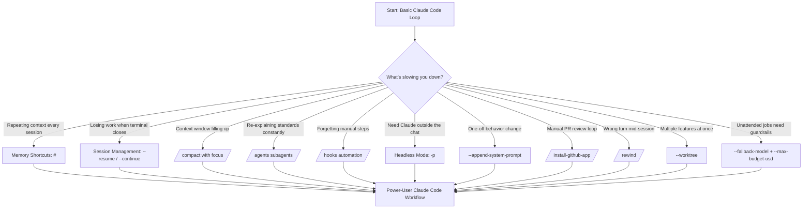

**How to read this tutorial:** Parts 1–4 are the command reference, ordered roughly by how soon you'll need each tool (daily-context tools first, guardrails last). Part 5 zooms out to the patterns and gives you an adoption path. The later sections (best practices, labs, exercises, question bank) are for reinforcement — treat them like a workout plan, not a novel.

---
## Part 1: Memory & Context Management

### 1. The `#` Shortcut — Turning Corrections Into Permanent Rules

**The problem:** You tell Claude your project uses `pnpm`. It forgets three sessions later and suggests `npm install` again. You *could* open `CLAUDE.md`, scroll to the right section, and paste in a correction — but that's friction, and friction means you'll skip it half the time.

**The fix:** Start any message with `#`:

```
# Always use pnpm in this repo, never npm
```

Claude Code intercepts this immediately, asks which memory file it belongs in (project-level `CLAUDE.md`, user-global `~/.claude/CLAUDE.md`, or a local override), and appends the rule on the spot.

#### More examples

```
# This API only accepts snake_case field names, not camelCase
```

```
# Never run migrations automatically — always ask first
```

```
# Use Vitest for all new tests, not Jest (legacy tests can stay as-is)
```

#### Why this matters more than it looks

Every correction you make to Claude without using `#` is a correction you'll probably make again next week. The `#` shortcut converts a *repeated conversation* into a *permanent rule*, which is the difference between Claude learning your codebase and Claude re-learning it every session.

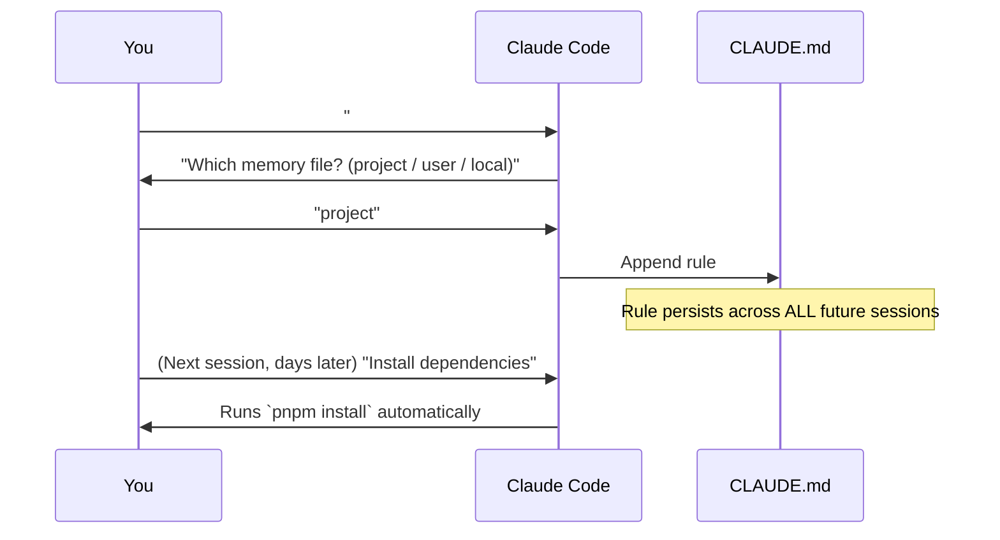

**Use case:** Onboarding a new teammate. Instead of writing a wiki page nobody reads, every convention correction you make with `#` becomes part of a living, machine-readable `CLAUDE.md` that Claude actually enforces.

> 💡 **Tip:** Commit the project-level `CLAUDE.md` to the repo. Then the rules you capture don't just survive *your* sessions — they apply to every teammate's Claude too.

#### Common mistakes

- ❌ Typing the rule as a normal message and assuming Claude will "remember" — chat turns are not memory.
- ❌ Putting project-specific rules in the *user-global* file, then wondering why other repos behave strangely.
- ❌ Collecting hundreds of `#` rules until `CLAUDE.md` bloats and every prompt pays the token cost. Prune periodically.

---

### 2. `--resume` and `--continue` — Sessions That Survive Closing the Terminal

**The problem:** You spend an hour walking Claude through a gnarly refactor, close the terminal, and assume all that context is gone. Now you're bracing to re-paste files and re-explain the plan.

**The fix:** It isn't gone. Claude Code persists every session to disk automatically.

```bash
claude --resume
```

This opens an interactive picker of recent conversations, each with a timestamp and preview. Pick one, and you're back exactly where you left off — full context, tool call history, and in-progress todos intact.

```bash
claude --continue
# or the short form
claude -c
```

This skips the picker entirely and reloads the most recent session **for the current directory**. Because it needs no interaction, it's a natural fit for a shell alias:

```bash
alias cc='claude --continue'   # add to ~/.zshrc or ~/.bashrc
```

#### Worked example

```bash
# Monday, 4pm — deep in a refactor
$ claude
> Let's refactor the payment module to use the new retry logic...
# [close laptop, go home]

# Tuesday, 9am
$ claude -c
# Claude Code reloads Monday's exact context, mid-refactor, no re-explaining
```

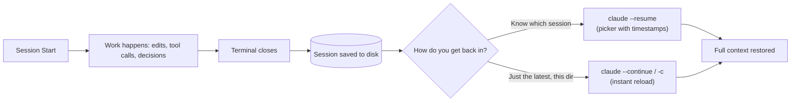

**Use case:** Consultants or contractors juggling multiple client repos. `--resume` lets you keep a dozen separate threads of work alive simultaneously without mental overhead — pick the right session from the picker instead of trying to remember where you left off.

#### `--resume` vs `--continue`: which one when?

| Situation | Use | Why |
|---|---|---|
| Yesterday's work, same repo, nothing else touched it since | `claude -c` | Fastest path, zero interaction |
| Several sessions across multiple repos | `claude --resume` | Picker shows timestamps/previews so you pick the right thread |
| Shell alias / muscle memory | `claude -c` | Deterministic, never blocks on a picker |
| Someone else shares the machine/repo | `claude --resume` | Session files are local, so the picker shows *your* history only |

#### Common mistakes

- ❌ Running `claude -c` from the *wrong directory* — sessions are scoped per directory, so you'll reload the wrong thread.
- ❌ Assuming `--continue` restores *uncommitted file changes* on disk. It restores conversation context; your files are whatever git/the filesystem says they are.

---
### 3. `/compact` With a Focus Instruction — Directing What Gets Kept

**The problem:** A session sitting at 180,000 tokens starts feeling sluggish and forgetful. The standard fix is `/compact`, but run plain, Claude picks what to preserve using a generic heuristic — which is often *not* the part of the conversation you actually need.

**The fix:** `/compact` accepts free text telling it exactly what to hold onto:

```
/compact focus on the auth refactor decisions and the failing test output, drop the unrelated CSS discussion
```

#### More examples

```
/compact keep the database schema changes and the migration plan, discard the exploratory questions
```

```
/compact preserve every failed hypothesis we tried for the race condition bug, summarize everything else
```

#### Why generic compaction fails you

Picture a debugging session where you tried five different theories for a flaky test before finding the real cause. A generic `/compact` might summarize this as "explored several approaches to fix flaky test" — losing the *specific* failed hypotheses that would stop you from re-trying them later. A focused `/compact` keeps that detail intact.

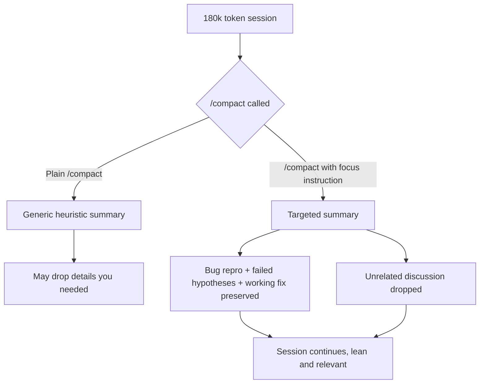

**Use case:** Marathon debugging sessions on production incidents, where losing the "we already tried X, it didn't work" context means burning time re-testing the same dead ends.

> 💡 **Pro tip:** Compact *proactively*, not just when Claude starts degrading. Compact right after a milestone ("the schema migration is done, keep the migration plan and current failing test") — you control what's remembered instead of letting a crisis pick for you.

#### Common mistakes

- ❌ Running plain `/compact` right before handing the session to a teammate — the summary loses the reasoning trail.
- ❌ Focus instructions that are too vague: "keep the important stuff" gives the summarizer no signal at all.

---

## Part 2: Building Reusable Workflows

### 4. `/agents` — Building Reusable Specialists

**The problem:** Asking Claude "review this for security" or "write tests for this" repeatedly means re-explaining your standards every single time.

**The fix:** `/agents` opens the subagent manager, where you define a focused agent **once**:

- A specific system prompt (its "job description")
- A restricted tool set (read-only for a reviewer, full edit access for a refactorer)
- A model choice

Once defined, invoke it by name:

```
@security-reviewer audit the new login endpoint
```

It runs in its own context window and returns just the result, keeping your main session uncluttered.

#### Examples of specialist agents worth building

| Agent | Tool access | Purpose |
|---|---|---|
| `@security-reviewer` | Read-only | Audits code for injection, auth bypass, secrets in code |
| `@test-writer` | Read + Write (test files only) | Generates test suites matching your existing test style |
| `@docs-updater` | Read + Write (docs folder) | Keeps README/API docs in sync with code changes |
| `@refactor-bot` | Full edit access | Executes large mechanical refactors under supervision |

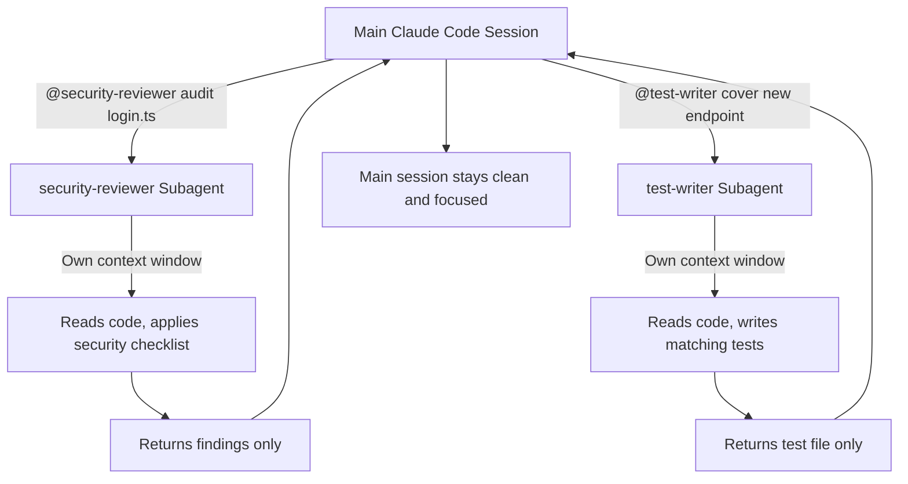

**Use case:** A team where every PR needs a security pass before merge. Instead of a human reviewer repeating the same checklist from memory, `@security-reviewer` applies it consistently, every time, without cluttering the main development conversation.

#### Common mistakes

- ❌ Giving every subagent full tool access "just in case" — the value of a reviewer agent is precisely that it *can't* edit.
- ❌ Writing vague job descriptions. A good system prompt says what to check, what output format to return, and what to ignore.

---
### 5. `/hooks` — Automating the Stuff You Always Forget

**The problem:** You always forget to run the linter before committing, or you want auto-formatting on every file edit.

**The fix:** `/hooks` wires shell commands to Claude Code's lifecycle events — `PreToolUse`, `PostToolUse`, `Stop`, `SessionStart`, and more — configured in `.claude/settings.json`:

```json
{
  "hooks": {
    "PostToolUse": [
      {
        "matcher": "Edit|Write",
        "hooks": [{ "type": "command", "command": "pnpm prettier --write $CLAUDE_FILE_PATH" }]
      }
    ]
  }
}
```

Now every edit auto-formats without you remembering to ask.

#### More hook examples

**Run tests after every code change:**

```json
{
  "hooks": {
    "PostToolUse": [
      {
        "matcher": "Edit|Write",
        "hooks": [{ "type": "command", "command": "npm test -- --related $CLAUDE_FILE_PATH" }]
      }
    ]
  }
}
```

**Block edits to a protected file (PreToolUse can veto the tool call):**

```json
{
  "hooks": {
    "PreToolUse": [
      {
        "matcher": "Edit",
        "hooks": [{ "type": "command", "command": "./scripts/block-if-protected.sh $CLAUDE_FILE_PATH" }]
      }
    ]
  }
}
```

**Notify Slack when a session finishes:**

```json
{
  "hooks": {
    "Stop": [
      {
        "hooks": [{ "type": "command", "command": "./scripts/notify-slack.sh 'Claude session complete'" }]
      }
    ]
  }
}
```

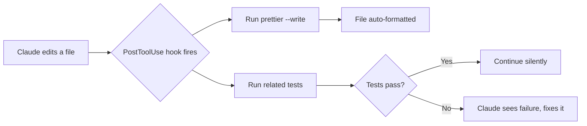

**Use case:** Team conventions stop living in someone's head and start living in a checked-in file. A new hire clones the repo, and the linting/formatting/testing discipline is inherited automatically — no onboarding doc required.

#### Lifecycle events cheat sheet

| Event | Fires when | Typical use |
|---|---|---|
| `PreToolUse` | Before Claude runs a tool (can block) | Guard rails: block edits to protected paths |
| `PostToolUse` | After a tool succeeds | Auto-format, run related tests, log |
| `Stop` | When the main agent finishes responding | Notifications, summary extraction |
| `SessionStart` | When a session begins | Load env, print reminders, warm caches |

#### Common mistakes

- ❌ Putting a slow hook (a full test suite) on every `Edit` — each edit then takes minutes. Prefer targeted/related-test runners.
- ❌ Hooks that fail silently. Make your scripts print clear error output; Claude (and you) need to see why a hook failed.

---

## Part 3: Taking Claude Outside the Chat Box

### 6. `claude -p` — Headless Mode for Scripts and CI

**The problem:** Claude Code feels interactive by design. But sometimes you want it as a building block inside a pipeline, not a chat partner.

**The fix:** `-p` (print) runs non-interactively: it takes a prompt, executes with full tool access, prints the result to stdout, and exits.

```bash
git diff main..HEAD | claude -p "Write a PR description for these changes"
```

```bash
cat error.log | claude -p "Classify each line as warning, error, or info"
```

Pair it with `--output-format json` for structured output a downstream script can parse:

```bash
claude -p "Summarize open TODOs in this repo" --output-format json > todos.json
```

#### More examples

**Generate a changelog entry from a commit range:**

```bash
git log v1.2.0..HEAD --oneline | claude -p "Write a CHANGELOG.md entry grouped by feature/fix/chore"
```

**Triage incoming bug reports:**

```bash
cat new-issue.txt | claude -p "Classify severity (low/medium/high/critical) and suggest an owning team" --output-format json
```

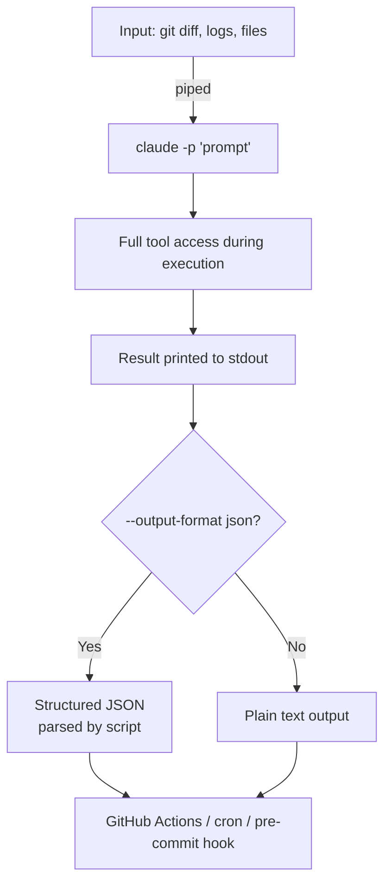

**Use case:** A pre-commit hook that automatically drafts a PR description, or a nightly cron job that scans logs and files a summary — anywhere you'd normally reach for `awk` or `jq`, now with a model that actually understands intent.

#### Common mistakes

- ❌ Forgetting that `-p` has *full tool access* — it can edit files. In CI, run it in an isolated checkout or add explicit constraints.
- ❌ Parsing plain text when you meant to consume JSON (or vice versa) — always set `--output-format json` explicitly when a script depends on the output shape.

---
### 7. `--append-system-prompt` — A One-Shot Behavior Override

**The problem:** You want terse, no-emoji, markdown-table output for exactly one task — without permanently editing `CLAUDE.md` for every future session.

**The fix:**

```bash
claude --append-system-prompt "Always respond in fewer than 100 words. No code fences unless asked."
```

This appends your instruction to the system prompt for **that single invocation only**.

#### More examples

```bash
claude -p --append-system-prompt "Output only valid JSON, no prose" "List all API endpoints in this repo"
```

```bash
claude --append-system-prompt "You are reviewing for a junior developer. Explain every suggestion in plain language." review src/auth.ts
```

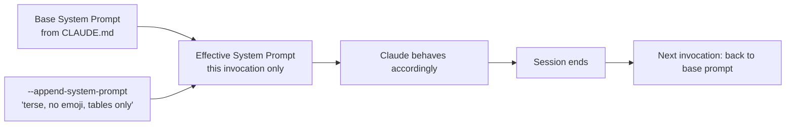

**Use case:** CI jobs that need machine-parseable output in an exact shape, or quickly A/B testing a style change without committing to it permanently.

#### When to use which mechanism

| Need | Mechanism |
|---|---|
| Rule should apply to all future sessions in this repo | `#` shortcut → `CLAUDE.md` |
| Rule applies to *you* across all repos | `~/.claude/CLAUDE.md` (user-global) |
| One script/CI job needs special behavior | `--append-system-prompt` |
| Deciding whether a rule deserves permanence | Try it via `--append-system-prompt` first, promote with `#` if it works |

#### Common mistakes

- ❌ Using `--append-system-prompt` for permanent rules — you'll end up copy-pasting the same flag into every invocation. Promote it to `CLAUDE.md` instead.
- ❌ Cramming contradictory instructions (e.g., "be terse" *and* "explain in detail") — pick one per invocation.

---

### 8. `/install-github-app` — Claude on Every PR, Automatically

**The problem:** Copying a diff into Claude, asking for feedback, then pasting the response back into a PR comment works — but it's a manual loop repeated on every single pull request.

**The fix:**

```
/install-github-app
```

This installs the official GitHub App on your repository. From then on, mentioning `@claude` in a PR or issue comment lets it read the context and respond directly in GitHub. A workflow file can make it run automatically on every PR — running tests, suggesting fixes, even pushing commits if you allow it.

#### Examples

**Manual trigger in a PR comment:**

```
@claude can you check if this migration is backwards-compatible?
```

**Automatic workflow on every PR (conceptual `.github/workflows/claude-review.yml`):**

```yaml
on:
  pull_request:
    types: [opened, synchronize]
jobs:
  claude-review:
    runs-on: ubuntu-latest
    steps:
      - uses: anthropics/claude-code-action@v1
        with:
          prompt: "Review this PR for bugs, security issues, and style violations"
```

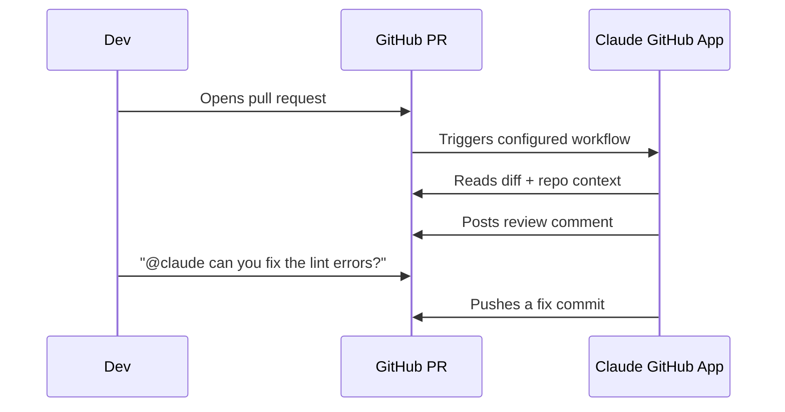

**Use case:** Small teams without a dedicated reviewer for every PR get a consistent first pass — catching obvious bugs and style issues before a human ever looks at the diff.

#### Common mistakes

- ❌ Granting the app write/push permissions on day one. Start read-and-comment-only; expand after you trust its reviews.
- ❌ Treating the bot's review as a *replacement* for human review — it's a first-pass filter, not an approver of record.

---
## Part 4: Safety Nets and Parallel Work

### 9. `/rewind` — Undo Without Reaching for Git

**The problem:** Claude tries an approach, it's wrong, and you want back to "before that last attempt" — without the overhead of a full git operation.

**The fix:** Claude Code automatically checkpoints your session before every edit. Press `Esc` twice, or type:

```
/rewind
```

You get a scrollable list of every prior prompt in the session, each restorable independently. You can restore just the code, just the conversation, or both — with options to summarize the conversation before or after a chosen point to reclaim context space.

**Important caveat:** this is not a replacement for git. Changes made through raw bash commands like `rm` or `mv` aren't tracked, and checkpoints age out after 30 days.

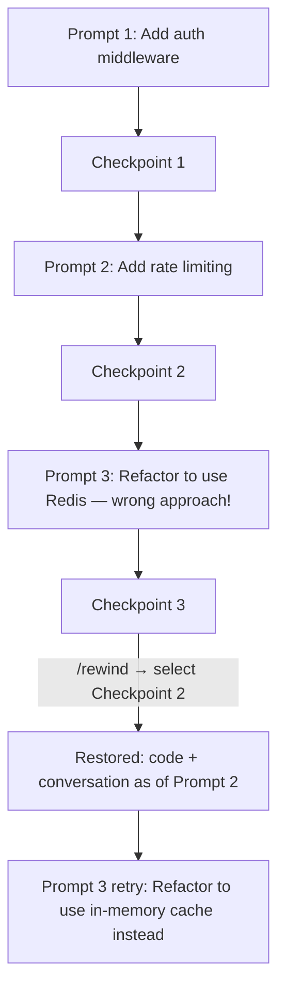

**Use case:** Exploratory coding where you want to try a risky approach freely, knowing that "that was a dead end" costs you one command, not a `git reset --hard` and lost conversation context.

#### When to `/rewind` vs when to use git

| Situation | Tool | Reason |
|---|---|---|
| Claude's last few edits were a dead end | `/rewind` | Restores code *and* conversation in one step |
| Work is committed and needs history-level undo | `git revert` / `reset` | Git owns committed history |
| Files were changed by raw `rm`, `mv`, or build scripts | `git checkout -- .` | Rewind doesn't track out-of-band changes |
| Keep the conversation but drop the code | `/rewind` (conversation-only restore) | Unique capability — git can't do this |

#### Common mistakes

- ❌ Relying on rewind after letting Claude run destructive bash commands — those changes are invisible to checkpoints.
- ❌ Treating 30-day-old checkpoints as a backup strategy. They're a session-level undo, not a VCS.

---

### 10. `--worktree` — Parallel Work Without Branch-Switching Pain

**The problem:** Working on two things at once in the same repo usually means stashing changes, switching branches, and hoping nothing gets tangled.

**The fix:** `--worktree` (or `-w`) starts a session in an isolated git worktree:

```bash
claude -w feature-auth
```

This creates a genuinely separate working directory under `.claude/worktrees/`, so a session working on one feature never touches files another session is mid-edit on.

#### More examples

```bash
# Review someone else's PR without touching your own work
claude -w --pr 482
```

```bash
# Two parallel features, two terminals
claude -w feature-auth      # Terminal 1
claude -w feature-billing   # Terminal 2
```

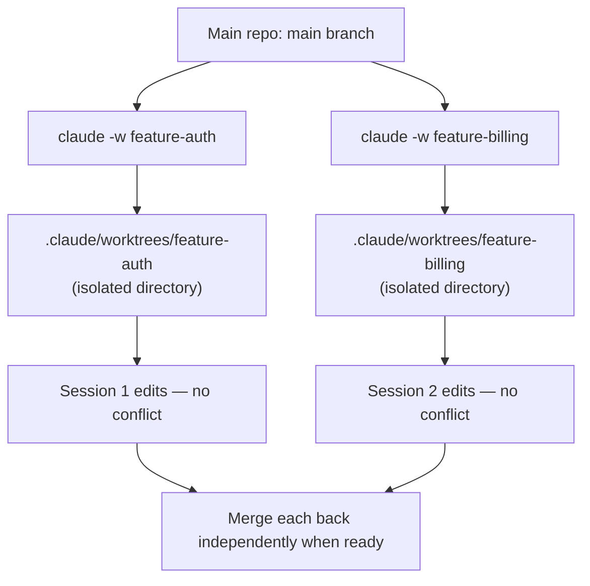

**Use case:** Reviewing an in-progress teammate's PR while your own feature branch stays completely untouched — no stash, no context-switch tax, no risk of your uncommitted work getting tangled with theirs.

#### Common mistakes

- ❌ Forgetting worktrees consume real disk space (each is a full checkout) — prune stale ones under `.claude/worktrees/` periodically.
- ❌ Assuming `node_modules` carries over — each worktree is a fresh checkout, so reinstall dependencies there before running tests.

---
### 11 & 12. `--fallback-model` and `--max-budget-usd` — Guardrails for Unattended Runs

**The problem:** Letting an agent loose on a task in print mode — especially one that might spawn subagents — is unnerving without limits. A primary model being temporarily overloaded shouldn't mean your CI job just fails outright.

**The fix — graceful degradation:**

```bash
claude --fallback-model sonnet,haiku
```

This defines an ordered chain of models to fall back through automatically if the primary one is unavailable.

**The fix — a hard cost ceiling:**

```bash
claude -p --max-budget-usd 5.00 "Refactor the auth module and update tests"
```

Once cumulative spend (including anything subagents use) hits the cap, further subagent spawning fails cleanly and any still-running background subagents are stopped.

#### Combined example for a real CI job

```bash
claude -p \
  --fallback-model sonnet,haiku \
  --max-budget-usd 3.00 \
  --output-format json \
  "Update the dependency versions in package.json and fix any resulting type errors" \
  > result.json
```

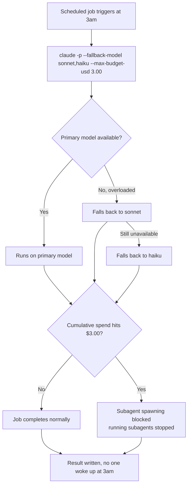

**Use case:** A nightly job that updates dependencies and fixes resulting type errors across dozens of files, potentially spawning several subagents to parallelize the work. Without `--max-budget-usd`, a bug that causes runaway subagent spawning could burn an unbounded amount of API spend overnight. With it, the job fails safely and cheaply instead.

> 💡 **Rule of thumb:** Every `claude -p` invocation that runs *without a human watching* should carry both guardrails. `--fallback-model` protects availability; `--max-budget-usd` protects your wallet. Together they make unattended automation boring — which is exactly what you want.

---
## Part 5: Putting It All Together

### The Four Underlying Patterns

Looking at all twelve together, four themes repeat:

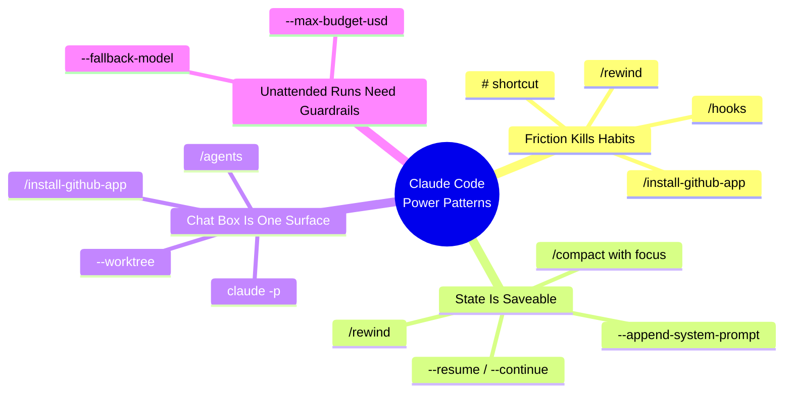

1. **Friction kills good habits.** The `#` shortcut, hooks, `/install-github-app`, and `/rewind` all remove a manual step that would otherwise just not happen consistently.
2. **State should be saved, sliced, and restored — not treated as disposable.** `--resume`, focused `/compact`, `--append-system-prompt`, and `/rewind` all reflect that a session doesn't vanish the moment you close the terminal.
3. **The interactive REPL is one surface among several.** `/agents`, `claude -p`, `--worktree`, and `/install-github-app` push Claude out of the chat box and into a shell script, a parallel workspace, or a GitHub bot.
4. **Unattended runs need real guardrails.** `--fallback-model` and `--max-budget-usd` exist specifically for the moment nobody's watching the terminal.

### The 12 Commands at a Glance

| # | Command | Category | One-line summary |
|---|---|---|---|
| 1 | `#` | Memory | Capture a correction as a permanent rule on the spot |
| 2 | `--resume` / `-c` | State | Reload a previous session's full context |
| 3 | `/compact <focus>` | State | Shrink context while keeping exactly what matters |
| 4 | `/agents` | Reuse | Define named specialists with scoped tools |
| 5 | `/hooks` | Automation | Run shell commands on lifecycle events |
| 6 | `claude -p` | Headless | Non-interactive runs for scripts and CI |
| 7 | `--append-system-prompt` | Headless | Per-invocation behavior override |
| 8 | `/install-github-app` | Automation | Automatic Claude reviews on every PR |
| 9 | `/rewind` | Safety | Restore code/conversation to any prior checkpoint |
| 10 | `--worktree` | Parallel | Isolated working directories per session |
| 11 | `--fallback-model` | Guardrail | Ordered model fallback chain |
| 12 | `--max-budget-usd` | Guardrail | Hard ceiling on unattended spend |

### What to Try First

Don't adopt all twelve at once — that's a recipe for abandoning all of them. Match your current pain point to the fix:

| Your friction this week | Try this |
|---|---|
| Repeating yourself across sessions | `#` to capture a fact instantly |
| Losing context when you close the terminal | `--resume` |
| Hitting context limits in long debugging sessions | `/compact` with a focus instruction |
| Re-explaining your standards constantly | Build a subagent with `/agents` |
| Forgetting to run the linter or formatter | A `PostToolUse` hook |
| Want Claude callable from a script | `claude -p` |
| Need different behavior for a single task | `--append-system-prompt` |
| Reviewing PRs by hand | `/install-github-app` |
| Made a wrong turn mid-session | `/rewind` |
| Juggling two features in the same repo | `--worktree` |
| Running unattended jobs that can't just fail | `--fallback-model` |
| Letting an agent loose without a spending ceiling | `--max-budget-usd` |

### A Suggested Learning Path

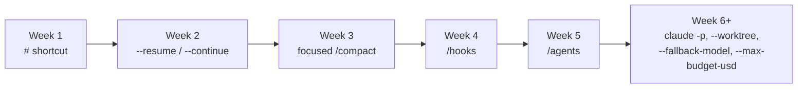

Start with whichever row solves the friction you're feeling *this week*, use it until it's reflexive, then move to the next. By the time you've worked through all twelve, the default `claude → prompt → watch → repeat` loop will feel like using 20% of a tool you once thought you already knew.

### A Fully Assembled Power-User Setup

Everything in one place — what a mature setup looks like on disk and in your shell:

```
your-repo/
├── CLAUDE.md                        # rules captured with # — committed to git
├── .claude/
│   ├── settings.json                # hooks: format on edit, block protected paths
│   └── agents/                      # subagent definitions from /agents
│       ├── security-reviewer.md
│       └── test-writer.md
└── scripts/
    ├── block-if-protected.sh        # PreToolUse veto script
    └── notify-slack.sh              # Stop-event notification
```

```bash
# ~/.zshrc — your daily drivers
alias cc='claude --continue'
alias ccr='claude --resume'
alias ccp='claude -p --output-format json'

# Nightly CI job (GitHub Actions or cron) always includes:
claude -p --fallback-model sonnet,haiku --max-budget-usd 3.00 --output-format json "..." > result.json
```

---
## Best Practices

### Memory & Context
- ✅ **Commit `CLAUDE.md` to the repo** so captured rules benefit the whole team; keep personal preferences in `~/.claude/CLAUDE.md`.
- ✅ **Capture rules the moment you state them** — if you've said the same correction twice in chat, it should have been a `#` rule.
- ✅ **Compact at milestones, not at failure.** A focused `/compact` after finishing a feature keeps the session lean on your terms.
- ✅ **Alias your habits**: `alias cc='claude --continue'` turns state restoration into a reflex.

### Automation
- ✅ **Start hooks in "observe" mode** — log what would happen before you let hooks veto or rewrite anything.
- ✅ **Keep hook scripts small, fast, and loud.** A hook that runs in <1s and prints clear errors is a hook you'll keep.
- ✅ **Check in `.claude/settings.json` and agent definitions** so the whole team inherits the same automation.
- ✅ **Scope subagent tool access to the minimum** — read-only reviewers, write-only-in-tests test writers.

### Headless & CI
- ✅ **Always set `--output-format json`** when a script consumes the output; parse the structured result, never regex the prose.
- ✅ **Pair every unattended run with both guardrails** (`--fallback-model` + `--max-budget-usd`).
- ✅ **Run headless jobs in an isolated checkout** so an unexpected file edit can't touch developer working state.
- ✅ **Pin versions in CI** (`claude-code-action@v1`, fixed CLI versions) so a CLI update can't break a nightly job silently.

### Safety & Parallelism
- ✅ **Use `--worktree` for anything that might collide**: PR reviews, experiments, parallel features.
- ✅ **Treat `/rewind` as session-level undo and git as history-level undo** — know which layer a problem lives in.

---

## Anti-Patterns

| ❌ Anti-pattern | Why it hurts | ✅ Do this instead |
|---|---|---|
| Re-explaining conventions every session | Wasted tokens, inconsistent behavior | Capture once with `#` into `CLAUDE.md` |
| Running plain `/compact` on important sessions | Generic heuristic drops the details you needed | Always pass a focus instruction |
| Giving every subagent full tool access | A "reviewer" that can edit isn't a reviewer | Scope tools per role |
| Slow hooks on every `Edit` (full test suite) | Each edit takes minutes; you'll disable hooks | Run only related/targeted tests |
| Headless runs with no guardrails | Overloaded model fails CI; runaway spend | `--fallback-model` + `--max-budget-usd` |
| Using `--append-system-prompt` for permanent rules | Flag spaghetti, drift between invocations | Promote proven rules to `CLAUDE.md` |
| Treating `/rewind` as a backup system | Checkpoints miss bash-driven changes and expire in 30 days | Commit early, push often; rewind is for live sessions |
| Ten parallel worktrees nobody prunes | Disk bloat, confusion about "where am I?" | One worktree per active thread; prune when merged |
| Letting the GitHub App push commits on day one | Untrusted automation writing to main-adjacent branches | Read+comment first; expand permissions gradually |
| Adopting all 12 commands in one week | None become muscle memory | One per week via the learning path |

> ⚠️ **The meta anti-pattern:** buying the *idea* of automation without the habit. A `PostToolUse` hook you disable after two days is worse than never installing it — you lose trust in the mechanism. Install one automation, live with it for a week, then add the next.

---
## Performance Considerations

| Area | Bottleneck | Optimization |
|---|---|---|
| Context window | Sessions accumulating 150k+ tokens slow responses and degrade recall | Focused `/compact` at milestones; keep `CLAUDE.md` tight |
| `CLAUDE.md` size | Every rule is loaded into *every* prompt in the project | Prune stale rules monthly; move rarely-relevant rules to docs Claude reads on demand |
| Hooks | A slow `PostToolUse` hook runs after *every* edit | Use `--related` test runners; debounce; keep formatters incremental |
| Subagents | Each subagent has its own context window (token cost) | Reserve subagents for tasks that genuinely benefit (parallelism, context isolation); don't spawn one to answer a one-liner |
| Worktrees | Each is a full checkout; dependency install per worktree | Reuse a shared cache (pnpm store, npm cache); prune merged worktrees |
| Headless runs | Cold start per invocation (auth, project scan) | Batch related work into one `-p` invocation rather than dozens of tiny ones |
| Model fallback | Falling back mid-job changes capability mid-task | Order the chain deliberately: primary → same-tier alternative → cheaper model; be aware quality may drop |

**Quick benchmark intuition:** a session kept under ~50k tokens with a focused `CLAUDE.md` typically feels dramatically faster and more accurate than a 180k-token marathon session — compaction isn't just about cost, it's about response *quality*.

---

## Security Considerations

1. **Hooks execute arbitrary shell commands.** Anything in `.claude/settings.json` runs with your user privileges. Never copy-paste a hooks config from the internet without reading every command. Malicious repo-level settings are a real supply-chain vector — review `.claude/` contents when cloning unfamiliar repos.
2. **`claude -p` grants full tool access.** A headless job can edit or delete files. In CI, run in an ephemeral checkout with a scoped token; consider `--permission-mode` / allowlist configuration to restrict write access.
3. **The GitHub App's permissions are real credentials.** Start with read+comment. Grant push only deliberately, and never on release branches without branch protection in place.
4. **Secrets in context.** Piped content (`cat error.log | claude -p ...`) and files Claude reads may include credentials. Scrub logs, use `.gitignore`d local overrides, and never ask Claude to "just fix the .env" in a shared/headless context.
5. **Memory files are prompt-injection surface.** `CLAUDE.md` rules are honored as instructions. Anyone who can commit to your repo can add rules — protect the branch like you'd protect CI config.
6. **Budget caps are a security control.** `--max-budget-usd` bounds the blast radius of a runaway agent loop; treat it as mandatory for cron/CI, not optional.
7. **Session files live on disk in plaintext** under your user profile. On shared machines, remember `--resume` exposes prior conversations to anyone using your account.

---

## Testing Your Claude Code Setup

Your *configuration* deserves the same verification as your code:

1. **Hook tests.** After editing `.claude/settings.json`, deliberately trigger each event: make a trivial edit (PostToolUse), ask Claude to touch a protected file (PreToolUse), and finish a session (Stop). Confirm each hook runs, its output appears, and failures are visible.
2. **Guardrail drills.** Run a deliberately small `claude -p --max-budget-usd 0.01 "list all files in src"` and confirm the cap behavior. Simulate primary-model unavailability with `--fallback-model` to see the fallback path execute.
3. **Subagent smoke tests.** Give `@security-reviewer` a file with an *intentionally* planted issue and confirm it reports it; confirm a read-only agent refuses to write.
4. **Round-trip restore tests.** Start a session, make edits, close the terminal, `claude -c`, and verify the conversation and todo state came back. Repeat with `--resume` across two directories.
5. **CI dry runs.** Run the exact nightly command with `--max-budget-usd` low and on a scratch branch before scheduling it for real. Verify `result.json` parses with `jq` before anything downstream consumes it.
6. **Worktree isolation check.** Edit a file in a worktree session, then `git status` in the main checkout — it must be untouched.

> 💡 **Treat config drift as a bug:** when a teammate's hooks or agents differ from yours, the automation behaves differently per machine. Checking in `.claude/` and reviewing changes to it in PRs (like CI config) prevents this.

---
## Migration Guide: From Basic Loop to Power Workflow

If you're currently a `claude → prompt → watch → repeat` user, don't flip a switch — migrate in stages. Each stage is independently valuable and none requires abandoning what you already do.

### Stage 1 → 2: From ephemeral sessions to persistent context (Week 1–3)

| Before | After |
|---|---|
| Re-typing conventions every session | `#` rules captured into a committed `CLAUDE.md` |
| Losing sessions on terminal close | `claude -c` alias + `claude --resume` picker |
| Panic-compacting when context overflows | Focused `/compact` at milestones, on your terms |

**Migration steps:** (1) Spend one session *only* capturing rules with `#` for every correction you'd normally re-explain. (2) Add `alias cc='claude --continue'`. (3) The next time a session grows past ~100k tokens, compact with an explicit focus instruction instead of starting over.

### Stage 2 → 3: From manual discipline to automation (Week 4–5)

| Before | After |
|---|---|
| Remembering to format/lint/test | `PostToolUse` hooks do it on every edit |
| Re-pasting review checklists | Named `@security-reviewer` / `@test-writer` subagents |
| Protected files guarded by hope | `PreToolUse` veto hook |

**Migration steps:** (1) Install exactly one hook — formatter on edit. Live with it a week. (2) Build one subagent for your most-repeated standards explanation. (3) Add the protected-file veto only after the first two feel boring.

### Stage 3 → 4: From chat-only to multi-surface (Week 6+)

| Before | After |
|---|---|
| Manual copy-diff → paste-review loops | `/install-github-app` reviews every PR |
| One feature at a time, stash dance between them | `--worktree` parallel sessions |
| Everything requires you at the keyboard | `claude -p` pipelines with `--output-format json` |

### Stage 4: Guardrails before you scale out

Before the first truly unattended job, bolt on `--fallback-model` and `--max-budget-usd`. This is the one stage you should *not* reorder — guardrails exist because automation without them eventually fails expensively.

> ⚠️ **Breaking-change note:** Flag names and hook event names have evolved across CLI versions (e.g., budget/fallback flags are newer than `-p` itself). Pin your CLI version in team docs and CI, and re-verify hooks after major upgrades — a silent hooks-format change disables your automation with no error in chat.

---

## Troubleshooting Guide

| Symptom | Likely cause | Fix |
|---|---|---|
| `#` rule doesn't persist to next session | Rule saved to the *local* override instead of project `CLAUDE.md`; or file not committed | Check which memory file was chosen; move to project `CLAUDE.md` and commit |
| `claude -c` loads the wrong conversation | Session state is per-directory; you ran it from another path | `cd` to the project root, or use `--resume` and pick explicitly |
| `--resume` picker doesn't show an old session | Sessions are local to the machine and user; age limits may apply | Restore from the same machine/account; treat long-term history as out of scope |
| Session still feels forgetful after `/compact` | Plain compaction dropped key details, or focus instruction was vague | Re-compact with a specific focus; re-state critical facts once more, then capture durable ones with `#` |
| Hook never fires | Wrong event name; matcher doesn't match the tool (e.g., `Edit` vs `Edit\|Write`); settings file in the wrong location | Run `/hooks` to inspect registered hooks; trigger each event deliberately |
| Hook fires but fails silently | Script error swallowed; unquoted `$CLAUDE_FILE_PATH` | Print stderr in the script; test the command standalone with a sample path |
| `--worktree` session can't run tests | Fresh checkout lacks dependencies | Install dependencies inside the worktree; share package-manager caches |
| `unknown option: --max-budget-usd` | CLI too old | `claude update` or reinstall; pin versions in CI |
| Budget cap hit but job seemed to keep going | Cap stops *subagent* spawning and background work — check what actually ran | Verify with `--output-format json` usage fields; set conservative caps; split giant tasks into staged jobs |
| GitHub App doesn't comment on PRs | Workflow not installed/triggering, or app lacks repo permission | Run `/install-github-app`, verify `.github/workflows/claude-review.yml` triggers, check app repo-access settings |
| `/rewind` didn't undo a deletion | Change was made via raw bash (`rm`/`mv`), invisible to checkpoints | Recover via git (`git checkout -- .`) or editor history; avoid bash-destructive flows mid-session |

> 🔧 **General debugging order:** (1) verify CLI version, (2) verify which settings/memory file actually applies, (3) reproduce the event in isolation, (4) read the structured JSON output instead of guessing from prose.

---
## Hands-On Labs

Complete these labs in order, in a scratch repo. Each takes 10–20 minutes and produces something you'll actually keep.

### Lab 1: Build Your Memory Layer (Commands 1–3)

1. Open Claude Code in a real project. Capture three real conventions with `#` (one package-manager rule, one naming rule, one "always/never" rule).
2. Choose the **project** memory file for each, then commit `CLAUDE.md`.
3. Start a new session and verify Claude obeys the rules without being told.
4. Fill a session with discussion (ask Claude to explain your project structure at length), then run `/compact` with an explicit focus instruction. Ask a question that requires the preserved context and confirm it's still answered correctly.

**Success criteria:** a committed `CLAUDE.md` with ≥3 rules; a session that survives `/compact` without losing the facts you named.

### Lab 2: Automate One Discipline (Command 5)

1. Create `scripts/block-if-protected.sh` (bash) or `scripts/Block-If-Protected.ps1` (PowerShell) that exits non-zero when the given path is under `infrastructure/` or matches `*.lock`.
2. Register it as a `PreToolUse` hook on `Edit|Write` in `.claude/settings.json` (adapt `$CLAUDE_FILE_PATH` to your shell).
3. Add a `PostToolUse` hook that runs your formatter on edited files.
4. Ask Claude to "update the lock file" and watch the veto fire. Ask it to edit a normal file and watch the formatter run.

**Success criteria:** Claude cannot edit protected paths; every other edit comes back formatted.

### Lab 3: Headless Pipeline with Guardrails (Commands 6, 7, 11, 12)

1. Write `scripts/summarize-todos.sh` that runs:
   ```bash
   claude -p \
     --append-system-prompt "Output only valid JSON: {\"todos\":[{\"file\":\"...\",\"line\":1,\"text\":\"...\"}]}" \
     --fallback-model sonnet,haiku \
     --max-budget-usd 0.50 \
     --output-format json \
     "List all TODO comments in src/ with file, line, and text"
   ```
2. Pipe the result through `jq '.todos | length'` and confirm it parses.
3. Run it again with `--max-budget-usd 0.01` and observe the cap behavior.

**Success criteria:** a repeatable script producing valid JSON, with both guardrails in place.

### Lab 4: Parallel Features with Worktrees (Command 10)

1. From your repo, run `claude -w lab-feature-a` in Terminal 1 and `claude -w lab-feature-b` in Terminal 2.
2. Have each session create a distinct file (e.g., `feature-a.txt`, `feature-b.txt`) and run `git status` in each worktree.
3. Run `git status` in your main checkout — confirm it's untouched.
4. Merge each worktree branch back independently, then prune the worktrees.

**Success criteria:** two features built simultaneously with zero stash operations and a clean main checkout.

### Lab 5: PR Review Bot (Command 8)

1. In a GitHub repo you own, run `/install-github-app` and grant read+comment only.
2. Open a PR with an obvious style issue and an obvious bug.
3. Add the claude-review workflow from section 8 and confirm it comments on the next pushed commit.
4. Try `@claude can you fix the lint errors?` and observe the (comment-only) response.

**Success criteria:** automatic review comments on a PR without any manual diff copying.

---
## Practice Exercises (With Detailed Solutions)

### Exercise 1: Diagnose the Forgotten Convention ⭐ (Beginner)

**Scenario:** Every Monday, Priya tells Claude "this repo uses Yarn, not npm." She told Claude three weeks in a row. Each new session forgets.

**Task:** Identify the root cause and design the permanent fix using tools from this tutorial.

#### Solution

**Root cause:** Conversation turns are ephemeral — they exist only inside one session. Nothing Priya types in chat persists across sessions; only *memory files* (`CLAUDE.md` layers) do.

**Fix (3 steps):**
1. Next time the correction comes up, type it with the memory shortcut: `# Always use Yarn in this repo, never npm` — and choose the **project** memory file so it's shared and committable.
2. Commit `CLAUDE.md` so the rule reaches teammates and survives machine changes.
3. Verify: open a *new* session, ask "install dependencies," and confirm `yarn install` runs.

**Why not other tools?** A `PostToolUse` hook could *react* to npm commands, but it doesn't teach intent — Claude would still plan around npm. Memory fixes the plan; hooks fix the enforcement. Belt-and-suspenders teams use both.

---

### Exercise 2: Design a Focused Compaction ⭐⭐ (Intermediate)

**Scenario:** A 170k-token session contains: (a) five failed hypotheses for a flaky integration test, (b) the final working fix with the root cause, (c) a long debate about CSS naming conventions, (d) the database migration plan you'll execute next week, (e) the exact error output from the failing CI run.

**Task:** Write the `/compact` instruction and explain *why* each element is kept or dropped.

#### Solution

```
/compact keep: the five failed hypotheses for the flaky integration test (so we never re-try them), the final fix and its root cause, the exact CI error output, and the database migration plan for next week. Drop: the CSS naming discussion entirely.
```

**Reasoning per element:**
- (a) **Keep verbatim** — failed hypotheses are the classic casualty of generic compaction and the most expensive to rediscover.
- (b) **Keep** — it's the session's outcome.
- (c) **Drop** — it's unrelated to the thread of work and re-derivable from git history/PRs if ever needed.
- (d) **Keep** — it's a forward-looking plan the compacted session must still execute.
- (e) **Keep** — exact error text is hard to reconstruct and is the fingerprint for matching the next occurrence.

**Follow-up:** the CSS convention debate revealed a real decision? Then that one sentence belongs in `CLAUDE.md` via `#` — *before* compacting — because memory is the right home for durable rules, not the compact summary.

---

### Exercise 3: Build the Guarded Nightly Job ⭐⭐ (Intermediate)

**Scenario:** You must schedule a nightly job that: updates npm dependencies, fixes resulting type errors, and writes a JSON report. The job runs unattended at 3am and may spawn subagents. A model outage should not fail the pipeline, and a runaway loop must not cost more than $3.

**Task:** Write the complete command and justify every flag.

#### Solution

```bash
#!/usr/bin/env bash
set -euo pipefail

claude -p \
  --fallback-model sonnet,haiku \
  --max-budget-usd 3.00 \
  --output-format json \
  --append-system-prompt "Do not push or open PRs. Work only on the current branch. Stop after the type check passes." \
  "Run npm update, then fix every TypeScript error introduced by the dependency bump (npm run typecheck), then write a summary of changed packages and remaining warnings." \
  > result.json

# Fail the pipeline if the result doesn't parse — don't ship a silently truncated report
jq -e '.result' result.json > /dev/null
```

**Flag-by-flag justification:**
- `-p` — unattended; the job must terminate on its own.
- `--fallback-model sonnet,haiku` — availability: an overloaded primary degrades to sonnet, then haiku, instead of failing the nightly.
- `--max-budget-usd 3.00` — blast radius: caps spend including subagents; spawning halts cleanly at the ceiling.
- `--output-format json` — the report must be machine-consumable, not prose.
- `--append-system-prompt` — one-off behavioral rails (no pushing, bounded scope) that don't belong in permanent `CLAUDE.md`.
- `jq -e` check — turns "JSON might be malformed" into a loud pipeline failure.

**What's still missing for production?** Run it in an ephemeral CI checkout (not a developer machine), pin the CLI version, and alert on job failure via the `Stop`-event pattern or the CI's own notification.

---
### Exercise 4: Choose the Right Recovery Tool ⭐⭐ (Intermediate)

**Scenario:** For each situation, decide: `/rewind`, git, or neither? Justify.

1. Claude's last three edits introduced a bad abstraction; the conversation reasoning is still useful.
2. You committed and pushed a broken change an hour ago.
3. A build script (run via bash) deleted `dist/` and rewrote three source files.
4. Claude went down a rabbit hole for 20 minutes; you want to keep the useful first half of the conversation but discard its code changes.

#### Solution

1. **`/rewind`** — checkpoints capture Claude's own edits, and restoring *both* code and conversation to before the bad abstraction is exactly what rewind does. Git can't restore the conversation.
2. **Git** (`git revert`) — committed history is git's domain; rewind operates on session checkpoints, not pushed history.
3. **Git** (`git checkout -- .` / `git restore`) — rewind doesn't track out-of-band bash changes, so it may not undo them correctly or at all.
4. **`/rewind` with conversation-only restore** (plus summarizing before the chosen point to reclaim context) — this split restore is a capability git fundamentally lacks.

**Key insight:** the decision axis is *who made the change* (Claude's tracked edits vs bash vs git) and *what you want back* (code, conversation, or both).

---

### Exercise 5: Architect a Team Rollout ⭐⭐⭐ (Advanced)

**Scenario:** A team of 6 adopts Claude Code. Today: everyone re-explains conventions, PR reviews are inconsistent, and one developer's nightly experiment just cost $40 in API spend due to a subagent loop.

**Task:** Design a two-week rollout: which commands land first, what's checked into git, what guardrails are mandatory, and how you measure success.

#### Solution

**Week 1 — shared memory and one automation:**
- Day 1–2: Team captures conventions with `#` into project `CLAUDE.md`; committed by Day 2. (Measures: `CLAUDE.md` exists with ≥10 real rules; new-joiner session test passes.)
- Day 3: One hook — formatter on `PostToolUse` for `Edit|Write`. Nothing else. Live with it.
- Day 4–5: Build `@security-reviewer` (read-only) and wire a `PreToolUse` veto for `infrastructure/` and lockfiles.

**Week 2 — multi-surface plus mandatory guardrails:**
- `/install-github-app` with **comment-only** permissions on all repos; claude-review workflow on PRs.
- Mandate: *every* unattended `claude -p` invocation carries `--fallback-model` + `--max-budget-usd`. The $40 incident becomes a documented standard: budget caps are non-negotiable.
- Introduce `--worktree` for PR reviews and parallel features.
- Check into git: `CLAUDE.md`, `.claude/settings.json`, agent definitions, workflow files. Review changes to these in PRs like CI config.

**Success metrics after two weeks:**
1. Zero repeated convention explanations (sample 5 sessions — rules appear in `CLAUDE.md`, not chat).
2. 100% of PRs receive a first-pass review before a human looks.
3. Zero unguarded unattended invocations (grep the job configs).
4. Weekly API spend variance drops (caps bound worst cases).

**What NOT to do:** don't roll out all 12 commands at once, don't grant the GitHub App push rights in week 1, and don't write hooks that veto before the team has watched them log for a few days.

---

## Test Your Understanding

Answer from memory before re-reading — that's the point.

1. What does typing `#` at the start of a message do, and what three destinations can the rule go to?
2. What's the difference between `claude --resume` and `claude -c`?
3. Why is a session scoped to a directory when using `--continue`?
4. Write a `/compact` instruction that would preserve a debugging session's failed hypotheses.
5. Name three lifecycle events hooks can attach to, and one use case for each.
6. What is the difference between a `PreToolUse` and `PostToolUse` hook in terms of *power*?
7. How do you invoke a subagent by name once it's defined?
8. Why does a subagent keep your main session clean?
9. What does `-p` do, and what flag pairs with it for machine-readable output?
10. When does `--append-system-prompt`'s effect end?
11. What GitHub mechanism does `/install-github-app` use to comment on PRs, and how do you trigger it manually?
12. What are `/rewind`'s two documented limitations?
13. Where does `--worktree` place its isolated directories?
14. What two guardrails should every unattended run carry?
15. What exactly happens when `--max-budget-usd` is hit?

> ✅ **Check yourself:** all answers appear in Parts 1–4. If you missed more than three, re-read the relevant section and try again tomorrow — spaced repetition beats re-reading immediately.

---
## Question Bank (50+ Questions)

### Beginner (1–18)

1. What single character starts a message that becomes a permanent memory rule?
2. Name the file Claude Code's project-level rules are stored in.
3. What flag reopens a picker of previous sessions?
4. What is the short form of `--continue`?
5. True or false: `--continue` restores uncommitted file changes made by raw shell commands.
6. What slash command shrinks a long session's context?
7. What extra input does `/compact` accept to improve what it keeps?
8. What slash command opens the subagent manager?
9. What symbol invokes a defined subagent by name?
10. Each subagent runs in its own what?
11. In which file are hooks configured?
12. Name two hook lifecycle events.
13. What flag runs Claude Code non-interactively?
14. What flag makes `claude -p` output parseable JSON?
15. What flag appends instructions for a single invocation only?
16. What slash command installs the GitHub App?
17. What keyword in a PR comment triggers the installed GitHub App?
18. How do you open the rewind checkpoint list (two ways)?

### Intermediate (19–38)

19. Why does the `#` shortcut succeed where re-explaining in chat fails?
20. What are the three memory destinations offered when you use `#`, and when is each appropriate?
21. Why should project-level `CLAUDE.md` be committed to git? Give two reasons.
22. When would you choose `--resume` over `--continue` even though `-c` is faster?
23. Why can a generic `/compact` be actively harmful in an incident-debugging session?
24. Describe a compaction focus instruction's two components (what to keep, what to drop) using an example.
25. Why is a read-only tool restriction essential for a reviewer subagent, not just nice?
26. What three properties does a well-designed subagent definition include?
27. What does the `matcher` field in a hook configuration select?
28. How can a `PreToolUse` hook *prevent* Claude from editing a file?
29. Why is running a full test suite on every `PostToolUse` an anti-pattern, and what's the better pattern?
30. How does `claude -p` receive input besides the prompt argument?
31. Give two real CI/cron use cases for `claude -p`.
32. Why prefer `--append-system-prompt` over editing `CLAUDE.md` for a one-off JSON output task?
33. How would you A/B test a new output style without committing to it?
34. What permissions should the GitHub App start with, and why?
35. What can `@claude` do on a PR beyond commenting, if allowed?
36. What is a checkpoint in `/rewind`, and when is it created?
37. In `/rewind`, what three restoration scopes exist?
38. Why does `--worktree` avoid the stash-switch-branch dance entirely?

### Advanced (39–55)

39. Explain how `--fallback-model`'s ordered chain behaves when the primary model is overloaded, and one quality implication of falling back.
40. What precisely happens to subagent spawning and running subagents when `--max-budget-usd` is reached?
41. Why should budget caps be considered a *security* control rather than merely a cost control?
42. Design the fallback chain for a job where output quality matters more than latency — justify the order.
43. Why are untracked bash-driven changes (`rm`, `mv`) a blind spot for `/rewind`, and what's the correct recovery tool?
44. How would you structure `.claude/` in git so automation is team-inherited but personal overrides still possible?
45. What is the prompt-injection risk in `CLAUDE.md`, and how should branch protection relate to it?
46. Compare `claude -p` with `--append-system-prompt` vs editing `CLAUDE.md` for enforcing strict JSON output in CI — which is best and why?
47. A teammate's hooks behave differently from yours on the same repo — list three possible causes and diagnostics.
48. Why might falling back to a smaller model mid-job produce inconsistent results even though the job "completes"?
49. Explain why sessions under ~50k tokens with a tight `CLAUDE.md` often outperform 180k-token sessions on accuracy.
50. What is the correct relationship between `/rewind`, git commits, and remote pushes in a recovery strategy?
51. How would you verify (test) that a `PreToolUse` veto actually blocks edits before relying on it?
52. Why run headless jobs in an ephemeral CI checkout rather than a developer machine?
53. Design the migration path for a rule proven useful via `--append-system-prompt` — at what point and into which file does it graduate?
54. A nightly job's `result.json` is occasionally malformed. Outline a defense-in-depth fix using flags and pipeline checks.
55. Argue for or against: "Every subagent should be able to spawn further subagents." Address cost and complexity.

---
## Common Interview Questions

1. **Q: How would you make an AI coding assistant learn your team's conventions instead of forgetting them?**
   A: Convert corrections into persistent memory at capture time — Claude Code's `#` shortcut writes rules into `CLAUDE.md` (project, user, or local scope). Commit the project file so the whole team's sessions inherit the rules. The key principle: *memory lives in files, not chat history.*

2. **Q: A session hit the context ceiling mid-incident. How do you keep the investigation going without losing the failed attempts?**
   A: `/compact` with an explicit focus instruction ("preserve every failed hypothesis and the exact error output; drop unrelated discussion"). Generic compaction summarizes blindly and loses exactly the dead ends you need to avoid re-testing.

3. **Q: How would you enforce "every PR gets a security pass" on a team with no dedicated reviewer?**
   A: Two layers: a read-only `@security-reviewer` subagent with a fixed checklist for interactive work, and `/install-github-app` + a `claude-code-action` workflow so every PR gets a consistent first-pass comment automatically. Humans stay approvers of record.

4. **Q: How do you stop a developer from having to remember to format and test after every AI edit?**
   A: Lifecycle hooks in `.claude/settings.json`: `PostToolUse` on `Edit|Write` runs the formatter and related tests. `PreToolUse` can veto edits to protected paths. The discipline moves from human memory to checked-in configuration.

5. **Q: Design a nightly unattended agent job. What do you include and why?**
   A: `claude -p` for termination; `--output-format json` for parseable results; `--fallback-model` chain for availability; `--max-budget-usd` to bound runaway spend including subagents; an ephemeral checkout; a `jq` parse check so malformed output fails loudly; pinned CLI version.

6. **Q: When is `/rewind` the wrong tool?**
   A: When changes came from raw bash (`rm`, `mv`), when history is already committed (use `git revert`), or when you need guarantees beyond 30 days — checkpoints are session-level undo, not a VCS.

7. **Q: How do you work on two features in one repo without stashing?**
   A: `claude --worktree` (or `-w`) per feature — each session gets an isolated working directory under `.claude/worktrees/`; branches merge back independently. Also ideal for reviewing a teammate's PR without touching your own uncommitted work.

8. **Q: What's the difference between permanent rules and per-invocation overrides, and where does each live?**
   A: Permanent rules live in memory files (`CLAUDE.md` layers) via `#`. Per-invocation behavior comes from `--append-system-prompt`, which affects only that single process and then disappears. Proven overrides should graduate into memory.

9. **Q: What security considerations come with hook and agent automation?**
   A: Hooks are arbitrary shell commands running with user privileges — review `.claude/settings.json` like CI config, especially when cloning unfamiliar repos. Headless mode grants full tool access, so run in isolated checkouts. `CLAUDE.md` is an instruction-injection surface, so protect the branch that controls it.

10. **Q: How would you roll these capabilities out to a team without overload?**
    A: Staged adoption matched to friction: memory first (`#`, committed `CLAUDE.md`), then one hook, then a subagent, then the GitHub App and guardrails, then headless/parallel. Each stage must become boring before the next lands. Check `.claude/` into git and review changes in PRs.

---

## Self-Assessment Checklist

Rate yourself honestly — 2 points per item you can do *from memory*, 1 for "with docs," 0 for "not yet." 24+ = power user.

- [ ] I capture a convention with `#` the moment I state it, and I know which memory file I'm choosing.
- [ ] My project's `CLAUDE.md` is committed, current, and pruned.
- [ ] I use `claude -c` (or an alias) to resume yesterday's work without re-explaining.
- [ ] I can explain when `--resume` beats `--continue`.
- [ ] I compact with focus instructions *before* sessions degrade, not after.
- [ ] I've defined at least one subagent with deliberately scoped tools.
- [ ] I invoke subagents by name and my main session stays clean.
- [ ] At least one hook in `.claude/settings.json` does a job I used to do by hand.
- [ ] I've written or reviewed a `PreToolUse` veto script for protected paths.
- [ ] I can pipe real data into `claude -p` and get useful output.
- [ ] My scripts consume `--output-format json`, not regexed prose.
- [ ] I know when to use `--append-system-prompt` vs editing memory files.
- [ ] The GitHub App reviews PRs in at least one repo I maintain.
- [ ] I've used `/rewind` to escape a dead end and I know its two limitations.
- [ ] I've run two parallel `--worktree` sessions without stashing.
- [ ] Every unattended invocation I own carries `--fallback-model` and `--max-budget-usd`.
- [ ] I treat changes to `.claude/` and `CLAUDE.md` as PR-reviewable config.

**Scoring:** 30–34: You've internalized all twelve — mentor someone else. 24–29: Power user. 14–23: Solid; pick the two lowest items and practice this week. <14: Re-run the hands-on labs.

---
## Pro Tips

1. **The promotion ladder.** Test a behavioral rule with `--append-system-prompt` (cheap, disposable) → if it proves itself, capture with `#` into `CLAUDE.md` → if a whole team needs it *enforced* (not just suggested), add a hook. Each rung raises commitment and permanence.
2. **Name your compact checkpoints.** When compacting, include the milestone name in the instruction ("keep the migration plan for the billing-v2 work") — the summary then references the milestone, making future `--resume` picker previews far more scannable.
3. **Hooks as a ladder, not a wall.** Start a `PreToolUse` hook in log-only mode for a week; read what it *would* have blocked; then enable vetoing. You'll calibrate matchers against reality instead of imagination.
4. **Budget caps per job size, not one global number.** A TODO summarizer and a monorepo-wide refactor have wildly different legitimate costs. Encode per-job caps in each script rather than sharing one figure.
5. **One worktree per terminal tab, named for the task.** `claude -w review-482` beats `claude -w temp2` a week later. Prune when merged: the worktree directory under `.claude/worktrees/` is disposable.
6. **Make the subagent return structured output.** A `@security-reviewer` whose prompt demands a severity-tagged markdown table produces results you can paste into a PR comment — or parse — directly.
7. **Compound the guardrails with CI notifications.** Combine a `Stop` hook (local) and the GitHub App (remote) so both interactive sessions and unattended jobs announce their own results. Unattended shouldn't mean uninformed.
8. **Practice the 30-second restore drill.** Close a session mid-task, reopen with `-c`, and confirm you can state the current goal without re-reading everything. If you can't, your compaction focus instructions need work.

---

## Summary / Key Takeaways

The twelve commands form **four patterns**, and the patterns matter more than the commands:

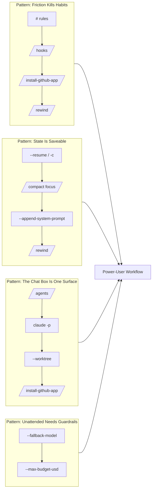

1. **Friction kills good habits** — the `#` shortcut, hooks, `/install-github-app`, and `/rewind` remove manual steps so the disciplined thing happens *by default*.
2. **State is saveable, sliceable, restorable** — `--resume`/`--continue`, focused `/compact`, `--append-system-prompt`, and `/rewind` mean a session never has to vanish or bloat uncontrollably.
3. **The REPL is one surface among several** — `/agents`, `claude -p`, `--worktree`, and the GitHub App put Claude in scripts, parallel workspaces, and pull requests.
4. **Unattended runs need real guardrails** — `--fallback-model` and `--max-budget-usd` make 3am automation safe *and* affordable.

**The adoption rule that makes it stick:** one command per week, matched to the friction you actually feel, used until it's reflexive. Twelve commands later, the default loop will feel like 20% of the tool — because now it is.

**Next steps after this tutorial:** run the five hands-on labs, take the self-assessment, then pick *one* command to teach a teammate — teaching is the fastest way to make it permanent.

---

## Further Reading / Resources

- 📚 **Official documentation** — Claude Code docs (memory, hooks, subagents, headless mode, settings): https://docs.anthropic.com/en/docs/claude-code
- 🐙 **claude-code-action** — the GitHub Action behind `/install-github-app` workflows: https://github.com/anthropics/claude-code-action
- 🛠️ **Claude Code on GitHub** — issues, releases, changelog (verify flag availability): https://github.com/anthropics/claude-code
- 📖 **Git worktrees** — the underlying mechanism of `--worktree`: https://git-scm.com/docs/git-worktree
- 🧭 **Anthropic engineering blog** — agent patterns, guardrails, and Claude Code best practices: https://www.anthropic.com/engineering
- 🗺️ **Model overview** — current model names/tiers to build sensible `--fallback-model` chains: https://docs.anthropic.com/en/docs/about-claude/models

> 📅 **Version disclaimer:** This tutorial reflects Claude Code behavior as of 2026-08-28. Flags, hook event names, and slash commands change — treat the official changelog as the source of truth when something here and something in your terminal disagree.

---

*End of tutorial. Now go capture your first three `#` rules — that's this week's assignment.*
