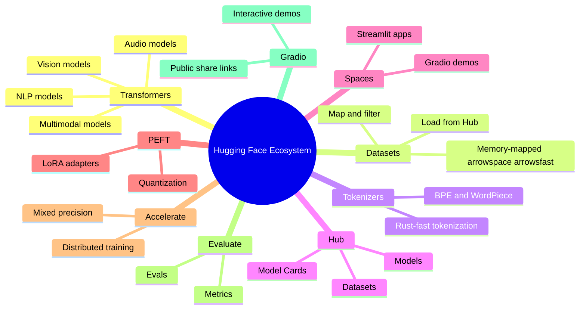
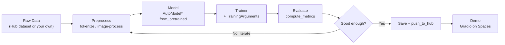
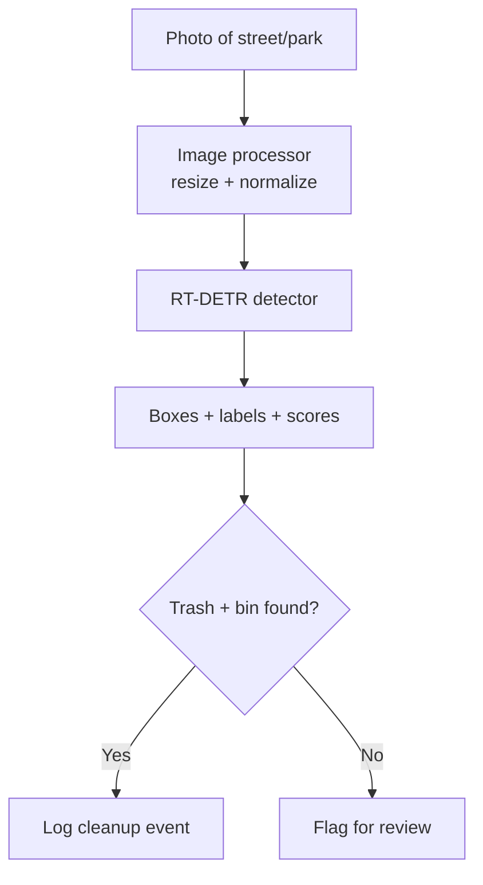
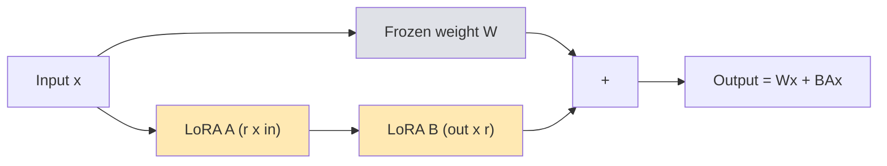
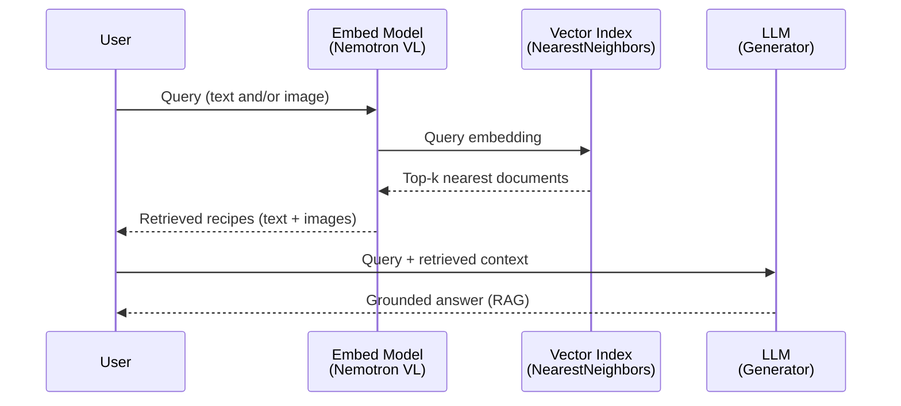
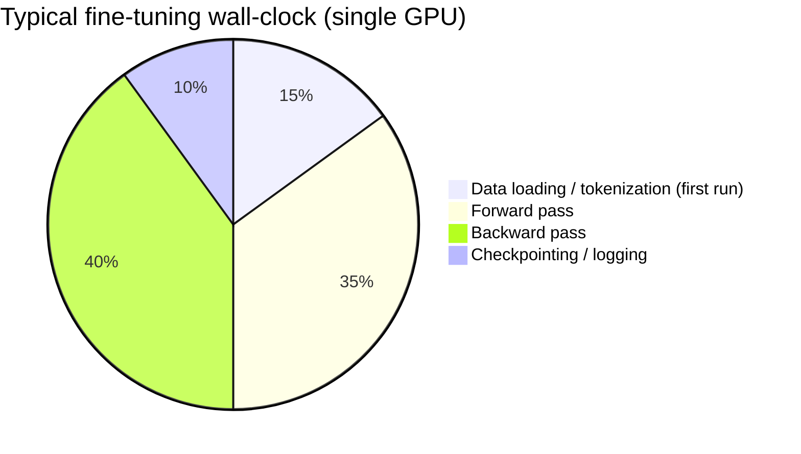

# 🤗 Hugging Face — Complete Hands-On Guide

> ⏱️ **Estimated Reading Time:** 75–90 minutes
> 🟡 **Difficulty Level:** Intermediate
> 🔄 **Last Updated:** 30 August 2026
> 🛠️ **Tech Stack:** Python, PyTorch, Transformers, Datasets, PEFT, Gradio
> 🎯 **Learning Path:** Text Classification → Object Detection → LLM Fine-tuning → VLM Fine-tuning → Multimodal RAG → Batched Inference

A practical, project-driven deep dive into the Hugging Face ecosystem. You will go from loading your first dataset to fine-tuning Large Language Models (LLMs) and Vision Language Models (VLMs), building a multimodal RAG system, and shipping live Gradio demos — all following one golden workflow: **Data → Model → Demo**.

> 💡 **The core mottos of this course:** *"If in doubt, run the code"* • *"Visualize, visualize, visualize"* • *"Experiment, experiment, experiment"* • *"Data, model, demo!"*

---

## 📑 Table of Contents

1. [Introduction to Hugging Face](#1-introduction-to-hugging-face)
2. [Prerequisites & Setup](#2-prerequisites--setup)
3. [Learning Objectives](#3-learning-objectives)
4. [Core Concepts: The Data → Model → Demo Workflow](#4-core-concepts-the-data--model--demo-workflow)
5. [Project 0: Text Classification — "Food Not Food"](#5-project-0-text-classification--food-not-food)
6. [Project 1: Object Detection — "Trashify"](#6-project-1-object-detection--trashify)
7. [Project 2: LLM Fine-tuning — "FoodExtract"](#7-project-2-llm-fine-tuning--foodextract)
8. [Project 3: VLM Fine-tuning — "FoodExtract Vision"](#8-project-3-vlm-fine-tuning--foodextract-vision)
9. [Project 4: Multimodal RAG](#9-project-4-multimodal-rag)
10. [Extension: Batched Inference](#10-extension-batched-inference)
11. [Best Practices](#11-best-practices)
12. [Anti-Patterns](#12-anti-patterns)
13. [Performance Considerations](#13-performance-considerations)
14. [Security Considerations](#14-security-considerations)
15. [Testing Strategies](#15-testing-strategies)
16. [Common Pitfalls & Troubleshooting](#16-common-pitfalls--troubleshooting)
17. [Real-World Use Cases & Case Studies](#17-real-world-use-cases--case-studies)
18. [Practice Exercises (With Solutions)](#18-practice-exercises-with-solutions)
19. [Test Your Understanding](#19-test-your-understanding)
20. [Common Interview Questions](#20-common-interview-questions)
21. [Question Bank (50+ Questions)](#21-question-bank-50-questions)
22. [Self-Assessment Checklist](#22-self-assessment-checklist)
23. [Pro Tips](#23-pro-tips)
24. [Summary & Key Takeaways](#24-summary--key-takeaways)
25. [Further Reading & Resources](#25-further-reading--resources)

---

## 1. Introduction to Hugging Face

### 1.1 What Is Hugging Face?

Hugging Face is a platform that offers access to **many different kinds of open-source machine learning models and datasets**. Think of it as the *"GitHub of machine learning"* — a place where researchers and companies publish models, where you can download state-of-the-art weights with one line of Python, and where you can host live demos for free.

They are also the creators of the popular **`transformers`** library — a Python library for working with pre-trained models (NLP, vision, audio, multimodal) as well as training your own custom models.

> 💡 **Aha moment:** Before Hugging Face, using a state-of-the-art model meant finding a paper, hunting for a code repo, fixing environment conflicts, and hoping the checkpoints loaded. With Hugging Face, that entire process collapses into `from_pretrained("model-name")`.

### 1.2 The Hugging Face Ecosystem

Many of the biggest companies in the world use Hugging Face — including **Apple, Google, Meta, Microsoft, OpenAI, and ByteDance**.



### 1.3 Core Components at a Glance

| Component | What it does | When you use it |
|---|---|---|
| **Transformers** | State-of-the-art models for NLP, vision, audio, multimodal tasks | Loading/training models (`AutoModel*`, `Trainer`, `pipeline`) |
| **Datasets** | Accessing and processing datasets efficiently | Loading, mapping, splitting data |
| **Tokenizers** | Fast tokenization for NLP models | Converting text → token IDs |
| **Hub** | Hosting/sharing models, datasets, demos | `push_to_hub()`, downloading models |
| **Spaces** | Free hosting for ML demos | Deploying your Gradio app |
| **PEFT** | Parameter-Efficient Fine-Tuning | LoRA fine-tuning of LLMs/VLMs |
| **Accelerate** | Easy distributed training & mixed precision | Multi-GPU or large-model training |
| **Evaluate** | Model evaluation metrics | Accuracy, F1, precision, recall |
| **Gradio** | Creating beautiful ML demos | Wrapping your model in a UI |

### 1.4 When to Use Hugging Face (and When Not To)

| ✅ Use it when... | ❌ Avoid / reconsider when... |
|---|---|
| You want a pre-trained model for a common task | You need extreme, hand-tuned inference latency at scale (custom runtimes like ONNX/TensorRT may be better) |
| You want to fine-tune on your own data | You are doing highly novel research needing custom architectures end-to-end |
| You want to share models/demos publicly | Your data cannot legally leave your infrastructure (self-host models instead — HF libraries still work offline) |
| You want reproducible, documented experiments | You only need simple classical ML (scikit-learn is enough) |

---

## 2. Prerequisites & Setup

### 2.1 Required Knowledge

- **3–6 months of Python experience** (functions, classes, dictionaries)
- **1 beginner machine learning or deep learning course** (understand loss, epochs, batches)
- **PyTorch experience is a bonus** (not required — the `Trainer` abstracts most of it)

### 2.2 Installation

```bash
# Install core libraries
pip install transformers datasets evaluate torch torchvision

# Install additional tools
pip install accelerate gradio huggingface_hub

# For computer vision projects
pip install timm

# For PEFT (Parameter-Efficient Fine-Tuning)
pip install peft

# For data processing
pip install pandas matplotlib scikit-learn
```

> ⚠️ **Version note:** On newer versions of `transformers` (≥4.46), `TrainingArguments(evaluation_strategy=...)` has been renamed to **`eval_strategy`**. If you see a `TypeError` or deprecation warning, swap the argument name.

### 2.3 Create a Hugging Face Account

1. Go to [huggingface.co/join](https://huggingface.co/join)
2. Sign up for a free account
3. Get your API token from **Settings → Access Tokens**
4. Login via the CLI:

```bash
huggingface-cli login
```

> 🔒 **Security tip:** Never hard-code your token in notebooks or commit it to Git. Use the CLI login (stores it in `~/.cache/huggingface/token`), an environment variable (`HF_TOKEN`), or a secrets manager. See [Section 14](#14-security-considerations).

### 2.4 Verify Your Installation

```python
import transformers
import datasets
import torch

print(f"Transformers version: {transformers.__version__}")
print(f"Datasets version: {datasets.__version__}")
print(f"PyTorch version: {torch.__version__}")
print(f"CUDA available: {torch.cuda.is_available()}")
```

If `CUDA available: False`, you can still complete every project — training will just run on CPU (slower; reduce epochs/dataset size while learning).

### 2.5 Setup Troubleshooting

| Symptom | Likely Cause | Fix |
|---|---|---|
| `torch.cuda.is_available()` is `False` | CPU-only PyTorch installed | Install the CUDA build from pytorch.org |
| `OSError: Couldn't reach server` | No internet / HF outage | Check connectivity; set `HF_HUB_OFFLINE=1` for cached models |
| `401 Unauthorized` on model download | Gated model / missing token | Accept the license on the Hub page, then `huggingface-cli login` |
| `pip install` conflicts | Mixed torch versions | Use a fresh virtual environment per project |

---

## 3. Learning Objectives

By the end of this guide you will be able to:

- [ ] Explain the Hugging Face ecosystem and when to use each library
- [ ] Load, explore, split, and visualize datasets from the Hub with `datasets`
- [ ] Tokenize text for transformer models and create label mappings (`id2label` / `label2id`)
- [ ] Fine-tune a text classifier with `Trainer` and evaluate it with `evaluate`
- [ ] Fine-tune an object detector (RT-DETR) with image processors
- [ ] Apply **LoRA (PEFT)** to efficiently fine-tune LLMs and VLMs
- [ ] Build a **multimodal RAG** pipeline with embeddings and nearest-neighbor retrieval
- [ ] Speed up inference with **batching**
- [ ] Push models, datasets, and demos to the Hub and build a **Gradio demo**
- [ ] Debug common training failures (OOM, shape errors, slow training)

---

## 4. Core Concepts: The Data → Model → Demo Workflow

Nearly every Hugging Face project follows the same loop. Learn this once, reuse it everywhere:



### 4.1 The Key Abstractions

| Abstraction | Role | Analogy |
|---|---|---|
| `load_dataset()` | Loads data as a memory-mapped `DatasetDict` | A filing cabinet you open drawer-by-drawer, not the whole room at once |
| `AutoTokenizer` / `AutoImageProcessor` | Converts raw inputs → model-ready tensors | A translator who speaks the model's language |
| `AutoModelForSequenceClassification` etc. | Pre-trained model + task-specific head | A trained chef + a new hat for a new cuisine |
| `TrainingArguments` | Knobs: batch size, epochs, LR, logging | The recipe card |
| `Trainer` | The training loop itself | The kitchen that runs the recipe |
| `compute_metrics` | How you grade results | The taste test |
| `pipeline()` | One-line inference wrapper | The waiter who serves the dish |
| `push_to_hub()` | Version-controlled sharing | Publishing to GitHub |

### 4.2 Two Ways to Run Inference

| Approach | Pros | Cons | Use when |
|---|---|---|---|
| `pipeline(task=..., model=...)` | 3 lines of code, handles preprocessing | Less control, hides internals | Demos, prototypes, standard tasks |
| Manual (tokenizer + model + `torch.no_grad()`) | Full control, batch-friendly, production-ready | More code | Custom logic, batched serving |

You will practice **both** in this guide.

> 🧠 **Quick Recap:** Everything in this guide is a variation of: *get data → prepare it for a model → train (or plug in) a model → evaluate → share*. If you ever feel lost, ask yourself: *which step of the flowchart am I in?*

---

## 5. Project 0: Text Classification — "Food Not Food"

> 🟢 **Difficulty:** Beginner-friendly • **Task:** Classify image captions as `food` or `not_food` • **Workflow:** Data → Model → Demo

This is the ideal starting project if you have never used the Hugging Face ecosystem. We follow the **complete workflow** end-to-end, in 13 steps.

**Resources:**
- 📊 Dataset: [learn_hf_food_not_food_image_captions](https://huggingface.co/datasets/mrdbourke/learn_hf_food_not_food_image_captions)
- 🤖 Model: [DistilBERT classifier](https://huggingface.co/mrdbourke/learn_hf_food_not_food_text_classifier-distilbert-base-uncased)
- 🚀 Demo: [Live Demo](https://huggingface.co/spaces/mrdbourke/learn_hf_food_not_food_text_classifier_demo)

### Step 1: Load and Explore the Dataset

```python
from datasets import load_dataset

# Load the dataset from the Hugging Face Hub
# (downloads + caches locally, so future loads are instant)
dataset = load_dataset(path="mrdbourke/learn_hf_food_not_food_image_captions")

print(dataset)
# DatasetDict({
#     train: Dataset({
#         features: ['text', 'label'],
#         num_rows: 250
#     })
# })

print(dataset.column_names)      # {'train': ['text', 'label']}
train_dataset = dataset["train"] # access a split like a dict
print(train_dataset[0])
# {'text': 'Creamy cauliflower curry...', 'label': 'food'}
```

**Why this works so well:** `datasets` uses *memory mapping* — the data stays on disk and Python reads only the slices you request. You can work with datasets far larger than RAM.

### Step 2: Explore and Visualize the Data

> 🚨 **Golden rule:** *Never train before you look at your data.* Most "model problems" are actually data problems.

```python
import random
import pandas as pd
from collections import Counter

# View random samples
for idx in random.sample(range(len(train_dataset)), 5):
    item = train_dataset[idx]
    print(f"Text: {item['text']} | Label: {item['label']}")

# Unique labels and class balance
print(train_dataset.unique("label"))            # ['food', 'not_food']
print(Counter(train_dataset["label"]))          # {'food': 125, 'not_food': 125}

# DataFrame view for eyeballing
df = pd.DataFrame(train_dataset)
print(df.sample(7))
print(df["label"].value_counts())
```

✅ **Good practice:** checking class balance first. Here it's ~50/50, so plain accuracy is a meaningful metric. ❌ **Bad practice:** training on a 95/5 imbalanced set and reporting only accuracy (a model that always predicts the majority class gets 95% while being useless).

### Step 3: Create Label Mappings

Models output **integers**; humans read **strings**. You must maintain both directions of the mapping:

```python
# Option A: hard-coded (fine for small, fixed label sets)
id2label = {0: "not_food", 1: "food"}
label2id = {"not_food": 0, "food": 1}

# Option B: programmatic (better for many classes — sorted for reproducibility)
id2label = {idx: label for idx, label in enumerate(sorted(train_dataset.unique("label")))}
label2id = {label: idx for idx, label in id2label.items()}

print(f"ID to Label mapping: {id2label}")
print(f"Label to ID mapping: {label2id}")
```

> ⚠️ **Pitfall:** if you sort labels for the mapping but map them manually elsewhere, your labels are silently wrong. Pick one method and use it consistently.

### Step 4: Preprocess the Data (labels + splits)

```python
# 1. Map string labels to integers
def map_labels_to_number(example):
    example["label"] = label2id[example["label"]]  # KeyError risk handled below
    return example

try:
    dataset = dataset["train"].map(map_labels_to_number)
except KeyError as e:
    raise KeyError(f"Label not in mapping {label2id}: {e}") from e

# 2. Create a train/test split (seeded for reproducibility!)
dataset = dataset.train_test_split(test_size=0.2, seed=42)
print(dataset)
# DatasetDict({ train: Dataset(...), test: Dataset(...) })
```

**Why `seed=42`?** Without a seed, every run gets a different split — making your experiments impossible to compare. Reproducibility is a feature, not an option.

---

### Step 5: Tokenization

Transformers don't read text — they read **token IDs**. A tokenizer splits text into subword tokens and maps each to an integer from the model's vocabulary.

```python
from transformers import AutoTokenizer

tokenizer = AutoTokenizer.from_pretrained("distilbert-base-uncased")

# Test it on a sample
tokens = tokenizer("I love pizza")
print(tokens)
# {'input_ids': [101, 1045, 2293, 10733, 102],
#  'attention_mask': [1, 1, 1, 1, 1]}
```

What happened:
- `101` = `[CLS]` token (start), `102` = `[SEP]` token (end)
- `1045` = "i" (uncased), `10733` = "pizza"
- `attention_mask` tells the model which positions are real tokens (1) vs padding (0)

```python
# Batched tokenization applied lazily via .map()
def tokenize_text(examples):
    return tokenizer(
        examples["text"],
        truncation=True,     # cut texts longer than max_length
        padding=True,        # pad shorter texts in the batch
        max_length=512,
    )

tokenized_dataset = dataset.map(
    tokenize_text,
    batched=True,                 # MUCH faster than per-example
    remove_columns=["text"],      # model only needs token IDs + label
)
print(tokenized_dataset)
```

> 💡 **Pro tip:** `truncation=True` + `max_length` prevents crashes on long inputs. `remove_columns` prevents passing raw strings into the model (a classic source of `ValueError`).

❌ **Common mistake:** tokenizing with a *different* tokenizer than the model's. Vocabulary IDs are model-specific — always use the tokenizer that ships with your checkpoint (`AutoTokenizer.from_pretrained(same_model_id)`).

### Step 6: Load and Configure the Model

```python
from transformers import AutoModelForSequenceClassification

model = AutoModelForSequenceClassification.from_pretrained(
    "distilbert-base-uncased",
    num_labels=2,             # size of the classification head
    id2label=id2label,        # so predictions come back as readable labels
    label2id=label2id,
)

def count_params(model):
    return {
        "trainable_parameters": sum(p.numel() for p in model.parameters() if p.requires_grad),
        "total_parameters": sum(p.numel() for p in model.parameters()),
    }

print(count_params(model))
# {'trainable_parameters': 66955010, 'total_parameters': 66955010}
```

**What just happened?** DistilBERT (pre-trained, 6 layers) got a **fresh classification head** on top. The head starts random — that's what fine-tuning teaches. Everything is trainable here; later (Projects 2–3) you'll see LoRA, which trains <1% of parameters.

### Step 7: Define Metrics

```python
import evaluate
import numpy as np

accuracy = evaluate.load("accuracy")

def compute_metrics(eval_pred):
    predictions, labels = eval_pred      # logits + ground truth
    predictions = np.argmax(predictions, axis=1)  # logits → class index
    return accuracy.compute(predictions=predictions, references=labels)
```

> 🧠 **Feynman check:** logits are raw scores per class (one per label). `argmax` picks the highest one. The metric compares that pick to the true label.

### Step 8: Set Up Training (`TrainingArguments` + `Trainer`)

```python
from transformers import TrainingArguments, Trainer
from pathlib import Path

model_save_dir = Path("models/learn_hf_food_not_food_text_classifier-distilbert-base-uncased")
model_save_dir.mkdir(parents=True, exist_ok=True)

training_args = TrainingArguments(
    output_dir=str(model_save_dir),
    per_device_train_batch_size=8,
    per_device_eval_batch_size=8,
    num_train_epochs=3,
    eval_strategy="epoch",        # was `evaluation_strategy` in older versions ⚠️
    save_strategy="epoch",
    load_best_model_at_end=True,
    metric_for_best_model="accuracy",
    logging_dir="./logs",
    logging_steps=10,
    report_to="none",             # disable wandb/tensorboard for simplicity
)

trainer = Trainer(
    model=model,
    args=training_args,
    train_dataset=tokenized_dataset["train"],
    eval_dataset=tokenized_dataset["test"],
    tokenizer=tokenizer,               # saved alongside checkpoints
    compute_metrics=compute_metrics,
)
```

Key arguments explained:

| Argument | Why it matters |
|---|---|
| `per_device_train_batch_size` | Samples per step. Raise until OOM, then back off |
| `num_train_epochs` | Full passes over the data. Small dataset → 3 is fine |
| `eval_strategy="epoch"` | Evaluate after each epoch so you can *see* overfitting |
| `save_strategy="epoch"` + `load_best_model_at_end` | Keep checkpoints, reload the best one |
| `metric_for_best_model` | Which metric decides "best" |
| `report_to="none"` | Opt out of experiment trackers |

### Step 9: Train the Model

```python
results = trainer.train()

for key, value in results.metrics.items():
    print(f"{key}: {value}")
```

Typical output:
```
train_runtime: 90.2341
train_loss: 0.1982
epoch: 3.0
```

```python
# Visualize the loss curve — "visualize, visualize, visualize!"
import matplotlib.pyplot as plt

trainer_history = trainer.state.log_history
training_metrics = [h for h in trainer_history if "loss" in h and "eval_loss" not in h]
eval_metrics     = [h for h in trainer_history if "eval_loss" in h]

plt.plot([h["loss"] for h in training_metrics])
plt.title("Training Loss")
plt.xlabel("Logging step")
plt.ylabel("Loss")
plt.show()
```

**Reading the curve:** a healthy run slopes down and flattens. If training loss keeps dropping while **eval loss rises** → you're **overfitting** (stop earlier, add data, or add regularization).

---

### Step 10: Evaluate the Model

```python
# Full evaluation on the held-out test set
predictions = trainer.predict(tokenized_dataset["test"])
print(f"Test metrics: {predictions.metrics}")
# e.g. {'test_loss': 0.21, 'test_accuracy': 0.94, 'test_runtime': ...}

preds = np.argmax(predictions.predictions, axis=1)
labels = predictions.label_ids

from sklearn.metrics import accuracy_score
test_accuracy = accuracy_score(labels, preds)
print(f"Test accuracy: {test_accuracy * 100:.2f}%")
```

Go beyond the headline number — inspect **which examples the model gets wrong or is unsure about**:

```python
test_df = pd.DataFrame({
    "text": dataset["test"]["text"],
    "true_label": [id2label[l] for l in labels],
    "predicted_label": [id2label[p] for p in preds],
    "pred_prob": np.max(predictions.predictions, axis=1),
})

# Most uncertain predictions — great candidates for human review / data labeling
uncertain = test_df.sort_values("pred_prob", ascending=True).head(10)
print("Most uncertain predictions:")
print(uncertain)
```

> 💡 **Aha moment:** the *least confident* predictions are where your model is telling you what it needs. Reviewing them is called **active learning**, and it's often more valuable than more epochs.

### Step 11: Save Locally and Push to the Hub

```python
# Save locally
trainer.save_model(output_dir=model_save_dir)
print(f"Model saved to {model_save_dir}")

# Push model + tokenizer to the Hugging Face Hub
model.push_to_hub("learn_hf_food_not_food_text_classifier")
tokenizer.push_to_hub("learn_hf_food_not_food_text_classifier")
```

Anyone can now load your model with:
```python
model = AutoModelForSequenceClassification.from_pretrained("YOUR_USERNAME/learn_hf_food_not_food_text_classifier")
```

✅ Always write a **model card** (the README of your model): what it does, training data, metrics, limitations. See [Section 11.6](#116-version-control-and-sharing-model-cards).

### Step 12: Create an Inference Pipeline

```python
import torch
from transformers import pipeline

def set_device():
    device = "cuda" if torch.cuda.is_available() else "cpu"
    print(f"[INFO] Using device: {device}")
    return device

DEVICE = set_device()

classifier = pipeline(
    task="text-classification",
    model=model,
    tokenizer=tokenizer,
    device=0 if torch.cuda.is_available() else -1,  # 0 = first GPU, -1 = CPU
)

print(classifier("A delicious photo of a plate of scrambled eggs, bacon and toast"))
# [{'label': 'food', 'score': 0.998}]

print(classifier("Set of oven mitts hanging on a hook"))
# [{'label': 'not_food', 'score': 0.997}]
```

### Step 13: Create a Gradio Demo

```python
import gradio as gr

def classify_text(text):
    result = classifier(text)[0]
    return {
        "food": result["score"] if result["label"] == "food" else 1 - result["score"],
        "not_food": result["score"] if result["label"] == "not_food" else 1 - result["score"],
    }

demo = gr.Interface(
    fn=classify_text,
    inputs=gr.Textbox(placeholder="Enter text to classify..."),
    outputs=gr.Label(num_top_classes=2),
    title="Food Not Food Classifier",
    description="Classify text as 'food' or 'not_food' using a fine-tuned DistilBERT model",
)

demo.launch()
```

Push this `app.py` to a **Hugging Face Space** and your model has a public, shareable UI — the **"demo"** in Data → Model → Demo. 🎉

> 🧠 **Quick Recap (Project 0):** load → visualize → map labels → split → tokenize → configure model → metrics → `Trainer` → train → evaluate + inspect errors → save/push → `pipeline` → Gradio. Every later project reuses this skeleton with task-specific swaps.

---

## 6. Project 1: Object Detection — "Trashify 🚮"

> 🟡 **Difficulty:** Intermediate • **Task:** Detect `trash`, `hand`, and `bin` in photos • **Approach:** fine-tune RT-DETR

Learn computer vision with Hugging Face by fine-tuning and deploying an object detection model.

**Resources:**
- 📊 Dataset: [trashify_manual_labelled_images](https://huggingface.co/datasets/mrdbourke/trashify_manual_labelled_images)
- 🤖 Model: [RT-DETRv2 fine-tuned](https://huggingface.co/mrdbourke/rt_detrv2_finetuned_trashify_box_detector_v1)
- 🚀 Demo: [Live Demo](https://huggingface.co/spaces/mrdbourke/trashify_demo_v4)

### 6.1 Why this task is interesting

The real-world story: robots or volunteers photograph litter. A detector that finds **trash, the hand picking it up, and the bin** can automatically verify cleanup events. Object detection is harder than classification — the model must output *boxes + classes + confidence*, and evaluation uses IoU-based metrics (mAP) rather than plain accuracy.



### 6.2 Key Steps

```python
from datasets import load_dataset
from transformers import AutoImageProcessor, AutoModelForObjectDetection
from PIL import Image

# 1. Load dataset
dataset = load_dataset("mrdbourke/trashify_manual_labelled_images")

# 2. Load image processor and pre-trained detector
image_processor = AutoImageProcessor.from_pretrained("PekingU/rtdetr_r50vd")
model = AutoModelForObjectDetection.from_pretrained("PekingU/rtdetr_r50vd")

# 3. Preprocess images + annotations into model-ready targets
def prepare_examples(examples):
    images = [Image.open(path).convert("RGB") for path in examples["image"]]
    targets = [
        {
            "image_id": idx,
            "annotations": [
                {
                    "area": ann["area"],
                    "bbox": ann["bbox"],           # [x, y, width, height]
                    "category_id": ann["category_id"],
                }
                for ann in annotations
            ],
        }
        for idx, annotations in enumerate(examples["objects"])
    ]

    result = image_processor(images=images, annotations=targets, return_tensors="pt")
    result["labels"] = targets
    return result

# 4. Fine-tune
from transformers import TrainingArguments, Trainer

training_args = TrainingArguments(
    output_dir="./trashify-detector",
    per_device_train_batch_size=4,   # images are memory-hungry: keep small
    num_train_epochs=10,
    eval_strategy="epoch",           # was `evaluation_strategy` ⚠️
)

trainer = Trainer(
    model=model,
    args=training_args,
    train_dataset=dataset["train"],
    eval_dataset=dataset["test"],
    tokenizer=image_processor,       # saved so inference preprocessing matches training
)

trainer.train()

# 5. Inference pipeline
from transformers import pipeline

object_detector = pipeline(
    "object-detection",
    model=model,
    image_processor=image_processor,
)

# 6. Test on a new image
result = object_detector("path/to/image.jpg")
print(result)
# [{'score': 0.91, 'label': 'trash', 'box': {'xmin': ..., 'ymin': ..., 'xmax': ..., 'ymax': ...}}, ...]
```

### 6.3 Notes & gotchas

- **Smaller batches:** image models eat GPU memory fast (4–8 is typical for detection).
- **`tokenizer=image_processor`:** for vision tasks, the "tokenizer" slot carries the processor so saved checkpoints are self-contained.
- **Evaluation:** detection uses **mAP** (mean Average Precision) at IoU thresholds — a prediction counts only if its box overlaps the ground truth enough (IoU ≥ 0.5 by default).
- ⚠️ The `prepare_examples` transform above is illustrative; always cross-check the exact annotation schema of *your* dataset variant with `dataset["train"].features` before training.

> 🧠 **Quick Recap (Project 1):** same skeleton as Project 0, but the tokenizer is replaced by an **image processor**, and "accuracy" is replaced by **mAP**. Architecture (RT-DETR) differs, workflow doesn't.

---

## 7. Project 2: LLM Fine-tuning — "FoodExtract"

> 🟠 **Difficulty:** Intermediate–Advanced • **Task:** Extract structured data (ingredients, steps) from raw text with an LLM • **Model:** Google Gemma 3 270M

**Resources:**
- 📊 Dataset: [FoodExtract-1k](https://huggingface.co/datasets/mrdbourke/FoodExtract-1k)
- 🤖 Model: [Fine-tuned Gemma 3 270M](https://huggingface.co/mrdbourke/FoodExtract-gemma-3-270m-fine-tune-v1)
- 🚀 Demo: [Live Demo](https://huggingface.co/spaces/mrdbourke/FoodExtract-v1)

### 7.1 Why fine-tune a Small Language Model (SLM)?

Prompting a giant model via an API works, but: you pay per token, you wait on network round-trips, your data leaves your machine, and outputs drift. A **270M-parameter model fine-tuned on your exact task** can run *locally*, *cheaply*, and *consistently* — ideal for narrow, well-defined extraction tasks.

| | Prompting a big API model | Fine-tuned SLM (this project) |
|---|---|---|
| Cost per 1M requests | High (per-token) | Near-zero (your hardware) |
| Latency | Network-bound | Local, milliseconds–seconds |
| Data privacy | Leaves your infra | Stays on device |
| Output consistency | Varies with prompt | Very stable after fine-tuning |
| Flexibility | Any task instantly | One task, done extremely well |

### 7.2 LoRA: fine-tuning 1% of the weights

Full fine-tuning updates **every** weight (expensive, memory-hungry). **LoRA (Low-Rank Adaptation)** freezes the original weights and learns tiny *adapter matrices* injected into attention layers:



Only A and B (rank `r`, e.g. 8) are trained — often **<1% of parameters** — yet performance approaches full fine-tuning. Adapters are a few MB, not GB.

| Hyperparameter | Typical value | Meaning |
|---|---|---|
| `r` | 8–16 | Adapter rank; higher = more capacity + memory |
| `lora_alpha` | 16–32 | Scaling factor; commonly ~2× `r` |
| `target_modules` | `q_proj, k_proj, v_proj, o_proj` | Which layers get adapters |
| `lora_dropout` | 0.05 | Regularization |

### 7.3 Key Steps

```python
import torch
from datasets import load_dataset
from transformers import AutoTokenizer, AutoModelForCausalLM, TrainingArguments, Trainer
from peft import LoraConfig, get_peft_model

# 1. Load dataset
dataset = load_dataset("mrdbourke/FoodExtract-1k")

# 2. Load tokenizer and model (gated: accept license on the Hub first)
model_id = "google/gemma-3-270m-it"
tokenizer = AutoTokenizer.from_pretrained(model_id)
model = AutoModelForCausalLM.from_pretrained(
    model_id,
    device_map="auto",              # place layers across available devices
    torch_dtype=torch.bfloat16,     # half the memory of fp32
)

# 3. Configure LoRA
lora_config = LoraConfig(
    r=8,
    lora_alpha=32,
    target_modules=["q_proj", "k_proj", "v_proj", "o_proj"],
    lora_dropout=0.05,
    bias="none",
    task_type="CAUSAL_LM",
)

model = get_peft_model(model, lora_config)
model.print_trainable_parameters()
# e.g. trainable params: 1,179,648 || all params: 271,577,088 || trainable%: 0.43

# 4. Tokenize
def tokenize_function(examples):
    return tokenizer(
        examples["text"],           # prompt + target formatted per model chat template
        truncation=True,
        max_length=512,
        padding="max_length",
    )

tokenized_dataset = dataset.map(tokenize_function, batched=True)

# 5. Training setup
training_args = TrainingArguments(
    output_dir="./foodextract-gemma",
    per_device_train_batch_size=4,
    gradient_accumulation_steps=4,   # effective batch = 4 x 4 = 16
    num_train_epochs=3,
    learning_rate=2e-4,              # LoRA tolerates higher LR than full FT
    fp16=True,                       # or bf16=True on Ampere+ GPUs
    logging_steps=10,
    save_strategy="epoch",
    report_to="none",
)

trainer = Trainer(
    model=model,
    args=training_args,
    train_dataset=tokenized_dataset["train"],
    tokenizer=tokenizer,
)

# 6. Train
trainer.train()

# 7. Save + push
model.push_to_hub("FoodExtract-gemma-3-270m-fine-tune")
```

### 7.4 Correct vs incorrect patterns

❌ **Incorrect:**
```python
model = AutoModelForCausalLM.from_pretrained(model_id)          # fp32 — 2x the memory
training_args = TrainingArguments(learning_rate=2e-5, ...)      # too low for LoRA (slow convergence)
tokenizer(examples["text"], truncation=False)                   # OOM crash on long inputs
```

✅ **Correct:**
```python
model = AutoModelForCausalLM.from_pretrained(model_id, torch_dtype=torch.bfloat16, device_map="auto")
training_args = TrainingArguments(learning_rate=2e-4, gradient_accumulation_steps=4, ...)
tokenizer(examples["text"], truncation=True, max_length=512)
```

> ⚠️ **Chat templates matter:** instruction-tuned models like `gemma-3-270m-it` expect inputs wrapped in their chat template (`tokenizer.apply_chat_template(...)`). Fine-tuning on raw text without the template degrades output quality.

> 🧠 **Quick Recap (Project 2):** freeze the LLM → inject LoRA adapters → train ~0.5% of weights in bf16 → push adapters to the Hub. Same `Trainer`, new memory tricks.

---

## 8. Project 3: VLM Fine-tuning — "FoodExtract Vision"

> 🟠 **Difficulty:** Advanced • **Task:** Extract structured data from **images** (e.g., handwritten recipes, food photos) • **Model:** SmolVLM2-500M

**Resources:**
- 📊 Dataset: [FoodExtract-1k-Vision](https://huggingface.co/datasets/mrdbourke/FoodExtract-1k-Vision)
- 🤖 Model: [Fine-tuned SmolVLM2-500M](https://huggingface.co/mrdbourke/FoodExtract-Vision-SmolVLM2-500M-fine-tune-v1)
- 🚀 Demo: [Live Demo](https://huggingface.co/spaces/mrdbourke/FoodExtract-Vision-v1)

### 8.1 Key Concepts

**Vision Language Models (VLMs)** understand images *and* text, making them perfect for:
- Image captioning
- Visual question answering
- Document understanding
- **Structured data extraction from images** (this project)

Think of a VLM as two specialists working together: a **vision encoder** (turns pixels into embeddings) and a **language model** (reasons over those embeddings + text). LoRA is applied to the language side; the vision encoder stays frozen.

### 8.2 Key Steps

```python
import torch
from PIL import Image
from datasets import load_dataset
from transformers import AutoProcessor, AutoModelForVision2Seq, TrainingArguments, Trainer
from peft import LoraConfig, get_peft_model

# 1. Load dataset with images
dataset = load_dataset("mrdbourke/FoodExtract-1k-Vision")

# 2. Load processor and model
processor = AutoProcessor.from_pretrained("HuggingFaceTB/SmolVLM2-500M-Video-Instruct")
model = AutoModelForVision2Seq.from_pretrained(
    "HuggingFaceTB/SmolVLM2-500M-Video-Instruct",
    device_map="auto",
    torch_dtype=torch.bfloat16,
)

# 3. Prepare (text + image) inputs
def prepare_examples(examples):
    images = [Image.open(path).convert("RGB") for path in examples["image"]]
    texts = [f"Extract food information: {text}" for text in examples["text"]]

    inputs = processor(
        text=texts,
        images=images,
        return_tensors="pt",
        padding=True,
        truncation=True,
    )
    inputs["labels"] = inputs["input_ids"].clone()
    return inputs

# 4. Configure LoRA (language-side attention only)
lora_config = LoraConfig(
    r=8,
    lora_alpha=32,
    target_modules=["q_proj", "v_proj"],
    lora_dropout=0.05,
    task_type="CAUSAL_LM",
)
model = get_peft_model(model, lora_config)

# 5. Train
training_args = TrainingArguments(
    output_dir="./smolvlm-foodextract",
    per_device_train_batch_size=2,      # VLMs are memory-hungry: batch small
    gradient_accumulation_steps=8,      # effective batch = 16
    num_train_epochs=3,
    learning_rate=2e-4,
    fp16=True,
    report_to="none",
)

trainer = Trainer(
    model=model,
    args=training_args,
    train_dataset=dataset["train"],
    tokenizer=processor,
    data_collator=processor,
)

trainer.train()
```

> ⚠️ **Gotchas:** (1) always convert images to **RGB** — PNGs with alpha channels crash vision processors; (2) `data_collator=processor` lets the processor batch variable-size (image, text) pairs; (3) VLM training usually needs `gradient_checkpointing=True` on smaller GPUs.

---

## 9. Project 4: Multimodal RAG

> 🔴 **Difficulty:** Advanced • **Task:** Retrieve recipes using **text and image queries** against a shared embedding space, then generate answers with an LLM

**Resources:**
- 📊 Dataset: [recipe-synthetic-images-10k](https://huggingface.co/datasets/mrdbourke/recipe-synthetic-images-10k)
- 🤖 Models: [Nemotron Embed VL](https://huggingface.co/nvidia/llama-nemotron-embed-vl-1b-v2) • [Nemotron Rerank VL](https://huggingface.co/nvidia/llama-nemotron-rerank-vl-1b-v2)
- 🚀 Demo: [Live Demo](https://huggingface.co/spaces/mrdbourke/multimodal-rag-with-nemotron)

### 9.1 What is (Multimodal) RAG?

**RAG (Retrieval-Augmented Generation)** combines:
1. **Retrieval** — find relevant information in a knowledge base
2. **Augmentation** — add it to the LLM's context
3. **Generation** — answer using that context

**Multimodal RAG** embeds text and images into the **same vector space**, so a text query ("creamy pasta") can retrieve both recipe *text* and recipe *photos* — and a photo can retrieve similar recipes.



### 9.2 Key Steps

```python
import torch
import numpy as np
from PIL import Image
from datasets import load_dataset
from transformers import AutoProcessor, AutoModel

# 1. Load embedding model (text + images -> shared space)
embed_model_id = "nvidia/llama-nemotron-embed-vl-1b-v2"
processor = AutoProcessor.from_pretrained(embed_model_id)
embed_model = AutoModel.from_pretrained(embed_model_id, device_map="auto")

# 2. Load dataset
recipe_dataset = load_dataset("mrdbourke/recipe-synthetic-images-10k")

# 3. Embedding helper
def get_embeddings(texts, images=None):
    inputs = processor(
        text=texts,
        images=images,
        return_tensors="pt",
        padding=True,
        truncation=True,
    ).to(embed_model.device)

    with torch.no_grad():                       # embeddings: never backprop
        outputs = embed_model(**inputs)
        embeddings = outputs.last_hidden_state.mean(dim=1)  # mean-pool tokens

    return embeddings.cpu().numpy()

# 4. Build the vector store
from sklearn.neighbors import NearestNeighbors

all_embeddings = []
for item in recipe_dataset["train"]:
    embedding = get_embeddings([item["text"]], [item["image"]])
    all_embeddings.append(embedding[0])
all_embeddings = np.array(all_embeddings)

nn = NearestNeighbors(n_neighbors=5, metric="cosine")
nn.fit(all_embeddings)

def query_rag(query_text, query_image=None, k=5):
    query_embedding = get_embeddings([query_text], [query_image] if query_image else None)
    distances, indices = nn.kneighbors(query_embedding, n_neighbors=k)
    return [
        {"document": recipe_dataset["train"][int(idx)], "distance": float(dist)}
        for idx, dist in zip(indices[0], distances[0])
    ]

# 5. Generation step (grounded answer)
from transformers import AutoModelForCausalLM, AutoTokenizer

llm_id = "meta-llama/Llama-2-7b-chat-hf"       # gated: accept license first
llm_tokenizer = AutoTokenizer.from_pretrained(llm_id)
llm = AutoModelForCausalLM.from_pretrained(llm_id, device_map="auto")

def generate_response(query, retrieved_docs):
    context = "\n".join([doc["document"]["text"] for doc in retrieved_docs])
    prompt = f"Context:\n{context}\n\nQuestion: {query}\n\nAnswer:"
    inputs = llm_tokenizer(prompt, return_tensors="pt").to(llm.device)
    outputs = llm.generate(**inputs, max_length=500)
    return llm_tokenizer.decode(outputs[0], skip_special_tokens=True)

results = query_rag("a creamy vegetarian pasta dish")
print(generate_response("How do I make it?", results))
```

### 9.3 Design trade-offs

| Decision | Option A | Option B | Trade-off |
|---|---|---|---|
| Vector index | `sklearn` NearestNeighbors | FAISS / dedicated vector DB | Exact + simple vs. scales to millions with ANN |
| Embedding pooling | mean-pool last hidden state | CLS token / pooled output | Mean is robust; task-tuned pooling often better |
| Retrieval only | Top-k results shown | Add reranker (Nemotron Rerank VL) | Faster vs. more precise ordering |
| Embedding storage | Compute on the fly | Precompute + persist | Fast queries vs. one-time indexing cost |

> 💡 **Pro tip:** **Precompute embeddings** for the knowledge base and persist them (`np.save`). Only the *query* should be embedded at request time — recomputing 10k embeddings per query would make RAG unusably slow.

---

## 10. Extension: Batched Inference

> 🟡 **Difficulty:** Intermediate • **Goal:** Speed up LLM inference by processing multiple samples at once

- 📓 Notebook: [Batched Inference Tutorial](https://www.learnhuggingface.com/notebooks/hugging_face_llm_batched_inference_with_transformers)

### 10.1 Why batching helps

GPUs are massively parallel. Running one prompt at a time leaves the GPU starved. Batching amortizes weight-loading and kernel overhead across many samples:

- ✅ Better GPU utilization
- ✅ Reduced per-sample overhead
- ✅ Higher throughput (samples/second)

| Strategy | Relative throughput | Notes |
|---|---|---|
| One prompt at a time | 1× (baseline) | Simple, low memory |
| Batch of 8 | ~4–6× | Sweet spot for most single-GPU setups |
| Batch of 32+ | ~6–10× | Watch OOM; pad waste grows if lengths vary wildly |
| Continuous batching (serving engines) | Higher still | Out of scope; see vLLM / TGI |

### 10.2 Example Implementation

```python
import torch
from torch.utils.data import DataLoader, Dataset
from transformers import AutoModelForCausalLM, AutoTokenizer

# 1. Load model and tokenizer
model_id = "microsoft/phi-2"
tokenizer = AutoTokenizer.from_pretrained(model_id)
if tokenizer.pad_token is None:                 # ⚠️ many LLMs have no pad token
    tokenizer.pad_token = tokenizer.eos_token

model = AutoModelForCausalLM.from_pretrained(
    model_id,
    device_map="auto",
    torch_dtype=torch.float16,
)

# 2. Dataset wrapper
class TextDataset(Dataset):
    def __init__(self, texts, tokenizer, max_length=512):
        self.texts = texts
        self.tokenizer = tokenizer
        self.max_length = max_length

    def __len__(self):
        return len(self.texts)

    def __getitem__(self, idx):
        encoding = self.tokenizer(
            self.texts[idx],
            truncation=True,
            max_length=self.max_length,
            return_tensors="pt",
        )
        return {k: v.squeeze(0) for k, v in encoding.items()}

# 3. Dataloader with batching
texts = ["What is machine learning?", "Explain neural networks", "What is deep learning?"]
dataset = TextDataset(texts, tokenizer)
dataloader = DataLoader(dataset, batch_size=2, shuffle=False)

# 4. Batch inference
model.eval()
all_outputs = []

with torch.no_grad():
    for batch in dataloader:
        inputs = {k: v.to(model.device) for k, v in batch.items()}
        outputs = model.generate(**inputs, max_length=100)
        decoded = tokenizer.batch_decode(outputs, skip_special_tokens=True)
        all_outputs.extend(decoded)

for i, output in enumerate(all_outputs):
    print(f"Input {i+1}: {texts[i]}")
    print(f"Output {i+1}: {output}\n")
```

❌ **Common mistake:** forgetting to set `tokenizer.pad_token` — many decoder-only LLMs only define an EOS token, and `generate()` crashes with `Asking to pad but the tokenizer does not have a padding token`.

> 🧠 **Quick Recap:** `model.eval()` + `torch.no_grad()` + `DataLoader` = the production inference trifecta. Measure before/after with `time.perf_counter()` to prove the win.

---

## 11. Best Practices

### 11.1 Data Practices
- **Always visualize your data** before training (samples, class counts, lengths)
- **Check for class imbalance** and handle it (resampling, class weights, better metrics)
- **Create proper train/validation/test splits** — never tune on the test set
- **Use seed values** everywhere (`train_test_split(seed=42)`, `set_seed`) for reproducibility
- **Start small** — overfit a 100-sample subset first; if the model can't overfit that, you have a bug

### 11.2 Model Training

```python
training_args = TrainingArguments(
    fp16=True,                      # or bf16=True on newer GPUs (Ampere+)
    gradient_accumulation_steps=4,  # simulate 4x larger batch without 4x memory
    gradient_checkpointing=True,    # trade ~30% speed for large memory savings
    logging_steps=10,
    eval_strategy="epoch",          # was `evaluation_strategy` ⚠️
    save_strategy="epoch",
    load_best_model_at_end=True,
)
```

| Technique | Speed | Memory | When |
|---|---|---|---|
| Bigger batch | ↑ | ↑↑ | When GPU has headroom |
| Gradient accumulation | = | = (effective batch ↑) | GPU constrained |
| Mixed precision (fp16/bf16) | ↑↑ | ↓ | Almost always |
| Gradient checkpointing | ↓ ~30% | ↓↓ | Large models / OOM |
| LoRA (PEFT) | ↑↑ (fewer grads) | ↓↓ | LLM/VLM fine-tuning |

### 11.3 Memory Optimization

```python
# 1. LoRA: train <1% of parameters
from peft import LoraConfig, get_peft_model

lora_config = LoraConfig(
    r=8, lora_alpha=32,
    target_modules=["q_proj", "v_proj"],
    lora_dropout=0.05, bias="none", task_type="CAUSAL_LM",
)
model = get_peft_model(model, lora_config)

# 2. Gradient checkpointing
model.gradient_checkpointing_enable()

# 3. 4-bit quantization via bitsandbytes
from transformers import BitsAndBytesConfig

bnb_config = BitsAndBytesConfig(
    load_in_4bit=True,
    bnb_4bit_use_double_quant=True,
    bnb_4bit_quant_type="nf4",
    bnb_4bit_compute_dtype=torch.bfloat16,
)
# model = AutoModelForCausalLM.from_pretrained(model_id, quantization_config=bnb_config)
```

Approximate memory for a 7B-parameter model:

| Precision | Weights memory | Practical? |
|---|---|---|
| fp32 | ~28 GB | Rarely needed |
| bf16/fp16 | ~14 GB | Standard |
| 8-bit | ~7 GB | Consumer GPUs |
| 4-bit (NF4) | ~3.5–4 GB | Laptop-class GPUs |

### 11.4 Evaluation — Multiple Metrics

```python
import evaluate, numpy as np

accuracy  = evaluate.load("accuracy")
f1        = evaluate.load("f1")
precision = evaluate.load("precision")
recall    = evaluate.load("recall")

def compute_metrics(eval_pred):
    predictions, labels = eval_pred
    predictions = np.argmax(predictions, axis=1)
    return {
        "accuracy":  accuracy.compute(predictions=predictions, references=labels)["accuracy"],
        "f1":        f1.compute(predictions=predictions, references=labels, average="weighted")["f1"],
        "precision": precision.compute(predictions=predictions, references=labels, average="weighted")["precision"],
        "recall":    recall.compute(predictions=predictions, references=labels, average="weighted")["recall"],
    }
```

> 💡 Always look at **precision and recall per class** — accuracy hides minority-class failures.

### 11.5 Deployment

```python
from transformers import pipeline

classifier = pipeline("text-classification", model=model, tokenizer=tokenizer)
detector   = pipeline("object-detection", model=model)
generator  = pipeline("text-generation", model=model, tokenizer=tokenizer)

import gradio as gr

demo = gr.Interface(
    fn=classifier,
    inputs="text",
    outputs="label",
    title="My Model",
    description="A simple demo",
)
demo.launch()   # deploy to Hugging Face Spaces by pushing app.py
```

### 11.6 Version Control and Sharing (Model Cards)

````python
model_card = """
# Model Name

## Model Description
This model is fine-tuned for...

## Training Data
- Dataset: [link]
- Size: X examples
- Task: classification

## Usage
```python
from transformers import pipeline

classifier = pipeline("text-classification", model="your-username/model-name")
result = classifier("Your text here")
```

## Evaluation Results
- Accuracy: X%
- F1 Score: X

## Limitations and Bias
- Trained on a small, English-only dataset; expect degraded performance
  on other languages, dialects, or domains
- May inherit biases present in the base model and the training captions
- Known failure modes: [e.g., ambiguous descriptions, rare classes]
- Do not use for [out-of-scope or high-stakes decisions without review]
"""
# Write model_card to README.md in your model repo before/after pushing:
# model.push_to_hub("model-name")
````

A good model card answers: *what is it, what data trained it, how well does it work, what can't it do?*

---

## 12. Anti-Patterns

Patterns that feel fine but bite you later:

| ❌ Anti-pattern | Why it hurts | ✅ Do instead |
|---|---|---|
| Training without looking at data | Garbage in, garbage out; silent label errors | Visualize samples + class balance first |
| No `seed` on splits/models | Non-reproducible experiments | Seed everything (`seed=42`, `transformers.set_seed`) |
| Tuning on the test set | Test set becomes training data; metrics lie | Tune on validation, report on test, once |
| Tokenizing with a mismatched tokenizer | Garbage token IDs, silently terrible results | Use the model's own `AutoTokenizer` |
| Hard-coding label order | Shuffle the data → labels are wrong | Derive `id2label`/`label2id` programmatically, once |
| Reporting only accuracy on imbalanced data | Majority-class baseline looks great | Add F1/precision/recall, per-class report |
| `truncation=False` on variable text | OOM crashes on long inputs | `truncation=True, max_length=...` |
| fp32 everywhere | 2–4× the memory for nothing | bf16/fp16 (or 4-bit for inference) |
| Re-embedding the whole corpus per query | RAG latency in minutes | Precompute + persist embeddings |
| Committing HF tokens to Git | Token leaks are scraped by bots within minutes | `huggingface-cli login`, env vars, secrets |
| Pushing models without a model card | Unusable by others (and by future-you) | Write description/data/metrics/limitations |
| Keeping `report_to="all"` blindly | Accidental wandb logins, noisy runs | Choose your tracker explicitly |

> ⚠️ **The most expensive anti-pattern:** skipping the error analysis (Step 10 of Project 0). Models fail *locally* — on specific slices — long before aggregate metrics drop.

---

## 13. Performance Considerations

### 13.1 Precision

| Setting | Memory | Speed | Quality risk |
|---|---|---|---|
| fp32 | 4 bytes/param | 1× baseline | None |
| fp16 | 2 bytes/param | ~1.5–2× | Overflow issues (use loss scaling — Trainer does this) |
| bf16 | 2 bytes/param | ~1.5–2× | Minimal (wider range than fp16; prefer on Ampere+) |
| 8-bit / 4-bit (inference/QLoRA) | 1 / 0.5 bytes/param | varies | Small degradation, huge memory win |

### 13.2 Throughput levers (ranked by effort)

1. **Batching** (Section 10) — easiest win, often 4–6×
2. **Mixed precision** — free speedup on modern GPUs
3. **`batched=True` in `.map()`** — 10–50× faster tokenization than per-row
4. **Precompute embeddings/indexes** — move cost offline
5. **Quantization for inference** — smaller + faster on limited hardware
6. **Serving engines (vLLM, TGI)** — continuous batching, paged attention

### 13.3 Where time actually goes



Backward pass dominates — which is exactly why LoRA (fewer gradients) and mixed precision (cheaper matmuls) work so well.

---

## 14. Security Considerations

> 🔒 ML systems inherit all normal software risks **plus** model-specific ones.

1. **Token management** — treat `HF_TOKEN` like a password: CLI login, env vars, CI secrets. **Never** hard-code tokens in notebooks/`app.py`; a leaked write-scoped token lets attackers publish malicious code under your name. Use *read*-scoped tokens for inference workloads.
2. **Model loading safety** — model files can contain arbitrary code (`pickle`-based formats). Prefer **safetensors** checkpoints, review `model_card` and files list of third-party models, and pin exact revisions (`revision="<commit-sha>"`) in production.
3. **Data privacy** — fine-tuning memorizes training data. Never fine-tune on secrets/PII you wouldn't publish; a model can leak its training data through extraction attacks.
4. **Gated & licensed models** — Gemma and Llama are gated: you must accept license terms. Respect them in redistribution.
5. **RAG-specific risks** — retrieved documents are untrusted input. Poisoned corpus entries can drive the LLM to produce attacker-chosen answers (indirect **prompt injection**). Sanitize sources, and instruct the model to treat context as *data*, not instructions.
6. **Demos (Spaces)** — a public demo exposes your model to abuse: add rate limits, input length caps, and don't load secrets into the app. Public inference endpoints also reveal your model's outputs to everyone.
7. **Supply chain** — pin library versions (`requirements.txt`); transformers/peft release fast and breaking changes are common.

---

## 15. Testing Strategies

| Level | What to test | Example |
|---|---|---|
| **Unit** | Label mapping, tokenizer behavior | `label2id["food"] == 1`; `tokenizer(text)` returns `input_ids` + `attention_mask` of equal length |
| **Data** | Splits, class balance, no leakage | Same text never appears in train and test; label counts match expectation |
| **Smoke / integration** | One tiny training run | Train 1 epoch on 100 samples → loss decreases → `trainer.predict` runs |
| **Model quality** | Regression tests on metrics | Accuracy on a frozen eval set must stay ≥ previous release − 1% |
| **Inference** | Pipeline sanity | Known inputs → expected labels; latency < budget |
| **Demo** | UI contract | `classify_text("")` handled gracefully; output is a dict with both classes |

```python
# Example: lightweight unit tests for the Project 0 pipeline
import pytest
from datasets import load_dataset


def test_label_mapping_covers_all_labels():
    dataset = load_dataset("mrdbourke/learn_hf_food_not_food_image_captions")["train"]
    labels = set(dataset.unique("label"))
    assert set(label2id.keys()) == labels
    assert set(id2label.values()) == labels
    assert set(label2id.values()) == set(id2label.keys())


def test_no_train_test_leakage():
    split = dataset["train"].train_test_split(test_size=0.2, seed=42)
    train_texts = set(split["train"]["text"])
    test_texts = set(split["test"]["text"])
    assert not (train_texts & test_texts), "Text leaked between train and test"
```

> 💡 **Pro tip:** CI should run **smoke tests on CPU with a tiny model** (e.g., `hf-internal-testing/tiny-random-distilbert`) — fast, free, and catches 80% of integration breakage.

---

## 16. Common Pitfalls & Troubleshooting

| 🚨 Symptom | 🔍 Cause | 🛠️ Fix |
|---|---|---|
| `CUDA out of memory` | Batch too big / fp32 / no checkpointing | Lower batch size, add `gradient_accumulation_steps`, bf16, `gradient_checkpointing=True`, 4-bit quantization |
| `TypeError: __init__() got an unexpected keyword argument 'evaluation_strategy'` | Renamed in transformers ≥4.46 | Use `eval_strategy` |
| `ValueError: expected sequence of length...` | Inconsistent padding | `padding=True` or `padding="max_length"` + `truncation=True` |
| `Asking to pad but the tokenizer does not have a padding token` | Decoder LLM without pad token | `tokenizer.pad_token = tokenizer.eos_token` |
| `KeyError` in label mapping | Unseen label in data | Build mapping from `dataset.unique("label")`; validate before `.map()` |
| Accuracy stuck at chance | Wrong label mapping, wrong loss/task head, LR way off | Verify `id2label`, `num_labels`, learning rate; overfit 100 samples as a sanity check |
| Train loss ↓ but eval loss ↑ | Overfitting | Fewer epochs, more data, dropout/weight decay, early stopping |
| `401/403` downloading Gemma/Llama | Gated model, no token | Accept license on Hub, `huggingface-cli login` |
| `.map()` re-runs every time | Function changed / cache miss | Pass `load_from_cache_file=True` defaults; use `fingerprint`-stable functions; `keep_in_memory=True` for small data |
| Tokens/s glacial on GPU | No `torch_dtype`, unbatched inference | Load in bf16; batch inputs (Section 10) |
| `device` errors mixing CPU/GPU tensors | Forgetting `.to(device)` | Move model **and** inputs to the same device |
| Spaces demo crashes on start | Missing `requirements.txt` / model path | List all deps; load model from `your-username/model-name` |
| Disk fills up | Model + checkpoint accumulation | Clean `~/.cache/huggingface`; set `save_total_limit=2` in `TrainingArguments` |

---

## 17. Real-World Use Cases & Case Studies

| Project pattern | Real-world application | Analogy from this guide |
|---|---|---|
| Text classification | Content moderation, ticket routing, spam filtering, product tagging | **"Food Not Food"** — same 13 steps, swap the labels |
| Object detection | Autonomous driving, retail shelf audits, recycling robots, safety monitoring | **"Trashify"** — detect trash/hand/bin to verify cleanups |
| LLM structured extraction | Invoice parsing, lead enrichment, medical coding, contract clause extraction | **"FoodExtract"** — Gemma 270M turns messy text into JSON |
| VLM extraction | Handwritten forms, receipts, lab reports, quality-control photos | **"FoodExtract Vision"** — same task, images in |
| Multimodal RAG | Recipe search, e-commerce "find similar", technical support over manuals + diagrams | **Multimodal Recipe RAG** — text *or* photo queries |
| Batched inference | Any production endpoint; offline bulk scoring | **Batched Inference** — 4–6× throughput for free |

### Case study snapshots

- **Content moderation (classification):** a marketplace tags listings as `allowed` / `review` before human moderation. Fine-tuned DistilBERT-class models handle this at a fraction of LLM API cost — exactly the Project 0 shape.
- **Waste management (detection):** cities photo-verify cleanup events. Trashify's trick — detecting *hand* and *bin* alongside *trash* — provides contextual proof rather than trusting a single class. That's a real production pattern: **detect context, not just the target.**
- **Document AI (VLM):** expense platforms extract totals and vendors from receipt *photos*. Fine-tuning a 500M VLM with LoRA beats prompting a giant model for this narrow schema, and keeps receipt images (sensitive!) on-premise.
- **Support copilot (RAG):** grounding an LLM in retrieved manuals measurably reduces hallucination — but only if retrieval is good. Invest in embeddings + a reranker (the Nemotron pattern from Project 4) before blaming the LLM.

> 💡 **Meta-lesson:** every case above is the same **Data → Model → Demo** loop. Companies don't win because of exotic architecture — they win because of better data, faster iteration, and shipped demos.

---

## 18. Practice Exercises (With Solutions)

Work these **without copy-pasting first**. Solutions follow each exercise.

### Exercise 1 (🟢 Beginner): Rebalance the dataset

**Task:** The Food Not Food dataset is ~50/50. Simulate imbalance by taking only 20% of `food` examples, then answer: (a) what accuracy would a majority-class baseline achieve? (b) why is accuracy now misleading, and which metric would you report instead?

**Solution:**

```python
from datasets import load_dataset
import pandas as pd

dataset = load_dataset("mrdbourke/learn_hf_food_not_food_image_captions")["train"]
df = pd.DataFrame(dataset)

# Keep all not_food, drop 80% of food
food = df[df.label == "food"].sample(frac=0.2, random_state=42)
not_food = df[df.label == "not_food"]
imbalanced = pd.concat([food, not_food]).sample(frac=1.0, random_state=42)  # shuffle

print(imbalanced["label"].value_counts(normalize=True))
# not_food ≈ 0.86 → majority-class baseline accuracy ≈ 86%
```

**(a)** ≈ 86% (the share of `not_food`). **(b)** A model predicting `not_food` always scores 86% while being useless. Report **macro-averaged F1** (weights both classes equally) and inspect the confusion matrix — the minority class is where the model is actually judged.

### Exercise 2 (🟡 Intermediate): Confusion matrix + per-class metrics

**Task:** After training Project 0's model, build a confusion matrix and print a per-class classification report. Identify which class is confused with which.

**Solution:**

```python
import numpy as np
from sklearn.metrics import confusion_matrix, classification_report

predictions = trainer.predict(tokenized_dataset["test"])
preds = np.argmax(predictions.predictions, axis=1)
labels = predictions.label_ids

target_names = [id2label[i] for i in sorted(id2label)]
print(confusion_matrix(labels, preds))
print(classification_report(labels, preds, target_names=target_names))
```

**How to read it:** rows = truth, columns = predictions. The diagonal = correct. Off-diagonal cells tell you the confusion direction — e.g., many `food` texts predicted as `not_food` means the model under-detects food; look at those specific texts (they're probably ambiguous captions like *"a cookbook on a shelf"*).

### Exercise 3 (🟠 Advanced): LoRA hyperparameter mini-study

**Task:** For Project 2, compare `r=4` vs `r=16` (with `lora_alpha=2*r`) on 200 training samples, 1 epoch. Record trainable-parameter counts and eval loss. Which do you pick and why?

**Solution:**

```python
from peft import LoraConfig, get_peft_model
import copy

results = {}
for r in [4, 16]:
    cfg = LoraConfig(
        r=r, lora_alpha=2 * r,
        target_modules=["q_proj", "k_proj", "v_proj", "o_proj"],
        lora_dropout=0.05, bias="none", task_type="CAUSAL_LM",
    )
    model = get_peft_model(copy.deepcopy(base_model), cfg)
    model.print_trainable_parameters()
    # ...build a small Trainer over the 200-sample subset, train 1 epoch,
    # then record trainer.evaluate()["eval_loss"] into results[r]
```

**Expected outcome & reasoning:** `r=16` has ~4× the adapter parameters and typically lower eval loss *on the training distribution*, but gains are usually small for simple schemas like FoodExtract — and higher `r` increases overfitting risk on 200 samples. **Pick the smallest `r` whose eval loss is within noise of the larger one** (e.g., r=4 if the gap <0.01). Smaller adapters = smaller artifacts, faster merges, less overfitting. This is a *trade-off discussion in miniature*: capacity vs. generalization vs. artifact size.

### Exercise 4 (🔴 Advanced): Measure retrieval quality (Hit@k)

**Task:** For Project 4's RAG, implement **Hit@5**: for each of 50 validation queries, check whether the *correct* recipe appears in the top-5 retrieved. Report the score and suggest two concrete ways to improve it.

**Solution:**

```python
def hit_at_k(query_text, correct_idx, index, k=5):
    _, indices = index.kneighbors(get_embeddings([query_text]), n_neighbors=k)
    return int(correct_idx in indices[0])

hits = 0
N = 50
for i in range(N):
    item = recipe_dataset["test"][i]
    hits += hit_at_k(item["query_text"], i, nn, k=5)

print(f"Hit@5: {hits / N:.2%}")
```

**Two improvements:**
1. **Add the reranker** — retrieve top-50 candidates cheaply, then reorder with `nvidia/llama-nemotron-rerank-vl-1b-v2`. Rerankers are the single biggest quality jump in most RAG stacks.
2. **Better embeddings of the corpus** — embed *concatenations* (recipe title + ingredients + a caption) rather than one sparse field; richer documents retrieve better. (Also acceptable: tune `k`, normalize embeddings, or switch mean-pooling to the model's recommended pooling.)

---

## 19. Test Your Understanding

Answer before peeking at the solutions.

1. **What is the difference between a `Dataset` and a `DatasetDict`?**
   > *Answer:* A `Dataset` is one table-like, memory-mapped collection (one split). A `DatasetDict` maps split names (`train`, `test`, ...) to `Dataset` objects.

2. **Why pass `id2label` into `from_pretrained`?**
   > *Answer:* So the model config carries human-readable names — predictions from pipelines return `"food"`/`"not_food"` instead of `"LABEL_0"`/`"LABEL_1"`.

3. **What does `attention_mask` tell the model?**
   > *Answer:* Which token positions are real content (1) vs padding (0), so padded positions don't influence outputs.

4. **Why use `batched=True` in `.map()`?**
   > *Answer:* It processes many examples per function call, dramatically reducing Python overhead — often 10–50× faster tokenization.

5. **What are logits and how do they become a prediction?**
   > *Answer:* Raw per-class scores from the model's final layer; `argmax` over them picks the predicted class.

6. **Why does `load_best_model_at_end=True` require `save_strategy` to match `eval_strategy`?**
   > *Answer:* "Best" is decided by comparing eval metrics across checkpoints; you need checkpoints saved at the same cadence evaluations happen.

7. **In object detection, why can't you use plain accuracy?**
   > *Answer:* The model outputs boxes, not just classes; a prediction is only correct if the box overlaps ground truth sufficiently (IoU), hence IoU-based metrics like mAP.

8. **What does LoRA freeze, and what does it train?**
   > *Answer:* It freezes all original weights and trains small low-rank adapter matrices (A, B) injected into selected layers (usually attention projections).

9. **Why is `torch.bfloat16` often preferred over `torch.float16` for LLM training?**
   > *Answer:* bf16 has the same exponent range as fp32 — far less risk of overflow/underflow — with the same 2-byte memory footprint.

10. **In RAG, why precompute corpus embeddings?**
    > *Answer:* Embedding 10k+ documents per query would take minutes; precomputing moves that cost offline so only the query is embedded at request time.

11. **Why must a VLM's inputs be RGB-converted?**
    > *Answer:* RGBA/grayscale images break processor assumptions about channels; `.convert("RGB")` normalizes them to 3 channels.

12. **What does `report_to="none"` do?**
    > *Answer:* Disables integration with experiment trackers (wandb, tensorboard) so training runs without external reporting.

---

## 20. Common Interview Questions

1. **Walk me through fine-tuning a text classifier with Hugging Face.**
   > *Strong answer:* Load dataset → explore/visualize + class balance → create label mappings and integer labels → seeded train/test split → tokenize with the model's tokenizer (`truncation`, `padding`) → `AutoModelForSequenceClassification` with `num_labels`/`id2label` → `compute_metrics` → `TrainingArguments` (batch size, epochs, eval/save strategy) → `Trainer.train()` → evaluate on held-out test set, inspect errors → save/push to Hub → Gradio demo.

2. **Your model overfits after epoch 1. What do you do?**
   > *Strong answer:* Confirm via train-vs-eval loss curves; add data or augmentation; reduce epochs / early stopping; add weight decay/dropout; check leakage between splits; for small datasets consider frozen-feature or LoRA fine-tuning instead of full fine-tuning.

3. **Explain LoRA and when you'd choose it over full fine-tuning.**
   > *Strong answer:* LoRA freezes base weights, trains low-rank adapters (often <1% of params) → far less memory, faster training, few-MB artifacts, adapters swappable per task. Choose it for LLM/VLM fine-tuning or constrained GPUs; choose full FT when the domain shift is massive or when merging adapters into one deployment is simpler.

4. **How would you handle a heavily imbalanced dataset?**
   > *Strong answer:* Diagnose with value counts; use macro-F1/per-class metrics, not accuracy; resample (over/under-sampling) or class weights; collect more minority data; threshold tuning; report per-class confusion matrix.

5. **What's the memory difference between fp32 and 4-bit quantization for a 7B model?**
   > *Strong answer:* fp32 ≈ 28 GB; 4-bit ≈ 3.5–4 GB (~8× reduction), typically via bitsandbytes NF4 with a bf16 compute dtype; usually paired with LoRA (QLoRA).

6. **How does the Trainer know which model is "best"?**
   > *Strong answer:* `metric_for_best_model` is evaluated at each `eval_strategy` checkpoint; with `load_best_model_at_end=True` the checkpoint with the best metric is reloaded at the end.

7. **Describe a multimodal RAG pipeline end to end.**
   > *Strong answer:* Offline: embed all documents (text + images) with a VL embedding model into a shared space, build/persist a vector index. Online: embed the query (text and/or image), nearest-neighbor search for top-k, optionally rerank, stuff results into the LLM prompt, generate a grounded answer. Key risks: embedding quality, index scale, prompt injection from retrieved content.

8. **Why can batching speed up inference by 4–6×?**
   > *Strong answer:* GPUs execute matrix ops in parallel; batching turns several sequential forward passes into fewer, larger ones, amortizing weight access and kernel-launch overhead per sample.

9. **What safety considerations exist when loading third-party models?**
   > *Strong answer:* Pickle-based checkpoints can execute code → prefer safetensors; review model cards and file lists; pin revisions; use read-scoped tokens; watch for license/gating obligations.

10. **How do you debug a model stuck at random-chance accuracy?**
    > *Strong answer:* Overfit 100 samples first (if it can't, there's a bug); verify label mapping consistency (`id2label` vs data), `num_labels`, correct task head, loss alignment; check tokenization isn't empty/garbage; try a higher learning rate; log a batch's decoded inputs.

11. **`evaluation_strategy` vs `eval_strategy` — what changed and how do you stay compatible?**
    > *Strong answer:* transformers ≥4.46 renamed the argument to `eval_strategy` (older name deprecated/removed). Pin your transformers version in requirements and use the matching name; handle both if supporting multiple versions.

12. **When would you *not* fine-tune, and what would you do instead?**
    > *Strong answer:* When few-shot prompting/RAG with a strong pre-trained model meets quality targets (fine-tuning adds maintenance cost); when data is tiny or unlabeled; when the task changes frequently; when you need zero retraining latency for new knowledge — RAG handles knowledge, fine-tuning handles behavior/format.

---

## 21. Question Bank (50+ Questions)

### 🟢 Beginner (1–15)

1. What is Hugging Face, in one sentence? *(A platform + library ecosystem for sharing/using open ML models and datasets — the "GitHub of ML".)*
2. Which library do you use to load a dataset from the Hub? *(`datasets` — `load_dataset()`)*
3. What does `AutoTokenizer.from_pretrained()` return? *(A tokenizer matching the model's vocabulary.)*
4. What are `input_ids`? *(Integers mapping each token to its vocabulary entry.)*
5. What does `attention_mask` do? *(Marks real tokens (1) vs padding (0).)*
6. What is an *epoch*? *(One full pass over the training data.)*
7. What does `num_labels` control? *(The size of the classification head's output.)*
8. Why is `seed=42` passed to `train_test_split`? *(Reproducible splits across runs.)*
9. What is `id2label` used for? *(Mapping predicted class indices to readable names.)*
10. Name three tasks supported by `pipeline()`. *(e.g., text-classification, object-detection, text-generation.)*
11. What is a Gradio `Interface`? *(A few-lines-of-code web UI wrapping a Python function — used for demos.)*
12. What is a Hugging Face Space? *(Free hosting for ML demos/apps like Gradio apps.)*
13. What does `trainer.save_model()` do? *(Saves model weights + config to a local directory.)*
14. What is a model card? *(The README documenting a model's purpose, data, metrics, limitations.)*
15. What does `push_to_hub()` do? *(Uploads model/dataset artifacts to your Hub account with versioning.)*

### 🟡 Intermediate (16–35)

16. Why is `datasets` memory-efficient? *(Memory mapping: data stays on disk, slices are read on demand.)*
17. Difference between `Trainer` and a custom PyTorch loop? *(Trainer abstracts the loop, metrics, checkpointing, mixed precision; custom loops give full control.)*
18. What does `gradient_accumulation_steps=4` do? *(Accumulates gradients over 4 micro-batches → effective batch 4× larger without 4× memory.)*
19. Why does mixed precision speed training? *(Cheaper half-precision matmuls + less memory movement; ~1.5–2× typical.)*
20. fp16 vs bf16 — key difference? *(bf16 keeps fp32's exponent range → fewer overflow issues.)*
21. What does `load_best_model_at_end=True` need to work? *(Matching `eval_strategy`/`save_strategy` and a `metric_for_best_model`.)*
22. What is IoU in object detection? *(Intersection-over-Union: box-overlap measure gating whether a detection counts as correct.)*
23. What is mAP? *(Mean of per-class Average Precision across IoU thresholds — standard detection metric.)*
24. Why replace the tokenizer slot with an `image_processor` in detection `Trainer`? *(So preprocessing is saved with checkpoints and inference matches training.)*
25. What is an image processor vs a tokenizer? *(Same job for images: resize/normalize → pixel tensors; often also handles text for multimodal models.)*
26. What is PEFT? *(Parameter-Efficient Fine-Tuning: train small adapters instead of all weights.)*
27. In LoRA, what do `r` and `lora_alpha` control? *(Adapter rank (capacity) and scaling of the adapter's contribution.)*
28. Why target `q_proj, k_proj, v_proj, o_proj`? *(They're the attention projections where adapters give the best quality/effort trade-off.)*
29. What is a gated model? *(Requires accepting license terms + token before download — e.g., Gemma, Llama.)*
30. What does `device_map="auto"` do? *(Automatically distributes model layers across GPU(s)/CPU.)*
31. Why `torch.no_grad()` at inference? *(Disable gradient tracking → less memory, faster.)*
32. Why must LLM tokenizers get a pad token for batching? *(Batching pads to equal lengths; many decoder LLMs only define EOS — reuse it as pad.)*
33. What is an embedding space? *(A vector space where semantic similarity ≈ geometric proximity (cosine distance).)*
34. Why cosine similarity for retrieval? *(Compares direction, not magnitude — robust to embedding scale.)*
35. RAG vs fine-tuning: which for new knowledge, which for new behavior? *(RAG → knowledge; fine-tuning → behavior/format/style.)*

### 🔴 Advanced (36–51)

36. How does gradient checkpointing trade time for memory? *(Recomputes activations during backward instead of storing them → ~30% slower, much less memory.)*
37. What is QLoRA? *(LoRA on top of a 4-bit quantized base model — near-full-FT quality at laptop-GPU memory.)*
38. Why does LoRA use low-rank matrices? *(Assumes task adaptation lives in a low-dimensional subspace; W + BA with rank r ≪ dims captures it with few params.)*
39. How do you make `.map()` preprocessing reproducible/cached? *(Deterministic functions → stable fingerprints; cached arrow files; `keep_in_memory` for small sets.)*
40. What is data leakage in train/test splits and how do you detect it? *(Same/derived examples in both splits; detect via exact/duplicate-key intersection tests.)*
41. Why is accuracy misleading under class imbalance — give the math intuition. *(95/5 split: predicting majority always yields 95% while recall on minority = 0.)*
42. Explain mean-pooling of `last_hidden_state` for embeddings. *(Average token vectors → one fixed-size document vector; robust, task-agnostic.)*
43. Exact NN vs ANN indexes — trade-off? *(Exact: simple, correct, O(n) scan. ANN (FAISS/HNSW): approximate but sub-linear at millions of vectors.)*
44. What is indirect prompt injection in RAG and one mitigation? *(Attacker text inside retrieved docs steers the LLM; mitigate by treating context as data, sanitizing sources, instruction hardening.)*
45. Why might fine-tuning leak private data? *(Models memorize training examples; extraction attacks can surface them — don't train on secrets.)*
46. How would you A/B two fine-tuned models safely? *(Frozen eval set, seeded decoding, paired significance tests (bootstrap), track per-slice metrics, not just averages.)*
47. What breaks when you fine-tune an instruction model without its chat template? *(Distribution shift vs pre-training format → degraded, inconsistent outputs; always `apply_chat_template`.)*
48. You hit OOM — list four distinct remedies in the order you'd try them. *(↓ batch size → gradient accumulation → bf16 → gradient checkpointing → (then) 4-bit/QLoRA.)*
49. How do continuous batching engines (vLLM/TGI) beat naive batching? *(Admit/evict requests mid-batch (paged attention) so the GPU stays full without waiting for the whole batch to finish.)*
50. Design an eval for a structured-extraction LLM: what metric and why? *(Field-level precision/recall/F1 against parsed JSON (not exact-string match); validates schema + per-field correctness; track per-field breakdowns.)*
51. When would full fine-tuning beat LoRA even on small GPUs? *(Heavy domain shift needing new behaviors across the whole network, or when you'll merge to a single deployment artifact anyway — even if you must train with checkpointing/accumulation.)*

---

## 22. Self-Assessment Checklist

You're ready to move on when you can honestly check all of these:

- [ ] I can set up a fresh environment and log in to the Hub in under 5 minutes
- [ ] I can load, visualize, and split a Hub dataset with a fixed seed
- [ ] I can explain `input_ids`, `attention_mask`, logits, and `argmax` to a colleague
- [ ] I trained Project 0 end-to-end and pushed it to the Hub with a model card
- [ ] I built a Gradio demo and launched it locally (or on Spaces)
- [ ] I can articulate why detection uses mAP instead of accuracy
- [ ] I can set up a LoRA config and read `print_trainable_parameters()` output
- [ ] I can name three memory optimizations and their trade-offs
- [ ] I built (or debugged) a multimodal RAG query → retrieve → generate loop
- [ ] I can benchmark batched vs unbatched inference and explain the delta
- [ ] I know where my HF token lives and why it must never be committed
- [ ] I have a debugging routine for OOM and accuracy-stuck-at-chance

---

## 23. Pro Tips

1. 💡 **Overfit one batch first.** A single tiny batch should drive loss → ~0. If it can't, you have a bug — not a hyperparameter problem.
2. 💡 **Pin versions in `requirements.txt`.** The HF stack moves fast; `evaluation_strategy` → `eval_strategy` is just one rename that broke thousands of scripts.
3. 💡 **Cache aggressively, deliberately.** `load_dataset` and `.map()` cache to disk. Changing preprocessing functions invalidates fingerprints — keep transforms pure/deterministic.
4. 💡 **Use tiny models for CI.** `hf-internal-testing/tiny-random-*` checkpoints run in seconds and catch integration breakage.
5. 💡 **Read `trainer.state.log_history`, not just final metrics.** Curves tell you *how* the model learned; final numbers only tell you *where it ended*. Plateaued-then-spiked loss = LR too high.
6. 💡 **Inspect the most uncertain predictions** — that's your highest-ROI data labeling queue (active learning).
7. 💡 **For RAG quality, fix retrieval before touching the LLM.** Better embeddings + a reranker beats any prompt engineering.
8. 💡 **Keep adapters, merge only at deploy time.** `merge_and_unload()` bakes LoRA into base weights for a single-artifact deployment.
9. 💡 **`save_total_limit=2`** in `TrainingArguments` stops checkpoints from eating your disk.
10. 💡 **Write the model card *before* pushing** — if you can't describe the limitations, the model isn't ready to ship.

---

## 24. Summary & Key Takeaways

| # | Takeaway |
|---|---|
| 1 | **One workflow rules them all:** Data → Model → Demo. Every project in this guide is that loop with task-specific swaps. |
| 2 | **Auto-classes are your API surface:** `AutoTokenizer` / `AutoImageProcessor` / `AutoModelFor*` keep code model-agnostic. |
| 3 | **Visualize before you train.** Class balance, random samples, loss curves, uncertain predictions. |
| 4 | **`Trainer` + `TrainingArguments`** give you professional training loops — checkpointing, best-model reload, metrics — for free. |
| 5 | **Tokenizers/processors must match their model** — vocabulary and preprocessing are model-specific. |
| 6 | **Detection ≠ classification:** boxes + IoU + mAP replace single labels + accuracy. |
| 7 | **LoRA makes LLM/VLM fine-tuning accessible:** <1% trainable params, few-MB artifacts, near full-FT quality. |
| 8 | **RAG = retrieve → augment → generate;** multimodal RAG embeds text and images in one space. Retrieval quality dominates. |
| 9 | **Batching is the cheapest inference win** — often 4–6× throughput for a few lines of code. |
| 10 | **Ship it:** push to the Hub with a real model card and wrap it in a Gradio demo. *"Data, model, demo!"* |

### Learning path from here

1. ✅ Rebuild Project 0 from memory (no copy-paste)
2. ✅ Swap in a different dataset (e.g., your own labels) and repeat
3. ✅ Run Project 1 or 2 on a free Colab GPU
4. ✅ Add a reranker to Project 4 and measure Hit@k before/after
5. ✅ Deploy one demo to Hugging Face Spaces and share it

---

## 25. Further Reading & Resources

### Official Documentation

- **Hugging Face Docs:** [huggingface.co/docs](https://huggingface.co/docs)
- **Transformers:** [huggingface.co/docs/transformers](https://huggingface.co/docs/transformers)
- **Datasets:** [huggingface.co/docs/datasets](https://huggingface.co/docs/datasets)
- **PEFT:** [huggingface.co/docs/peft](https://huggingface.co/docs/peft)
- **Accelerate:** [huggingface.co/docs/accelerate](https://huggingface.co/docs/accelerate)

### Learning Resources

- **Learn Hugging Face:** [learnhuggingface.com](https://www.learnhuggingface.com/)
- **Video Course:** [Zero to Mastery Hugging Face Bootcamp](https://dbourke.link/ZTMHuggingFace)
- **GitHub Repository:** [github.com/mrdbourke/learn-huggingface](https://github.com/mrdbourke/learn-huggingface)
- **Batched inference notebook:** [hugging_face_llm_batched_inference_with_transformers](https://www.learnhuggingface.com/notebooks/hugging_face_llm_batched_inference_with_transformers)

### Community

- **Hugging Face Forums:** [discuss.huggingface.co](https://discuss.huggingface.co)
- **Discord:** Hugging Face Discord
- **Issues:** [github.com/mrdbourke/learn-huggingface/issues](https://github.com/mrdbourke/learn-huggingface/issues)

### Course Updates (from learnhuggingface.com)

| Date | Update |
|---|---|
| 10 Jun 2026 | All LLM fine-tuning course videos live on ZTM |
| 16 Apr 2026 | Batched inference notebook added |
| 1 Apr 2026 | LLM fine-tuning notebook finished |
| 26 Feb 2026 | Links updated, dark mode added |
| 08 Jan 2026 | Gemma 3 270M LLM fine-tuning notebook added |
| 07 Nov 2025 | Object detection videos available |
| 18 Jun 2025 | Object detection project completed |
| 1 Oct 2024 | Text classification video course live |

### FAQ

**Is this an official Hugging Face website?** No — it's a personal project by Daniel Bourke to help others learn the Hugging Face ecosystem.

**How is the original site made?** It's a Quarto website ([quarto.org/docs/websites](https://quarto.org/docs/websites)).

**Found a bug?** Leave an issue at [github.com/mrdbourke/learn-huggingface/issues](https://github.com/mrdbourke/learn-huggingface/issues).

---

> 🤗 **Happy Learning!** *Start with the text classification project and work your way up. Remember: the best way to learn is by doing — and if in doubt, run the code!*

---

*📄 File: `Hugging Face - Complete Hands-On Tutorial.md` • Last Updated: 30 August 2026 • Source: learnhuggingface.com content, expanded into a comprehensive deep-dive per tutorial preferences.*

