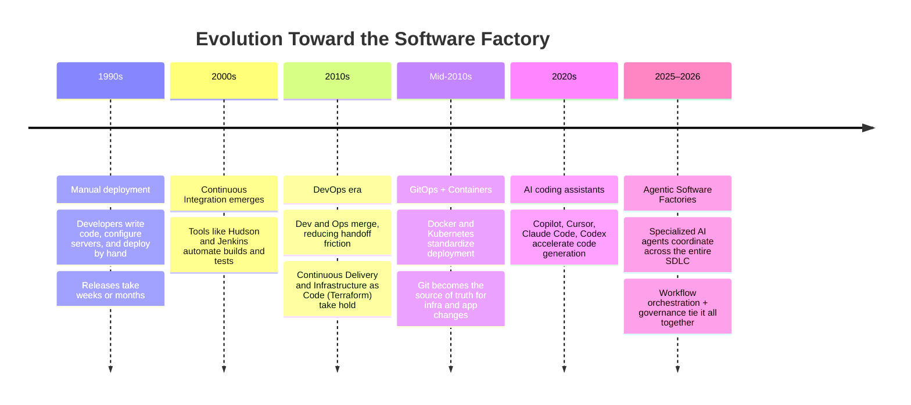
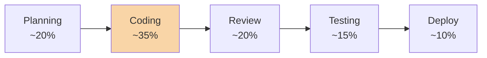
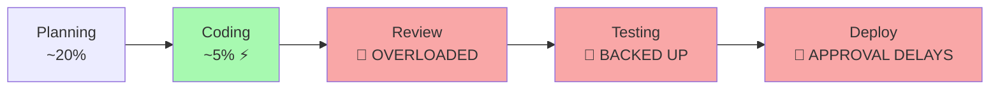
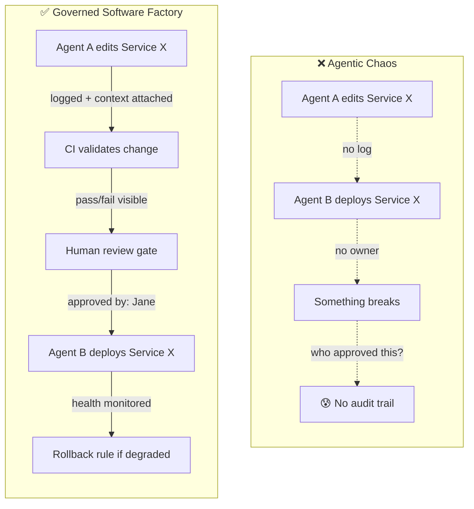
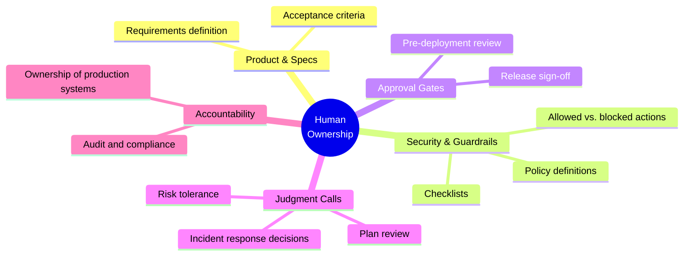
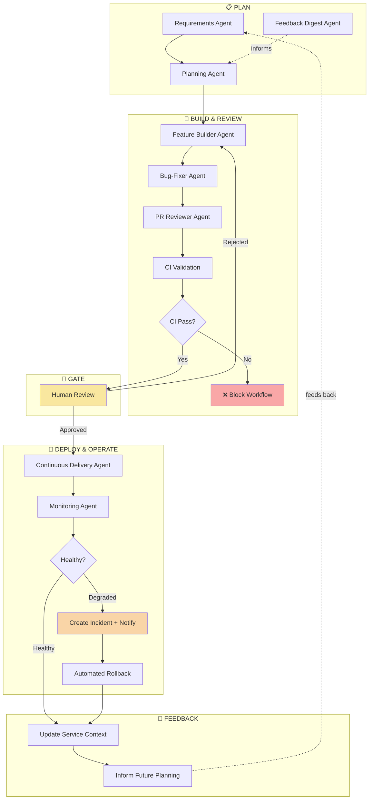
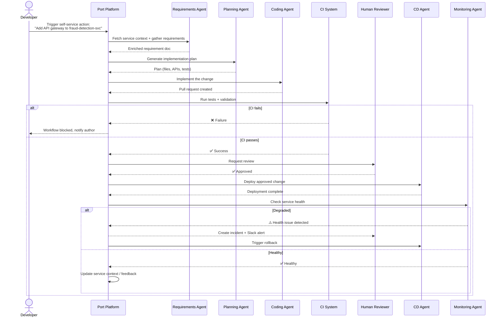
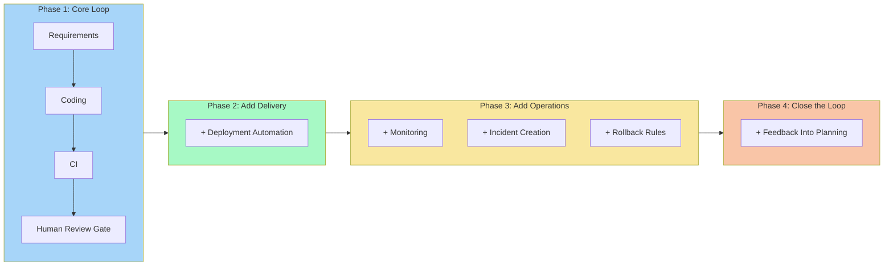

# Building a Software Factory With AI Agents and Workflows: A Complete Tutorial

## Introduction

If you've spent any time around engineering teams in 2025–2026, you've heard the term **"software factory"** thrown around a lot. It's tempting to dismiss it as another buzzword, but the idea behind it solves a real and growing problem: **AI coding assistants have made writing code faster, but they haven't made shipping software faster.**

In fact, in many teams, faster code generation has made things *worse* downstream — pull requests pile up, reviewers get overwhelmed, testing pipelines choke, and deployment approvals become the new bottleneck. This tutorial walks you through what a software factory actually is, why it matters right now, how to build one using AI agents and workflow orchestration, and how to avoid the common trap of "agentic chaos."

By the end of this tutorial, you'll understand:

- The mental model behind a software factory (and why the assembly-line analogy works)
- How software delivery evolved to get here
- Why faster coding creates new bottlenecks elsewhere in the SDLC
- The specific building blocks (agents + gates) that make up a working factory
- A step-by-step walkthrough of building one, with a concrete example
- Real-world use cases across different types of teams
- How to start small and scale up safely

Let's dig in.

---

## 1. What Is a Software Factory?

A software factory is **not** a new IDE, a new CI tool, or a single AI coding assistant. It's an **operating model** — a way of organizing the entire software development lifecycle (SDLC) as one connected, observable, repeatable system, rather than a series of disconnected tools and manual handoffs.

### The Assembly-Line Analogy

Think about how a car gets built:

- The chassis moves to the **welding station**.
- Then to **painting**.
- Then to **electronics and interior assembly**.
- Then through **quality inspection**.
- Finally, it's **delivered**.

At every station, there's a clear job, a predictable order, and quality checks placed exactly where they matter. Humans aren't removed from the process — a human inspector still checks the paint job and signs off before the car moves to the next station. But humans aren't manually tightening every bolt either.

**Software delivery can work exactly the same way.**

```mermaid
flowchart LR
    subgraph Car["🚗 Car Factory"]
        direction LR
        A1[Chassis] --> A2[Welding]
        A2 --> A3[Painting]
        A3 --> A4[Inspection]
        A4 --> A5[Assembly]
        A5 --> A6[Final QA]
        A6 --> A7[Delivery]
    end

    subgraph Software["💻 Software Factory"]
        direction LR
        B1[Requirements] --> B2[Planning]
        B2 --> B3[Build/Code]
        B3 --> B4[Test/CI]
        B4 --> B5[Human Review]
        B5 --> B6[Deploy]
        B6 --> B7[Monitor & Feedback]
    end

    Car -.same operating model.-> Software
```

### The Core Insight

In an **agentic** software factory, AI agents perform the repetitive, well-defined work at each station — gathering requirements, writing code, running tests, checking service health — while **humans own the checkpoints that require judgment**: approvals, security sign-off, and production decisions.

> **Key mental model:** Agents perform work. Humans provide the gates.

### A Typical Flow

| Stage | What Happens | Owner |
|---|---|---|
| Requirements & design | Clarify what to build, gather service context | Agent (assisted by human input) |
| Planning | Turn requirements into a feasible implementation plan | Agent |
| Build | Generate or modify code | Agent |
| Testing & CI | Validate the change, catch failures early | Agent |
| Human review | Approve, reject, or request changes | **Human** |
| Deployment | Release the approved change | Agent |
| Monitoring & ops | Check health, raise incidents, roll back | Agent |
| Feedback loop | Feed production learnings back into planning | Agent + Human |

---

## 2. How We Got Here: The Evolution of Software Delivery

Understanding *why* the software factory model emerged makes it much easier to reason about how to build one. It's the natural next step in a decades-long push toward more reliable, repeatable delivery.

### Why Each Step Mattered

1. **Manual → CI**: Removed human error from build/test repetition.
2. **CI → DevOps**: Removed the wall between "people who write code" and "people who run it."
3. **DevOps → GitOps**: Made infrastructure changes as reviewable and auditable as code changes.
4. **GitOps → Agentic**: Extended automation beyond *execution* into *cognition* — agents can now plan, decide, and adapt, not just run scripts.

The critical difference in this last step: **automation used to follow fixed scripts. Agents can reason about context and take variable action.** That power is exactly why the software factory model — with explicit gates and governance — becomes necessary rather than optional.

---

## 3. Why AI Coding Assistants Create New Bottlenecks

This is the part most teams get wrong. They assume that because AI can write code 5–10x faster, the *whole* delivery pipeline gets 5–10x faster. It doesn't — because code is only one stage in a multi-stage system, and **a system is only as fast as its slowest stage.**

### Before AI Assistants: A Balanced Pipeline

Roughly balanced effort across stages — coding took the largest share, but every stage had comparable throughput.

### After AI Assistants: An Unbalanced Pipeline

**Example:** Imagine a team of 6 engineers. Before AI assistants, each engineer opened ~2 PRs per week — 12 PRs/week total, matched to review capacity. With AI-assisted coding, the same team might now generate 5–8 PRs *per engineer* per week — 30–48 PRs/week. Senior reviewers, whose bandwidth hasn't changed, become the new critical path. Merge times stretch from hours to days. Ironically, **cycle time to production can get worse**, even though code is being written faster.

This is precisely the problem a software factory is designed to solve: it looks at the *entire* system's throughput, not just the coding stage.

### Preventing "Agentic Chaos"

There's a second, subtler risk. If a team bolts multiple independent AI agents onto different tools without a shared operating layer, you lose visibility fast. Ask yourself:

- Which agent changed this service, and when?
- What context (docs, tickets, service catalog data) did it use to make that change?
- Which policy or guardrail applied to this action?
- Who actually approved the deployment?
- What's the defined response if a health check fails post-deploy?

If you can't answer these quickly, you have **agentic chaos**: lots of autonomous activity, but no accountability trail. A software factory prevents this by making the agent workflow **explicit, visible, and gated** — every agent action happens inside a known workflow step, with logged inputs, outputs, and approvals.

---

## 4. Humans Still Own the System

It's tempting to think "we can automate the entire SDLC end-to-end." Technically, much of it *can* be automated. But giving unrestricted authority to agents is a real operational risk — a poorly constrained agent can make a bad call, trigger the wrong action, or cause real production damage.

In a well-designed software factory, your job isn't to manually execute every repeated task — it's to **define the rules of the factory**.

### What Humans Own

### What Agents Own

- Gathering context (service catalogs, past incidents, related tickets)
- Drafting implementation plans
- Writing and modifying code
- Running tests and CI checks
- Checking service health post-deploy
- Notifying the right team through Slack/email
- Summarizing feedback for the next planning cycle

**Analogy:** Think of yourself as a factory manager, not a factory worker. You design the assembly line, set the quality gates, and step in at decision points — you don't personally tighten every bolt.

---

## 5. The Building Blocks of an Agentic Software Factory

Rather than one giant "do everything" agent, an effective software factory uses **specialized agents**, each with a narrow, well-defined job, connected through **workflow orchestration**.

### Breaking Down Each Block

**Plan stage:**
- *Requirements Agent* — takes a raw feature request ("add rate limiting to the checkout API") and enriches it with service ownership, dependencies, and context.
- *Planning Agent* — converts that requirement into a concrete implementation plan (files to touch, APIs to change, tests to add).
- *Feedback Digest Agent* — pulls in relevant history: past incidents, prior similar changes, what worked or didn't.

**Build & Review stage:**
- *Feature Builder / Bug-Fixer Agent* — writes or modifies the actual code.
- *PR Reviewer Agent* — performs an automated first-pass review (style, obvious bugs, missing tests).
- *CI* — runs the test suite. **Critically: a failed CI build blocks the workflow.** It does not quietly continue toward deployment.

**Human Review Gate:**
- A developer reviews the CI-passed change and decides: approve, reject, or request changes. This is the single most important checkpoint in the whole factory — it's where speed meets judgment.

**Deploy & Operate stage:**
- *Continuous Delivery Agent* — deploys the approved change.
- *Monitoring Agent* — checks service health (error rates, latency, saturation) post-deploy.
- If health is degraded: create an incident, notify the owning team (e.g., via Slack), and — where policy allows — trigger an automated rollback.

**Feedback loop:**
- Production outcomes (did the change cause issues? did it resolve the original problem?) get written back into the service's context, so the *next* planning cycle is smarter than the last.

---

## 6. Hands-On: Building a Software Factory Workflow With Port

To make this concrete, here's a worked example using [Port](https://www.port.io) as the context and orchestration layer — combining service catalog data, agent management, and workflow governance in one place.

### Step-by-Step Workflow

### The Twelve Concrete Steps

1. **Fetch service context** — identify the service, its owner, and relevant metadata.
2. **Gather requirements** — a requirements agent interprets the feature request.
3. **Create a plan** — a planning agent drafts the implementation approach.
4. **Build the change** — a coding agent implements the work.
5. **Test and run CI** — validate through automated testing.
6. **Block on failure** — stop immediately if CI fails; never proceed silently.
7. **Request human review** — a developer approves, rejects, or requests changes.
8. **Deploy through CD** — release the approved change.
9. **Monitor health** — inspect the live service.
10. **Respond to degradation** — create incidents, notify teams, roll back if needed.
11. **Collect feedback** — send outcomes back into the service catalog.
12. **Final deploy gate** — one last human checkpoint before final release/publish.

### Two Ways to Trigger It

- **Self-service action**: A developer picks a service in the catalog and describes a feature (e.g., "add an API gateway to the fraud detection service"). The workflow runs end-to-end automatically, pausing at gates.
- **Conversational (Port AI)**: A developer can simply ask, *"Trigger the agentic SDLC pipeline for `payments-service` and add OpenTelemetry distributed tracing."* Port locates the service, finds the matching workflow, triggers it, and returns a live tracking link.

**Crucially, this is never a black box.** At any point, you can inspect the workflow's current stage (planning? coding? testing?), see logs, and review the exact configuration that's running.

---

## 7. Real-World Use Cases

Here's where the software factory model earns its keep in practice. Below are several concrete scenarios showing how it applies across different situations.

### Use Case 1: Adding a Security Feature Under Deadline Pressure

**Scenario:** A fraud-detection service needs an API gateway with rate limiting before a compliance deadline.

- Requirements agent pulls existing service context (current auth model, downstream consumers).
- Planning agent proposes a plan that doesn't break existing API contracts.
- Coding agent implements it; CI runs contract tests automatically.
- Human review gate catches an edge case the agent missed (a legacy internal client bypassing the gateway).
- Once fixed and approved, CD deploys; monitoring confirms no regression in fraud-check latency.

**Why the factory model helps:** Speed *and* an audit trail for compliance — you can show exactly who reviewed what, and when.

### Use Case 2: Adding Observability Across Many Services

**Scenario:** A platform team wants to roll out OpenTelemetry tracing across 40 microservices.

- Instead of 40 manual PRs, a developer triggers the same software factory workflow per service via Port AI conversationally.
- Each run follows the identical governed path: plan → build → CI → human review → deploy → monitor.
- Feedback from early rollouts (e.g., a config pattern that caused memory overhead) automatically improves the plan for later services.

**Why the factory model helps:** Consistency at scale — the 40th rollout benefits from lessons learned in the first 5.

### Use Case 3: Handling a Production Incident

**Scenario:** A deploy goes out, and error rates spike 10 minutes later.

- The monitoring agent detects the degradation automatically.
- It creates an incident ticket and posts a Slack alert to the owning team — no one has to notice manually.
- Based on policy, it triggers an automated rollback immediately, buying the team time to investigate without prolonged customer impact.
- The incident and its resolution get logged into the service's feedback context for future planning.

**Why the factory model helps:** Mean-time-to-recovery (MTTR) drops because detection and first response are automatic, while the human team focuses on root cause.

### Use Case 4: Bug Fix From a Support Ticket

**Scenario:** A customer support ticket describes a bug in checkout flow.

- Requirements agent converts the ticket into a structured bug description tied to the checkout service.
- Bug-fixer agent proposes a patch; CI validates it against the existing test suite plus a new regression test.
- A human reviewer approves a low-risk, well-tested fix quickly since the CI evidence is strong.
- CD deploys during a low-traffic window automatically.

**Why the factory model helps:** Low-risk changes move fast without sacrificing the review checkpoint.

---

## 8. Start Small, Then Expand the Factory

You do not need to automate the entire SDLC on day one — and you shouldn't try to. A mature software factory is built incrementally.

### A Practical Rollout Checklist

| Phase | Goal | Success Signal |
|---|---|---|
| 1. Core loop | Requirements → Code → CI → Human gate stable for one service | Fewer stalled PRs; consistent review turnaround |
| 2. Delivery | Add automated CD for approved changes | Deploy frequency increases without incident rate rising |
| 3. Operations | Add monitoring, incident creation, rollback rules | MTTR decreases measurably |
| 4. Feedback loop | Production outcomes inform next planning cycle | Fewer repeat incidents over time |

---

## 9. Key Takeaways

- **A software factory is an operating model**, not a tool — it organizes the entire SDLC into a connected, repeatable, observable workflow.
- **Faster coding alone doesn't speed up delivery** — without matching improvements downstream, code review, testing, and deployment approval become the new bottlenecks.
- **Agents perform work; humans provide the gates.** The division of responsibility is what keeps a software factory safe at speed.
- **Specialized agents beat one giant agent** — requirements, planning, coding, review, deployment, and monitoring are each better served by a focused agent with a clear job.
- **Governance prevents agentic chaos** — every agent action should be visible, logged, and tied to a defined workflow step and an accountable human decision point.
- **Start small.** A stable core loop (requirements → code → CI → human review) is a better foundation than a fragile end-to-end automation attempt.

---

## 10. Quick Reference: Software Factory vs. Traditional Pipeline

| Aspect | Traditional CI/CD Pipeline | Agentic Software Factory |
|---|---|---|
| Code generation | Manual, by developers | AI agents (assisted or autonomous) |
| Requirements gathering | Manual (tickets, docs) | Agent-enriched with service context |
| Planning | Manual, often ad hoc | Dedicated planning agent |
| Review | Fully manual | Automated first pass + human gate |
| Deployment | Scripted/automated | Agent-driven, policy-gated |
| Monitoring | Dashboards, manual triage | Agent-driven detection + auto-incident |
| Rollback | Manual decision | Policy-driven automated rollback |
| Feedback loop | Rare, informal | Structured, feeds back into planning |
| Governance | Implicit, tribal knowledge | Explicit, visible, auditable |

---

## Conclusion

The shift from "AI helps me write code" to "AI agents run parts of my delivery pipeline" is one of the biggest changes in how software gets built. But speed without structure just moves the bottleneck around — and unstructured autonomy creates real operational risk.

The software factory model solves both problems at once: it treats the entire SDLC as a connected system, gives every agent a clearly scoped job, and puts humans exactly where their judgment adds the most value — at approvals, security checkpoints, and production decisions. Start with one stable loop, prove it out, and expand the factory one gate at a time.