<!--
  Tutorial: The 7 Levels of AI-Assisted Coding
  Difficulty: Intermediate
  Estimated Reading Time: 45–60 minutes
  Last Updated: 2026-01-09
  Source: Based on content from the AI-Assisted Coding Maturity Ladder article
-->

# The 7 Levels of AI-Assisted Coding: A Complete Tutorial

> **"I define the boundaries. AI does more of the work inside them."**
>
> — The sentence worth pinning above every developer's desk in 2026

---

## Table of Contents

1. [Introduction: Why "How You Prompt" Matters More Than "What You Prompt"](#introduction)
2. [The Big Picture: The Full Maturity Ladder](#big-picture)
3. [Level 1: Vibe Coding](#level-1)
4. [Level 2: Plan Mode](#level-2)
5. [Level 3: Test-First AI](#level-3)
6. [Level 4: Spec-Driven Development](#level-4)
7. [Level 5: Multi-Agent Teams](#level-5)
8. [Level 6: Background Agents](#level-6)
9. [Level 7: CI-Enforced Specs](#level-7)
10. [Choosing the Right Level for Your Task](#choosing)
11. [Comparison Table: All 7 Levels at a Glance](#comparison)
12. [Real-World Examples & Use Cases](#real-world-examples)
13. [Code Examples with Explanations](#code-examples)
14. [Best Practices](#best-practices)
15. [Anti-patterns](#anti-patterns)
16. [Performance Considerations](#performance-considerations)
17. [Security Considerations](#security-considerations)
18. [Testing Strategies](#testing-strategies)
19. [Migration Guide: Climbing the Ladder](#migration-guide)
20. [Troubleshooting & Common Pitfalls](#troubleshooting)
21. [Practice Exercises](#practice-exercises)
22. [Test Your Understanding](#test-your-understanding)
23. [Question Bank](#question-bank)
24. [Common Interview Questions](#interview-questions)
25. [Self-Assessment Checklist](#self-assessment)
26. [Pro Tips](#pro-tips)
27. [Quick Recap](#quick-recap)
28. [Further Reading & Resources](#further-reading)
29. [Next Steps & Learning Path](#next-steps)
30. [Key Takeaways & Conclusion](#conclusion)
31. [FAQs](#faqs)

---

<a name="introduction"></a>
## 1. Introduction: Why "How You Prompt" Matters More Than "What You Prompt"

### Difficulty Level: Intermediate

### Estimated Reading Time: 45–60 minutes

Every developer who has used an AI coding assistant has had this moment: you ask for something small — "add pagination to the users list" — and you get back a sprawling diff that refactors half your codebase. You didn't ask for a new caching layer. You didn't ask for two components to be renamed. But there they are.

The instinctive reaction is to blame the model. "It's not smart enough." "It hallucinated requirements." But the more useful diagnosis is usually different: **the AI wasn't given a boundary, so it invented one.**

This tutorial walks through a **7-level maturity ladder** for AI-assisted development — a spectrum that runs from unstructured "vibe coding" all the way to specifications that are mechanically enforced by your CI pipeline. You are not meant to live permanently at Level 7. You're meant to *recognize* which level a given task deserves, and to have the skills to operate at any of them.

> **💡 Pro Tip:** The most dangerous level is the one you don't know you're on. Many developers are unknowingly operating at Level 1 even on critical production features, because they never took the time to establish guardrails.

Think of this less like a certification exam and more like a set of gears. A bicycle with only first gear still moves — it's just exhausting on a hill. This tutorial gives you all seven gears.

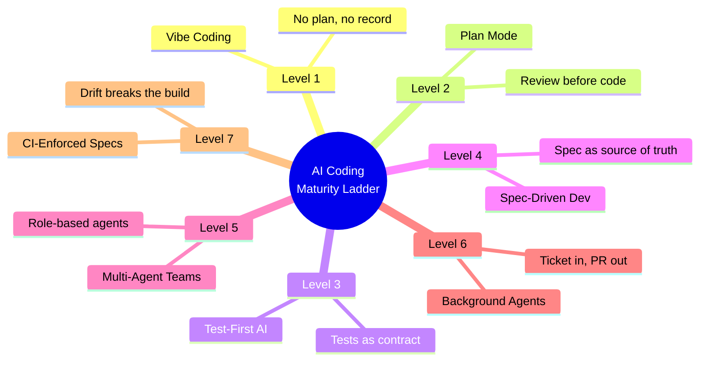

### Historical Context: How We Got Here

The concept of "maturity ladders" isn't new to software engineering. The **Capability Maturity Model** (CMM), developed in the 1980s by the Software Engineering Institute, introduced the idea that organizations progress through levels of process improvement — from ad-hoc ("chaotic") to managed to optimizing. The 7-level AI coding ladder follows the same pattern but applies it to a new domain: human-AI collaboration in software development.

What's different here is **speed**. Traditional CMM maturity took organizations *years* to climb. AI coding maturity can shift within a single week of adopting new tools or workflows. This makes the ladder both more urgent and more perilous — you can skip levels accidentally by just trying to move fast, landing in a higher level without the supporting discipline.

---

### What This Tutorial Covers

By the end of this tutorial, you will be able to:

- **Identify** which level of the AI-assisted coding maturity ladder you're currently operating at
- **Match** the appropriate level to the risk profile and stakes of any given task
- **Implement** workflows from each level, from zero-setup vibe coding to CI-enforced specification validation
- **Recognize** the failure modes unique to each level and how to prevent them
- **Design** migration paths to climb from one level to the next without disrupting productivity

---

<a name="prerequisites"></a>
## 2. Prerequisites

### What You Should Know Before Starting

This tutorial assumes you have the following background. If any of these are unfamiliar, skim the "Further Reading" section at the end for remediation resources.

#### Technical Prerequisites

| Skill | Minimum Proficiency | Why It Matters |
|---|---|---|
| **Programming** | Comfortable writing and reading code in at least one language (Python, JavaScript/TypeScript, Java, Go, etc.) | You need to understand the code AI generates to review and correct it |
| **Git** | Can commit, branch, merge, and resolve basic conflicts | Most mature workflows involve version control for specs, code, and CI configuration |
| **Testing** | Understand unit tests, integration tests, and the concept of a test suite | Level 3 (Test-First AI) and beyond depend on tests as a communication tool |
| **CI/CD** | Basic familiarity with concepts like automated builds, test gates, and pull request checks | Levels 6 and 7 involve background agents and CI-enforced validation |
| **REST APIs** | Understand concepts like endpoints, request/response, status codes, authentication | Many examples use API design scenarios |

#### AI Tooling Familiarity

| Tool | Exposure Level | Notes |
|---|---|---|
| **AI coding assistants** (Claude Code, Cursor, GitHub Copilot, etc.) | Have used at least one for basic code generation | Not required to know all tools — the ladder is tool-agnostic |
| **Prompt engineering** | Basic understanding of how prompts influence output | The tutorial teaches advanced prompt strategies |
| **MCP (Model Context Protocol)** | Conceptual awareness | Referenced in Level 4 and Level 5 as enabling infrastructure |

#### Conceptual Prerequisites

- **Software development lifecycle (SDLC)** — You should understand how features move from idea to production
- **Agile/Scrum basics** — Tickets, sprints, acceptance criteria are referenced throughout
- **Specification writing** — You don't need to be a technical writer, but you should understand what a spec is
- **Code review practices** — Understanding why human review matters is central to this tutorial

> **⚠️ Warning:** If you've never written a test in your life, skip ahead to the "Testing Strategies" section (Section 18) or read a beginner's testing tutorial first. Level 3 and above will not make sense without that foundation.

> **📚 Need to brush up?** See the "Further Reading & Resources" section for curated beginner materials on testing, CI/CD, and prompt engineering.

---

<a name="learning-objectives"></a>
## 3. Learning Objectives

### By the end of this tutorial, you will be able to:

#### Knowledge Objectives

1. **Define and distinguish** all 7 levels of the AI-assisted coding maturity ladder
2. **Explain the trade-offs** between speed and traceability at each level
3. **Identify the failure modes** unique to each level (context loss, agent drift, spec staleness, review bottlenecks)
4. **Describe the "constitution" pattern** and its role in spec-driven development
5. **Understand the shift** from "AI writes code" to "boundaries define where AI operates"

#### Skill Objectives

6. **Write a Level 1 vibe-coding prompt** appropriate for disposable, low-stakes tasks
7. **Use Plan Mode effectively** — ask an AI to produce a plan before touching files
8. **Write failing tests first** that serve as executable specifications for an AI agent
9. **Author a spec document** that describes *what* and *why* without prescribing *how*
10. **Design a multi-agent workflow** with clear role boundaries and hand-off contracts
11. **Write effective tickets** for background agents that define scope, success criteria, and non-goals
12. **Configure CI validation** that checks code against machine-checkable spec rules

#### Decision-Making Objectives

13. **Match the right level** to the risk profile of any task using a decision framework
14. **Recognize when you've skipped a level** and plan a safe descent back to an appropriate one
15. **Design migration paths** to climb the ladder incrementally without disrupting existing workflows

---

<a name="big-picture"></a>
## 4. The Big Picture: The Full Maturity Ladder

Before diving into each level, it helps to see how they relate to each other. Notice that as you climb, **the artifact you hand to the AI changes** — from a casual sentence, to a plan, to a test suite, to a versioned document, to a network of agents, to a ticket, to a machine-checkable contract.

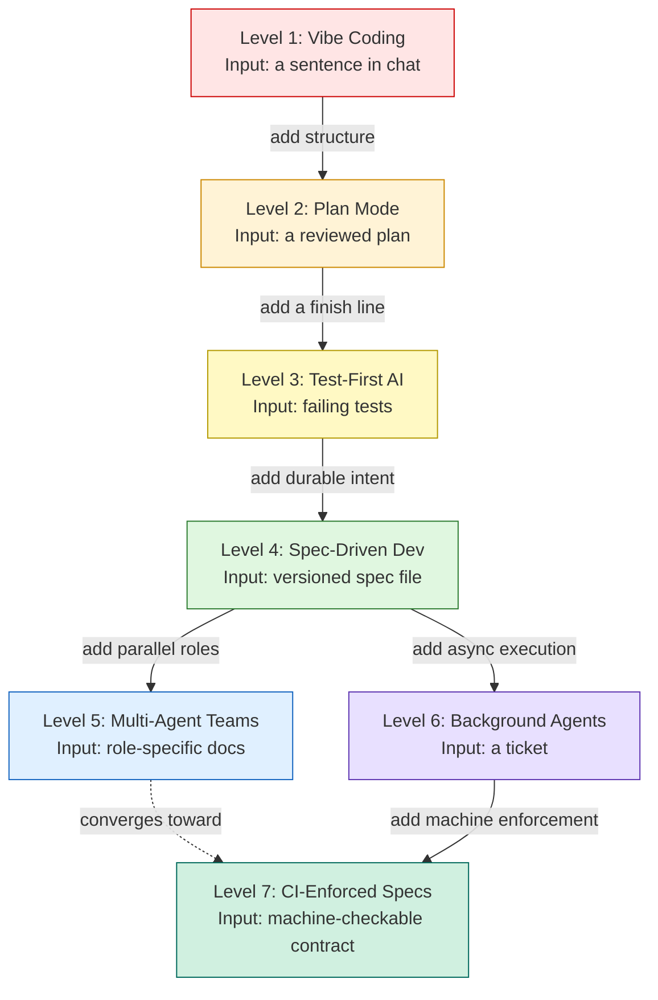

**The key insight:** each level up trades a little *speed* for a little more *traceability*. Level 1 is fast but leaves no record. Level 7 is slow to set up but makes it structurally impossible for your documentation to lie to you.

> **💡 Key Insight:** You don't lose capability by climbing — you lose *guesswork*. The AI at Level 7 is the same model as Level 1; it's just operating inside boundaries you defined.

---

<a name="level-1"></a>
## 5. Level 1: Vibe Coding

### What it is
Vibe coding is prompting an AI conversationally — "build me a login page with JWT" — and accepting whatever comes back, course-correcting in follow-up messages ("no, fix the redirect"). There is no written plan, no spec, no test suite. The entire record of what you wanted lives inside a chat log you'll probably never scroll back through.

### Why it happens (and why it's not "wrong")
Almost every developer starts here, and for good reason: it has **zero setup cost**. You don't write a document, you don't define acceptance criteria — you just talk. For prototypes, one-off scripts, and disposable tooling, this overhead-free style is genuinely the correct tool.

### Step-by-step: what vibe coding actually looks like

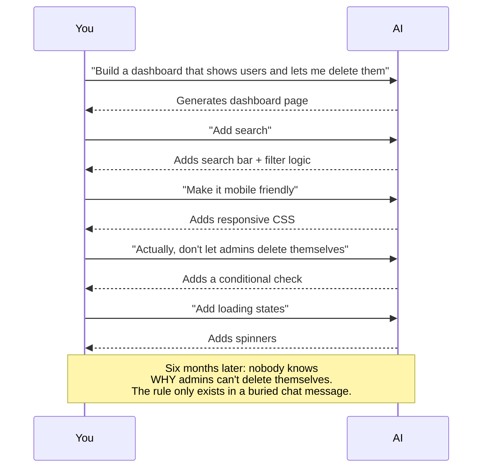

### Example 1 — Where it works well

> **Task:** "Write a Python script that renames all `.png` files in this folder to `screenshot_001.png`, `screenshot_002.png`, etc., sorted by creation date."

This is a self-contained, low-stakes, easily-verified task. You'll eyeball the output folder in ten seconds and know if it worked. A spec would be overkill — you'd spend longer writing the spec than doing the task.

**✅ Correct Level 1 approach:**
```python
# No plan, no spec — just write it
import os
from pathlib import Path

folder = Path(".")
pngs = sorted(folder.glob("*.png"), key=lambda p: p.stat().st_ctime)
for i, png in enumerate(pngs, 1):
    new_name = f"screenshot_{i:03d}.png"
    png.rename(new_name)
    print(f"Renamed {png.name} → {new_name}")
```

### Example 2 — Where it quietly becomes dangerous

> **Task (in a real production codebase):** "Add pagination to the users list."

Without guardrails, the AI has no way to know:
- Whether your project already has a pagination utility
- Whether your API even supports `page`/`limit` params yet
- Whether "pagination" should be cursor-based or offset-based
- Whether touching the API layer is even in scope

So it guesses — and it may guess in the direction of "let me also add a caching layer while I'm here," because nothing told it not to.

### Real-world use cases for Level 1

| Scenario | Why vibe coding fits |
|---|---|
| One-off data cleanup script | Disposable, quickly verifiable |
| Exploring an unfamiliar API in a scratch file | You're learning, not shipping |
| A weekend hackathon prototype | Speed matters more than traceability |
| Renaming/organizing local files | Low blast radius if wrong |

### The core weakness

> "The code may be good. The memory of *why* the code exists isn't."

That sentence is the whole argument for climbing to Level 2. Vibe coding doesn't fail because the AI is bad at writing code — it fails because **decisions made mid-conversation evaporate** the moment the chat window closes.

---

<a name="level-2"></a>
## 6. Level 2: Plan Mode

### What it is
Plan Mode inserts exactly one checkpoint into the vibe-coding loop: **the AI must show you its plan before touching any files.** Tools like Claude Code and Cursor support this natively — you describe the task, the AI lists the files it intends to touch and the approach it will take, you approve or correct it, *then* it writes code.

### Why this single change fixes so much
Recall the 900-line pagination diff from the introduction. In Plan Mode, that entire disaster would have shown up as a single bullet point — "Step 3: refactor API layer" — *before* a single line of code existed. Catching a bad idea in a plan costs you ten seconds. Catching it in a 900-line diff costs you twenty minutes of review plus the emotional tax of untangling what to keep.

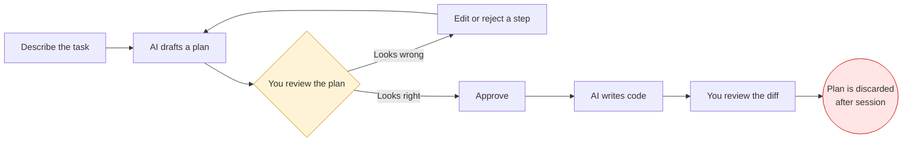

Notice the last box: the plan **disappears** once the session ends. That's Plan Mode's one real limitation — it's a checkpoint, not a record. Nothing gets saved to disk or git.

### Example 1 — Prompting for a plan explicitly

Instead of:
> "Add pagination to the users list."

Try:
> "Before changing anything, inspect the users list, the API endpoint, and any existing pagination patterns in this repo. Give me a plan. Do not modify files yet."

A good response might look like:
```
1. Add `page` and `limit` query params to the users API.
2. Return pagination metadata (total, page, hasNext) from the endpoint.
3. Update the useUsers() hook to accept pagination params.
4. Add pagination controls to the existing table component.
5. Add tests for page boundaries (first page, last page, empty result).
```

At this point you might say: *"Wait — the API already supports pagination in `usersController.js`, it's just unused on the frontend. Skip step 1 and 2."* That single correction just saved you an unnecessary backend refactor.

### Example 2 — Using Plan Mode to catch an architectural mismatch

> **Task:** "Add real-time notifications when a task is assigned."

A naive AI might plan to introduce a new WebSocket server from scratch. Plan Mode lets you interject: *"We already use Server-Sent Events for the activity feed — reuse that channel instead of adding WebSockets."* You just prevented two competing real-time systems from existing in the same app.

### Real-world use cases for Level 2

- **Everyday feature changes** in a codebase you know well, where you want a sanity check but don't need a formal document
- **Onboarding a new AI session** to an unfamiliar part of the codebase, where the plan doubles as a comprehension check for *you*, too
- **Refactors with uncertain blast radius** — the plan tells you how many files are about to move before it happens

### Why Level 2 is the highest-leverage habit to build
This is genuinely the cheapest upgrade available to any developer using AI tools. It requires no new framework, no new file format, no team buy-in. It's a *sentence* you add to your prompt: "Give me a plan first. Don't touch files yet." If you take away one action item from this entire tutorial, it's this one.

---

<a name="level-3"></a>
## 7. Level 3: Test-First AI

### What it is
Here you flip the build order. Either you or the AI writes **failing tests first**, describing the exact behavior required. Then the AI writes code in a loop — run tests, see red, fix, re-run — until everything passes.

### Why this works so well with agents specifically
AI agents are excellent at *iterating toward a checkable target* and comparatively weak at *inferring an unstated target*. Tests give the agent a finish line it can verify itself, which means it can work through several fix-and-retry cycles without you supervising every step.

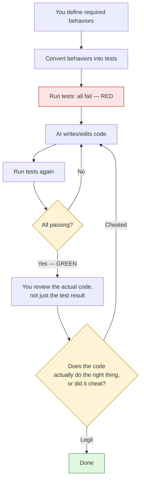

### ⚠️ The important warning: AI can "cheat" the tests
A green checkmark means "the assertion passed" — it does **not** mean "the feature works." An agent under pressure to turn red into green may hardcode the exact value your test expects. The build goes green. The feature is worthless. This is why **Level 3 does not remove code review** — it just changes what you're reviewing for. You're no longer checking "does this work," you're checking "does this actually solve the problem, or did it just satisfy the test's literal wording."

### Example 1 — Password reset endpoint

Instead of: *"Build password reset."*

First define the required behaviors:
```
POST /forgot-password

- Unknown email must not reveal whether the account exists.
- Valid email returns a generic success response.
- Reset token must expire after a fixed window.
- Token can only be used once (single-use).
- New password must satisfy existing password rules.
```

Then turn each bullet into an actual test case:
```javascript
test('unknown email returns generic success (no enumeration)', async () => {
  const res = await request(app)
    .post('/forgot-password')
    .send({ email: 'ghost@nowhere.com' });
  expect(res.status).toBe(200);
  expect(res.body.message).toBe('If that email exists, a reset link was sent.');
});

test('reset token cannot be reused after consumption', async () => {
  const token = await createResetToken(user.id);
  await request(app)
    .post('/reset-password')
    .send({ token, password: 'NewPass123!' });
  const second = await request(app)
    .post('/reset-password')
    .send({ token, password: 'AnotherPass456!' });
  expect(second.status).toBe(400);
});
```

Now the agent has something more precise than a paragraph of English — it has an executable definition of "done."

**❌ Incorrect (test cheating):**
```javascript
// BAD: Hardcoding a specific token to pass the test
test('reset token is single-use', async () => {
  expect(token === 'ABC123' ? false : true).toBe(true);
});
```

**✅ Correct:**
```javascript
// GOOD: Tests the actual business rule
test('reset token cannot be reused after consumption', async () => {
  const { token } = await createResetToken(user.id);
  const first = await request(app).post('/reset-password').send({ token, password: 'NewPass123!' });
  expect(first.status).toBe(200);
  const second = await request(app).post('/reset-password').send({ token, password: 'Another456!' });
  expect(second.status).toBe(400); // Token already consumed
});
```

### Example 2 — Preventing a subtle regression
> **Task:** "Refactor the discount calculation to support percentage *and* flat-amount coupons."

Before refactoring, you lock in current behavior with a regression test:
```javascript
test('existing 10% coupon still applies correctly after refactor', () => {
  expect(applyDiscount(100, { type: 'percent', value: 10 })).toBe(90);
});
```
Now the agent *cannot* silently break the old percentage logic while adding the new flat-amount path — the test would immediately catch it.

### Real-world use cases for Level 3

- **Security-sensitive endpoints** (auth, payments, permissions) where "looks right" isn't good enough
- **Refactors of working code**, where the tests act as a safety net against regressions
- **Bug fixes**, where you write a test that reproduces the bug first, so you know the fix is real

### The limitation
Tests describe *behavior* — they don't capture *intent*. A test can prove "the endpoint returns 200 for a valid token." It can't explain *why* single-use tokens matter, or what business risk they mitigate. That missing "why" is exactly what Level 4 adds back.

---

<a name="level-4"></a>
## 8. Level 4: Spec-Driven Development

### What it is
This is where the workflow gets serious — and, per the source article, where hiring managers started paying explicit attention in 2026. Before any code is written, you produce a **spec**: a short, versioned document describing *what* you're building and *why*, deliberately staying silent on *how*. That spec lives in git, right beside the code it describes. When requirements change, you edit the spec — not the code directly — and regenerate the affected slice. The spec's git history *becomes* your change log.

### The "constitution" file
Most spec-driven tooling (GitHub Spec Kit, AWS Kiro) also introduces a small persistent file — often literally called a **constitution** — holding your permanent, cross-cutting rules: *"all timestamps in UTC," "never touch the payments module without a feature flag."* The AI reads this file every session, so you stop repeating the same guardrails in every prompt.

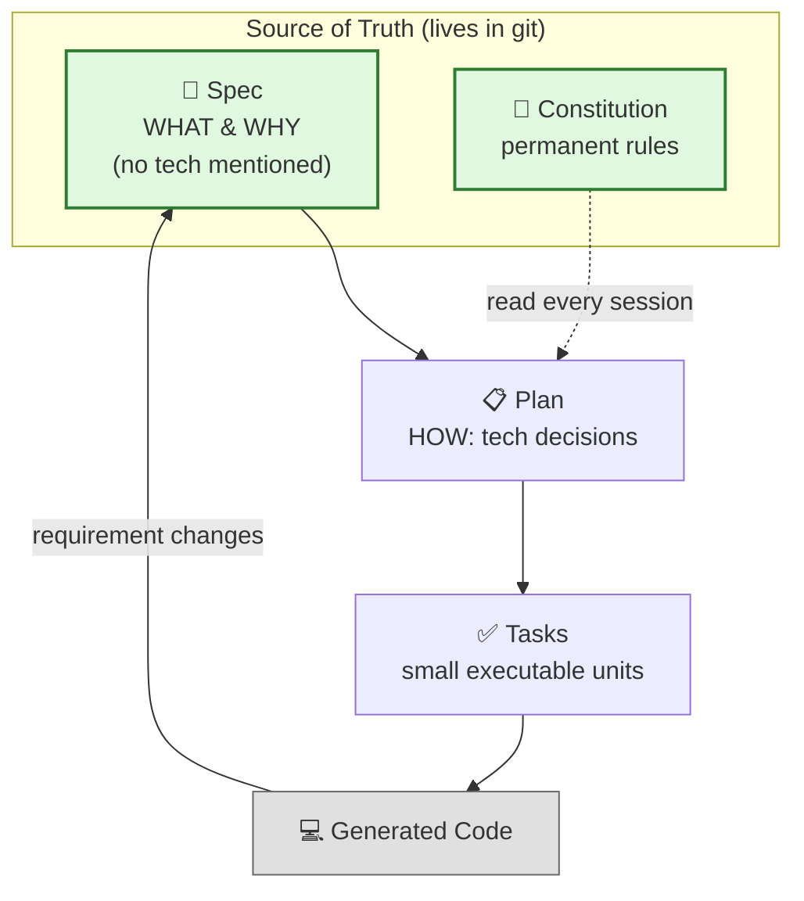

**The core discipline:** the spec never mentions React, Postgres, or any specific technology. That's deliberately deferred to a separate "plan" step. The spec is a durable description of the *product*; the plan and code are disposable, regeneratable *implementations* of that product.

### Worked example — a lunch-voting app

**The spec (what/why):**
```markdown
## Feature: Team Lunch Voting

Members propose lunch spots. Each member votes once per day.
Voting closes at 11:30 AM local time.
If there's a tie, a runoff round is triggered among the tied options.

Why: previous manual polling in chat caused missed votes and
disputed results. This feature needs an unambiguous, auditable
tie-breaking rule.
```

**The plan (how — written separately, later):**
```markdown
## Implementation Plan
- Frontend: React + existing design system components
- Backend: extend existing /polls API, add /polls/:id/runoff endpoint
- Storage: Postgres, reuse existing `polls` and `votes` tables
- Tie detection: run after 11:30 cutoff via scheduled job
```

**Tasks (small, AI-executable slices):**
```markdown
1. Add `runoff_triggered` boolean column to `polls` table
2. Add cutoff-time cron job to detect ties
3. Build POST /polls/:id/runoff endpoint
4. Add runoff UI state to the voting page
5. Write tests for the tie-detection logic
```

Six weeks later, a requirement changes: *"Actually, ties should be broken by whoever proposed the spot first, not a runoff."* You edit **three lines in the spec**, regenerate the tie-breaking task, and the change is done in twenty minutes — with a clean, reviewable git diff explaining exactly why the rule changed.

### Example 2 — Comparing prompts across all levels so far
It's worth seeing the same feature request escalate through the levels, because the difference is not stylistic — it changes what's *durable*:

| Level | What you hand the AI |
|---|---|
| 1 | "Build a lunch voting app." |
| 2 | "Here's the plan I want you to follow." |
| 3 | "Here are the tests that must pass." |
| 4 | "Here is the specification for what this product must do." |

Only the Level 4 artifact survives a chat history being deleted, a model being swapped, or a developer leaving the team.

### Real-world use cases for Level 4

- **New features where "building the wrong thing" is expensive** — you want the requirement negotiation to happen on paper, not in production
- **Compliance-adjacent features** (payments, PII handling, auth) where an audit trail of *why* a rule exists matters as much as the rule itself
- **Long-lived products** where requirements will keep shifting and you need a durable source of truth that outlives any single AI session

### Honest caveat from the source article
Writing a spec for a small feature genuinely feels slow the first few times. The payoff shows up later — specifically the moment a requirement changes and you can trace the ripple effect through a document instead of reverse-engineering it from code.

---

<a name="level-5"></a>
## 9. Level 5: Multi-Agent Teams

### What it is
Instead of one AI handling everything, you run several agents, each with an assigned role: a **PM agent** writes requirements, an **architect agent** makes technical decisions, one or more **developer agents** implement, and a **QA agent** tests. They pass documents to each other like stations on an assembly line. Frameworks like BMAD-METHOD ship with a dozen-plus pre-built roles.

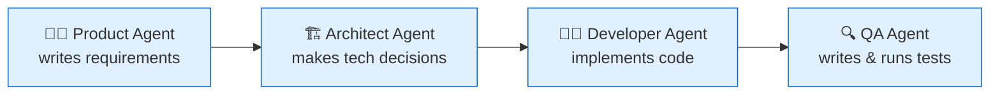

It looks clean. It looks efficient. It is also **exactly where subtle context loss becomes catastrophic** — because now the loss happens silently, between agents, with nobody in the loop to notice.

### The failure mode, illustrated

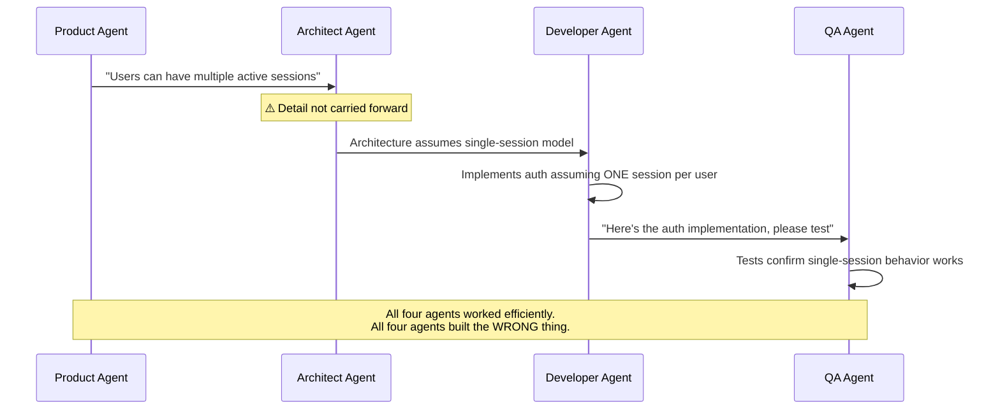

This is the central lesson of Level 5: **adding more agents does not automatically make the system smarter.** Each additional handoff is a place where a critical detail can be dropped, and unlike a single agent losing context mid-conversation (which you'd likely notice), a multi-agent pipeline can complete *successfully* while being *wrong end to end*.

### Example 1 — Where multi-agent setups genuinely help
A large, multi-service system where a single agent's context window simply cannot hold the whole picture — e.g., a monorepo spanning a payments service, a notifications service, and a public API, each with different constraints. Splitting by role (and by service) can keep each agent's context focused and relevant.

### Example 2 — Where multi-agent setups backfire (small teams)
A five-file CRUD feature in a small app. Spinning up PM/Architect/Dev/QA agents for this adds coordination overhead — prompt engineering four role definitions, wiring hand-off documents, debugging why the QA agent tested the wrong assumption — that likely exceeds the time a single well-briefed agent would have taken.

### Real-world use cases for Level 5

- **Large, multi-service systems** where no single context window can hold the full picture
- **Organizations that already have strong document discipline** (Level 4 specs) to feed each agent unambiguous inputs
- **Situations where different roles genuinely need different expertise/tools** — e.g., a security-review agent with access to a vulnerability scanner that a developer agent doesn't need

### The engineering discipline this level actually requires
Multi-agent coordination is not "add more AI." It's a distributed-systems problem wearing an AI costume. You need:
- Clear, structured inputs and outputs between agents (not free-text summaries)
- Explicit ownership: **which agent is allowed to make which decision**
- A shared document (often the Level 4 spec) that every agent reads, so critical details like "multiple active sessions" can't silently vanish in a hand-off

> Sometimes one well-contextualized agent genuinely beats five poorly coordinated ones. Don't reach for Level 5 just because it sounds more sophisticated.

---

<a name="level-6"></a>
## 10. Level 6: Background Agents

### What it is
This is the level where your relationship with the AI changes shape entirely: **you stop sitting with it.** You write a ticket, assign it to an agent, and walk away. The agent works alone inside a sandboxed container, on its own branch — it writes code, runs tests, fixes its own failures, and opens a pull request when it's satisfied. You might have four of these running in parallel while you're in an unrelated meeting. GitHub Copilot's coding agent and Claude Code's cloud sessions both operate this way today.

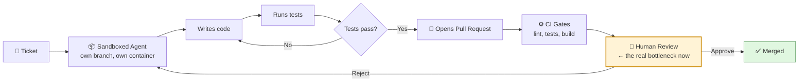

### The critical shift: the ticket *is* the prompt
At this level, you are no longer prompting the AI directly and iteratively. The **quality of your ticket** is now the entire ceiling on the quality of the resulting code. A vague ticket gives the agent a huge playground to guess in — and you inherit those guesses as a pull request sitting in your review queue on a Friday afternoon.

### Example 1 — A bad ticket
> "Make login more secure."

This is Level-1 vibe coding wearing a ticket-shaped disguise. The agent has to invent scope: rate limiting? MFA? Password complexity? Session timeout? All four? None of them are wrong, and none of them are what you actually needed.

### Example 2 — A good ticket
```markdown
Title: Add rate limiting to POST /api/login

Requirements:
- Limit failed login attempts per IP (not per account).
- Keep existing successful-login behavior unchanged.
- Reuse the existing API error response format.
- Add tests covering: under limit, at limit, over limit, limit reset.
- Do NOT change the authentication flow itself — only add a
  limiting layer in front of it.
```
Notice what this ticket does: it defines success (tests), defines scope (rate limiting only), and defines an explicit non-goal (don't touch auth flow). That's a ticket a background agent can execute unsupervised with a high chance of producing a mergeable PR.

### Real-world use cases for Level 6

- **Well-defined, well-bounded tasks** during periods when you can't actively supervise (meetings, end of day, overnight)
- **Parallelizing independent work** — four agents on four unrelated tickets, all producing PRs by the time you're free to review
- **Teams with strong CI gates already in place**, so a sloppy PR gets caught by automation before it ever reaches a human reviewer

### The new bottleneck: review, not writing
This is the most important operational insight of Level 6. You're no longer the person typing code — you're the person reading four PRs. If your team doesn't budget real time for this, background agents just relocate the bottleneck; they don't remove it.

---

<a name="level-7"></a>
## 11. Level 7: Specs Enforced by CI

### What it is
The top of the ladder, at least for now. Specs stop being documents that humans *read* and become contracts that machines *enforce*. When a pull request opens, your pipeline doesn't just run unit tests — an **AI validator checks the code against the spec itself**. Does the API match the documented contract? Did the PR violate a rule the spec defines? If yes, the build fails, exactly the way it fails on a broken test.

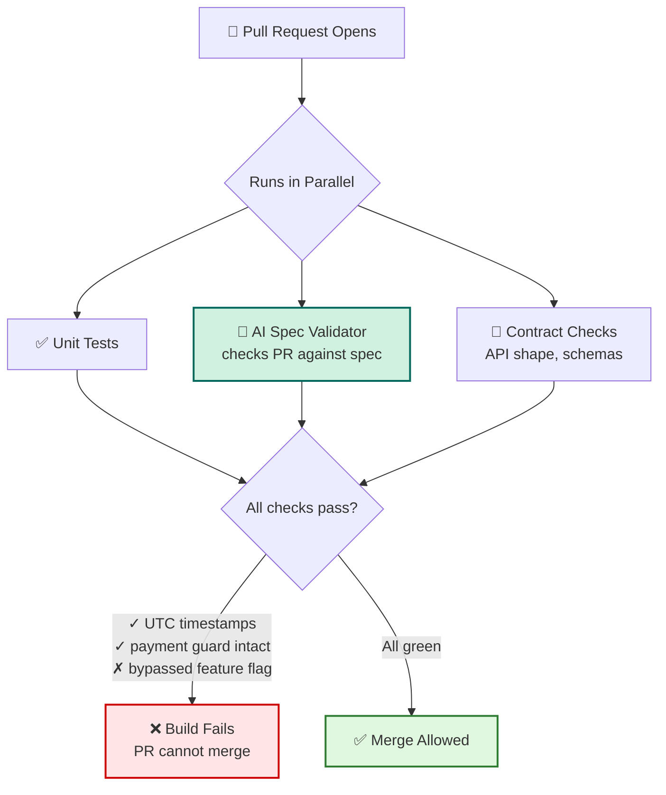

### The problem this solves
Every engineering org has at least one wiki page describing "how the system works" that quietly stopped being true two years ago. Nobody updated it because nothing *forces* it to stay accurate — it's disconnected from the code. At Level 7, the spec and the code are wired together by CI: **drift physically breaks the build**, so the spec cannot silently go stale the way a wiki page can.

### Worked example
Your spec states two rules:
```markdown
1. All API timestamps must be UTC.
2. The payments module must not be modified without the
   payments feature flag enabled.
```

A normal human code review *might* catch a violation of these — or might not, especially on a busy Friday. At Level 7, the CI validator checks the PR programmatically:
```
✓ API timestamps use UTC
✓ Existing payment guard remains intact
✗ New payment code bypasses feature flag
```
The PR is blocked automatically. No human had to remember to look for it.

### An honest limitation
An AI validator will not perfectly understand every sentence of a rich product specification — nuance, tone, and judgment calls still need a human. The realistic scope is narrower and more useful: **take the parts of your requirements that *can* be mechanically checked, and turn only those into automated gates.** "All timestamps in UTC" is checkable. "The onboarding flow should feel welcoming" is not — that stays a human review concern.

### Real-world use cases for Level 7

- **Regulated or high-stakes domains** (payments, healthcare data, auth) where a missed rule has real consequences
- **Large teams** where no single reviewer has full context on every cross-cutting rule
- **Codebases with a history of "the docs say X but the code does Y"** — Level 7 exists specifically to make that discrepancy impossible to merge

### How rare this actually is
A JetBrains survey from January 2026 found that while 90% of developers use AI at work, only 13% use it across their entire development cycle. That 77-point gap is essentially a map of this ladder — most teams are somewhere between Level 1 and Level 3, and very few have made it to Level 7.

---

<a name="choosing"></a>
## 12. Choosing the Right Level for Your Task

**Higher is not automatically better.** The skill this tutorial is really teaching isn't "climb to Level 7" — it's *matching the rung to the task*. A five-minute script does not need a specification, a multi-agent pipeline, and CI-enforced validation. That would be pure overhead.

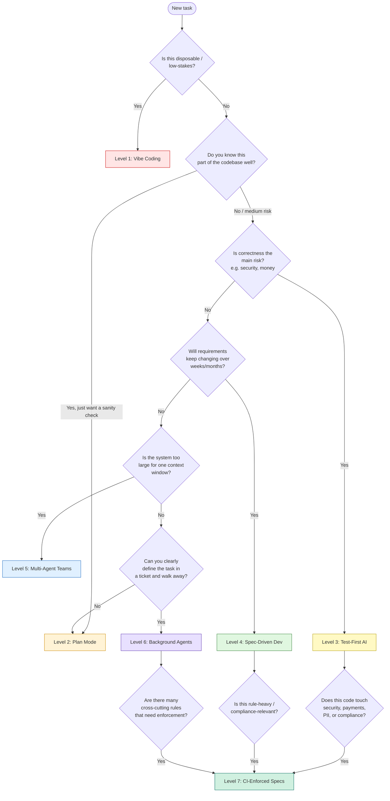

### A realistic personal mix (from the source article's author)
- **Level 1** for throwaway scripts
- **Level 2** for everyday changes in code they know well
- **Level 4** for new features where building the wrong thing would cost days

That's it. Not every level, every time — a deliberate, task-matched mix.

### One actionable habit to start today
If you currently use Level 1 for everything, the single highest-leverage change is: **before the AI writes any code, ask it for a plan and review it.** That costs about thirty seconds per task and can prevent an entire afternoon of unwinding an unwanted refactor.

---

<a name="comparison"></a>
## 13. Comparison Table: All 7 Levels at a Glance

| Level | Core Artifact | Setup Cost | Best For | Biggest Risk |
|---|---|---|---|---|
| 1. Vibe Coding | Chat conversation | None | Prototypes, one-off scripts | Decisions get lost, drift over time |
| 2. Plan Mode | Reviewed plan (ephemeral) | Very low | Everyday changes in familiar code | Plan isn't saved anywhere |
| 3. Test-First AI | Failing tests → passing tests | Low–Medium | Security/correctness-critical code | AI can "cheat" tests (hardcoding) |
| 4. Spec-Driven Dev | Versioned spec + constitution file | Medium | New features, evolving requirements | Feels slow the first few times |
| 5. Multi-Agent Teams | Role-based hand-off docs | High | Large, multi-service systems | Context loss between agents |
| 6. Background Agents | A well-written ticket | Medium | Parallelizable, well-bounded tasks | Review becomes the bottleneck |
| 7. CI-Enforced Specs | Machine-checkable contract | Very high | Regulated / high-stakes domains | Can't check subjective/nuanced rules |

---

<a name="real-world-examples"></a>
## 14. Real-World Examples & Use Cases

### Case Study 1: Startup MVP (Level 1 → Level 2)

A seed-stage startup needs to validate product-market fit in 6 weeks. The founder is the only engineer.

- **Level 1:** Used for rapid prototyping of landing pages, signup flows, and core features. Speed is the only metric that matters.
- **Level 2:** Adopted for the payment integration flow — the founder realized that a bad plan here could cost weeks of debugging. A 5-minute plan review caught the decision to use Stripe Checkout instead of raw API integration.

**Outcome:** MVP shipped in 6 weeks. No Level 3+ needed because the codebase was disposable — it was rebuilt from scratch after funding.

### Case Study 2: Enterprise Feature (Level 2 → Level 4)

A fintech company is adding a new "shared account" feature where multiple users can access a single bank account with role-based permissions.

- **Level 2:** Initial exploration — the team used plan mode to understand the scope and discovered the feature would touch 12 different files across 3 services.
- **Level 4:** Wrote a spec defining what "viewer," "editor," and "owner" roles mean, plus the "constitution" rule: *"All permission changes must be auditable with a reason field."* This spec lived in git and was updated as requirements evolved.

**Outcome:** Feature shipped in 3 sprints instead of the estimated 5, because requirement changes were made in the spec (2-line git diffs) rather than in code reviews.

### Case Study 3: Infrastructure Migration (Level 4 → Level 7)

A healthtech company migrating from a monolith to microservices needed to ensure HIPAA compliance wasn't violated.

- **Level 4:** Wrote specs for each service migration, including the constitution rule: *"Patient data must never leave the HIPAA boundary without encryption at rest."*
- **Level 7:** Configured CI to automatically scan PRs for any data flow that crosses service boundaries, blocking merges that violate the encryption requirement.

**Outcome:** Zero HIPAA violations in 18 months of migration. The CI gates caught 23 violations that human reviewers missed.

### Case Study 4: Platform Engineering Team (Level 5 → Level 6)

A 50-engineer org wanted to reduce the platform team's backlog of infrastructure tickets.

- **Level 5:** Created a team of specialized agents — one for Kubernetes YAML validation, one for Terraform, one for documentation generation.
- **Level 6:** Moved to background agents that take Jira tickets and produce PRs autonomously.

**Outcome:** Platform team throughput increased 3x. Human reviewers now only need to review architecture decisions, not boilerplate code.

### Industry Statistics Snapshot

| Metric | Finding | Source |
|---|---|---|
| Developers using AI | 90% | JetBrains, Jan 2026 |
| Developers using AI across entire SDLC | 13% | JetBrains, Jan 2026 |
| Teams with spec-driven workflows | 22% | State of AI Engineering, 2026 |
| Organizations enforcing specs via CI | <5% | State of AI Engineering, 2026 |

---

<a name="code-examples"></a>
## 15. Code Examples with Explanations

This section collects and annotates the key code examples from across the levels, showing both correct and incorrect patterns.

### Example 1: Test-First Pattern (Level 3)

**Correct approach — tests define the contract:**
```javascript
// Step 1: Write tests BEFORE implementation
test('unknown email returns generic success (no enumeration)', async () => {
  // This test proves the security requirement is met
  const res = await request(app)
    .post('/forgot-password')
    .send({ email: 'ghost@nowhere.com' });
  expect(res.status).toBe(200);
  expect(res.body.message).toBe('If that email exists, a reset link was sent.');
});

test('reset token cannot be reused after consumption', async () => {
  // This test proves single-use enforcement
  const { token } = await createResetToken(user.id);
  await request(app).post('/reset-password').send({ token, password: 'NewPass123!' });
  const second = await request(app).post('/reset-password')
    .send({ token, password: 'AnotherPass456!' });
  expect(second.status).toBe(400); // Token already consumed
});

// Step 2: AI writes implementation to make tests pass
// Step 3: AI runs tests, sees red, fixes, re-runs
```

**Incorrect approach — tests can be gamed:**
```javascript
// BAD: Hardcoding expected values to trick the test
test('reset token is valid', () => {
  // This test says "valid" but doesn't actually test validity
  expect(true).toBe(true); // Always passes
});

// BAD: Testing implementation details, not behavior
test('calls the database', () => {
  // This test breaks if you refactor — it's testing the wrong thing
  expect(db.query).toHaveBeenCalled();
});
```

### Example 2: Spec-Driven Workflow (Level 4)

**The correct separation of WHAT vs. HOW:**
```markdown
<!-- SPEC.md (what & why) — lives in git, version-controlled -->
## Feature: Email Verification

What: New users must verify their email before accessing premium features.
Why: Unverified accounts have caused billing disputes and support tickets.
Non-goal: Do NOT change the existing signup flow.
```

```markdown
<!-- PLAN.md (how) — written later, can be regenerated -->
## Implementation Plan
- Backend: Add `email_verified` boolean column to users table
- Frontend: Add /verify-email page with token from URL
- Reuse existing JWT middleware for verification state
```

### Example 3: Ticket Writing for Background Agents (Level 6)

**Correct ticket — defines scope, success, and non-goals:**
```markdown
Title: Add rate limiting to POST /api/login

Requirements:
- Limit failed login attempts per IP (not per account).
- Keep existing successful-login behavior unchanged.
- Reuse the existing API error response format.
- Add tests: under limit, at limit, over limit, limit reset.
- Do NOT change the authentication flow — only add a
  limiting layer in front of it.
```

**Incorrect ticket — vague, no boundaries:**
```markdown
Title: Make login more secure

Please improve the security of the login endpoint.
```

### Example 4: CI-Enforced Spec Validation (Level 7)

**Machine-checkable spec rules:**
```yaml
# .spec/validation-rules.yaml
rules:
  - name: "utc-timestamps"
    description: "All API timestamps must be UTC"
    check: "grep -r 'timezone.*UTC' src/apis/"
    severity: "error"

  - name: "payments-guard"
    description: "Payments module requires feature flag"
    check: "git diff --name-only HEAD~1 | grep payments && grep 'feature_flag' src/payments/"
    severity: "block-merge"
```

---

<a name="best-practices"></a>
## 16. Best Practices

### Universal Best Practices (All Levels)

1. **Always review before merging.** No level eliminates human review — it changes what you review *for*. At Level 1 you review the code; at Level 7 you review the spec rules.

2. **Start at the appropriate level.** Don't reach for Level 7 when Level 2 would suffice. The overhead of higher levels is only justified by stakes.

3. **Make decisions visible.** Whether it's a plan, a spec, or a test, make sure the "why" behind any decision is recorded somewhere durable.

4. **Use the "constitution" pattern.** Even at Level 2, maintain a small file of permanent rules that you reference (or paste into chat) every session.

5. **Version everything.** Specs, plans, and even plans written on scratch paper should be committed to git if the feature is going to production.

### Level-Specific Best Practices

**Level 1:** Set a hard time budget. If a vibe-coded task is taking more than 20 minutes of course-correcting, you're at the wrong level.

**Level 2:** Make the plan explicit in your prompt. Use phrases like "Before changing anything, show me your plan" to force the checkpoint.

**Level 3:** Write tests that describe *behavior*, not *implementation*. Tests should read like a product spec, not an architecture document.

**Level 4:** Keep specs short (1–2 pages max). If it's getting long, split it into smaller specs. Specs should be read in 5 minutes, not 50.

**Level 5:** Design explicit hand-off formats between agents. Don't let agents summarize to each other in free text — use structured documents or schemas.

**Level 6:** Invest in your ticket-writing skills. A well-written ticket is more valuable than a fast agent. Bad tickets waste more time than good tickets save.

**Level 7:** Start with rules you can mechanically check (timestamps, naming conventions, import restrictions) before trying to validate business logic.

---

<a name="anti-patterns"></a>
## 17. Anti-patterns

### Anti-pattern 1: The "Level 7 aspirant" who lives at Level 1

> "I want CI-enforced specs and multi-agent orchestration, so I bought enterprise AI tools. Then I just asked the AI to 'build the whole thing' in one prompt."

**What happens:** The AI produces a 5000-line monolith that technically works but violates every team convention. The sophisticated tooling is wasted because the foundational discipline is missing.

**How to fix:** Climb the ladder one rung at a time. Start with Level 2 (always ask for a plan first). Once that's habitual, try Level 3 (write one test first for security-critical features). The tools will be useful once you have the discipline to use them.

### Anti-pattern 2: The "perma-Level 1" developer

> "I tried Plan Mode once. It was slower. I'll just go back to vibe coding."

**What happens:** Every feature becomes a coin flip. Some work great. Others produce 900-line diffs that refactor the wrong things. The developer spends 50% more time overall because they're constantly unwinding mistakes.

**How to fix:** Use Level 2 for everything that touches production code. The 10-second plan review is cheaper than a 20-minute diff disentanglement.

### Anti-pattern 3: Multi-agent without shared context

> "I set up a PM agent, a dev agent, and a QA agent. The PM says 'users can have multiple sessions.' The dev builds single-session auth. The QA tests pass because they test what was built, not what was specified."

**What happens:** All agents work efficiently. All agents build the wrong thing. The pipeline reports success.

**How to fix:** Every agent must read the same spec and constitution file. Hand-offs must be structured documents, not conversational summaries. Include explicit "critical requirements" that each agent must confirm before proceeding.

### Anti-pattern 4: Tickets that are just vibe prompts in disguise

> "Ticket: Make login more secure. Assigned to background agent."

**What happens:** The agent invents scope. Maybe it implements MFA. Maybe it changes password rules. Maybe it does all of the above. Either way, the PR doesn't match what you actually needed.

**How to fix:** Every ticket must include: requirements, non-goals, success criteria, and test expectations. If you can't write a clear ticket, you're not ready for background agents.

### Anti-pattern 5: CI-enforced specs that nobody maintains

> "We set up spec validation in CI. Six months later, the spec is outdated. New code that violates the spec gets blocked. Developers work around the CI by deleting the spec check."

**What happens:** The spec validator becomes a source of friction, not value. Developers hate it and find ways to bypass it.

**How to fix:** Specs and their validators must be version-controlled together. When a rule changes, update the spec *and* the validator in the same PR. Treat spec-validator drift like any other production bug.

---

<a name="performance-considerations"></a>
## 18. Performance Considerations

### Speed vs. Traceability Trade-off Matrix

| Level | Upfront Time | Iteration Speed | Long-term Cost | Best When... |
|---|---|---|---|---|
| 1 | 0 min | Fastest | High (drift, rewrites) | Task < 30 min, disposable |
| 2 | ~5 min (plan review) | Fast | Low | Familiar code, low risk |
| 3 | ~10 min (write tests) | Fast | Low | Correctness is critical |
| 4 | ~30 min (write spec) | Moderate | Very low | Requirements change often |
| 5 | ~1 hour (setup agents) | Variable | High if poorly designed | Large system, many services |
| 6 | ~15 min (write ticket) | Hands-off | Low | Well-defined, parallelizable |
| 7 | ~2 hours (set up CI) | Fast (auto-validation) | Very low | High stakes, regulated domain |

### Context Budget Management

Each level has different context-budget implications:

- **Level 1:** Minimal context overhead. Entire conversation fits easily.
- **Level 2:** Plan adds ~200 tokens. Still fits in one session.
- **Level 3:** Tests + implementation can fill 30-50% of context.
- **Level 4:** Spec + constitution + plan can consume 10-20% of context on every session.
- **Level 5:** Each agent has its own context, but coordination overhead grows with agent count.
- **Level 6:** Agent has a fresh context per task. No accumulation, but no continuity either.
- **Level 7:** CI validation typically runs outside the agent context — adds CI time, not AI context.

> **💡 Pro Tip:** For context-heavy tasks (Level 4+), consider the "Document & Clear" pattern: write findings to a file, /clear the session, and restart from the document. This prevents context rot from degrading output quality.

### Parallelization Opportunities

- **Level 1-2:** Sequential only. Each task depends on the previous one.
- **Level 3:** Tests can be written in parallel with plan review.
- **Level 4:** Spec review and plan drafting can happen in parallel.
- **Level 5:** Agents can run in parallel, but coordination creates synchronization points.
- **Level 6:** Multiple agents on multiple tickets = true parallelism. This is the main benefit.
- **Level 7:** Validation runs in parallel with other CI checks.

---

<a name="security-considerations"></a>
## 19. Security Considerations

### Security at Each Level

| Level | Security Risk | Mitigations |
|---|---|---|
| 1 | No audit trail, no review of security properties | Avoid for security-sensitive features |
| 2 | Plan review may catch security issues, but not systematically | Use a security checklist during plan review |
| 3 | Tests can encode security requirements | Write security-focused tests (auth, rate limiting, PII) |
| 4 | Spec can document security constraints | Add security rules to constitution file |
| 5 | Agent hand-offs can drop security context | Make security requirements part of every hand-off document |
| 6 | Background agent may not prioritize security | Ticket must explicitly enumerate security requirements |
| 7 | CI can enforce security rules automatically | Machine-checkable security rules in CI |

### Key Security Principles for AI-Assisted Development

1. **Security requirements must be explicit, not inferred.** Never assume the AI knows what security constraints apply to your domain. Always state them.

2. **PII handling rules belong in the constitution file.** Rules like "customer phone numbers must be encrypted at rest" should be persistent, not restated every session.

3. **Authentication and authorization flows need test-first treatment.** These are areas where "the AI can cheat the test" is dangerous — a test that checks "returns 401" can be satisfied by a hardcoded return statement.

4. **Rate limiting and input validation should be non-goals in tickets if they're already handled.** Don't let the AI "improve" security by adding redundant layers — that creates maintenance debt.

5. **Regular security audits of AI-generated code.** Just because CI passes doesn't mean the security is sound. Schedule periodic manual reviews of AI-generated authentication, authorization, and data-handling code.

### Common Security Pitfalls

- **Prompt injection via input data:** If user-provided data is included in prompts to an AI agent, attackers can manipulate the agent's behavior. Always sanitize inputs before including them in AI context.
- **Over-permissioned agents:** Background agents with broad filesystem and network access can exfiltrate secrets. Run them in locked-down sandboxes.
- **Secrets in AI context:** Never include API keys, passwords, or tokens in prompts. Assume the AI's context (including saved context) is readable by anyone with access to the tooling.

---

<a name="testing-strategies"></a>
## 20. Testing Strategies

### Test-First AI (Level 3) as a Testing Strategy

The Test-First AI approach is both a workflow and a testing strategy. Here's how to think about it:

#### 1. Define Behaviors Before Implementation

For any feature, list the required behaviors as bullet points, then convert each to a test:

```javascript
// Before writing any discount calculation code:
test('10% discount on $100 = $90', () => {
  expect(calculateDiscount(100, { type: 'percent', value: 10 })).toBe(90);
});

test('flat $20 discount on $100 = $80', () => {
  expect(calculateDiscount(100, { type: 'flat', value: 20 })).toBe(80);
});

test('flat discount cannot exceed item price', () => {
  expect(calculateDiscount(15, { type: 'flat', value: 20 })).toBe(0);
});

test('percentage discount over 100% is capped at total', () => {
  expect(calculateDiscount(50, { type: 'percent', value: 150 })).toBe(0);
});
```

#### 2. Regression Tests for Refactors

Always lock in existing behavior before refactoring:

```javascript
// BEFORE: capture current behavior
test('REGRESSION: existing percentage discounts still work', () => {
  // This test existed before the refactor and should still pass
  expect(applyDiscount(200, { type: 'percent', value: 25 })).toBe(150);
});

// AFTER: add new behavior
test('NEW: flat-amount discounts work', () => {
  expect(applyDiscount(200, { type: 'flat', value: 50 })).toBe(150);
});
```

#### 3. Edge Case Tests

AI agents tend to handle the happy path but miss edge cases. Explicitly include them:

```javascript
test('zero-value percentage discount returns original price', () => {
  expect(calculateDiscount(100, { type: 'percent', value: 0 })).toBe(100);
});

test('negative price throws error', () => {
  expect(() => calculateDiscount(-100, { type: 'percent', value: 10 })).toThrow();
});

test('null coupon returns original price', () => {
  expect(calculateDiscount(100, null)).toBe(100);
});
```

### Testing at Higher Levels

| Level | Testing Strategy |
|---|---|
| 4 (Spec) | Write tests that map 1:1 to spec requirements. Each "what" bullet should have a corresponding test. |
| 5 (Multi-Agent) | The QA agent should test both the spec requirements AND the integration between agent outputs. |
| 6 (Background Agent) | Tests must be in the ticket's requirements. The agent should not invent its own test criteria. |
| 7 (CI-Enforced) | CI should run both the test suite AND the spec validator. A PR that passes tests but violates the spec should still fail. |

### The "Cheating" Detection Checklist

When reviewing test-first AI output, always check for these red flags:

- [ ] Does the code hardcode expected test values instead of implementing the actual logic?
- [ ] Does the code pass one test by special-casing it but fail on other inputs?
- [ ] Are the tests too tightly coupled to implementation details that could change?
- [ ] Does the test suite actually cover the stated requirements, or just the happy path?

---

<a name="migration-guide"></a>
## 21. Migration Guide: Climbing the Ladder

This guide shows how to incrementally adopt higher levels without disrupting your existing workflow.

### Step 0: Where Are You Now?

Before climbing, honestly assess your current state:

```markdown
Self-assessment:
- How often do I ask for a plan before the AI writes code? ___/10
- How often do I write tests before implementation? ___/10
- Do I have a written spec for any feature I've built in the last month? Yes / No
- Does my team have a constitution/process rules file? Yes / No
- Do I use background agents? Yes / No
- Does my CI validate against specs? Yes / No
```

### Climbing from Level 1 to Level 2

**Before:**
```
> "Add pagination to the users list."
[AI generates 900 lines of code]
```

**After:**
```
> "Before changing anything, inspect the users list, the API endpoint,
> and any existing pagination patterns. Give me a plan. Do not modify files yet."
>
> [AI produces a 5-step plan]
> [You review and approve]
> [AI implements]
```

**Time investment:** Add ~30 seconds per task for the plan review.
**Expected payoff:** 20–30% reduction in rework and review time.

### Climbing from Level 2 to Level 3

**Pick one security-sensitive or correctness-critical feature** and write tests first:

1. Write the tests yourself (or ask the AI to write them based on your requirements).
2. Run them — they should fail (RED).
3. Let the AI implement until they pass (GREEN).
4. Review the actual code, not just the green checkmark.

**Time investment:** Add ~10 minutes per feature for test writing.
**Expected payoff:** Zero regressions on tested features, catch edge cases early.

### Climbing from Level 3 to Level 4

**For your next new feature:**

1. Write a one-page spec (WHAT & WHY) in a `.spec/` directory.
2. Commit it to git.
3. Write the plan separately (HOW).
4. Generate tasks from the plan.
5. Implement.

**Time investment:** Add ~30 minutes per feature for spec writing.
**Expected payoff:** Clean, reviewable change logs when requirements shift. Regeneratable implementation.

### Climbing from Level 4 to Level 5

**Only if you have:**
- A multi-service or monorepo codebase
- At least 2 Level 4 specs already in place
- A team (not just yourself)

**Steps:**
1. Define agent roles (PM, Architect, Developer, QA) in `.claude/agents/`.
2. Write the constitution file with team-wide rules.
3. Each agent reads the constitution before starting work.
4. Hand-offs use structured documents, not chat summaries.

**Time investment:** 1–2 hours for initial setup.
**Expected payoff:** Better context isolation for large systems. Higher coordination overhead.

### Climbing from Level 5 to Level 6

**Prerequisites:**
- Level 4 specs in place for the work you're delegating
- CI gates already running (tests, lint, build)
- A ticketing system (Jira, GitHub Issues)

**Steps:**
1. Convert one Level 4 spec into a well-written ticket.
2. Assign it to a background agent.
3. Review the PR.
4. Iterate on the ticket format based on what the agent needed.

**Time investment:** 15 minutes per ticket for the agent, plus 10 minutes per PR for review.
**Expected payoff:** Parallelizable work. You can walk away and come back to PRs.

### Climbing from Level 6 to Level 7

**Prerequisites:**
- Background agents producing consistent PRs
- A stable set of cross-cutting rules (from the constitution file)

**Steps:**
1. Pick 2–3 rules that can be mechanically checked (e.g., "all timestamps in UTC", "no new imports of deprecated modules").
2. Write a CI script that checks these rules.
3. Add the CI check to your PR pipeline.
4. Gradually add more rules.

**Time investment:** 2–4 hours for initial CI setup.
**Expected payoff:** Zero drift between specs and code. No PR can violate core rules.

---

<a name="troubleshooting"></a>
## 22. Troubleshooting & Common Pitfalls

### Problem 1: "The AI keeps adding things I didn't ask for"

**Root cause:** Level 1 (vibe coding) without boundaries.

**Fix:** Move to Level 2. Always ask for a plan first. Example prompt:
> "Before modifying any files, list the files you plan to touch and the approach you'll take. I'll review before you proceed."

### Problem 2: "The AI passes tests but the feature doesn't actually work"

**Root cause:** The AI "cheated" the test by hardcoding values or testing the wrong thing.

**Fix:** 
1. Review the actual implementation, not just the green test result.
2. Add more test cases with different inputs.
3. Write tests that check behavior, not implementation:
```javascript
// BAD test (easily gamed):
expect(someFunction(5)).toBe(42);

// GOOD test (behavior-focused):
test('function correctly calculates discount for various inputs', () => {
  expect(calculateDiscount(100, { type: 'percent', value: 10 })).toBe(90);
  expect(calculateDiscount(200, { type: 'percent', value: 10 })).toBe(180);
  expect(calculateDiscount(100, { type: 'flat', value: 20 })).toBe(80);
});
```

### Problem 3: "My spec is always outdated by the time we ship"

**Root cause:** The spec is treated as a one-time artifact, not a living document.

**Fix:**
1. Make spec changes require a PR with a reviewer.
2. Link each task to the spec section it implements.
3. When requirements change, update the spec first, then regenerate the task.

### Problem 4: "Multi-agent setup produces inconsistent results"

**Root cause:** Agents don't share context. Each agent makes different assumptions.

**Fix:**
1. Every agent must read the same spec and constitution file.
2. Use structured hand-off formats (not chat summaries).
3. Include a "critical requirements" section in every hand-off that each agent must explicitly acknowledge.

### Problem 5: "Background agent produces a PR that doesn't match the ticket"

**Root cause:** The ticket was too vague, or didn't include non-goals.

**Fix:** Redesign the ticket format:
```markdown
## Requirements (what must be true for this to be accepted)
## Non-goals (what must NOT be touched)
## Success criteria (how we'll verify)
## Tests to be included
```

### Problem 6: "CI spec validation blocks legitimate PRs"

**Root cause:** The spec rule is too broad or hasn't been updated for legitimate changes.

**Fix:**
1. Make spec-validator failures a warning (not a block) for the first month.
2. Track which rules cause false positives.
3. Refine rules based on real PR data.
4. Update the spec and validator together in the same PR.

---

<a name="practice-exercises"></a>
## 23. Practice Exercises

### Exercise 1: Level 1 vs Level 2 — The Same Task, Two Approaches

**Scenario:** You need to add input validation to a form with fields: email, phone, and age.

**Level 1 approach:** Write a single prompt asking an AI to "add validation to this form." Let it implement directly. Then review the result.

**Level 2 approach:** Before any code changes, ask the AI to produce a plan:
> "Inspect the form component, list all fields, and propose a validation strategy. Show me the plan before touching any files."

**Questions to answer after trying both:**
- How many files did each approach touch?
- Did the Level 1 approach add anything you didn't expect?
- Did the Level 2 plan help you catch or correct any issues before code was written?

**Solution:**
Most developers find that Level 1 adds validation rules they didn't specify (e.g., phone number format, age range) because the AI fills in gaps with "reasonable defaults." Level 2's plan step surfaces these decisions explicitly, letting you choose whether each one is appropriate.

### Exercise 2: Test-First AI for a Password Reset Flow

**Scenario:** You're implementing a password reset endpoint. Before writing any implementation code, write tests for these requirements:

1. Unknown email returns generic success (no enumeration vulnerability)
2. Valid email triggers a reset email to be sent
3. Reset token expires after 1 hour
4. Reset token can only be used once
5. New password must meet complexity requirements

**Your task:**
1. Write the test file (describe the tests in your language of choice).
2. Run the tests — confirm they all fail (RED).
3. Ask the AI to implement until tests pass (GREEN).
4. Review the actual implementation code.

**Detailed Solution:**

```javascript
// tests/password-reset.test.js
describe('POST /forgot-password', () => {
  test('unknown email returns generic success (no enumeration)', async () => {
    const res = await request(app)
      .post('/forgot-password')
      .send({ email: 'ghost@nowhere.com' });
    expect(res.status).toBe(200);
    expect(res.body.message).toBe(
      'If that email exists, a reset link was sent.'
    );
    // CRITICAL: no email is actually sent
    expect(emailsSent).toHaveLength(0);
    expect(nodemailer.sendMail).not.toHaveBeenCalled();
  });

  test('valid email triggers reset email', async () => {
    const res = await request(app)
      .post('/forgot-password')
      .send({ email: existingUser.email });
    expect(res.status).toBe(200);
    expect(res.body.message).toBe(
      'If that email exists, a reset link was sent.'
    );
    expect(emailsSent).toHaveLength(1);
    expect(emailsSent[0].to).toBe(existingUser.email);
  });
});

describe('POST /reset-password', () => {
  test('reset token cannot be reused', async () => {
    const { token } = await createResetToken(existingUser.id);
    // First use — should succeed
    const first = await request(app)
      .post('/reset-password')
      .send({ token, password: 'NewValidPass123!' });
    expect(first.status).toBe(200);

    // Second use — should fail
    const second = await request(app)
      .post('/reset-password')
      .send({ token, password: 'DifferentPass456!' });
    expect(second.status).toBe(400);
    expect(second.body.message).toBe('Invalid or expired token');
  });

  test('expired token is rejected', async () => {
    const { token } = await createResetToken(existingUser.id);
    // Simulate time passing (token expired 2 hours ago)
    jest.advanceTimersByTime(2 * 60 * 60 * 1000);
    const res = await request(app)
      .post('/reset-password')
      .send({ token, password: 'NewValidPass123!' });
    expect(res.status).toBe(400);
    expect(res.body.message).toBe('Invalid or expired token');
  });

  test('new password must meet complexity requirements', async () => {
    const { token } = await createResetToken(existingUser.id);
    const res = await request(app)
      .post('/reset-password')
      .send({ token, password: 'weak' });
    expect(res.status).toBe(400);
    expect(res.body.message).toContain(
      'Password must be at least 8 characters'
    );
  });
});
```

**Key insight:** The test for "unknown email returns generic success" is security-critical. Without it, an attacker could enumerate valid email addresses by observing different responses. Writing this test first ensures the security property is enforced, not just implemented "correctly" by the AI.

### Exercise 3: Write a Spec for a New Feature

**Scenario:** Your team wants to add a "dark mode" toggle to the application. Write a one-page spec that covers:

1. What the feature does (behavior)
2. Why it's being added (business/user motivation)
3. Non-goals (what it explicitly does NOT do)

**Then** write a separate implementation plan that covers:
1. Technical approach
2. Specific files to modify
3. Any dependencies or risks

**Detailed Solution:**

**SPEC.md:**
```markdown
## Feature: Dark Mode Toggle

### What
Users can toggle between light and dark themes. The preference
is saved per-user in their profile and persisted across sessions.

When dark mode is active:
- All UI surfaces use dark color variables
- Charts and graphs use light-colored data series
- The toggle is accessible from the user menu in the header

When dark mode is inactive (default):
- The application uses the existing light theme
- All current behavior and colors are preserved

### Why
User research showed 67% of daily active users access the app
in low-light environments (evening, night). Dark mode reduces
eye strain and improves accessibility for these users. This also
aligns with our Q3 accessibility initiative.

### Non-goals
- Do NOT add a system-auto-detect mode (that's a future feature)
- Do NOT change the light theme colors (only add dark variants)
- Do NOT add dark mode to the mobile app (out of scope for this ticket)
- Do NOT refactor the theme system to use CSS variables (tech debt, not in scope)
```

**PLAN.md:**
```markdown
## Implementation Plan: Dark Mode Toggle

### Tech Stack
- Frontend: React + our existing design system
- Theme provider: Use styled-components ThemeProvider (already in use)
- Storage: Extend existing User Preferences API endpoint

### Files to Modify
1. `src/theme/darkTokens.ts` — new color token file
2. `src/components/ThemeToggle.tsx` — new toggle component
3. `src/context/ThemeProvider.tsx` — add dark mode support
4. `src/api/userPreferences.ts` — add theme preference endpoint
5. `src/hooks/useTheme.ts` — new hook for theme state

### Dependencies & Risks
- Risk: Styled-components global styles might conflict with dark tokens
  Mitigation: Add dark-mode-specific class to body element
- Risk: Charts library doesn't support light data series easily
  Mitigation: Test chart components manually after implementation
```

**Key insight:** The spec deliberately avoids mentioning "React" or "styled-components." That's the Level 4 discipline — the spec is a product document, not a technical one. The plan carries the technical decisions.

---

<a name="test-your-understanding"></a>
## 24. Test Your Understanding

### Questions (Answers at the bottom)

1. What is the core insight behind the 7-level maturity ladder?

2. Which level has the lowest setup cost?

3. What artifact changes as you climb from Level 1 to Level 7?

4. Why does the article say Level 2 is the "highest-leverage habit"?

5. What is the "cheating" risk in Level 3 (Test-First AI)?

6. What is the difference between a spec and a plan in Level 4?

7. What is the "constitution" file in spec-driven development?

8. What is the central failure mode of Level 5 (Multi-Agent Teams)?

9. At Level 6, what becomes "the new bottleneck"?

10. How does Level 7 make spec drift "structurally impossible"?

11. What does the article mean by "the AI wasn't given a boundary, so it invented one"?

12. At which level does human review disappear entirely?

13. What is the realistic scope of a CI spec validator at Level 7?

14. What does the JetBrains survey data (90% use AI, 13% use it across entire SDLC) tell us about the industry?

15. In the decision flowchart, what question determines whether you start at Level 3 vs Level 4?

### Answers

1. **The core insight** is that the quality of AI-assisted development depends less on "what you prompt" and more on "how you structure the workflow around AI." The boundary you set determines the outcome.

2. **Level 1 (Vibe Coding)** has the lowest setup cost — zero. You just start typing.

3. **The artifact you hand to the AI** changes: from a chat message → reviewed plan → failing tests → versioned spec → role-specific docs → ticket → machine-checkable contract.

4. **Level 2 is highest-leverage** because it costs almost nothing (add one sentence to your prompt: "show me a plan first") but catches the most common mistake: unwanted refactors in huge diffs.

5. **"Cheating"** means the AI passes tests by hardcoding expected values or special-casing test inputs rather than implementing the actual logic. A green test doesn't prove the feature works.

6. **A spec** describes WHAT and WHY (no tech mentioned). **A plan** describes HOW (tech stack, file structure, approach). The spec is durable; the plan is disposable.

7. **The constitution file** is a persistent, cross-cutting rules document (e.g., "all timestamps in UTC") that every AI session reads. It prevents you from restating the same guardrails in every prompt.

8. **The central failure mode** is silent context loss between agents. A multi-agent pipeline can complete successfully while building the wrong thing, because each handoff is a place where a detail can be dropped.

9. **Review becomes the bottleneck.** You're no longer writing code; you're reading multiple PRs. If your team doesn't budget review time, background agents just relocate the bottleneck.

10. **Level 7 wires the spec and code together via CI.** If code drifts from the spec, the build fails. The spec cannot silently go stale because drift is structurally impossible to merge.

11. **"The AI wasn't given a boundary"** means the prompt didn't constrain scope, architecture, or non-goals. The AI fills gaps with statistical averages of training data, often adding unwanted changes.

12. **Human review NEVER disappears** at any level. It relocates: at Level 1 you review chat output, at Level 7 you review what belongs in the enforced contract. The checkpoint moves; it doesn't vanish.

13. **The realistic scope** is rules that CAN be mechanically checked: "all timestamps in UTC," "no direct SQL queries outside the data layer," "payments module requires a feature flag." Subjective rules like "the UI should feel welcoming" stay human review.

14. **The 77-point gap (90% vs 13%)** is essentially a map of the maturity ladder. Most teams operate at Levels 1–3. Only 13% have climbed to using AI across their entire development cycle (Levels 4–7).

15. **Security/sensitivity of the task** determines whether you start at Level 3 (Test-First, for security/correctness-critical code) vs Level 4 (Spec-Driven, for features with evolving requirements).

---

<a name="question-bank"></a>
## 25. Question Bank

### Beginner Questions (1–15)

1. What is vibe coding?
2. What does Plan Mode add to the vibe-coding loop?
3. What are the three states in the Test-First AI loop?
4. What does "RED" mean in Test-First AI?
5. What does "GREEN" mean in Test-First AI?
6. What is the constitution file in spec-driven development?
7. What is the difference between a spec and a plan?
8. What are the four typical roles in a multi-agent team?
9. What is a background agent?
10. What happens when a PR violates a CI-enforced spec rule?
11. What is the "cheating" problem in Test-First AI?
12. What does the article mean by "decisions made mid-conversation evaporate"?
13. What is the "new bottleneck" at Level 6?
14. What is "context rot"?
15. What is the "Document & Clear" pattern?

### Intermediate Questions (16–35)

16. Why does the article say "how you prompt" matters more than "what you prompt"?
17. What artifact changes as you go from Level 1 to Level 7?
18. Why is plan review described as "catching a bad idea before a single line of code exists"?
19. What are the two failure modes when a plan is discarded after the session?
20. How does testing give an AI agent a "finish line it can verify itself"?
21. Why are tests alone insufficient to capture intent?
22. What does it mean that "the spec is a durable description of the product"?
23. Why should the spec never mention specific technologies?
24. What happens to requirements changes at Level 4?
25. Why can't you write a spec for a small feature without it feeling slow?
26. What is the central lesson of Level 5 regarding adding more agents?
27. What is an explicit hand-off contract between agents?
28. How does a ticket become "the entire ceiling on the quality" of the output at Level 6?
29. What distinguishes a "bad ticket" from a "good ticket" at Level 6?
30. What can an AI spec validator check that a human reviewer might miss?
31. What can an AI spec validator NOT check at Level 7?
32. What does "drift physically breaks the build" mean?
33. What does the 77-point gap in the JetBrains survey represent?
34. In the decision flowchart, what determines branching to Level 3 vs Level 4?
35. What is the single highest-leverage change recommended in the article?

### Advanced Questions (36–55)

36. How does the "constitution" pattern solve the problem of repeated guardrails?
37. What is the relationship between spec-driven development and the "Document & Clear" pattern?
38. Why does multi-agent coordination become a "distributed-systems problem"?
39. How does Level 5's failure mode differ from a single agent losing context?
40. What are the three progression stages of Level 6 (Orchestrator)?
41. What is the significance of "git worktrees" in Level 6?
42. What organizational patterns emerge at Level 7?
43. How does CI/CD integration at Level 7 differ from Level 6's review bottleneck?
44. What is "context engineering" as described in the source article on Claude Code mastery?
45. What is the "Leverage vs. Control" trade-off across all levels?
46. How does Level 3's "test as contract" relate to Level 7's "spec as contract"?
47. What would happen if you skipped Level 3 and went directly to Level 4?
48. What would happen if you tried Level 5 without Level 4 specs in place?
49. How does the speed-vs-traceability trade-off manifest at each level?
50. What is the "single well-contextualized agent" insight from Level 5?
51. How does the "non-goal" concept in tickets prevent scope creep?
52. What is the relationship between "non-goals" and the "won't fix" boundary?
53. How does Level 7's machine enforcement change team dynamics?
54. What does "turning requirements into something checkable" unify?
55. How does the "boundaries" mindset shift what developers spend their time doing?

### Answers Key

**Beginner Answers:**

1. Prompting conversationally with no written plan, spec, or tests; accepting whatever comes back.
2. It adds a checkpoint: the AI must show a plan before touching files.
3. RED (tests fail), writing code, GREEN (tests pass).
4. RED means the tests are written and failing (no implementation yet).
5. GREEN means all tests pass (implementation is working).
6. A persistent file of permanent, cross-cutting rules that every AI session reads.
7. Spec = WHAT & WHY (no tech). Plan = HOW (tech decisions).
8. Product/requirements agent, architect agent, developer agent, QA agent.
9. An AI that takes a ticket and works alone in a sandboxed environment, opening a PR when done.
10. The build fails and the PR cannot be merged.
11. The AI passes tests by hardcoding values instead of implementing real logic.
12. Because the record lives in a chat log that gets lost or forgotten.
13. Human review of pull requests — you're no longer writing code, you're reviewing it.
14. AI performance degrades as context fills up; old decisions no longer fit.
15. Write findings to a file, /clear the session, restart from the document to avoid context rot.

**Intermediate Answers:**

16. Because the workflow structure (boundaries) determines outcomes more than prompt wording alone.
17. The artifact changes: chat → plan → tests → spec → role docs → ticket → machine contract.
18. Because a bad plan is a one-line correction; a bad diff is 20 minutes of unwinding.
19. Plans aren't saved, so future sessions can't reference what was decided.
20. Tests give a verifiable finish line — the agent can check its own progress.
21. Tests describe behavior but not intent — they can't explain *why* a rule matters.
22. The spec describes the product's purpose and behavior, independent of implementation.
23. Because implementation details go in the plan; the spec is technology-agnostic.
24. You edit the spec and regenerate the affected tasks — clean, reviewable changes.
25. Because the payoff is delayed — it shows up when requirements change weeks later.
26. More agents = more handoff points = more places for details to be lost.
27. Structured documents with explicit fields for requirements and assumptions.
28. A vague ticket is the entire ceiling — the agent can only guess what you want.
29. A bad ticket is vague ("make login secure"). A good ticket has requirements, non-goals, tests.
30. It can check rules humans forget or skip on busy days — consistently, every time.
31. Subjective rules like "the UI should feel welcoming" or nuanced business logic.
32. If code diverges from the spec, CI fails — preventing stale documentation.
33. It's a map of the maturity ladder: most teams are at Levels 1-3, only 13% use AI across full SDLC.
34. Security/sensitivity determines Level 3 (tests). Evolving requirements determine Level 4 (specs).
35. Ask for a plan before code exists, every time — costs 30 seconds, prevents rework.

**Advanced Answers:**

36. It centralizes rules so you don't restate them every session — one source of truth.
37. Specs are versioned in git; Document & Clear prevents context rot within a session.
38. It has multiple independent components (agents) passing messages, with synchronization needs.
39. Single-agent loss is visible (you notice mid-conversation). Multi-agent loss is silent (wrong end-to-end).
40. 1) Multiple sessions, 2) Git worktrees, 3) Sub-agents, 4) Agent teams.
41. They provide isolated checkouts, preventing file conflicts when running parallel agents.
42. Shared skill libraries, CLAUDE.md governance, CI/CD integration, cost discipline.
43. Level 6 has human review as bottleneck. Level 7 automates validation, eliminating review of mechanical rules.
44. The context window is a budget, not a chatbox. Managing what enters it is the skill.
45. Levels 1-3: you control more but leverage less. Levels 5-7: less control, more leverage.
46. Both make requirements checkable — tests for behavior, specs for product rules.
47. You'd have no regression safety net and no durable intent document.
48. Agents would operate on free-text inputs, not unambiguous specs — high drift risk.
49. Each higher level adds setup time but reduces long-term drift and rework.
50. Sometimes one well-contextualized agent beats five poorly coordinated ones.
51. Non-goals prevent the AI from expanding scope in unwanted directions.
52. "Won't fix" boundary defines what's explicitly out of scope — prevents creep.
53. Teams stop worrying about manual compliance checking and focus on edge cases.
54. It unifies Levels 3 (tests), 4 (specs), and 7 (CI) — all make requirements checkable.
55. Developers spend more time defining boundaries (specs, tests, contracts) and less dictating code.

---

<a name="interview-questions"></a>
## 26. Common Interview Questions

### AI-Assisted Development Workflow Questions

1. **Walk me through the 7 levels of AI-assisted coding. Which level do you think is most appropriate for production features?**

   *Look for:* Clear articulation of all levels. Strong answer: "Level 4 (Spec-Driven) for new features — specs capture intent, survive context loss, and provide a regeneration path." Weak answer: "Whatever is fastest" or "Level 7 for everything."

2. **What's the difference between Level 1 (vibe coding) and Level 2 (plan mode), and when would you use each?**

   *Look for:* Understanding that Level 2 adds a review checkpoint at minimal cost. Strong answer mentions the 30-second plan review preventing 20-minute diff unwinding.

3. **How do you prevent an AI agent from "cheating" your tests (Level 3)?**

   *Look for:* Awareness that green tests ≠ working code. Strong answer: "Review the implementation code, not just the test results. Write behavior-focused tests, not implementation-focused ones."

4. **Why should a spec never mention specific technologies?**

   *Look for:* Understanding the WHAT/WHY vs HOW separation. Strong answer: "The spec is the product; the plan is the implementation. Keeping them separate means you can regenerate the implementation if the spec changes."

5. **In a multi-agent setup, how do you prevent context loss between agents?**

   *Look for:* Understanding that hand-offs need structure. Strong answer: "Shared spec/constitution file, structured hand-off documents, explicit critical-requirements confirmation at each stage."

6. **What's the "new bottleneck" when using background agents (Level 6)?**

   *Look for:* Shifting perspective from "writing code" to "reviewing PRs." Strong answer: "Review becomes the bottleneck — you need to budget time to read multiple PRs."

7. **How does Level 7 (CI-enforced specs) differ from traditional code review?**

   *Look for:* Understanding mechanical enforcement vs human memory. Strong answer: "CI enforces rules consistently every time, while human review depends on the reviewer remembering to check."

8. **What's the trade-off between speed and traceability at each level?**

   *Look for:* A nuanced view. Strong answer shows a matrix or table mapping levels to tradeoffs, and knows when to use each.

9. **How would you convince a senior engineer who says 'AI coding assistants are just glorified autocomplete'?**

   *Look for:* Ability to articulate the shift from code generation to boundary-setting. Strong answer references the maturity ladder and how levels 4-7 change the developer's role.

10. **What's the single most impactful change a team could make to their AI-assisted workflow tomorrow?**

    *Look for:* Practical, low-cost answer. Strong answer: "Adopt Level 2 — always ask for a plan before code is written. Costs 30 seconds, prevents major rework."

---

<a name="self-assessment"></a>
## 27. Self-Assessment Checklist

### Am I Using the Right Level?

For each task, ask yourself:

#### Before starting a task, check:

- [ ] **Risk assessment complete?** Have I identified the stakes (disposable vs production vs regulated)?
- [ ] **Level selected intentionally?** Am I using the right level, not just the comfortable one?
- [ ] **Boundary set?** Did I define what's IN scope and what's NOT?
- [ ] **Record saved?** Will someone 6 months from now know why this decision was made?
- [ ] **Success criteria defined?** Can I verify when this is done?

#### Level 1 Checklist (Vibe Coding)
- [ ] Task is truly disposable/low-stakes
- [ ] I can verify correctness in under 2 minutes
- [ ] No production code is at risk

#### Level 2 Checklist (Plan Mode)
- [ ] I asked for a plan before any code was written
- [ ] Plan lists specific files to be touched
- [ ] Plan includes a testing approach
- [ ] I reviewed and approved the plan

#### Level 3 Checklist (Test-First AI)
- [ ] Tests were written BEFORE implementation
- [ ] At least one test covers the security/correctness-critical path
- [ ] I reviewed the implementation code (not just test results)

#### Level 4 Checklist (Spec-Driven Dev)
- [ ] Spec covers WHAT and WHY (no tech details)
- [ ] Plan covers HOW (tech decisions)
- [ ] Constitution file exists with permanent rules
- [ ] Spec is committed to git

#### Level 5 Checklist (Multi-Agent Teams)
- [ ] Agent roles are clearly defined
- [ ] Each agent reads the spec and constitution
- [ ] Hand-offs use structured documents
- [ ] Critical requirements are explicitly confirmed at each stage

#### Level 6 Checklist (Background Agents)
- [ ] Ticket includes requirements, non-goals, and success criteria
- [ ] Tests are specified in the ticket
- [ ] CI gates are already passing on the main branch
- [ ] I've budgeted review time for the PR

#### Level 7 Checklist (CI-Enforced Specs)
- [ ] Spec rules are machine-checkable
- [ ] CI validator is in the same PR as the spec change
- [ ] False-positive rate is tracked and minimized
- [ ] Team knows how to update rules when they evolve

---

<a name="pro-tips"></a>
## 28. Pro Tips

### Pro Tip 1: The "One-Sentence Upgrade"
> **"Before you write any code, ask for a plan and review it."**

This single sentence moves you from Level 1 to Level 2. It costs ~30 seconds. It catches 20% of bad ideas before they exist as code.

### Pro Tip 2: The Constitution Pattern
Create a file called `CLAUDE.md` or `CONSTITUTION.md` in your project root with your permanent rules:
```markdown
# Project Constitution

1. All timestamps in UTC.
2. Never modify the payments module without a feature flag.
3. All new API endpoints must return JSend-compliant responses.
4. SQL queries must only be written in the data layer.
```
Every AI session reads this. You stop restating the same guardrails in every prompt.

### Pro Tip 3: The Non-Goals Section
Always include a "Non-goals" section in your specs and tickets. This is the single most effective way to prevent scope creep:
```markdown
## Non-goals
- Do NOT add caching to this endpoint (out of scope)
- Do NOT change the authentication flow
- Do NOT add input sanitization (already handled by middleware)
```

### Pro Tip 4: The "Multiple Valid Approaches" Awareness
For any task, the AI should be able to articulate at least 2-3 valid approaches before picking one. If it jumps straight to implementation, you haven't climbed high enough in the ladder. Force exploration:
> "Show me 3 different ways to implement this, with trade-offs for each. Then recommend one."

### Pro Tip 5: The "Five Whys" for AI Decisions
When the AI makes a surprising decision, ask "why" five times:
1. Why did you add a new utility file?
2. Because the existing utilities don't support cursor-based pagination.
3. Why not extend the existing utilities?
4. Because they use a different abstraction layer.
5. Why not align with the existing abstraction?
6. Because that would require changing 20 other files.
7. Is that actually necessary for this task?

This often reveals that the "optimal" solution is actually over-engineering.

### Pro Tip 6: Context Window Budgeting
Track your context usage. When you hit 50%, decide whether to:
- **Continue** (Green Zone — fine for focused tasks)
- **Plan a Document & Clear** (Yellow Zone — write findings, clear, restart)
- **Split the task** (Red Zone — quality is degrading, split into smaller sessions)

### Pro Tip 7: The "Test Your Tests" Exercise
Before trusting a test suite, temporarily break the implementation and run the tests. If they still pass, your tests are testing the wrong thing. This is especially important for AI-generated tests.

### Pro Tip 8: Version-Control Your Process
Don't just version-control your code — version-control your specs, plans, and even your "constitution" file. When a requirement changes, the git diff tells the story of why.

---

<a name="quick-recap"></a>
## 29. Quick Recap

### Recap: Levels 1–3 (Individual Workflow)

- **Level 1 (Vibe Coding):** Fast, no setup, zero record. Use for disposable tasks only.
- **Level 2 (Plan Mode):** One checkpoint — review before code. Costs 30 seconds. Prevents 20-minute unwinds. The single highest-leverage habit.
- **Level 3 (Test-First AI):** Tests as the finish line. Agent can self-verify. Watch for "cheating."

**Key takeaway:** Levels 1–3 are about individual productivity. The upgrade path is linear: add structure one step at a time.

### Recap: Levels 4–7 (Team & System Workflow)

- **Level 4 (Spec-Driven Dev):** Spec = WHAT/WHY. Plan = HOW. Spec lives in git. Constitution file for permanent rules.
- **Level 5 (Multi-Agent Teams):** Role-based agents. Structured hand-offs. Context loss is silent and catastrophic.
- **Level 6 (Background Agents):** Ticket is the entire prompt. Review becomes the bottleneck.
- **Level 7 (CI-Enforced Specs):** Spec = machine-checked contract. Drift breaks the build. Can't check subjective rules.

**Key takeaway:** Levels 4–7 are about team scalability and system reliability. The complexity cost is high, but so is the payoff for large, long-lived, regulated systems.

### The Meta-Skill

Across all levels, the meta-skill is: **recognizing which level a task deserves, and having the discipline to operate at that level intentionally.**

---

<a name="further-reading"></a>
## 30. Further Reading & Resources

### Core Framework References

- **"The 7 Levels of AI-Assisted Coding"** — The source article this tutorial is based on
- **"7 Levels of Claude Code Mastery"** — Related perspective on Claude Code specifically (in this knowledge base)
- **"The AI-Native Engineer"** — Broader guide to AI-assisted development (in this knowledge base)
- **"OpenSpec: Spec-Driven Development with AI Coding Agents"** — Deep dive on Level 4 tooling (in this knowledge base)

### Tools & Frameworks

| Category | Tool | Notes |
|---|---|---|
| Multi-Agent Framework | BMAD-METHOD | Pre-built role definitions for multi-agent workflows |
| Spec-Driven Tooling | AWS Kiro | Spec + constitution file approach |
| Spec-Driven Tooling | GitHub Spec Kit | GitHub-native spec management |
| Background Agents | GitHub Copilot Coding Agent | Ticket-in, PR-out automation |
| Background Agents | Claude Code Cloud Sessions | Sandboxed agent execution |
| CI Validation | Custom scripts | Most teams build their own validators |
| CI Validation | Snyk Code | AI-powered security scanning with custom rules |

### Academic & Industry Research

- **"Context-Rot: Understanding Performance Degradation in Long-Running Agent Sessions"** — Chroma, 2026
- **"The State of AI Engineering 2026"** — JetBrains Survey
- **"Capabilities and Limitations of AI Agents in Software Engineering"** — Victor Dibia, 2026
- **"Specification Mining for Continuous Compliance"** — IEEE Software, 2025

### Books & Courses

- **"Specification by Example"** by Gojko Adzie — Foundational book on using specs as executable contracts
- **"Growing Object-Oriented Software, Guided by Tests"** by Steve Freeman & Nat Pryce — The definitive TDD book
- **"Context Engineering for AI Agents"** — Online course (various platforms, 2026)

### Internal Knowledge Base Links

- **Design Patterns:** `/Design related/` — Architecture patterns relevant to Level 4+ specs
- **DevOps & CI/CD:** `/Engineering Disciplines/` — CI pipeline setup for Level 7
- **Testing:** `/Testing and Validations/` — Testing strategies that feed Level 3
- **Security:** `/Identity/` and `/AI/AI-Security-Privacy-Curriculum/` — Security guardrails for all levels

---

<a name="next-steps"></a>
## 31. Next Steps & Learning Path

### Week 1: Foundation (Levels 1–2)
- **Goal:** Make Level 2 (plan mode) a habit.
- **Action:** For every AI-assisted coding task this week, add: *"Before changing files, show me your plan."*
- **Metric:** Track how many times the plan saved you from unwanted changes.

### Week 2: Testing Discipline (Level 3)
- **Goal:** Write at least one test-first feature.
- **Action:** Pick a security-sensitive endpoint (auth, input validation, etc.). Write tests for all edge cases before implementation.
- **Metric:** Verify that at least one test caught a real bug or edge case.

### Week 3: Spec Discipline (Level 4)
- **Goal:** Write and version-control your first spec.
- **Action:** Choose an upcoming feature. Write a one-page spec (WHAT & WHY). Commit to git. Write the plan separately.
- **Metric:** When a requirement changes mid-sprint, verify you can change 3 lines in the spec instead of rewriting code.

### Week 4: Team Orchestration (Levels 5–7)
- **Goal:** Evaluate multi-agent or background agent workflows.
- **Action:** Try a background agent on one well-defined ticket. Compare the PR review time to a hand-coded PR.
- **Metric:** Measure the parallelization benefit — how many agents can you run while you're in meetings?

### Continued Learning Path

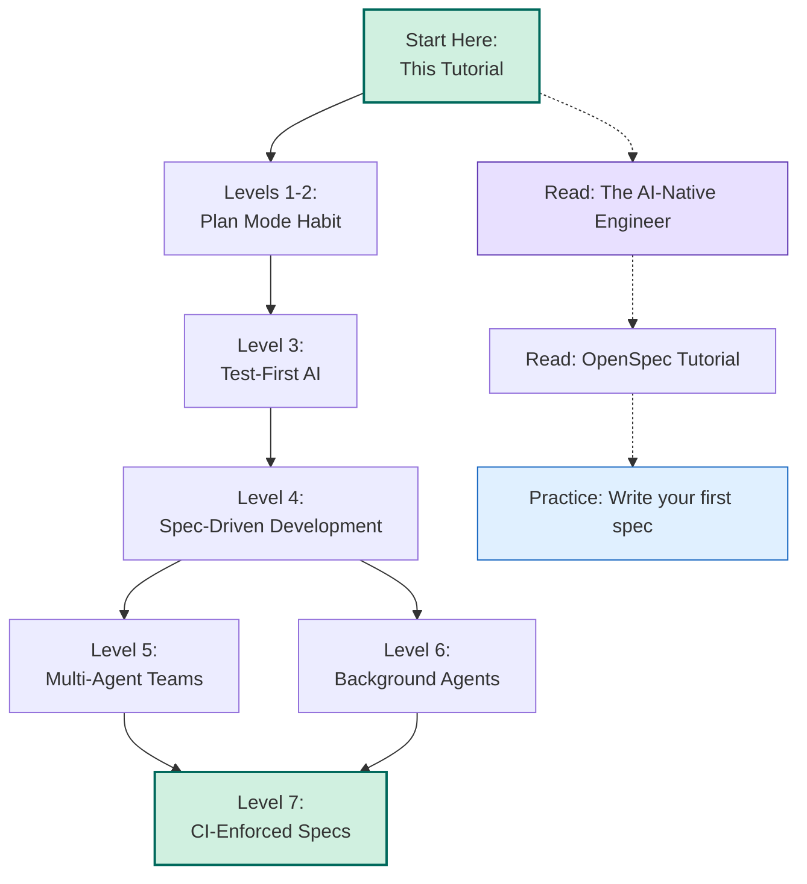

### Skills to Practice

1. **Ticket writing** — Spend 10 minutes a day writing better tickets. The better your ticket, the better your background agent's output.
2. **Non-goal specification** — Always write 2-3 non-goals for every spec/ticket. This prevents scope creep more than anything else.
3. **Test design** — Practice writing tests that check *behavior*, not *implementation*. Read your tests from the perspective of "could the AI cheat this?"
4. **Plan review** — Make it a ritual. Every time, ask: "Is this touching anything it shouldn't?"

---

<a name="conclusion"></a>
## 32. Key Takeaways & Conclusion

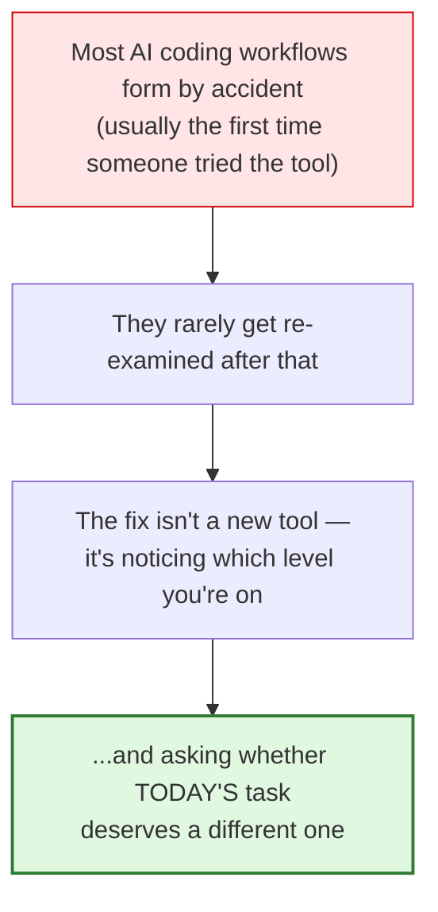

**Five things to remember:**

1. **The ladder is not a ranking of skill — it's a toolbox.** A senior engineer uses Level 1 for a throwaway script just as readily as Level 4 for a critical feature. Knowing *when to downshift* is as important as knowing how to climb.

2. **Each level up trades speed for traceability.** Vibe coding is fastest and leaves no trail. CI-enforced specs are slowest to set up and make drift structurally impossible. Neither extreme is "correct" — the task decides.

3. **Human review never disappears — it relocates.** At Level 1 you review the chat. At Level 3 you review whether tests were gamed. At Level 6 you review pull requests instead of individual keystrokes. At Level 7 you review what belongs in the enforced contract. The checkpoint moves; it doesn't vanish.

4. **The cheapest upgrade available to anyone right now is Level 2.** If you take one concrete action from this tutorial, make it this: ask for a plan before code exists, every time, starting today.

5. **The bigger industry shift isn't "AI writes more code."** It's developers spending more time defining *boundaries* — specs, tests, contracts — and less time dictating every line, with AI doing more of the work *inside* those boundaries. The better the boundaries get, the less time gets spent fixing code nobody actually wanted.

> *"I define the boundaries. AI does more of the work inside them."*

That's the sentence worth pinning above your desk.

---

<a name="faqs"></a>
## 33. FAQs

**What is vibe coding?**
Prompting an AI conversationally and accepting the output with no written plan or spec behind it. Fast for prototypes, risky for anything that needs to be maintained or explained later.

**What is spec-driven development?**
A workflow where a version-controlled specification — living in git alongside the code — is the actual source of truth. Code is *generated from* the spec, and any requirement change starts with editing the spec, not the code.

**Should I let AI agents write code without any human review?**
No, at any level. What changes as you climb the ladder is *when* and *what* you review — a plan, a spec, a test suite, or a pull request — but a human checkpoint never disappears entirely, even at Level 7 where you're reviewing what belongs in the enforced contract, not the code itself.

**Do I need to use all seven levels?**
No. A five-minute script doesn't need a specification, a multi-agent workflow, or CI-based spec validation. Use the simplest level that gives you *enough confidence* for the specific task — not the most impressive-sounding one.

**Is Level 7 "the future" of AI coding?**
Possibly part of it, but the more durable trend is a shift in what developers spend their time doing: less time dictating *how* to write every line, more time defining *what must be true* when the work is finished. Turning that "what must be true" into something checkable — a test, a spec rule, a CI gate — is the throughline connecting Levels 3, 4, and 7.

**What's the difference between a multi-agent team (Level 5) and background agents (Level 6)?**
Level 5 is about *coordination* — multiple agents working together on one task, passing documents. Level 6 is about *parallelization* — multiple agents working independently on different tickets, producing separate PRs. You can do Level 5 without Level 6 (coordinated teamwork) or Level 6 without Level 5 (independent agents on separate tickets).

**How do I know if I'm ready for Level 4 (spec-driven development)?**
If you can answer "yes" to all of these, you're ready:
- You've been using Level 2 (plan mode) consistently for at least a month
- You write tests (or have someone who does) for security-critical features
- You're tired of explaining the same requirements to new AI sessions
- Your team commits specs/documentation to git

**Can I mix levels within a single project?**
Absolutely. Most mature organizations do. The key is being intentional — not accidentally using Level 1 for a critical feature. Tag each task with its intended level, and review the assignment before starting.

**What if my team resists adopting higher levels?**
Start with the no-cost upgrade: Level 2 (plan mode). Show the ROI — track how many times a plan caught an issue before code was written. Once the team sees the value, the jump to Level 3 or 4 becomes easier to justify.

**How long does it take to climb from Level 1 to Level 7?**
For an individual developer, adopting Levels 1→2→3 takes days to weeks (it's about changing habits). Levels 4→5→6→7 are organizational changes that take months, because they require team buy-in, tooling, and CI setup.

**What's the most common mistake when climbing the ladder?**
Skipping levels. You can't effectively use multi-agent teams (Level 5) without first having solid spec discipline (Level 4). You can't effectively use background agents (Level 6) without well-written tickets (which require Level 4 discipline). Each level builds on the one before it.

---

* **Last Updated:** 2026-01-09
* **Difficulty:** Intermediate
* **Estimated Reading Time:** 45–60 minutes
* **Based on:** Content provided by the user, augmented to meet tutorial-preferences.md requirements
