# Clean Architecture in Spring Boot: A Complete Hands-On Tutorial

> **Difficulty:** 🟡 Intermediate | **Reading Time:** ~95 minutes | **Hands-on Time:** ~120 minutes | **Last Updated:** 2026-10-22
> **Spring Boot Version:** 3.4.x (applies to all Spring Boot 3.x) | **Java:** 17+ | **Code Language:** Java | **Build Tool:** Maven

> 💡 **Who is this for?** Java/Spring developers who can already write a `@RestController` and a Spring Data repository, but want to understand *why* Clean Architecture exists, *where each line of code belongs*, and *how to prove the structure pays off*. We build one small feature — a "Create Post" API — and dissect it layer by layer.

> ⚠️ **A note on scope.** This tutorial will not convince you that Clean Architecture is always the right answer. Section 21 includes an honest table of situations where a plain controller/service/repository stack is the better choice. Use the structure when your business rules justify it; skip it when they don't.

---

## Table of Contents

- [1. Introduction / Overview](#1-introduction--overview)
- [2. Prerequisites](#2-prerequisites)
- [3. Learning Objectives](#3-learning-objectives)
- [4. The Problem Clean Architecture Solves](#4-the-problem-clean-architecture-solves)
- [5. The Dependency Rule](#5-the-dependency-rule)
- [6. Dependency Inversion and Ports and Adapters](#6-dependency-inversion-and-ports-and-adapters)
- [7. Three Representations of the Post Concept](#7-three-representations-of-the-post-concept)
- [8. The Four Layers at a Glance](#8-the-four-layers-at-a-glance)
- [9. Project Setup](#9-project-setup)
- [10. The Domain Layer](#10-the-domain-layer)
- [11. The Application Layer](#11-the-application-layer)
- [12. The Infrastructure Layer](#12-the-infrastructure-layer)
- [13. The Presentation Layer](#13-the-presentation-layer)
- [14. Following One Request End to End](#14-following-one-request-end-to-end)
- [15. Validation: Where Does What Belong](#15-validation-where-does-what-belong)
- [16. Error Handling Across Layers](#16-error-handling-across-layers)
- [17. Testing Each Layer](#17-testing-each-layer)
- [18. Proof of the Benefit: Swapping the Database](#18-proof-of-the-benefit-swapping-the-database)
- [19. Adding a Second Feature: Get Post](#19-adding-a-second-feature-get-post)
- [20. Clean Architecture vs Classic Layered Architecture](#20-clean-architecture-vs-classic-layered-architecture)
- [21. Real World Examples and Use Cases](#21-real-world-examples-and-use-cases)
- [22. Multiple Implementation Approaches](#22-multiple-implementation-approaches)
- [23. Best Practices](#23-best-practices)
- [24. Anti Patterns](#24-anti-patterns)
- [25. Performance Considerations](#25-performance-considerations)
- [26. Security Considerations](#26-security-considerations)
- [27. Testing Strategies](#27-testing-strategies)
- [28. Common Pitfalls and Troubleshooting](#28-common-pitfalls-and-troubleshooting)
- [29. Migration Guide: Refactoring a Fat Controller](#29-migration-guide-refactoring-a-fat-controller)
- [30. Summary and Key Takeaways](#30-summary-and-key-takeaways)
- [31. Practice Exercises with Solutions](#31-practice-exercises-with-solutions)
- [32. Hands On Lab: End to End Checklist](#32-hands-on-lab-end-to-end-checklist)
- [33. Test Your Understanding](#33-test-your-understanding)
- [34. Common Interview Questions](#34-common-interview-questions)
- [35. Question Bank for Knowledge Reinforcement](#35-question-bank-for-knowledge-reinforcement)
- [36. Self Assessment Checklist](#36-self-assessment-checklist)
- [37. Pro Tips](#37-pro-tips)
- [38. Further Reading and Resources](#38-further-reading-and-resources)
- [39. Cheat Sheet](#39-cheat-sheet)
- [40. Conclusion](#40-conclusion)

---

## 1. Introduction / Overview

**Most Spring Boot projects start out like this, and it works fine for a while:**

```java
// ❌ The "everything in the controller" approach
@RestController
@RequestMapping("/post")
public class PostController {

    @Autowired
    private PostJpaRepository repository;   // database code in the controller

    @PostMapping
    public PostEntity create(@RequestBody PostEntity entity) {
        if (entity.getContent() == null) {                    // validation
            throw new RuntimeException("Content required");
        }
        entity.setCreatedAt(LocalDateTime.now());             // business logic
        entity.setStatus("ACTIVE");
        return repository.save(entity);                       // persistence
    }
}
```

This works for a demo. As the app grows, four specific things start to hurt:

| Symptom | Why it hurts |
|---|---|
| Controllers with hundreds of lines | Nobody can find anything, and merge conflicts multiply |
| Business rules mixed with HTTP code | You can't reuse rules from a scheduled job or message consumer |
| JPA entities used as API contracts | A database column change breaks your mobile app |
| Tests need a running server and database | Tests are slow and flaky, so people stop writing them |

### The core idea

> **Keep responsibilities separate, and make the important business logic independent of external details such as HTTP, databases, and frameworks.**

Clean Architecture is **not** about creating lots of folders or interfaces. It is about **responsibilities, boundaries, and dependency direction**. If your folder structure is pretty but your `domain` package imports `org.springframework.web`, you do not have Clean Architecture — you have folders.

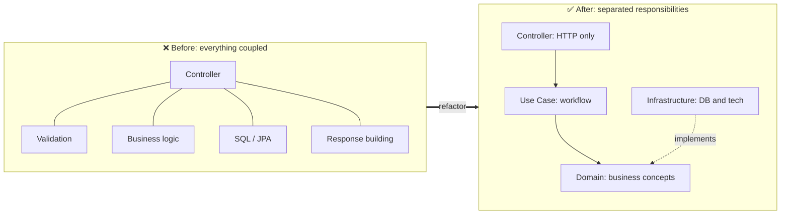

> 💡 **The Feynman test.** If you cannot explain Clean Architecture to a colleague using only a restaurant metaphor, you probably don't understand it yet. We build that metaphor in Section 8.

### What this tutorial delivers

By the end, you will have a running Spring Boot API with four clearly separated layers, a test suite where the business-logic tests run in milliseconds without Spring or MySQL, an ArchUnit test that mechanically enforces the dependency rule, and a demonstrated ability to swap the database by writing exactly one new class.

**How to use this tutorial:** Read Sections 4–8 for the mental model. Code along with Sections 9–14. Use Sections 15–19 as reference while building. Sections 20–29 are for when you need to defend the design in a review, migrate an existing codebase, or answer an interview question.

---

## 2. Prerequisites

**Required:**

- JDK 17 or newer — check with `java -version` (Spring Boot 3.x requires 17+)
- Maven 3.9+ — check with `mvn -version` (or use the generated `./mvnw` wrapper)
- Docker Desktop — to run MySQL in a throwaway container for the hands-on part
- IDE: IntelliJ IDEA / VS Code / Eclipse with Java + Maven support
- Working knowledge of Java 17 (records, switch expressions, `Optional`) and basic REST + SQL

**Nice to have (but not required):**

- Familiarity with Spring Boot basics (`@RestController`, `@Service`, Spring Data JPA)
- Familiarity with hexagonal architecture terminology — we define everything here

```bash
java -version        # expect 17+ (21+ recommended)
mvn -version         # expect 3.9+
docker ps            # should list containers (Docker running)
```

### Docker setup for MySQL

```bash
docker run -d --name social-post-db \
  -e MYSQL_ROOT_PASSWORD=secret \
  -e MYSQL_DATABASE=social_app \
  -p 3306:3306
```

> 💡 **Tip:** If Docker isn't running, you can still follow the whole tutorial with the in-memory adapter from Section 18. The architecture is identical; only the last mile changes.

---

## 3. Learning Objectives

By the end of this tutorial, you will be able to:

1. **Explain the Dependency Rule** and implement it in a real Spring Boot project (with an automated ArchUnit guard).
2. **Distinguish DTO, domain model, and persistence entity**, and justify when each one is the right representation.
3. **Apply Dependency Inversion** to replace a JPA repository with a domain-owned interface plus an adapter.
4. **Place validation correctly**, splitting field-level, cross-field, and business-rule validation across the right layers.
5. **Translate domain exceptions into HTTP responses** without the domain ever importing a Spring Web class.
6. **Write a fast test suite** (pure unit, slice, and integration) where the majority of tests need no Spring context and no database.
7. **Swap the persistence technology** (JPA/MySQL → MongoDB → in-memory) by writing a single new class.
8. **Evaluate whether Clean Architecture fits** a given problem — including when to deliberately not use it.
9. **Refactor an existing fat controller** into the layered structure using a safe, incremental migration path.

---

## 4. The Problem Clean Architecture Solves

Let's be concrete about the pain, because "clean architecture" is meaningless until you've felt the alternative.

### 4.1 Symptom 1: The "Where do I put this?" problem

A new teammate asks: *"I'm adding a rule that posts must be under 5,000 characters. Where does that go?"*

In a fat controller project, the honest answer is "wherever is convenient" — and everyone picks a different spot. Now the rule exists in three places and will drift.

### 4.2 Symptom 2: The reuse trap

You write the post-creation logic in a controller. Then a nightly batch job needs to create posts too. Options:

- ❌ Call the controller method directly (works, but ugly and fragile)
- ❌ Copy-paste the logic into the job (diverges within a month)
- ✅ Extract a use case that both call

Clean Architecture is designed for the third option from day one.

### 4.3 Symptom 3: The "one column rename breaks three clients" trap

```java
// ❌ Entity as the API contract
public class PostEntity {
    private Long id;
    private Long userId;
    @Column(name = "like_cnt")   // DBA renames the column...
    private Long likeCount;
}
```

Because the entity is serialized straight to JSON, renaming `like_cnt` → `likes` changes the API response and breaks every mobile client in the field.

### 4.4 Symptom 4: The slow test suite

```java
// ❌ Every test boots the whole application and hits MySQL
@SpringBootTest
class PostControllerTest {
    @Test void createsPost() { /* needs a real DB */ }
}
```

Each test costs seconds. A 200-test suite takes 10+ minutes. Developers start batching them, skipping them, or running them only before releases. The feedback loop dies.

### 4.5 What "clean" actually fixes

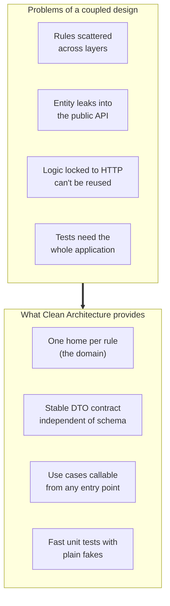

> 💡 **Key insight:** The goal is not "no frameworks." The goal is **"the framework is a detail, and details can change."** You can still use Spring, JPA, and MySQL — they just live in the outer ring, and the business rules do not know they exist.

---

## 5. The Dependency Rule

> **Source-code dependencies must point inward, toward the business logic.**

This is the single rule everything else derives from. Inner layers must not know the names of anything in outer layers. The domain should not import a Spring MVC class, a JPA annotation, or a MySQL driver.

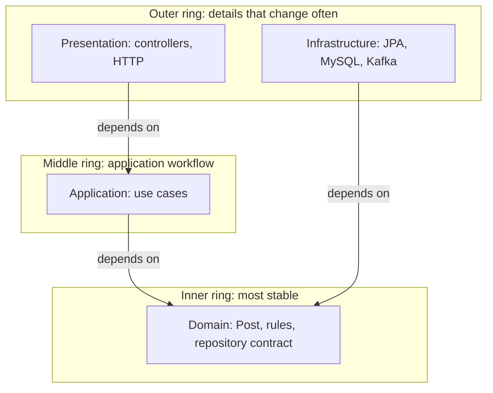

Both the Presentation and Infrastructure layers depend **inward**. Nothing in the domain depends on them.

### 5.1 How to check the rule mechanically

Open your domain package and list every import. A correct Clean Architecture domain looks like this:

```java
// ✅ domain/model/Post.java
package com.example.app.domain.model;

import lombok.Builder;
import lombok.Data;
import java.time.LocalDateTime;

@Data
@Builder
public class Post {
    private Long id;
    private Long userId;
    private PostType postType;
    private String content;
    private String imageUrl;
    private String videoUrl;
    private PostStatus postStatus;
    private Long likeCount;
    private Long commentCount;
    private LocalDateTime createdAt;
    private LocalDateTime updatedAt;
}
```

Imports: `lombok.*` and `java.time.*`. That's it. No `jakarta.persistence`, no `org.springframework`, no `com.fasterxml`.

> ⚠️ **The Lombok nuance.** Lombok annotations are compile-time code generators; they do not create a runtime dependency on a framework, so most teams accept them in the domain. The thing to avoid is *runtime* infrastructure coupling — JPA proxies, Spring context, servlet APIs.

### 5.2 The rings, concretely

| Ring | Contains | May import from | Example |
|---|---|---|---|
| Innermost | Entities, value objects, domain services, repository interfaces | Nothing (JDK + Lombok only) | `Post`, `PostRepository` |
| Middle | Use cases, DTOs, mappers, ports | Innermost | `CreatePostUseCaseImpl` |
| Outer | Controllers, exception handlers, JPA entities, adapters, clients | Middle + Innermost | `PostController`, `PostRepositoryAdapter` |

### 5.3 Why "inward" and not "sideways"

A common question: *"Why can't infrastructure depend on presentation, or vice versa?"*

Because neither should need to. If the presentation layer knew about JPA, HTTP code would be coupled to the database. If infrastructure knew about controllers, you'd have to change your REST API to change a database job. Both directions are unnecessary coupling that costs you nothing to avoid.

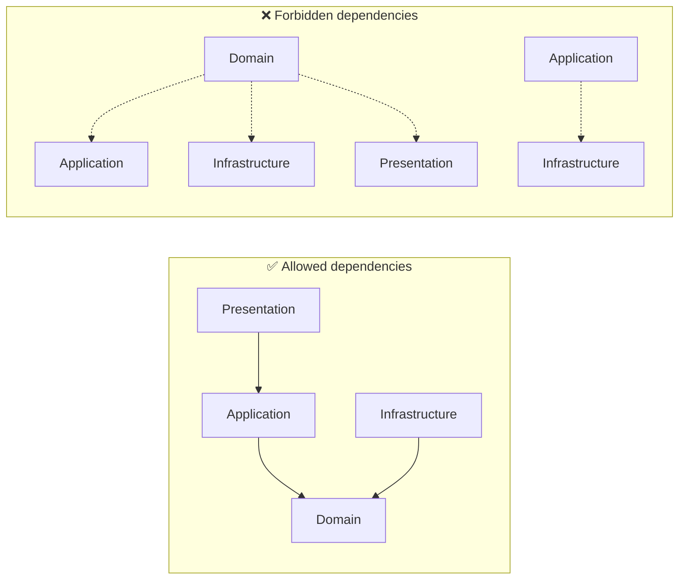

---

## 6. Dependency Inversion and Ports and Adapters

### 6.1 The chicken-and-egg problem

The use case needs to save a post, but it can't depend on JPA, because JPA lives in an outer layer and the rule says inner layers don't know outer ones.

The resolution is Dependency Inversion:

1. The **inner** layer defines an interface (`PostRepository`) that describes what it needs.
2. The **outer** layer implements that interface (`PostRepositoryAdapter`).

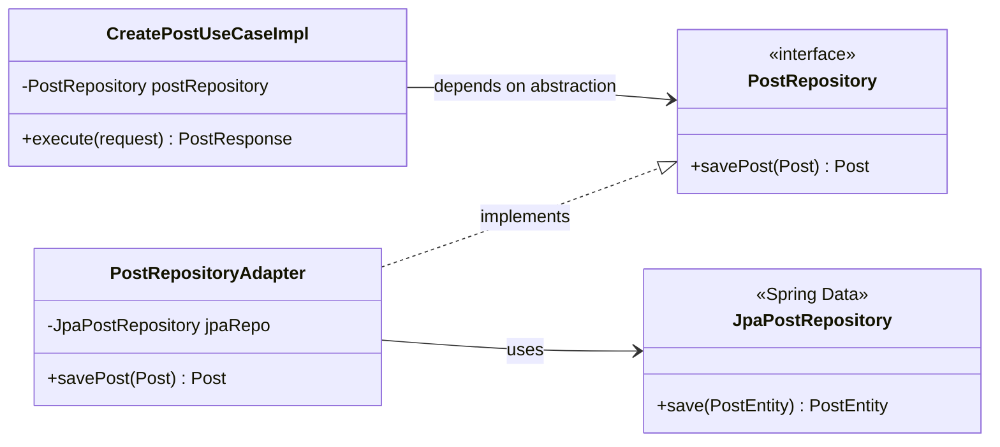

### 6.2 The analogy that makes it click

> Telling a restaurant *"I need food"* is different from telling it *"Ravi must cook this on burner 3."*
>
> The first states a **need**; the second dictates an **implementation**. The interface states the need.

The domain says *"I need something that can persist a Post."* It does not care whether that's MySQL, MongoDB, or a `HashMap`.

### 6.3 Ports and Adapters (Hexagonal Architecture)

This same pattern is known as **Ports and Adapters**:

| Term | Meaning | Our example |
|---|---|---|
| **Port** | An interface owned by the inner layer describing an outward capability | `PostRepository` |
| **Adapter** | The outer-layer implementation of a port for a specific technology | `PostRepositoryAdapter` |
| **Driver adapter** | An adapter that *calls* the application (HTTP, Kafka, CLI) | `PostController` |
| **Driven adapter** | An adapter the application *calls* (DB, S3, Stripe) | `PostRepositoryAdapter` |

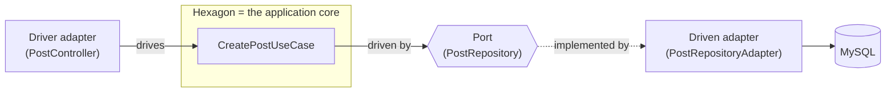

> 💡 **The hexagon shape is a metaphor, not a mandate.** Some people put the application use cases *inside* the hexagon too, and call the domain the "core". Both readings are common; the dependency direction is what matters.

### 6.4 "But isn't an interface for one implementation wasteful?"

Fair challenge. Two honest answers:

1. **The value isn't polymorphism — it's decoupling.** The interface lets you substitute a *test double* (a plain fake class) with zero Spring involvement. That's the payoff you get on day one, long before anyone writes a Mongo adapter.
2. **You don't need an interface everywhere.** Section 24 covers this anti-pattern. Create abstractions at *meaningful boundaries* — persistence, external payment gateways, message brokers — not on every class.

---

## 7. Three Representations of the Post Concept

This is the concept beginners find hardest. One business concept, **Post**, has three representations, because each answers a different question.

| Representation | Class | Question it answers | Lives in |
|---|---|---|---|
| Request DTO | `CreatePostRequest` | *What may the client send?* | Application (boundary) |
| Domain model | `Post` | *What is a Post in our business?* | Domain |
| Entity | `PostEntity` | *How is a Post stored in the DB?* | Infrastructure |

```mermaid
flowchart LR
    J["JSON from client"] -->|Jackson| R["CreatePostRequest (DTO)"]
    R -->|PostMapper.toDomain| P["Post (Domain)"]
    P -->|PostEntityMapper.toEntity| E["PostEntity (JPA)"]
    E -->|save| DB[("posts table")]
    DB -->|load| E2["PostEntity"]
    E2 -->|PostEntityMapper.toDomain| P2["Post (Domain)"]
    P2 -->|PostMapper.toResponse| RS["PostResponse (DTO)"]
    RS -->|Jackson| J2["JSON to client"]
```

### 7.1 Why not use one class everywhere?

- A client should never send `id`, `likeCount`, `createdAt`, or `status`. If you used the entity as input, a malicious client could send `likeCount: 1000000` and your app would believe it. (See Section 26 on mass assignment.)
- Renaming a DB column should not break your public API.
- Your domain should stay free of `@Entity` and `@Column`.
- A response DTO lets you *hide* fields: `likeCount` and `postStatus` are internal; clients have no business seeing them.

### 7.2 The three-object rule of thumb

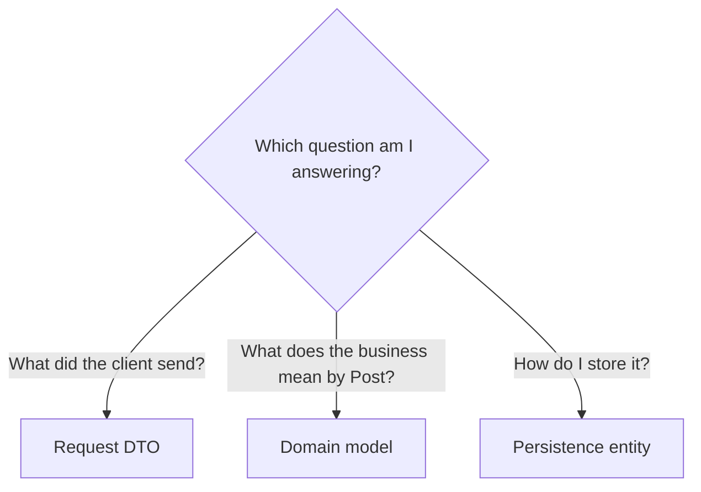

### 7.3 A note on naming

Notice the domain calls the fields `postType` and `postStatus`, while the entity calls them `type` and `status`. **That is allowed and intentional.** The two models are allowed to differ; the mapper bridges them. This is the whole point of a separate domain model: it uses the *business's* vocabulary, not the *database's* vocabulary.

---

## 8. The Four Layers at a Glance

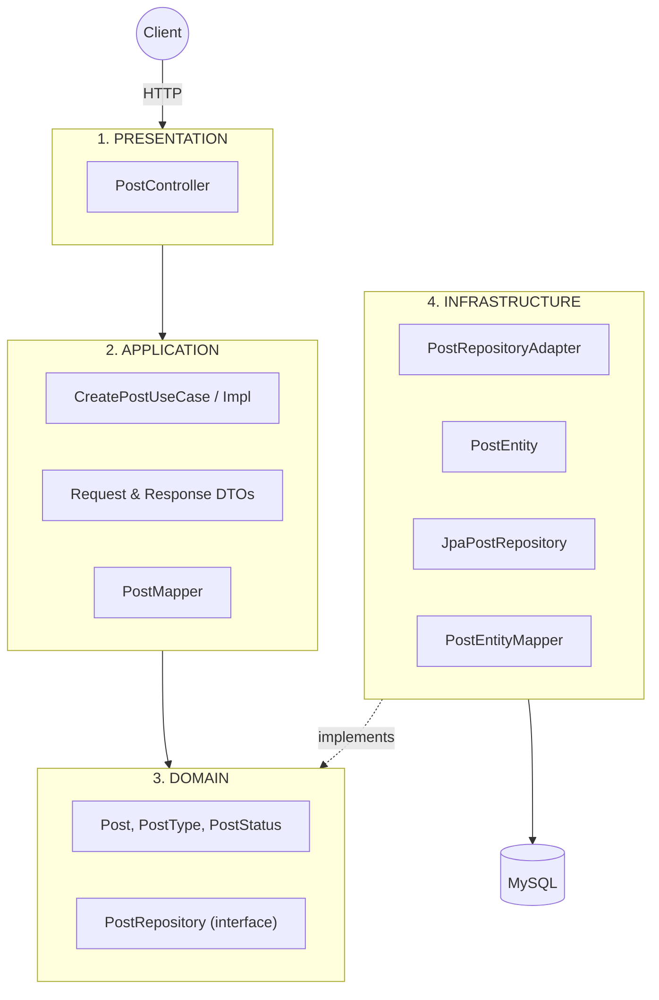

| Layer | Responsibility | Knows about | Must NOT do |
|---|---|---|---|
| **Presentation** | Talk HTTP | Requests, responses, status codes | Touch the database, hold business rules |
| **Application** | Orchestrate one use case | Domain, DTOs | Know about HTTP or JPA |
| **Domain** | Core concepts and rules | Only itself | Import Spring Web or JPA classes |
| **Infrastructure** | Technical details | JPA, MySQL, external APIs | Decide API behavior or business rules |

### 8.1 The restaurant analogy

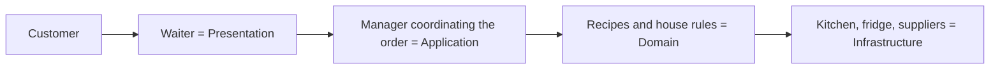

- The **waiter** takes the order and hands it to the manager. The waiter doesn't cook, and doesn't decide what the kitchen can deliver.
- The **manager** coordinates the order — "one appetiser, one main, no dessert" — and calls the kitchen.
- The **recipes and house rules** define what a dish *is* and when it's acceptable. They never mention ovens.
- The **kitchen** knows about burners and suppliers. It can be swapped for a different kitchen without changing the menu.

The analogy isn't perfect — but it gives you a mental model for deciding which layer a new piece of code belongs to. When in doubt, ask: *is this about talking to the customer, running the order, defining the food, or preparing it?*

### 8.2 The one-sentence rule

> **Presentation asks the Application to do something. The Application asks the Domain for decisions. The Infrastructure makes the Domain's needs real.**

---

## 9. Project Setup

Create a Spring Boot project (Java 17+) with these dependencies:

```xml
<dependencies>
    <dependency>
        <groupId>org.springframework.boot</groupId>
        <artifactId>spring-boot-starter-web</artifactId>
    </dependency>
    <dependency>
        <groupId>org.springframework.boot</groupId>
        <artifactId>spring-boot-starter-validation</artifactId>
    </dependency>
    <dependency>
        <groupId>org.springframework.boot</groupId>
        <artifactId>spring-boot-starter-data-jpa</artifactId>
    </dependency>
    <dependency>
        <groupId>com.mysql</groupId>
        <artifactId>mysql-connector-j</artifactId>
        <scope>runtime</scope>
    </dependency>
    <dependency>
        <groupId>org.projectlombok</groupId>
        <artifactId>lombok</artifactId>
        <optional>true</optional>
    </dependency>
    <dependency>
        <groupId>org.springframework.boot</groupId>
        <artifactId>spring-boot-starter-test</artifactId>
        <scope>test</scope>
    </dependency>
    <dependency>
        <groupId>com.tngtech.archunit</groupId>
        <artifactId>archunit-junit5</artifactId>
        <version>1.3.0</version>
        <scope>test</scope>
    </dependency>
</dependencies>
```

> 💡 **Why the ArchUnit dependency?** It's what turns the dependency rule from a code-review convention into a build failure. Section 24 shows the test.

`application.yml`:

```yaml
spring:
  datasource:
    url: jdbc:mysql://localhost:3306/social_app
    username: root
    password: secret
  jpa:
    hibernate:
      ddl-auto: update
    open-in-view: false
  jackson:
    property-naming-strategy: SNAKE_CASE   # user_id, post_type, created_at
```

> **Why `SNAKE_CASE`?** The API uses `user_id` and `post_type`, while Java fields are `userId` and `postType`. This setting maps between them globally, so you don't annotate every field.

### 9.1 Folder structure

```text
src/main/java/com/example/app/
├── domain/
│   ├── model/
│   │   ├── Post.java
│   │   ├── PostType.java
│   │   └── PostStatus.java
│   ├── exception/
│   │   └── PostNotFoundException.java
│   └── repository/
│       └── PostRepository.java
│
├── application/
│   ├── dto/
│   │   ├── request/CreatePostRequest.java
│   │   └── response/PostResponse.java
│   ├── mapper/PostMapper.java
│   └── usecase/
│       ├── CreatePostUseCase.java
│       └── CreatePostUseCaseImpl.java
│
├── infrastructure/
│   └── persistence/
│       ├── entity/PostEntity.java
│       ├── repository/JpaPostRepository.java
│       ├── adapter/PostRepositoryAdapter.java
│       └── mapper/PostEntityMapper.java
│
└── presentation/
    ├── controller/PostController.java
    ├── response/ApiResponse.java
    ├── validation/
    │   ├── ValidPostContent.java
    │   └── PostContentValidator.java
    └── exception/GlobalExceptionHandler.java
```

> 📌 **Remember:** folder names don't make a project "Clean". Dependency direction does. We'll build from the inside out, starting with the domain.

### 9.2 Build order

Work **inside-out**. The order below matters — each layer compiles against the ones before it, which is a natural, frequent sanity check on the dependency rule.

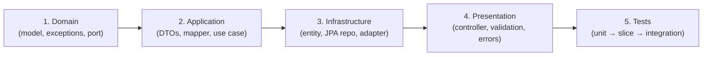

### 9.3 The API contract we are building

**Request**

```http
POST /post
Content-Type: application/json

{
  "user_id": 23,
  "post_type": "TEXT",
  "content": "Hello, this is my first post"
}
```

**Response**

```json
{
  "status": 201,
  "message": "Post created successfully",
  "data": {
    "id": 1,
    "user_id": 23,
    "type": "TEXT",
    "content": "Hello, this is my first post",
    "created_at": "2026-09-12T10:30:00"
  }
}
```

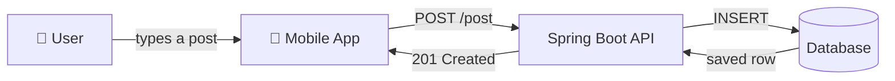

---

## 10. The Domain Layer

The domain represents **what the business cares about**. It has no knowledge of Spring MVC, JPA, or MySQL.

### 10.1 Enums

```java
package com.example.app.domain.model;

public enum PostType {
    TEXT, IMAGE, VIDEO
}
```

```java
package com.example.app.domain.model;

public enum PostStatus {
    ACTIVE, DELETED, FLAGGED
}
```

> 💡 **Why enums instead of `String`?** A `String status` field accepts `"ACTIVE"`, `"active"`, `"ACTIVEE"`, and `"banana"`. An enum makes invalid states unrepresentable and gives you exhaustive `switch` support — the compiler tells you when a new status appears.

### 10.2 The `Post` domain model

```java
package com.example.app.domain.model;

import lombok.Builder;
import lombok.Data;
import java.time.LocalDateTime;

@Data
@Builder
public class Post {
    private Long id;
    private Long userId;
    private PostType postType;
    private String content;
    private String imageUrl;
    private String videoUrl;
    private PostStatus postStatus;
    private Long likeCount;
    private Long commentCount;
    private LocalDateTime createdAt;
    private LocalDateTime updatedAt;
}
```

Notice what is **missing**: `@Entity`, `@Table`, `@Column`, and `JpaRepository`. That is intentional.

### 10.3 The repository contract (port)

```java
package com.example.app.domain.repository;

import com.example.app.domain.model.Post;
import java.util.Optional;

public interface PostRepository {
    Post savePost(Post post);

    Optional<Post> findById(Long id);       // used by the Get Post feature (Section 19)
}
```

This says: *"The application needs something capable of saving and loading a Post."* It doesn't say how.

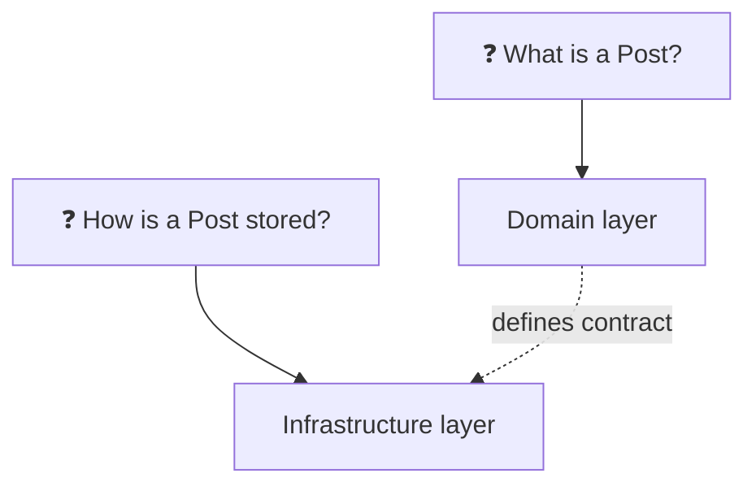

### 10.4 The domain exception

```java
package com.example.app.domain.exception;

public class PostNotFoundException extends RuntimeException {
    public PostNotFoundException(Long id) {
        super("Post not found with id " + id);
    }
}
```

> ⚠️ **No `HttpStatus.NOT_FOUND` here.** The domain doesn't know what HTTP is. The presentation layer translates this into a 404. This is the single most common leak people accidentally introduce.

### 10.5 Putting real behavior in the domain

So far, `Post` is a plain data holder. In real projects, push rules into the domain so they are reusable and testable without Spring:

```java
package com.example.app.domain.model;

import lombok.Builder;
import lombok.Data;
import java.time.LocalDateTime;

@Data
@Builder
public class Post {
    // ...fields as above...

    /** Business rule: only the owner can edit a post. */
    public void assertOwnedBy(Long requestingUserId) {
        if (this.userId == null || !this.userId.equals(requestingUserId)) {
            throw new IllegalStateException("User does not own this post");
        }
    }

    /** Business rule: deleted posts cannot be liked. */
    public boolean isInteractable() {
        return postStatus == PostStatus.ACTIVE;
    }

    /** Factory capturing the defaults for a brand-new post. */
    public static Post newPost(Long userId, PostType type,
                               String content, String imageUrl, String videoUrl) {
        LocalDateTime now = LocalDateTime.now();
        return Post.builder()
                .userId(userId)
                .postType(type)
                .content(content)
                .imageUrl(imageUrl)
                .videoUrl(videoUrl)
                .postStatus(PostStatus.ACTIVE)
                .likeCount(0L)
                .commentCount(0L)
                .createdAt(now)
                .updatedAt(now)
                .build();
    }
}
```

The "new posts start `ACTIVE` with zero likes" rule now lives in **one** place, the domain. We'll use `Post.newPost(...)` in the mapper below.

> 💡 **The "aha moment" of Clean Architecture:** `Post.newPost(...)` is a *factory method on the domain model*. It encodes a business default, and it is callable from a REST controller, a Kafka consumer, or a unit test — with no framework in sight. That's the payoff for keeping the domain pure.

### 10.6 A stricter version: immutable domain objects

Some teams go further and make the domain model immutable, using `with*` copy methods instead of setters:

```java
@Getter
@EqualsAndHashCode
public final class Post {

    private final Long id;
    private final Long userId;
    private final PostType postType;
    private final String content;
    private final PostStatus postStatus;
    private final LocalDateTime createdAt;

    // ... constructor, getters ...

    /** Returns a NEW post with updated content — the original is untouched. */
    public Post withContent(String newContent, LocalDateTime updatedAt) {
        return new Post(id, userId, postType, newContent, postStatus, updatedAt);
    }
}
```

| Aspect | Mutable (`@Data`) | Immutable |
|---|---|---|
| Familiarity | High — matches most Spring codebases | Lower — requires `with*` style |
| Thread safety | Caller's problem | Guaranteed |
| JPA friendliness | Easy | Requires extra mapping work |
| Best for | Most applications | Core banking / high-concurrency domains |

> 💡 **Pragmatic take:** Start mutable with `@Data`. Move to immutable when you have a specific reason (concurrency, auditability, event sourcing). Don't start a rewrite over it.

---

## 11. The Application Layer

The application layer contains **use cases**: one class per thing the system can do. Think *"What operation does my application perform?"*, not *"I need a service class."*

Examples of use cases: `CreatePost`, `GetPost`, `DeletePost`, `TransferMoney`, `PlaceOrder`.

### 11.1 DTOs

**Request DTO**: only what the client is allowed to provide.

```java
package com.example.app.application.dto.request;

import com.example.app.domain.model.PostType;
import jakarta.validation.constraints.NotNull;
import jakarta.validation.constraints.Size;
import lombok.Data;

@Data
public class CreatePostRequest {

    @NotNull(message = "Valid post type is required")
    private PostType postType;

    @NotNull(message = "User ID is required")
    private Long userId;

    @Size(max = 5000, message = "Content must not exceed 5000 characters")
    private String content;

    private String imageUrl;
    private String videoUrl;
}
```

> ⚠️ **This class imports `jakarta.validation`.** That's a deliberate, small, standard coupling at the *boundary* — validation annotations are compile-time metadata, not a runtime framework dependency. Section 22 discusses the trade-off honestly.

**Response DTO**: only what we choose to expose.

```java
package com.example.app.application.dto.response;

import com.example.app.domain.model.PostType;
import lombok.Builder;
import lombok.Data;
import java.time.LocalDateTime;

@Data
@Builder
public class PostResponse {
    private Long id;
    private Long userId;
    private PostType type;
    private String content;
    private String imageUrl;
    private String videoUrl;
    private LocalDateTime createdAt;
}
```

> Notice `PostResponse` does **not** expose `postStatus`, `likeCount`, or `updatedAt`. You decide what the world sees, and the entity can change freely behind it.

### 11.2 The use case interface

```java
package com.example.app.application.usecase;

import com.example.app.application.dto.request.CreatePostRequest;
import com.example.app.application.dto.response.PostResponse;

public interface CreatePostUseCase {
    PostResponse execute(CreatePostRequest request);
}
```

It declares one capability: *"The application can create a post."*

### 11.3 The mapper (DTO ↔ Domain)

```java
package com.example.app.application.mapper;

import com.example.app.application.dto.request.CreatePostRequest;
import com.example.app.application.dto.response.PostResponse;
import com.example.app.domain.model.Post;

public final class PostMapper {

    private PostMapper() {}   // utility class — no instances

    public static Post toDomain(CreatePostRequest request) {
        return Post.newPost(
                request.getUserId(),
                request.getPostType(),
                request.getContent(),
                request.getImageUrl(),
                request.getVideoUrl()
        );
    }

    public static PostResponse toResponse(Post post) {
        return PostResponse.builder()
                .id(post.getId())
                .userId(post.getUserId())
                .type(post.getPostType())
                .content(post.getContent())
                .imageUrl(post.getImageUrl())
                .videoUrl(post.getVideoUrl())
                .createdAt(post.getCreatedAt())
                .build();
    }
}
```

### 11.4 The use case implementation

```java
package com.example.app.application.usecase;

import com.example.app.application.dto.request.CreatePostRequest;
import com.example.app.application.dto.response.PostResponse;
import com.example.app.application.mapper.PostMapper;
import com.example.app.domain.model.Post;
import com.example.app.domain.repository.PostRepository;
import lombok.RequiredArgsConstructor;
import org.springframework.stereotype.Service;

@Service
@RequiredArgsConstructor
public class CreatePostUseCaseImpl implements CreatePostUseCase {

    private final PostRepository postRepository;   // ← the INTERFACE, not JPA

    @Override
    public PostResponse execute(CreatePostRequest request) {
        Post post = PostMapper.toDomain(request);   // 1. DTO → Domain
        post = postRepository.savePost(post);       // 2. Persist via the contract
        return PostMapper.toResponse(post);         // 3. Domain → DTO
    }
}
```

This is the application layer's job: **coordinate the steps required to complete a use case.**

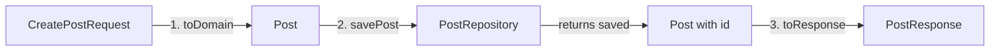

> 💡 **Note the naming asymmetry:** the domain field is `postType`, but the response DTO field is `type`. That's deliberate — the *public API* vocabulary is a product decision, and the *domain* vocabulary is a modelling decision. The mapper is where they're reconciled.

### 11.5 "Why not just put this in the controller?"

Because the use case can be called from **anywhere**: a REST controller, a gRPC endpoint, a Kafka listener, a scheduled job, or a test. The controller is only *one* way in.

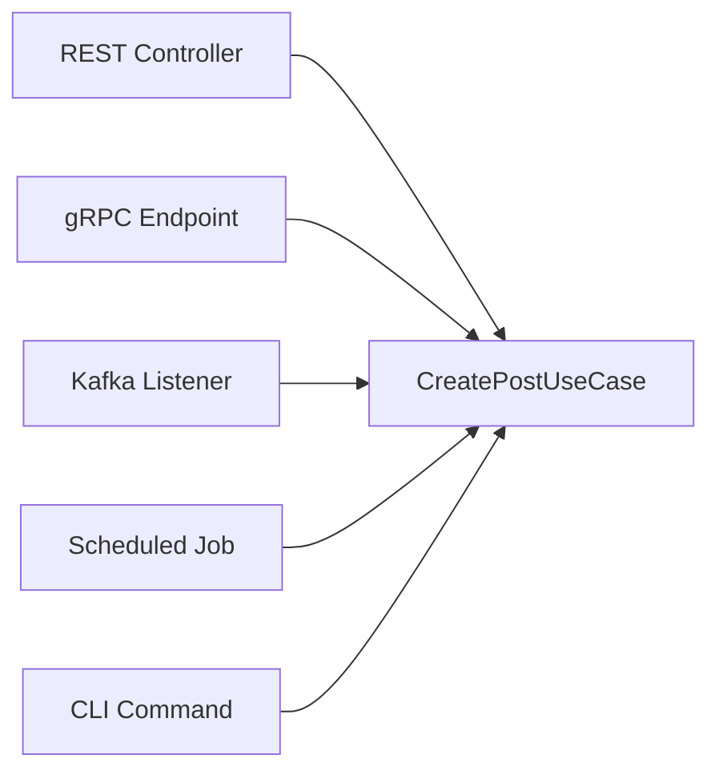

### 11.6 Should the use case interface exist?

Two legitimate options:

| Option | Pros | Cons |
|---|---|---|
| Interface + Impl (`CreatePostUseCase` / `CreatePostUseCaseImpl`) | Multiple entry points can swap implementations; mirrors the original Clean Architecture book | Extra file per use case |
| Concrete class only (`CreatePostUseCase`) | Fewer files; less ceremony | No seam for a second implementation |

> 💡 **Pragmatic take:** Most production teams use the concrete-class variant and reserve interfaces for genuinely substitutable boundaries (persistence, external gateways). Both are shown in Section 22. The important thing is that the use case **never depends on JPA** — that holds either way.

---

## 12. The Infrastructure Layer

This layer knows about the database and everything technical. JPA annotations are welcome here.

### 12.1 The JPA entity

```java
package com.example.app.infrastructure.persistence.entity;

import com.example.app.domain.model.PostStatus;
import com.example.app.domain.model.PostType;
import jakarta.persistence.*;
import lombok.*;
import java.time.LocalDateTime;

@Entity
@Table(name = "posts")
@Data
@Builder
@NoArgsConstructor
@AllArgsConstructor
public class PostEntity {

    @Id
    @GeneratedValue(strategy = GenerationType.IDENTITY)
    private Long id;

    @Column(nullable = false)
    private Long userId;

    @Enumerated(EnumType.STRING)
    @Column(nullable = false)
    private PostType type;

    @Column(length = 5000)
    private String content;

    private String imageUrl;
    private String videoUrl;

    @Enumerated(EnumType.STRING)
    private PostStatus status;

    private Long likeCount;
    private Long commentCount;
    private LocalDateTime createdAt;
    private LocalDateTime updatedAt;
}
```

> Notice that the entity calls the field `type` and `status`, while the domain calls them `postType` and `postStatus`. The two models are allowed to differ. The mapper bridges them.

> ⚠️ **Watch out for the enum-in-database trap.** `@Enumerated(EnumType.STRING)` stores `"TEXT"` and reads it back safely. The default (`ORDINAL`) stores `0`, `1`, `2` — so **reordering the enum silently corrupts every existing row**. Always use `STRING` for enums you might extend.

### 12.2 Spring Data JPA repository

```java
package com.example.app.infrastructure.persistence.repository;

import com.example.app.infrastructure.persistence.entity.PostEntity;
import org.springframework.data.jpa.repository.JpaRepository;

public interface JpaPostRepository extends JpaRepository<PostEntity, Long> {
}
```

Spring generates `save()`, `findById()`, `findAll()`, and `deleteById()` for free.

### 12.3 The problem: two different interfaces

- The application knows `PostRepository` (domain contract).
- Spring Data provides `JpaPostRepository`.

They're different types, and we need a bridge.

### 12.4 The adapter

```java
package com.example.app.infrastructure.persistence.adapter;

import com.example.app.domain.model.Post;
import com.example.app.domain.repository.PostRepository;
import com.example.app.infrastructure.persistence.entity.PostEntity;
import com.example.app.infrastructure.persistence.mapper.PostEntityMapper;
import com.example.app.infrastructure.persistence.repository.JpaPostRepository;
import lombok.RequiredArgsConstructor;
import org.springframework.stereotype.Repository;

import java.util.Optional;

@Repository
@RequiredArgsConstructor
public class PostRepositoryAdapter implements PostRepository {

    private final JpaPostRepository jpaPostRepository;

    @Override
    public Post savePost(Post post) {
        PostEntity entity = PostEntityMapper.toEntity(post);
        entity = jpaPostRepository.save(entity);
        return PostEntityMapper.toDomain(entity);
    }

    @Override
    public Optional<Post> findById(Long id) {
        return jpaPostRepository.findById(id).map(PostEntityMapper::toDomain);
    }
}
```

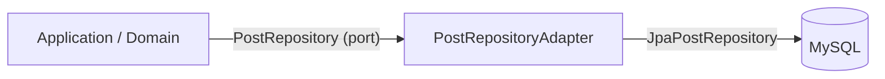

**Why "adapter"?** Think of a USB-C laptop and a USB-A flash drive. A small adapter lets two incompatible plugs work together without modifying either device. Our adapter does the same for `PostRepository` and `JpaPostRepository`.

> This pattern is also called **Ports and Adapters** (Hexagonal Architecture). The *port* is the interface in the domain, and the *adapter* is its technology-specific implementation.

### 12.5 The entity mapper

```java
package com.example.app.infrastructure.persistence.mapper;

import com.example.app.domain.model.Post;
import com.example.app.infrastructure.persistence.entity.PostEntity;

public final class PostEntityMapper {

    private PostEntityMapper() {}

    public static PostEntity toEntity(Post post) {
        return PostEntity.builder()
                .id(post.getId())
                .userId(post.getUserId())
                .type(post.getPostType())        // domain postType  → entity type
                .content(post.getContent())
                .imageUrl(post.getImageUrl())
                .videoUrl(post.getVideoUrl())
                .status(post.getPostStatus())    // domain postStatus → entity status
                .likeCount(post.getLikeCount())
                .commentCount(post.getCommentCount())
                .createdAt(post.getCreatedAt())
                .updatedAt(post.getUpdatedAt())
                .build();
    }

    public static Post toDomain(PostEntity entity) {
        return Post.builder()
                .id(entity.getId())
                .userId(entity.getUserId())
                .postType(entity.getType())
                .content(entity.getContent())
                .imageUrl(entity.getImageUrl())
                .videoUrl(entity.getVideoUrl())
                .postStatus(entity.getStatus())
                .likeCount(entity.getLikeCount())
                .commentCount(entity.getCommentCount())
                .createdAt(entity.getCreatedAt())
                .updatedAt(entity.getUpdatedAt())
                .build();
    }
}
```

> **Tip:** For larger projects, consider [MapStruct](https://mapstruct.org/) to generate these mappers at compile time and avoid hand-written boilerplate. See Section 22.

### 12.6 Why the adapter is a separate class at all

You might be tempted to put `savePost` directly on `JpaPostRepository`. Consider what breaks:

| Approach | Problem |
|---|---|
| `JpaPostRepository extends PostRepository` | The domain interface would need to speak in entities — the domain now depends on JPA types. The dependency rule breaks. |
| `JpaPostRepository` has `savePost(Post)` | Spring Data can't generate that for you; you'd write a `default` method in a JPA-typed interface, so the *port* still lives in an outer package. |
| **Separate adapter** ✅ | The port stays in the domain; the adapter translates. Both can evolve independently. |

---

## 13. The Presentation Layer

The outermost layer for HTTP. Its job: receive the request, delegate to a use case, and shape the HTTP response.

### 13.1 A generic response wrapper

```java
package com.example.app.presentation.response;

import lombok.Builder;
import lombok.Data;

@Data
@Builder
public class ApiResponse<T> {
    private int status;
    private String message;
    private T data;
}
```

> 💡 **Consider whether you need this wrapper at all.** A `status` field inside the body is redundant with the real HTTP status code, and many teams prefer a bare body plus standard HTTP semantics. Both are defensible. If you keep the wrapper, at least make sure the *real* HTTP status matches the `status` field — see Section 13.2.

### 13.2 The controller

```java
package com.example.app.presentation.controller;

import com.example.app.application.dto.request.CreatePostRequest;
import com.example.app.application.dto.response.PostResponse;
import com.example.app.application.usecase.CreatePostUseCase;
import com.example.app.presentation.response.ApiResponse;
import jakarta.validation.Valid;
import lombok.RequiredArgsConstructor;
import org.springframework.http.HttpStatus;
import org.springframework.validation.annotation.Validated;
import org.springframework.web.bind.annotation.*;

@RestController
@Validated          // ← required for the class-level @ValidPostContent constraint (Section 15.2)
@RequestMapping("/post")
@RequiredArgsConstructor
public class PostController {

    private final CreatePostUseCase createPostUseCase;

    @PostMapping
    @ResponseStatus(HttpStatus.CREATED)
    public ApiResponse<PostResponse> create(
            @Valid @RequestBody CreatePostRequest request) {

        PostResponse response = createPostUseCase.execute(request);

        return ApiResponse.<PostResponse>builder()
                .status(HttpStatus.CREATED.value())
                .message("Post created successfully")
                .data(response)
                .build();
    }
}
```

> The original sketch returned the JSON body with status 201 *inside* the payload, but the actual HTTP status would still be 200 by default. `@ResponseStatus(HttpStatus.CREATED)` makes the real HTTP status 201 as well.

### 13.3 Annotation walkthrough

| Annotation | Meaning |
|---|---|
| `@RestController` | Handles HTTP requests and writes return values to the response body as JSON |
| `@RequestMapping("/post")` | Base URL for every method in this class |
| `@PostMapping` | Handles `POST /post` |
| `@RequestBody` | Converts incoming JSON into a `CreatePostRequest` |
| `@Valid` | Runs the field-level validation rules on the request object |
| `@Validated` | Enables method-level validation, which cascades into class-level constraints |
| `@ResponseStatus` | Sets the real HTTP status code |

### 13.4 Why keep the controller small?

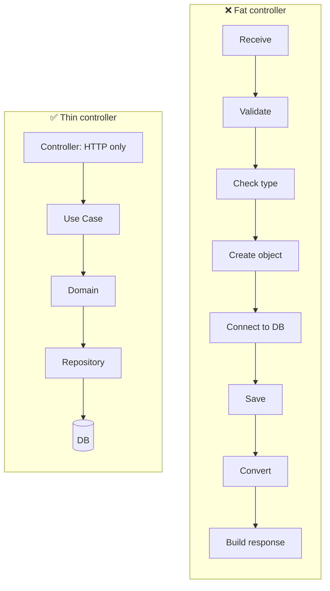

### 13.5 Controller checklist

A controller that passes this checklist is doing its job well:

- ✅ It knows the URL, HTTP method, and status codes
- ✅ It accepts a request DTO and returns a response DTO
- ✅ It delegates to exactly one use case
- ✅ It contains no business rules (`if (postType == TEXT)`)
- ✅ It contains no persistence calls
- ✅ It contains no entity types in its signature

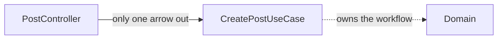

> 💡 **A controller with two or three arrows out is a smell.** If your controller calls a use case *and* a repository *and* a cache, you've smuggled infrastructure into the presentation layer.

---

## 14. Following One Request End to End

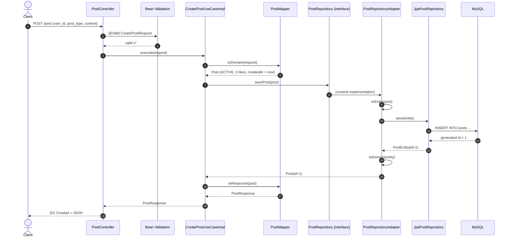

### 14.1 Step by step

**Step 1: Controller receives the request.** Jackson converts the JSON into `CreatePostRequest`, and `@Valid` runs validation. If validation fails, the request never reaches the use case — the `GlobalExceptionHandler` turns it into a 400.

**Step 2: Use case starts the workflow.** The controller calls `createPostUseCase.execute(request)`. It saves nothing itself.

**Step 3: Domain model is created.** `PostMapper.toDomain` builds:

```text
userId     = 23
postType   = TEXT
content    = "Hello from my first post"
postStatus = ACTIVE
likeCount  = 0
createdAt  = 2026-09-12T10:30:00
```

Note that `postStatus = ACTIVE` and `likeCount = 0` came from `Post.newPost(...)` — a *domain* rule, not a mapper decision.

**Step 4: Repository is called.** The use case calls `postRepository.savePost(post)`. It knows nothing about JPA.

**Step 5: Adapter handles persistence.** The adapter converts `Post → PostEntity` and calls `jpaPostRepository.save(entity)`.

**Step 6: Database returns the saved entity.** The generated `id = 1` is available. The adapter converts `PostEntity → Post`.

**Step 7: Use case builds the response.** `Post → PostResponse`.

**Step 8: Controller returns HTTP.** The client receives the JSON with status 201.

### 14.2 How the data changes shape

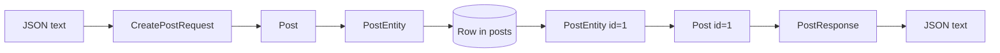

### 14.3 The trace of "who knows what"

| Step | Class | Knows about HTTP? | Knows about SQL? |
|---|---|---|---|
| 1 | `PostController` | ✅ | ❌ |
| 2–3 | `CreatePostUseCaseImpl`, `PostMapper` | ❌ | ❌ |
| 4 | `PostRepository` (interface) | ❌ | ❌ |
| 5–6 | `PostRepositoryAdapter`, `JpaPostRepository` | ❌ | ✅ |
| 7 | `PostMapper` | ❌ | ❌ |
| 8 | `PostController` | ✅ | ❌ |

> 💡 **Read that table as the whole architecture in miniature.** HTTP knowledge appears only at the top, SQL knowledge only at the bottom, and the middle knows about neither. That is the Dependency Rule in practice.

---

## 15. Validation: Where Does What Belong?

Validation confuses many beginners because there are **three different kinds**:

```mermaid
flowchart TB
    V["Validation"] --> A["1. Field-level<br/>NotNull, NotBlank, Size"]
    V --> B["2. Cross-field<br/>TEXT needs content, IMAGE needs imageUrl"]
    V --> C["3. Business rules<br/>A user can edit only their own post"]
    A --> PA["📍 Request boundary"]
    B --> PB["📍 Request boundary: custom validator"]
    C --> PC["📍 Application / Domain"]
```

### 15.1 Field-level validation

```java
@NotNull(message = "User ID is required")
private Long userId;
```

### 15.2 Cross-field (class-level) validation

The rule: **TEXT → content, IMAGE → imageUrl, VIDEO → videoUrl.** Annotations on a single field can't express this, so we create a custom constraint.

```java
package com.example.app.presentation.validation;

import jakarta.validation.Constraint;
import jakarta.validation.Payload;
import java.lang.annotation.*;

@Target(ElementType.TYPE)
@Retention(RetentionPolicy.RUNTIME)
@Constraint(validatedBy = PostContentValidator.class)
public @interface ValidPostContent {
    String message() default "Invalid content for the selected post type";
    Class<?>[] groups() default {};
    Class<? extends Payload>[] payload() default {};
}
```

```java
package com.example.app.presentation.validation;

import com.example.app.application.dto.request.CreatePostRequest;
import jakarta.validation.ConstraintValidator;
import jakarta.validation.ConstraintValidatorContext;

public class PostContentValidator
        implements ConstraintValidator<ValidPostContent, CreatePostRequest> {

    @Override
    public boolean isValid(CreatePostRequest request, ConstraintValidatorContext ctx) {
        if (request == null || request.getPostType() == null) {
            return true; // @NotNull on the field already reports this
        }
        return switch (request.getPostType()) {
            case TEXT  -> notBlank(request.getContent());
            case IMAGE -> notBlank(request.getImageUrl());
            case VIDEO -> notBlank(request.getVideoUrl());
        };
    }

    private boolean notBlank(String s) {
        return s != null && !s.isBlank();
    }
}
```

Apply it:

```java
@Data
@ValidPostContent
public class CreatePostRequest { /* ... */ }
```

> ⚠️ **Gotcha: class-level constraints need `@Validated` on the controller.** `@Valid @RequestBody` validates *field* constraints of the bean. To trigger a class-level constraint like `@ValidPostContent`, annotate the controller class (or the handler method) with Spring's `@Validated`:
>
> ```java
> @RestController
> @Validated          // ← enables method-level validation cascading to the bean
> @RequestMapping("/post")
> public class PostController { ... }
> ```
>
> Without `@Validated`, the custom constraint silently never fires and every invalid request returns 201. This is the single most common bug in this pattern — check it first when your validator "does nothing".

**Examples**

| Request | Valid? | Why |
|---|---|---|
| `{post_type: TEXT, content: "Hi"}` | ✅ | TEXT has content |
| `{post_type: TEXT, content: ""}` | ❌ | TEXT needs non-blank content |
| `{post_type: IMAGE, image_url: "https://cdn/x.png"}` | ✅ | IMAGE has imageUrl |
| `{post_type: IMAGE, content: "caption"}` | ❌ | IMAGE needs imageUrl |
| `{post_type: VIDEO, video_url: null}` | ❌ | VIDEO needs videoUrl |

### 15.3 Business rules

Rules like *"a user may only update their own post"* or *"a user may post at most 50 times per day"* are not about request shape. They depend on stored data and business policy, so they belong in the use case or domain:

```java
@Service
@RequiredArgsConstructor
public class UpdatePostUseCaseImpl implements UpdatePostUseCase {

    private final PostRepository postRepository;

    @Override
    public PostResponse execute(UpdatePostRequest request) {
        Post post = postRepository.findById(request.getPostId())
                .orElseThrow(() -> new PostNotFoundException(request.getPostId()));

        post.assertOwnedBy(request.getRequestingUserId());   // ← domain rule

        post.setContent(request.getContent());
        post.setUpdatedAt(LocalDateTime.now());

        return PostMapper.toResponse(postRepository.savePost(post));
    }
}
```

> **Rule of thumb:** *The controller validates the request **shape**. The application and domain make business **decisions**.*

### 15.4 A decision table

| Rule type | Example | Where it goes | Example implementation |
|---|---|---|---|
| Required field | `userId` must not be null | Request DTO | `@NotNull` |
| Length limit | content ≤ 5000 chars | Request DTO | `@Size(max = 5000)` |
| Format | `imageUrl` must be a URL | Request DTO | `@URL` / `@Pattern` |
| Cross-field | TEXT needs content | Request DTO + custom validator | `@ValidPostContent` |
| Uniqueness | email not already registered | Application / domain | `UserRepository.existsByEmail` + domain exception |
| Authorization | only the owner may edit | Domain | `post.assertOwnedBy(userId)` |
| Rate limit | max 10 posts per day | Application / domain | `PostRepository.countByUserIdAndCreatedAtAfter` |
| State machine | can't like a DELETED post | Domain | `post.isInteractable()` |

---

## 16. Error Handling Across Layers

Clean error handling keeps exceptions meaningful at each layer.

```mermaid
flowchart LR
    D["Domain / Use Case<br/>throws PostNotFoundException"] --> H["GlobalExceptionHandler<br/>(Presentation)"]
    H --> R["HTTP 404 + JSON body"]
```

**Domain-level exception (no HTTP knowledge):**

```java
package com.example.app.domain.exception;

public class PostNotFoundException extends RuntimeException {
    public PostNotFoundException(Long id) {
        super("Post not found with id " + id);
    }
}
```

**Presentation-level translation to HTTP:**

```java
package com.example.app.presentation.exception;

import com.example.app.domain.exception.PostNotFoundException;
import com.example.app.presentation.response.ApiResponse;
import org.springframework.http.HttpStatus;
import org.springframework.web.bind.MethodArgumentNotValidException;
import org.springframework.web.bind.annotation.*;
import org.springframework.web.bind.annotation.RestControllerAdvice;

import java.util.HashMap;
import java.util.Map;

@RestControllerAdvice
public class GlobalExceptionHandler {

    @ExceptionHandler(MethodArgumentNotValidException.class)
    @ResponseStatus(HttpStatus.BAD_REQUEST)
    public ApiResponse<Map<String, String>> handleValidation(MethodArgumentNotValidException ex) {
        Map<String, String> errors = new HashMap<>();
        ex.getBindingResult().getFieldErrors()
                .forEach(e -> errors.put(e.getField(), e.getDefaultMessage()));
        ex.getBindingResult().getGlobalErrors()
                .forEach(e -> errors.put(e.getObjectName(), e.getDefaultMessage()));

        return ApiResponse.<Map<String, String>>builder()
                .status(400).message("Validation failed").data(errors).build();
    }

    @ExceptionHandler(PostNotFoundException.class)
    @ResponseStatus(HttpStatus.NOT_FOUND)
    public ApiResponse<Void> handleNotFound(PostNotFoundException ex) {
        return ApiResponse.<Void>builder()
                .status(404).message(ex.getMessage()).build();
    }
}
```

The domain throws *business* exceptions, and only the presentation layer decides they become 404s.

**Example failure response** for `{"user_id": 23, "post_type": "IMAGE"}`:

```json
{
  "status": 400,
  "message": "Validation failed",
  "data": { "createPostRequest": "Invalid content for the selected post type" }
}
```

### 16.1 A complete exception hierarchy

```mermaid
classDiagram
    class RuntimeException
    class DomainException {
        <<abstract>>
        +String code
    }
    class PostNotFoundException
    class DuplicateEmailException
    class BusinessRuleViolationException
    class GlobalExceptionHandler

    RuntimeException <|-- DomainException
    DomainException <|-- PostNotFoundException
    DomainException <|-- DuplicateEmailException
    DomainException <|-- BusinessRuleViolationException
    GlobalExceptionHandler ..> DomainException : translates
```

```java
// A small base class gives every domain error a stable machine-readable code
public abstract class DomainException extends RuntimeException {

    private final String code;

    protected DomainException(String code, String message) {
        super(message);
        this.code = code;
    }

    public String getCode() {
        return code;
    }
}

public class PostNotFoundException extends DomainException {
    public PostNotFoundException(Long id) {
        super("POST_NOT_FOUND", "Post not found with id " + id);
    }
}
```

### 16.2 The translation table

| Domain / application exception | HTTP status | Where handled |
|---|---|---|
| `MethodArgumentNotValidException` | 400 | Presentation |
| `HttpMessageNotReadableException` (malformed JSON) | 400 | Presentation |
| `PostNotFoundException` | 404 | Presentation |
| `DuplicateEmailException` | 409 Conflict | Presentation |
| `BusinessRuleViolationException` | 422 Unprocessable Entity | Presentation |
| `AccessDeniedException` | 403 | Presentation / Spring Security |
| `OptimisticLockingFailureException` | 409 | Presentation |
| Anything else | 500 | Presentation (generic handler) |

### 16.3 Always add a catch-all

Without a generic handler, an unhandled exception returns Spring's default error body — which leaks internals and breaks your response contract.

```java
@ExceptionHandler(Exception.class)
@ResponseStatus(HttpStatus.INTERNAL_SERVER_ERROR)
public ApiResponse<Void> handleUnexpected(Exception ex) {
    log.error("Unhandled exception", ex);   // ← log the detail, don't return it
    return ApiResponse.<Void>builder()
            .status(500)
            .message("An unexpected error occurred")
            .build();
}
```

> ⚠️ **Never return `ex.getMessage()` for unexpected exceptions.** It routinely contains SQL fragments, file paths, or class names — a classic information-disclosure vulnerability (CWE-209). Log it, return a generic message.

---

## 17. Testing Each Layer

This is where the architecture pays for itself. Each layer has a different, appropriate test style.

```mermaid
flowchart TB
    subgraph Fast["⚡ Fast — no Spring, no DB (milliseconds)"]
        T1["Domain unit tests"]
        T2["Use case unit tests<br/>(with a hand-written fake)"]
    end
    subgraph Medium["🔧 Medium — partial Spring context"]
        T3["@WebMvcTest slice"]
        T4["@DataJpaTest slice"]
    end
    subgraph Slow["🐢 Slow — full application"]
        T5["@SpringBootTest integration"]
    end
    Fast --> Medium --> Slow
```

> 💡 **Aim for the pyramid:** many fast tests, fewer medium ones, fewest slow ones. The layering is what makes the pyramid possible.

### 17.1 Domain unit test — no Spring at all

```java
package com.example.app.domain.model;

import org.junit.jupiter.api.Test;
import static org.junit.jupiter.api.Assertions.*;

class PostTest {

    @Test
    void newPost_startsActive_withZeroCounters() {
        Post post = Post.newPost(23L, PostType.TEXT, "Hello", null, null);

        assertEquals(PostStatus.ACTIVE, post.getPostStatus());
        assertEquals(0L, post.getLikeCount());
        assertEquals(0L, post.getCommentCount());
        assertNotNull(post.getCreatedAt());
        assertEquals(post.getCreatedAt(), post.getUpdatedAt());
    }

    @Test
    void assertOwnedBy_throws_whenUserIsNotOwner() {
        Post post = Post.newPost(23L, PostType.TEXT, "Hello", null, null);

        assertThrows(IllegalStateException.class, () -> post.assertOwnedBy(99L));
    }

    @Test
    void assertOwnedBy_doesNotThrow_forOwner() {
        Post post = Post.newPost(23L, PostType.TEXT, "Hello", null, null);

        assertDoesNotThrow(() -> post.assertOwnedBy(23L));
    }

    @Test
    void deletedPost_isNotInteractable() {
        Post post = Post.newPost(23L, PostType.TEXT, "Hello", null, null);
        post.setPostStatus(PostStatus.DELETED);

        assertFalse(post.isInteractable());
    }
}
```

```bash
mvn test -Dtest=PostTest
# Tests run: 4, Failures: 0 — finished in ~0.4s, no Spring context started
```

### 17.2 Use case unit test with a hand-written fake

The `PostRepository` interface is the seam. We write a fake by hand — no mocking framework needed.

```java
package com.example.app.application.usecase;

import com.example.app.domain.model.Post;
import com.example.app.domain.repository.PostRepository;

import java.util.HashMap;
import java.util.Map;
import java.util.Optional;
import java.util.concurrent.atomic.AtomicLong;

public class InMemoryPostRepository implements PostRepository {

    private final Map<Long, Post> store = new HashMap<>();
    private final AtomicLong sequence = new AtomicLong(0);

    @Override
    public Post savePost(Post post) {
        if (post.getId() == null) {
            post.setId(sequence.incrementAndGet());
        }
        store.put(post.getId(), post);
        return post;
    }

    @Override
    public Optional<Post> findById(Long id) {
        return Optional.ofNullable(store.get(id));
    }
}
```

```java
package com.example.app.application.usecase;

import com.example.app.application.dto.request.CreatePostRequest;
import com.example.app.application.dto.response.PostResponse;
import com.example.app.domain.model.PostType;
import org.junit.jupiter.api.BeforeEach;
import org.junit.jupiter.api.Test;
import static org.junit.jupiter.api.Assertions.*;

class CreatePostUseCaseImplTest {

    private InMemoryPostRepository repository;
    private CreatePostUseCaseImpl useCase;

    @BeforeEach
    void setUp() {
        repository = new InMemoryPostRepository();
        useCase = new CreatePostUseCaseImpl(repository);   // plain constructor — no Spring
    }

    @Test
    void createsPost_withGeneratedId_andActiveStatus() {
        CreatePostRequest request = new CreatePostRequest();
        request.setUserId(23L);
        request.setPostType(PostType.TEXT);
        request.setContent("Hello");

        PostResponse response = useCase.execute(request);

        assertNotNull(response.getId());
        assertEquals(23L, response.getUserId());
        assertEquals(PostType.TEXT, response.getType());
        assertEquals("Hello", response.getContent());
        assertNotNull(response.getCreatedAt());
    }

    @Test
    void persistsThePost_soItCanBeReadBack() {
        CreatePostRequest request = new CreatePostRequest();
        request.setUserId(23L);
        request.setPostType(PostType.TEXT);
        request.setContent("Hello");

        PostResponse created = useCase.execute(request);

        assertTrue(repository.findById(created.getId()).isPresent());
    }
}
```

> 💡 **This is the payoff.** The test above exercises real business logic, runs in milliseconds, needs no database, and would still pass if you replaced MySQL with MongoDB tomorrow.

### 17.3 Controller slice test (`@WebMvcTest`)

```java
package com.example.app.presentation.controller;

import com.example.app.application.dto.response.PostResponse;
import com.example.app.application.usecase.CreatePostUseCase;
import com.example.app.domain.model.PostType;
import org.junit.jupiter.api.Test;
import org.springframework.beans.factory.annotation.Autowired;
import org.springframework.boot.test.autoconfigure.web.servlet.WebMvcTest;
import org.springframework.boot.test.mock.mockito.MockBean;
import org.springframework.http.MediaType;
import org.springframework.test.web.servlet.MockMvc;

import java.time.LocalDateTime;

import static org.mockito.ArgumentMatchers.any;
import static org.mockito.Mockito.when;
import static org.springframework.test.web.servlet.request.MockMvcRequestBuilders.post;
import static org.springframework.test.web.servlet.result.MockMvcResultMatchers.*;

@WebMvcTest(PostController.class)
class PostControllerTest {

    @Autowired
    private MockMvc mockMvc;

    @MockBean
    private CreatePostUseCase createPostUseCase;   // only the use case is mocked

    @Test
    void createPost_returns201_andBody() throws Exception {
        when(createPostUseCase.execute(any())).thenReturn(
                PostResponse.builder()
                        .id(1L).userId(23L).type(PostType.TEXT)
                        .content("Hello").createdAt(LocalDateTime.now())
                        .build());

        mockMvc.perform(post("/post")
                        .contentType(MediaType.APPLICATION_JSON)
                        .content("""
                                {"user_id":23,"post_type":"TEXT","content":"Hello"}
                                """))
                .andExpect(status().isCreated())
                .andExpect(jsonPath("$.status").value(201))
                .andExpect(jsonPath("$.message").value("Post created successfully"))
                .andExpect(jsonPath("$.data.id").value(1))
                .andExpect(jsonPath("$.data.user_id").value(23))
                .andExpect(jsonPath("$.data.type").value("TEXT"));
    }

    @Test
    void createPost_returns400_whenValidationFails() throws Exception {
        mockMvc.perform(post("/post")
                        .contentType(MediaType.APPLICATION_JSON)
                        .content("""
                                {"user_id":23,"post_type":"TEXT"}
                                """))
                .andExpect(status().isBadRequest());
    }

    @Test
    void createPost_returns400_whenImagePostHasNoImageUrl() throws Exception {
        // This case is only caught by the CLASS-LEVEL @ValidPostContent constraint.
        // It requires @Validated on the controller — see Section 15.2.
        mockMvc.perform(post("/post")
                        .contentType(MediaType.APPLICATION_JSON)
                        .content("""
                                {"user_id":23,"post_type":"IMAGE"}
                                """))
                .andExpect(status().isBadRequest());
    }
}
```

> 💡 **Note what is NOT mocked:** no repository, no JPA, no database. The slice test only loads the web layer. `@WebMvcTest` also picks up `@RestControllerAdvice` beans, so the `GlobalExceptionHandler` is active and the 400 body matches the production contract.

### 17.4 Repository slice test (`@DataJpaTest`)

```java
package com.example.app.infrastructure.persistence.repository;

import com.example.app.domain.model.PostStatus;
import com.example.app.domain.model.PostType;
import com.example.app.infrastructure.persistence.entity.PostEntity;
import org.junit.jupiter.api.Test;
import org.springframework.beans.factory.annotation.Autowired;
import org.springframework.boot.test.autoconfigure.orm.jpa.DataJpaTest;

import static org.assertj.core.api.Assertions.assertThat;

@DataJpaTest
class JpaPostRepositoryTest {

    @Autowired
    private JpaPostRepository repository;

    @Test
    void saveAndFindById_roundTrips() {
        PostEntity entity = PostEntity.builder()
                .userId(23L)
                .type(PostType.TEXT)
                .content("Hello")
                .status(PostStatus.ACTIVE)
                .likeCount(0L)
                .build();

        Long id = repository.save(entity).getId();

        assertThat(repository.findById(id)).isPresent()
                .get()
                .extracting(PostEntity::getContent)
                .isEqualTo("Hello");
    }
}
```

> `@DataJpaTest` uses an embedded database by default, so this test doesn't need MySQL. It only verifies that the *persistence* mapping works.

### 17.5 Architecture test (ArchUnit) — the enforcer

```java
package com.example.app.architecture;

import com.tngtech.archunit.junit.AnalyzeClasses;
import com.tngtech.archunit.junit.ArchTest;
import com.tngtech.archunit.lang.ArchRule;

import static com.tngtech.archunit.lang.syntax.ArchRuleDefinition.noClasses;

@AnalyzeClasses(packages = "com.example.app")
class ArchitectureTest {

    @ArchTest
    static final ArchRule domain_must_not_depend_on_framework =
            noClasses()
                .that().resideInAPackage("..domain..")
                .should().dependOnClassesThat()
                .resideInAnyPackage(
                    "org.springframework..",
                    "jakarta.persistence..",
                    "org.springframework.data..",
                    "com.fasterxml.jackson.."
                );

    @ArchTest
    static final ArchRule application_must_not_depend_on_web_or_persistence =
            noClasses()
                .that().resideInAPackage("..application..")
                .should().dependOnClassesThat()
                .resideInAnyPackage(
                    "..presentation..",
                    "org.springframework.web..",
                    "jakarta.persistence.."
                );

    @ArchTest
    static final ArchRule infrastructure_must_not_depend_on_presentation =
            noClasses()
                .that().resideInAPackage("..infrastructure..")
                .should().dependOnClassesThat()
                .resideInAPackage("..presentation..");
}
```

> 💡 **This is the highest-value test in the whole tutorial.** It costs ~1 second and permanently prevents the most common architectural decay: *"just this one quick import won't hurt."*

### 17.6 Test summary

| Test type | Annotation | Starts Spring? | Needs DB? | Typical speed | What it proves |
|---|---|---|---|---|---|
| Domain unit | *(none)* | ❌ | ❌ | ~5 ms | Business rules are correct |
| Use case unit | *(none)* | ❌ | ❌ | ~10 ms | Workflow orchestration is correct |
| Web slice | `@WebMvcTest` | ✅ (web only) | ❌ | ~1 s | Routing, validation, JSON shape |
| JPA slice | `@DataJpaTest` | ✅ (JPA only) | ✅ (embedded) | ~2 s | Entity ↔ table mapping |
| Architecture | `@AnalyzeClasses` | ❌ | ❌ | ~1 s | The dependency rule holds |
| Integration | `@SpringBootTest` | ✅ | ✅ (real) | ~10 s | The whole thing works together |

---

## 18. Proof of the Benefit: Swapping the Database

This section is the "show me" moment. We replace MySQL with MongoDB **and with an in-memory store**, and count the lines of code that change.

```mermaid
flowchart LR
    subgraph Before["Before: JPA + MySQL"]
        B1[Controller] --> B2[Use Case] --> B3["PostRepository<br/>(interface)"]
        B3 --> B4["PostRepositoryAdapter"] --> B5["JpaPostRepository"] --> B6[("MySQL")]
    end
    subgraph After["After: MongoDB"]
        A1[Controller] --> A2[Use Case] --> A3["PostRepository<br/>(SAME interface)"]
        A3 --> A4["MongoPostRepositoryAdapter"] --> A5[("MongoDB")]
    end
    Before ==>|only the adapter changes| After
```

### 18.1 What changes — and what doesn't

| Component | Changes? | Lines |
|---|---|---|
| `Post` (domain) | ❌ No | 0 |
| `PostRepository` (interface) | ❌ No | 0 |
| `CreatePostUseCaseImpl` | ❌ No | 0 |
| `PostMapper` (application) | ❌ No | 0 |
| `PostController` | ❌ No | 0 |
| `PostEntity` | ✅ Deleted | −30 |
| `JpaPostRepository` | ✅ Deleted | −5 |
| `PostRepositoryAdapter` | ✅ Deleted | −25 |
| `MongoPostRepositoryAdapter` | ✅ Added | +30 |

**Three files touched. Everything that matters — the business logic — untouched.**

### 18.2 The MongoDB adapter

```java
package com.example.app.infrastructure.persistence.adapter;

import com.example.app.domain.model.Post;
import com.example.app.domain.repository.PostRepository;
import lombok.RequiredArgsConstructor;
import org.springframework.data.mongodb.core.MongoTemplate;
import org.springframework.stereotype.Repository;

import java.util.Optional;

@Repository
@RequiredArgsConstructor
public class MongoPostRepositoryAdapter implements PostRepository {

    private final MongoTemplate mongoTemplate;

    @Override
    public Post savePost(Post post) {
        PostDocument doc = PostDocument.from(post);
        PostDocument saved = mongoTemplate.save(doc);
        return saved.toDomain();
    }

    @Override
    public Optional<Post> findById(Long id) {
        return Optional.ofNullable(mongoTemplate.findById(id, PostDocument.class))
                .map(PostDocument::toDomain);
    }
}
```

```java
package com.example.app.infrastructure.persistence.adapter;

import com.example.app.domain.model.Post;
import com.example.app.domain.model.PostStatus;
import com.example.app.domain.model.PostType;
import lombok.Data;
import org.springframework.data.annotation.Id;
import org.springframework.data.mongodb.core.mapping.Document;

import java.time.LocalDateTime;

@Data
@Document(collection = "posts")
public class PostDocument {

    @Id
    private Long id;
    private Long userId;
    private String postType;
    private String content;
    private String imageUrl;
    private String videoUrl;
    private String postStatus;
    private Long likeCount;
    private Long commentCount;
    private LocalDateTime createdAt;
    private LocalDateTime updatedAt;

    public static PostDocument from(Post post) {
        PostDocument d = new PostDocument();
        d.setId(post.getId());
        d.setUserId(post.getUserId());
        d.setPostType(post.getPostType().name());
        d.setContent(post.getContent());
        d.setImageUrl(post.getImageUrl());
        d.setVideoUrl(post.getVideoUrl());
        d.setPostStatus(post.getPostStatus().name());
        d.setLikeCount(post.getLikeCount());
        d.setCommentCount(post.getCommentCount());
        d.setCreatedAt(post.getCreatedAt());
        d.setUpdatedAt(post.getUpdatedAt());
        return d;
    }

    public Post toDomain() {
        return Post.builder()
                .id(id)
                .userId(userId)
                .postType(PostType.valueOf(postType))
                .content(content)
                .imageUrl(imageUrl)
                .videoUrl(videoUrl)
                .postStatus(PostStatus.valueOf(postStatus))
                .likeCount(likeCount)
                .commentCount(commentCount)
                .createdAt(createdAt)
                .updatedAt(updatedAt)
                .build();
    }
}
```

### 18.3 The in-memory adapter — zero dependencies

```java
package com.example.app.infrastructure.persistence.adapter;

import com.example.app.domain.model.Post;
import com.example.app.domain.repository.PostRepository;
import org.springframework.stereotype.Repository;

import java.util.Map;
import java.util.Optional;
import java.util.concurrent.ConcurrentHashMap;
import java.util.concurrent.atomic.AtomicLong;

@Repository
public class InMemoryPostRepositoryAdapter implements PostRepository {

    private final Map<Long, Post> store = new ConcurrentHashMap<>();
    private final AtomicLong sequence = new AtomicLong();

    @Override
    public Post savePost(Post post) {
        if (post.getId() == null) {
            post.setId(sequence.incrementAndGet());
        }
        store.put(post.getId(), post);
        return post;
    }

    @Override
    public Optional<Post> findById(Long id) {
        return Optional.ofNullable(store.get(id));
    }
}
```

> 💡 **This adapter is gold for demos, tests, and local development.** You can run the entire application with zero external services — no MySQL, no MongoDB, no Docker.

### 18.4 Switching between them with profiles

```java
package com.example.app.infrastructure.config;

import com.example.app.domain.repository.PostRepository;
import com.example.app.infrastructure.persistence.adapter.*;
import com.example.app.infrastructure.persistence.repository.JpaPostRepository;
import org.springframework.context.annotation.*;
import org.springframework.data.mongodb.core.MongoTemplate;

@Configuration
public class PostRepositoryConfig {

    @Bean
    @Profile("!mongo & !memory")
    public PostRepository jpaPostRepository(JpaPostRepository jpaPostRepository) {
        return new PostRepositoryAdapter(jpaPostRepository);
    }

    @Bean
    @Profile("mongo")
    public PostRepository mongoPostRepository(MongoTemplate mongoTemplate) {
        return new MongoPostRepositoryAdapter(mongoTemplate);
    }

    @Bean
    @Profile("memory")
    public PostRepository inMemoryPostRepository() {
        return new InMemoryPostRepositoryAdapter();
    }
}
```

```bash
mvn spring-boot:run -Dspring-boot.run.profiles=memory   # no database needed
```

### 18.5 The honest caveat

The swap is easy for **persistence**, because persistence is a well-understood boundary with a small, stable contract.

It is **much harder** for boundaries with rich semantics:

| Boundary | Swappable? | Why |
|---|---|---|
| Database | ✅ Yes | CRUD semantics; a contract of a few methods |
| Message broker | ⚠️ Partly | Ordering, delivery guarantees, dead-lettering are business-visible |
| Payment gateway | ❌ Hard | Webhooks, idempotency, currency rules are business rules |
| Search engine | ⚠️ Partly | Ranking and relevance are business behaviour |

> 💡 **The value of Clean Architecture is proportional to the value of the boundary.** If your app is CRUD over one database with no interesting rules, you will gain little — and pay for the extra classes. Section 21 quantifies this.

---

## 19. Adding a Second Feature: Get Post

Adding a feature is where the structure either pays off or becomes overhead. Let's see.

### 19.1 The domain already has what we need

```java
public interface PostRepository {
    Post savePost(Post post);
    Optional<Post> findById(Long id);   // ← already declared in Section 10.3
}
```

The `PostNotFoundException` already exists too. Nothing in the domain needs to change. This is the payoff of designing the contract up front.

### 19.2 The use case

```java
package com.example.app.application.usecase;

import com.example.app.application.dto.response.PostResponse;
import com.example.app.application.mapper.PostMapper;
import com.example.app.domain.exception.PostNotFoundException;
import com.example.app.domain.model.Post;
import com.example.app.domain.repository.PostRepository;
import lombok.RequiredArgsConstructor;
import org.springframework.stereotype.Service;

@Service
@RequiredArgsConstructor
public class GetPostUseCaseImpl implements GetPostUseCase {

    private final PostRepository postRepository;

    @Override
    public PostResponse execute(Long postId) {
        Post post = postRepository.findById(postId)
                .orElseThrow(() -> new PostNotFoundException(postId));   // ← domain exception
        return PostMapper.toResponse(post);
    }
}
```

```java
package com.example.app.application.usecase;

import com.example.app.application.dto.response.PostResponse;

public interface GetPostUseCase {
    PostResponse execute(Long postId);
}
```

### 19.3 The controller endpoint

```java
@GetMapping("/{postId}")
public ApiResponse<PostResponse> getPost(@PathVariable Long postId) {
    return ApiResponse.<PostResponse>builder()
            .status(HttpStatus.OK.value())
            .message("Post retrieved successfully")
            .data(getPostUseCase.execute(postId))
            .build();
}
```

The `PostNotFoundException` propagates up and is turned into a **404** by the `GlobalExceptionHandler` — with **no changes to the domain or the use case**.

```mermaid
sequenceDiagram
    actor C as Client
    participant CT as PostController
    participant UC as GetPostUseCaseImpl
    participant R as PostRepository
    participant H as GlobalExceptionHandler

    C->>CT: GET /post/999
    CT->>UC: execute(999)
    UC->>R: findById(999)
    R-->>UC: Optional.empty()
    UC-->>H: PostNotFoundException
    H-->>C: 404 Not Found + JSON
```

### 19.4 What changed, layer by layer

| Layer | Change |
|---|---|
| Domain | ❌ Nothing — `findById` and `PostNotFoundException` already existed |
| Application | ✅ New `GetPostUseCase` + impl (reuses `PostMapper`) |
| Infrastructure | ❌ Nothing — `findById` was already implemented in the adapter |
| Presentation | ✅ New `@GetMapping` method |

> 💡 **Two new files, not ten.** In a fat-controller design, this feature would have added logic to the existing controller and duplicated the "not found" check. Here, the *domain* was prepared for it in advance — the exception, the contract method, the mapper function — so the new feature was mostly wiring.

---

## 20. Clean Architecture vs Classic Layered Architecture

"Layered architecture" (also called "n-tier" or "three-tier") is what most Spring Boot apps already use. The two are related but different.

### 20.1 Side-by-side

| Aspect | Classic Layered | Clean Architecture |
|---|---|---|
| Layers | Controller → Service → Repository → DB | Presentation → Application → Domain ← Infrastructure |
| Entity reuse | Same class for DB and API | Separate domain, entity, DTO |
| Dependencies | Flow downward, service depends on repository | Point inward; domain depends on nothing |
| Business rules | Often in the service layer | In the domain, next to the data they describe |
| Testing | Service tests need mocks/DB | Domain & use case tests are plain JUnit |
| Persistence swap | Touches services | Touches one adapter |
| Number of files | Fewer | More |
| Best for | Simple CRUD apps | Complex, long-lived, rule-heavy systems |

### 20.2 The same feature, both ways

**Classic layered:**

```java
// Controller
@RestController
@RequestMapping("/post")
public class PostController {
    @Autowired private PostService postService;

    @PostMapping
    public PostEntity create(@RequestBody PostEntity post) {
        if (post.getType() == PostType.TEXT && post.getContent() == null) {
            throw new ResponseStatusException(HttpStatus.BAD_REQUEST);
        }
        post.setCreatedAt(LocalDateTime.now());
        post.setStatus(PostStatus.ACTIVE);
        return postService.save(post);   // returns the ENTITY
    }
}
```

```java
// Service
@Service
public class PostService {
    @Autowired private PostRepository postRepository;   // Spring Data, entity-typed

    public PostEntity save(PostEntity post) {
        return postRepository.save(post);
    }
}
```

**Problems visible immediately:**

1. The controller returns `PostEntity` — the DB schema is now the public API.
2. The controller accepts `PostEntity` — clients can set `likeCount`, `status`, `createdAt`. **Mass assignment.**
3. Business rules live in the controller, so a Kafka consumer can't reuse them.
4. `PostService` depends on `PostRepository` (a Spring Data interface) — the business logic is welded to JPA.

### 20.3 A visual comparison

```mermaid
flowchart TB
    subgraph Classic["Classic layered"]
        direction TB
        c1[Controller] --> c2[Service] --> c3[Repository] --> c4[(DB)]
        c2 -.also holds rules.-> c2
    end
    subgraph Clean["Clean Architecture"]
        direction TB
        k1[Presentation] --> k2[Application] --> k3[Domain]
        k4[Infrastructure] -.implements port.-> k3
        k4 --> k5[(DB)]
    end
```

### 20.4 When each one wins

| Situation | Better choice | Why |
|---|---|---|
| Admin panel over a fixed schema | Classic layered | Rules are trivial; the structure is overhead |
| Report generator | Classic layered | Read-only, no domain rules |
| Prototype / MVP | Classic layered | Speed to first release matters most |
| Long-lived enterprise system | Clean Architecture | Rules evolve; boundaries must hold |
| Multi-client product (web + mobile + partner API) | Clean Architecture | Stable contracts; multiple entry points |
| Heavy domain rules (pricing, eligibility, scheduling) | Clean Architecture | Rules need one home and isolated tests |
| Microservice with 3 CRUD endpoints | Classic layered | Service autonomy matters more than internal layering |

> 💡 **The classic layered architecture is not "wrong."** It is a legitimate, simpler design. It becomes a problem when business rules accumulate in services and the service layer starts importing framework types.

---

## 21. Real World Examples and Use Cases

### 21.1 Where you already use it

You may think Clean Architecture is exotic, but you use the same idea every day:

| Everyday analogy | Clean Architecture equivalent |
|---|---|
| A car's engine doesn't know about the steering wheel | Domain doesn't know about HTTP |
| A universal charger works with many devices | One port, many adapters |
| A driver's licence is the same regardless of the car | Stable DTO contract across implementations |
| A recipe doesn't mention the oven | Domain doesn't mention JPA |

### 21.2 E-commerce: order pricing

```mermaid
flowchart TB
    subgraph DomainRules["Domain rules — pure Java"]
        D1["Order total = items + tax − discount"]
        D2["Discount applies only above ₹1000"]
        D3["Cannot ship an unpaid order"]
    end
    subgraph UseCase["Application — orchestration"]
        U1["PlaceOrderUseCase"]
    end
    subgraph Infra["Infrastructure"]
        I1["JPA order repository"]
        I2["Stripe payment adapter"]
        I3["Kafka event publisher"]
    end
    U1 --> DomainRules
    I1 -.implements port.-> DomainRules
    I2 -.implements port.-> DomainRules
    I3 -.implements port.-> DomainRules
```

Here the boundaries are genuinely valuable: you could swap Stripe for Razorpay without touching a single pricing rule.

### 21.3 Banking: loan eligibility

The domain is the *entire value* of the application. The database and the web layer are replaceable details.

```java
public class LoanApplication {

    private final BigDecimal amount;
    private final int creditScore;
    private final int existingEmis;

    /** Domain rule: eligibility depends only on domain data. */
    public boolean isEligible() {
        return creditScore >= 700
                && existingEmis <= 4
                && amount.compareTo(BigDecimal.valueOf(50_000)) <= 0;
    }

    public BigDecimal interestRate() {
        return isEligible() ? new BigDecimal("0.08") : new BigDecimal("0.14");
    }
}
```

```java
@Test
void applicantWithCreditScore650_isNotEligible() {
    LoanApplication app = new LoanApplication(BigDecimal.valueOf(100_000), 650, 1);

    assertFalse(app.isEligible());
    assertEquals(new BigDecimal("0.14"), app.interestRate());
}
```

> 💡 **Note that this test has no Spring, no JPA, no database, and no mocks.** It runs in microseconds and it is the test your business stakeholders actually care about.

### 21.4 Healthcare: patient records

Regulatory requirements (HIPAA, GDPR) often demand:

- Audit trails on every access
- Separation between "who may see what" and "how it is stored"
- The ability to swap storage vendors

Clean Architecture makes the audit and authorization rules live in the domain, testable in isolation, and independent of where the data sits.

### 21.5 SaaS: multi-tenant

The tenant context is a domain concept. A `TenantId` value object in the domain means every rule can be tenant-aware without touching HTTP headers or SQL filters.

### 21.6 A decision matrix

```mermaid
flowchart TD
    S{"Do you have<br/>non-trivial business rules?"}
    S -->|No| L1["Classic layered<br/>is fine"]
    S -->|Yes| T{"Will the system<br/>live for years?"}
    T -->|No| L2["Classic layered<br/>(move fast)"]
    T -->|Yes| M{"Do you need to swap<br/>a technical detail?"}
    M -->|No| L3["Classic layered<br/>with a service layer"]
    M -->|Yes| CL["Clean Architecture"]
```

### 21.7 The honest cost

| Cost | Detail |
|---|---|
| More files | ~3–4× the classes for the same feature |
| More indirection | Reading a feature means hopping 5 files instead of 2 |
| Onboarding | New devs must understand the boundaries |
| Boilerplate | Mappers, DTOs, adapters |
| Over-engineering risk | Easy to apply to a CRUD app that doesn't need it |

> 💡 **The right time to adopt it is when the pain appears** — not on day one of a greenfield prototype. Adopting it early is fine too, but adopt it *knowingly*, knowing the trade-off.

---

## 22. Multiple Implementation Approaches

"Clean Architecture" describes principles, not a single file layout. Here are the mainstream variants in Spring Boot.

### 22.1 Variant A: Four packages (what we built)

```text
domain/         application/     infrastructure/     presentation/
```

| Pros | Cons |
|---|---|
| Simple to explain | Large applications get big packages |
| Matches the book's rings closely | Layering is by *technical role*, not by *feature* |

### 22.2 Variant B: Feature-first (package-by-feature)

```text
post/
├── domain/          Post, PostType, PostStatus, PostRepository
├── application/     CreatePostUseCase, PostMapper
├── infrastructure/  PostEntity, JpaPostRepository, PostRepositoryAdapter
└── presentation/    PostController, PostResponse
```

```mermaid
flowchart LR
    subgraph FP["Feature-first"]
        direction TB
        F1["post/"] --> F2["comment/"] --> F3["user/"]
    end
    subgraph TL["Technical-layer-first"]
        direction TB
        T1["domain/"] --> T2["application/"] --> T3["infrastructure/"] --> T4["presentation/"]
    end
```

| Pros | Cons |
|---|---|
| Everything about a feature is in one place | Shared code needs a `common` package |
| Deleting a feature = deleting a folder | Cross-feature use cases can get tangled |
| Parallel development works better | — |

> 💡 **Variant B is my recommendation for medium and large applications.** It keeps the dependency rule *within* each feature folder, and it scales better. The ArchUnit rules need a small adjustment to match (use `..post.domain..` instead of `..domain..`).

### 22.3 Variant C: Interface-per-use-case vs concrete use cases

**C1 — Interface + Impl (what we built):**

```java
public interface CreatePostUseCase {
    PostResponse execute(CreatePostRequest request);
}

@Service
@RequiredArgsConstructor
public class CreatePostUseCaseImpl implements CreatePostUseCase { ... }
```

**C2 — Concrete class only:**

```java
@Service
@RequiredArgsConstructor
public class CreatePostUseCase {
    private final PostRepository postRepository;

    public PostResponse execute(CreatePostRequest request) { ... }
}
```

| | C1 | C2 |
|---|---|---|
| Files per use case | 2 | 1 |
| Test double for the use case | Easy | Easy (mock the class) |
| Multiple implementations | Supported | Not without refactoring |
| Book fidelity | High | Low |
| **Recommendation** | When several entry points share a use case | **Default for most teams** |

### 22.4 Variant D: MediatR / CQRS

A widely used Spring pattern that combines well with Clean Architecture:

```java
public record CreatePostCommand(
        Long userId, PostType postType, String content,
        String imageUrl, String videoUrl) {}

@Component
@RequiredArgsConstructor
public class CreatePostCommandHandler implements CommandHandler<CreatePostCommand, PostResponse> {

    private final PostRepository postRepository;

    @Override
    public PostResponse handle(CreatePostCommand command) {
        Post post = Post.newPost(command.userId(), command.postType(),
                command.content(), command.imageUrl(), command.videoUrl());
        return PostMapper.toResponse(postRepository.savePost(post));
    }
}
```

```java
@RestController
@RequestMapping("/post")
@RequiredArgsConstructor
public class PostController {

    private final CommandHandler<CreatePostCommand, PostResponse> handler;

    @PostMapping
    public ApiResponse<PostResponse> create(@Valid @RequestBody CreatePostRequest request) {
        CreatePostCommand command = new CreatePostCommand(
                request.getUserId(), request.getPostType(), request.getContent(),
                request.getImageUrl(), request.getVideoUrl());

        return ApiResponse.<PostResponse>builder()
                .status(201).message("Post created successfully")
                .data(handler.handle(command)).build();
    }
}
```

> ⚠️ **MediatR's `IRequest`/`IRequestHandler` types live in the application layer and reference MediatR.** That's a *framework* dependency in your inner layer — a violation of the strictest reading of the rule. Two mitigations: (a) treat MediatR as an allowed "application framework" and add it to the ArchUnit allow-list, or (b) write your own tiny dispatcher interface in the domain and adapt MediatR at the edge.

### 22.5 Variant E: MapStruct instead of hand-written mappers

```java
@Mapper(componentModel = "spring")
public interface PostMapper {

    @Mapping(target = "postType", source = "postType")
    @Mapping(target = "postStatus", ignore = true)
    Post toDomain(PostEntity entity);

    @Mapping(target = "type", source = "postType")
    PostResponse toResponse(Post post);
}
```

| Pros | Cons |
|---|---|
| No boilerplate | Compile-time complexity; annotation debugging |
| Compile-time safety | Generated code can surprise you |
| Handles nested types | One more build dependency |

### 22.6 Variant F: Domain events

```java
// domain/event
public record PostCreatedEvent(Long postId, Long userId, LocalDateTime occurredAt) {}

// domain/aggregate
public Post create() {
    Post post = Post.newPost(userId, postType, content, imageUrl, videoUrl);
    DomainEvents.register(new PostCreatedEvent(post.getId(), userId, post.getCreatedAt()));
    return post;
}
```

```java
// infrastructure/listener
@Component
@RequiredArgsConstructor
public class PostCreatedNotificationListener {

    private final NotificationPort notificationPort;

    @EventListener
    public void on(PostCreatedEvent event) {
        notificationPort.notifyUser(event.userId(), "Your post was published");
    }
}
```

> 💡 **The key insight:** the domain *decides that something happened*; infrastructure *decides what to do about it*. The domain never imports Spring's `@EventListener`.

### 22.7 Which to choose?

```mermaid
flowchart TD
    A{"Team size"}
    A -->|1-3 devs| B["Variant A + concrete use cases<br/>(simplest)"]
    A -->|4+ devs| C["Variant B (feature-first)"]
    C --> D{"Need a lot of use cases?"}
    D -->|Yes| E["MediatR (Variant D)"]
    D -->|No| F["Plain use cases"]
    E --> G{"Lots of mapping?"}
    F --> G
    G -->|Yes| H["MapStruct (Variant E)"]
    G -->|No| I["Hand-written mappers"]
```

---

## 23. Best Practices

### 23.1 The dependency rule, enforced

| Practice | How |
|---|---|
| Keep the domain framework-free | No Spring, JPA, Jackson imports in `domain` |
| Define ports in the domain | `PostRepository` lives in `domain/repository` |
| Implement ports in infrastructure | `PostRepositoryAdapter` lives in `infrastructure` |
| Guard with ArchUnit | A failing build beats a code-review comment |

### 23.2 Keep three models separate

| Rule | Reason |
|---|---|
| Never return an entity from a controller | Schema changes become API breaks |
| Never accept an entity as a request body | Mass assignment |
| Never put `@Entity` on a domain model | Persistence concerns leak inward |

### 23.3 Prefer constructor injection

```java
// ✅ Immutable, testable, no field injection
@Service
@RequiredArgsConstructor
public class CreatePostUseCaseImpl implements CreatePostUseCase {
    private final PostRepository postRepository;
}
```

Avoid `@Autowired` on fields — it hides dependencies, prevents final fields, and makes tests clumsier.

### 23.4 Use `@Service` only in the application layer

`@Service` in the domain would mean a Spring dependency in the domain. Use plain classes there. Spring annotations belong in the layers that Spring manages.

### 23.5 Make use cases thin and single-purpose

```mermaid
flowchart LR
    subgraph Good["✅ One use case = one job"]
        direction TB
        g1["CreatePostUseCase"] --> g2["one clear responsibility"]
    end
    subgraph Bad["❌ God use case"]
        direction TB
        b1["ManagePostUseCase"] --> b2["create"] --> b3["update"] --> b4["delete"] --> b5["like"] --> b6["report"]
    end
```

### 23.6 Prefer immutability where it matters

```java
// ✅ Domain value object — immutable
public record Money(BigDecimal amount, String currency) {
    public Money {
        if (amount == null || amount.signum() < 0) {
            throw new IllegalArgumentException("Amount must be non-negative");
        }
    }

    public Money add(Money other) {
        if (!currency.equals(other.currency)) {
            throw new IllegalArgumentException("Currency mismatch");
        }
        return new Money(amount.add(other.amount), currency);
    }
}
```

Records give you equality, hash code, and immutability for free — and they keep the domain free of Lombok.

### 23.7 Use `Optional` in the domain, never `null`

```java
Optional<Post> findById(Long id);   // ✅ "may not exist" is explicit
Post findById(Long id);              // ❌ null is a hidden trap
```

### 23.8 Name things for what they do, not what they are

| Instead of | Prefer |
|---|---|
| `PostService` | `CreatePostUseCase` |
| `PostDTO` | `CreatePostRequest` / `PostResponse` |
| `PostDAO` | `PostRepository` (port) / `PostRepositoryAdapter` |
| `PostHelper` | `PostMapper` |

### 23.9 Keep the domain model the single source of truth

```mermaid
flowchart LR
    J["JSON body"] --> D["Request DTO"]
    D -->|"mapping"| DM["Domain model ✅"]
    DM -->|"mapping"| E["Entity"]
    E --> DB[("Table")]
```

> Only the domain model sits in the middle. If you find yourself mapping DTO → Entity directly, you've skipped the domain — and lost the place where rules live.

### 23.10 Do the minimum

> 💡 **Clean Architecture is a means, not an end.** Every abstraction you add must pay rent: a real boundary, a real rule, or a real testability gain. If an interface has one implementation and will never be swapped, ask whether it's earning its keep.

---

## 24. Anti Patterns

### 24.1 The "God Interface"

```java
// ❌ One giant repository interface for everything
public interface BaseRepository<T, ID> {
    T save(T entity);
    T findById(ID id);
    List<T> findAll();
    void delete(T entity);
    boolean existsById(ID id);
    long count();
    // ... 40 more methods
}
```

**Problem:** a fat generic repository exposes persistence operations the domain doesn't need, and it can't express domain-specific queries.

**Fix:** small, domain-shaped interfaces.

```java
// ✅
public interface PostRepository {
    Post savePost(Post post);
    Optional<Post> findById(Long id);
}
```

### 24.2 The "Entity as Domain Model"

```java
// ❌ A JPA entity in the domain layer
package com.example.app.domain.model;

@Entity
@Table(name = "posts")
@Data
public class Post { ... }
```

**Problem:** the domain now carries `@Entity`, `@Column`, lazy-loading proxies, and `Serializable` requirements. It cannot be tested or reused outside JPA.

**Fix:** separate domain model and entity, with a mapper.

### 24.3 The "Anemic Domain"

```java
// ❌ All logic in the service; the domain is pure data
@Data
public class Post {
    private Long id;
    private String content;
    private PostStatus status;
}

@Service
public class PostService {
    public void likePost(Long id, Long userId) {
        Post post = repository.findById(id).orElseThrow();
        if (post.getStatus() != PostStatus.ACTIVE) {   // ← rule lives here
            throw new BusinessException("Cannot like");
        }
        post.setLikeCount(post.getLikeCount() + 1);
    }
}
```

**Problem:** the rules are in the service, so a different entry point (a Kafka consumer, a batch job) can bypass them, and the domain object can't protect itself.

**Fix:** move the rule onto the domain object (`post.like(userId)`), and let the service orchestrate.

### 24.4 The "Anemic Service Layer" / pass-through service

```java
// ❌ A service that adds nothing
@Service
public class PostService {
    @Autowired private PostRepository postRepository;

    public PostEntity save(PostEntity post) {
        return postRepository.save(post);
    }
}
```

**Problem:** pure ceremony. If the service adds no orchestration, no transaction boundary, and no translation, it should not exist.

**Fix:** delete it, or give it a job (orchestration, transaction boundary, mapping).

### 24.5 The "Leaky Abstraction"

```java
// ❌ The port leaks a persistence concept
public interface PostRepository {
    Post save(Post post);
    Page<Post> findAll(Pageable pageable);      // Spring Data type
    List<Post> findByUserId(Long id, Sort sort); // Spring Data type
}
```

**Problem:** `Pageable` and `Sort` are Spring Data classes. The domain now depends on Spring Data.

**Fix:** use your own types in the port, or accept `int page, int size` and map internally.

### 24.6 The "Setter Soup"

```java
// ❌ Anyone can put a Post into an invalid state
@Data
public class Post {
    private PostStatus status;
    public void setStatus(PostStatus status) { this.status = status; }
}
```

**Problem:** `post.setStatus(DELETED)` bypasses any rule about transitions.

**Fix:** make the class immutable, or expose intention-revealing methods (`post.markAsDeleted()`).

### 24.7 The "Validator in the Wrong Place"

```java
// ❌ Business rules hidden in a Bean Validation annotation
@AssertTrue(message = "Video posts need a videoUrl")
public boolean isValidForType() { ... }
```

**Problem:** Bean Validation runs *before* the use case. A rule that depends on stored data (e.g. *"this user is not banned"*) can't be expressed there — and rules that *can* be expressed there often hide the domain's intent.

**Fix:** use Bean Validation for **shape** only. Put **decisions** in the domain.

### 24.8 The "Interface for Everything"

```java
// ❌ 40 interfaces, 40 implementations, 1 real behaviour
public interface PostCreator { }
public interface PostDeleter { }
public interface PostValidator { }
public interface PostMapper { }
```

**Problem:** pure ceremony; huge navigation cost.

**Fix:** abstract only at genuine boundaries (persistence, external systems).

### 24.9 The "Layer with No Purpose"

```java
// ❌ An "application" layer that only forwards calls
@Service
public class PostApplicationService {
    public PostEntity create(PostEntity e) { return postService.create(e); }
}
```

**Fix:** merge layers that add nothing.

### 24.10 The "Domain that Knows About Spring"

```java
// ❌
package com.example.app.domain.model;

import org.springframework.stereotype.Service;
import org.springframework.data.annotation.Id;

@Service
public class Post { @Id private Long id; }
```

**Fix:** domain classes are plain Java. Annotate only in infrastructure.

### 24.11 Anti-pattern summary

```mermaid
mindmap
  root(("Clean Architecture<br/>Anti Patterns"))
    God Interface
      Fat generic base repository
      40 methods
    Leaky Domain
      JPA entity in domain
      Spring annotations
      Pageable in port
    Anemic Design
      All rules in service
      Pass-through service
    Rule Misplacement
      Business rule in @AssertTrue
      Rule in controller
    Ceremony
      Interface for everything
      Empty layers
      Mapper per field
```

---

## 25. Performance Considerations

Clean Architecture adds indirection. Here's what that costs and how to manage it.

### 25.1 The cost of indirection

```mermaid
flowchart LR
    A["HTTP request"] --> B[Controller] --> C[Use case] --> D[Mapper] --> E[Adapter] --> F[Mapper] --> G[JPA]
```

Each hop is a method call — nanoseconds. **Object allocation** (DTOs, domain objects, entities) is the real cost, and it is small.

| Operation | Typical cost |
|---|---|
| Method call | ~1 ns |
| Small object allocation | ~10–20 ns (young-gen, often scalar-replaced by the JIT) |
| JSON serialize + deserialize one DTO | ~1–5 µs |
| One MySQL INSERT (network-bound) | ~1–10 ms |

> 💡 **The verdict:** the layering overhead is typically **less than 0.1%** of a request that touches a database. Optimising it away is a false economy. Optimise the *query* instead.

### 25.2 Where performance is actually lost

| Mistake | Impact | Fix |
|---|---|---|
| N+1 queries from lazy relations | 100× slower | `@EntityGraph`, `join fetch`, or DTO projections |
| `open-in-view: true` | Connections held for the whole request | Set `open-in-view: false` (Spring Boot's default) |
| Excessive mapping | Small CPU cost | Keep mapping simple; use MapStruct for volume |
| Synchronous I/O in the use case | Latency | Use reactive types or async ports |
| No read/write separation | Contention | Separate read ports (CQRS) |
| Domain events dispatched synchronously | Latency | Use `@Async` or an outbox pattern |

### 25.3 N+1 — the classic trap

```java
// ❌ One query for posts, then one per post for its author
public List<Post> findAll() {
    return postRepository.findAll().stream()
            .map(p -> p.getAuthor().getName())     // ← lazy load per row
            .toList();
}
```

```java
// ✅ Fetch what you need in one query
@Query("select p from PostEntity p join fetch p.author")
List<PostEntity> findAllWithAuthor();
```

### 25.4 Keep `open-in-view` off

```yaml
spring:
  jpa:
    open-in-view: false   # ← default in Spring Boot; keep it
```

With `open-in-view: true`, the persistence context stays open for the entire HTTP request — the connection is held while your code runs, and lazy loading happens invisibly in the controller. Turning it off forces the adapter to fetch what it needs, which is both faster and safer.

### 25.5 Caching at the right layer

| Cache | Layer | Notes |
|---|---|---|
| HTTP response cache | Presentation | CDN / reverse proxy |
| Query result cache | Infrastructure | `spring.cache` with a JPA region |
| Read-model cache | Application | Cache a `PostResponse`, not an entity |
| Domain rule cache | Domain | Rarely useful — rules are cheap |

> ⚠️ **Never cache a JPA entity.** Entities are managed by the persistence context and carry lazy proxies; caching them outside a session causes `LazyInitializationException` and stale-state bugs.

### 25.6 Transactions belong at the use-case boundary

```java
@Service
@RequiredArgsConstructor
public class TransferMoneyUseCaseImpl implements TransferMoneyUseCase {

    private final AccountRepository accountRepository;

    @Transactional
    @Override
    public void execute(TransferMoneyCommand command) {
        // both reads and writes are inside one transaction
    }
}
```

> 💡 **Why here?** A transaction is a *use-case-level* concept: "this whole operation either happens or doesn't." Putting `@Transactional` on the adapter would give you a transaction per repository call — not per use case. And putting it in the domain would require a Spring import there.

---

## 26. Security Considerations

### 26.1 Mass assignment — the #1 risk of using entities as input

```java
// ❌ Catastrophic
@PostMapping
public PostEntity create(@RequestBody PostEntity entity) {
    return repository.save(entity);
}
```

A client can send:

```json
{
  "user_id": 23,
  "content": "hello",
  "like_count": 999999,
  "status": "ACTIVE",
  "created_at": "1999-01-01T00:00:00"
}
```

With the Clean Architecture DTO, `CreatePostRequest` simply **has no `likeCount` field** — Jackson ignores unknown properties (or you configure it to fail), so the attack has nowhere to land.

> 💡 **Defense in depth:** also configure Jackson to reject unknown properties.
>
> ```yaml
> spring:
>   jackson:
>     deserialization:
>       fail-on-unknown-properties: true
> ```

### 26.2 Where does authentication fit?

```mermaid
flowchart TB
    R[HTTP Request] --> F["Spring Security Filter<br/>(presentation layer)"]
    F -->|SecurityContext| CT[Controller]
    CT -->|currentUserId| UC[Use Case]
    UC --> D[Domain rule: assertOwnedBy]
```

**Authentication and authorization are cross-cutting concerns**, so they live at the boundary — but the *authorization rules* are domain rules.

```java
// Presentation: extract the authenticated principal
@PostMapping
public ApiResponse<PostResponse> create(@Valid @RequestBody CreatePostRequest request,
                                        @AuthenticationPrincipal UserDetails user) {
    request.setUserId(user.getId());   // ← server-side identity wins
    // ...
}
```

> ⚠️ **Never trust `userId` from the request body.** If a client can send `user_id`, it can post as anyone. Derive the user from the security context, or at minimum verify that the body's `user_id` matches the authenticated principal.

### 26.3 Domain-level authorization

```java
// ✅ The rule lives with the data it protects
public void assertOwnedBy(Long requestingUserId) {
    if (this.userId == null || !this.userId.equals(requestingUserId)) {
        throw new NotPostOwnerException(this.id);
    }
}
```

Then map it in the exception handler:

```java
@ExceptionHandler(NotPostOwnerException.class)
@ResponseStatus(HttpStatus.FORBIDDEN)
public ApiResponse<Void> handleForbidden(NotPostOwnerException ex) {
    return ApiResponse.<Void>builder()
            .status(403).message("You are not allowed to modify this post").build();
}
```

### 26.4 Don't leak internals in error responses

| Never return | Why |
|---|---|
| `ex.getMessage()` for unexpected exceptions | Leaks SQL, paths, class names (CWE-209) |
| Stack traces | Full internal structure |
| Entity JSON in errors | May include internal fields, user data of others |

```java
// ✅ Log the detail, return a generic message
@ExceptionHandler(Exception.class)
@ResponseStatus(HttpStatus.INTERNAL_SERVER_ERROR)
public ApiResponse<Void> handleUnexpected(Exception ex) {
    log.error("Unhandled exception while processing request", ex);
    return ApiResponse.<Void>builder()
            .status(500).message("An unexpected error occurred").build();
}
```

### 26.5 Input validation as a security control

| Threat | Control |
|---|---|
| SQL injection | Parameterized queries (JPA does this by default) — never build SQL strings |
| Oversized payloads | `@Size`, server-side `max-request-size`, request size limits |
| Invalid enum values | Enum types reject unknown values at deserialization |
| XSS in stored content | Encode on output; never render raw HTML from user content |
| Resource exhaustion | Rate limiting, pagination limits, timeouts on outbound calls |

### 26.6 Secrets never enter the domain

```yaml
spring:
  datasource:
    password: ${DB_PASSWORD}     # ← from environment / Vault, not source
```

The domain must never see a password, an API key, or a connection string.

### 26.7 Security checklist

- ✅ `userId` derived from the security context, not the request body
- ✅ Request DTOs contain no server-controlled fields
- ✅ Domain enforces ownership and state-transition rules
- ✅ Domain exceptions mapped to 401/403/404 without leaking details
- ✅ Generic message for unexpected exceptions; details only in logs
- ✅ Secrets from the environment, never hard-coded
- ✅ `fail-on-unknown-properties: true` to reject unexpected JSON
- ✅ Pagination limits on all list endpoints
- ✅ Logs never contain request bodies containing passwords or tokens

---

## 27. Testing Strategies

### 27.1 The four test types and what each proves

```mermaid
flowchart TB
    subgraph Pyramid["Test pyramid for Clean Architecture"]
        direction TB
        I["🧪 Integration tests<br/>(few, slow)<br/>Real DB + full context"]
        S["🔬 Slice tests<br/>(some)<br/>@WebMvcTest / @DataJpaTest"]
        U["⚡ Unit tests<br/>(many, fast)<br/>Pure JUnit, no Spring"]
    end
    U --> S --> I
```

| Test type | Verifies | Cost | Change it breaks |
|---|---|---|---|
| Domain unit test | Business rules | ~5 ms | Rule changes |
| Use case unit test | Orchestration & error paths | ~10 ms | Workflow changes |
| Slice test | HTTP contract, validation, JSON | ~1 s | API/validation changes |
| Integration test | Wiring, mapping, transactions | ~10 s | Wiring changes |
| ArchUnit test | Architectural constraints | ~1 s | Nothing — it's a constant |

### 27.2 The change-impact advantage

```mermaid
flowchart LR
    subgraph Classic["Classic layered: change a rule"]
        A1[Rule change] --> A2[Service] --> A3["Service tests<br/>(need DB/mocks)"] --> A4["Controller tests<br/>(need Spring)"]
        A4 --> A5["Integration tests"]
    end
    subgraph Clean["Clean: change a rule"]
        B1[Rule change] --> B2[Domain] --> B3["Domain unit test ✅"]
        B2 --> B4["Use case unit test ✅"]
        B4 --> B5["Integration tests<br/>(may not even need to change)"]
    end
```

> 💡 **This is the real payoff.** Changing a business rule invalidates *one* test in the Clean design, and it runs in 5 ms. In a coupled design, the same change invalidates service, controller, and integration tests — and you wait minutes for the answer.

### 27.3 Test doubles: fake vs mock vs stub

| Type | What it is | When to use |
|---|---|---|
| **Stub** | Returns canned data | Simple input control |
| **Mock** | Asserts interactions ("save was called once") | Verifying collaboration |
| **Fake** | A working in-memory implementation | Repositories, caches, gateways |
| **Spy** | Wraps a real object | Rarely needed |

```java
// ❌ Mock-heavy test — brittle, tests implementation details
@Mock PostRepository repo;
when(repo.savePost(any())).thenReturn(...);
verify(repo).savePost(argThat(p -> p.getUserId() == 23L));
```

```java
// ✅ Behaviour-focused test with a fake
InMemoryPostRepository repo = new InMemoryPostRepository();
CreatePostUseCaseImpl useCase = new CreatePostUseCaseImpl(repo);

PostResponse response = useCase.execute(request);

assertThat(repo.findById(response.getId())).isPresent();   // observable outcome
```

### 27.4 Arrange–Act–Assert

```java
@Test
void returnsPostNotFound_whenIdDoesNotExist() {
    // Arrange
    InMemoryPostRepository repository = new InMemoryPostRepository();
    GetPostUseCaseImpl useCase = new GetPostUseCaseImpl(repository);

    // Act
    Throwable thrown = assertThrows(PostNotFoundException.class,
            () -> useCase.execute(999L));

    // Assert
    assertThat(thrown.getMessage()).contains("999");
}
```

### 27.5 Data-driven tests for domain rules

```java
@ParameterizedTest
@CsvSource({
        "700, 1, true",
        "699, 1, false",
        "700, 5, false",
        "800, 0, true"
})
void eligibility(int creditScore, int emis, boolean expected) {
    LoanApplication app = new LoanApplication(BigDecimal.valueOf(10_000), creditScore, emis);

    assertEquals(expected, app.isEligible());
}
```

### 27.6 Contract tests for the ports

```java
// Runs the SAME test against every adapter implementation
interface PostRepositoryContract {
    PostRepository repository();   // supplied by the implementation under test

    @Test
    void savedPost_canBeReadBack() {
        Post saved = repository().savePost(
                Post.newPost(23L, PostType.TEXT, "Hello", null, null));

        assertThat(repository().findById(saved.getId())).isPresent();
    }
}

class InMemoryPostRepositoryTest implements PostRepositoryContract {
    @Override public PostRepository repository() { return new InMemoryPostRepositoryAdapter(); }
}

class JpaPostRepositoryTest implements PostRepositoryContract {
    @Autowired PostRepository repository;
    @Override public PostRepository repository() { return repository; }
}
```

> 💡 **Contract tests guarantee that every adapter honours the port's promise.** This is invaluable when you have three adapters — the in-memory one, JPA, and Mongo.

### 27.7 Coverage: measure the right thing

```xml
<plugin>
  <groupId>org.jacoco</groupId>
  <artifactId>jacoco-maven-plugin</artifactId>
  <version>0.8.12</version>
  <executions>
    <execution>
      <goals><goal>prepare-agent</goal></goals>
    </execution>
    <execution>
      <id>report</id>
      <phase>test</phase>
      <goals><goal>report</goal></goals>
    </execution>
  </executions>
</plugin>
```

| Package | Target coverage | Why |
|---|---|---|
| `domain` | 95%+ | This is the business value |
| `application` | 90%+ | Orchestration correctness |
| `infrastructure` | 70%+ | Trust the framework; test the mapping |
| `presentation` | 80%+ | Cover the contract, not every branch |

> 💡 **Do not chase 100% coverage.** A coverage number is a hint, not a goal. 100% coverage with no meaningful assertions is worse than 70% with sharp tests.

---

## 28. Common Pitfalls and Troubleshooting

### 28.1 The custom validator never fires

**Symptom:** `POST /post` with `{"post_type":"IMAGE"}` and no `imageUrl` returns **201** instead of 400.

**Cause:** a class-level constraint (`@Target(ElementType.TYPE)`) is not triggered by `@Valid @RequestBody` alone. Spring needs `@Validated` on the controller for method-level validation to cascade into the bean's class-level constraints.

**Fix:**

```java
@RestController
@Validated          // ← add this
@RequestMapping("/post")
public class PostController { ... }
```

**Verify it works** with a slice test that asserts a 400 — otherwise the bug comes back.

### 28.2 `NoSuchBeanDefinitionException` for `PostRepository`

**Symptom:** the app fails to start with "No qualifying bean of type 'com.example.app.domain.repository.PostRepository'".

**Causes and fixes:**

| Cause | Fix |
|---|---|
| The adapter isn't annotated | Add `@Repository` to `PostRepositoryAdapter` |
| The adapter isn't in a scanned package | Ensure it's under your `@SpringBootApplication` base package |
| Two adapters and no `@Primary` | Use `@Profile` or a `@Primary` bean |
| You defined the interface in the wrong package | The port must be in `domain`, the impl in `infrastructure` |

> ⚠️ **Watch the duplicate-bean case:** if you add the in-memory adapter *and* keep the JPA adapter, Spring finds two `PostRepository` beans and fails with `NoUniqueBeanDefinitionException`. Use profiles (Section 18.4) or `@Primary`.

### 28.3 `LazyInitializationException`

**Symptom:** `Could not initialize proxy - no Session`.

**Cause:** a lazy association was accessed after the persistence context closed — usually because `open-in-view: false` and the controller touched a lazy relation.

**Fix:** fetch what you need in the adapter (`join fetch`, `@EntityGraph`) and map to the domain object inside the transactional boundary.

### 28.4 The domain model and entity fields drift

**Symptom:** `postStatus` is `null` after a round-trip through the database.

**Cause:** a mapper forgot a field. This is the most common bug in the three-model design.

**Fixes:**
- Write a **round-trip test** that asserts every field survives the mapping.
- Use MapStruct with `unmappedTargetPolicy = ReportingPolicy.ERROR` so the compiler catches omissions.

```java
@Mapper(componentModel = "spring", unmappedTargetPolicy = ReportingPolicy.ERROR)
public interface PostEntityMapper { ... }
```

### 28.5 Enum stored as ordinal — data corruption

**Symptom:** after adding `PostType.ARTICLE` in the middle of the enum, old rows show the wrong type.

**Fix:** always use `@Enumerated(EnumType.STRING)`. If you already have ordinal data, write a migration.

### 28.6 Validation not running at all

| Symptom | Cause | Fix |
|---|---|---|
| No error on a null field | Missing `@Valid` on `@RequestBody` | Add `@Valid` |
| Error ignored | Missing `spring-boot-starter-validation` | Add the dependency (it's **not** included by `starter-web` in Boot 3) |
| Constraint ignored | Wrong `ConstraintValidator` generic type | Check the validator's type parameter |
| Class-level constraint ignored | Missing `@Validated` on the controller | Add `@Validated` |

### 28.7 `LazyInitializationException` vs `EntityNotFoundException`

`EntityNotFoundException` from Spring Data means the row is missing. Your adapter should convert it into a domain exception, so the use case doesn't depend on Spring Data's exception type:

```java
@Override
public Optional<Post> findById(Long id) {
    return jpaPostRepository.findById(id).map(PostEntityMapper::toDomain);
}
```

`findById` returns `Optional.empty()` — no exception, and the use case decides what "missing" means (`PostNotFoundException`).

### 28.8 Circular dependencies between layers

**Symptom:** `The dependencies of some of the beans form a cycle`.

**Cause:** the domain depends on infrastructure, which depends back on the domain.

**Fix:** apply the dependency rule. If the domain "needs" a service from infrastructure, you have the direction backwards — define a port in the domain and implement it outside.

### 28.9 Pitfall summary

| Symptom | Root cause | Fix |
|---|---|---|
| Validator never fires | Missing `@Validated` | Add `@Validated` to the controller |
| Bean not found | Adapter not annotated / wrong package | `@Repository` + correct package |
| Two beans of same type | Multiple adapters | `@Profile` / `@Primary` |
| `LazyInitializationException` | Lazy access outside the session | Fetch in the adapter |
| Field is null after save | Incomplete mapper | Round-trip test / MapStruct `ERROR` |
| Wrong enum values after upgrade | `EnumType.ORDINAL` | Use `EnumType.STRING` |
| Validation skipped entirely | Missing starter or `@Valid` | Add dependency + `@Valid` |
| Bean cycle | Layer direction reversed | Apply the dependency rule |

---

## 29. Migration Guide: Refactoring a Fat Controller

Let's refactor a real fat controller into the layered structure — **without breaking anything**.

### 29.1 The starting point

```java
// ❌ PostController.java (BEFORE)
@RestController
@RequestMapping("/post")
public class PostController {

    @Autowired
    private PostJpaRepository postRepository;

    @Autowired
    private UserService userService;

    @PostMapping
    public PostEntity createPost(@RequestBody PostEntity postEntity) {
        if (postEntity.getType() == null) {
            throw new ResponseStatusException(HttpStatus.BAD_REQUEST, "Post type required");
        }
        if (postEntity.getType() == PostType.TEXT
                && (postEntity.getContent() == null || postEntity.getContent().isBlank())) {
            throw new ResponseStatusException(HttpStatus.BAD_REQUEST, "Content required for text posts");
        }
        if (postEntity.getType() == PostType.IMAGE
                && (postEntity.getImageUrl() == null || postEntity.getImageUrl().isBlank())) {
            throw new ResponseStatusException(HttpStatus.BAD_REQUEST, "Image URL required");
        }

        if (!userService.isUserActive(postEntity.getUserId())) {
            throw new ResponseStatusException(HttpStatus.FORBIDDEN, "User is not active");
        }

        postEntity.setCreatedAt(LocalDateTime.now());
        postEntity.setUpdatedAt(LocalDateTime.now());
        postEntity.setStatus(PostStatus.ACTIVE);
        postEntity.setLikeCount(0L);
        postEntity.setCommentCount(0L);

        PostEntity saved = postRepository.save(postEntity);
        return saved;
    }
}
```

**Problems:** validation mixed with rules, business logic in the controller, entity as the API contract, `userService` called directly, no testability.

### 29.2 Step 1 — Extract the domain (no behaviour change yet)

Create the domain model, enums, and the repository port. **Don't delete anything yet.**

```java
// domain/model/Post.java
@Data @Builder
public class Post {
    private Long id;
    private Long userId;
    private PostType postType;
    private String content;
    private String imageUrl;
    private String videoUrl;
    private PostStatus postStatus;
    private Long likeCount;
    private Long commentCount;
    private LocalDateTime createdAt;
    private LocalDateTime updatedAt;
}

// domain/repository/PostRepository.java
public interface PostRepository {
    Post savePost(Post post);
}
```

### 29.3 Step 2 — Add the adapter and mappers

```java
// infrastructure/persistence/adapter/PostRepositoryAdapter.java
@Repository
@RequiredArgsConstructor
public class PostRepositoryAdapter implements PostRepository {

    private final PostJpaRepository postRepository;   // the existing Spring Data repo

    @Override
    public Post savePost(Post post) {
        PostEntity entity = PostEntityMapper.toEntity(post);
        return PostEntityMapper.toDomain(postRepository.save(entity));
    }
}
```

Now `PostRepository` is injectable. **The old code still works unchanged.**

### 29.4 Step 3 — Introduce the use case

```java
@Service
@RequiredArgsConstructor
public class CreatePostUseCaseImpl implements CreatePostUseCase {

    private final PostRepository postRepository;

    @Override
    public PostResponse execute(CreatePostRequest request) {
        Post post = PostMapper.toDomain(request);
        Post saved = postRepository.savePost(post);
        return PostMapper.toResponse(saved);
    }
}
```

### 29.5 Step 4 — Move the rules to the right places

| Rule from the fat controller | New home |
|---|---|
| `postType == null` | `@NotNull` on the DTO |
| TEXT needs content | `@ValidPostContent` (class-level validator) |
| IMAGE needs imageUrl | `@ValidPostContent` |
| User must be active | `UserActivePort` check in the use case |
| `createdAt = now`, `status = ACTIVE`, counters = 0 | `Post.newPost(...)` factory |

### 29.6 Step 5 — Slim the controller

```java
// ✅ PostController.java (AFTER)
@RestController
@Validated
@RequestMapping("/post")
@RequiredArgsConstructor
public class PostController {

    private final CreatePostUseCase createPostUseCase;

    @PostMapping
    @ResponseStatus(HttpStatus.CREATED)
    public ApiResponse<PostResponse> createPost(@Valid @RequestBody CreatePostRequest request) {
        PostResponse response = createPostUseCase.execute(request);
        return ApiResponse.<PostResponse>builder()
                .status(201).message("Post created successfully").data(response).build();
    }
}
```

### 29.7 The safe migration order

```mermaid
flowchart TB
    S1["1. Add domain model<br/>(additive, no risk)"] --> S2["2. Add port + adapter<br/>(additive)"]
    S2 --> S3["3. Add use case<br/>(calls adapter)"]
    S3 --> S4["4. Point controller at use case<br/>⚠️ BREAKING: response shape changes"]
    S4 --> S5["5. Move validation to DTO<br/>(behaviour preserved)"]
    S5 --> S6["6. Move rules to domain<br/>(behaviour preserved)"]
    S6 --> S7["7. Delete old code ✅"]
```

> ⚠️ **Step 4 is the only breaking step** — the response body changes from an entity to a DTO. Everything else is additive or behaviour-preserving.

**How to de-risk step 4:**

| Option | Trade-off |
|---|---|
| Version the endpoint (`/v2/post`) | Zero risk; temporary duplication |
| Ship the DTO shape identical to the entity | Low risk; clients see the same JSON |
| Deploy in one step with a changelog | Fast; requires coordination |

### 29.8 The rule of refactoring

> **Never change behaviour and structure in the same step.** If a test fails after a refactor, you cannot tell whether the structure or the logic is wrong.

### 29.9 Migration checklist

- [ ] Existing tests still pass after each step
- [ ] Domain model added with no framework imports
- [ ] Port defined in `domain`, adapter in `infrastructure`
- [ ] Use case added and covered by unit tests
- [ ] DTOs introduced with matching field names (minimise client impact)
- [ ] Validation moved from the controller to the DTO
- [ ] Business rules moved to the domain
- [ ] Old code deleted (no dead code left behind)
- [ ] ArchUnit test added to prevent regression

---

## 30. Summary and Key Takeaways

### 30.1 The ten things to remember

| # | Takeaway |
|---|---|
| 1 | **The Dependency Rule**: dependencies point inward. The domain depends on nothing. |
| 2 | **Three models, three questions**: DTO (what the client sends), domain (what it means), entity (how it's stored). |
| 3 | **The domain owns the port**; infrastructure implements the adapter. |
| 4 | **Validation has two homes**: shape → request boundary; decisions → application/domain. |
| 5 | **The domain throws business exceptions**; only the presentation layer maps them to HTTP status codes. |
| 6 | **Use cases are the unit of reuse** — REST, gRPC, Kafka, and cron all call the same one. |
| 7 | **Layers buy fast tests**: domain and use case tests need no Spring and no database. |
| 8 | **ArchUnit makes the rule mechanical**, so it survives code review and team turnover. |
| 9 | **The swap works**: changing databases touched 3 files and zero business logic. |
| 10 | **It's not always the answer** — apply it where business rules justify it. |

### 30.2 The architecture in one diagram

```mermaid
flowchart TB
    CL((Client))
    subgraph Presentation["PRESENTATION — HTTP concerns"]
        C["PostController<br/>@Validated @Valid"]
        H["GlobalExceptionHandler<br/>domain exception → HTTP status"]
        AR["ApiResponse"]
    end
    subgraph Application["APPLICATION — use case workflow"]
        UC["CreatePostUseCaseImpl"]
        DTO["CreatePostRequest / PostResponse"]
        MP["PostMapper"]
    end
    subgraph Domain["DOMAIN — business concepts & rules"]
        DM["Post + PostType + PostStatus<br/>Post.newPost(), assertOwnedBy()"]
        PORT["PostRepository (port)"]
        EX["PostNotFoundException"]
    end
    subgraph Infrastructure["INFRASTRUCTURE — technical details"]
        AD["PostRepositoryAdapter"]
        ENT["PostEntity"]
        JR["JpaPostRepository"]
        EM["PostEntityMapper"]
    end

    CL --> C
    C --> UC
    UC --> DTO
    UC --> MP
    UC --> DM
    UC --> PORT
    AD -.implements.-> PORT
    AD --> JR
    AD --> EM
    JR --> ENT
    ENT --> DB[("MySQL")]
    EX -.thrown by.-> UC
    H -.translates.-> EX
```

### 30.3 The dependency rule, visually

```mermaid
flowchart LR
    P["Presentation"] -->|imports| A["Application"]
    A -->|imports| D["Domain"]
    I["Infrastructure"] -->|implements| D
    D -->|"imports NOTHING<br/>outside itself"| X["❌ Spring<br/>❌ JPA<br/>❌ Jackson"]
```

### 30.4 The request flow, condensed

```text
POST /post
   → PostController                    (HTTP)
   → @Valid CreatePostRequest         (shape)
   → CreatePostUseCaseImpl             (workflow)
   → PostMapper.toDomain               (translate)
   → Post.newPost(...)                 (business defaults)
   → PostRepository.savePost(...)      (port)
   → PostRepositoryAdapter             (adapt)
   → JpaPostRepository.save(...)       (SQL)
   → PostEntityMapper.toDomain        (translate back)
   → PostMapper.toResponse             (translate)
   → ApiResponse<PostResponse>         (HTTP)
   → 201 Created
```

### 30.5 If you remember only one thing

> **A business rule belongs next to the data it describes, and it should be testable without starting a server.**

---

## 31. Practice Exercises with Solutions

### Exercise 1 — Identify the layer (Easy, 5 min)

For each snippet, name the layer it belongs in: **D** (domain), **A** (application), **I** (infrastructure), **P** (presentation).

| Snippet | Answer |
|---|---|
| `public class Post { private PostType postType; }` | D |
| `public class CreatePostRequest { @NotNull Long userId; }` | A (or P — it's a boundary DTO) |
| `@Entity public class PostEntity { ... }` | I |
| `public interface PostRepository { Post savePost(Post p); }` | D |
| `public class PostController { @PostMapping ... }` | P |
| `public class PostRepositoryAdapter implements PostRepository` | I |
| `public class CreatePostUseCaseImpl { ... }` | A |
| `@RestControllerAdvice public class GlobalExceptionHandler` | P |

### Exercise 2 — Fix the dependency violation (Medium, 10 min)

```java
// ❌ The domain imports Spring
package com.example.app.domain.model;

import org.springframework.stereotype.Component;

@Component
public class Post {
    private Long id;
}
```

**Solution:** remove `@Component` and the import. The domain should be plain Java. If it needs to be a Spring bean, wrap it in an application-layer service.

### Exercise 3 — Write the domain rule (Medium, 15 min)

**Requirement:** a post may only be liked when it is `ACTIVE`. Write the rule in the domain.

<details>
<summary>Solution</summary>

```java
public class Post {

    public void like(Long userId) {
        if (postStatus != PostStatus.ACTIVE) {
            throw new BusinessRuleViolationException("Only active posts can be liked");
        }
        if (userId == null) {
            throw new BusinessRuleViolationException("A user id is required to like a post");
        }
        this.likeCount = (this.likeCount == null ? 0L : this.likeCount) + 1;
    }
}
```

```java
@Test
void cannotLikeDeletedPost() {
    Post post = Post.newPost(23L, PostType.TEXT, "Hi", null, null);
    post.setPostStatus(PostStatus.DELETED);

    assertThrows(BusinessRuleViolationException.class, () -> post.like(99L));
}
```

</details>

### Exercise 4 — Place the validation (Medium, 10 min)

Where should each rule live?

| Rule | Answer |
|---|---|
| `userId` must not be null | Request DTO — `@NotNull` |
| `content` max 5000 chars | Request DTO — `@Size(max = 5000)` |
| TEXT posts need content | Request DTO — class-level custom validator |
| A banned user cannot post | Application/use case via a `UserStatusPort` |
| Only the owner can edit | Domain — `post.assertOwnedBy(userId)` |
| `imageUrl` must be a valid URL | Request DTO — `@Pattern` / `@URL` |

### Exercise 5 — Add the "Delete Post" feature (Hard, 40 min)

**Requirement:** `DELETE /post/{id}` soft-deletes a post (sets status to `DELETED`); the owner only.

**Hints:** add `deletePost(Long id)` to the port, `markAsDeleted()` to the domain, a `DeletePostUseCase`, and a `@DeleteMapping` in the controller. The domain exception `PostNotFoundException` and the `assertOwnedBy` rule already exist.

<details>
<summary>Solution sketch</summary>

```java
// domain
public void markAsDeleted() {
    this.postStatus = PostStatus.DELETED;
    this.updatedAt = LocalDateTime.now();
}
```

```java
// application
@Service
@RequiredArgsConstructor
public class DeletePostUseCaseImpl implements DeletePostUseCase {

    private final PostRepository postRepository;

    @Override
    public void execute(DeletePostCommand command) {
        Post post = postRepository.findById(command.postId())
                .orElseThrow(() -> new PostNotFoundException(command.postId()));

        post.assertOwnedBy(command.requestingUserId());
        post.markAsDeleted();

        postRepository.savePost(post);
    }
}
```

```java
// presentation
@DeleteMapping("/{postId}")
public ApiResponse<Void> deletePost(@PathVariable Long postId,
                                   @AuthenticationPrincipal UserDetails user) {
    deletePostUseCase.execute(new DeletePostCommand(postId, user.getId()));

    return ApiResponse.<Void>builder()
            .status(200).message("Post deleted successfully").build();
}
```

</details>

### Exercise 6 — Spot the bug (Hard, 20 min)

```java
public interface PostRepository {
    Post savePost(Post post);
    Optional<Post> findById(Long id);
}

@Repository
@RequiredArgsConstructor
public class PostRepositoryAdapter implements PostRepository {
    private final JpaPostRepository jpaPostRepository;

    @Override
    public Post savePost(Post post) {
        PostEntity entity = PostEntityMapper.toEntity(post);
        jpaPostRepository.save(entity);          // ← BUG?
        return post;
    }
}
```

<details>
<summary>Solution</summary>

**The bug:** the saved entity is discarded, so the returned `Post` has a `null` id (the database-generated id never reaches the caller). The response would contain `"id": null`.

**Fix:**

```java
PostEntity saved = jpaPostRepository.save(entity);
return PostEntityMapper.toDomain(saved);
```

</details>

### Exercise 7 — Architectural judgement (Medium, 10 min)

A colleague proposes putting `@Transactional` on `PostRepositoryAdapter.savePost`. What's wrong with it, and where should it go?

<details>
<summary>Solution</summary>

**Problems:**
1. The transaction scope becomes "one repository call", not "one use case". A use case that saves two aggregates would run in two transactions — losing atomicity.
2. The adapter is infrastructure; the transaction boundary is a business decision ("the whole operation either happens or doesn't").

**Fix:** put `@Transactional` on the use case implementation (`CreatePostUseCaseImpl.execute`). Note that this requires a Spring import in the application layer — acceptable, because the application layer is where Spring is allowed to be known. The **domain** must stay clean.

</details>

---

## 32. Hands On Lab: End to End Checklist

Follow this to build the whole project from scratch. Estimated time: **~2 hours**.

### Phase 1 — Scaffold (15 min)

- [ ] Create a Spring Boot 3.4.x project with Java 17 (`start.spring.io` → Maven, Spring Web, Validation, Data JPA, MySQL Driver, Lombok)
- [ ] Add the ArchUnit test dependency
- [ ] Create the four packages: `domain`, `application`, `infrastructure`, `presentation`
- [ ] Configure `application.yml`: datasource, `SNAKE_CASE` naming, `open-in-view: false`
- [ ] Start MySQL in Docker and create the `social_app` database

### Phase 2 — Domain (25 min)

- [ ] `PostType` enum: `TEXT`, `IMAGE`, `VIDEO`
- [ ] `PostStatus` enum: `ACTIVE`, `DELETED`, `FLAGGED`
- [ ] `Post` domain model with `postType` / `postStatus` naming
- [ ] `Post.newPost(...)` factory with the business defaults
- [ ] `assertOwnedBy(Long)` and `isInteractable()` rules
- [ ] `PostRepository` port: `savePost`, `findById`
- [ ] `PostNotFoundException`

### Phase 3 — Application (20 min)

- [ ] `CreatePostRequest` DTO with `@NotNull` and `@Size`
- [ ] `PostResponse` DTO (no `postStatus`, no counters)
- [ ] `PostMapper.toDomain` and `PostMapper.toResponse`
- [ ] `CreatePostUseCase` interface and `CreatePostUseCaseImpl`

### Phase 4 — Infrastructure (20 min)

- [ ] `PostEntity` with `@Enumerated(EnumType.STRING)` on both enums
- [ ] `JpaPostRepository extends JpaRepository<PostEntity, Long>`
- [ ] `PostEntityMapper.toEntity` and `toDomain` (note the field renames!)
- [ ] `PostRepositoryAdapter implements PostRepository`

### Phase 5 — Presentation (25 min)

- [ ] `ApiResponse<T>` wrapper
- [ ] `PostController` with `@Validated`, `@Valid @RequestBody`, `@ResponseStatus(CREATED)`
- [ ] `ValidPostContent` annotation + `PostContentValidator` (exhaustive `switch` over `PostType`)
- [ ] `GlobalExceptionHandler` with handlers for validation, not-found, and a catch-all
- [ ] `GET /post/{postId}` returning 404 for a missing post

### Phase 6 — Tests (25 min)

- [ ] `PostTest` — 4 pure domain unit tests (no Spring)
- [ ] `CreatePostUseCaseImplTest` with a hand-written `InMemoryPostRepository`
- [ ] `PostControllerTest` with `@WebMvcTest` — 201 case and 400 case
- [ ] `JpaPostRepositoryTest` with `@DataJpaTest`
- [ ] `ArchitectureTest` with 3 ArchUnit rules

### Phase 7 — Verify (10 min)

- [ ] `mvn test` — all green
- [ ] `curl -X POST localhost:8080/post` with a valid body → 201
- [ ] `curl` with `post_type: IMAGE` and no `imageUrl` → 400 (proves the class-level validator fires)
- [ ] `curl localhost:8080/post/1` → 200; `/post/999` → 404
- [ ] `curl` with an unknown JSON field → 400 (with `fail-on-unknown-properties: true`)

```mermaid
flowchart LR
    P1["Phase 1<br/>Scaffold"] --> P2["Phase 2<br/>Domain"]
    P2 --> P3["Phase 3<br/>Application"]
    P3 --> P4["Phase 4<br/>Infrastructure"]
    P4 --> P5["Phase 5<br/>Presentation"]
    P5 --> P6["Phase 6<br/>Tests"]
    P6 --> P7["Phase 7<br/>Verify"]
```

---

## 33. Test Your Understanding

Answer these before checking the solutions. Try to answer from memory, not by scrolling.

### 33.1 Conceptual questions

1. **What is the Dependency Rule, and what does it forbid?**
2. **Why is the repository *interface* in the domain but its *implementation* in infrastructure?**
3. **What is the difference between a DTO, a domain model, and a persistence entity?**
4. **Name three differences between Clean Architecture and classic layered architecture.**
5. **What problem does the `PostRepositoryAdapter` solve?**
6. **Why does the domain throw `PostNotFoundException` instead of `ResponseStatusException`?**
7. **What does "Dependency Inversion" mean in this context?**
8. **Why do you need *both* `@Valid` and `@Validated` on the controller?**

### 33.2 Code-reading questions

9. Where does this code belong, and why?

```java
public class PostContentValidator
        implements ConstraintValidator<ValidPostContent, CreatePostRequest> { ... }
```

10. Is this acceptable in a Clean Architecture domain? Justify.

```java
@Data
@Builder
public class Post {
    private Long id;
    private PostType postType;
}
```

11. This returns the wrong result. Why?

```java
public Post savePost(Post post) {
    PostEntity entity = PostEntityMapper.toEntity(post);
    jpaPostRepository.save(entity);
    return post;
}
```

12. Which layer should `@Transactional` go on, and why not the others?

13. Why does `PostResponse` have a field named `type` while `Post` has `postType`?

14. Your custom validator returns 201 for an invalid request. What's missing?

### 33.3 Scenario questions

15. A teammate wants to add `likeCount` to the `CreatePostRequest` so clients can preset it. What do you say?
16. The team wants to move the `PostRepository` interface into `infrastructure` "next to the implementation". What's the risk?
17. You need a `GET /post/feed` that returns posts from multiple users. Where does the pagination logic go?
18. The `PostEntity` now needs a `deleted_at` column. Which layers change?

### 33.4 Solutions

<details>
<summary>Solutions to Section 33</summary>

1. **Source-code dependencies must point inward.** The domain must not import anything from the application, infrastructure, or presentation layers, nor from frameworks like Spring, JPA, or Jackson.
2. Because the domain defines *what it needs* (the port). The infrastructure supplies *how it is done* (the adapter). Putting the interface in infrastructure would mean the domain depends on infrastructure to express its needs — the direction would be backwards.
3. DTO = the API/request shape; domain model = the business concept and its rules; entity = the persistence representation. Separate classes let the API, the rules, and the schema evolve independently.
4. (i) The domain is framework-free vs the service layer importing Spring Data; (ii) separate entity vs DTO vs domain model vs one shared class; (iii) rules live in the domain vs in the service; (iv) fast unit tests vs DB-backed service tests; (v) swappable persistence vs repository-typed services.
5. It bridges the domain's `PostRepository` port (which speaks in domain objects) and Spring Data's `JpaPostRepository` (which speaks in entities). It's where the mapping happens.
6. Because the domain must not know about HTTP. `ResponseStatusException` would put `org.springframework.web` into the domain. The presentation layer translates the domain exception into a 404.
7. Instead of the inner layer depending on an outer concrete class, the inner layer defines an abstraction and the outer layer depends on that abstraction. The dependency is inverted relative to the naive direction.
8. `@Valid` triggers **field-level** constraints on the `@RequestBody` bean. `@Validated` (Spring's) enables **method-level** validation, which cascades into class-level constraints like `@ValidPostContent`.
9. **Presentation layer** (validation). It validates the *shape of the request*, which is an HTTP-boundary concern. It imports the request DTO, which is fine.
10. **Yes, acceptable** — it imports only Lombok and JDK types. Lombok is a compile-time code generator, so there's no runtime framework coupling. `@Entity`, `@Column`, `@Autowired`, or `org.springframework.*` would not be acceptable.
11. The saved entity is discarded, so the database-generated `id` never reaches the caller — the response would have `"id": null`. Fix: `return PostEntityMapper.toDomain(jpaPostRepository.save(entity));`
12. On the **use case implementation**. A transaction is a use-case-level concept ("this whole operation succeeds or fails"). On the adapter it'd be per-repository-call; in the domain it'd require a Spring import.
13. The response field is the **public API vocabulary**; the domain field is the **modelling vocabulary**. The mapper translates between them. They are allowed to differ.
14. The controller class is missing `@Validated`. Class-level constraints are not evaluated by `@Valid @RequestBody` alone.
15. **Refuse.** `likeCount` is server-controlled state. Accepting it from the client is mass assignment — a client could grant itself a million likes. Keep it out of the request DTO; the domain sets it to `0` in `Post.newPost(...)`.
16. **The risk:** the domain would then need to import `infrastructure` to reference the port, inverting the dependency direction. The ArchUnit rule `domain must not depend on infrastructure` would fail. The port must stay in the domain.
17. **Application layer** (the use case), with pagination parameters on the port (or a domain-friendly `PageRequest` value object). The infrastructure adapter converts it to Spring Data's `Pageable`. The controller passes raw `page`/`size` and applies limits.
18. Only **infrastructure** (`PostEntity`) and possibly the domain (if the business now tracks deletion time) and the entity mapper. The controller and DTOs are unaffected if `deleted_at` is not part of the public API.

</details>

---

## 34. Common Interview Questions

### Q1. What is Clean Architecture, and what problem does it solve?

**Answer:** It's an architectural approach that separates a system into concentric rings — domain, application, infrastructure, presentation — with a strict rule that **source-code dependencies point inward**. The domain contains business concepts and rules and depends on nothing external. The benefit is that the valuable part of your system (the rules) is insulated from volatile details like HTTP, databases, and frameworks, which makes it independently testable and replaceable.

> 💡 **Follow-up:** *"How is this different from a layered architecture?"* — In layered architecture, dependencies flow downward and the business layer typically imports the persistence layer's types. In Clean Architecture, the inner layer defines the contracts and the outer layer implements them, so the direction is inverted.

### Q2. Explain the Dependency Rule with an example.

**Answer:** Inner layers must not know the names of outer-layer classes. For example, `CreatePostUseCaseImpl` depends on `PostRepository` — an interface declared in the domain — and not on `JpaPostRepository`. At runtime, Spring injects `PostRepositoryAdapter`, which implements the port and internally uses `JpaPostRepository`. So the use case compiles against the abstraction, and swapping MySQL for Mongo changes only the adapter.

### Q3. What is the difference between DTO, entity, and domain model? Why not use one class?

**Answer:** They answer different questions. The **DTO** describes the API contract — what the client may send and what it may see. The **domain model** describes the business concept and enforces its invariants. The **entity** describes the database row. Using one class for all three couples your public API to your schema (renaming a column breaks clients), allows mass assignment (clients set `likeCount`), and drags JPA annotations into the business logic.

### Q4. Where do you put validation?

**Answer:** Split by kind. **Field-level and cross-field request-shape rules** belong on the request DTO (`@NotNull`, `@Size`, plus a class-level custom constraint) and are enforced at the boundary with `@Valid`. **Business decisions** — ownership, rate limits, state transitions, uniqueness — belong in the application use case or the domain, because they depend on stored data and business policy, not on the request's shape.

### Q5. How do you handle exceptions without coupling the domain to HTTP?

**Answer:** The domain throws plain business exceptions (`PostNotFoundException`). A `@RestControllerAdvice` in the presentation layer catches them and maps them to status codes (404, 409, 422…). The domain never imports `org.springframework.web`. A catch-all handler returns a generic 500 message and logs the detail, so internal errors aren't leaked.

### Q6. How do you test this?

**Answer:** Three tiers. **Pure unit tests** for the domain (no Spring, no database, ~5 ms) and for use cases (using a hand-written in-memory fake of the repository). **Slice tests** with `@WebMvcTest` for the HTTP contract and `@DataJpaTest` for the entity mapping. **Integration tests** with `@SpringBootTest` for the full wiring. Plus an **ArchUnit test** that mechanically enforces the dependency rule. The result is a fast suite where the majority of tests need no Spring context.

### Q7. What is the benefit if you already use a service layer?

**Answer:** Three things. (1) The service layer in classic architecture usually imports Spring Data types, so business logic is welded to JPA. Clean Architecture's port/adapter removes that. (2) Rules can live on the domain object where they protect the data, rather than in a service that others can bypass. (3) A use case can be invoked from any entry point — REST, gRPC, Kafka, cron — whereas a controller-scoped service is tied to HTTP.

### Q8. Isn't this over-engineering for a CRUD app?

**Answer:** Often, yes — and that's a legitimate answer to give. For a simple CRUD service over one database, the extra DTOs, mappers, and adapters add cost without benefit. Clean Architecture earns its keep when business rules are non-trivial, when the system will live for years, when multiple clients share the API, or when a technical detail genuinely needs to be swappable. The right response is to apply it where the pain exists, not everywhere.

### Q9. What is Ports and Adapters, and how does it relate?

**Answer:** It's the same idea framed differently. A **port** is an interface owned by the inner layer describing an outward capability; an **adapter** is the outer implementation. **Driver adapters** (controllers, Kafka listeners) drive the application; **driven adapters** (repositories, gateway clients) are driven by it. Clean Architecture is the broader principle (rings + dependency rule); Ports and Adapters is the hexagonal framing of the same structure.

### Q10. How do you prevent the architecture from decaying?

**Answer:** With an executable rule. ArchUnit tests assert that the domain doesn't depend on Spring/JPA/Jackson, that the application doesn't depend on web or persistence, and that infrastructure doesn't depend on presentation. When someone adds a "quick" import, the build fails in about a second. Documentation and code review alone don't survive team turnover; an automated test does.

---

## 35. Question Bank for Knowledge Reinforcement

Use this as a spaced-repetition deck. Cover the answers, answer from memory, then check.

| # | Question | Answer |
|---|---|---|
| 1 | What is the single rule at the heart of Clean Architecture? | Dependencies point inward; the domain depends on nothing external |
| 2 | Name the four layers. | Presentation, Application, Domain, Infrastructure |
| 3 | What is a *port*? | An interface owned by an inner layer describing an outward capability |
| 4 | What is an *adapter*? | The outer-layer implementation of a port for a specific technology |
| 5 | Driver vs driven adapter? | Driver *calls* the app (controller); driven is *called by* the app (repository) |
| 6 | Which layer owns `PostRepository`? | The domain |
| 7 | Which layer implements `PostRepository`? | Infrastructure |
| 8 | Name the three representations of a Post. | Request DTO, domain model, persistence entity |
| 9 | Why three instead of one? | API contract, business rules, and DB schema evolve independently |
| 10 | What is mass assignment? | Binding client-supplied values to server-controlled fields (e.g. `likeCount`) |
| 11 | Where does field-level validation go? | The request DTO, enforced with `@Valid` |
| 12 | Where does cross-field validation go? | The request DTO via a class-level constraint + `@Validated` on the controller |
| 13 | Where do business rules go? | The application use case or the domain model |
| 14 | Why does the domain not throw `ResponseStatusException`? | HTTP is an outer concern; the domain must not import `org.springframework.web` |
| 15 | Which layer maps exceptions to HTTP status codes? | Presentation (`@RestControllerAdvice`) |
| 16 | What HTTP status for a validation failure? | 400 |
| 17 | What HTTP status for a missing post? | 404 |
| 18 | What HTTP status for a duplicate resource? | 409 Conflict |
| 19 | Where should `@Transactional` go? | The use case implementation |
| 20 | Why not on the adapter? | It would scope the transaction per repository call, not per use case |
| 21 | What is Dependency Inversion? | The inner layer defines the abstraction; the outer layer implements it |
| 22 | What does `@Validated` add over `@Valid`? | Method-level validation, which cascades into class-level constraints |
| 23 | Which enum storage mode is safe? | `EnumType.STRING` (`ORDINAL` corrupts data when the enum is reordered) |
| 24 | What test needs no Spring and no DB? | Domain and use case unit tests |
| 25 | Which annotation tests only the web layer? | `@WebMvcTest` |
| 26 | Which annotation tests only the persistence layer? | `@DataJpaTest` |
| 27 | Which library enforces architecture rules in tests? | ArchUnit |
| 28 | What did the database swap change? | Only the adapter (+ a new adapter); zero business-logic changes |
| 29 | When is Clean Architecture *not* worth it? | Simple CRUD apps, prototypes, read-only tools with trivial rules |
| 30 | Name three anti-patterns. | God interface, entity-as-domain, anemic domain, leaky abstraction, setter soup |
| 31 | What is the "anemic domain" anti-pattern? | Business rules live in services; domain objects are pure data |
| 32 | Where does `open-in-view: false` matter? | Prevents lazy loading in the controller and frees the DB connection earlier |
| 33 | Why not cache a JPA entity? | It carries lazy proxies and managed state — caching it causes `LazyInitializationException` |
| 34 | How do you derive `userId` safely? | From the `SecurityContext` / `@AuthenticationPrincipal`, never from the request body |
| 35 | What's the safe refactoring order? | Additive steps first (domain → port → adapter → use case), then switch the controller, then move rules |
| 36 | Which framework versions does this target? | Spring Boot 3.x, Java 17+ |

---

## 36. Self Assessment Checklist

Tick the boxes honestly. Each cluster maps to a learning objective.

### A. Concepts

- [ ] I can state the Dependency Rule in one sentence.
- [ ] I can draw the four layers and the allowed/forbidden arrows from memory.
- [ ] I can explain Dependency Inversion without using the word "interface".
- [ ] I can name Ports and Adapters and relate it to Clean Architecture.
- [ ] I can explain why the three representations of a concept are not redundant.

### B. Implementation

- [ ] I can create a domain model with no framework imports.
- [ ] I can define a port in the domain and implement it in infrastructure.
- [ ] I can write a use case that depends only on the domain.
- [ ] I can write a thin controller that returns a DTO and sets the right status code.
- [ ] I can write a class-level custom validator *and* remember the `@Validated` requirement.
- [ ] I can map domain exceptions to HTTP statuses in a `@RestControllerAdvice`.

### C. Testing

- [ ] I can write a domain unit test with no Spring context.
- [ ] I can write a use case test using a hand-written in-memory fake.
- [ ] I can write a `@WebMvcTest` slice test asserting both 201 and 400.
- [ ] I can write an ArchUnit rule that fails when the domain imports Spring.
- [ ] I can explain why the test pyramid flattens with this architecture.

### D. Judgement

- [ ] I can list three situations where Clean Architecture is the wrong choice.
- [ ] I can estimate the cost of the structure for a given feature.
- [ ] I can plan a migration from a fat controller without breaking clients.
- [ ] I can defend the design in a code review without over-engineering it.

### Scoring

| Score | Level | What to do next |
|---|---|---|
| 28–36 | 🏆 **Architect** | Teach it. Start contributing the ArchUnit rules to your team's build. |
| 20–27 | ✅ **Practitioner** | Solid. Implement the missing pieces in a real project this week. |
| 12–19 | 🟡 **Learner** | Re-read Sections 5–17 and redo the hands-on lab. |
| 0–11 | 🔰 **Novice** | Work through Sections 4–14 slowly, then repeat the lab. |

---

## 37. Pro Tips

### 37.1 Make the ArchUnit rule the team's style guide

```java
@ArchTest
static final ArchRule domain_should_not_depend_on_web =
        noClasses().that().resideInAPackage("..domain..")
                .should().dependOnClassesThat().resideInAnyPackage(
                        "org.springframework.web..",
                        "org.springframework.web.bind.annotation..");
```

Add one rule per team rule. The build becomes the style guide — new contributors learn the boundary by hitting it once.

### 37.2 Use a "one-way" mapper convention

Name your mapper methods so the direction is obvious at the call site:

```java
PostMapper.toDomain(request);      // → domain
PostMapper.toResponse(post);       // → DTO
PostEntityMapper.toEntity(post);   // → entity
PostEntityMapper.toDomain(entity); // → domain
```

### 37.3 Keep the controller a one-liner

Give `ApiResponse` a small factory so the controller stays trivial:

```java
// presentation/response/ApiResponse.java
public static <T> ApiResponse<T> success(T data, String message) {
    return ApiResponse.<T>builder()
            .status(200).message(message).data(data).build();
}
```

```java
@PostMapping
@ResponseStatus(HttpStatus.CREATED)
public ApiResponse<PostResponse> create(@Valid @RequestBody CreatePostRequest request) {
    return ApiResponse.success(createPostUseCase.execute(request), "Post created successfully");
}
```

> ⚠️ **Keep the real HTTP status and the `status` field in sync.** The factory above hard-codes `200`, but the endpoint returns **201 Created**. Use a status-aware overload (or drop the redundant `status` field entirely) so the body never contradicts the HTTP header.

If the controller body fits on one line, you probably got the split right.

### 37.4 Let the compiler find missing mappings

```java
@Mapper(componentModel = "spring", unmappedTargetPolicy = ReportingPolicy.ERROR)
public interface PostEntityMapper { ... }
```

> 💡 MapStruct's `unmappedTargetPolicy = ERROR` turns a forgotten field into a **compile error** instead of a production bug. This eliminates the most common three-model bug (Section 28.4).

### 37.5 Use `Optional` in the domain, `orElseThrow` in the use case

```java
// Domain — states the possibility
Optional<Post> findById(Long id);

// Use case — makes the decision
Post post = postRepository.findById(id)
        .orElseThrow(() -> new PostNotFoundException(id));
```

### 37.6 Inject `Clock` for testable timestamps

Add an overload that accepts a `Clock`, and keep the original delegating to `Clock.systemDefaultZone()`:

```java
// domain
public static Post newPost(Long userId, PostType type, String content,
                            String imageUrl, String videoUrl) {
    return newPost(userId, type, content, imageUrl, videoUrl, Clock.systemDefaultZone());
}

public static Post newPost(Long userId, PostType type, String content,
                            String imageUrl, String videoUrl, Clock clock) {
    LocalDateTime now = LocalDateTime.now(clock);
    return Post.builder()
            .userId(userId)
            .postType(type)
            .content(content)
            .imageUrl(imageUrl)
            .videoUrl(videoUrl)
            .postStatus(PostStatus.ACTIVE)
            .likeCount(0L)
            .commentCount(0L)
            .createdAt(now)
            .updatedAt(now)
            .build();
}
```

```java
// test
Clock fixed = Clock.fixed(Instant.parse("2026-09-12T10:30:00Z"), ZoneOffset.UTC);
Post post = Post.newPost(23L, PostType.TEXT, "Hi", null, null, fixed);
assertEquals(LocalDateTime.of(2026, 9, 12, 10, 30), post.getCreatedAt());
```

> 💡 **This is a small change with a big payoff:** deterministic tests for anything time-dependent.

### 37.7 Add a `@Profile("memory")` in-memory adapter to every project

It gives you: instant local startup, zero infrastructure, deterministic integration tests, and a demonstration of why the port exists.

### 37.8 Prefer exhaustive `switch` over `if/else` chains

```java
// ✅ The compiler tells you when a new type is added
return switch (request.getPostType()) {
    case TEXT  -> notBlank(request.getContent());
    case IMAGE -> notBlank(request.getImageUrl());
    case VIDEO -> notBlank(request.getVideoUrl());
};
```

### 37.9 Use records for commands and value objects

```java
public record DeletePostCommand(Long postId, Long requestingUserId) {}
public record Money(BigDecimal amount, String currency) {}
```

Records are immutable, have value-based equality, and need no Lombok — which keeps the domain free of annotations.

### 37.10 Keep the domain in one module

For a large system, consider a **Maven multi-module** build:

```text
parent
├── domain-module          (no Spring, no JPA — even the build enforces it)
├── application-module    (depends on domain)
├── infrastructure-module (depends on domain)
└── api-module            (depends on application)
```

> 💡 The build-time dependency graph then *is* the architecture. A wrong dependency won't compile. This is the strongest possible enforcement of the dependency rule.

### 37.11 Log at layer boundaries, not everywhere

```java
log.info("Creating post for user {}", request.getUserId());
```

Useful events: request received, use case completed, external call made, exception caught. Not useful: every field of every object.

### 37.12 Review checklist for a new feature

```text
□ Is there a new use case, or did I put logic in a controller?
□ Do the rules live in the domain or the use case?
□ Does the domain still import zero framework classes?
□ Is the request DTO free of server-controlled fields?
□ Is the response DTO free of internal fields?
□ Are the mappers complete (use MapStruct ERROR policy)?
□ Does the port stay free of Spring Data types?
□ Is there a unit test for each new rule?
□ Did the ArchUnit rules still pass?
```

---

## 38. Further Reading and Resources

### 38.1 Books

| Book | Why read it |
|---|---|
| **Clean Architecture** — Robert C. Martin ("Uncle Bob") | The origin. Focus on the Dependency Rule and the entity/interface/adaptor boundaries. |
| **Implementing Domain-Driven Design** — Vaughn Vernon | Aggregates, repositories, domain events, and how they map to code. |
| **Domain-Driven Design** — Eric Evans | The vocabulary of the domain model; the "why" behind the structure. |
| **Hexagonal Architecture** — Alistair Cockburn | The original Ports and Adapters pattern. Short and free online. |
| **Building Microservices** — Sam Newman | Where service boundaries (and therefore Clean Architecture per service) belong. |

### 38.2 Free articles and talks

- **Uncle Bob's blog** — `blog.cleancoder.com` — "The Clean Architecture" and "Architecture and Design" series
- **Alistair Cockburn** — "Hexagonal Architecture" (original article)
- **Baeldung** — *Clean Architecture in Spring Boot* and *Hexagonal Architecture* series
- **Spring Framework reference** — `docs.spring.io/spring-framework/reference` — `Validation`, `Web MVC`, and `Data JPA` sections
- **Spring Boot best practices (GitHub)** — production-grade layered structure conventions

### 38.3 Tools

| Tool | Purpose |
|---|---|
| [ArchUnit](https://www.archunit.org/userguide/html/000_Index.html) | Enforce architecture rules as unit tests |
| [MapStruct](https://mapstruct.org/) | Compile-time mapper generation |
| [Spring Modulith](https://spring.io/projects/spring-modulith) | Module boundaries and events for Spring Boot apps |
| [jMolecules](https://jmolecules.archunit.org/) | ArchUnit extensions for DDD-style aggregates and value objects |
| [Lombok](https://projectlombok.org/) | Boilerplate reduction (keep it out of strict domain code) |
| [Testcontainers](https://www.testcontainers.org/) | Real database in integration tests without manual setup |

### 38.4 Related patterns worth reading

| Pattern | Relationship |
|---|---|
| **Hexagonal Architecture** | Same idea, different vocabulary (ports/adapters) |
| **CQRS** | Separate read and write models — often paired with Clean Architecture |
| **Event-Driven Architecture** | Domain events published from the domain, consumed by infrastructure |
| **Repository Pattern** | The port/adapter pair is a repository pattern with an explicit seam |
| **Anti-Corruption Layer** | An adapter that shields your domain from a foreign model's semantics |
| **Onion Architecture** | Very similar; the domain is the centre of concentric layers |

### 38.5 Blogs and newsletters to follow

- Clean Coder (Robert C. Martin)
- Martin Fowler's *Architecture* and *Microservices* articles
- Spring's official blog and Spring Modulith documentation
- Alistair Cockburn's writing on *bounded contexts* and *design levels*

---

## 39. Cheat Sheet

### 39.1 Layer responsibilities

```text
┌─────────────────────────────────────────────────────────┐
│ PRESENTATION                                          │
│   Controllers, DTOs (request/response), validation,    │
│   exception → HTTP mapping                             │
│   Knows: HTTP. Does NOT know: JPA, business rules.     │
├─────────────────────────────────────────────────────────┤
│ APPLICATION                                           │
│   Use cases, orchestration, DTO↔domain mapping         │
│   Knows: domain. Does NOT know: HTTP, JPA.             │
├─────────────────────────────────────────────────────────┤
│ DOMAIN  ★ the valuable part                           │
│   Entities, value objects, enums, business rules,      │
│   repository ports, domain exceptions                  │
│   Knows: nothing external.                             │
├─────────────────────────────────────────────────────────┤
│ INFRASTRUCTURE                                        │
│   JPA entities, Spring Data repos, adapters,           │
│   external clients, mappers                            │
│   Knows: domain, JPA. Does NOT know: HTTP.             │
└─────────────────────────────────────────────────────────┘
```

### 39.2 Decision table — "where does this go?"

| I'm writing… | Put it in | Example |
|---|---|---|
| A URL, status code, or `@RequestBody` | Presentation | `@PostMapping`, `@ResponseStatus` |
| A request/response JSON shape | Presentation / Application | `CreatePostRequest`, `PostResponse` |
| A "not found / already exists" check | Use case | `.orElseThrow(() -> new PostNotFoundException(id))` |
| A business rule about a post | Domain | `post.assertOwnedBy(userId)` |
| A default for a new object | Domain factory | `Post.newPost(...)` |
| A workflow with 3+ steps | Use case | `CreatePostUseCaseImpl` |
| A database query | Infrastructure | `JpaPostRepository.findByUserId(...)` |
| A mapping between models | The layer that owns the conversion | `PostEntityMapper` |
| A transaction boundary | Use case | `@Transactional` on `execute` |
| An HTTP error code for an exception | Presentation | `@ExceptionHandler` |

### 39.3 Validation placement

```text
Field-level    → DTO annotation           @NotNull @Size @Pattern
Cross-field    → DTO class-level          @ValidPostContent + @Validated on controller
Business rule  → Use case or domain       assertOwnedBy(), isEligible()
```

### 39.4 Exception → HTTP status

```text
MethodArgumentNotValidException  → 400
HttpMessageNotReadableException  → 400
PostNotFoundException            → 404
AccessDeniedException            → 403
DuplicateEmailException          → 409
OptimisticLockingFailure         → 409
BusinessRuleViolationException   → 422
Everything else                  → 500 (generic message; log the detail)
```

### 39.5 Testing cheat sheet

```text
Domain rule          → plain JUnit, no Spring
Use case flow        → plain JUnit + hand-written fake
HTTP contract        → @WebMvcTest
Entity ↔ table       → @DataJpaTest
Whole app            → @SpringBootTest
Architecture rules   → @AnalyzeClasses (ArchUnit)
```

### 39.6 The one-page dependency map

```mermaid
flowchart LR
    P["Presentation"] --> A["Application"]
    A --> D["Domain"]
    I["Infrastructure"] -.implements.-> D
    I --> DB[("Database")]
    style D fill:#d4edda
    style A fill:#fff3cd
    style P fill:#d1ecf1
    style I fill:#f8d7da
```

### 39.7 Ten commandments

1. The domain imports nothing external.
2. Dependencies point inward, always.
3. The domain owns the ports; infrastructure implements them.
4. DTO, domain model, entity are three different classes.
5. Request DTOs contain only client-settable fields.
6. Response DTOs contain only client-visible fields.
7. The controller talks HTTP; the use case does the work.
8. Validation of shape at the boundary; decisions in the domain.
9. The domain throws business exceptions; presentation maps them.
10. If a rule can't be tested without a database, it belongs elsewhere.

---

## 40. Conclusion

Clean Architecture is not about how many layers you have. It's about a single, testable, enforceable idea:

> **The business rules are the most valuable part of the system, so they must depend on nothing, change least often, and be testable without any infrastructure at all.**

Everything in this tutorial follows from that:

| Principle | Consequence |
|---|---|
| The domain depends on nothing | The rules outlive the framework |
| The domain owns the ports | Technical details become replaceable |
| Three separate models | The API and the schema evolve independently |
| Validation split by kind | Request shape and business decisions stay distinct |
| Domain exceptions, HTTP mapping outside | The domain stays free of `HttpStatus` |
| Layered tests | A rule change costs 5 ms, not 5 minutes |

### What to do next

1. **Build the lab** (Section 32). Two hours, and you will have felt every layer.
2. **Add the ArchUnit rules** to a project you already work on — even one rule will change how people write code.
3. **Find one fat controller** in your codebase and refactor it using the safe order (Section 29).
4. **Write one domain rule as a pure unit test.** Notice how fast it runs.

### A final word

The most common failure mode is not doing Clean Architecture badly — it's doing it *everywhere*, including where it doesn't belong. A three-endpoint CRUD service does not need four layers and two mappers. Use this structure where the business has weight, and be honest elsewhere.

> *"First, do no harm"* applies to architecture too. The best architecture for a system is the one that makes its hardest rule easy to express and its fastest feedback loop easy to run.

---

## Related Tutorials

- [Quarkus vs. Spring Boot - Complete Tutorial](./Quarkus%20vs.%20Spring%20Boot%20-%20Complete%20Tutorial.md)
- [Spring Boot Performance Tuning - Complete Tutorial](./Spring%20Boot%20Performance%20Tuning%20-%20Complete%20Tutorial.md)
- [Reactive Spring Boot with WebFlux - Complete Tutorial](./Reactive%20Spring%20Boot%20with%20WebFlux%20-%20Complete%20Tutorial.md)
- [Testing Spring Boot Applications - Complete Tutorial](./Testing%20Spring%20Boot%20Applications%20-%20Complete%20Tutorial.md)

---

**Document Version:** 1.0 | **Last Updated:** 2026-10-22 | **Applies To:** Spring Boot 3.x, Java 17+

*Found an error or want to suggest an improvement? Every section is designed to be updated — open an issue or edit the file directly.*
