# Granular Notification Service with Spring Boot — Complete Tutorial
> Last Updated: 2026-10-16 | Difficulty: Intermediate | Reading: 100-120 min
> Based on Deepakraj S. Repo: https://github.com/deepakrajs11/notification
## Table of Contents

### Getting Started

1. [Introduction](#1-introduction)
2. [Prerequisites](#2-prerequisites)
3. [Learning Objectives](#3-learning-objectives)

### Fundamentals (Start Here)

4. [Why Notification Systems Are Harder Than They Look](#4-why-notification-systems-are-harder-than-they-look)
5. [Architecture Overview](#5-architecture-overview)
6. [Project Setup and Package Structure](#6-project-setup-and-package-structure)
7. [Multiple Databases, Each With a Clear Role](#7-multiple-databases-each-with-a-clear-role)
8. [The Domain Model](#8-the-domain-model)
9. [The Persistent Notification Queue](#9-the-persistent-notification-queue)

### Core Engine

10. [The Worker](#10-the-worker)
11. [Avoiding Duplicate Processing (Optimistic Claim)](#11-avoiding-duplicate-processing-optimistic-claim)
12. [Retry and Exponential Backoff](#12-retry-and-exponential-backoff)
13. [Dead-Lettering](#13-dead-lettering)
14. [The Delivery Audit Log](#14-the-delivery-audit-log)
15. [Template-Based Notifications](#15-template-based-notifications)
16. [Designing for Extension: Channel Providers](#16-designing-for-extension-channel-providers)
17. [Push Platform Abstraction (FCM / APNs)](#17-push-platform-abstraction-fcm--apns)

### Reference and Hands-On

18. [REST API Reference](#18-rest-api-reference)
19. [Configuration](#19-configuration)
20. [Hands-On Lab (Step-by-Step)](#20-hands-on-lab-step-by-step)
21. [Failure Walkthrough (SMTP down)](#21-failure-walkthrough-smtp-down)
22. [Real-World Examples and Use Cases](#22-real-world-examples-and-use-cases)

### Production Readiness

23. [Testing Strategy](#23-testing-strategy)
24. [Performance Considerations](#24-performance-considerations)
25. [Security Considerations](#25-security-considerations)
26. [Best Practices](#26-best-practices)
27. [Anti-Patterns](#27-anti-patterns)
28. [Troubleshooting / Common Pitfalls](#28-troubleshooting--common-pitfalls)
29. [Migration Guides](#29-migration-guides)
30. [Production Hardening Checklist](#30-production-hardening-checklist)
31. [Future Extensions](#31-future-extensions)
32. [Summary and Key Takeaways](#32-summary-and-key-takeaways)

### Practice and Assessment

33. [Practice Exercises (with Detailed Solutions)](#33-practice-exercises-with-detailed-solutions)
34. [Test Your Understanding (12 Q)](#34-test-your-understanding-12-q)
35. [Common Interview Questions (12 Q)](#35-common-interview-questions-12-q)
36. [Question Bank for Knowledge Reinforcement (55 Questions)](#36-question-bank-for-knowledge-reinforcement-55-questions)
37. [Self-Assessment Checklist + Pro Tips + Next Steps](#37-self-assessment-checklist--pro-tips--next-steps)

### Appendix

38. [Further Reading / Resources](#38-further-reading--resources)
39. [Glossary](#39-glossary)

## 1. Introduction
Think post office, not courier. Naive controller drives to SMTP while user waits; if road closed, letter lost. Granular clerk stamps, gives trackingId, returns 202 Accepted. Worker truck delivers later with retry + audit.
> Key idea: Accepting and delivering are separate. Persist first, deliver later.
> Aha: queue does not care email vs push; worker does not care FCM vs APNs; channel does not care Thymeleaf vs FreeMarker.
When to use: onboarding, OTP, orders, invoices, alerts. When to evolve: millions/min -> Kafka + SKIP LOCKED + multi-workers.

## 2. Prerequisites
- Java 17+, Spring Boot 3.x, JPA, REST, Maven, curl
- Clone: git clone https://github.com/deepakrajs11/notification
- No real FCM/APNs needed (NoOp log-only senders included).

## 3. Learning Objectives
By end you will: explain sync loss; decouple accept/deliver; model NEW/PROCESSING/SENT/RETRY_SCHEDULED/DEAD_LETTER; compute backoff; dead-letter + replay; audit state vs history; Thymeleaf separation; add SMS without touching worker; configure 3 datasources.
Path: Basics (4-9) -> Engine (10-15) -> Prod (24-30).


<!-- APPEND-HERE -->
## 4. Why Notification Systems Are Harder Than They Look
### Naive (INCORRECT - blocks, loses data)
```java
@PostMapping("/notify")
public String notify(@RequestBody Request req) {
    mailSender.send(buildMessage(req)); // blocks SMTP
    return "sent";
}
```
| What if | Naive result |
|---|---|
| SMTP down 2 min | Fail + lost |
| Retry | Loop in request thread |
| 2 instances | Duplicates |
| Audit? | None |
| 3 devices | Sends to one |
| SMS needed | Edit controller+service+tests |
| Copy change | Redeploy |

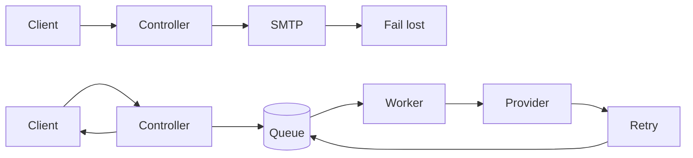
> Key idea: persist first, deliver later. Return 202 Accepted + trackingId.

## 5. Architecture Overview
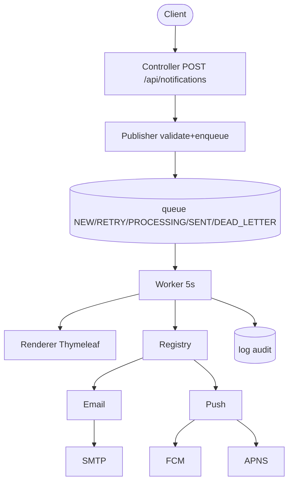
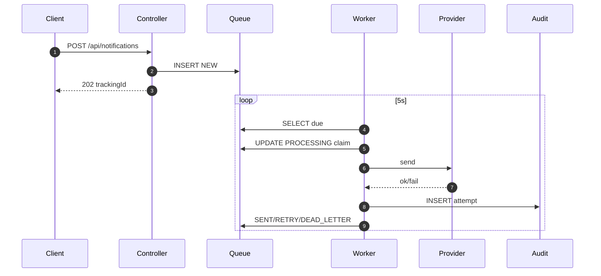
Principles: separation, async, extensibility, resilience, observability.

## 6. Project Setup and Package Structure
Domain-first packages: common/ config/ contact/ device/ template/render/ queue/worker/ log/ dispatch/email/push/ api/
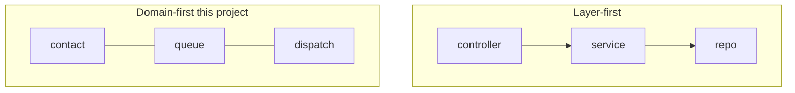
> Why it matters: retry work lives in queue/. Features stay cohesive.

## 7. Multiple Databases, Each With a Clear Role
| DB | Holds |
|---|---|
| contact-db | userId,email,displayName,locale,active |
| device-db | userId,deviceId,platform,pushToken,status |
| engine-db | templates,queue,logs |
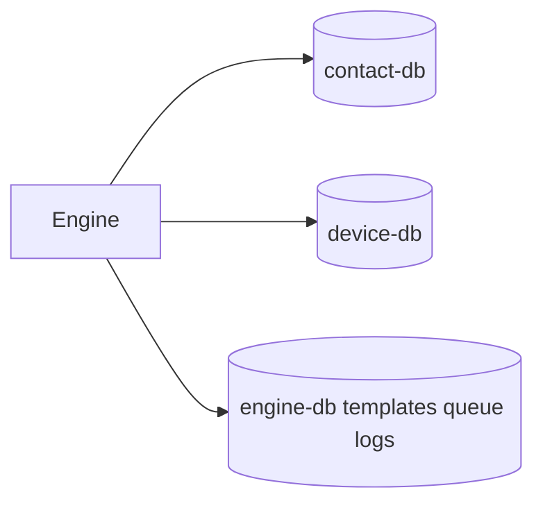
```java
@SpringBootApplication(exclude={DataSourceAutoConfiguration.class,HibernateJpaAutoConfiguration.class})
@EnableScheduling
public class NotificationApplication {
    public static void main(String[] args){ SpringApplication.run(NotificationApplication.class,args); }
}
```
Always qualify: @Transactional("engineTransactionManager") and @Transactional(value="contactTransactionManager",readOnly=true).
> Pitfall: forgetting qualifier uses wrong TxManager. Mark one @Primary or always qualify.
<!-- APPEND-HERE -->
## 8. The Domain Model
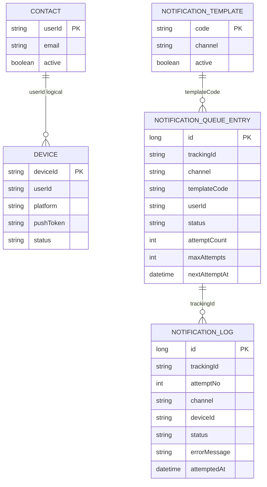
> Links across DBs are logical (matched by userId), not FKs.
```java
@Entity
@Table(name="notification_queue_entry", indexes=@Index(name="idx_due", columnList="status,nextAttemptAt"))
public class NotificationQueueEntry {
    @Id @GeneratedValue(strategy=GenerationType.IDENTITY) private Long id;
    @Column(nullable=false, unique=true) private String trackingId = UUID.randomUUID().toString();
    @Enumerated(EnumType.STRING) private Channel channel; // EMAIL, PUSH
    private String templateCode;
    private String userId;
    @Lob private String variablesJson;
    @Enumerated(EnumType.STRING) private QueueStatus status = QueueStatus.NEW;
    private int attemptCount = 0;
    private int maxAttempts;
    private Instant nextAttemptAt = Instant.now();
    private String lastError;
    // getters/setters...
}
public enum QueueStatus { NEW, PROCESSING, RETRY_SCHEDULED, SENT, DEAD_LETTER }
```
> Index on (status,nextAttemptAt) keeps SELECT due fast.
```java
@Entity public class UserDevice {
    @Id private String deviceId;
    private String userId;
    @Enumerated(EnumType.STRING) private Platform platform; // ANDROID, IOS, WEB
    private String pushToken;
    @Enumerated(EnumType.STRING) private DeviceStatus status; // ACTIVE, INACTIVE
}
```
Example: user-123 has device-a ANDROID ACTIVE, device-b IOS ACTIVE, device-c WEB INACTIVE (skipped). Only ACTIVE get push.

## 9. The Persistent Notification Queue
| Approach | Pros | Cons |
|---|---|---|
| In-memory | Fast simple | Lost on restart |
| DB-backed | Durable queryable no infra | Polling overhead |
| Kafka/RabbitMQ | High throughput | Ops complexity |
```java
@Service public class NotificationQueuePublisher {
    private final NotificationQueueRepository repo;
    private final TemplateService templates;
    private final ObjectMapper mapper;
    private final QueueProperties props;
    @Transactional("engineTransactionManager")
    public String enqueue(SendNotificationRequest req) {
        templates.requireActive(req.templateCode(), req.channel()); // 1 validate
        NotificationQueueEntry e = new NotificationQueueEntry(); // 2 build
        e.setChannel(req.channel()); e.setTemplateCode(req.templateCode());
        e.setUserId(req.userId()); e.setVariablesJson(toJson(req.variables()));
        e.setMaxAttempts(props.getDefaultMaxAttempts());
        e.setStatus(QueueStatus.NEW); e.setNextAttemptAt(Instant.now());
        return repo.save(e).getTrackingId(); // 3 persist
    }
}
```
```java
@RestController @RequestMapping("/api/notifications")
public class NotificationController {
    private final NotificationQueuePublisher publisher;
    @PostMapping public ResponseEntity<Map<String,String>> send(@Valid @RequestBody SendNotificationRequest req) {
        return ResponseEntity.accepted().body(Map.of("trackingId", publisher.enqueue(req)));
    }
}
```
> 202 Accepted = accepted, will process later. Request {channel:PUSH, templateCode:welcome_push, userId:user-1, variables:{name:Ada,appName:Notify}} -> {trackingId:...} row NEW attemptCount 0.
## 10. The Worker
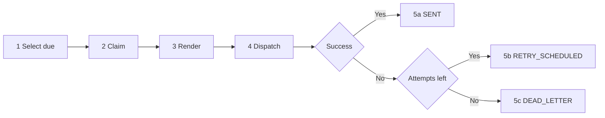
Due = status IN (NEW,RETRY_SCHEDULED) AND nextAttemptAt <= now ORDER BY nextAttemptAt LIMIT batch-size.
```java
public interface NotificationQueueRepository extends JpaRepository<NotificationQueueEntry, Long> {
    @Query("SELECT e FROM NotificationQueueEntry e WHERE e.status IN (:statuses) AND e.nextAttemptAt <= :now ORDER BY e.nextAttemptAt ASC")
    List<NotificationQueueEntry> findDue(@Param("statuses") Collection<QueueStatus> s, @Param("now") Instant n, Pageable p);
    @Modifying @Query("UPDATE NotificationQueueEntry e SET e.status = \'PROCESSING\' WHERE e.id = :id AND e.status = :expected")
    int claim(@Param("id") Long id, @Param("expected") QueueStatus e);
}
```
```java
@Component public class NotificationWorker {
    @Scheduled(fixedDelayString="${notification.queue.poll-interval-ms:5000}")
    public void poll() {
        List<NotificationQueueEntry> due = repo.findDue(List.of(QueueStatus.NEW, QueueStatus.RETRY_SCHEDULED), Instant.now(), PageRequest.of(0, props.getBatchSize()));
        for (NotificationQueueEntry e : due) process(e);
    }
    private void process(NotificationQueueEntry entry) {
        QueueStatus expected = entry.getStatus();
        if (repo.claim(entry.getId(), expected) == 0) return; // someone else won
        int attemptNo = entry.getAttemptCount() + 1;
        try {
            RenderedMessage msg = renderer.render(entry.getChannel(), entry.getTemplateCode(), fromJson(entry.getVariablesJson()));
            DeliveryResult r = registry.get(entry.getChannel()).send(entry.getUserId(), msg);
            auditLog.record(entry, attemptNo, r); markSent(entry, attemptNo);
        } catch (Exception ex) {
            auditLog.recordFailure(entry, attemptNo, ex); handleFailure(entry, attemptNo, ex);
        }
    }
}
```
Enable @EnableScheduling. Tune poll-interval-ms 5000, batch-size 20, default-max-attempts 5.

## 11. Avoiding Duplicate Processing (Optimistic Claim)
Two workers read #101 NEW -> both send without guard.
Fix: UPDATE ... SET PROCESSING WHERE id=:id AND status=:expected. 1 row = won, 0 = skip.
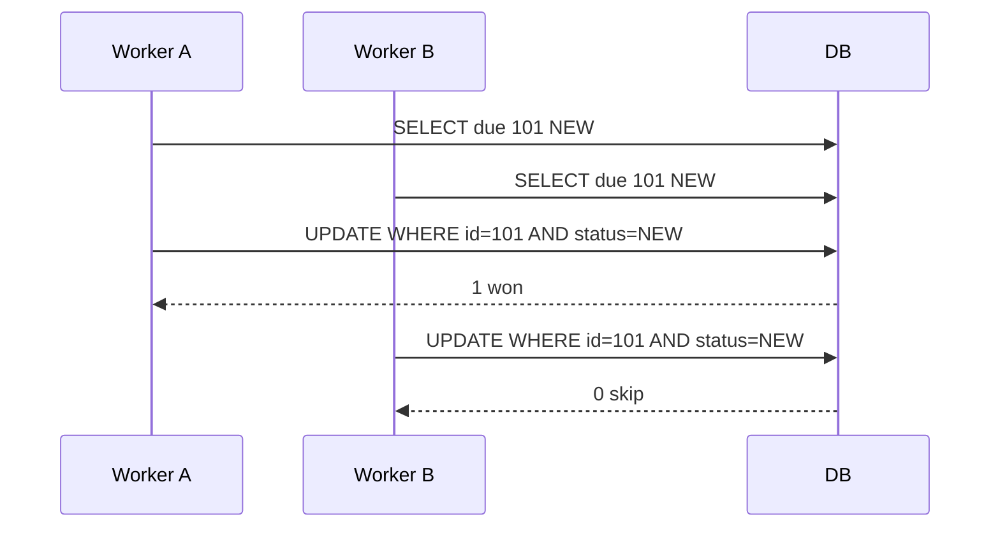
| | Optimistic claim | Pessimistic FOR UPDATE |
|---|---|---|
| Blocking | No skip | Yes wait |
| Complexity | Low | Medium |
| H2 | Yes | Yes |
> Postgres alternative: FOR UPDATE SKIP LOCKED. Caveat: crash after claim leaves PROCESSING forever -> need claimedAt + recovery job (see hardening).
## 12. Retry and Exponential Backoff
Transient fails: SMTP restart, network blip, 429, DNS.
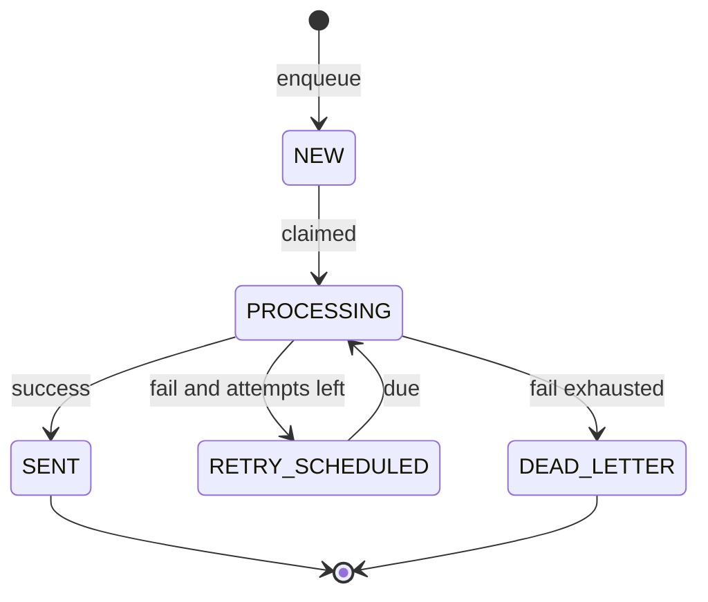
> Same row rescheduled, trackingId stable. Formula: delay = min(baseDelay * multiplier^attemptCount, maxDelay).
Example base 2s x3 cap 60s: 2s, 6s, 18s, 54s, 60s. Example 1s x2 cap 30s: 1s,2s,4s,8s,16s,30s...
```mermaid
gantt
    title Retry timeline base 2s x3 cap 60s
    dateFormat ss
    axisFormat %Ss
    section Attempts
    Attempt 1 fail :a1, 00, 1s
    Wait 2s :w1, after a1, 2s
    Attempt 2 fail :a2, after w1, 1s
    Wait 6s :w2, after a2, 6s
    Attempt 3 fail :a3, after w2, 1s
    Wait 18s :w3, after a3, 18s
    Attempt 4 ok :a4, after w3, 1s
```
```java
@Component public class RetryPolicy {
    private final RetryProperties props;
    public Duration nextDelay(int attemptCount) {
        double raw = props.getBaseDelayMs() * Math.pow(props.getMultiplier(), attemptCount);
        return Duration.ofMillis((long)Math.min(raw, props.getMaxDelayMs()));
    }
}
```
```java
private void handleFailure(NotificationQueueEntry e, int attemptNo, Exception ex) {
    e.setAttemptCount(attemptNo); e.setLastError(truncate(ex.getMessage(),500));
    if (attemptNo >= e.getMaxAttempts()) e.setStatus(QueueStatus.DEAD_LETTER);
    else { e.setStatus(QueueStatus.RETRY_SCHEDULED); e.setNextAttemptAt(Instant.now().plus(retryPolicy.nextDelay(attemptNo-1))); }
    repo.save(e);
}
```
> Why not immediate? Retry storm overwhelms recovering provider. Add jitter: capped + random(0,capped/5).
```yaml
notification:
  retry: { base-delay-ms: 2000, multiplier: 3.0, max-delay-ms: 60000 }
```

## 13. Dead-Lettering
attemptCount >= maxAttempts -> DEAD_LETTER. Permanent fails: bad email, expired token, template bug. Protects capacity, investigation point, replayable.
```sql
SELECT tracking_id, channel, user_id, last_error, attempt_count FROM notification_queue_entry WHERE status = \'DEAD_LETTER\' ORDER BY next_attempt_at DESC;
```
```java
@Transactional("engineTransactionManager") public void replay(String trackingId) {
    var e = repo.findByTrackingId(trackingId).orElseThrow();
    if (e.getStatus() != QueueStatus.DEAD_LETTER) throw new IllegalStateException("Only dead-letter replayable");
    e.setStatus(QueueStatus.NEW); e.setAttemptCount(0); e.setNextAttemptAt(Instant.now()); repo.save(e);
}
```

## 14. The Delivery Audit Log
| Concept | Lives | Answers |
|---|---|---|
| State | queue_entry | Where now? |
| History | notification_log | What each time? |
Example #1001: attempt1 FAILED timeout, attempt2 FAILED, attempt3 SUCCESS = 3 rows. Push to 2 devices = 1 row per device per attempt.
```java
@Entity @Table(name="notification_log") public class NotificationLog {
    @Id @GeneratedValue(strategy=GenerationType.IDENTITY) private Long id;
    private String trackingId; private int attemptNo;
    @Enumerated(EnumType.STRING) private Channel channel;
    private String userId; private String deviceId;
    @Enumerated(EnumType.STRING) private LogStatus status;
    private String errorMessage; private Instant attemptedAt = Instant.now();
}
```
GET /api/notifications/{trackingId} -> {trackingId,status,attemptCount,history:[{attempt,status,error}]}. Search logs?userId=&channel=&status=. Answers: why Ada missed email, SMTP fail rate, prove invoice sent.
## 15. Template-Based Notifications
Content out of code: templateCode welcome_email + variables {name:Ada} not string concat.
Files: templates/email/welcome_email.html body, email/welcome_email-subject.txt subject, push/welcome_push-title.txt title, push/welcome_push-body.txt body.
```html
<html xmlns:th="http://www.thymeleaf.org"><body style="font-family: Arial, sans-serif;">
<h2>Welcome, <span th:text="${name}">User</span>!</h2>
<p>Thanks for joining <b th:text="${appName}">App</b>.</p>
</body></html>
```
Subject: Welcome to [[${appName}]], [[${name}]]! Push title: Hi [[${name}]]! Push body: Your [[${appName}]] account is ready.
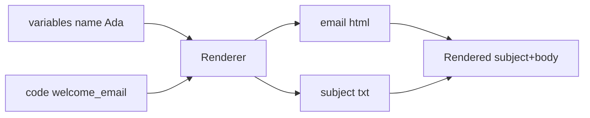
```java
public interface TemplateRenderer { RenderedMessage render(Channel c, String code, Map<String,Object> v); }
public record RenderedMessage(String subject, String title, String body) {}
@Component public class ThymeleafTemplateRenderer implements TemplateRenderer {
    private final SpringTemplateEngine htmlEngine; private final SpringTemplateEngine textEngine;
    public RenderedMessage render(Channel ch, String code, Map<String,Object> vars) {
        Context ctx = new Context(); ctx.setVariables(vars);
        return switch(ch) {
            case EMAIL -> new RenderedMessage(textEngine.process("email/"+code+"-subject.txt",ctx).trim(), null, htmlEngine.process("email/"+code+".html",ctx));
            case PUSH -> new RenderedMessage(null, textEngine.process("push/"+code+"-title.txt",ctx).trim(), textEngine.process("push/"+code+"-body.txt",ctx).trim());
        };
    }
}
```
DB stores metadata only: welcome_email EMAIL true, welcome_push PUSH true. Benefits: small requests, Git diffs, runtime off via PATCH /active.
Fail-fast at registration: check email/code.html and -subject.txt exist else 400. Seed welcome_* on startup.
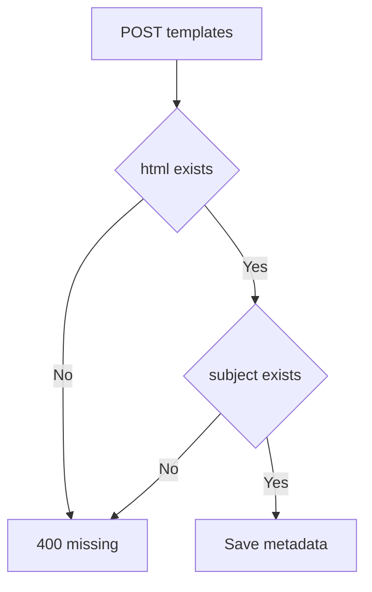

## 16. Designing for Extension: Channel Providers
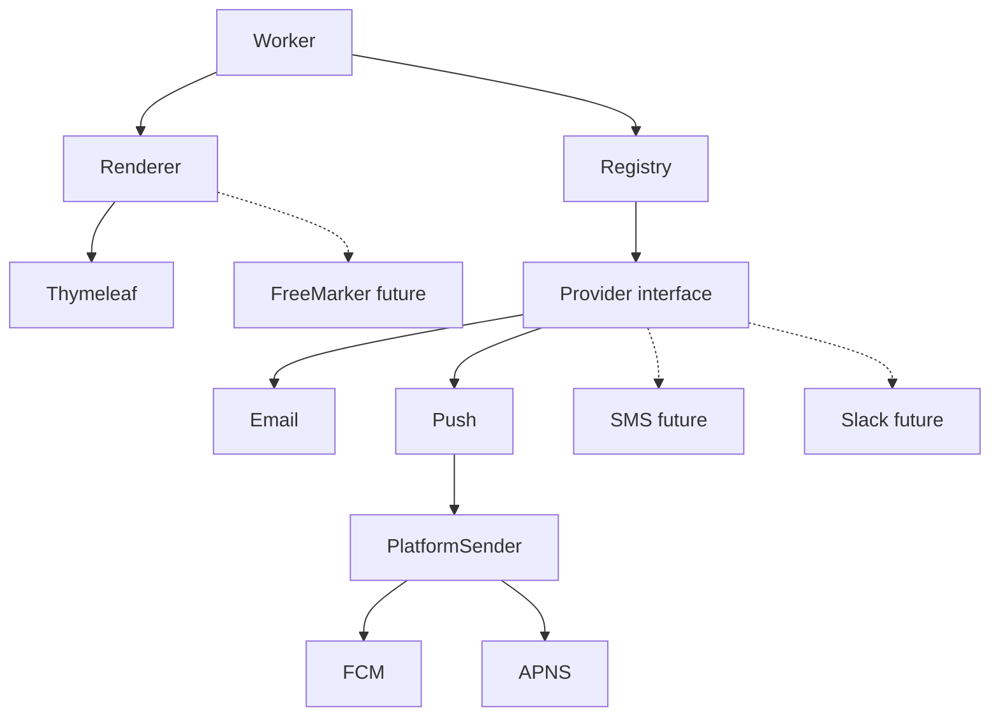
```java
public interface NotificationChannelProvider { Channel channel(); DeliveryResult send(String userId, RenderedMessage m) throws DeliveryException; }
@Component public class ChannelProviderRegistry {
    private final Map<Channel,NotificationChannelProvider> providers;
    public ChannelProviderRegistry(List<NotificationChannelProvider> all) {
        this.providers = all.stream().collect(Collectors.toMap(NotificationChannelProvider::channel, Function.identity()));
    }
    public NotificationChannelProvider get(Channel c) {
        var p = providers.get(c); if (p==null) throw new IllegalStateException("No provider "+c); return p;
    }
}
```
Email sends via JavaMailSender + ContactService + HTML true, wraps Mail/MessagingException to DeliveryException. Add SMS = one @Component class + SMS enum + template files; controller/queue/worker/retry/audit unchanged. Open/Closed in action.
## 17. Push Platform Abstraction (FCM / APNs)
| ANDROID | FCM |
| IOS | APNs or FCM |
| WEB | FCM / WebPush |
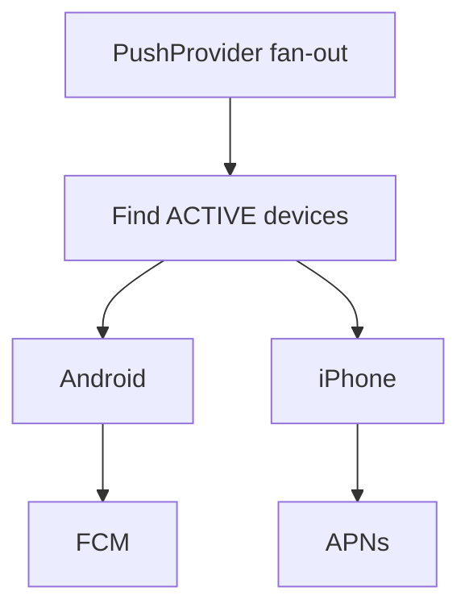
```java
public interface PlatformPushSender { Platform platform(); void send(UserDevice d, RenderedMessage m) throws DeliveryException; }
@Component public class NoOpFcmSender implements PlatformPushSender {
    public Platform platform(){ return Platform.ANDROID; }
    public void send(UserDevice d, RenderedMessage m){ log.info("[NO-OP FCM] token={} title={} body={}", d.getPushToken(), m.title(), m.body()); }
}
```
PushProvider finds active devices, loops senders map, counts failures, throws if all fail else partial success. Design Q: one failed device retries all -> duplicates on succeeded? Consider per-device tracking.

## 18. REST API Reference
Contacts: POST /api/contacts, PUT /api/contacts/{userId}, GET /api/contacts/{userId}, DELETE. Devices: POST /api/devices, GET /api/devices?userId=, DELETE /api/devices/{deviceId}. Templates: POST /api/templates validates files, GET /api/templates/{code}, PATCH /api/templates/{code}/active. Notifications: POST /api/notifications -> trackingId, GET /api/notifications/{trackingId}, GET /api/notifications/logs?userId=&channel=&status=.

## 19. Configuration
```yaml
notification:
  datasource: { contact: {url: jdbc:h2:mem:contactdb}, device: {url: jdbc:h2:mem:devicedb}, engine: {url: jdbc:h2:mem:enginedb} }
  mail: {host: smtp.example.com, port: 587, username: ${SMTP_USERNAME}, password: ${SMTP_PASSWORD}, from: no-reply@example.com}
  queue: { poll-interval-ms: 5000, batch-size: 20, default-max-attempts: 5 }
  retry: { base-delay-ms: 2000, multiplier: 3.0, max-delay-ms: 60000 }
  push: { fcm: {enabled: false}, apns: {enabled: false} }
```
```java
@ConfigurationProperties(prefix="notification.retry") public class RetryProperties { private long baseDelayMs; private double multiplier; private long maxDelayMs; }
```
> Never commit SMTP creds. Env or vault.

## 20. Hands-On Lab (Step-by-Step)
1. ./mvnw spring-boot:run 2. POST /api/contacts user-1 Ada 3. POST /api/devices device-1 ANDROID tok-abc 4. POST /api/notifications PUSH welcome_push -> trackingId 5. POST EMAIL welcome_email 6. GET status within 5s -> SENT 7. GET logs?userId=user-1&channel=PUSH&status=SUCCESS. Log: [NO-OP FCM] token=tok-abc title Hi Ada! body Your Notify account ready.
```bash
curl -X POST localhost:8080/api/contacts -H "Content-Type: application/json" -d \'{"userId":"user-1","email":"user1@example.com","displayName":"Ada"}\'
curl -X POST localhost:8080/api/devices -H "Content-Type: application/json" -d \'{"userId":"user-1","deviceId":"device-1","platform":"ANDROID","pushToken":"tok-abc"}\'
curl -X POST localhost:8080/api/notifications -H "Content-Type: application/json" -d \'{"channel":"PUSH","templateCode":"welcome_push","userId":"user-1","variables":{"name":"Ada","appName":"Notify"}}\'
curl localhost:8080/api/notifications/b2f9c0e4-xxxx
curl "localhost:8080/api/notifications/logs?userId=user-1&channel=PUSH&status=SUCCESS"
```
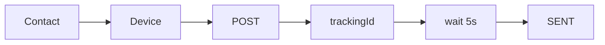

## 21. Failure Walkthrough (SMTP down)
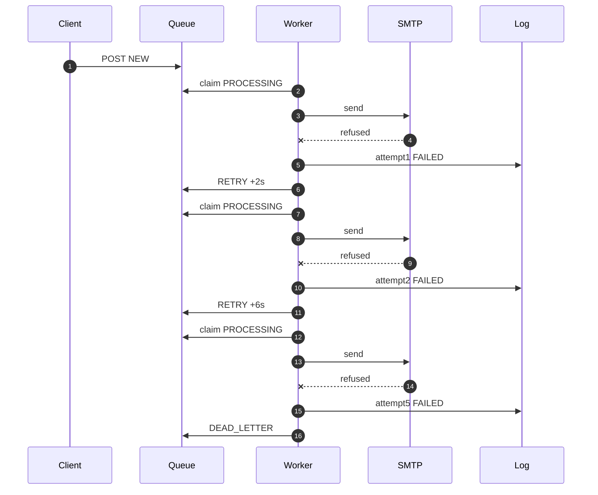
If recovers attempt3 -> SUCCESS SENT. Audit shows exact trail.
## 22. Real-World Examples and Use Cases
| # | Use case | Channels | Why helps |
|---|---|---|---|
|1| Onboarding welcome | EMAIL+PUSH | Templates, no SMTP wait |
|2| Password reset OTP | EMAIL/SMS | Retry, audit proof |
|3| Order shipped | PUSH | Fan-out all devices |
|4| Invoice receipt | EMAIL | Compliance audit |
|5| Security new login | PUSH+EMAIL | Multi-channel important |
|6| Marketing campaign | EMAIL | Backoff protects SMTP |
|7| Ops down alert | SLACK future | Plug-and-play |
|8| Chat mention | PUSH/WebSocket | Realtime or push |
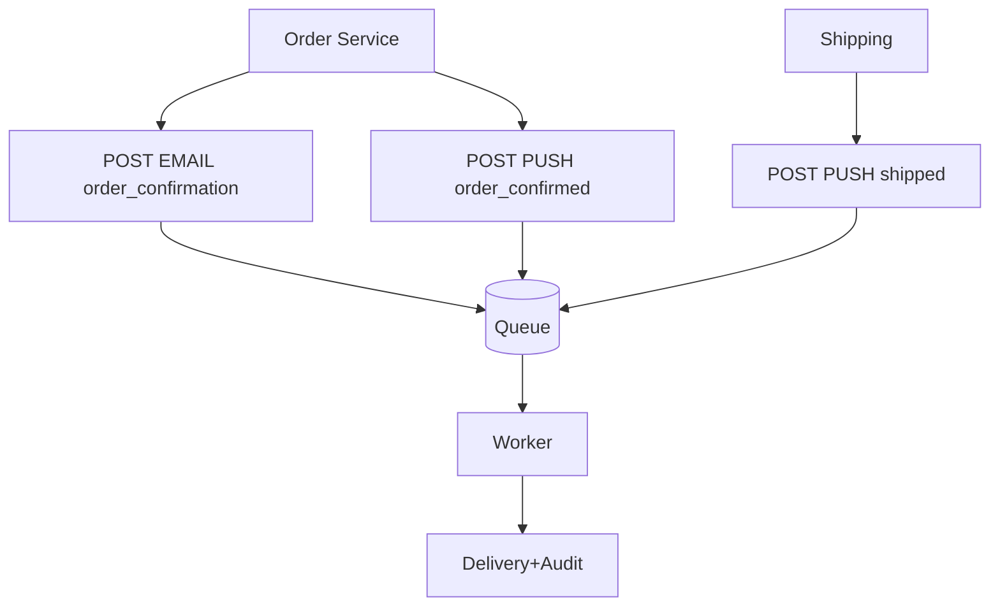
Each microservice says notify user template; knows nothing of SMTP/FCM/retry.

## 23. Testing Strategy
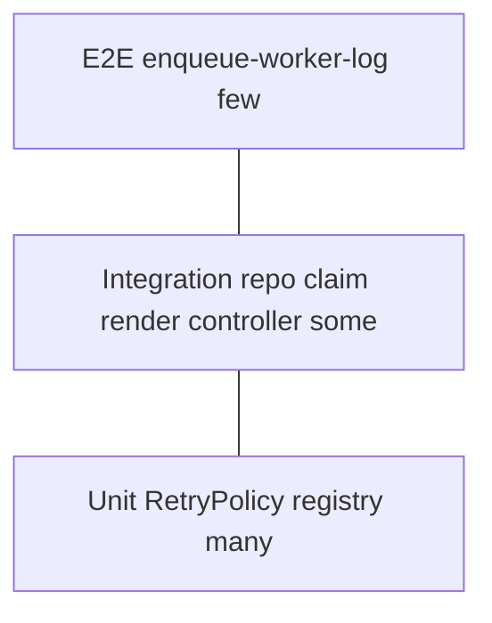
```java
class RetryPolicyTest {
    RetryPolicy policy = new RetryPolicy(props(2000,3.0,60000));
    @Test void growsExponentially(){ assertEquals(Duration.ofSeconds(2),policy.nextDelay(0)); assertEquals(Duration.ofSeconds(6),policy.nextDelay(1)); assertEquals(Duration.ofSeconds(18),policy.nextDelay(2)); }
    @Test void neverExceedsMax(){ assertEquals(Duration.ofSeconds(60),policy.nextDelay(10)); }
}
@DataJpaTest class ClaimTest {
    @Autowired NotificationQueueRepository repo;
    @Test void onlyFirstClaimWins(){ var e=repo.save(newEntry(QueueStatus.NEW)); assertEquals(1,repo.claim(e.getId(),QueueStatus.NEW)); assertEquals(0,repo.claim(e.getId(),QueueStatus.NEW)); }
}
@Test void failureSchedulesRetry(){ when(emailProvider.send(any(),any())).thenThrow(new DeliveryException("boom")); worker.poll(); var e=repo.findByTrackingId(tid).orElseThrow(); assertEquals(QueueStatus.RETRY_SCHEDULED,e.getStatus()); assertEquals(1,e.getAttemptCount()); assertTrue(e.getNextAttemptAt().isAfter(Instant.now())); }
@Test void exhaustedBecomesDeadLetter(){ var e=entryWith(4,5); when(provider.send(any(),any())).thenThrow(new DeliveryException("boom")); worker.process(e); assertEquals(QueueStatus.DEAD_LETTER,repo.findById(e.getId()).get().getStatus()); }
```

## 24. Performance Considerations
Tune batch-size 20 vs poll 5s: larger batch higher throughput but longer tx; shorter poll lower latency but more queries. (status,nextAttemptAt) index critical. Backoff+jitter avoids storm. H2 demo only; Postgres + SKIP LOCKED for scale. Token bucket per channel for quotas. Archive old SENT/logs (retention). Multi-workers supported by claim; else Kafka.
| batch | poll | latency | DB load |
|---|---|---|---|
|10|5s|~5s|low|
|20|5s|~5s|medium|
|100|1s|~1s|high|
Optimized jitter: long jitter=ThreadLocalRandom.current().nextLong(0,capped/5+1); return Duration.ofMillis(capped+jitter);

## 25. Security Considerations
Never commit creds; use env SMTP_USERNAME/PASSWORD or vault. Mask PII (email, pushToken) in logs. Thymeleaf auto-escapes HTML -> prevents XSS; careful with th:utext. Validate userId ownership. Device tokens secrets. Rate-limit POST to prevent spam. TLS SMTP. Secrets rotation.

## 26. Best Practices
- Return 202 + trackingId, never block on SMTP.
- Validate template active + files at registration (fail fast).
- Qualify TxManagers explicitly.
- Typed @ConfigurationProperties under notification.*.
- One audit row per attempt per device.
- Interfaces + registry auto-discovery for channels.
- Externalize retry tunables.
- NoOp senders for local dev.
- IdempotencyKey unique constraint for duplicate POSTs.
- Error classification transient vs permanent.

## 27. Anti-Patterns
| Anti-pattern | Why bad | Do instead |
|---|---|---|
| Sync send in controller | Blocks, loses on fail | Enqueue + 202 |
| Retry loop in request | Ties thread, storm | Backoff in worker |
| Edit worker for SMS | Violates Open/Closed | New provider @Component |
| String concat email | Copy needs redeploy | Thymeleaf templates |
| No audit | Cannot prove/debug | Log every attempt |
| Retry immediate | Storm | Exponential+jitter |
| Single DB no qualifier | Wrong tx | Qualify managers |
| Commit SMTP creds | Leak | Env/vault |
| Retry permanent forever | Wastes capacity | Dead-letter fast |
## 28. Troubleshooting / Common Pitfalls
| Symptom | Cause | Fix |
|---|---|---|
| No TxManager bean | Excluded auto-config, no @Primary | Qualify or mark @Primary |
| Template 400 missing file | Path typo | Check templates/email/code.html + -subject.txt |
| Always PROCESSING stuck | Crash after claim | Add claimedAt + recovery job |
| Duplicates with 2 instances | No claim check | Verify claim==1 else return |
| Retry storm | Immediate retry | Backoff + jitter |
| H2 works Postgres fails | FOR UPDATE syntax | Use SKIP LOCKED native query |
| Mail auth fails | Hardcoded creds | Use env ${SMTP_USERNAME} |
| Push no devices | INACTIVE only | Check findActive, token valid |
| Logs grow huge | No retention | Archive/purge SENT >90d |
| Slow poll | Missing index | Create idx_due(status,nextAttemptAt) |
```java
@Scheduled(fixedDelay=60000) public void recoverStuck(){ Instant cutoff=Instant.now().minus(Duration.ofMinutes(10)); repo.resetStuck(cutoff); }
// repo: UPDATE e SET status=RETRY_SCHEDULED WHERE status=PROCESSING AND claimedAt < :cutoff
```

## 29. Migration Guides
H2->Postgres: add postgres driver, change notification.datasource.engine.url to jdbc:postgresql://..., create claimedAt column, replace claim with: SELECT ... FOR UPDATE SKIP LOCKED native. DB-queue->Kafka: keep Publisher interface, publish to topic notifications, worker becomes @KafkaListener, keep retry/dead-letter via DLT topic. NoOp->Real FCM: implement PlatformPushSender with FirebaseAdmin SDK behind notification.push.fcm.enabled=true, same interface no worker change.

## 30. Production Hardening Checklist
| Area | Concern | Approach |
|---|---|---|
| Stuck PROCESSING | Crash | claimedAt + recovery |
| Idempotency | Dup POST | idempotencyKey unique |
| Exactly-once illusion | DB fail after send | At-least-once + provider idempotency keys |
| Error classification | Waste retries | Transient vs permanent -> dead-letter permanent now |
| Jitter | Sync retries | Random 0-20% |
| DB | H2 demo | Postgres/MySQL SKIP LOCKED |
| Retention | Log bloat | Archive/purge |
| Rate limit | Quota | Token bucket |
| Observability | Blind | Micrometer queue_depth,fail_rate,dead_letter_count |
| Security | PII | Mask, vault |
| Scaling | Bottleneck | Multi-workers claim supports, or Kafka |

## 31. Future Extensions
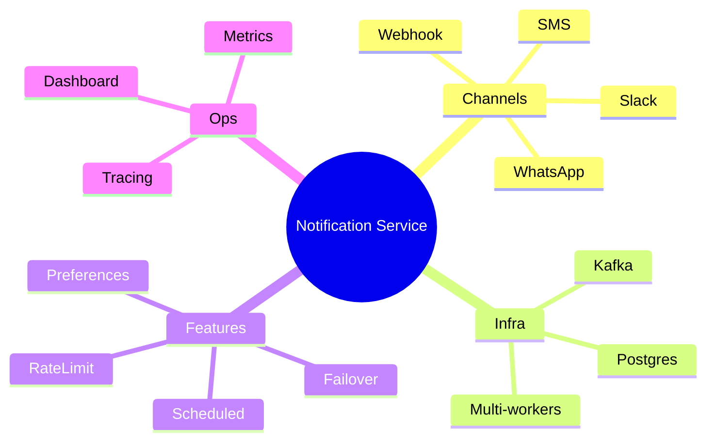
WebSocket: router checks online? WS realtime : push fallback + email important. Failover: primary SMTP -> secondary SES. Preferences: marketing_email off, security [EMAIL,PUSH], quiet 22-07.
## 32. Summary and Key Takeaways
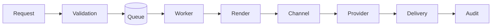
1. Decouple accept/deliver. 2. Persist before process. 3. Conditional UPDATE claim. 4. Backoff + dead-letter. 5. Audit row per attempt. 6. Content in templates validated. 7. Interfaces for growth. Core: queue cares not email/push; worker cares not FCM/APNs; channel cares not engine.
Quick Recap: 202+trackingId, poll 5s, claim, render, dispatch, audit, SENT/RETRY/DEAD.
## 33. Practice Exercises (with Detailed Solutions)
### Ex1 (Beginner): Add `password_reset_email` end-to-end

**Objective:** Practice template registration + enqueue + worker delivery + audit check.

**Task:** Add a new EMAIL template and send it to `user-1`.

**Steps:**
1. Create `templates/email/password_reset_email.html` with `${name}` and `${resetLink}`.
2. Create `templates/email/password_reset_email-subject.txt` with `Reset your [[${appName}]] password`.
3. Register: `POST /api/templates {code, channel: EMAIL}`.
4. Enqueue: `POST /api/notifications {channel: EMAIL, templateCode, userId: user-1}`.
5. Poll `GET /api/notifications/{trackingId}` until `SENT`.

**Solution:** HTML uses `<span th:text="${name}">` + `<a th:href="${resetLink}">Reset</a>`; subject file single line. Registration validates both files exist (Section 15), else 400.

**Verify:** Status `SENT` within ~5s; `notification_log` has 1 `SUCCESS` row; inbox/MailHog shows rendered name + link.

### Ex2 (Intermediate): Add jitter to `RetryPolicy` + unit test bounds

**Objective:** Prevent retry storms with bounded randomness.

**Task:** Change `nextDelay` to add 0–20% jitter and prove bounds.

**Steps:**
1. Compute `capped = min(raw, max)`.
2. Compute `j = ThreadLocalRandom.current().nextLong(0, capped/5 + 1)`.
3. Return `capped + j`.

**Solution:**
```java
double raw = props.getBaseDelayMs() * Math.pow(props.getMultiplier(), attemptCount);
long capped = (long) Math.min(raw, props.getMaxDelayMs());
long j = ThreadLocalRandom.current().nextLong(0, capped / 5 + 1);
return Duration.ofMillis(capped + j);
```

**Verify:** Loop 100x `nextDelay(2)` with base 2s x3; assert each in `[18s, 21.6s]`; existing `growsExponentially` still passes for mean.

### Ex3 (Intermediate): `replay` endpoint for dead-lettered entries

**Objective:** Let operators requeue hopeless messages after a fix.

**Task:** Implement `POST /api/notifications/{trackingId}/replay`.

**Steps:**
1. Load by `trackingId`, throw 404 if missing.
2. If status != `DEAD_LETTER`, throw 400.
3. Set `NEW`, `attemptCount = 0`, `nextAttemptAt = now`, save.

**Solution:** See `replay()` in Section 13; add `@PostMapping("/{trackingId}/replay")` in controller delegating to service with `@Transactional("engineTransactionManager")`.

**Verify:** Seed DEAD_LETTER row → call replay → assert `NEW`, count 0, due immediately; worker picks it up next poll.

### Ex4 (Intermediate): `SmsChannelProvider` with fake gateway (no worker change)

**Objective:** Prove Open/Closed extension via registry auto-discovery.

**Task:** Add SMS delivery without editing controller, queue, worker, retry, or audit.

**Steps:**
1. Add `SMS` to `Channel` enum.
2. Add `templates/sms/order_shipped.txt`: `Hi [[${name}]], shipped!`.
3. Create `@Component SmsChannelProvider implements NotificationChannelProvider` returning `channel() = SMS`.
4. Inject fake `SmsGateway`, call `gateway.send(phone, body)`.

**Solution:** Registry collects `List<NotificationChannelProvider>` into map; new bean auto-discovered. `TemplateRenderer` switch adds SMS branch rendering the txt file.

**Verify:** Mock gateway; enqueue SMS; assert `gateway.send` called once; status `SENT`; no diff in worker file.

### Ex5 (Advanced): `claimedAt` + stuck-entry recovery job

**Objective:** Self-heal rows stranded in `PROCESSING` by crashed workers.

**Task:** Add timestamp on claim + scheduler resetting stale rows.

**Steps:**
1. Add `Instant claimedAt` to `NotificationQueueEntry`.
2. Change `claim` to `SET status = 'PROCESSING', claimedAt = :now`.
3. Add `@Scheduled(fixedDelay = 60000) recoverStuck()` resetting `PROCESSING` with `claimedAt < now - 10m` to `RETRY_SCHEDULED`.

**Solution:**
```java
@Modifying @Query("UPDATE NotificationQueueEntry e SET e.status = 'PROCESSING', e.claimedAt = :now WHERE e.id = :id AND e.status = :expected")
int claim(Long id, QueueStatus expected, Instant now);
```

**Verify:** Insert `PROCESSING` with `claimedAt = now - 20m` → run job → assert `RETRY_SCHEDULED`; fresh `PROCESSING` untouched.
## 34. Test Your Understanding (12 Q)

**Q1. Why return 202 Accepted instead of 200 OK?**

**A1.** 202 means accepted for async processing. Persisted as NEW with trackingId, delivered later, never blocks on SMTP.

**Q2. Compute delay base 2s x3 cap 60s at index 2?**

**A2.** min(2*9,60)=18s. Series 2s,6s,18s,54s,60s capped.

**Q3. Worker crashes after claim?**

**A3.** Row stuck PROCESSING forever. Fix with claimedAt plus recovery job resetting to RETRY_SCHEDULED.

**Q4. Two workers read same row?**

**A4.** Only claim==1 wins and processes. claim==0 skips.

**Q5. Retry creates same row or new?**

**A5.** Same row rescheduled, trackingId stable, history coherent.

**Q6. Why index on (status,nextAttemptAt)?**

**A6.** Keeps SELECT due fast as table grows.

**Q7. Permanent invalid email - retry?**

**A7.** No. Classify transient vs permanent, dead-letter permanent immediately.

**Q8. Push to 2 devices, 1 fails?**

**A8.** Two log rows, partial success. Retrying all may duplicate on succeeded device, consider per-device tracking.

**Q9. Why validate template files at registration?**

**A9.** Fail fast at registration, not hours later at send time with retries and dead-letters.

**Q10. Steps to add Slack channel?**

**A10.** Add SLACK to Channel enum, create @Component SlackChannelProvider, add templates, registry auto-discovers, no worker edit.

**Q11. Why three separate databases?**

**A11.** Contact and device are read-mostly, engine is write-heavy queue plus logs. Engine does not own user domain, replaceable by User Service.

**Q12. At-least-once vs exactly-once?**

**A12.** Accept at-least-once. Provider may succeed but DB update fail causing duplicate. Use provider idempotency keys.

## 35. Common Interview Questions (12 Q)

**Q1. How do you prevent duplicate sends with multiple workers?**

**A1.** Optimistic claim via conditional UPDATE WHERE id and status expected. 1 row wins, 0 skips. DB applies atomically.

**Q2. DB queue vs Kafka - when to use each?**

**A2.** DB durable queryable no infra for small-medium and auditability. Kafka high throughput scale with more ops complexity.

**Q3. What is your backoff formula?**

**A3.** delay=min(baseDelay*multiplier^attemptCount,maxDelay) plus jitter 0-20 percent to avoid retry storm.

**Q4. State vs history - where stored?**

**A4.** State in notification_queue_entry current status. History in notification_log one row per attempt per device.

**Q5. Show Open-Closed Principle in this project?**

**A5.** Worker closed for modification, system open for extension. New channel is one @Component auto-discovered by ChannelProviderRegistry.

**Q6. Why separate template content from code?**

**A6.** Small requests, Git versioned diffs, designer review, runtime on-off via PATCH active, no redeploy for copy change.

**Q7. How abstract FCM vs APNs?**

**A7.** PlatformPushSender interface with platform() method. PushChannelProvider fans out to ACTIVE devices via Map Platform to sender. NoOp stand-ins locally.

**Q8. How fix stuck PROCESSING rows?**

**A8.** Add claimedAt timestamp on claim. Scheduled recovery resets PROCESSING older than N minutes to RETRY_SCHEDULED.

**Q9. How migrate H2 queue to Postgres at scale?**

**A9.** Move to Postgres, use FOR UPDATE SKIP LOCKED native query, keep (status,nextAttemptAt) index, multiple workers.

**Q10. How handle provider rate limits?**

**A10.** Token bucket per channel, tune batch-size and poll-interval, backoff plus jitter.

**Q11. Transient vs permanent errors?**

**A11.** Transient timeout 5xx 429 retries with backoff. Permanent invalid address expired token dead-letters immediately to save capacity.

**Q12. One failed device should retry all?**

**A12.** Retrying all risks duplicates on succeeded devices. Better per-device tracking or accept partial with at-least-once semantics.

## 36. Question Bank for Knowledge Reinforcement (55 Questions)

### Beginner (15)
**Q1. What is a trackingId?**

**A1.** Unique ID returned on enqueue, stable across retries, used to query status and history.

**Q2. What does NEW mean?**

**A2.** Freshly enqueued, due immediately, awaiting first claim.

**Q3. What does PROCESSING mean?**

**A3.** Claimed by one worker via conditional UPDATE, being rendered and dispatched.

**Q4. What does SENT mean?**

**A4.** Provider reported success, terminal state.

**Q5. What does RETRY_SCHEDULED mean?**

**A5.** Failed but attempts remain, rescheduled with nextAttemptAt now plus backoff.

**Q6. What does DEAD_LETTER mean?**

**A6.** Exhausted maxAttempts or permanent error, terminal, replayable after fix.

**Q7. Why 202 Accepted?**

**A7.** Accepted async, processing later, never blocks on SMTP.

**Q8. What is the audit log?**

**A8.** notification_log table, one row per attempt per device, proves delivery.

**Q9. Channel enum values?**

**A9.** EMAIL, PUSH, plus future SMS, SLACK, WEBHOOK, WHATSAPP.

**Q10. Platform enum values?**

**A10.** ANDROID, IOS, WEB.

**Q11. Email template files?**

**A11.** email slash code dot html for body plus email slash code dash subject dot txt.

**Q12. Push template files?**

**A12.** push slash code dash title dot txt plus push slash code dash body dot txt.

**Q13. Default poll interval?**

**A13.** 5000 ms via notification dot queue dot poll-interval-ms.

**Q14. Default batch-size?**

**A14.** 20 entries per poll, tunable.

**Q15. Default max attempts?**

**A15.** 5 via notification dot queue dot default-max-attempts.

### Intermediate (25)

**Q16. What is the findDue query?**

**A16.** status IN NEW plus RETRY_SCHEDULED AND nextAttemptAt less-equal now ORDER BY nextAttemptAt LIMIT batch.

**Q17. What is the claim SQL?**

**A17.** UPDATE entry SET PROCESSING WHERE id and status expected.

**Q18. Claim returns 1 vs 0?**

**A18.** 1 wins and processes, 0 lost and skips.

**Q19. Backoff formula?**

**A19.** min baseDelay times multiplier power attemptCount comma maxDelay plus jitter.

**Q20. Compute 2s x3 at attempt index 1?**

**A20.** 2 times 3 equals 6s.

**Q21. Purpose of cap maxDelay?**

**A21.** Bounds wait, prevents hours-long gaps, protects SLA.

**Q22. Why jitter?**

**A22.** Random 0 to 20 percent avoids synchronized retry storm.

**Q23. Why same row on retry?**

**A23.** Stable trackingId, coherent history, no duplicate IDs.

**Q24. When dead-letter?**

**A24.** attemptCount greater-equal maxAttempts or permanent error classified.

**Q25. Replay steps?**

**A25.** Validate DEAD_LETTER, set NEW attemptCount 0 nextAttemptAt now, save.

**Q26. State vs history?**

**A26.** State entry current, history log every attempt.

**Q27. Why log per device?**

**A27.** Push fans out to ACTIVE devices, each device success or fail tracked.

**Q28. TemplateRenderer interface?**

**A28.** render Channel code variables returns RenderedMessage subject title body.

**Q29. Thymeleaf HTML vs TEXT engines?**

**A29.** HTML engine for email body, TEXT engine for subject title body txt.

**Q30. Registration validation?**

**A30.** Check backing files exist via ClassPathResource, else 400 fail fast.

**Q31. Registry auto-discovery how?**

**A31.** Spring injects List of providers, collects to Map Channel to provider by channel method.

**Q32. Email provider steps?**

**A32.** Require active contact, build MimeMessage from plus to plus subject plus HTML body true, send, wrap exception.

**Q33. SMS add steps?**

**A33.** Add SMS enum, templates, Component SmsChannelProvider, registry picks up, no worker change.

**Q34. Push fan-out?**

**A34.** Find ACTIVE devices, loop senders map by Platform, count fails, throw if all fail else partial.

**Q35. NoOp sender purpose?**

**A35.** Log-only FCM APNs for local run without real credentials, behind enabled false.

**Q36. Three DB roles?**

**A36.** Contact email, device tokens, engine templates queue logs.

**Q37. Why qualify TxManager?**

**A37.** Auto-config excluded, wrong manager corrupts tx, qualify or Primary.

**Q38. What does EnableScheduling do?**

**A38.** Enables Scheduled poll every 5s and recovery job.

**Q39. Contact vs device vs engine write pattern?**

**A39.** Contact device read-mostly, engine heavy writes updates.

**Q40. Logical link userId?**

**A40.** Cross-DB no FK, matched by userId string.

### Advanced (15)

**Q41. Optimistic vs pessimistic locking?**

**A41.** Optimistic non-blocking skip losers low complexity. Pessimistic FOR UPDATE blocks waits medium complexity.

**Q42. What is SKIP LOCKED?**

**A42.** Postgres queue lock skipping locked rows for multi-worker throughput.

**Q43. Stuck recovery design?**

**A43.** claimedAt on claim, scheduler resets PROCESSING older than 10 min to RETRY_SCHEDULED.

**Q44. Why at-least-once?**

**A44.** Send may succeed but DB update fail, duplicate on retry. Use provider idempotency keys.

**Q45. Error classification?**

**A45.** Transient timeout 5xx 429 backoff. Permanent bad address expired token dead-letter now.

**Q46. Per-device retry tradeoff?**

**A46.** Per-device avoids duplicates but more state. All-retry simple but duplicates succeeded.

**Q47. Token bucket?**

**A47.** Rate limiter per channel protecting SMTP FCM quotas.

**Q48. Retention strategy?**

**A48.** Archive purge old SENT and logs beyond 90 days, table grows unbounded.

**Q49. Micrometer metrics?**

**A49.** queue_depth failure_rate retry_count dead_letter_count per channel.

**Q50. PII masking?**

**A50.** Mask email and pushToken in logs, secrets in vault, TLS.

**Q51. Kafka migration?**

**A51.** Keep Publisher interface, publish topic, listener worker, DLT for dead-letter, keep retry audit.

**Q52. Provider failover?**

**A52.** Primary SMTP to secondary SES on fail, same provider interface.

**Q53. User prefs quiet hours?**

**A53.** marketing off, security EMAIL plus PUSH, quiet 22 to 07 delay delivery.

**Q54. WebSocket fallback?**

**A54.** Router online via WS realtime else push FCM APNs plus email important.

**Q55. IdempotencyKey?**

**A55.** Client key unique constraint, duplicate POST returns same trackingId no double send.

## 37. Self-Assessment Checklist + Pro Tips + Next Steps
### 37.1 Self-Assessment Checklist

Score yourself: 0 = cannot explain, 1 = with notes, 2 = confidently. Aim for 16+ out of 20.

#### Core concepts (Sections 4-9)

- [ ] I can explain why sync `mailSender.send()` in a controller loses data
- [ ] I can draw the accept-persist-202 + worker-poll-render-dispatch-audit flow
- [ ] I can name the 5 queue states and their transitions
- [ ] I can explain why contact, device and engine are 3 separate DBs
- [ ] I can write the `findDue` query and explain the `idx_due` index

#### Engine mechanics (Sections 10-14)

- [ ] I can implement `claim` with `UPDATE ... WHERE status = :expected` (1 = won, 0 = skip)
- [ ] I can compute backoff: `min(base * mult^attempt, max)` + jitter
- [ ] I can explain when a row becomes `DEAD_LETTER` and how `replay` works
- [ ] I can distinguish queue state vs audit history with an example
- [ ] I can describe push fan-out and per-device log rows

#### Extension and production (Sections 15-30)

- [ ] I can add a Thymeleaf template and explain fail-fast registration
- [ ] I can add an SMS provider without touching the worker
- [ ] I can explain `PlatformPushSender` FCM vs APNs with NoOp stand-ins
- [ ] I can fix stuck `PROCESSING` with `claimedAt` + recovery job
- [ ] I can list 3 hardening items: idempotency, classification, metrics

### 37.2 Pro Tips

| # | Tip | Why it matters |
|---|---|---|
| 1 | `idempotencyKey` with unique constraint | Duplicate POST returns same trackingId, no double send |
| 2 | `claimedAt` on claim + 60s recovery job | Stuck PROCESSING rows self-heal |
| 3 | Classify transient vs permanent errors | Permanent dead-letters immediately, saves capacity |
| 4 | Add 0-20% jitter to backoff | Avoids synchronized retry storms |
| 5 | Keep `idx_due` on `(status, nextAttemptAt)` | Due query stays fast at scale |
| 6 | Always qualify transaction managers | Prevents wrong-DB transactions |
| 7 | NoOp senders locally, real behind flag | Run without FCM/APNs credentials |
| 8 | Mask email and pushToken in logs | PII protection |
| 9 | Emit queue_depth / dead_letter metrics | See backlog before users complain |
| 10 | Validate templates at registration | Fail fast, not at 2 AM send time |

### 37.3 Hands-On Lab Recap

- [ ] Section 20 Steps 1-7: contact, device, PUSH welcome_push, EMAIL welcome_email, GET status SENT, search logs
- [ ] Section 21 failure walkthrough: stop SMTP, watch RETRY 2s, 6s, 18s, then DEAD_LETTER or recovery SUCCESS
- [ ] Stretch: change retry YAML to 1s x2 cap 30s and re-observe the new delays

### 37.4 Next Steps and Learning Path

| Step | Action | Outcome |
|---|---|---|
| 1 | Finish Ex1-Ex5 in Section 33 | E2E template, jitter, replay, SMS, recovery |
| 2 | Postgres migration in Section 29 | SKIP LOCKED multi-worker queue |
| 3 | Micrometer dashboard | queue_depth and dead_letter alerts |
| 4 | Kafka migration in Section 29 | High-throughput async delivery |
| 5 | Preferences + quiet hours in Section 31 | User-respecting delivery |

## 38. Further Reading / Resources
- Repo https://github.com/deepakrajs11/notification
- Spring Scheduling, Thymeleaf TEXT mode, JavaMailSender, H2, Postgres FOR UPDATE SKIP LOCKED, FCM Admin SDK, APNs, Micrometer

## 39. Glossary

| Term | Meaning | Where to learn more |
|---|---|---|
| Tracking ID | Unique ID returned on enqueue; stable across retries; used to query status/history | Sections 9, 14 |
| Claim | Atomic `UPDATE ... SET PROCESSING WHERE status = :expected`; 1 = won, 0 = skip | Section 11 |
| Backoff | Growing wait between retries: `min(base * mult^attempt, max)` | Section 12 |
| Jitter | Random 0–20% variation added to backoff to avoid retry storms | Section 12 |
| Dead letter | Terminal state after `attemptCount >= maxAttempts`; replayable after fix | Section 13 |
| Audit log | One row per attempt per device in `notification_log`; history vs state | Section 14 |
| Idempotency | Same request processed twice has the same effect as once (`idempotencyKey`) | Section 30 |
| Fan-out | One notification delivered to many targets (e.g. all ACTIVE devices) | Section 17 |
| Channel provider | `NotificationChannelProvider` implementation per channel (EMAIL, PUSH, SMS) | Section 16 |
| Platform sender | `PlatformPushSender` per platform (FCM for ANDROID, APNs for IOS) | Section 17 |
| Template | Thymeleaf files + DB metadata; content separated from code | Section 15 |
| At-least-once | Delivery guarantee accepted here; duplicates possible, dedupe via provider keys | Sections 30, 34–35 |
