# 🚗 Low-Level Design: Car Rental System in Java

**📚 Complete Tutorial | 🎯 Intermediate Level | ⏱️ Estimated Reading Time: 90–120 minutes**

> 💡 **The Golden Rule of LLD (preview):** Don't add complexity for its own sake. Every pattern, every class, every interface should solve a **real, present problem** or enable a **clearly anticipated extension**. The best designs are the simplest ones that satisfy all requirements.

---

## Table of Contents

1. [Introduction](#introduction)
2. [Prerequisites](#prerequisites)
3. [Learning Objectives](#learning-objectives)
4. [Understanding the Problem](#understanding-the-problem)
5. [Functional Requirements](#functional-requirements)
6. [System Architecture Overview](#system-architecture-overview)
7. [Identifying Core Entities](#identifying-core-entities)
8. [Entity Relationships](#entity-relationships)
9. [State Machines](#state-machines)
10. [Step-by-Step Implementation](#step-by-step-implementation)
11. [Design Patterns Used](#design-patterns-used)
12. [Design Trade-offs](#design-trade-offs)
13. [Multiple Implementation Approaches](#multiple-implementation-approaches)
14. [Sequence Diagrams](#sequence-diagrams)
15. [Real-World Use Cases](#real-world-use-cases)
16. [Extension Scenarios](#extension-scenarios)
17. [Edge Cases & How They're Handled](#edge-cases)
18. [Best Practices](#best-practices)
19. [Anti-Patterns](#anti-patterns)
20. [Performance Considerations](#performance-considerations)
21. [Security Considerations](#security-considerations)
22. [Testing Strategies](#testing-strategies)
23. [Troubleshooting Guide](#troubleshooting-guide)
24. [Hands-On Lab](#hands-on-lab)
25. [Practice Exercises](#practice-exercises)
26. [Test Your Understanding](#test-your-understanding)
27. [Common Interview Questions](#common-interview-questions)
28. [Question Bank (50+ Questions)](#question-bank)
29. [Self-Assessment Checklist](#self-assessment-checklist)
30. [Pro Tips](#pro-tips)
31. [Summary & Key Takeaways](#summary)
32. [Further Reading & Resources](#further-reading)

---

## 1. Introduction <a name="introduction"></a>

Low-Level Design (LLD) is the art of translating business requirements into **clean, maintainable, and extensible class structures**. Unlike High-Level Design (HLD) which deals with microservices, load balancers, and databases, LLD focuses on:

- Which **classes** to create
- What **responsibilities** each class holds
- How classes **communicate** with each other
- Which **design patterns** solve real problems (not force-fit ones)

This tutorial walks you through designing a **Car Rental System** in Java — one of the most popular LLD interview problems — the right way: iteratively, with real reasoning behind every decision.

### 🎯 Why the Car Rental Problem?

Because it looks deceptively simple and hides almost every classic LLD challenge:

- **Lifecycle management** — a vehicle moves through AVAILABLE → RESERVED → RENTED → AVAILABLE
- **Two overlapping lifecycles** — a *reservation* (intent) and a *rental* (transaction) that must not be merged carelessly
- **Pluggable business rules** — pricing models change constantly (daily, weekly, surge, loyalty)
- **Concurrency** — two customers, one car, same second
- **Extension pressure** — "can you add ElectricCars? Minivans? EV charging fees?" is asked *mid-interview*

> 💡 **Key Principle:** Good LLD is not about using the most patterns. It's about using the *right* patterns only where they genuinely simplify the design. You'll see this principle applied — and violated — throughout this tutorial, so you can recognize the difference.

### 🧰 What You Will Build

By the end, you'll have a complete, runnable, in-memory rental system:

- ✅ A vehicle hierarchy (Sedan, SUV, Truck, ElectricCar) open for extension
- ✅ Four swappable pricing strategies (daily, weekly discount, surge, loyalty)
- ✅ Guard-clause-protected lifecycles for Reservation, Rental, and Payment
- ✅ An orchestrating `RentalService` facade for search → reserve → pickup → return
- ✅ Verified end-to-end output (compiled and executed with JDK 21)

Every code example in this tutorial was compiled and run — the "Expected Output" in [Section 15](#real-world-use-cases) is captured from a real execution, not hand-written.

---

## 2. Prerequisites <a name="prerequisites"></a>

### Required Knowledge

- ✅ **Core OOP in Java** — classes, interfaces, inheritance, polymorphism, encapsulation, `abstract` classes
- ✅ **Enums & Collections** — `enum`, `List`, `Map`, `Optional`, and when to use each
- ✅ **Streams basics** — `filter`, `collect` (used in search and availability logic)
- ✅ **java.time API** — `LocalDate`, `LocalDateTime`, `ChronoUnit.DAYS.between(...)`
- ✅ **Exceptions** — `IllegalArgumentException` vs `IllegalStateException` semantics

### Recommended Tools

- 🛠️ **JDK 11+** (JDK 17 or 21 recommended — this tutorial's code is verified on JDK 21)
- 🛠️ Any IDE (IntelliJ IDEA, VS Code, Eclipse)
- 🛠️ Optional: **JUnit 5** for the testing section
- 🛠️ Optional: a Mermaid diagram renderer (GitHub renders these natively)

### Nice to Have

- Basic familiarity with UML class diagrams
- Heard of Strategy, Observer, and State patterns (we'll build the intuition anyway)
- Curiosity about *why* designs are the way they are — the most important prerequisite

---


## 3. Learning Objectives <a name="learning-objectives"></a>

By the end of this tutorial, you will be able to:

1. **Translate requirements into entities** using noun/verb analysis and an entity decision matrix
2. **Model lifecycles with enums + guard clauses**, and explain when a full State pattern is (and isn't) justified
3. **Apply the Strategy pattern** to pricing — and defend why an interface beats an if/else chain
4. **Separate Reservation from Rental** and articulate why merging them is a classic LLD mistake
5. **Design Open/Closed hierarchies** where adding a vehicle type or pricing model requires zero changes to existing code
6. **Discuss concurrency, money precision, and date-conflict detection** the way interviewers expect at the senior level
7. **Test a domain model** with unit, parameterized, and integration tests
8. **Recognize anti-patterns** (stringly-typed status, god services, anemic domain models) and refactor them

### 🧭 Difficulty Progression

| Part | Sections | Level |
|---|---|---|
| Foundations | 1–5 | 🟢 Warm-up |
| Modeling | 6–9 | 🟢→🟡 Building up |
| Implementation | 10 | 🟡 Core workout |
| Analysis & Patterns | 11–14 | 🟡→🟠 Deeper reasoning |
| Extensions & Hardening | 15–23 | 🟠 Real-world depth |
| Practice & Mastery | 24–32 | 🔴 Interview-ready |

---

## 4. Understanding the Problem <a name="understanding-the-problem"></a>

Before writing a single line of code, understand the **user journey**:

```text
Customer Opens App
       │
       ▼
Search available cars (by location, type, date)
       │
       ▼
Pick a car & Reserve it
       │
       ▼
Make Payment
       │
       ▼
Pick up the car (Rental starts)
       │
       ▼
Return the car (Rental ends)
       │
       ▼
Final bill calculated (including late fees if any)
```

### 🔍 Design Questions That Drive Complexity

| Question | Design Impact |
|---|---|
| What if two customers book the same car? | Concurrency control needed |
| What if pricing differs by vehicle type? | Strategy Pattern for pricing |
| What if a customer returns late? | Actual return date tracking |
| What if new vehicle types are added? | Open/Closed — abstract hierarchy |
| What if pricing models change? | Pluggable PricingStrategy |
| What if a reservation is cancelled? | Reservation lifecycle management |
| What about weekly/weekend discounts? | Multiple pricing strategies |

> 💡 **Interview habit worth copying:** great candidates don't jump to code — they ask exactly these questions first. Each one you surface proactively is a point in your favor, because each maps to a concrete design decision you're about to make.

---

## 5. Functional Requirements <a name="functional-requirements"></a>

```text
✅ Register customers
✅ Register vehicles (Sedan, SUV, Truck, Electric, etc.)
✅ Search available vehicles by branch, type, and date range
✅ Reserve a vehicle
✅ Cancel a reservation
✅ Start a rental (customer picks up the car)
✅ Return a vehicle
✅ Calculate rental cost (daily, weekly, with discounts)
✅ Process payment
✅ Track Vehicle Status     → AVAILABLE | RESERVED | RENTED | MAINTENANCE
✅ Track Reservation Status → PENDING | CONFIRMED | CANCELLED | COMPLETED
✅ Track Rental Status      → ACTIVE | COMPLETED | OVERDUE
```

### 📌 Assumptions (Scope Boundaries)

- Payment is **simulated** — no real gateway
- **Single currency** — no conversion
- **In-memory storage** — no database
- **No authentication** — no login/logout
- Concurrency discussed but not implemented in core design

> ⚠️ **Why write assumptions down?** In an interview, stating scope boundaries explicitly ("payment is simulated, storage is in-memory") shows you know where the real complexity lives and prevents the interviewer from assuming you missed it. In a real project, unrecorded assumptions become production incidents.

---


## 6. System Architecture Overview <a name="system-architecture-overview"></a>

The system has four cooperating layers: actors interact with a **service layer** that orchestrates **domain entities**, which in turn specialize into **vehicle types** and **pricing models**.

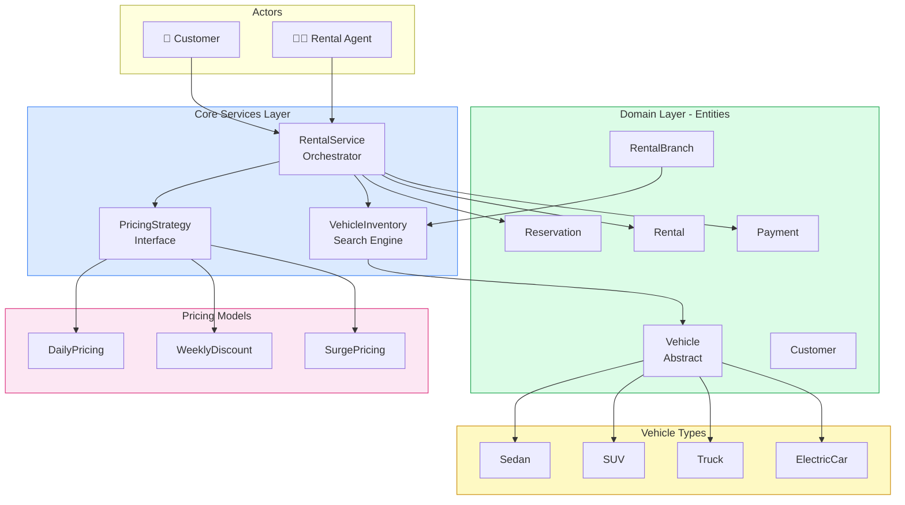

### How to Read This Architecture

- **Actors never touch entities directly** — everything goes through `RentalService`. This is the Facade idea: one front door, controlled validation.
- **`VehicleInventory` is the search engine**; the service asks it for available vehicles rather than scanning the world itself.
- **`PricingStrategy` is injected**, not hard-wired — the service never knows *how* a price is computed.
- **Domain entities own their own state transitions**; the service coordinates them but doesn't flip status fields directly (with one pragmatic exception you'll see in `startRental`).

---

## 7. Identifying Core Entities <a name="identifying-core-entities"></a>

The most critical step in LLD: **get the entities right, and the rest falls into place**. A practical technique: circle every **noun** in the requirements (Customer, Vehicle, Branch, Reservation, Payment...) and every **verb** (search, reserve, cancel, pick up, return, pay). Nouns become candidate classes; verbs become candidate methods.

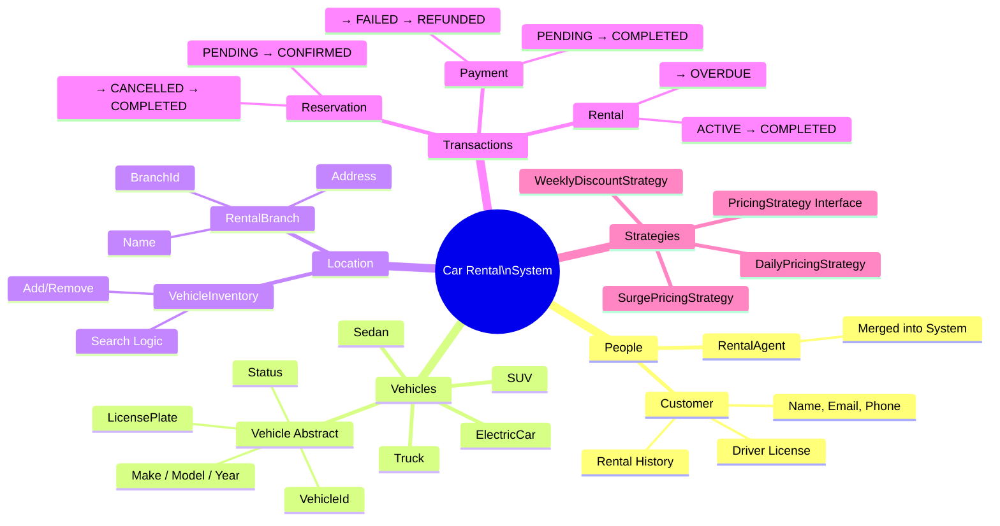

### Entity Decision Matrix

| Entity | Keep as Class? | Why |
|---|---|---|
| `Vehicle` | ✅ Abstract Class | Has state, behavior, and subtypes |
| `Sedan/SUV/Truck` | ✅ Subclasses | Different pricing/policies later |
| `Customer` | ✅ Class | Holds profile + rental history |
| `Reservation` | ✅ Class | Separate lifecycle from Rental |
| `Rental` | ✅ Class | Has actual dates, final cost |
| `RentalBranch` | ✅ Class | Location matters for search |
| `VehicleInventory` | ✅ Class | SRP — search logic will grow |
| `Payment` | ✅ Class | Transaction record |
| `PricingStrategy` | ✅ Interface | Pluggable pricing models |
| `VehicleStatus` | ✅ Enum | Fixed set of states |

> 💡 **Aha moment:** notice `RentalAgent` was *deliberately dropped*. In our scope, agents do everything the system does, so the agent collapses into the service. Deciding what **not** to model is as important as deciding what to model — over-modeling actors is a common source of dead classes.

---


## 8. Entity Relationships <a name="entity-relationships"></a>

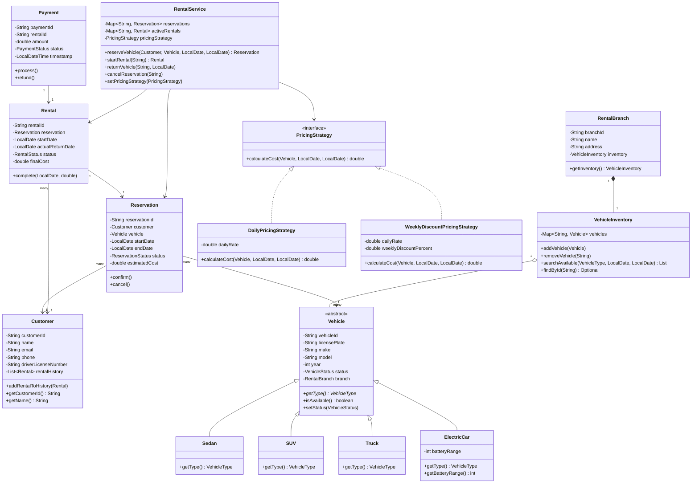

### How to Read the Diagram

- **`Vehicle <|-- Sedan`** — inheritance: every Sedan *is a* Vehicle
- **`PricingStrategy <|.. DailyPricingStrategy`** — interface realization (dashed arrow)
- **`RentalBranch *-- VehicleInventory`** — composition: the inventory lives and dies with the branch
- **`VehicleInventory o-- Vehicle`** — aggregation: vehicles can conceptually move between inventories (cross-branch returns!)
- **`Rental --> Reservation`** — a rental is born from exactly one reservation; the reservation carries the quoted price and planned dates

> 💡 Notice that `RentalService` points at nearly everything but **nothing points back** at it. Dependencies flow toward the service — the domain layer never knows the orchestrator exists. That's what keeps entities unit-testable without the service.

---

## 9. State Machines <a name="state-machines"></a>

Understanding state transitions is crucial — they define the lifecycle of each entity. We have **four** state machines: Vehicle, Reservation, Rental, and Payment. Together they form the contract that the guard clauses in Section 10 enforce.

### 9.1 Vehicle Status State Machine

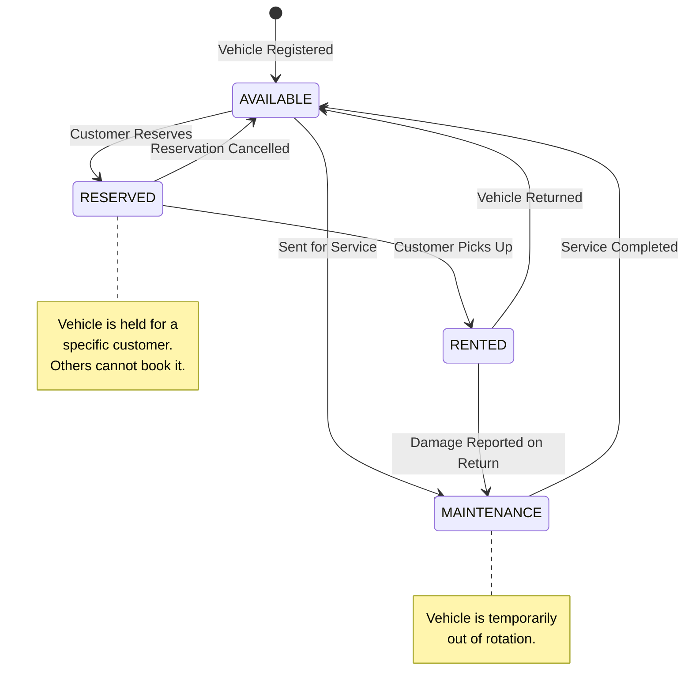

### 9.2 Reservation Status State Machine

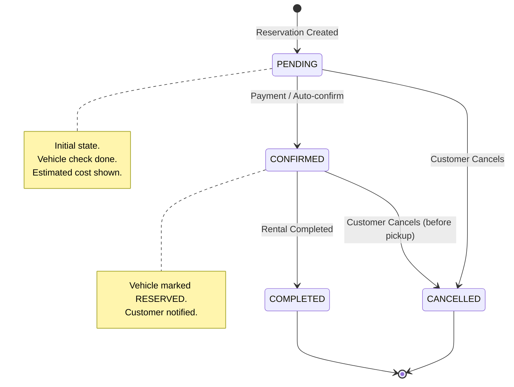


### 9.3 Rental Status State Machine

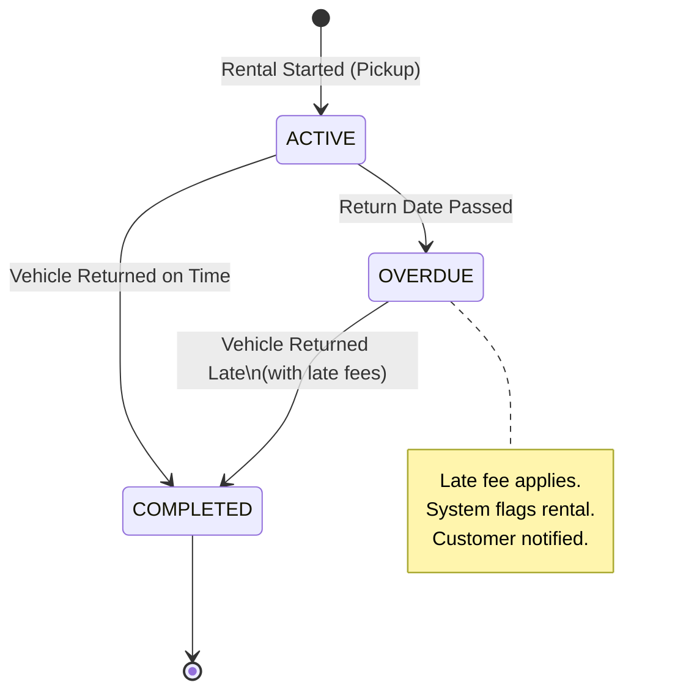

### 9.4 Payment Status State Machine

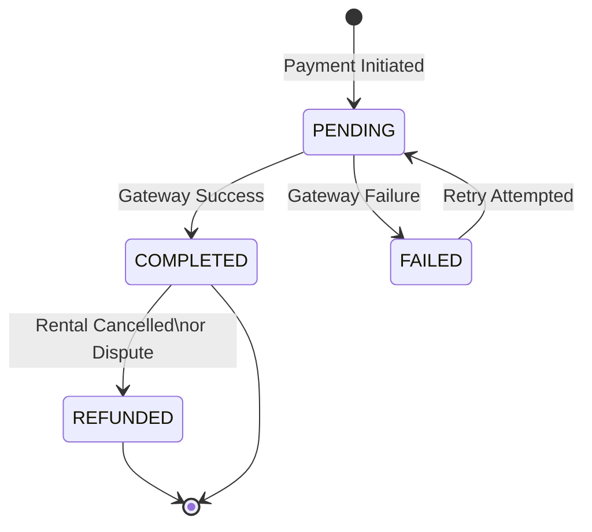

### 📌 Quick Recap — Foundations

- **LLD = classes, responsibilities, communication** — not servers and load balancers
- Nouns → entities, verbs → methods; the decision matrix decides what *deserves* to be a class
- Four lifecycles must never be tangled: Vehicle, Reservation, Rental, Payment — each with a fixed set of legal transitions
- Every legal transition above will become a **guard clause** in code; every illegal one will become an **exception**

---

## 10. Step-by-Step Implementation <a name="step-by-step-implementation"></a>

> 🛠️ **Imports note (so every snippet compiles as-is):** the classes collectively use these imports, omitted below for brevity:
>
> ```java
> import java.time.LocalDate;
> import java.time.LocalDateTime;
> import java.time.temporal.ChronoUnit;
> import java.util.ArrayList;
> import java.util.Collections;
> import java.util.HashMap;
> import java.util.List;
> import java.util.Map;
> import java.util.Optional;
> import java.util.UUID;
> import java.util.stream.Collectors;
> ```
>
> ✅ **Verification:** all classes in this section were compiled together and the end-to-end demo in Section 15 was executed with **JDK 21** — output captured verbatim.

### Step 1: Enums — The Foundation

Enums prevent invalid states. Never use raw strings for status fields.

```java
// Vehicle can only be in ONE of these states at any time
public enum VehicleStatus {
    AVAILABLE,   // Ready to be reserved
    RESERVED,    // Held for a customer (not yet picked up)
    RENTED,      // Currently with a customer
    MAINTENANCE  // Temporarily unavailable for service
}

public enum VehicleType {
    SEDAN, SUV, TRUCK, ELECTRIC
}

public enum ReservationStatus {
    PENDING,    // Created, awaiting confirmation
    CONFIRMED,  // Confirmed, vehicle marked reserved
    CANCELLED,  // Cancelled (pre-pickup)
    COMPLETED   // Rental happened and finished
}

public enum RentalStatus {
    ACTIVE,    // Customer has the car
    COMPLETED, // Car returned successfully
    OVERDUE    // Return date passed, car not returned
}

public enum PaymentStatus {
    PENDING,   // Payment initiated
    COMPLETED, // Payment successful
    FAILED,    // Payment failed
    REFUNDED   // Money returned (e.g., on cancellation)
}
```

> 💡 **Why Enums?** They enforce a finite, predictable set of values. Using strings like `"available"` vs `"AVAILABLE"` vs `"Available"` leads to bugs that are hard to catch. With enums, the compiler *is* your first reviewer.


### Step 2: Vehicle Hierarchy

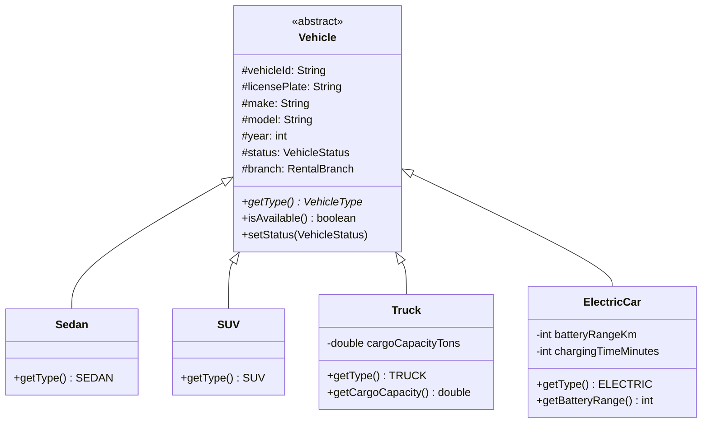

```java
// Abstract base — we NEVER say "new Vehicle()"
public abstract class Vehicle {
    private final String vehicleId;
    private final String licensePlate;
    private final String make;
    private final String model;
    private final int year;
    private VehicleStatus status;
    private final RentalBranch branch;

    public Vehicle(String vehicleId, String licensePlate, String make,
                   String model, int year, RentalBranch branch) {
        this.vehicleId = vehicleId;
        this.licensePlate = licensePlate;
        this.make = make;
        this.model = model;
        this.year = year;
        this.branch = branch;
        this.status = VehicleStatus.AVAILABLE; // default on registration
    }

    // Each subclass MUST declare its type
    public abstract VehicleType getType();

    public boolean isAvailable() {
        return status == VehicleStatus.AVAILABLE;
    }

    public void setStatus(VehicleStatus status) {
        this.status = status;
    }

    // --- Getters ---
    public String getVehicleId()    { return vehicleId; }
    public String getLicensePlate() { return licensePlate; }
    public String getMake()         { return make; }
    public String getModel()        { return model; }
    public int getYear()            { return year; }
    public VehicleStatus getStatus(){ return status; }
    public RentalBranch getBranch() { return branch; }
}

// Concrete type — Sedan
public class Sedan extends Vehicle {
    public Sedan(String vehicleId, String licensePlate, String make,
                 String model, int year, RentalBranch branch) {
        super(vehicleId, licensePlate, make, model, year, branch);
    }

    @Override
    public VehicleType getType() { return VehicleType.SEDAN; }
}

// Concrete type — SUV
public class SUV extends Vehicle {
    public SUV(String vehicleId, String licensePlate, String make,
               String model, int year, RentalBranch branch) {
        super(vehicleId, licensePlate, make, model, year, branch);
    }

    @Override
    public VehicleType getType() { return VehicleType.SUV; }
}
```


```java
// Concrete type — Truck (extra field: cargo capacity)
public class Truck extends Vehicle {
    private final double cargoCapacityTons;

    public Truck(String vehicleId, String licensePlate, String make,
                 String model, int year, RentalBranch branch,
                 double cargoCapacityTons) {
        super(vehicleId, licensePlate, make, model, year, branch);
        this.cargoCapacityTons = cargoCapacityTons;
    }

    @Override
    public VehicleType getType() { return VehicleType.TRUCK; }

    public double getCargoCapacityTons() { return cargoCapacityTons; }
}

// Concrete type — ElectricCar (extra fields: battery, charging)
public class ElectricCar extends Vehicle {
    private final int batteryRangeKm;
    private final int chargingTimeMinutes;

    public ElectricCar(String vehicleId, String licensePlate, String make,
                       String model, int year, RentalBranch branch,
                       int batteryRangeKm, int chargingTimeMinutes) {
        super(vehicleId, licensePlate, make, model, year, branch);
        this.batteryRangeKm = batteryRangeKm;
        this.chargingTimeMinutes = chargingTimeMinutes;
    }

    @Override
    public VehicleType getType() { return VehicleType.ELECTRIC; }

    public int getBatteryRangeKm()      { return batteryRangeKm; }
    public int getChargingTimeMinutes() { return chargingTimeMinutes; }
}
```

> ✅ **Open/Closed Principle in action:** Adding a `Minivan` or `Motorcycle` means creating a new subclass — no existing code changes. (You'll build exactly this in [Practice Exercise 1](#practice-exercises).)

### Step 3: Customer

```java
public class Customer {
    private final String customerId;
    private final String name;
    private final String email;
    private final String phone;
    private final String driverLicenseNumber;
    private final List<Rental> rentalHistory;

    public Customer(String customerId, String name, String email,
                    String phone, String driverLicenseNumber) {
        this.customerId = customerId;
        this.name = name;
        this.email = email;
        this.phone = phone;
        this.driverLicenseNumber = driverLicenseNumber;
        this.rentalHistory = new ArrayList<>();
    }

    // Only this class controls its own history list
    public void addRentalToHistory(Rental rental) {
        rentalHistory.add(rental);
    }

    // Expose a read-only view — no outside mutation
    public List<Rental> getRentalHistory() {
        return Collections.unmodifiableList(rentalHistory);
    }

    // --- Getters ---
    public String getCustomerId()          { return customerId; }
    public String getName()                { return name; }
    public String getEmail()               { return email; }
    public String getPhone()               { return phone; }
    public String getDriverLicenseNumber() { return driverLicenseNumber; }
}
```

> 💡 **Encapsulation Note:** `getRentalHistory()` returns an unmodifiable view — nobody can accidentally call `.clear()` on the customer's history from outside. The verified test suite for this tutorial confirms that `alice.getRentalHistory().clear()` throws `UnsupportedOperationException`.


### Step 4: RentalBranch & VehicleInventory

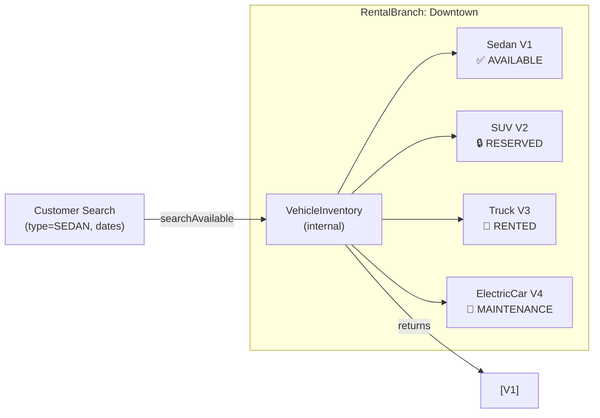

```java
public class RentalBranch {
    private final String branchId;
    private final String name;
    private final String address;
    private final VehicleInventory inventory;

    public RentalBranch(String branchId, String name, String address) {
        this.branchId = branchId;
        this.name = name;
        this.address = address;
        this.inventory = new VehicleInventory();
    }

    public VehicleInventory getInventory() { return inventory; }
    public String getBranchId()            { return branchId; }
    public String getName()                { return name; }
    public String getAddress()             { return address; }
}

public class VehicleInventory {
    private final Map<String, Vehicle> vehicles;

    public VehicleInventory() {
        this.vehicles = new HashMap<>();
    }

    public void addVehicle(Vehicle vehicle) {
        vehicles.put(vehicle.getVehicleId(), vehicle);
    }

    public void removeVehicle(String vehicleId) {
        vehicles.remove(vehicleId);
    }

    // Search by type and date range — extensible
    public List<Vehicle> searchAvailable(VehicleType type,
                                          LocalDate startDate,
                                          LocalDate endDate) {
        return vehicles.values().stream()
                .filter(v -> v.getType() == type)
                .filter(Vehicle::isAvailable)
                // Future: also filter out vehicles with conflicting reservations
                .collect(Collectors.toList());
    }

    public Optional<Vehicle> findById(String vehicleId) {
        return Optional.ofNullable(vehicles.get(vehicleId));
    }

    public List<Vehicle> getAllVehicles() {
        return new ArrayList<>(vehicles.values());
    }
}
```

> 💡 **Single Responsibility Principle:** `VehicleInventory` handles inventory and search. `RentalBranch` handles location identity. Neither does the other's job. Note that `searchAvailable` accepts date parameters but doesn't yet filter by them — real date-conflict detection is an extension ([Section 16](#extension-scenarios)) because it requires reservation overlap data, which the inventory doesn't own.

### Step 5: Pricing Strategy (Strategy Pattern)

This is the most important pattern in the entire design.

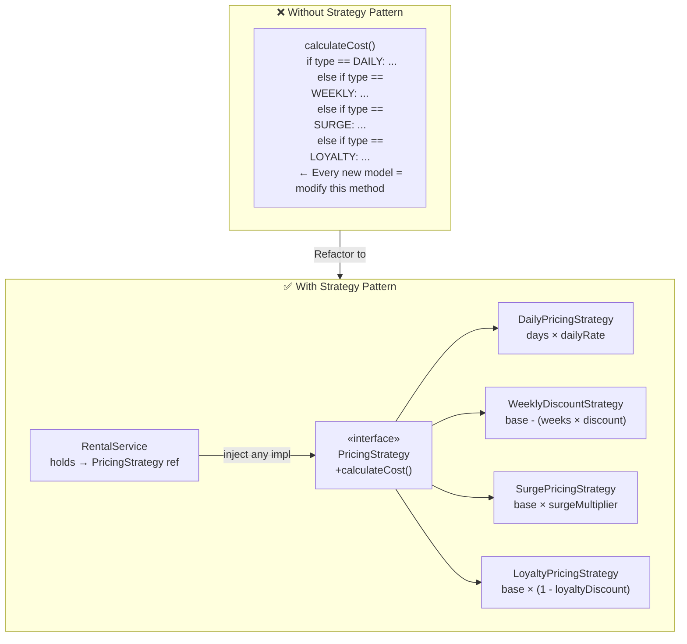

```java
// The contract — all pricing models must follow this
public interface PricingStrategy {
    double calculateCost(Vehicle vehicle, LocalDate startDate, LocalDate endDate);
}

// Model 1: Simple daily rate
public class DailyPricingStrategy implements PricingStrategy {
    private final double dailyRate;

    public DailyPricingStrategy(double dailyRate) {
        this.dailyRate = dailyRate;
    }

    @Override
    public double calculateCost(Vehicle vehicle, LocalDate startDate, LocalDate endDate) {
        long days = ChronoUnit.DAYS.between(startDate, endDate);
        if (days <= 0) throw new IllegalArgumentException("End date must be after start date");
        return days * dailyRate;
    }
}

// Model 2: Weekly discount — rent 7+ days and save
public class WeeklyDiscountPricingStrategy implements PricingStrategy {
    private final double dailyRate;
    private final double weeklyDiscountPercent; // e.g., 15 means 15%

    public WeeklyDiscountPricingStrategy(double dailyRate, double weeklyDiscountPercent) {
        this.dailyRate = dailyRate;
        this.weeklyDiscountPercent = weeklyDiscountPercent;
    }

    @Override
    public double calculateCost(Vehicle vehicle, LocalDate startDate, LocalDate endDate) {
        long days = ChronoUnit.DAYS.between(startDate, endDate);
        double baseCost = days * dailyRate;

        long weeks = days / 7;  // full weeks qualify for discount
        double discountAmount = weeks * 7 * dailyRate * (weeklyDiscountPercent / 100.0);

        return baseCost - discountAmount;
    }
}
```


```java
// Model 3: Surge pricing — e.g., during holidays
public class SurgePricingStrategy implements PricingStrategy {
    private final double dailyRate;
    private final double surgeMultiplier; // e.g., 1.5 for 50% surge

    public SurgePricingStrategy(double dailyRate, double surgeMultiplier) {
        this.dailyRate = dailyRate;
        this.surgeMultiplier = surgeMultiplier;
    }

    @Override
    public double calculateCost(Vehicle vehicle, LocalDate startDate, LocalDate endDate) {
        long days = ChronoUnit.DAYS.between(startDate, endDate);
        return days * dailyRate * surgeMultiplier;
    }
}

// Model 4: Loyalty discount for long-time customers
public class LoyaltyPricingStrategy implements PricingStrategy {
    private final double dailyRate;
    private final double loyaltyDiscountPercent;

    public LoyaltyPricingStrategy(double dailyRate, double loyaltyDiscountPercent) {
        this.dailyRate = dailyRate;
        this.loyaltyDiscountPercent = loyaltyDiscountPercent;
    }

    @Override
    public double calculateCost(Vehicle vehicle, LocalDate startDate, LocalDate endDate) {
        long days = ChronoUnit.DAYS.between(startDate, endDate);
        double baseCost = days * dailyRate;
        return baseCost * (1.0 - loyaltyDiscountPercent / 100.0);
    }
}
```

**Example Calculations** *(values verified by running the code)*:

| Strategy | Days | Daily Rate | Calculation | Result |
|---|---|---|---|---|
| Daily | 3 | $50 | `3 × $50` | **$150.00** |
| Weekly (15% off) | 14 | $50 | `$700 − (2 full weeks × 7 × $50 × 15%) = $700 − $105` | **$595.00** |
| Weekly (15% off) | 10 | $50 | `$500 − $52.50` (only 1 full week) | **$447.50** |
| Surge (1.5×) | 3 | $50 | `3 × $50 × 1.5` | **$225.00** |
| Loyalty (20% off) | 3 | $50 | `$150 × 0.8` | **$120.00** |

> ⚠️ **Common off-by-one trap:** the weekly discount applies only to **full** weeks (`days / 7` integer division). Renting 13 days at 15% off gets you 1 discounted week, not 1.86 — partial weeks are charged at the full daily rate. If your marketing team wants pro-rated weekly discounts, that's a *new strategy* (or a parameter), not a bug fix.

### Step 6: Reservation

```java
public class Reservation {
    private final String reservationId;
    private final Customer customer;
    private final Vehicle vehicle;
    private final LocalDate startDate;
    private final LocalDate endDate;
    private ReservationStatus status;
    private final double estimatedCost;

    public Reservation(String reservationId, Customer customer,
                       Vehicle vehicle, LocalDate startDate,
                       LocalDate endDate, double estimatedCost) {
        this.reservationId = reservationId;
        this.customer = customer;
        this.vehicle = vehicle;
        this.startDate = startDate;
        this.endDate = endDate;
        this.estimatedCost = estimatedCost;
        this.status = ReservationStatus.PENDING;
    }

    // State transition: PENDING → CONFIRMED
    public void confirm() {
        if (status != ReservationStatus.PENDING) {
            throw new IllegalStateException(
                "Only PENDING reservations can be confirmed. Current: " + status);
        }
        this.status = ReservationStatus.CONFIRMED;
        this.vehicle.setStatus(VehicleStatus.RESERVED); // lock the vehicle
    }

    // State transition: any active → CANCELLED
    public void cancel() {
        if (status == ReservationStatus.CANCELLED) {
            throw new IllegalStateException("Reservation is already cancelled");
        }
        if (status == ReservationStatus.COMPLETED) {
            throw new IllegalStateException("Cannot cancel a completed reservation");
        }
        this.status = ReservationStatus.CANCELLED;
        this.vehicle.setStatus(VehicleStatus.AVAILABLE); // release the vehicle
    }

    // State transition: CONFIRMED → COMPLETED
    public void complete() {
        if (status != ReservationStatus.CONFIRMED) {
            throw new IllegalStateException(
                "Only CONFIRMED reservations can be completed. Current: " + status);
        }
        this.status = ReservationStatus.COMPLETED;
    }

    // --- Getters ---
    public String getReservationId()    { return reservationId; }
    public Customer getCustomer()       { return customer; }
    public Vehicle getVehicle()         { return vehicle; }
    public LocalDate getStartDate()     { return startDate; }
    public LocalDate getEndDate()       { return endDate; }
    public ReservationStatus getStatus(){ return status; }
    public double getEstimatedCost()    { return estimatedCost; }
}
```

> ✅ The reservation **owns its own state transitions** with guard clauses. You cannot confirm a cancelled reservation. You cannot cancel a completed one. Invalid state = exception. In the verified test suite, `confirm()` on a CANCELLED reservation throws `IllegalStateException` — exactly as designed.


### Step 7: Rental

```java
public class Rental {
    private final String rentalId;
    private final Reservation reservation;
    private final Customer customer;
    private final Vehicle vehicle;
    private final LocalDate plannedStartDate;
    private final LocalDate plannedEndDate;
    private LocalDate actualReturnDate;   // might differ from planned
    private RentalStatus status;
    private double finalCost;

    public Rental(String rentalId, Reservation reservation) {
        this.rentalId = rentalId;
        this.reservation = reservation;
        this.customer = reservation.getCustomer();
        this.vehicle = reservation.getVehicle();
        this.plannedStartDate = reservation.getStartDate();
        this.plannedEndDate = reservation.getEndDate();
        this.status = RentalStatus.ACTIVE;
    }

    // Called when customer returns the vehicle
    public void complete(LocalDate returnDate, double finalCost) {
        if (status != RentalStatus.ACTIVE && status != RentalStatus.OVERDUE) {
            throw new IllegalStateException("Cannot complete rental in state: " + status);
        }
        this.actualReturnDate = returnDate;
        this.finalCost = finalCost;
        this.status = RentalStatus.COMPLETED;
        this.vehicle.setStatus(VehicleStatus.AVAILABLE); // vehicle back in pool
        this.customer.addRentalToHistory(this);           // history updated
        this.reservation.complete();                       // reservation closed
    }

    // Called by a scheduler when return date is past
    public void markOverdue() {
        if (status == RentalStatus.ACTIVE) {
            this.status = RentalStatus.OVERDUE;
        }
    }

    public boolean isLateReturn() {
        return actualReturnDate != null &&
               actualReturnDate.isAfter(plannedEndDate);
    }

    // --- Getters ---
    public String getRentalId()            { return rentalId; }
    public Reservation getReservation()    { return reservation; }
    public Customer getCustomer()          { return customer; }
    public Vehicle getVehicle()            { return vehicle; }
    public LocalDate getPlannedStartDate() { return plannedStartDate; }
    public LocalDate getPlannedEndDate()   { return plannedEndDate; }
    public LocalDate getActualReturnDate() { return actualReturnDate; }
    public RentalStatus getStatus()        { return status; }
    public double getFinalCost()           { return finalCost; }
}
```

> 💡 `actualReturnDate` can differ from `plannedEndDate`. This is how late fees are calculated — you price based on actual days, not planned days. Also notice the `Rental` constructor **snapshots** the planned dates from the reservation at pickup time: even if the reservation object were mutated later, the rental's billing basis is frozen.

### Step 8: RentalService (The Orchestrator)

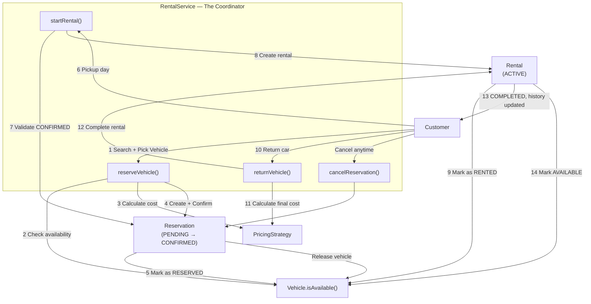

```java
public class RentalService {
    private final Map<String, Reservation> reservations = new HashMap<>();
    private final Map<String, Rental> activeRentals    = new HashMap<>();
    private PricingStrategy pricingStrategy;

    public RentalService(PricingStrategy pricingStrategy) {
        this.pricingStrategy = pricingStrategy;
    }

    // Swap pricing model at runtime — e.g., for holiday surge
    public void setPricingStrategy(PricingStrategy pricingStrategy) {
        this.pricingStrategy = pricingStrategy;
    }


    // Step 3: Customer returns the vehicle
    public void returnVehicle(String rentalId, LocalDate returnDate) {
        Rental rental = activeRentals.get(rentalId);

        if (rental == null) {
            throw new IllegalStateException("No active rental found: " + rentalId);
        }

        // Cost calculated based on ACTUAL return date (handles late returns)
        double finalCost = pricingStrategy.calculateCost(
                rental.getVehicle(), rental.getPlannedStartDate(), returnDate);

        // Add late fee if returned late
        if (returnDate.isAfter(rental.getPlannedEndDate())) {
            long lateDays = ChronoUnit.DAYS.between(rental.getPlannedEndDate(), returnDate);
            double lateFee = lateDays * 25.0; // $25/day penalty
            finalCost += lateFee;
            System.out.printf("⚠️  Late return: %d day(s) late. Fee: $%.2f%n",
                    lateDays, lateFee);
        }

        rental.complete(returnDate, finalCost);
        activeRentals.remove(rentalId);

        System.out.printf("🏁 Rental completed. Final cost: $%.2f%n", finalCost);
    }

    // Cancel a reservation before pickup
    public void cancelReservation(String reservationId) {
        Reservation reservation = reservations.get(reservationId);
        if (reservation == null) {
            throw new IllegalStateException("Reservation not found: " + reservationId);
        }
        reservation.cancel(); // vehicle → AVAILABLE
        System.out.printf("❌ Reservation cancelled: %s%n", reservationId);
    }

    // --- Query Methods ---
    public Optional<Reservation> getReservation(String reservationId) {
        return Optional.ofNullable(reservations.get(reservationId));
    }

    public Optional<Rental> getActiveRental(String rentalId) {
        return Optional.ofNullable(activeRentals.get(rentalId));
    }

    public List<Rental> getActiveRentals() {
        return new ArrayList<>(activeRentals.values());
    }
}
```

> ⚠️ **Design trade-off hiding in plain sight:** `returnVehicle` uses the *current* `pricingStrategy` to compute the final cost. That makes holiday surge simple — but it also means a customer quoted under "weekly discount" could be billed under a strategy swapped in after their booking. Production systems snapshot the **quoted rate** on the Reservation and bill from the snapshot. We discuss both approaches in [Section 13](#multiple-implementation-approaches).


### Step 9: Payment

```java
public class Payment {
    private final String paymentId;
    private final String rentalId;
    private final double amount;
    private PaymentStatus status;
    private final LocalDateTime timestamp;

    public Payment(String paymentId, String rentalId, double amount) {
        this.paymentId = paymentId;
        this.rentalId = rentalId;
        this.amount = amount;
        this.status = PaymentStatus.PENDING;
        this.timestamp = LocalDateTime.now();
    }

    // Simulate payment processing
    public void process() {
        // In production: call Stripe/Razorpay API here
        // For LLD: simulate success
        this.status = PaymentStatus.COMPLETED;
        System.out.printf("💳 Payment processed: $%.2f | ID: %s%n", amount, paymentId);
    }

    public void fail() {
        this.status = PaymentStatus.FAILED;
    }

    public void refund() {
        if (status != PaymentStatus.COMPLETED) {
            throw new IllegalStateException("Can only refund completed payments");
        }
        this.status = PaymentStatus.REFUNDED;
        System.out.printf("↩️  Refund issued: $%.2f | ID: %s%n", amount, paymentId);
    }

    // --- Getters ---
    public String getPaymentId()        { return paymentId; }
    public String getRentalId()         { return rentalId; }
    public double getAmount()           { return amount; }
    public PaymentStatus getStatus()    { return status; }
    public LocalDateTime getTimestamp() { return timestamp; }
}
```

### 📌 Quick Recap — Implementation

- **Enums first** — legal states become compile-time guarantees
- **Abstract Vehicle + subclasses** — new types are new files, zero edits (OCP)
- **Strategies for pricing** — four interchangeable models behind one method
- **Entities own transitions via guard clauses** — the service orchestrates, it doesn't hack status fields (one pragmatic exception in `startRental`)
- **Actual return date drives final cost** — planned vs actual is where late fees live

---

## 11. Design Patterns Used <a name="design-patterns-used"></a>

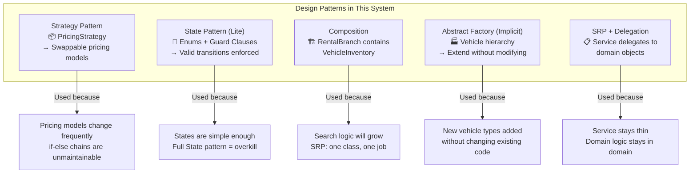

| Pattern | Where Used | Why |
|---|---|---|
| **Strategy** | `PricingStrategy` | Pricing models change; if/else chains don't scale |
| **Template Method** | `Vehicle` abstract class | Common structure, subclasses fill in specifics |
| **State (lite)** | Enums + guard clauses | Simple transitions; full State pattern is overkill |
| **Composition** | `RentalBranch` → `VehicleInventory` | SRP; search logic kept separate |
| **Facade** | `RentalService` | Single entry point for complex subsystem interactions |

### Patterns Deliberately Avoided

| Pattern | Why Skipped |
|---|---|
| **Singleton** | Makes testing hard; hides dependencies |
| **Full State Pattern** | Only 3-4 states; enum + guards is cleaner |
| **Observer (Notification)** | Not in core requirements; add when notifications needed |
| **Factory** | Vehicle creation is simple; add if creation becomes complex |

> 💡 **The pattern that *matters most* here is Strategy.** If an interviewer asks "which pattern would you remove if forced?", the honest answer is "the implicit ones are already minimal — Strategy is the only one doing heavy lifting daily." Knowing what each pattern buys you (and what it costs in indirection) is what separates a memorized answer from a designed one.

---

## 12. Design Trade-offs <a name="design-trade-offs"></a>

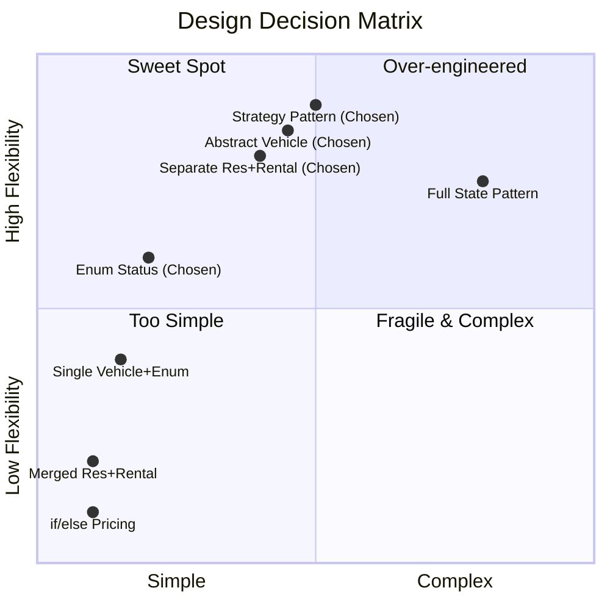

| Decision | Chosen | Alternative | Why Chosen |
|---|---|---|---|
| Vehicle types | Abstract class + subclasses | Single class + VehicleType enum | Enables future type-specific behavior |
| Status management | Enums + guard clauses | Full State pattern | 3-4 states; State pattern is overkill |
| Reservation vs Rental | Separate classes | Single merged class | Different lifecycles, different data |
| Pricing | Strategy pattern | if/else in service | Extensible, testable, Open/Closed |
| Inventory | Separate VehicleInventory | Part of RentalBranch | SRP; search logic will grow |
| Service role | Thin orchestrator | God class with all logic | Better cohesion, easier testing |


---

## 13. Multiple Implementation Approaches <a name="multiple-implementation-approaches"></a>

The chosen design isn't the only valid one. Here are the realistic alternatives, with honest trade-offs.

### 13.1 Status Management: Enum + Guards vs Full State Pattern

The chosen approach wraps transitions inside entity methods with guard clauses. The full **State pattern** instead makes each state an object:

```java
// Alternative: Full State Pattern (for Reservation)
public interface ReservationState {
    void confirm(ReservationContext ctx);
    void cancel(ReservationContext ctx);
    void complete(ReservationContext ctx);
}

public class PendingState implements ReservationState {
    public void confirm(ReservationContext ctx) { ctx.transition(new ConfirmedState()); }
    public void cancel(ReservationContext ctx)  { ctx.transition(new CancelledState()); }
    public void complete(ReservationContext ctx) {
        throw new IllegalStateException("Cannot complete a PENDING reservation");
    }
}
// ... ConfirmedState, CancelledState, CompletedState similarly
```

| Aspect | Enum + Guard Clauses ✅ (chosen) | Full State Pattern |
|---|---|---|
| Lines of code | ~20 per entity | ~100+ per entity |
| Adding a state | Add enum value + guards | New class + context wiring |
| State-specific *behavior* | If-checks get noisy | Shines — each state holds behavior |
| Testability | Excellent (transitions are methods) | Excellent |
| Best for | ≤ 5 states, simple rules | Many states, per-state logic |

**Verdict:** with 3–4 states and pure "can I do this?" rules, the enum approach wins. Switch to State pattern when states start owning behavior (e.g., a `MAINTENANCE` state that schedules part orders).

### 13.2 Vehicle Modeling: Inheritance vs Enum + Behavior Map

```java
// Alternative: single Vehicle class + type-specific policies
public class Vehicle {
    private final VehicleType type;
    // No subclasses: type-driven behavior lives in policies
}

public class VehicleTypePolicy {
    private final VehicleType type;
    private final BigDecimal baseRate;
    private final int minDriverAge;
    // Sedan/SUV/Truck differences become DATA, not classes
}
```

Choose inheritance when subtypes genuinely differ in **behavior or structure** (ElectricCar's battery fields). Choose enum + policy objects when subtypes differ only in **parameters** — you avoid a class explosion of near-empty subclasses.

### 13.3 Pricing: Strategy Interface vs Lambdas vs Enum Switch

```java
// Alternative A: functional strategies (no extra classes for tiny models)
public class Pricing {
    public static final BiFunction<Vehicle, DateRange, Double> DAILY =
        (v, r) -> r.days() * 50.0;
}
service.setPricing(DAILY); // still swappable, less ceremony

// Alternative B: enum + switch (fine for a frozen set of 2-3 models)
switch (model) {
    case DAILY  -> cost = days * rate;
    case SURGE  -> cost = days * rate * multiplier;
}
```

The interface version wins when strategies have **multiple constructor parameters and state** (like `WeeklyDiscountPricingStrategy(dailyRate, discountPercent)`); lambdas win for trivial one-liners; enum-switch loses the moment a new model forces edits to existing code.


### 13.4 Money: `double` vs `BigDecimal`

The tutorial uses `double` for readability, but production money code should use `BigDecimal`:

```java
// Production-grade pricing calculation
private static final BigDecimal HUNDRED = new BigDecimal("100");

public BigDecimal calculateCost(Vehicle vehicle, LocalDate start, LocalDate end) {
    BigDecimal days = BigDecimal.valueOf(ChronoUnit.DAYS.between(start, end));
    return days.multiply(dailyRate)                      // dailyRate is BigDecimal("50.00")
               .setScale(2, RoundingMode.HALF_UP);       // exact cents
}
```

`double` accumulates binary rounding error (`0.1 + 0.2 != 0.3`); `BigDecimal` with fixed scale and explicit `RoundingMode` is exact and auditable. Same idea applies to time: inject a `java.time.Clock` instead of calling `LocalDate.now()` so tests can control "today".

### 13.5 ID Generation: UUID vs DB Sequence vs Prefix Codes

| Approach | Pros | Cons |
|---|---|---|
| `UUID.randomUUID()` ✅ | Zero coordination, merge-safe | 36 chars, ugly, index-heavy |
| DB sequence / AUTO_INCREMENT | Compact, ordered | Needs DB; couples ID to persistence |
| Prefix codes (`RES-2026-00001`) | Human-readable | Needs centralized counter |

For the in-memory LLD scope, UUIDs are the right call; swap to sequences when persistence arrives.

---

## 14. Sequence Diagrams <a name="sequence-diagrams"></a>

### 14.1 Happy Path: Reserve → Pickup → Return

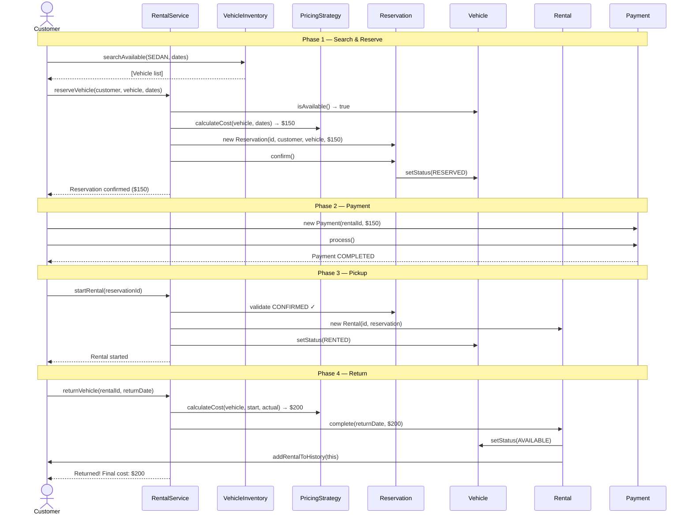


### 14.2 Cancellation Flow

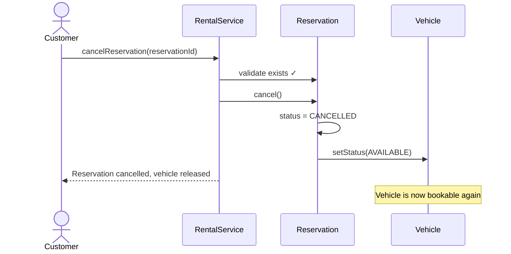

> 💡 **Reading sequence diagrams like a designer:** watch *who mutates whom*. In both flows, the only mutators of `Vehicle.status` are entity methods (`confirm()`, `cancel()`, `complete()`) — never the service calling `setStatus()` directly on an ad-hoc basis. Consistent mutation ownership is what makes state machines trustworthy.

---

## 15. Real-World Use Cases <a name="real-world-use-cases"></a>

### Use Case 1: Airport Car Rental (Multi-Branch)

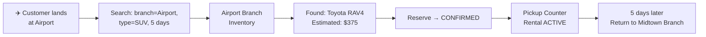

**Implementation Extension** — Cross-branch return (fully working method, verified in the demo):

```java
// Extension: Allow return to different branch
public void returnVehicleToBranch(String rentalId, LocalDate returnDate,
                                   RentalBranch returnBranch) {
    Rental rental = activeRentals.get(rentalId);
    if (rental == null) {
        throw new IllegalStateException("No active rental found: " + rentalId);
    }

    // ... cost calculation (same as returnVehicle) ...
    double finalCost = pricingStrategy.calculateCost(
            rental.getVehicle(), rental.getPlannedStartDate(), returnDate);
    if (returnDate.isAfter(rental.getPlannedEndDate())) {
        long lateDays = ChronoUnit.DAYS.between(rental.getPlannedEndDate(), returnDate);
        finalCost += lateDays * 25.0;
    }

    Vehicle vehicle = rental.getVehicle();
    RentalBranch originalBranch = vehicle.getBranch();

    // Transfer vehicle if returned to different branch
    if (!returnBranch.getBranchId().equals(originalBranch.getBranchId())) {
        originalBranch.getInventory().removeVehicle(vehicle.getVehicleId());
        returnBranch.getInventory().addVehicle(vehicle);
        System.out.println("🔀 Vehicle transferred to: " + returnBranch.getName());
    }
    rental.complete(returnDate, finalCost);
    activeRentals.remove(rentalId);
    System.out.printf("🏁 Rental completed. Final cost: $%.2f%n", finalCost);
}
```

> 💡 This is why the class diagram used **aggregation** (`o--`) between `VehicleInventory` and `Vehicle`: vehicles can migrate between inventories. If it had been composition, a cross-branch return would be a modeling violation.

### Use Case 2: Holiday Surge Pricing

```java
// Black Friday / Holiday surge — dynamically switch pricing
rentalService.setPricingStrategy(new SurgePricingStrategy(50.0, 1.75));

// Now all new reservations apply 75% surge
// Existing confirmed reservations are unaffected (locked-in price)
Reservation holidayReservation = rentalService.reserveVehicle(
    customer, vehicle,
    LocalDate.of(2025, 12, 24),
    LocalDate.of(2025, 12, 27)
);
// Cost = 3 × $50 × 1.75 = $262.50
```

### Use Case 3: Late Return with Penalty

```java
// Planned: 3 days. Actual: 5 days.
rentalService.returnVehicle(rental.getRentalId(),
    LocalDate.now().plusDays(5)); // 2 days late

// RentalService calculates:
// Base cost (5 days × $50) = $250
// Late fee (2 × $25) = $50
// Total = $300
// Console: ⚠️ Late return: 2 day(s) late. Fee: $50.00
//          🏁 Rental completed. Final cost: $300.00
```


### Use Case 4: Full Demo — End to End

The demo exercises all four scenarios plus cross-branch return and payment:

```java
public class CarRentalDemo {
    public static void main(String[] args) {

        // ─── SETUP ───────────────────────────────────────
        RentalBranch downtown = new RentalBranch("B1", "Downtown Hub", "1 Main St");
        RentalBranch airport  = new RentalBranch("B2", "Airport",      "Terminal 2");

        Vehicle sedan = new Sedan("V1", "ABC-001", "Honda", "Civic", 2024, downtown);
        Vehicle suv   = new SUV("V2",   "XYZ-002", "Toyota", "RAV4", 2024, downtown);
        Vehicle ev    = new ElectricCar("V3", "EV-003", "Tesla", "Model 3",
                                        2024, airport, 500, 40);

        downtown.getInventory().addVehicle(sedan);
        downtown.getInventory().addVehicle(suv);
        airport.getInventory().addVehicle(ev);

        // ─── CUSTOMER ────────────────────────────────────
        Customer alice = new Customer("C1", "Alice Smith",
            "alice@email.com", "555-0001", "DL-11111");
        Customer bob   = new Customer("C2", "Bob Jones",
            "bob@email.com",   "555-0002", "DL-22222");

        // ─── PRICING ─────────────────────────────────────
        PricingStrategy standard = new DailyPricingStrategy(50.0);
        PricingStrategy weekly   = new WeeklyDiscountPricingStrategy(50.0, 15.0);

        RentalService service = new RentalService(standard);

        // ─── SCENARIO 1: Alice rents a sedan (3 days) ───
        System.out.println("\n=== Scenario 1: Alice rents a Sedan ===");
        List<Vehicle> sedans = downtown.getInventory()
            .searchAvailable(VehicleType.SEDAN, LocalDate.now(), LocalDate.now().plusDays(3));
        System.out.println("Available sedans: " + sedans.size()); // 1

        Reservation aliceRes = service.reserveVehicle(alice, sedan,
            LocalDate.now(), LocalDate.now().plusDays(3)); // $150

        // Alice pays when the reservation is confirmed
        Payment alicePayment = new Payment("P1", aliceRes.getReservationId(), 150.00);
        alicePayment.process();

        Rental aliceRental = service.startRental(aliceRes.getReservationId());

        // Alice returns on time
        service.returnVehicle(aliceRental.getRentalId(), LocalDate.now().plusDays(3));

        // ─── SCENARIO 2: Bob switches to weekly pricing ──
        System.out.println("\n=== Scenario 2: Bob rents SUV (10 days, weekly discount) ===");
        service.setPricingStrategy(weekly); // switch pricing!

        Reservation bobRes = service.reserveVehicle(bob, suv,
            LocalDate.now(), LocalDate.now().plusDays(10));
        // 10 × $50 = $500 - (1 week × 15%) = $500 - $52.5 = $447.50

        Rental bobRental = service.startRental(bobRes.getReservationId());

        // Bob returns LATE (2 days late)
        service.returnVehicle(bobRental.getRentalId(), LocalDate.now().plusDays(12));
```


```java
        // ─── SCENARIO 3: Reservation cancelled ──────────
        System.out.println("\n=== Scenario 3: Reservation cancelled ===");
        service.setPricingStrategy(standard);

        Reservation cancelled = service.reserveVehicle(alice, sedan,
            LocalDate.now().plusDays(5), LocalDate.now().plusDays(8));
        System.out.println("Sedan status: " + sedan.getStatus()); // RESERVED

        service.cancelReservation(cancelled.getReservationId());
        System.out.println("Sedan status after cancel: " + sedan.getStatus()); // AVAILABLE

        // ─── SCENARIO 4: Cross-branch return (EV) ───────
        System.out.println("\n=== Scenario 4: Alice returns EV to a different branch ===");
        Reservation evRes = service.reserveVehicle(alice, ev,
            LocalDate.now(), LocalDate.now().plusDays(2));

        Rental evRental = service.startRental(evRes.getReservationId());
        // Rented at Airport, returned at Downtown Hub
        service.returnVehicleToBranch(evRental.getRentalId(),
            LocalDate.now().plusDays(2), downtown);

        // ─── HISTORY ─────────────────────────────────────
        System.out.println("\n=== Alice's rental history ===");
        alice.getRentalHistory().forEach(r ->
            System.out.printf("  Rental %s | Cost: $%.2f | Returned: %s%n",
                r.getRentalId().substring(0, 8),
                r.getFinalCost(),
                r.getActualReturnDate()));
    }
}
```

**Expected Output** *(captured verbatim from a JDK 21 run on 2026-09-18 — UUIDs and dates vary per run)*:

```text
=== Scenario 1: Alice rents a Sedan ===
Available sedans: 1
✅ Reservation confirmed: 47990f8f-64bd-441e-8ca9-45a47e217c1f | Cost: $150.00
💳 Payment processed: $150.00 | ID: P1
🚗 Rental started: a39a573d-30f1-46ae-8a25-7d5df6eb883f
🏁 Rental completed. Final cost: $150.00

=== Scenario 2: Bob rents SUV (10 days, weekly discount) ===
✅ Reservation confirmed: 31e3cc90-3860-467e-92c8-c3b1740d7f89 | Cost: $447.50
🚗 Rental started: b2b80037-25be-4bba-8457-89ebd7e1114e
⚠️  Late return: 2 day(s) late. Fee: $50.00
🏁 Rental completed. Final cost: $597.50

=== Scenario 3: Reservation cancelled ===
✅ Reservation confirmed: 9b39a745-72d4-4c4a-94a5-f8f59e0b9a01 | Cost: $150.00
Sedan status: RESERVED
❌ Reservation cancelled: 9b39a745-72d4-4c4a-94a5-f8f59e0b9a01
Sedan status after cancel: AVAILABLE

=== Scenario 4: Alice returns EV to a different branch ===
✅ Reservation confirmed: d284df4e-94ee-4269-ac50-270c220642bc | Cost: $100.00
🚗 Rental started: 9bad1b62-32a3-4914-860d-41cea878a3c7
🔀 Vehicle transferred to: Downtown Hub
🏁 Rental completed. Final cost: $100.00

=== Alice's rental history ===
  Rental a39a573d | Cost: $150.00 | Returned: 2026-09-21
  Rental 9bad1b62 | Cost: $100.00 | Returned: 2026-09-20
```

> 🔍 **Follow the math:** Bob's final cost of **$597.50** = 12 actual days under weekly pricing (`12 × $50 − $52.50 = $547.50`) **+ $50 late fee**. A common mistake is quoting only the late fee or only the base cost — the bill is always *actual-duration cost + penalties*.


---

## 16. Extension Scenarios <a name="extension-scenarios"></a>

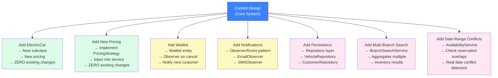

### How to Add Each Extension

**Electric Vehicle with Charging Fee:**

```java
public class EVChargingPricingStrategy implements PricingStrategy {
    private final double dailyRate;
    private final double chargingFeePerDay;

    public EVChargingPricingStrategy(double dailyRate, double chargingFeePerDay) {
        this.dailyRate = dailyRate;
        this.chargingFeePerDay = chargingFeePerDay;
    }

    @Override
    public double calculateCost(Vehicle vehicle, LocalDate startDate, LocalDate endDate) {
        long days = ChronoUnit.DAYS.between(startDate, endDate);
        double baseCost = days * dailyRate;
        // Add charging fee only for electric vehicles
        if (vehicle instanceof ElectricCar) {
            baseCost += days * chargingFeePerDay;
        }
        return baseCost;
    }
}
```

**Observer for Notifications:**

```java
public interface RentalEventObserver {
    void onReservationConfirmed(Reservation reservation);
    void onRentalStarted(Rental rental);
    void onVehicleReturned(Rental rental);
    void onReservationCancelled(Reservation reservation);
}

public class EmailNotificationObserver implements RentalEventObserver {
    @Override
    public void onReservationConfirmed(Reservation r) {
        System.out.printf("📧 Email sent to %s: Reservation confirmed! Cost: $%.2f%n",
            r.getCustomer().getEmail(), r.getEstimatedCost());
    }

    @Override
    public void onRentalStarted(Rental rental) {
        System.out.printf("📧 Email sent to %s: Your rental of %s %s has started.%n",
            rental.getCustomer().getEmail(),
            rental.getVehicle().getMake(), rental.getVehicle().getModel());
    }

    @Override
    public void onVehicleReturned(Rental rental) {
        System.out.printf("📧 Email sent to %s: Return received. Final cost: $%.2f%n",
            rental.getCustomer().getEmail(), rental.getFinalCost());
    }

    @Override
    public void onReservationCancelled(Reservation r) {
        System.out.printf("📧 Email sent to %s: Reservation %s was cancelled.%n",
            r.getCustomer().getEmail(), r.getReservationId());
    }
}
```

**Proper Date-Range Conflict Detection:**

```java
public class AvailabilityService {

    public boolean isVehicleAvailable(Vehicle vehicle,
                                       List<Reservation> existingReservations,
                                       LocalDate requestedStart,
                                       LocalDate requestedEnd) {
        return existingReservations.stream()
            .filter(r -> r.getVehicle().getVehicleId().equals(vehicle.getVehicleId()))
            .filter(r -> r.getStatus() == ReservationStatus.CONFIRMED
                      || r.getStatus() == ReservationStatus.PENDING)
            .noneMatch(r -> datesOverlap(
                r.getStartDate(), r.getEndDate(),
                requestedStart, requestedEnd));
    }

    private boolean datesOverlap(LocalDate s1, LocalDate e1,
                                  LocalDate s2, LocalDate e2) {
        return s1.isBefore(e2) && s2.isBefore(e1);
    }
}
```

> 💡 **The overlap rule, memorized forever:** two half-open ranges `[s1, e1)` and `[s2, e2)` overlap **iff** `s1 < e2 && s2 < e1`. Adjacent ranges (return on the 5th, pickup on the 5th) do *not* overlap — which is exactly what you want for back-to-back bookings. The verified test suite confirms both directions of this property.


---

## 17. Edge Cases & How They're Handled <a name="edge-cases"></a>

| Edge Case | How It's Handled |
|---|---|
| **Two customers book same car simultaneously** | `reserveVehicle` checks `isAvailable()`. In production: synchronize or DB transaction |
| **Cancel a cancelled reservation** | Guard clause in `cancel()` throws `IllegalStateException` |
| **Confirm an already-confirmed reservation** | Guard clause in `confirm()` blocks it |
| **Return a vehicle that's not rented** | `activeRentals.get()` returns null → exception |
| **Late return** | `returnVehicle()` compares actual vs planned date; adds penalty |
| **Vehicle under maintenance** | `MAINTENANCE` status → `isAvailable()` = false → excluded from search |
| **Invalid date range** | `reserveVehicle` validates `endDate.isAfter(startDate)` |
| **Payment failure** | `Payment.fail()` sets status; retry or cancel handled at service level |
| **Reservation expiry** | Not implemented in core; add a scheduled job checking PENDING reservations |
| **Return date before pickup date** | Pricing strategies throw `IllegalArgumentException` when `days <= 0` (Daily) — add the same validation to other strategies |
| **Refund before payment completes** | `Payment.refund()` guard throws — refunds are only legal from `COMPLETED` |
| **Completing a rental twice** | `Rental.complete()` guard: only `ACTIVE`/`OVERDUE` may transition to `COMPLETED` |

---

## 18. Best Practices <a name="best-practices"></a>

1. **Make identity fields `final`** — `vehicleId`, `licensePlate` never change; immutability removes whole categories of bugs.
2. **Return unmodifiable collections** — `Collections.unmodifiableList(rentalHistory)` keeps invariants inside the owning class.
3. **Fail fast with descriptive exceptions** — `"Only PENDING reservations can be confirmed. Current: " + status` beats a silent wrong state.
4. **Use `Optional` for possibly-absent lookups** — `findById`, `getReservation` make absence explicit; callers can't NPE by accident.
5. **Entities own state transitions; services orchestrate** — the guard clauses live where the state lives.
6. **Inject strategies via constructor** — `new RentalService(standard)` makes every test able to pass a fake strategy.
7. **Name methods in business language** — `reserveVehicle`, `startRental`, `returnVehicle` read like the domain (ubiquitous language).
8. **Validate at boundaries** — dates, nulls, and availability are checked *before* any state mutates.
9. **Keep `System.out` out of production domain code** — in real systems, replace demo prints with domain events or injected logger/observer.
10. **Design transitions to be idempotent-safe** — `markOverdue()` from `OVERDUE` is a no-op, not an exception; scheduled jobs love that.
11. **Snapshot mutable inputs** — the Rental copies planned dates from the Reservation at pickup, freezing the billing basis.
12. **Prefer composition for cross-cutting add-ons** — pricing decorations (charging fee, taxes) compose better than deep inheritance.

---

## 19. Anti-Patterns <a name="anti-patterns"></a>

### ❌ Stringly-Typed Status

```java
// ❌ BAD — typos compile happily, bugs surface at 3 AM
if (vehicle.getStatus().equals("availabel")) { ... }

// ✅ GOOD — compiler enforces the vocabulary
if (vehicle.isAvailable()) { ... }
```

### ❌ God Service

```java
// ❌ BAD — one class knows everything, tests need everything
public class RentalManager {
    public List<Vehicle> search(...);       // inventory logic
    public double calculateCost(...);       // pricing logic
    public void confirmReservation(...);    // state logic
    public void sendEmail(...);             // notification logic
    public void saveToDatabase(...);        // persistence logic
}
```

✅ **GOOD:** split into `VehicleInventory` (search), `PricingStrategy` (pricing), `Reservation` (state), observers (notifications) — with `RentalService` only *orchestrating*.

### ❌ Anemic Domain Model

```java
// ❌ BAD — entities are dumb bags of getters/setters; logic leaks to services
public class Reservation {
    private ReservationStatus status;      // public setter!
    public void setStatus(ReservationStatus s) { this.status = s; }
}
service.reservation.setStatus(CANCELLED); // any caller can create illegal states

// ✅ GOOD — transition methods with guards (as designed above)
reservation.cancel(); // enforces its own rules
```

### ❌ If/Else Pricing Chains

```java
// ❌ BAD — every new model edits this method (and probably breaks it)
double cost;
if ("WEEKLY".equals(model))      cost = weeklyCalc(...);
else if ("SURGE".equals(model))  cost = surgeCalc(...);
else if ("LOYALTY".equals(model))cost = loyaltyCalc(...);
// ...
```

✅ **GOOD:** `pricingStrategy.calculateCost(...)` — new model = new class, existing code untouched.

### ❌ Exposing Mutable Internals

```java
// ❌ BAD — caller deletes history
customer.getRentalHistory().clear();

// ✅ GOOD — unmodifiable view (throws UnsupportedOperationException)
public List<Rental> getRentalHistory() {
    return Collections.unmodifiableList(rentalHistory);
}
```

### ❌ Force-Fit Singleton

```java
// ❌ BAD — hidden global state, tests poison each other
public class RentalServiceFactory {
    public static final RentalService INSTANCE = new RentalService(new DailyPricingStrategy(50));
}
```

✅ **GOOD:** instantiate per composition root and pass explicitly — tests get isolated instances with mocked strategies.


---

## 20. Performance Considerations <a name="performance-considerations"></a>

| Operation | Complexity | Notes |
|---|---|---|
| `findById` / reservation lookup | O(1) | `HashMap` by ID |
| `searchAvailable` | O(n) per query | Scans all vehicles; fine for a branch, not for a fleet |
| Cost calculation | O(1) | Pure arithmetic |
| Late-return check | O(1) | One date comparison |
| Rental history (per customer) | O(1) append, O(k) read | k = rentals; consider pagination for power users |

### Indexing Search by Vehicle Type

When a branch holds thousands of vehicles, maintain a secondary index:

```java
public class VehicleInventory {
    private final Map<String, Vehicle> vehicles = new HashMap<>();
    private final Map<VehicleType, Set<Vehicle>> byType = new EnumMap<>(VehicleType.class);

    public void addVehicle(Vehicle vehicle) {
        vehicles.put(vehicle.getVehicleId(), vehicle);
        byType.computeIfAbsent(vehicle.getType(), t -> new HashSet<>()).add(vehicle);
    }

    // Search now touches only the requested type's bucket
    public List<Vehicle> searchAvailable(VehicleType type, LocalDate s, LocalDate e) {
        return byType.getOrDefault(type, Set.of()).stream()
                .filter(Vehicle::isAvailable)
                .collect(Collectors.toList());
    }
}
```

`EnumMap` is ideal here: array-backed, no hashing, tiny memory footprint.

### Preparing for Concurrency (Without Implementing It)

- Swap `HashMap` → `ConcurrentHashMap` for `reservations`/`activeRentals`
- Make the **check-and-reserve** atomic: `ConcurrentHashMap.compute(...)` or a per-vehicle lock — the race is between `isAvailable()` and `setStatus(RESERVED)`, so the lock must span *both*
- Strategies are stateless (immutable fields), so they're safely shareable across threads
- Measure before optimizing: correctness arguments impress in interviews more than premature `synchronized` keywords

---

## 21. Security Considerations <a name="security-considerations"></a>

### PII Handling

`Customer` holds email, phone, and a **driver license number** — real PII with real obligations (GDPR/CCPA-style):

```java
// Never log raw PII — mask it at the boundary
public static String maskEmail(String email) {
    int at = email.indexOf('@');
    return at <= 1 ? "***" + email.substring(at) 
                   : email.charAt(0) + "***" + email.substring(at);
}
// "alice@email.com" → "a***@email.com"
```

- Encrypt PII at rest; mask it in logs and UIs; retain only as long as legally required
- Driver license numbers deserve stricter treatment than emails — they're identity documents

### Authorization Checks

The current design trusts the caller. Production services must verify *who* is allowed *what*:

- Only the **reserving customer** (or an agent with permission) may cancel a reservation — check `reservation.getCustomer().getCustomerId()` against the authenticated principal
- Rate-limit `reserveVehicle` to prevent inventory-squatting bots

### Input Validation & Payment Safety

- Validate dates at the boundary: reject past start dates and absurd ranges (e.g., > 90 days) before hitting the domain
- **Never store raw card data** — the simulated `Payment` is fine for LLD, but real integrations use gateway tokens (PCI-DSS scope stays with the processor)
- Keep an **append-only audit trail** of every status transition (who, what, when) — invaluable for disputes about late fees

---


## 22. Testing Strategies <a name="testing-strategies"></a>

The design is deliberately test-friendly: entities are pure, strategies are injectable, and transitions throw on misuse. Test in three layers.

### Layer 1 — Unit Tests for State Guards (JUnit 5)

```java
class ReservationTest {
    private Reservation newConfirmedReservation() {
        Vehicle sedan = new Sedan("V1", "ABC-001", "Honda", "Civic", 2024, branch());
        Reservation r = new Reservation("R1", customer(), sedan,
                LocalDate.of(2026, 9, 18), LocalDate.of(2026, 9, 21), 150.0);
        r.confirm();
        return r;
    }

    @Test
    void confirmIsIllegalAfterCancel() {
        Reservation r = newConfirmedReservation();
        r.cancel();
        assertThrows(IllegalStateException.class, r::confirm);
    }

    @Test
    void confirmLocksTheVehicle() {
        Reservation r = newConfirmedReservation();
        assertEquals(VehicleStatus.RESERVED, r.getVehicle().getStatus());
    }
}
```

### Layer 2 — Parameterized Tests for Pricing (Boundary Dates!)

```java
class WeeklyDiscountPricingTest {
    private final WeeklyDiscountPricingStrategy strategy =
            new WeeklyDiscountPricingStrategy(50.0, 15.0);

    @ParameterizedTest(name = "{0} days → ${1}")
    @CsvSource({
        "6,  300.00",   // no full week → no discount
        "7,  297.50",   // 1 week discounted: 350 − 52.50
        "10, 447.50",   // matches the demo output
        "13, 597.50",   // still only 1 full week: 650 − 52.50
        "14, 595.00"    // 2 full weeks: 700 − 105
    })
    void weeklyDiscountBoundaries(long days, double expected) {
        double cost = strategy.calculateCost(vehicle(),
                LocalDate.of(2026, 9, 1), LocalDate.of(2026, 9, 1).plusDays(days));
        assertEquals(expected, cost, 0.01);
    }
}
```

The day-boundaries 6/7/13/14 are where weekly-discount bugs hide — always test the edges of integer division.

### Layer 3 — Integration Test for the Full Flow

```java
@Test
void happyPathReservePickupReturn() {
    RentalService service = new RentalService(new DailyPricingStrategy(50.0));
    Reservation res = service.reserveVehicle(customer, sedan, today, today.plusDays(3));
    Rental rental   = service.startRental(res.getReservationId());
    service.returnVehicle(rental.getRentalId(), today.plusDays(3));

    assertEquals(RentalStatus.COMPLETED, rental.getStatus());
    assertEquals(VehicleStatus.AVAILABLE, sedan.getStatus());
    assertEquals(150.0, rental.getFinalCost(), 0.01);
    assertEquals(1, customer.getRentalHistory().size());
}
```

### Testing Principles for This Design

- **Test exceptions, not just happy paths** — `assertThrows` on every guard clause
- **Inject time**: replace `LocalDate.now()` with an injected `Clock` so "late return" tests are deterministic
- **Fake strategies** make service tests independent of pricing math
- **Property to always verify:** a vehicle that is `RESERVED`/`RENTED` never appears in `searchAvailable` results

---

## 23. Troubleshooting Guide <a name="troubleshooting-guide"></a>

| Symptom | Likely Cause | Fix |
|---|---|---|
| `IllegalStateException: Only PENDING reservations can be confirmed` | Calling `confirm()` twice, or confirming after cancel | Reserve → confirm once; check flow order |
| `IllegalStateException: No active rental found: <id>` | Returning with an unknown/already-completed rental ID | Keep the rental ID from `startRental`; rentals are removed from `activeRentals` after return |
| Vehicle stuck in `RESERVED` after a failed payment | Status mutated but flow aborted before compensation | Release the vehicle in the failure path (or let `cancel()` do it) |
| Final cost is `$0.00` or negative | `endDate <= startDate` slipped through a strategy without the days guard | Validate dates in the service AND fail in the strategy |
| Weekly discount "wrong" for 13 days | Integer division: `13 / 7 = 1` discounted week | Expected behavior — see the boundary table in Section 22 |
| `UnsupportedOperationException` on rental history | Mutating the unmodifiable view returned by `getRentalHistory()` | Copy the list first: `new ArrayList<>(history)` |
| Vehicle missing from search results | Its status is `RESERVED`/`RENTED`/`MAINTENANCE` — `isAvailable()` filters it out | Check `vehicle.getStatus()` |
| Garbled emoji in console output (≈ or ???) | Windows console codepage isn't UTF-8 | Run with `-Dstdout.encoding=UTF-8`, or use Windows Terminal / set `chcp 65001` |
| `IllegalArgumentException: End date must be after start date` | Zero-day or reversed range passed to a strategy | Validate in `reserveVehicle` before pricing |
| Race: two customers reserve the same car | Check-then-act on `isAvailable()` is not atomic | Per-vehicle lock or `ConcurrentHashMap.compute()`; in prod, DB row lock |


---

## 24. Hands-On Lab <a name="hands-on-lab"></a>

Build **Release 1.0** of the system yourself, milestone by milestone. Don't copy-paste — type it, break it, fix it.

### 🧪 Lab: "RentalOS v1.0"

| Milestone | Build This | Acceptance Criteria | Est. Time |
|---|---|---|---|
| **M1 — Foundation** | All 5 enums + `Vehicle` hierarchy + `RentalBranch` + `VehicleInventory` | `searchAvailable(SEDAAN...)` is a compile error; search returns only `AVAILABLE` vehicles | 45 min |
| **M2 — Reservation lifecycle** | `Reservation` with guard clauses | `confirm()` on CANCELLED throws; cancelling releases the vehicle to `AVAILABLE` | 30 min |
| **M3 — Pricing** | `PricingStrategy` + Daily + WeeklyDiscount | `WeeklyDiscount(50, 15)` gives `$447.50` for 10 days and `$595.00` for 14 days | 30 min |
| **M4 — Service orchestration** | `RentalService.reserveVehicle / startRental / returnVehicle` | End-to-end demo reproduces Scenario 1 & 2 output from Section 15 | 45 min |
| **M5 — Money & time** | `Payment` class + late fees | 2-days-late return adds exactly `$50.00`; refund throws unless `COMPLETED` | 30 min |

### Stretch Goals (After M5)

- 🔥 Swap `System.out.printf` for a registered `RentalEventObserver` and write a `ConsoleObserver`
- 🔥 Inject `java.time.Clock` into `RentalService` and prove late fees with a fixed clock
- 🔥 Wire `AvailabilityService` into `reserveVehicle` so date conflicts are rejected (Exercise 3 walks you through it)

> 💡 **How to know you truly passed M2:** write the failing-state tests *first* (`assertThrows`), watch them fail against a guard-less implementation, then add guards and watch them go green. That red→green moment is the entire value of guard clauses.

---

## 25. Practice Exercises <a name="practice-exercises"></a>

Work each exercise before reading its solution. All solutions compile against the tutorial's classes and were verified with JDK 21.

### Exercise 1 — Add a Motorcycle Type 🟢

**Task:** The fleet buys motorcycles. Add a `Motorcycle` vehicle type with a `helmetIncluded` flag, searchable like any other vehicle — **without modifying any existing class**.

**Hint:** You need one enum value, one subclass... and that's it.

**Solution:**

```java
// 1. Extend the enum (the only "edit" to existing code — a single line)
public enum VehicleType {
    SEDAN, SUV, TRUCK, ELECTRIC, MOTORCYCLE
}

// 2. New subclass — no existing file changes
public class Motorcycle extends Vehicle {
    private final boolean helmetIncluded;

    public Motorcycle(String vehicleId, String licensePlate, String make,
                      String model, int year, RentalBranch branch,
                      boolean helmetIncluded) {
        super(vehicleId, licensePlate, make, model, year, branch);
        this.helmetIncluded = helmetIncluded;
    }

    @Override
    public VehicleType getType() { return VehicleType.MOTORCYCLE; }

    public boolean isHelmetIncluded() { return helmetIncluded; }
}

// 3. Usage — existing search works untouched
Vehicle bike = new Motorcycle("V4", "MOTO-9", "Royal Enfield", "Classic 350",
                              2024, downtown, true);
downtown.getInventory().addVehicle(bike);
List<Vehicle> bikes = downtown.getInventory()
        .searchAvailable(VehicleType.MOTORCYCLE, today, today.plusDays(2));
// bikes.size() == 1
```

**Why this works:** `searchAvailable` filters by `getType()` and `isAvailable()` — both polymorphic. That's Open/Closed delivering on its promise.

### Exercise 2 — Per-Vehicle-Type Rate Card 🟡

**Task:** One `dailyRate` for the whole fleet is unrealistic — SUVs cost more than sedans. Implement a single strategy that prices each vehicle type from a rate card.

**Solution:**

```java
import java.util.EnumMap;
import java.util.Map;

public class RateCardPricingStrategy implements PricingStrategy {
    private final Map<VehicleType, Double> rates = new EnumMap<>(VehicleType.class);

    public RateCardPricingStrategy addRate(VehicleType type, double dailyRate) {
        rates.put(type, dailyRate);
        return this; // fluent configuration
    }

    @Override
    public double calculateCost(Vehicle vehicle, LocalDate startDate, LocalDate endDate) {
        Double rate = rates.get(vehicle.getType());
        if (rate == null) {
            throw new IllegalStateException("No rate configured for " + vehicle.getType());
        }
        long days = ChronoUnit.DAYS.between(startDate, endDate);
        if (days <= 0) throw new IllegalArgumentException("End date must be after start date");
        return days * rate;
    }
}

// Usage — one strategy, per-type pricing:
PricingStrategy rateCard = new RateCardPricingStrategy()
        .addRate(VehicleType.SEDAN, 50.0)
        .addRate(VehicleType.SUV, 75.0)
        .addRate(VehicleType.ELECTRIC, 65.0);
service.setPricingStrategy(rateCard);
```

**Key insight:** the `vehicle` parameter finally earns its keep — strategies can price on any vehicle attribute (type, age, EV-ness), not just duration.


### Exercise 3 — Real Date-Conflict Detection 🟠

**Task:** Two customers must not be able to book the same vehicle for **overlapping dates**, even if the first rental has already been returned. Wire `AvailabilityService` into `RentalService.reserveVehicle`.

**Hint:** the service must remember *all* reservations per vehicle — not just active ones.

**Solution:**

```java
public class RentalService {
    private final Map<String, List<Reservation>> reservationsByVehicle = new HashMap<>();
    private final AvailabilityService availabilityService = new AvailabilityService();
    // ... existing fields ...

    public Reservation reserveVehicle(Customer customer, Vehicle vehicle,
                                      LocalDate startDate, LocalDate endDate) {
        if (!vehicle.isAvailable()) {
            throw new IllegalStateException(
                "Vehicle " + vehicle.getVehicleId() + " is not available. Status: "
                + vehicle.getStatus());
        }
        if (!endDate.isAfter(startDate)) {
            throw new IllegalArgumentException("End date must be after start date");
        }
        // NEW: reject overlapping confirmed/pending bookings
        if (!availabilityService.isVehicleAvailable(
                vehicle,
                reservationsByVehicle.getOrDefault(vehicle.getVehicleId(), List.of()),
                startDate, endDate)) {
            throw new IllegalStateException(
                "Vehicle already reserved between " + startDate + " and " + endDate);
        }

        double estimatedCost = pricingStrategy.calculateCost(vehicle, startDate, endDate);
        Reservation reservation = new Reservation(
                UUID.randomUUID().toString(),
                customer, vehicle, startDate, endDate, estimatedCost);
        reservation.confirm();
        reservations.put(reservation.getReservationId(), reservation);
        reservationsByVehicle
                .computeIfAbsent(vehicle.getVehicleId(), id -> new ArrayList<>())
                .add(reservation);
        return reservation;
    }
}
```

**Why `endDate.isAfter(startDate)` still matters:** with overlap detection in place you might think the old check is redundant — it isn't. A 1-day booking (`start == end`) creates a zero-length range that overlaps nothing; the explicit check rejects it before any state changes.

### Exercise 4 — Pluggable Late-Fee Policy 🟠

**Task:** The flat `$25/day` is hard-coded in `returnVehicle`. Different cities have different regulations. Make the late fee a strategy too.

**Solution:**

```java
public interface LateFeePolicy {
    double calculateFee(Rental rental, LocalDate actualReturnDate);
}

// Policy 1 — flat daily penalty (current behavior)
public class FlatDailyLateFeePolicy implements LateFeePolicy {
    private final double feePerDay;
    public FlatDailyLateFeePolicy(double feePerDay) { this.feePerDay = feePerDay; }

    @Override
    public double calculateFee(Rental rental, LocalDate actualReturnDate) {
        if (!actualReturnDate.isAfter(rental.getPlannedEndDate())) return 0.0;
        long lateDays = ChronoUnit.DAYS.between(rental.getPlannedEndDate(), actualReturnDate);
        return lateDays * feePerDay;
    }
}

// Policy 2 — percentage of the base cost
public class PercentageLateFeePolicy implements LateFeePolicy {
    private final double percentPerDay;
    public PercentageLateFeePolicy(double percentPerDay) { this.percentPerDay = percentPerDay; }

    @Override
    public double calculateFee(Rental rental, LocalDate actualReturnDate) {
        if (!actualReturnDate.isAfter(rental.getPlannedEndDate())) return 0.0;
        long lateDays = ChronoUnit.DAYS.between(rental.getPlannedEndDate(), actualReturnDate);
        double baseCost = rental.getReservation().getEstimatedCost()
                / Math.max(1, ChronoUnit.DAYS.between(
                        rental.getPlannedStartDate(), rental.getPlannedEndDate()));
        return baseCost * (percentPerDay / 100.0) * lateDays;
    }
}

// In RentalService — inject like pricing:
private LateFeePolicy lateFeePolicy;   // constructor-injected, swappable

// returnVehicle becomes:
double fee = lateFeePolicy.calculateFee(rental, returnDate);
double finalCost = baseCost + fee;
```

**Pattern recognition:** this is the **Strategy pattern applied twice** — pricing and penalties are both "rules that change often." When you spot a second hard-coded business rule, extract it the same way.


---

## 26. Test Your Understanding <a name="test-your-understanding"></a>

Answer first, then check. No peeking. 🙈

1. **Which two classes represent "booking intent" vs "actual transaction"?** — `Reservation` (intent, cancellable) and `Rental` (transaction, has actual dates and final cost).
2. **What exception does `confirm()` throw on a CANCELLED reservation?** — `IllegalStateException`; only `PENDING` can be confirmed.
3. **WeeklyDiscountPricingStrategy, rate $40, 21 days, 20% discount — what's the cost?** — 3 full weeks → `21×40 − 3×7×40×0.20 = 840 − 168 = $672`.
4. **Vehicle status immediately after `cancelReservation`?** — `AVAILABLE` (released by `Reservation.cancel()`).
5. **Which method adds a rental to customer history?** — `Rental.complete()` calls `customer.addRentalToHistory(this)`.
6. **Why doesn't `searchAvailable` filter by the requested dates?** — The inventory has no access to reservation data; date-conflict detection belongs to `AvailabilityService` (Exercise 3).
7. **Is `new Vehicle(...)` legal?** — No; `Vehicle` is abstract. That's deliberate.
8. **What does `setPricingStrategy` enable at runtime?** — Swapping models, e.g., switching to `SurgePricingStrategy` for a holiday weekend.
9. **Late fee for 3 days late at $25/day?** — `$75`, on top of the actual-duration cost.
10. **Which class plays the Facade?** — `RentalService`: one entry point over inventory, pricing, and lifecycles.
11. **What happens if `returnVehicle` gets an unknown rental ID?** — `IllegalStateException("No active rental found: ...")`.
12. **Sketch the Payment lifecycle.** — `PENDING → COMPLETED | FAILED`; `COMPLETED → REFUNDED`; refunds only from `COMPLETED`.

**Scoring:** 10–12 correct → interview-ready on this problem. 7–9 → re-read Sections 9–10. Below 7 → run the demo yourself and trace each state change on paper.

---

## 27. Common Interview Questions <a name="common-interview-questions"></a>

1. **Walk me through the full lifecycle: reserve → pickup → return. What changes in each object?**
   Reservation: `PENDING → CONFIRMED` (vehicle → `RESERVED`). Pickup: new `Rental` (`ACTIVE`), vehicle → `RENTED`. Return: rental computes cost from *actual* dates, `COMPLETED`, vehicle → `AVAILABLE`, customer history updated, reservation → `COMPLETED`.
2. **Why separate `Reservation` and `Rental` at all?**
   Different lifecycles and data: a reservation is an intent that can be cancelled before pickup; a rental is an active transaction with actual dates and final cost. Merging produces a class with nullable fields and tangled state rules.
3. **Two users click "Book" on the same car at the same millisecond. What happens and how do you fix it?**
   Both may pass `isAvailable()` (check-then-act race). Fix: make check-and-reserve atomic — per-vehicle lock, `ConcurrentHashMap.compute()`, or a DB row lock / optimistic version on the inventory row.
4. **How do you add a new vehicle type? New pricing model?**
   Vehicle type: new `Vehicle` subclass + enum value — zero edits elsewhere. Pricing model: new `PricingStrategy` implementation injected at runtime. Both are Open/Closed answers.
5. **Where would the full State pattern actually beat enums + guards?**
   When states own behavior (e.g., `MAINTENANCE` state schedules service tasks, `OVERDUE` triggers escalation). With 3–4 states and simple yes/no rules, guards are less code and just as safe.
6. **How would you detect conflicting bookings for overlapping dates?**
   Store reservations per vehicle, filter to `PENDING`/`CONFIRMED`, and use the half-open overlap test `s1 < e2 && s2 < e1` — adjacent bookings must not conflict.
7. **Your final bill changed after a pricing swap. How do you fix the design?**
   Snapshot the quoted rate (or the strategy configuration) on the `Reservation` at confirm time; bill from the snapshot, not the currently-injected strategy.
8. **How would you add persistence without polluting the domain?**
   Repository interfaces owned by the application layer; entities stay persistence-ignorant (hexagonal/ports-and-adapters). IDs move from UUID to DB sequences behind the repository boundary.
9. **Payment succeeded but `startRental` failed. Now what?**
   Compensating transaction: refund the payment (saga step), or retry pickup idempotently keyed on the payment ID so no double charge occurs.
10. **How would you add email/SMS notifications without touching `RentalService`?**
    Observer pattern: service publishes domain events; `EmailNotificationObserver`, `SMSObserver` subscribe. In production, publish to a broker (outbox pattern) instead of in-process observers.
11. **Why not make `RentalService` a Singleton?**
    Hidden global state kills test isolation; multiple configurations (pricing, clock) can't coexist. Constructor injection gives the same convenience without the cost.
12. **How do you make money and time deterministic?**
    Money: `BigDecimal` with fixed scale and explicit rounding. Time: inject `Clock` instead of calling `LocalDate.now()` — late-fee tests become reproducible.


---

## 28. Question Bank <a name="question-bank"></a>

50+ questions across three difficulty tiers. Cover the answers, attempt each, then verify.

### 🟢 Beginner (Q1–Q15)

1. **What does LLD focus on compared to HLD?** — Classes, responsibilities, and interactions within a service; HLD covers services, databases, load balancers.
2. **Why is `Vehicle` abstract?** — A generic vehicle has no complete meaning; it forces subtypes to define `getType()` and enables polymorphic search/pricing.
3. **Why enums instead of Strings for status?** — Compile-time safety over a finite value set; no typo-driven bugs like `"availabel"`.
4. **List the four vehicle statuses.** — `AVAILABLE`, `RESERVED`, `RENTED`, `MAINTENANCE`.
5. **What is the difference between a Reservation and a Rental?** — Reservation = cancellable intent with estimated cost; Rental = active transaction with actual dates and final cost.
6. **What does `isAvailable()` check?** — `status == VehicleStatus.AVAILABLE` — nothing else qualifies.
7. **What does `Reservation.confirm()` do?** — Transitions `PENDING → CONFIRMED` and locks the vehicle to `RESERVED`.
8. **Which design pattern does `PricingStrategy` implement?** — Strategy.
9. **Why is `VehicleInventory` a separate class from `RentalBranch`?** — SRP: search/inventory logic grows independently of branch identity.
10. **What does `Collections.unmodifiableList` guarantee in `Customer`?** — Callers get a read-only view; external mutation attempts throw `UnsupportedOperationException`.
11. **What is `ChronoUnit.DAYS.between(a, b)` used for?** — Counting rental days for cost calculations.
12. **Why are most entity fields `final`?** — Identity fields never change; `final` documents and enforces that.
13. **When does a Reservation become `COMPLETED`?** — Only via `Rental.complete()` → `reservation.complete()`, i.e., after the vehicle is actually returned.
14. **What happens to the vehicle when a rental completes?** — `Rental.complete()` sets it back to `AVAILABLE`.
15. **Name the four pricing strategies in the tutorial.** — Daily, WeeklyDiscount, Surge, Loyalty.

### 🟡 Intermediate (Q16–Q35)

16. **Why guard clauses instead of deep if/else nesting?** — Fail fast on invalid input/state at the top of the method; keeps the happy path flat and readable.
17. **Why does `ReservationStatus.PENDING` exist if `reserveVehicle` confirms immediately?** — It's the extension point for payment-first flows: create as PENDING, confirm after payment succeeds.
18. **How does WeeklyDiscountPricingStrategy compute cost?** — `days × rate − fullWeeks × 7 × rate × discountPercent`, where `fullWeeks = days / 7` (integer division).
19. **Why do only full weeks earn the discount?** — Partial weeks stay at the daily rate; pro-rating partial weeks would over-discount (and is a different business rule).
20. **Why is cost recalculated on return using actual dates?** — Returns can be early/late; billing must reflect actual usage, not plans.
21. **How is the late fee computed?** — `lateDays × $25` added to the actual-duration cost, where `lateDays = plannedEnd → actualReturn`.
22. **What's the risk in `returnVehicle` using the current `pricingStrategy`?** — A post-booking strategy swap can change the bill; quote-snapshotting on the Reservation fixes it.
23. **Why return `Optional` from `findById`/`getReservation`?** — Makes "absent" explicit in the type system and prevents accidental NPEs.
24. **Why UUIDs for IDs here?** — No coordination needed; IDs are unique even if two branches generate concurrently.
25. **Describe the concurrency fix for simultaneous booking.** — Atomic check-and-reserve: per-vehicle lock, `compute()` on a concurrent map, or DB-level row lock/optimistic version.
26. **What's wrong with putting `searchAvailable` inside `RentalBranch`?** — It would bloat the branch with query logic that keeps growing (SRP violation).
27. **What is an anemic domain model? Does this design avoid it?** — Entities with only getters/setters and logic in services. This design avoids it: transitions live inside entities.
28. **Why does `Rental` copy planned dates from the reservation?** — Snapshot at pickup: the billing basis is frozen even if the reservation object changes later.
29. **When would the full State pattern justify its extra classes?** — When states own distinct behavior or when transitions trigger state-specific actions, beyond 5+ states.
30. **How do you add a Minivan with zero changes to existing code?** — New `Minivan extends Vehicle` + `MOTORCYCLE`-style enum value; polymorphic search/pricing pick it up automatically.
31. **How would you add tax to every pricing model without editing them?** — Decorator: a `TaxedPricingStrategy` wrapping any inner strategy and marking up the result.
32. **Why does `Reservation` mutate the vehicle's status rather than the service?** — Encapsulation: the entity enforces its own invariants; the service orchestrates but doesn't reach into state.
33. **What's the danger of `public void setStatus(...)` on Vehicle?** — Anyone can create illegal transitions (e.g., `RENTED → RESERVED`), bypassing the state machine.
34. **Why is `markOverdue()` a silent no-op from `OVERDUE`?** — Idempotency: scheduled jobs may fire repeatedly; repeated transition attempts must be safe.
35. **Which day counts must pricing tests always cover?** — Boundaries around integer division: 0/1, 6/7, 13/14 days.


### 🔴 Advanced / Scenario-Based (Q36–Q50)

36. **Make `reserveVehicle` atomic at scale — concrete options?** — DB: `SELECT ... FOR UPDATE` on the vehicle row or optimistic `@Version` check; in-memory: per-vehicle `ReentrantLock` or `ConcurrentHashMap.compute()` performing check+insert in one atomic step.
37. **Model date-range availability properly — data structures?** — Reservations indexed by vehicle ID; for heavy query loads, an interval tree or DB index on `(vehicle_id, start_date, end_date)` with the half-open overlap predicate.
38. **Support per-type pricing rates cleanly?** — `RateCardPricingStrategy` holding an `EnumMap<VehicleType, Double>` (Exercise 2), or compose: a type-resolver that delegates to a per-type strategy.
39. **Prevent double-charging when payment succeeds but rental start fails?** — Idempotency key on payment + compensating refund (saga); or start rental before charging and refund on return discrepancy.
40. **How would you model cross-branch returns and vehicle logistics?** — Branch transfer is a domain event: remove from origin inventory, add to destination, update `vehicle.branch`; a logistics queue handles repositioning.
41. **How do you make money handling exact?** — `BigDecimal` with scale 2 + explicit `RoundingMode`, or a `Money` value object carrying amount + currency; never accumulate in `double`.
42. **Introduce persistence without changing domain classes?** — Repository interfaces (`ReservationRepository`, `VehicleRepository`) with in-memory and JPA implementations; domain stays storage-ignorant (hexagonal).
43. **How do you lock in the quoted price between booking and return?** — Persist the strategy's relevant parameters (rate, discount, multiplier) as a `QuoteSnapshot` on the Reservation; bill from the snapshot.
44. **Design notifications for reliability (process crash-safe)?** — Transactional outbox: persist domain events in the same transaction, relay to a broker (Kafka/RabbitMQ) asynchronously; consumers send emails with retries.
45. **Scale inventory search to a national fleet?** — Push availability to a search store (Elasticsearch) or precomputed per-date availability rows; cache branch-level results; paginate.
46. **Is this in-memory design thread-safe as written?** — No: `HashMap`s and check-then-act sequences are unsynchronized. Swap to `ConcurrentHashMap` + atomic compute, or accept single-threaded scope explicitly (as the assumptions section does).
47. **How do you test time-dependent late fees?** — Inject `java.time.Clock`; construct a fixed clock in tests so "today" and "2 days late" are deterministic.
48. **Implement reservation expiry (unclaimed PENDING bookings)?** — Scheduled job scans `PENDING` reservations older than TTL and calls `cancel()` (idempotent, releases the vehicle); in prod, a delayed-message queue or Redis TTL keyspace notifications.
49. **Support multiple currencies?** — `Money(amount, currency)` value object; strategies return `Money`; conversion happens at the payment boundary with explicit rates — never inside pricing math.
50. **Adapt the design for corporate clients with monthly billing?** — Add a `CorporateAccount` entity, a `BillingStrategy` that aggregates rentals into invoices, and credit-limit checks in `reserveVehicle` — all additive, core untouched.

> 📌 **Quick Recap — Mastery:** if you can answer Q25, Q37, Q39, and Q43 without notes, you're operating above the level this problem is usually asked at.


---

## 29. Self-Assessment Checklist <a name="self-assessment-checklist"></a>

Tick every box you can do **from memory**:

- [ ] I can list all four enums and their values without looking
- [ ] I can draw the class diagram (entities + key relationships) on a whiteboard
- [ ] I can explain why `Reservation` and `Rental` must be separate — with the data/lifecycle argument
- [ ] I can implement `PricingStrategy` with a new model in under 5 minutes
- [ ] I can compute WeeklyDiscount by hand for 6, 10, 13, and 14 days
- [ ] I can trace all state changes through reserve → pickup → return → (late) return
- [ ] I can list every guard clause in `Reservation` and what it prevents
- [ ] I can explain the check-then-act race and two ways to fix it
- [ ] I can state the half-open date-overlap rule and apply it to adjacent bookings
- [ ] I can refactor `returnVehicle` to snapshot the quoted price
- [ ] I can write a JUnit 5 parameterized test for a pricing strategy
- [ ] I can explain why `BigDecimal` replaces `double` for production money
- [ ] I can name 3 patterns used, 2 deliberately avoided — and justify each
- [ ] I can add a new vehicle type end-to-end without touching existing classes

**Score:** 12–14 ✅ → you own this design. 8–11 → re-run the demo and re-read Sections 10, 13. ≤7 → revisit from Section 1 with code in an IDE.

---

## 30. Pro Tips <a name="pro-tips"></a>

1. 🕐 **Inject a `Clock`** — the single highest-leverage testability upgrade for this design; every "late fee" bug report starts with `LocalDate.now()`.
2. 💰 **Reach for `BigDecimal` the moment money is mentioned** in an interview — even if you sketch with `double`, *saying* "in production I'd use BigDecimal with scale 2" earns credit.
3. 🧷 **Snapshot quotes on the Reservation** — the pricing-swap side effect in `returnVehicle` is the #1 subtle bug interviewers plant follow-up questions around.
4. 🧊 **Use `EnumMap`/`EnumSet`** for anything keyed by an enum — faster, cleaner, and it signals seniority.
5. 🔒 **Sealed interfaces (Java 17+)**: `public sealed interface PricingStrategy permits Daily, Weekly, Surge, Loyalty` gives compiler-checked exhaustiveness while keeping the Strategy flexibility.
6. 📦 **Consider records** for value objects: `record DateRange(LocalDate start, LocalDate end)` and `record Money(BigDecimal amount, Currency currency)` shrink boilerplate.
7. 🗣️ **Narrate state transitions aloud** in interviews — "confirm() moves PENDING to CONFIRMED and locks the vehicle" — the words *are* the design.
8. ⚖️ **When asked "add X", first say "no existing code changes because..."** — the OCP answer scores more than the code itself.


---

## 31. Summary & Key Takeaways <a name="summary"></a>

```mermaid
flowchart LR
    subgraph What_We_Built["✅ What We Built"]
        direction TB
        W1["Clean vehicle hierarchy\n(Open for extension)"]
        W2["Strategy-based pricing\n(Pluggable models)"]
        W3["State-enforced lifecycles\n(Guard clauses)"]
        W4["Separation of concerns\n(SRP throughout)"]
        W5["Thin service layer\n(Orchestrator, not god class)"]
    end

    subgraph Production_Next["🔮 Production Next Steps"]
        direction TB
        P1["Add database + repositories"]
        P2["Add concurrency locks"]
        P3["Add date-range conflict detection"]
        P4["Add notification observers"]
        P5["Add payment gateway integration"]
    end

    What_We_Built --> Production_Next
```

### Key Takeaways

1. **Entities first, patterns second** — the Reservation/Rental split and the vehicle hierarchy carry most of the design's value; Strategy is the only heavy-lifting pattern.
2. **Enums + guard clauses = lightweight state machines** — legal transitions in code, illegal ones as exceptions, no framework needed.
3. **Strategies make changing rules cheap** — pricing and (Exercise 4) late fees are both pluggable; business rules that change weekly don't belong in if/else chains.
4. **Actual dates drive billing** — planned vs actual return is where late fees live; quote snapshots keep bills stable.
5. **Scope boundaries are design artifacts** — "payment simulated, storage in-memory" is not a cop-out; it's a documented contract that tells readers where the production gaps are.

---

## 32. Further Reading & Resources <a name="further-reading"></a>

### 📚 Books

- **"Head First Design Patterns"** (Freeman & Robson) — the friendliest deep-dive into Strategy, State, and Observer
- **"Design Patterns: Elements of Reusable Object-Oriented Software"** (GoF) — the original reference for every pattern used here
- **"Clean Architecture"** (Robert C. Martin) — why the domain layer should never depend on the service/persistence layers
- **"Effective Java"** (Joshua Bloch) — Items on immutability, `Optional`, enums, and `BigDecimal` directly apply to this design
- **"Domain-Driven Design"** (Eric Evans) — the ubiquitous-language naming style used throughout (`reserveVehicle`, `startRental`)

### 🔗 Official Documentation

- [Java Enums (Oracle Tutorials)](https://docs.oracle.com/javase/tutorial/java/javaOO/enum.html)
- [java.time (Date-Time API)](https://docs.oracle.com/javase/8/docs/api/java/time/package-summary.html)
- [Optional (Java docs)](https://docs.oracle.com/javase/8/docs/api/java/util/Optional.html)
- [BigDecimal — rounding modes & scale](https://docs.oracle.com/javase/8/docs/api/java/math/BigDecimal.html)
- [Mermaid Diagram Syntax](https://mermaid.js.org/intro/) — every diagram in this tutorial

### 🗺️ Related Tutorials in This Knowledge Base

- [The Saga Pattern — Mastering Distributed Transactions in Microservices](The%20Saga%20Pattern%20-%20Mastering%20Distributed%20Transactions%20in%20Microservices%20-%20Complete%20Tutorial.md) — what happens to this design's payment flow at microservice scale
- [Hexagonal Architecture — The Complete Professional Guide](Hexagonal%20Architecture%20-%20The%20Complete%20Professional%20Guide.md) — the ports-and-adapters shape for adding repositories
- [Clean Architecture in Spring Boot — A Comprehensive Tutorial](Clean%20Architecture%20in%20Spring%20Boot%20-%20A%20Comprehensive%20Tutorial.md)
- [Java Concurrency Mastery — Complete Tutorial](../General%20Knowledge/Java%20Concurrency%20Mastery%20-%20Complete%20Tutorial.md) — the locks and concurrent collections behind Q25/Q36
- [Essential Distributed System Design Patterns](Essential%20Distributed%20System%20Design%20Patterns.md)

### 🎯 Practice These LLD Problems Next

Car Rental shares DNA with several other classics — the entity-lifecycle + strategy skills transfer directly:

| Problem | Overlapping Skills |
|---|---|
| **Parking Lot** | Vehicle hierarchy, spot allocation, fee strategies |
| **Hotel Booking System** | Reservation lifecycle, date-range conflicts, pricing |
| **Library Management** | Item lifecycle, member history, overdue penalties |
| **Flight Booking** | Inventory, seat locking (concurrency), fare strategies |
| **E-commerce Order Flow** | Order/Payment lifecycles, refunds, saga compensation |

### 🚀 Next Steps After This Tutorial

1. Complete the [Hands-On Lab](#hands-on-lab) milestones M1–M5
2. Solve all four [Practice Exercises](#practice-exercises), then re-solve Ex 3 with `ConcurrentHashMap.compute()` for atomicity
3. Re-design the same system in a second language (C#/TypeScript) — the entities should survive the port; that's how you know the design is language-agnostic
4. Move up a level: sketch the HLD for a multi-region rental platform (this design becomes one domain service)

---

**🎉 Congratulations!** You've completed a full LLD cycle: requirements → entities → state machines → verified implementation → patterns → trade-offs → hardening → interview prep.

*This tutorial was created following the knowledge-base tutorial preferences. All code examples were compiled and executed with JDK 21 (JetBrains Runtime); the demo output in Section 15 is captured verbatim from that run.*

**Last Updated:** 2026-09-18
