# Many Causes, One Shape: Error Handling That Survives an Incident
### A Comprehensive Deep-Dive Tutorial on Consistent, Correlated, Production-Safe API Errors

<!--
Difficulty Level: Intermediate
Estimated Reading Time: 90–120 minutes
Last Updated: 2026-09-19
Source: Content provided by the user, augmented to meet tutorial-preferences.md requirements
Based on: RFC 7807 / RFC 9457 (HTTP Problem Details), RFC 9110 (HTTP Semantics), W3C Trace Context, OpenTelemetry correlation, and global error-mapping patterns in Spring Boot 3.x, FastAPI, and Express
-->

---

## 📚 Table of Contents

1. [Introduction](#introduction)
2. [Prerequisites](#prerequisites)
3. [Learning Objectives](#learning-objectives)
4. [The Problem: Nine Failures, Nine Shapes](#the-problem-nine-failures-nine-shapes)
5. [Core Philosophy: One Shape, Many Causes](#core-philosophy-one-shape-many-causes)
6. [HTTP Status Classes Explained](#http-status-classes-explained)
7. [The Five Key Components](#the-five-key-components)
8. [Architecture Deep Dive](#architecture-deep-dive)
9. [Implementation Guide](#implementation-guide)
10. [Real-World Use Cases](#real-world-use-cases)
11. [Hands-On Lab: Build It Yourself](#hands-on-lab-build-it-yourself)
12. [Testing Strategies](#testing-strategies)
13. [Performance Considerations](#performance-considerations)
14. [Security Considerations](#security-considerations)
15. [Migration Guide: From Chaos to One Shape](#migration-guide-from-chaos-to-one-shape)
16. [Common Pitfalls & Troubleshooting](#common-pitfalls--troubleshooting)
17. [Pro Tips from the Trenches](#pro-tips-from-the-trenches)
18. [Best Practices](#best-practices)
19. [Anti-Patterns Recap](#anti-patterns-recap)
20. [Quick Reference: Problem Detail Template](#quick-reference-problem-detail-template)
21. [Practice Exercises with Solutions](#practice-exercises-with-solutions)
22. [Test Your Understanding](#test-your-understanding)
23. [Common Interview Questions](#common-interview-questions)
24. [Comprehensive Question Bank](#comprehensive-question-bank)
25. [Summary & Key Takeaways](#summary--key-takeaways)
26. [Further Reading & Resources](#further-reading--resources)
27. [Next Steps](#next-steps)

---

## 🎬 Introduction

Picture this: it is 2:47 AM. Production is down. A support agent pings the on-call engineer with the message, *"A user says their order is failing."* The engineer asks the only question that matters: *"What did the API return? Do you have a request ID?"* The answer comes back: *"It said something about... Not Found? I think."*

That moment of silence is what this tutorial is about.

Modern APIs fail in many ways — bad input, missing credentials, missing resources, rate limits, dead upstreams, genuine crashes. The tragedy is not that things fail. The tragedy is that **each failure often gets its own bespoke error format**, invented independently by whichever developer, endpoint, or middleware happened to write it. One endpoint says `"error"`, another says `"msg"`, a third returns a bare string, and a fourth dumps a stack trace into the response for anyone — including an attacker — to read.

> 💡 **Aha Moment:** The shape of an error response is an API contract, exactly like the shape of a success response. Nobody would ship an endpoint that returns a differently-shaped `Order` object on every call — yet we routinely ship endpoints that return differently-shaped errors on every failure.

### What This Tutorial Teaches

This tutorial walks you through a battle-tested pattern we call **"One Shape, Many Causes"**:

1. Route each failure to the **correct HTTP status class** (never collapse everything into `500`).
2. Funnel every error through **one single mapping layer** (not nine scattered `try/catch` blocks).
3. Emit **one consistent document** — an RFC 7807 / RFC 9457 *Problem Detail* — with a **correlation token (`traceId`)** attached.
4. Keep internals (stack traces, SQL, credentials) **in your logs, never in your responses** — while the `traceId` bridges the two worlds.

The payoff is dramatic and measurable: support teams resolve incidents by searching a single token instead of interrogating users, client SDKs need exactly **one parser**, dashboards group errors meaningfully, and retry logic becomes universal.

### How to Read This Tutorial

- **Sections 4–8** build the conceptual foundation: the problem, the philosophy, HTTP status semantics, and the five components.
- **Section 9** is the practical core: full, working implementations in Java (Spring Boot), Python (FastAPI), and Node.js (Express).
- **Sections 11–20** cover operations: a hands-on lab, testing, performance, security, migration, and a best-practices checklist.
- **Sections 21–24** let you verify your learning with exercises and an extensive question bank.

> ✅ **Who this is for:** Backend and full-stack developers building (or inheriting) HTTP APIs, platform teams standardizing error contracts, and SREs tired of dashboards where every incident looks like `500`.

---

## 🧰 Prerequisites

To get the most out of this tutorial, you should have:

**Required:**
- 🌐 **Basic HTTP knowledge** — you know what status codes are (200, 404, 500) and how a request/response cycle works.
- 🛠️ **Comfort with at least one backend stack** — Java/Spring Boot, Python/FastAPI, or Node.js/Express. Section 9 provides parallel implementations; you only need to read the one you use.
- 🧪 **A terminal and a package manager** — Maven or Gradle, `pip`, or `npm`, depending on your language.
- 📋 **Familiarity with JSON** — you can read a JSON document and spot inconsistent key names.

**Helpful (but not required):**
- 📄 Awareness of RFC 7807 / RFC 9457 (we explain the standard in Section 7).
- 🔍 Any exposure to distributed tracing (OpenTelemetry, Jaeger, Zipkin) — the `traceId` concept clicks faster if you have seen a trace waterfall.
- 🚨 Any experience being paged for an incident — motivation is not a problem here.

> 💡 **Tip:** If your stack is not one of the three implementations shown, the concepts still apply. Every mainstream framework has a "global error handler" hook — Rails `rescue_from`, .NET `IExceptionHandler`, Go middleware, NestJS exception filters — and everything in this tutorial maps onto it directly.

---

## 🎯 Learning Objectives

By the end of this tutorial, you will be able to:

1. **Diagnose** inconsistent error-response contracts in an existing API and articulate the operational damage they cause.
2. **Explain** why HTTP status *classes* (4xx vs 5xx) carry semantic information that callers and retry logic depend on.
3. **Design** a single error-mapping layer that converts every failure cause into one consistent response document.
4. **Implement** RFC 7807 / RFC 9457 Problem Detail responses in Spring Boot, FastAPI, or Express.
5. **Correlate** a `traceId` across three places simultaneously — logs, distributed traces, and the response body.
6. **Classify** which information belongs in responses versus logs, and prevent credential/stack-trace leaks.
7. **Write tests** that enforce the error contract so the shape cannot drift.
8. **Migrate** a legacy API with scattered error formats to the one-shape pattern without breaking clients.

### Difficulty Progression

| Part | Sections | Difficulty | What You Gain |
|------|----------|------------|---------------|
| Foundations | 4–6 | ●●○○○ | Vocabulary and the mental model |
| Components | 7–8 | ●●●○○ | The five building blocks, deep understanding |
| Implementation | 9–11 | ●●●●○ | Working code in three stacks + lab |
| Operations | 12–20 | ●●●●○ | Testing, performance, security, migration |
| Mastery | 21–24 | ●●●●● | Exercises, interview prep, 50+ question bank |

---

## 🔴 The Problem: Nine Failures, Nine Shapes

Imagine a single API endpoint — `GET /orders/{id}` — that can fail in **many different ways**:

| Failure | HTTP Code | What Typically Happens |
|------------------------|-----------|--------------------------------|
| Missing auth header | 401 | `{ "error": "Unauthorized" }` |
| Wrong role/permission | 403 | `{ "msg": "forbidden" }` |
| Order doesn't exist | 404 | `"Not Found"` (plain string!) |
| Malformed request body | 400 | `{ "message": "bad input" }` |
| Duplicate submission | 409 | `{ "status": "conflict" }` |
| Rate limited | 429 | `{ "detail": "slow down" }` |
| Upstream service down | 502 | `{ "err": "gateway fail" }` |
| Unexpected crash | 500 | Stack trace in plain text |

> ⚠️ **Look closely at that last row.** The crash case usually leaks a stack trace — internal class names, file paths, sometimes connection strings — directly to the caller. That is not just ugly; it is a security vulnerability (covered in Section 14).

Every client that calls this endpoint must now write **a separate parser per failure mode**. Support teams search logs with no consistent identifier. Dashboards fill with noise. Incident response slows to a crawl.

### The Compounding Cost

The damage multiplies across every dimension of the organization:

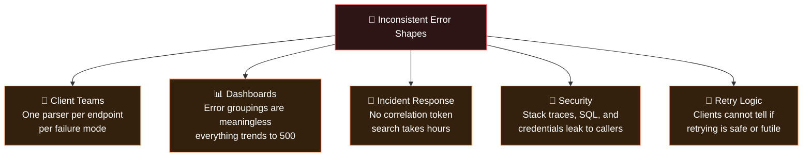

**This is the problem that "One Shape" error handling solves.**

> 🧠 **Feynman Check:** Can you explain to a teammate *why* a bare `"Not Found"` string is worse than a structured 404 document with a `traceId`? If not, re-read the table — the answer is that the string cannot carry a correlation token, cannot be extended with metadata (like `orderId`), and cannot be parsed by a generic client.

---

## 💡 Core Philosophy: One Shape, Many Causes

The solution is deceptively simple:

> Route each failure to the **correct HTTP status class**, then funnel every error through **one single mapping layer** that emits one consistent document — with a **correlation token** attached.

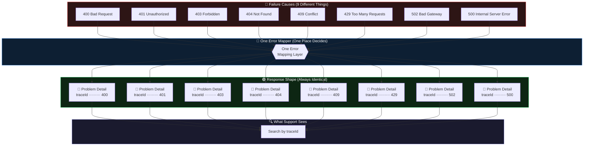

Three properties make this pattern work:

1. **Status accuracy** — the HTTP code still says who is at fault and what to do next.
2. **Shape invariance** — only the *values* change across errors, never the *keys*.
3. **Token correlation** — a single `traceId` links the response, the logs, and the distributed trace.

> 💡 **Analogy:** Think of a hospital emergency room. Patients arrive with completely different problems (causes). Triage assigns each one a category (status class). Documentation writes every chart in the same format (one shape) with the same patient ID (traceId). No matter what brought you in, any nurse can find your chart in seconds. An ER with nine chart formats per ailment would kill people through paperwork.

---

## 📊 HTTP Status Classes Explained

HTTP status codes are organized into **classes** — and each class carries semantic meaning. Collapsing everything into `500` throws away that information.

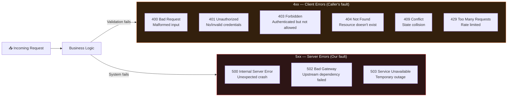

### Why Status Classes Matter

| Class | Meaning              | Who Fixes It?   | Retry?            |
|-------|----------------------|-----------------|-------------------|
| 4xx   | Client made an error | The caller      | Only after fix    |
| 5xx   | Server failed        | The server team | Yes, with backoff |

> ⚠️ **The `401` vs `403` confusion is the most common status bug in the wild.** `401 Unauthorized` actually means *unauthenticated* — "I don't know who you are." `403 Forbidden` means *authenticated but not allowed* — "I know who you are, and you still can't do this." Getting these wrong breaks authentication flows: clients that receive `401` will try to re-authenticate; clients that receive `403` will show a "permission denied" message. Send the wrong one and you trigger the wrong client behavior.

### The Decision Table You Should Memorize

| Situation | Status | `type` Example | Client Action |
|-----------|--------|----------------|---------------|
| JSON body failed schema validation | 400 | `validation-failed` | Fix the input |
| No/expired credentials | 401 | `auth-required` | Authenticate first |
| Valid token, insufficient role | 403 | `insufficient-role` | Request access; don't retry |
| Resource does not exist | 404 | `order-not-found` | Check the identifier |
| Duplicate/idempotency collision | 409 | `duplicate-submission` | Check state, then reconcile |
| Too many requests | 429 | `rate-limit-exceeded` | Wait for `Retry-After`, then retry |
| Upstream dependency failed | 502 | `payment-unavailable` | Retry with backoff |
| Unexpected crash | 500 | `internal-error` | Retry with backoff + report traceId |
| Planned maintenance/overload | 503 | `service-unavailable` | Retry later, respect `Retry-After` |

> 💡 **Rule of thumb:** If the *same request* would succeed after the caller fixes something on their side, it is 4xx. If the *same request* would succeed after we fix something on ours, it is 5xx. If you cannot decide, ask: "Whose logs do I need to read to fix this?" — the answer is the fixing party.

---

## 🧩 The Five Key Components

### 1. ✅ Error Mapping Layer

**One place that handles all exceptions.** No per-endpoint `try/catch` blocks. No scattered `if err != nil` checks that each produce unique JSON.

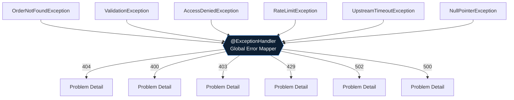

**Example (Java / Spring Boot):**

```java
@RestControllerAdvice
public class GlobalExceptionHandler {

    @ExceptionHandler(OrderNotFoundException.class)
    public ResponseEntity<ProblemDetail> handleOrderNotFound(OrderNotFoundException ex) {
        var pd = ProblemDetail.forStatus(HttpStatus.NOT_FOUND);
        pd.setType(URI.create("https://api.example.com/errors/order-not-found"));
        pd.setTitle("Order Not Found");
        pd.setDetail(ex.getMessage());
        pd.setProperty("traceId", MDC.get("traceId"));
        return ResponseEntity.status(HttpStatus.NOT_FOUND).body(pd);
    }

    @ExceptionHandler(AccessDeniedException.class)
    public ResponseEntity<ProblemDetail> handleAccessDenied(AccessDeniedException ex) {
        var pd = ProblemDetail.forStatus(HttpStatus.FORBIDDEN);
        pd.setType(URI.create("https://api.example.com/errors/access-denied"));
        pd.setTitle("Access Denied");
        pd.setProperty("traceId", MDC.get("traceId"));
        return ResponseEntity.status(HttpStatus.FORBIDDEN).body(pd);
    }

    @ExceptionHandler(Exception.class)  // Catch-all
    public ResponseEntity<ProblemDetail> handleUnexpected(Exception ex) {
        log.error("Unexpected error", ex);  // Full detail goes to logs ONLY
        var pd = ProblemDetail.forStatus(HttpStatus.INTERNAL_SERVER_ERROR);
        pd.setType(URI.create("https://api.example.com/errors/internal"));
        pd.setTitle("Internal Server Error");
        pd.setProperty("traceId", MDC.get("traceId"));
        // ❌ NO stack trace in the response!
        return ResponseEntity.status(500).body(pd);
    }
}
```

> 💡 **Key insight:** Because Spring resolves `@ExceptionHandler` methods by exception type, the *most specific* handler wins automatically. You write narrow handlers for the errors you care about, and one catch-all for everything else. Adding a new error cause means adding one class and one method — the shape never changes.

### 2. 📄 Problem Detail Envelope (RFC 7807 / RFC 9457)

The **Problem Detail** format is an IETF standard for HTTP error responses. It gives every error the same shape regardless of cause. RFC 9457 obsoletes RFC 7807 (2023) with minor clarifications — if you support one, you support both.

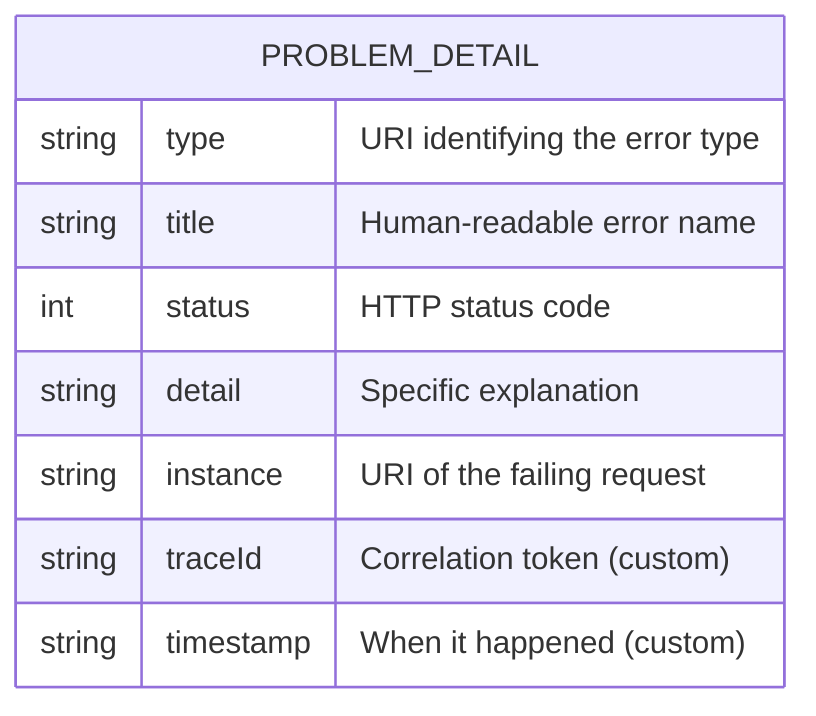

**Example Response:**

```json
{
  "type": "https://api.example.com/errors/order-not-found",
  "title": "Order Not Found",
  "status": 404,
  "detail": "Order with ID 9999 does not exist in the system.",
  "instance": "/orders/9999",
  "traceId": "7f3a-bc12-9e4d-1100",
  "timestamp": "2025-09-19T10:45:00Z"
}
```

Every single error — 400, 401, 403, 404, 429, 500 — returns this same envelope. **Only the values change, never the keys.**

| Field | Standard? | Semantics | Changes Per Error? |
|-------|-----------|-----------|--------------------|
| `type` | RFC 9457 | Stable URI identifying the error *class* | By error type — not per occurrence |
| `title` | RFC 9457 | Short human-readable summary | By error type |
| `status` | RFC 9457 | Mirrors the HTTP status code | Yes |
| `detail` | RFC 9457 | Human-readable explanation of *this* occurrence | Yes |
| `instance` | RFC 9457 | Path identifying this occurrence | Yes |
| `traceId` | Custom | Correlation token across logs/traces | Yes |
| `timestamp` | Custom | When it happened | Yes |
| Extra fields (e.g., `errors`, `orderId`) | Custom | Machine-readable specifics | By error type |

> ✅ **Best Practice:** Treat `type` values like a public API contract. Once published, `https://api.example.com/errors/order-not-found` must never change meaning. Many teams serve a human-readable documentation page at exactly that URI — turning every error `type` into a link the caller can click to understand the error.

> ⚠️ **Content Type matters:** Problem Detail responses should be served as `application/problem+json` (or `application/problem+xml`). Most frameworks do this for you when you use their Problem Detail support. If you hand-roll the envelope with `application/json`, document the deviation — some generic clients sniff the content type.

---

### 3. 🔗 Correlation Token (traceId)

The `traceId` is the same identifier that lives in **three places simultaneously**:

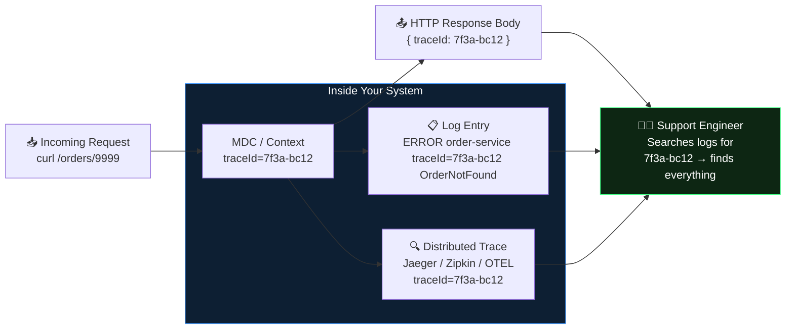

**Why three places?** Each answers a different question:

| Location | Question It Answers |
|----------|--------------------|
| Response body | "What happened to *my* request? What do I tell support?" |
| Logs | "What exactly did the system do during this request?" |
| Distributed trace | "How long did each internal step take? Where is the latency?" |

The `traceId` is the join key that turns three disconnected artifacts into one investigation.

**Implementation (Node.js with Express + AsyncLocalStorage):**

```javascript
import { AsyncLocalStorage } from 'async_hooks';
import { v4 as uuidv4 } from 'uuid';

const storage = new AsyncLocalStorage();

// Middleware: attach traceId to every request
app.use((req, res, next) => {
  const traceId = req.headers['x-trace-id'] || uuidv4();
  storage.run({ traceId }, () => {
    res.setHeader('x-trace-id', traceId);
    next();
  });
});

// Error handler: always include traceId
app.use((err, req, res, next) => {
  const { traceId } = storage.getStore() || {};

  logger.error({ traceId, err }, 'Request failed');  // Logs get it

  res.status(err.status || 500).json({
    type: `https://api.example.com/errors/${err.code || 'internal'}`,
    title: err.title || 'Internal Server Error',
    status: err.status || 500,
    detail: err.isOperational ? err.message : 'An unexpected error occurred.',
    traceId,   // Response body gets it
    timestamp: new Date().toISOString()
  });
});
```

> 💡 **Key insight:** JavaScript's `AsyncLocalStorage` (like Java's `MDC` on thread pools, or `contextvars` in Python) solves the hardest problem in correlation: keeping the token attached to *the logical request* even as work hops threads, tasks, or async continuations. Without request-scoped context propagation, you end up passing `traceId` through every function parameter — and someone will forget.

> ✅ **Best Practice — honor inbound tokens:** If the caller (or an upstream gateway) sends `x-trace-id`, **reuse it**; otherwise generate one. This lets a single token span multiple services in a request chain, per the W3C Trace Context standard. But treat inbound tokens as untrusted input: sanitize them (bounded length, safe characters) before logging — never echo arbitrary attacker-controlled strings into your logs.

### 4. 🔒 What to Keep Internal (Never Leak These)

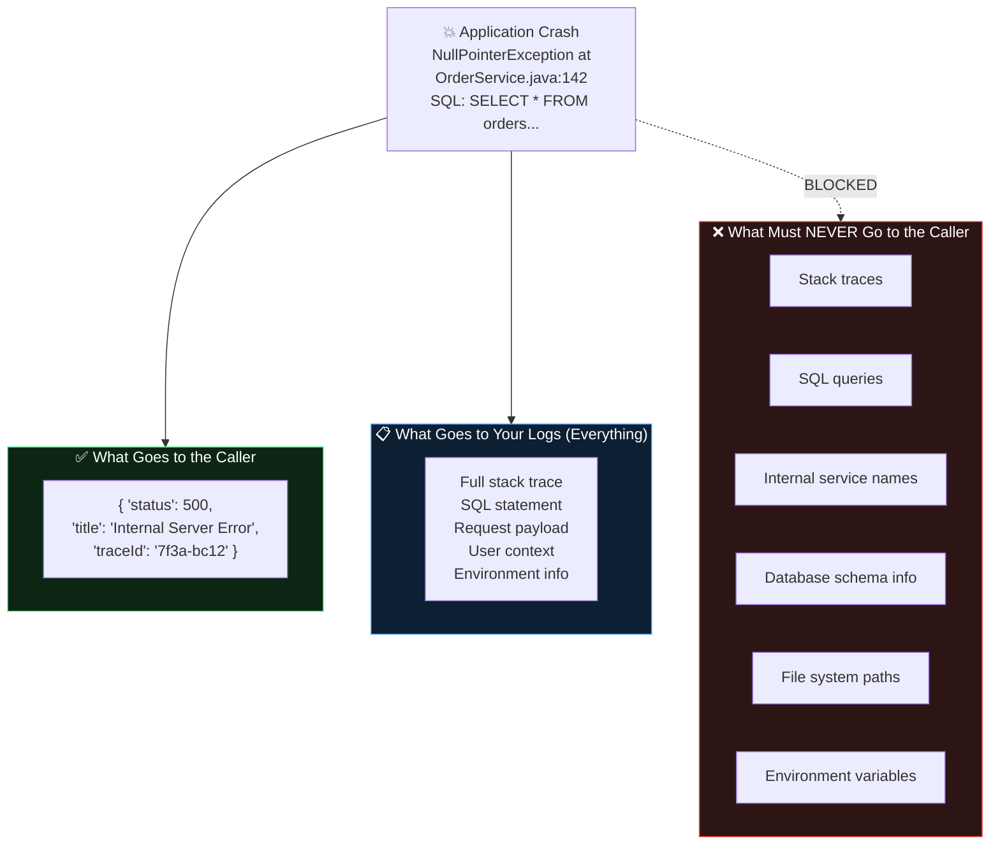

**Why this matters for security:**

- A SQL statement reveals your schema → attackers know your table and column names
- A stack trace reveals your technology stack and internal file structure
- An exception message like `"Connection refused: postgres://user:pass@db:5432"` exposes credentials

> 💡 **The traceId is the bridge.** You are not hiding information from the legitimate user — you are relocating it. The response says "something broke; here is the ticket number." The logs hold everything, indexed by that ticket number. The user's legitimate path to the information is through your support team, not through your stack traces.

### 5. ⚠️ The "Collapsed to 500" Anti-Pattern

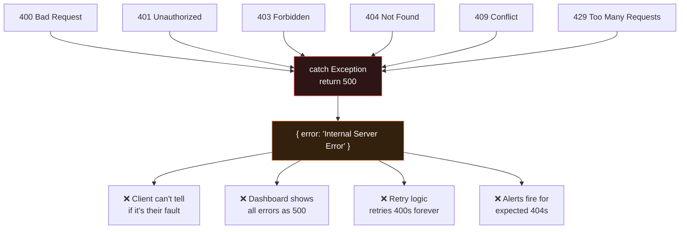

This anti-pattern usually starts innocently: a developer wraps a controller in `try { ... } catch (Exception e) { return 500; }` "just to be safe." Every subsequent developer copies the pattern. Within a year, your error dashboard reports a 500-pocalypse in which a genuine database outage is indistinguishable from a user typo.

---

## 🏗️ Architecture Deep Dive

Here is the full request lifecycle with error handling built in:

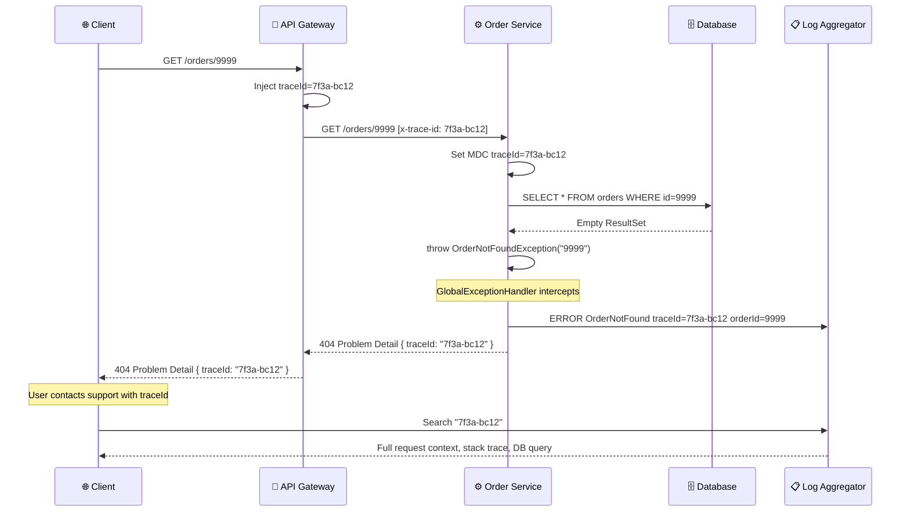

### Reading the Lifecycle, Step by Step

1. **Token entry (gateway):** The gateway is the single point where a `traceId` is born (or adopted from an inbound `x-trace-id` header). Nothing downstream generates its own.
2. **Context propagation (service):** The service copies the token into its request-scoped context (MDC / AsyncLocalStorage / `contextvars`). Every log line inside the request now carries it *automatically* — no parameter threading.
3. **Normal failure (business logic):** A missing order is *expected*. Business logic throws a domain-specific exception. Note that no `try/catch` appears anywhere in the request path.
4. **Interception (one mapper):** The global handler catches it, builds the Problem Detail, stamps `traceId` and `timestamp`, and returns 404.
5. **Internal logging:** The *same handler* writes the operational detail (query, identifiers, user context) to the log aggregator — rich on the inside, sparse on the outside.
6. **Correlation payoff:** Support searches `7f3a-bc12` and retrieves the complete story across logs, traces, and the response.

> 💡 **Notice what is *absent*:** no error handling code in the controller, no error mapping in the gateway (beyond pass-through), no per-endpoint JSON. The service layer's only job is to *throw the right exception*; the mapper's only job is to *shape the response*.

### Where the Pattern Lives in a Multi-Service System

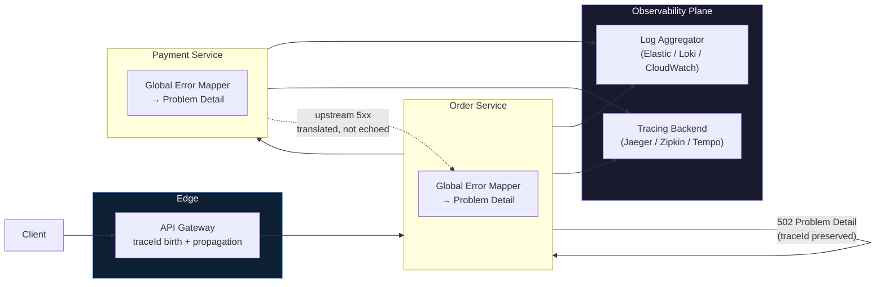

> ⚠️ **When a downstream service returns an error to you, translate it — never echo it.** If Payment Service returns a 5xx Problem Detail, Order Service maps that failure to its *own* `502 payment-unavailable` error, preserving the *root* `traceId` but writing the downstream detail to logs. Echoing the downstream body verbatim couples your contract to theirs and can leak their internals through your edge.

---

## 💻 Implementation Guide

The same architecture, implemented three ways. Each version provides: custom exception classes, a global mapping layer, a `traceId` propagation mechanism, and a catch-all handler that logs richly and responds safely.

### Shared Contract (all implementations)

| Concern | Java / Spring Boot | Python / FastAPI | Node.js / Express |
|---------|--------------------|------------------|-------------------|
| Envelope | `ProblemDetail` (built-in, RFC 9457) | Hand-rolled JSON helper | Hand-rolled JSON object |
| Mapping layer | `@RestControllerAdvice` + `@ExceptionHandler` | `@app.exception_handler(...)` | Last-position error middleware |
| Trace context | `MDC` (SLF4J) | `request.state` via middleware | `AsyncLocalStorage` |
| Catch-all | `@ExceptionHandler(Exception.class)` | `@app.exception_handler(Exception)` | `!err.isOperational` branch |
| Content type | `application/problem+json` (auto) | `application/json` (set manually if desired) | `application/json` |

---

### Java / Spring Boot 3.x

```java
// 1. Custom exception classes
class OrderNotFoundException extends RuntimeException {
    private final String orderId;

    public OrderNotFoundException(String orderId) {
        super("Order with ID " + orderId + " was not found");
        this.orderId = orderId;
    }

    public String getOrderId() { return orderId; }
}

class RateLimitExceededException extends RuntimeException {
    private final int retryAfterSeconds;

    public RateLimitExceededException(int retryAfter) {
        super("Rate limit exceeded. Retry after " + retryAfter + " seconds.");
        this.retryAfterSeconds = retryAfter;
    }

    public int getRetryAfterSeconds() { return retryAfterSeconds; }
}

// 2. Global exception handler — the ONE mapping layer
@RestControllerAdvice
public class GlobalExceptionHandler {

    private static final Logger log = LoggerFactory.getLogger(GlobalExceptionHandler.class);

    @ExceptionHandler(OrderNotFoundException.class)
    public ResponseEntity<ProblemDetail> handleOrderNotFound(OrderNotFoundException ex) {
        var pd = buildProblemDetail(
            HttpStatus.NOT_FOUND,
            "order-not-found",
            "Order Not Found",
            ex.getMessage()
        );
        pd.setProperty("orderId", ex.getOrderId());
        return ResponseEntity.status(404).body(pd);
    }

    @ExceptionHandler(MethodArgumentNotValidException.class)
    public ResponseEntity<ProblemDetail> handleValidation(MethodArgumentNotValidException ex) {
        var pd = buildProblemDetail(
            HttpStatus.BAD_REQUEST,
            "validation-failed",
            "Validation Failed",
            "One or more fields failed validation"
        );
        List<String> errors = ex.getBindingResult()
            .getFieldErrors()
            .stream()
            .map(f -> f.getField() + ": " + f.getDefaultMessage())
            .toList();
        pd.setProperty("errors", errors);
        return ResponseEntity.status(400).body(pd);
    }

    @ExceptionHandler(RateLimitExceededException.class)
    public ResponseEntity<ProblemDetail> handleRateLimit(RateLimitExceededException ex) {
        var pd = buildProblemDetail(
            HttpStatus.TOO_MANY_REQUESTS,
            "rate-limit-exceeded",
            "Rate Limit Exceeded",
            ex.getMessage()
        );
        return ResponseEntity.status(429)
            .header("Retry-After", String.valueOf(ex.getRetryAfterSeconds()))
            .body(pd);
    }

    @ExceptionHandler(Exception.class)
    public ResponseEntity<ProblemDetail> handleUnexpected(Exception ex, HttpServletRequest req) {
        // Log EVERYTHING internally — expose NOTHING
        log.error("Unhandled exception on {}", req.getRequestURI(), ex);

        var pd = buildProblemDetail(
            HttpStatus.INTERNAL_SERVER_ERROR,
            "internal-error",
            "Internal Server Error",
            "An unexpected error occurred. Please contact support with your traceId."
        );
        return ResponseEntity.status(500).body(pd);
    }

    private ProblemDetail buildProblemDetail(
        HttpStatus status, String errorCode, String title, String detail
    ) {
        var pd = ProblemDetail.forStatus(status);
        pd.setType(URI.create("https://api.example.com/errors/" + errorCode));
        pd.setTitle(title);
        pd.setDetail(detail);
        pd.setProperty("traceId", MDC.get("traceId"));
        pd.setProperty("timestamp", Instant.now().toString());
        return pd;
    }
}
```

**Populating the MDC (filter):**

```java
@Component
public class TraceIdFilter extends OncePerRequestFilter {
    @Override
    protected void doFilterInternal(HttpServletRequest req, HttpServletResponse res, FilterChain chain)
            throws ServletException, IOException {
        String traceId = req.getHeader("x-trace-id");
        if (traceId == null || traceId.length() > 64) {
            traceId = UUID.randomUUID().toString();
        }
        MDC.put("traceId", traceId);
        res.setHeader("x-trace-id", traceId);
        try {
            chain.doFilter(req, res);
        } finally {
            MDC.clear();  // CRITICAL: thread pools reuse threads
        }
    }
}
```

> ⚠️ **The `MDC.clear()` in the `finally` block is not optional.** Servlet containers reuse threads; a stale `traceId` from a previous request will silently corrupt the correlation of the *next* request on that thread. This is one of the most common and hardest-to-debug mistakes with MDC-based correlation.

---

### Python / FastAPI

```python
from fastapi import FastAPI, Request
from fastapi.responses import JSONResponse
from fastapi.exceptions import RequestValidationError
import uuid, logging, time

app = FastAPI()
logger = logging.getLogger("api")

# Middleware: inject traceId into every request
@app.middleware("http")
async def trace_middleware(request: Request, call_next):
    trace_id = request.headers.get("x-trace-id", str(uuid.uuid4()))
    request.state.trace_id = trace_id
    response = await call_next(request)
    response.headers["x-trace-id"] = trace_id
    return response

# Custom exception classes
class OrderNotFoundException(Exception):
    def __init__(self, order_id: str):
        self.order_id = order_id
        super().__init__(f"Order {order_id} not found")

class RateLimitException(Exception):
    def __init__(self, retry_after: int):
        self.retry_after = retry_after

# Helper: build Problem Detail response
def problem_detail(request: Request, status: int, error_code: str, title: str,
                  detail: str, **kwargs):
    return JSONResponse(
        status_code=status,
        content={
            "type": f"https://api.example.com/errors/{error_code}",
            "title": title,
            "status": status,
            "detail": detail,
            "instance": str(request.url.path),
            "traceId": request.state.trace_id,
            "timestamp": time.strftime("%Y-%m-%dT%H:%M:%SZ", time.gmtime()),
            **kwargs
        }
    )

# Exception handlers
@app.exception_handler(OrderNotFoundException)
async def order_not_found_handler(request: Request, exc: OrderNotFoundException):
    return problem_detail(request, 404, "order-not-found", "Order Not Found",
                          str(exc), orderId=exc.order_id)

@app.exception_handler(RequestValidationError)
async def validation_error_handler(request: Request, exc: RequestValidationError):
    errors = [f"{'.'.join(str(l) for l in e['loc'])}: {e['msg']}" for e in exc.errors()]
    return problem_detail(request, 400, "validation-failed", "Validation Failed",
                          "One or more fields failed validation", errors=errors)

@app.exception_handler(RateLimitException)
async def rate_limit_handler(request: Request, exc: RateLimitException):
    response = problem_detail(request, 429, "rate-limit-exceeded",
                              "Rate Limit Exceeded", f"Retry after {exc.retry_after} seconds.")
    response.headers["Retry-After"] = str(exc.retry_after)
    return response

@app.exception_handler(Exception)
async def generic_handler(request: Request, exc: Exception):
    logger.exception("Unhandled error on %s trace=%s", request.url.path,
                     getattr(request.state, "trace_id", "unknown"))
    return problem_detail(request, 500, "internal-error",
                          "Internal Server Error",
                          "An unexpected error occurred. Reference your traceId for support.")
```

> 💡 **FastAPI note:** FastAPI already uses Problem-Detail-style validation errors internally, but its default shape differs from the contract above — that is exactly why the `RequestValidationError` handler overrides it. Registering `@app.exception_handler(Exception)` catches everything the framework could not route to a narrower handler. Starlette routes unhandled exceptions through `ServerErrorMiddleware`, which invokes your custom `Exception` handler — so the trace middleware (which wraps everything) always runs first.

> ✅ **Bind the logger with the traceId.** For structured logging (e.g., `structlog`), add a processor that pulls `request.state.trace_id` from the context so *every* log line carries it — mirroring Java's MDC pattern.

---

### Node.js / Express

```javascript
// errors.js - Custom error classes
class AppError extends Error {
    constructor(status, code, title, detail, meta = {}) {
        super(detail);
        this.status = status;
        this.code = code;
        this.title = title;
        this.detail = detail;
        this.meta = meta;
        this.isOperational = true;
    }
}

class OrderNotFoundError extends AppError {
    constructor(orderId) {
        super(404, 'order-not-found', 'Order Not Found',
              `Order with ID ${orderId} was not found.`, { orderId });
    }
}

class ValidationError extends AppError {
    constructor(errors) {
        super(400, 'validation-failed', 'Validation Failed',
              'One or more fields failed validation.', { errors });
    }
}

// errorHandler.js - The ONE mapping layer
const errorHandler = (err, req, res, next) => {
    const traceId = req.headers['x-trace-id'] || 'unknown';

    if (err.isOperational) {
        // Known, expected error — safe to expose detail
        return res.status(err.status).json({
            type: `https://api.example.com/errors/${err.code}`,
            title: err.title,
            status: err.status,
            detail: err.detail,
            instance: req.path,
            traceId,
            timestamp: new Date().toISOString(),
            ...err.meta
        });
    }

    // Unknown error — log everything, expose nothing
    logger.error({ traceId, err, path: req.path }, 'Unhandled error');

    return res.status(500).json({
        type: 'https://api.example.com/errors/internal-error',
        title: 'Internal Server Error',
        status: 500,
        detail: 'An unexpected error occurred.',
        instance: req.path,
        traceId,
        timestamp: new Date().toISOString()
    });
};

// Register as the LAST middleware
app.use(errorHandler);
```

> 💡 **Why the `isOperational` flag matters:** Express error handlers receive *every* thrown error, including programmer mistakes (undefined variables, null dereferences). The flag is the boundary between "expected failures we can describe safely" and "unexpected failures we must treat as unknown." Express 5 automatically forwards errors thrown by *async* route handlers to the error middleware — in Express 4 you must `next(err)` from a `catch` block yourself.

### Bonus: ASP.NET Core (`IExceptionHandler`)

The same pattern in .NET 8+ — a global mapper registered once in `Program.cs`:

```csharp
// Registration: a few lines wire up the single mapping layer
builder.Services.AddProblemDetails();
builder.Services.AddExceptionHandler<OrderNotFoundHandler>();
builder.Services.AddExceptionHandler<GlobalExceptionHandler>(); // catch-all last

var app = builder.Build();
app.UseExceptionHandler();

// Catch-all handler
class GlobalExceptionHandler : IExceptionHandler
{
    public async ValueTask<bool> TryHandleAsync(HttpContext ctx, Exception ex,
        CancellationToken ct)
    {
        var logger = ctx.RequestServices
            .GetRequiredService<ILogger<GlobalExceptionHandler>>();
        logger.LogError(ex, "Unhandled error on {Path}", ctx.Request.Path);

        var traceId = Activity.Current?.TraceId.ToString() ?? ctx.TraceIdentifier;
        var pd = Results.Problem(
            typeUri: "https://api.example.com/errors/internal-error",
            title: "Internal Server Error",
            statusCode: StatusCodes.Status500InternalServerError,
            extensions: new Dictionary<string, object?>
            {
                ["traceId"] = traceId,
                ["timestamp"] = DateTimeOffset.UtcNow
            });

        await pd.ExecuteAsync(ctx);
        return true; // handled — do not fall through
    }
}
```

> 💡 **Framework convergence is the best evidence this pattern is correct.** Spring has `ProblemDetail` since 6.0, .NET has `AddProblemDetails` since .NET 7, and Helidon/Micronaut/Quarkus ship equivalents. The industry standardized on RFC 9457 precisely because bespoke error shapes were causing the pain described in Section 4.

---

## 🌍 Real-World Use Cases

### Use Case 1: E-Commerce Order API

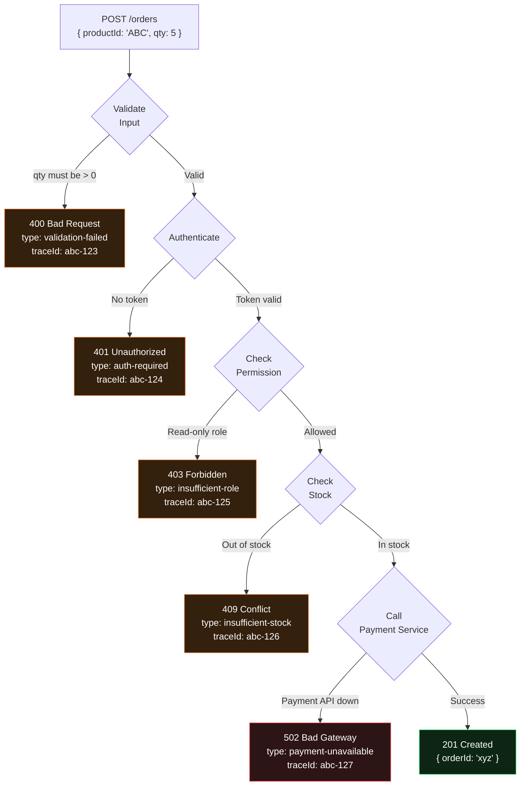

Every single failure branch produces the **same shape** of response. The client SDK needs exactly **one parser**.

Notice also how the *status classes* tell a story: 400/401/403/409 are all "caller, adjust something"; only 502 is "server-side dependency problem — retry with backoff." A naive implementation that returned 500 for all of these would make both the client SDK and the on-call rotation blind.

### Use Case 2: Support Team Incident Response

**Before (Inconsistent errors):**

```
Support: "User reports order 9999 failing."
Engineer: "What error did they get?"
Support: "Something about Not Found."
Engineer: "Which service? What was the request ID?"
Support: "I don't know."
→ Mean Time to Resolution: 45 minutes
```

**After (Problem Detail + traceId):**

```
Support: "User reports order 9999 failing. TraceId is 7f3a-bc12."
Engineer: grep "7f3a-bc12" logs → Finds: OrderNotFoundException, orderId=9999, userId=42, timestamp=10:45
Engineer: Correlates with DB query log → order was deleted at 10:40 by admin
→ Mean Time to Resolution: 3 minutes
```

The 15x improvement in MTTR comes from a single design decision: putting a correlation token in the response body. The support conversation changes from an interrogation into a lookup.

> 💡 **Make it easy for users:** A user who pastes a `traceId` into a support ticket is doing your incident response for you — for free. Put the token in a stable, copyable field, and consider surfacing it in the frontend error banner as well.

### Use Case 3: Client-Side Retry Logic

With a consistent error shape, clients can write **universal retry logic**:

```javascript
async function apiCall(url, options, maxRetries = 3) {
    for (let attempt = 1; attempt <= maxRetries; attempt++) {
        try {
            const res = await fetch(url, options);

            if (res.ok) return res.json();

            const error = await res.json(); // Always the same shape!

            // 4xx = client error, NEVER retry
            if (error.status >= 400 && error.status < 500) {
                if (error.status === 429) {
                    // Rate limit: wait exactly as long as server says
                    const retryAfter = res.headers.get('Retry-After') || 5;
                    await sleep(retryAfter * 1000);
                    continue;
                }
                // 400, 401, 403, 404, 409 = don't retry, tell user
                throw new ClientError(error.title, error.detail, error.traceId);
            }

            // 5xx = server error, retry with backoff
            if (attempt < maxRetries) {
                await sleep(Math.pow(2, attempt) * 1000);
                continue;
            }

            throw new ServerError(error.title, error.traceId);
        } catch (networkErr) {
            if (attempt === maxRetries) throw networkErr;
            await sleep(Math.pow(2, attempt) * 1000);
        }
    }
}
```

Because every error response has the same keys (`status`, `title`, `detail`, `traceId`), **this one function handles every error from every endpoint**.

> ⚠️ **Retry-safety caveat:** Exponential backoff on 5xx is only safe if the operation is *idempotent* or has not been attempted. For `POST /orders`, a 500 might mean "order was created and the response was lost." That is what `Idempotency-Key` headers and the `409 duplicate-submission` error type from Section 6 are for — the one-shape pattern gives retry logic a vocabulary to express it.

---

## 🧪 Hands-On Lab: Build It Yourself

Time to build the pattern end-to-end. This lab uses **Node.js/Express** (fastest to run), but the steps map 1:1 onto any stack.

### Lab Setup

```bash
mkdir one-shape-lab && cd one-shape-lab
npm init -y
npm install express uuid
node server.js
```

### Lab Tasks

**Task 1 — The trace middleware (10 min):**
Create `server.js` with a middleware that adopts an inbound `x-trace-id` or generates a UUID, stores it with `AsyncLocalStorage`, echoes it back in the `x-trace-id` response header, and rejects inbound tokens longer than 64 chars or containing characters outside `[A-Za-z0-9-]` (falling back to a generated one).

**Task 2 — The error hierarchy (10 min):**
Create an `AppError` base class with `status`, `code`, `title`, `detail`, `meta`, `isOperational` — plus `OrderNotFoundError` (404), `ValidationError` (400), and `ConflictError` (409).

**Task 3 — The mapper (15 min):**
Register the error middleware as the **last** `app.use`. Verify with `curl`:

```bash
# Expected: 404 + Problem Detail + matching x-trace-id header
curl -i http://localhost:3000/orders/9999

# Expected: same shape, different status
curl -i -X POST http://localhost:3000/orders -H 'Content-Type: application/json' -d '{"qty": -1}'

# Trace propagation check: your inbound token must come back
httpie --print=HhB GET :3000/orders/9999 x-trace-id:"lab-token-abc"
```

**Task 4 — Enforce the contract (15 min):**
Write a test asserting that for a 404 and a 400, the response bodies have **exactly the same keys**. This is the money test — it is what prevents shape drift forever (solution in Section 12).

**Task 5 — Break it on purpose (10 min):**
Add a route that does `JSON.parse(undefined)`. Verify the response is a safe 500 envelope, the full stack trace appears in your logs but *not* in the response, and the `traceId` in the log matches the one in the response.

### ✅ Lab Self-Check (all must be true)

- [ ] Every error response has the same key set
- [ ] `x-trace-id` header and `traceId` body field always match
- [ ] Inbound `x-trace-id` headers are honored and propagated
- [ ] A crash produces a safe 500 envelope, with full detail only in logs
- [ ] No response ever contains a stack trace, SQL, or file path
- [ ] One and only one error-mapping layer exists in the codebase

---

## 🧭 Testing Strategies

The error contract is a contract — so test it like one. Four layers of tests, from cheapest to most expensive:

### 1. Shape-Conformance Tests (the money test)

Assert that **every error response has the same key set**, regardless of status. This is the test that makes shape drift impossible.

```java
// Spring Boot — MockMvc
@WebMvcTest
class ErrorContractTest {
    @Autowired MockMvc mockMvc;

    @Test
    void allErrors_shareOneShape() throws Exception {
        List<MockHttpServletResponse> responses = List.of(
            mockMvc.perform(get("/orders/9999"))
                .andExpect(status().isNotFound()).andReturn().getResponse(),
            mockMvc.perform(post("/orders").contentType(APPLICATION_JSON)
                    .content("{\"qty\": -1}"))
                .andExpect(status().isBadRequest()).andReturn().getResponse()
        );

        Set<String> expectedKeys = Set.of("type", "title", "status", "detail",
                                          "instance", "traceId", "timestamp");
        for (var res : responses) {
            var node = new ObjectMapper().readTree(res.getContentAsString());
            var actualKeys = new TreeSet<String>();
            node.fieldNames().forEachRemaining(actualKeys::add);
            assertTrue(expectedKeys.stream().allMatch(actualKeys::contains),
                "Error response missing required keys: " + actualKeys);
        }
    }

    @Test
    void noStackTrace_leaksInResponses() throws Exception {
        var res = mockMvc.perform(get("/orders/boom"))
            .andExpect(status().isInternalServerError())
            .andReturn().getResponse();
        String body = res.getContentAsString().toLowerCase();
        assertFalse(body.contains("exception"));
        assertFalse(body.contains("at org."));
        assertFalse(body.contains("caused by"));
    }
}
```

```javascript
// Express + Supertest — the same money test in Node
const KEY_SET = ['type', 'title', 'status', 'detail', 'instance', 'traceId', 'timestamp'];

it.each([
    ['GET', '/orders/9999', 404],
    ['POST', '/orders', 400],
])('returns one shape for %s %s', async (method, url, expectedStatus) => {
    const res = await request(app)[method.toLowerCase()](url);
    expect(res.status).toBe(expectedStatus);
    KEY_SET.forEach(key => expect(res.body).toHaveProperty(key));
    expect(res.headers['x-trace-id']).toBe(res.body.traceId);
});
```

### 2. Correlation Tests

- Send an inbound `x-trace-id` and assert it returns in **both** the header and the body.
- Trigger an error and assert the emitted log entry (use a log capture appender/test transport) contains the same `traceId`.
- Assert the catch-all 500 response contains **no** fragments of the real exception message.

### 3. Integration / Gateway Tests

- Verify `Retry-After` is present and parseable on 429 responses.
- Verify a downstream 5xx is *translated* (your `type`, not theirs) and that the response never echoes the downstream body.
- Verify the problem detail `instance` matches the request path, including path parameters.

### 4. Contract Tests (consumer-driven)

If other teams consume your API, publish the error envelope as a schema (JSON Schema or OpenAPI component) and run **Pact**-style contract tests so a change to the shape breaks CI *before* it breaks clients.

```yaml
# OpenAPI fragment — publish the envelope, don't leave it tribal knowledge
components:
  schemas:
    ProblemDetail:
      type: object
      required: [type, title, status, detail, instance, traceId, timestamp]
      properties:
        type:     { type: string, format: uri }
        title:    { type: string }
        status:   { type: integer }
        detail:   { type: string }
        instance: { type: string }
        traceId:  { type: string }
        timestamp:{ type: string, format: date-time }
```

### Anti-Pattern to Avoid in Tests

> ❌ **Asserting exact `detail` strings in unit tests.** Human-readable messages change constantly and will turn your test suite brittle. Assert the *keys*, the *status*, and the *type URI*; assert message text only for security-critical cases (like the no-leak test above).

---

## 📈 Performance Considerations

Error handling is on the hot path of every failure — and during incidents, failures are *all* you serve. Keep it cheap.

| Concern | Guidance | Why |
|---------|----------|-----|
| Exception construction cost | Throw exceptions for *control flow* only where semantic; prefer validation up front | Stack trace capture is the expensive part of a Java exception (~microseconds each); a retry storm of 400s can generate millions |
| Stack trace logging on 4xx | **Don't.** Log expected 4xx failures at `INFO`/`WARN` *without* stack traces | A flood of 404s must not produce gigabytes of `OrderNotFoundException` traces |
| 5xx logging | Log **with** full stack, but sample/dedupe under load | Unhandled exceptions during an outage can double your log ingest |
| MDC / AsyncLocalStorage overhead | Negligible (a map write + thread-local read) | Do not trade correctness (correlation) for nanoseconds |
| Response payload size | Problem Detail is ~200–400 bytes | Consistent shape also means consistent, cacheable size |
| Trace token generation | UUIDv4 or W3C-compatible 128-bit hex | Generation cost is trivial; *format consistency* matters more |
| Error-path load shedding | Consider serving the 503 envelope without touching downstream systems | When everything fails, the mapper itself must not depend on a failing subsystem |

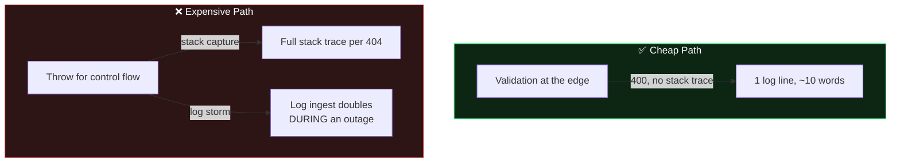

> ✅ **Benchmark tip:** Load-test your *error paths*, not just your success paths. Fire 5,000 rps of invalid requests at staging and watch CPU (exception volume), log ingest rate, and p99 latency of the 400 response. Most teams have never measured their 400s; attackers routinely have.

---

## 🔐 Security Considerations

The one-shape pattern is, at its core, a **security control**. Here is the full threat model:

| Threat | How the Pattern Helps | Residual Risk to Manage |
|--------|----------------------|------------------------|
| Information disclosure via stack traces | Catch-all 500 returns a fixed envelope; internals only to logs | Ensure *debug* mode is never enabled in prod (Spring `server.error.include-stacktrace`, ASP.NET `DeveloperExceptionPage`) |
| Schema/SQL enumeration | SQL never leaves the process | Also scrub SQL from *upstream* 5xx bodies you might be tempted to forward |
| Credential leakage in messages | Detail text for 5xx is static; connection strings only in logs | Never interpolate exception messages into `detail` for non-operational errors |
| Log injection via inbound `x-trace-id` | Sanitize inbound tokens (length + charset) before logging | Reject or regenerate non-conforming tokens |
| TraceId as oracle | `traceId` reveals only existence of an error, not data | Keep tokens random/unguessable; do not encode user IDs in them |
| 404-based resource enumeration | Standard behavior; document it | Combine with rate limiting; consider 404 vs 403 policy per resource |
| Denial of wallet via error-path load | Cheap error path; log sampling under load | Load-test error paths (Section 13) |

### The Error-Message Disclosure Checklist

Run this against every handler in your codebase:

- [ ] Does any `detail` string interpolate an exception message for **non-operational** errors? (Should be: no)
- [ ] Can a response contain a class name, file path, host name, port, or SQL fragment? (Should be: no)
- [ ] Does the catch-all handler log the full exception *before* deciding what to return? (Should be: yes)
- [ ] Are inbound `traceId`s bounded (≤64 chars) and charset-restricted before they hit logs? (Should be: yes)
- [ ] Do your 401/403 responses avoid revealing *whether the resource exists* where that matters? (Policy decision — document it)

> ⚠️ **The sneakiest leak:** building your Problem Detail from `ex.getMessage()` in the **catch-all** handler. The catch-alls in Section 9 return a *static* detail string for 500s precisely because framework exception messages are attacker-influenceable input.

---

## 🔄 Migration Guide: From Chaos to One Shape

You cannot flip the switch on a live API with external consumers. Migrate in five phases:

### Phase 1 — Map the Current Chaos (no code changes)

Inventory every distinct error shape your API emits today: grep for `"error"`, `"msg"`, `"message"`, `"detail"`, `"err"` in response-building code, and crawl your OpenAPI spec's error responses. Produce a table like Section 4's — it becomes your requirements document.

### Phase 2 — Introduce the Envelope Additively

Add the global mapper **without removing anything**. New behavior only for:

- **New endpoints** — they use the Problem Detail envelope from their first commit.
- **New error causes in old endpoints** — mapped by the global layer.
- **The catch-all 500** — usually safe to switch immediately, because leaking less is almost never a breaking change.

### Phase 3 — Dual-Shape Compatibility (if required)

If clients depend on old fields, add them as extension members *alongside* the standard ones for a deprecation window:

```json
{
  "type": "https://api.example.com/errors/order-not-found",
  "title": "Order Not Found",
  "status": 404,
  "detail": "Order with ID 9999 does not exist in the system.",
  "instance": "/orders/9999",
  "traceId": "7f3a-bc12-9e4d-1100",
  "timestamp": "2025-09-19T10:45:00Z",
  "error": "order-not-found-migration-alias",
  "deprecated_fields_warning": "Field 'error' is deprecated; use 'type' and 'title'. Removal: 2026-Q3"
}
```

Announce the removal date. Emit the warning field. **Then actually remove on the date** — a deprecation that never completes becomes permanent complexity.

### Phase 4 — Status Class Correction

Sweep the codebase and correct mis-classified statuses (the 500-for-everything anti-pattern). This *will* trigger client bug reports — which is the point. Clients who retried 400s, or who alerted on expected 404s, were broken all along; the corrected statuses finally reveal it.

### Phase 5 — Enforce and Delete

- Turn the shape test (Section 12) into a CI gate.
- Add a lint rule / code review checklist: *no response-building code outside the mapper*.
- Delete the per-endpoint `try/catch` blocks. Deletion is the finish line — the mapper plus thrown exceptions should be the only error code in the request path.

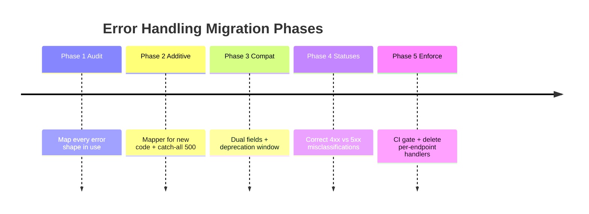

> 💡 **Version strategically:** If your API versioning allows it, ship the full one-shape contract in a new major version (`/v2`) and back-port only the *additive* pieces (Phase 2) to `/v1`. You get a clean contract for the future without holding existing clients hostage.

---

## 🩺 Common Pitfalls & Troubleshooting

| # | Symptom | Root Cause | Fix |
|---|---------|-----------|-----|
| 1 | `traceId` is `null` in the response | Handler runs outside the trace middleware/filter scope, or MDC was cleared early | Register the mapper *inside* the scope; verify middleware ordering |
| 2 | Wrong `traceId` in logs (belongs to another request) | MDC not cleared in `finally`; thread reuse | Add `MDC.clear()` in `finally` (Section 9) |
| 3 | 404 returns 500 anyway | Exception thrown in the *handler* chain before your mapper runs (e.g., in a filter) | Register mapper at the correct layer; add a filter-level fallback |
| 4 | Framework's default error page shows instead of your envelope | Catch-all `@ExceptionHandler(Exception.class)` missing, or `ErrorController` not overridden | Add the catch-all; override the default error controller |
| 5 | Client receives old error shape for *some* endpoints | A per-endpoint `try/catch` shadows the global mapper | Delete the local handler; grep for local JSON error building |
| 6 | `Retry-After` missing on 429 | Header set on the response but mapper replaced the response object | Set headers on the returned entity, as in Section 9 |
| 7 | Express handler never fires | Middleware registered after routes, or an earlier middleware ended the response | Error middleware must be the **last** `app.use`; never write after `next(err)` |
| 8 | FastAPI returns its own validation format | `RequestValidationError` handler not registered, or registered on a different app instance | Register on the same `app`; see Section 9 |
| 9 | Dashboard still shows 500s everywhere | Status classes were never corrected (Phase 4 skipped) | Run the Phase 4 sweep — the shape fix alone doesn't fix statuses |
| 10 | Logs have the traceId but the trace UI shows nothing | Tracing instrumentation and log MDC use different context stores | Bridge them: copy the OTEL `SpanContext` into MDC (or vice versa) once at the edge |

### Debugging a Lost `traceId` — A Systematic Walkthrough

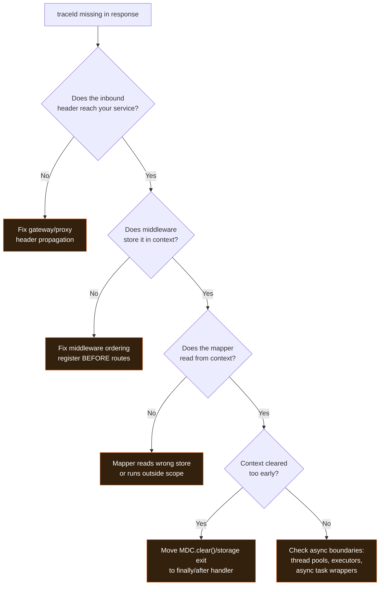

> ⚠️ **Async boundaries eat context.** The #1 real-world failure of this pattern: the request enters with a `traceId`, business logic hops to a thread pool / background executor / `CompletableFuture` / goroutine, and the context does not follow. Propagate context explicitly across every async boundary (`ContextPropagatingTaskDecorator` in Spring, `contextvars` in Python, `AsyncLocalStorage.run` wrappers in Node).

---

## 🚀 Pro Tips from the Trenches

1. **Serve docs at your `type` URIs.** A GET on `https://api.example.com/errors/order-not-found` returning a human-readable explanation turns every error into self-service documentation.
2. **Log the *resolution*, not just the failure.** When a request eventually succeeds after a 409 retry, log the success with the same `traceId` — incident narratives become complete stories.
3. **Add `durationMs` to 503/429 envelopes.** Helping clients "wait the right amount" converts thundering herds into polite backoff.
4. **Frontend surfaces the `traceId`.** A small "Report: `7f3a-bc12`" link under the error banner turns every user into a well-equipped bug reporter.
5. **Alert on *rate of a single `type`*, not on status codes.** `rate(order_not_found)` is actionable; `rate(500)` is noise. The `type` field exists precisely to make alerts precise.
6. **One enum, one source of truth.** Define all `type` codes in a single shared module (server + generated client SDKs) so a typo in a handler can never create a new unregistered error type.
7. **Include the `type` in your log lines.** Searching logs by error *type* (not just traceId) is how you detect "this started happening after Tuesday's deploy."

---

## ✅ Best Practices

| # | Practice | Why It Matters |
|---|----------|----------------|
| 1 | One mapping layer per service | The shape cannot drift if only one place decides it |
| 2 | Never collapse status classes | 4xx vs 5xx is the information clients and dashboards run on |
| 3 | `traceId` in logs + traces + response body | One search resolves one incident |
| 4 | Static `detail` text for 5xx | Framework exception messages are attacker-influenceable input |
| 5 | Sanitize inbound `x-trace-id` (≤64 chars, restricted charset) | Prevents log injection |
| 6 | Honor inbound tokens; generate only when absent | One token spans the whole request chain |
| 7 | Clear MDC/context in `finally` | Thread reuse silently corrupts correlation otherwise |
| 8 | Register the handler last (Express) / as catch-all (Spring, FastAPI) | Guarantees *nothing* escapes the envelope |
| 9 | Serve `application/problem+json` | Standard content type lets generic clients detect errors |
| 10 | Publish the envelope as an OpenAPI schema + CI shape test | Makes drift a build failure, not a production surprise |
| 11 | Put `Retry-After` on 429/503 | Converts thundering herds into polite backoff |
| 12 | Log richly (stack, SQL, context), respond sparsely | The traceId bridges the two worlds |
| 13 | Translate (never echo) downstream errors | Protects your contract and their internals |
| 14 | Alert on error `type` rates, not status codes | Precise alerts; the `type` field exists for this |

---

## 🚫 Anti-Patterns Recap

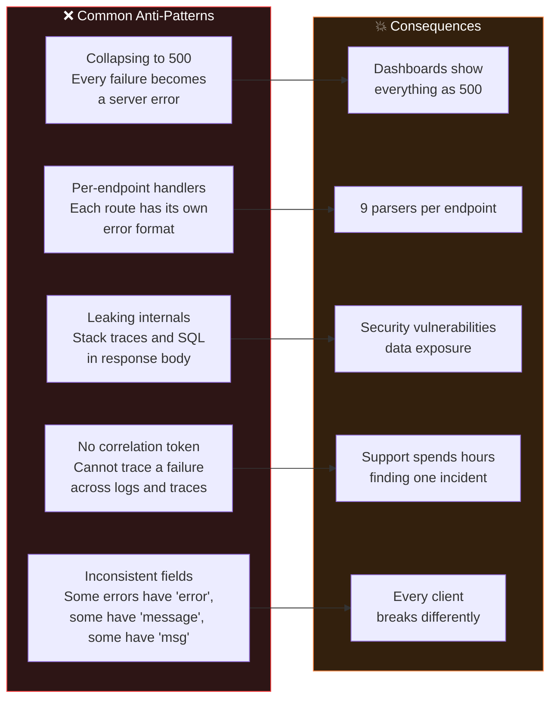

| Anti-Pattern | What It Looks Like in Code | Do This Instead |
|--------------|---------------------------|-----------------|
| Collapsed to 500 | `catch (Exception e) { return 500; }` in every controller | Typed exceptions + global mapper |
| Per-endpoint handlers | A `try/catch` per route, each building unique JSON | Delete them; rely on the mapper |
| Leaking internals | `body.put("stackTrace", e.toString())` | Static detail; stack to logs only |
| No correlation token | Response says only `"error": "something failed"` | Always attach `traceId` |
| Inconsistent fields | `error` vs `msg` vs `message` vs `detail` | One envelope, enforced by tests |
| Echoing downstream errors | Forwarding Payment Service's 502 body verbatim | Translate to your own type; keep root traceId |
| Log-and-rethrow chains | Every layer catches, logs, rethrows | Log once — at the boundary |

---

## 📎 Quick Reference: Problem Detail Template

```json
{
  "type": "https://api.example.com/errors/{error-code}",
  "title": "Human-readable error name",
  "status": 404,
  "detail": "Specific explanation of what went wrong in this instance.",
  "instance": "/path/to/failing/resource",
  "traceId": "7f3a-bc12-9e4d-1100",
  "timestamp": "2025-09-19T10:45:00Z"
}
```

**The rule is simple:** `type` + `title` describe the error *class*. `detail` + `instance` describe *this particular occurrence*. `traceId` links *everything together*.

### Copy-Paste Snippets

```bash
# Verify an endpoint's error contract in 10 seconds
curl -s -i https://api.example.com/orders/9999 | jq .
# Expect: type, title, status, detail, instance, traceId, timestamp — and nothing leaking

# Simulate an incident investigation
curl -s https://api.example.com/orders/9999 | jq -r .traceId
# → 7f3a-bc12-9e4d-1100
# Now: grep "7f3a-bc12-9e4d-1100" in logs, paste in trace UI, resolve incident
```

---

## 🏋️ Practice Exercises with Solutions

Work these against the stack from Section 9 or the lab from Section 11. Attempt each before reading the solution.

### Exercise 1: Enforce the One-Shape Contract (Beginner)

**Scenario:** Your team's API returns three different error shapes: `{ "error": ... }` on 401, a bare string on 404, and `{ "message": ... }` on 400.

**Task:** Write a *single* parametrized test that fails while *any* endpoint violates the one-shape contract.

**Solution (Express + Supertest):**

```javascript
const KEY_SET = ['type', 'title', 'status', 'detail', 'instance', 'traceId', 'timestamp'];

const CASES = [
    { method: 'get',  url: '/orders/9999',    expected: 404 },
    { method: 'post', url: '/orders',         expected: 400 },
    { method: 'get',  url: '/admin/anything', expected: 401 },
];

describe('error contract', () => {
    test.each(CASES)('$method $url → $expected',
        async ({ method, url, expected }) => {
            const res = await request(app)[method](url);
            expect(res.status).toBe(expected);
            KEY_SET.forEach(k => expect(res.body).toHaveProperty(k));
        });

    test('no leaks: 500 responses never contain stack fragments', async () => {
        const res = await request(app).get('/orders/boom');
        expect(res.status).toBe(500);
        const body = JSON.stringify(res.body).toLowerCase();
        expect(body).not.toMatch(/exception|stack|caused by|\.java|node_modules/);
    });

    test('header and body traceId match', async () => {
        const res = await request(app).get('/orders/9999');
        expect(res.headers['x-trace-id']).toBe(res.body.traceId);
    });
});
```

**Solution (Spring Boot):** the `ErrorContractTest` in Section 12.1 — the same parametrized shape test in MockMvc.

**What you learned:** the shape test is *one* test, parametrized over every failure mode — not one test per endpoint. It converts the contract into a CI gate.

---

### Exercise 2: Fix a Collapsed-to-500 Handler (Intermediate)

**Scenario:**

```java
// BEFORE — everything is 500
@ExceptionHandler(Exception.class)
public ResponseEntity<Map<String, Object>> handleAll(Exception ex) {
    log.error("Error", ex);
    return ResponseEntity.status(500).body(Map.of(
        "error", "Internal Server Error",
        "traceId", MDC.get("traceId")
    ));
}
```

**Task:** Refactor into a proper typed hierarchy with correct status classes, without changing the response *keys* for clients that already parse `traceId`.

**Solution:**

```java
// AFTER — typed exceptions, correct statuses, SAME envelope keys
@RestControllerAdvice
class FixedHandler {

    @ExceptionHandler(OrderNotFoundException.class)
    ResponseEntity<ProblemDetail> notFound(OrderNotFoundException ex) {
        var pd = base(HttpStatus.NOT_FOUND, "order-not-found",
                      "Order Not Found", ex.getMessage());
        pd.setProperty("orderId", ex.getOrderId());
        return ResponseEntity.status(404).body(pd);
    }

    @ExceptionHandler(ValidationException.class)
    ResponseEntity<ProblemDetail> badRequest(ValidationException ex) {
        var pd = base(HttpStatus.BAD_REQUEST, "validation-failed",
                      "Validation Failed", ex.getMessage());
        return ResponseEntity.status(400).body(pd);
    }

    @ExceptionHandler(Exception.class)
    ResponseEntity<ProblemDetail> catchAll(Exception ex, HttpServletRequest req) {
        log.error("Unhandled on {}", req.getRequestURI(), ex);  // full detail → logs
        var pd = base(HttpStatus.INTERNAL_SERVER_ERROR, "internal-error",
                      "Internal Server Error",
                      "An unexpected error occurred. Please contact support with your traceId.");
        return ResponseEntity.status(500).body(pd);
    }

    private ProblemDetail base(HttpStatus s, String code, String title, String detail) {
        var pd = ProblemDetail.forStatus(s);
        pd.setType(URI.create("https://api.example.com/errors/" + code));
        pd.setTitle(title);
        pd.setDetail(detail);
        pd.setProperty("traceId", MDC.get("traceId"));       // kept — clients parse this
        pd.setProperty("timestamp", Instant.now().toString());
        return pd;
    }
}
```

**What you learned:** (1) the legacy `error` key was replaced by the standard `type`/`title` pair during migration; (2) `traceId` survived unchanged, so existing parsers keep working; (3) the 500's `detail` is **static** — the real exception went only to logs; (4) correct statuses (404/400 vs 500) are the actual bug fix.

---

### Exercise 3: Hunt the Lost `traceId` (Advanced)

**Scenario:** Support reports: *"The API returns a `traceId`, but when we search the logs for it, nothing comes back — sometimes a DIFFERENT incident's traceId shows up instead."* Code review reveals:

```java
@Component
public class BuggyTraceFilter extends OncePerRequestFilter {
    protected void doFilterInternal(HttpServletRequest req, HttpServletResponse res, FilterChain chain) {
        MDC.put("traceId", UUID.randomUUID().toString());   // (A) ignores inbound header
        chain.doFilter(req, res);
        MDC.clear();                                        // (B) cleared immediately after chain
    }
}

@Service
class OrderService {
    public Order load(String id) {
        return CompletableFuture.supplyAsync(() -> repo.find(id))  // (C) hops thread pools
            .thenApply(o -> { if (o == null) throw new OrderNotFoundException(id); return o; })
            .join();
    }
}
```

**Task:** Identify all three bugs and fix them.

**Solution:**

| Bug | Problem | Fix |
|-----|---------|-----|
| (A) | Generates a *new* token even when the gateway supplied `x-trace-id` — breaks end-to-end correlation and inflates trace fragmentation | Adopt the inbound header: `String t = req.getHeader("x-trace-id"); if (t == null \|\| !SAFE.matcher(t).matches()) t = UUID.randomUUID().toString();` (also validates charset — defense against log injection) |
| (B) | `MDC.clear()` runs *after* `chain.doFilter` returns — but response serialization and async servlet processing may still happen after that; worse, when it runs too early the *error mapper* reads an empty MDC. Clearing in `finally` is correct, but here it was outside any `try`, so an exception in `doFilter` left the MDC polluted | Wrap in `try { chain.doFilter(...); } finally { MDC.clear(); }` |
| (C) | `CompletableFuture.supplyAsync` executes on the ForkJoinPool — a **different thread** with a **different MDC**. The exception is thrown on the worker thread where `MDC.get("traceId")` is `null` (or worse, stale from another request) | Use a `ContextPropagatingTaskDecorator`-style wrapper, or capture the token before the hop: `String traceId = MDC.get("traceId"); supplyAsync(...); ...` and re-inject with `MDC.put` inside the lambda (or switch to StructuredTaskScope/OTEL context propagation) |

**Fixed filter:**

```java
@Component
public class FixedTraceFilter extends OncePerRequestFilter {
    private static final Pattern SAFE = Pattern.compile("[A-Za-z0-9\\-]{1,64}");

    protected void doFilterInternal(HttpServletRequest req, HttpServletResponse res, FilterChain chain)
            throws ServletException, IOException {
        String inbound = req.getHeader("x-trace-id");
        String traceId = (inbound != null && SAFE.matcher(inbound).matches())
                ? inbound : UUID.randomUUID().toString();
        MDC.put("traceId", traceId);
        res.setHeader("x-trace-id", traceId);
        try {
            chain.doFilter(req, res);
        } finally {
            MDC.clear();
        }
    }
}
```

**What you learned:** the three classic correlation killers — ignoring inbound tokens, clearing/reading context at the wrong moment, and losing context across async boundaries. Together they explain nearly every "traceId doesn't work" support ticket.

---

## ❓ Test Your Understanding

Answer from memory, then check the solutions. (Cross-references point to the section with the full explanation.)

1. What are the three places a `traceId` must live simultaneously, and what question does each answer? → *Solution:* Response body ("what happened to my request?"), logs ("what exactly did the system do?"), distributed trace ("where was the latency?"). See Section 7.3.
2. Why is collapsing every failure into 500 harmful to client retry logic? → *Solution:* Clients can't distinguish "fix your input and retry" (4xx, don't auto-retry) from "server may recover" (5xx, retry with backoff) — so they either retry futilely forever or give up on recoverable errors. See Sections 6 and 7.5.
3. What is the difference between 401 and 403, and what wrong client behavior does mixing them up trigger? → *Solution:* 401 = unauthenticated ("who are you?"), 403 = authenticated but not allowed ("you can't do this"). Wrong 401 triggers needless re-authentication flows; wrong 403 hides the need to re-authenticate. See Section 6.
4. Which RFC defines the Problem Detail format, and which RFC obsoleted it? → *Solution:* RFC 7807, obsoleted by RFC 9457 (2023). See Section 7.2.
5. Name four things that must never appear in an error response body. → *Solution:* Any four of: stack traces, SQL queries, internal service names, DB schema info, file paths, environment variables/credentials. See Section 7.4.
6. Why must `MDC.clear()` (or the equivalent) run in a `finally` block? → *Solution:* Servlet/container threads are reused; without clearing, the next request on that thread inherits the previous request's `traceId` and logs get misattributed. See Section 9.
7. Where must the Express error middleware be registered, and what happens if it isn't? → *Solution:* Last, after all routes and other middleware; otherwise Express's default handler (or nothing) processes errors and your envelope never runs. See Section 9.
8. What is the `isOperational` flag in the Express pattern, and what does the mapper do differently for each value? → *Solution:* It marks *expected, known* errors. When true, the mapper exposes `err.detail` and the error's status; when false (unknown), it returns a static 500 envelope and logs everything. See Section 9.
9. Your 429 handler sets `Retry-After` on the raw response, but clients report it missing. What likely happened? → *Solution:* The mapper replaced/wrapped the response object after the header was set, or the header was set on the wrong object — set it on the returned entity (as in Section 9), and verify in tests.
10. A downstream service returns its own Problem Detail with a 5xx. What do you return to your caller? → *Solution:* Your *own* translated error (e.g., `502 payment-unavailable`), preserving the root `traceId`, with the downstream detail written to logs — never echo their body. See Section 8.
11. Why should the catch-all 500 handler return a **static** `detail` string instead of `ex.getMessage()`? → *Solution:* Framework/library exception messages are attacker-influenceable input and may contain internals; the real message goes to logs. See Section 14.
12. What single test makes error-shape drift impossible, and what does it assert? → *Solution:* The shape-conformance ("money") test: parametrized over many failure modes, asserting every error body contains the same required key set. See Section 12.

---

## 💼 Common Interview Questions

**Q1. Your API returns different JSON error shapes on different endpoints. Walk me through how you'd standardize them without breaking clients.**
> *Strong answer:* Audit the current shapes, introduce a global error mapper additively (new endpoints + catch-all first), offer a dual-field deprecation window where clients depend on legacy keys, correct status misclassifications, then enforce with a CI shape test and delete per-endpoint handlers. Mention RFC 9457 and phased migration (Section 15).

**Q2. Why does HTTP distinguish 4xx from 5xx, and what breaks if you blur them?**
> *Strong answer:* 4xx says "caller's fault — fix input, don't retry"; 5xx says "server's fault — retry with backoff." Blurring them breaks client retry logic, makes dashboards/alerts meaningless (everything trends to 500), and triggers pointless pages for expected 404s (Section 6).

**Q3. Design the error contract for a new microservice from scratch.**
> *Strong answer:* Adopt Problem Detail (RFC 9457) with extension members `traceId` + `timestamp`; a stable `type` URI per error class; correct status per cause; one `@RestControllerAdvice`-style mapper with a catch-all; trace middleware at the edge adopting/inbound-generating tokens; shape test in CI; envelope published in the OpenAPI schema (Sections 7, 9, 12).

**Q4. What's the security risk of returning stack traces in API errors?**
> *Strong answer:* Information disclosure — reveals technology stack, file structure, class names, sometimes SQL/schema and connection strings (credentials). Attackers use it for targeted exploits. Mitigation: static catch-all detail, internals only in logs, `traceId` as the bridge (Sections 7.4, 14).

**Q5. How would you correlate a user-reported failure with backend logs across five services?**
> *Strong answer:* Correlation token born at the gateway, propagated via `x-trace-id`/W3C Trace Context into every service's request-scoped context (MDC/AsyncLocalStorage/contextvars), stamped on every log line, attached to the distributed trace, and returned in the response body. Support searches the token once across logs + traces (Sections 7.3, 8).

**Q6. What's the difference between how you'd log a 404 and an unhandled NullPointerException? Why?**
> *Strong answer:* 404: `WARN`/`INFO`, one line, no stack — it's expected traffic and logging stacks would flood ingest (and cost money) during e.g. scanner sweeps. NPE: `ERROR` with full stack — it's unexpected, rare, and the stack is the diagnostic payload (Section 13).

**Q7. A colleague says "the traceId is null in error responses, sometimes." How do you debug it?**
> *Strong answer:* Walk the propagation chain: does the inbound header arrive? Does middleware store it? Does the mapper read the same store inside the scope? Is context cleared too early? Does the code hop threads (async boundary) losing context? Section 16's decision tree.

**Q8. When would you *not* use the one-shape pattern?**
> *Strong answer:* Legacy public APIs mid-deprecation-window (migrate, don't break); HTML Server-Sent/redirect flows where HTTP semantics differ; edge cases like WebSocket frames where RFC 9457 doesn't apply directly — the *principles* (one mapper, correlation, no leaks) still hold; also be honest: for a tiny internal tool the full ceremony may exceed its value, but correlation tokens remain worth it.

**Q9. Explain why `traceId` in the response body is better than telling users "check the dashboard."**
> *Strong answer:* It converts the user into a correlated bug reporter: support does one exact-string search across logs/traces instead of guessing by timestamp. It's the single join key that makes MTTR measurable and small (Section 10, Use Case 2).

**Q10. How do you keep an error contract from drifting over years and teams?**
> *Strong answer:* Structural enforcement, not vigilance: one mapping layer as the only code path, shape-conformance test as a CI gate, envelope published as an OpenAPI schema with consumer-driven contract tests, and review checklist banning response-building outside the mapper (Sections 12, 15).

**Q11. What should a 429 response include beyond the standard envelope?**
> *Strong answer:* A `Retry-After` header (seconds or HTTP-date) — and arguably the header alone is the standard; the envelope's `detail` explains the limit. Clients must respect it; thundering herds become polite backoff (Sections 9, 18).

**Q12. How do you test error handling without waiting for real failures?**
> *Strong answer:* Trigger each cause in tests (invalid payloads, missing auth, missing resources, a route that throws deliberately), assert status + shape + no-leak + header/body traceId match; use a captured log appender to assert the log line got the same traceId; contract tests for downstream translation (Section 12).

---

## 📚 Comprehensive Question Bank

55 questions across three difficulty levels. Answers in the answer key at the end of this section.

### 🟢 Beginner (Q1–Q20)

1. What does "one shape, many causes" mean in the context of API error handling?
2. What HTTP status class indicates the *caller* made a mistake — 4xx or 5xx?
3. What HTTP status class indicates the *server* failed?
4. Which status code means "resource does not exist"?
5. Which status code means "too many requests — slow down"?
6. Which status code means "malformed input"?
7. What is the difference between 401 and 403?
8. What is the standard IETF format for HTTP error responses called?
9. Which two RFCs define Problem Detail?
10. What field of the Problem Detail identifies the *class* of error?
11. What field of the Problem Detail describes *this particular occurrence*?
12. What is a `traceId`?
13. Name the three places a `traceId` should appear.
14. Why should a 500 response never contain a stack trace?
15. True or false: an error response with `{ "error": ... }` and another with `{ "msg": ... }` can both be "correct" under the one-shape pattern.
16. What HTTP header do clients typically read on a 429 response to know how long to wait?
17. What is a "global error handler" in one sentence?
18. True or false: per-endpoint try/catch blocks that each produce unique JSON are a recommended pattern.
19. What does `instance` represent in a Problem Detail document?
20. What is the security risk of putting a plain-text stack trace in a 500 response?

### 🟡 Intermediate (Q21–Q42)

21. Explain why shape invariance ("only values change, never keys") reduces client-side code.
22. Why does the catch-all handler return a *static* detail message instead of `ex.getMessage()`?
23. What is MDC in the Java/Spring ecosystem, and what problem does it solve for correlation?
24. What is `AsyncLocalStorage` in Node.js, and what is its equivalent role to MDC?
25. Why must MDC be cleared in a `finally` block?
26. What breaks if the Express error middleware is registered before the routes?
27. What is the `isOperational` flag and how does the mapper treat each branch differently?
28. When a downstream service returns a 5xx, why must you translate rather than echo the response?
29. Why should inbound `x-trace-id` values be validated (length/charset) before use?
30. What is `Retry-After`, and which two status codes commonly pair with it?
31. How does the one-shape pattern make universal client retry logic possible?
32. Why is exponential backoff on 5xx not always safe for POST endpoints?
33. What makes the "shape-conformance test" effective at preventing contract drift?
34. Why is asserting exact `detail` strings in tests an anti-pattern?
35. What logging strategy differs between expected 4xx failures and unexpected 5xx crashes?
36. How does the `type` field make alerting more precise than alerting on status codes?
37. What does serving a documentation page at the `type` URI accomplish?
38. In the Spring `ProblemDetail` API, how do you attach custom (extension) fields?
39. Why is `application/problem+json` preferred over plain `application/json` for error responses?
40. What is the risk of generating a new `traceId` at every service instead of adopting the inbound one?
41. How does the RFC 9457 envelope support custom fields without breaking generic parsers?
42. Describe the five phases of migrating a legacy API to the one-shape pattern.

### 🔴 Advanced (Q43–Q55)

43. Explain how `CompletableFuture.supplyAsync` silently breaks MDC correlation, and give two remedies.
44. Contrast MDC, `AsyncLocalStorage`, and Python `contextvars` — what property do all three share, and what are their failure modes?
45. Design the interaction between a W3C Trace Context header (`traceparent`) and your `traceId` extension field.
46. Argue for or against: "The error mapper should read configuration from the database when building a response." What principle decides this?
47. How would you structure load testing to catch error-path performance regressions?
48. A scanner floods your API with invalid requests, tripling log ingest. Which pattern decisions protect you, and which ones failed?
49. Explain the idempotency problem in retry logic and how `Idempotency-Key` plus a 409 `duplicate-submission` type resolve it.
50. Your security team wants `traceId` removed from responses because "it reveals internal information." How do you respond?
51. How do consumer-driven contract tests (Pact-style) interact with the error envelope schema?
52. Describe how to bridge OpenTelemetry `SpanContext` and log MDC so a trace search finds the exact log lines.
53. A gateway and a service both define the error envelope, but with different key orders and casing. Does this violate the contract? How would you enforce exact conformance?
54. Propose a strategy for versioning error `type` URIs when an error's semantics must change.
55. Under a full-database-outage incident, why must the 503 mapper path avoid database access, and how do you architect that?

### ✅ Answer Key

**Beginner (Q1–Q20):**

1. All failures funnel through one mapping layer into one consistent response document.
2. 4xx.
3. 5xx.
4. 404.
5. 429.
6. 400.
7. 401 = unauthenticated (no/invalid credentials); 403 = authenticated but not allowed.
8. Problem Detail.
9. RFC 7807 and RFC 9457.
10. `type`.
11. `detail` (with `instance` identifying the occurrence).
12. A correlation token linking the response, logs, and distributed trace for one request.
13. Response body, logs, distributed trace.
14. It leaks internal structure (stack frames, file paths, technology stack) — an information-disclosure vulnerability.
15. False — the keys must be identical across all errors.
16. `Retry-After`.
17. One central component that converts any thrown failure into the standard envelope.
18. False — the global mapper is the recommended pattern.
19. The URI/path identifying this failing request occurrence.
20. Information disclosure — attackers learn your stack, paths, and potentially schema/credentials.

**Intermediate (Q21–Q42):**

21. One parser and one key-set handle every error; extension fields are additive, not replacements.
22. Framework exception messages are attacker-influenceable input and may leak internals; the real message goes to logs.
23. A per-thread (logback/log4j) key-value context stamped onto every log line automatically — it removes manual traceId threading.
24. Request-scoped storage that survives async continuations; it is Node's analogue of MDC.
25. Container threads are reused; stale values from a previous request misattribute the next request's logs.
26. Errors bypass it entirely — Express's default handler (or nothing) responds.
27. It marks expected, known errors. Operational → expose `err.detail`/status; non-operational → static 500 envelope, log everything.
28. Echoing couples your contract to theirs and can leak their internals through your edge; translate to your own type, keep the root traceId.
29. Prevents log injection and unbounded junk tokens from polluting (or attacking) your log store.
30. A response header telling clients how long to wait before retrying; 429 and 503.
31. Identical keys (`status`, `title`, `detail`, `traceId`) let one client function parse every error from every endpoint.
32. A 500 after a POST may mean "operation committed, response lost" — blind retries can duplicate side effects; idempotency keys fix this.
33. It is one parametrized test over many failure modes asserting the same required key set, executed on every CI run.
34. Human-readable messages change constantly, making tests brittle; assert keys/status/type instead.
35. 4xx: single line, no stack, WARN/INFO; 5xx: ERROR with full stack (sampled/deduped under load).
36. `type` groups errors semantically; rate-of-type alerts are actionable while status-rate alerts drown in noise.
37. Self-service documentation — every error becomes a clickable explanation.
38. `pd.setProperty("name", value)` — extension members serialize alongside standard fields.
39. It is the standard content type; generic clients and gateways can detect Problem Details.
40. Correlation fragments at every service boundary; one logical request gets many tokens.
41. The RFC permits extension members; unknown fields don't break generic parsers.
42. Audit shapes → add mapper additively → dual-field deprecation window → correct status classes → enforce via CI and delete per-endpoint handlers.

**Advanced (Q43–Q55):**

43. The worker thread has a different (empty) MDC, so logs inside the lambda lose the token; remedies: a context-propagating `TaskDecorator`/wrapper, or capture the token before the hop and re-inject it inside the lambda, or use structured concurrency/OTEL context propagation.
44. All three bind state to the *logical request* across execution boundaries. Failure modes: MDC loses context on thread hops and needs manual cleanup; ALS requires every async path to run inside `.run()` scoping; `contextvars` requires manual `Context.run()` usage or framework support.
45. Derive `traceId` from the `traceparent` trace-id portion so the extension field and the tracing backend agree; generate one only when absent; keep sanitization identical for both sources.
46. Against. The mapper must be buildable from process-local state only — it is the code path that runs when everything else is failing; a DB call there turns a component failure into a total failure. The deciding principle: the error path must have the fewest dependencies of any code in the system.
47. Sustained invalid/edge traffic against staging at production-plus rates; watch exception-construction CPU, log ingest bytes/sec, and p99 of *error* responses; assert budgets in a perf regression suite.
48. Protecting you: static catch-all detail, cheap validation-path 400s (no stacks), log sampling. Failed: no inbound-token sanitization (junk tokens flooding logs), stack-per-404 logging, missing rate limiting.
49. A 500 after a POST may mean "committed but unreported"; an `Idempotency-Key` makes safe replays possible, and a 409 `duplicate-submission` type lets clients detect duplicates explicitly instead of guessing.
50. It reveals nothing except a random token; it *reduces* exposure versus stack traces by relocating detail to logs. Keep tokens random/unguessable, sanitized, and never encode user data in them.
51. The envelope is published as a schema; consumer tests pin the required key set so a provider-side change fails CI before it breaks any client.
52. Set the OTEL span's trace id into MDC (or a shared context store) once at the edge, so every log line carries the same id the tracer emits; one search then joins logs and traces.
53. Key *order* is irrelevant (JSON objects are unordered); *casing* is contractual. Enforce with exact-key shape tests and a published schema with `additionalProperties: false` where you want strictness.
54. Never repurpose an existing `type` URI. Introduce a new one (new code or `-v2` suffix), support both during a deprecation window, then retire the old URI on the announced date.
55. The 503 path is the "everything is failing" path — if it calls the DB, a component outage becomes total. Build it from process-local state only (static envelope + context token), front it with a fast-fail circuit breaker, and load-test that path specifically.

---

## 🎓 Summary & Key Takeaways

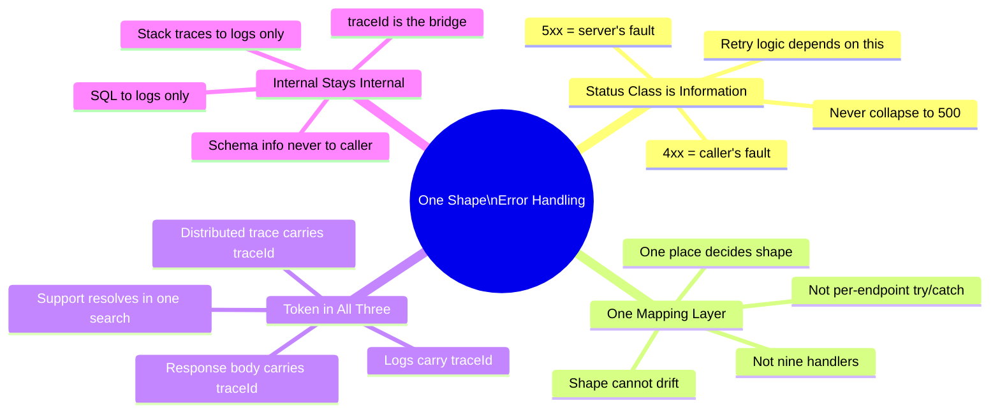

| # | Principle | Bad | Good |
|---|-----------|-----|------|
| 1 | **Status class is information** | Every error → 500 | 4xx for client errors, 5xx for server errors |
| 2 | **One mapping layer** | `try/catch` in every controller | `@ExceptionHandler` / global error middleware |
| 3 | **Token in all three** | Error has no ID, logs have no correlation | `traceId` in logs, trace, and response body |
| 4 | **Internal stays internal** | Stack trace in response JSON | Only `traceId` to caller; full detail in logs |

### Self-Assessment Checklist

Rate yourself honestly — each "yes" is a production outage you will resolve faster:

- [ ] I can explain why 4xx vs 5xx semantics matter to clients, dashboards, and alerting
- [ ] I can implement a global error mapper in my primary stack from memory
- [ ] I know where the `traceId` must appear (three places) and how it propagates through async boundaries
- [ ] I can list at least six things that must never appear in an error response
- [ ] I know why the catch-all 500's `detail` must be static
- [ ] I have written (or would write) a shape-conformance test as a CI gate
- [ ] I can articulate a five-phase migration plan for a live API
- [ ] I know the three classic correlation killers (inbound token ignored, wrong clear timing, async boundary loss)

> 💬 **Remember:** *"One shape out, whatever went wrong in."* — The entire value of this pattern lives in that single sentence. Build it once, enforce it everywhere, and your error dashboard transforms from noise into signal.

---

## 📖 Further Reading & Resources

**Standards:**
- [RFC 9457 — Problem Details for HTTP APIs](https://www.rfc-editor.org/rfc/rfc9457) — the current standard (obsoletes RFC 7807)
- [RFC 7807 — Problem Details (original)](https://www.rfc-editor.org/rfc/rfc7807)
- [RFC 9110 — HTTP Semantics](https://www.rfc-editor.org/rfc/rfc9110) — authoritative status-code semantics
- [W3C Trace Context](https://www.w3.org/TR/trace-context/) — the `traceparent` propagation standard

**Framework documentation:**
- [Spring Framework — ProblemDetail & Response Entity Exception Handling](https://docs.spring.io/spring-framework/reference/web/webmvc/mvc-controller/ann-advice.html)
- [FastAPI — Handling Errors](https://fastapi.tiangolo.com/tutorial/handling-errors/)
- [Express — Error Handling Guide](https://expressjs.com/en/guide/error-handling.html)
- [ASP.NET Core — Problem Details & IExceptionHandler](https://learn.microsoft.com/en-us/aspnet/core/fundamentals/error-handling)

**Operations:**
- [OpenTelemetry Documentation](https://opentelemetry.io/docs/) — traces, context propagation, and log correlation
- [OWASP — Error Handling Cheat Sheet](https://cheatsheetseries.owasp.org/cheatsheets/Error_Handling_Cheat_Sheet.html)
- [Google SRE Book — Chapter on Distributed Periodic Traces](https://sre.google/sre-book/distributed-periodic-trace-collection/)

**Community:**
- Spring Boot issue threads and blog posts on `ProblemDetail` + MDC correlation — a consistently recurring theme since Spring Framework 6.0 shipped built-in Problem Detail support.

---

## 🚀 Next Steps

1. **This week:** Run the Hands-On Lab (Section 11) in your own stack. Time-box it to two hours.
2. **This sprint:** Add the shape-conformance test to your API's CI pipeline (Section 12).
3. **This quarter:** Run the Phase 1 audit (Section 15) against your main service and present the before/after table to your team.
4. **Ongoing:** Alert on error-`type` rates, not status codes; serve docs at your `type` URIs.
5. **Related tutorials in this knowledge base:** *Ten Things To Stop Doing In Java 25 REST APIs* (Swap 5 covers the same envelope pattern in the Java 25 context) and the JWT security deep dive (which pairs well with the 401/403 semantics from Section 6).

---

*Last Updated: 2026-09-19* · *Difficulty: Intermediate* · *Part of the knowledge-base tutorial series, created per `tutorial-preferences.md` requirements.*

*Source: Content provided by the user ("Many Causes, One Shape: Error Handling That Survives an Incident"), augmented with RFC 7807/9457, W3C Trace Context, OWASP guidance, and multi-stack implementations to meet the comprehensive deep-dive standard.*
