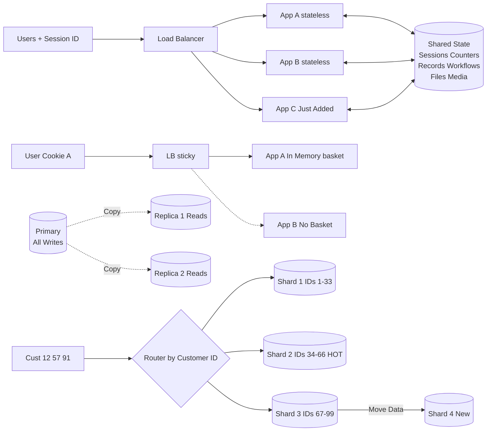
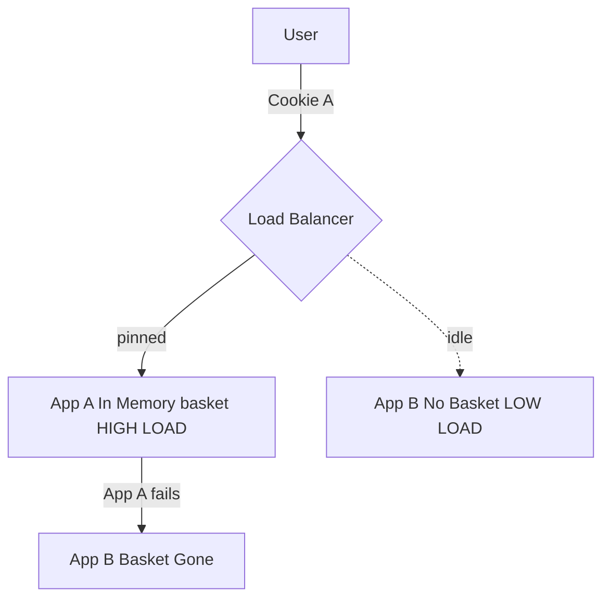
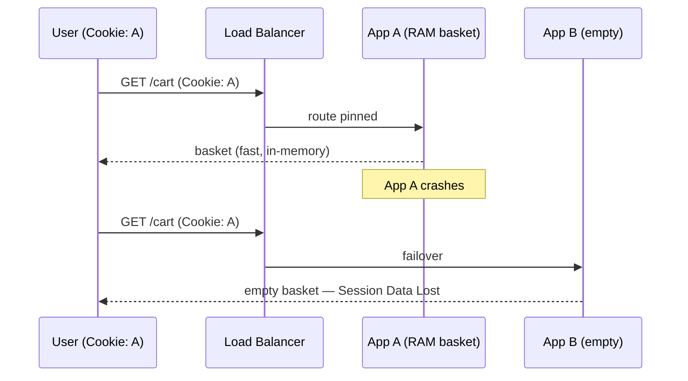
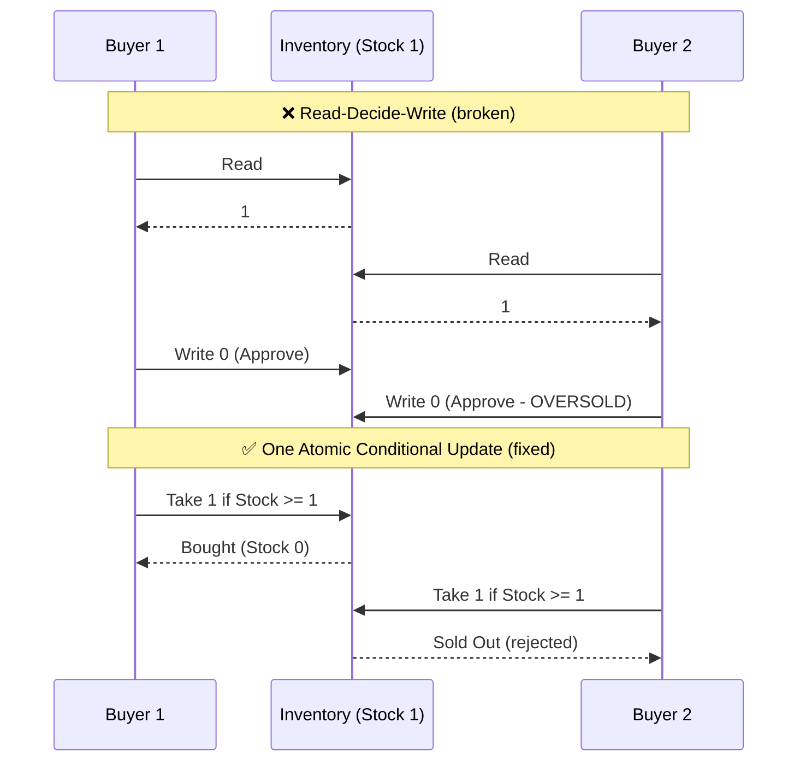
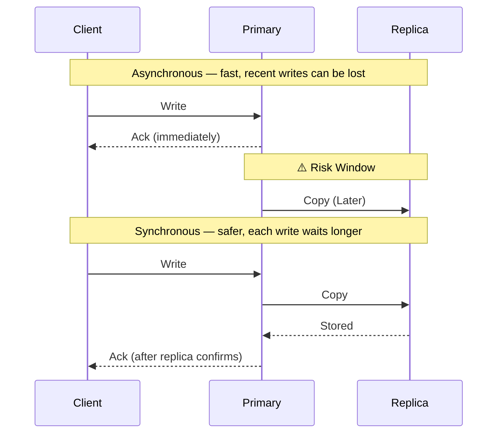
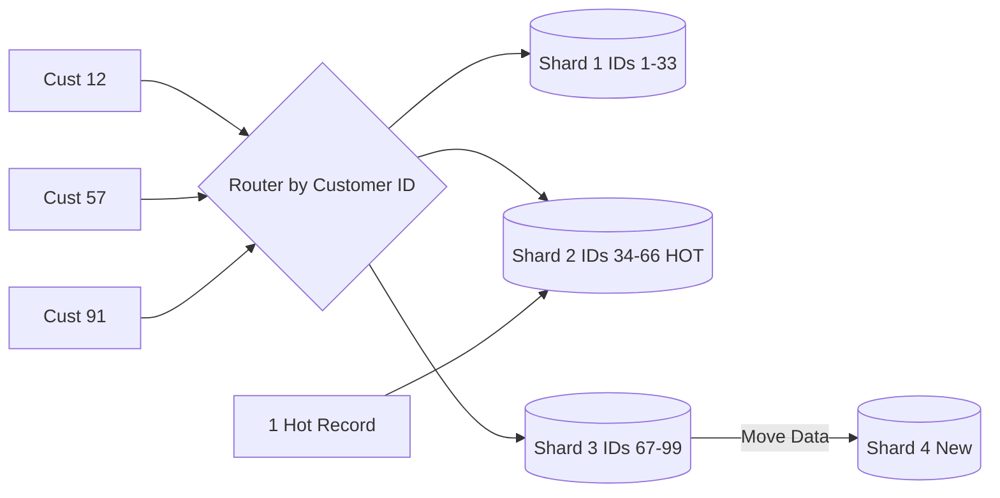
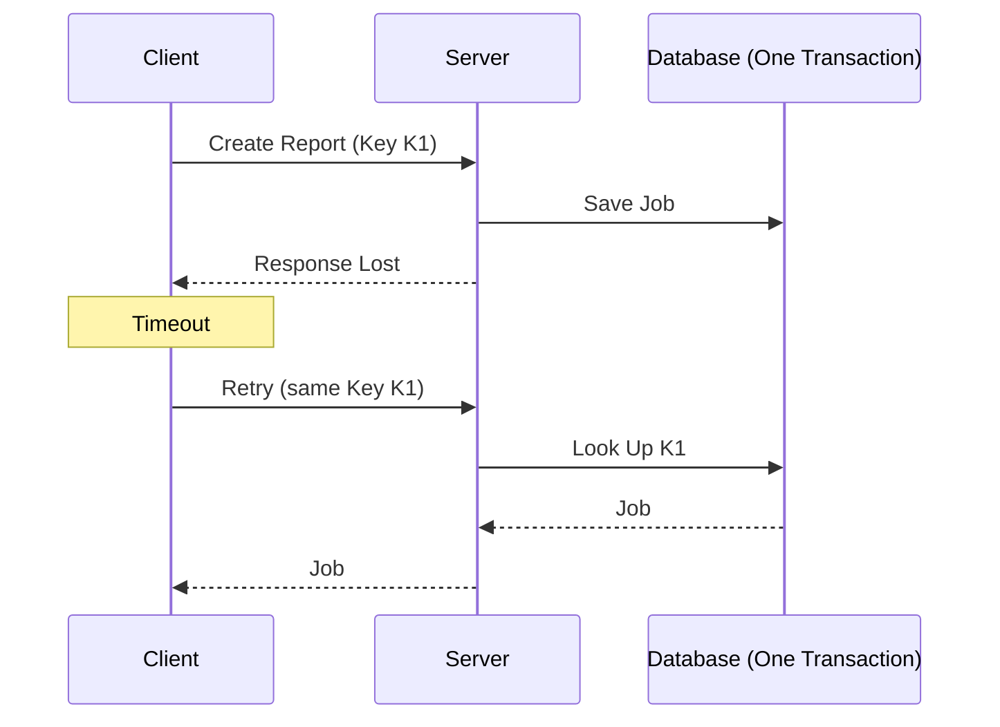
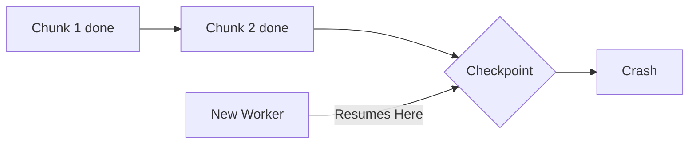
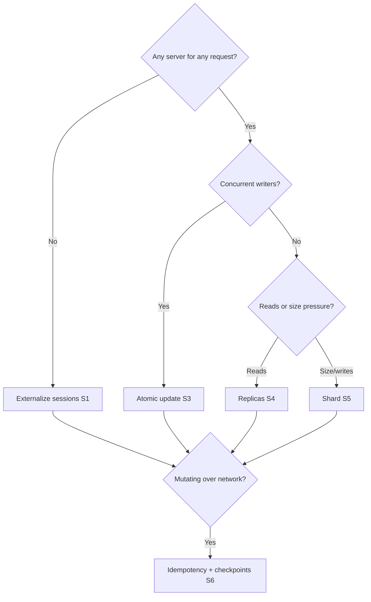

# State Management Strategies - Complete Tutorial

> **From Sticky Sessions to Sharding: How to Keep Correct State at Scale**
> *Expanded from ByteByteGo "State Management Strategies" infographic into a hands-on engineering deep dive.*

**Difficulty:** Intermediate 🟡 | **Estimated Reading Time:** 100 minutes | **Last Updated:** 2026-10-02

---
## Table of Contents

- [1. Introduction / Overview](#1-introduction--overview)
- [2. Prerequisites](#2-prerequisites)
- [3. Learning Objectives](#3-learning-objectives)
- [4. The Big Picture - 6 Strategies at a Glance](#4-the-big-picture---6-strategies-at-a-glance)
- [5. Strategy 1 - Stateless Shared State](#5-strategy-1---stateless-shared-state)
- [6. Strategy 2 - Sticky Sessions](#6-strategy-2---sticky-sessions)
- [7. Strategy 3 - Concurrent Changes](#7-strategy-3---concurrent-changes)
- [8. Strategy 4 - Replication](#8-strategy-4---replication)
- [9. Strategy 5 - Sharding](#9-strategy-5---sharding)
- [10. Strategy 6 - Retries Without Duplicates](#10-strategy-6---retries-without-duplicates)
- [11. Real-World Examples and Use Cases](#11-real-world-examples-and-use-cases)
- [12. Best Practices](#12-best-practices)
- [13. Anti-Patterns](#13-anti-patterns)
- [14. Performance Considerations](#14-performance-considerations)
- [15. Security Considerations](#15-security-considerations)
- [16. Testing Strategies](#16-testing-strategies)
- [17. Migration Guides](#17-migration-guides)
- [18. Common Pitfalls / Troubleshooting](#18-common-pitfalls--troubleshooting)
- [19. Practice Exercises](#19-practice-exercises-with-detailed-solutions)
- [20. Test Your Understanding](#20-test-your-understanding)
- [21. Common Interview Questions](#21-common-interview-questions)
- [22. Question Bank](#22-question-bank-for-knowledge-reinforcement)
- [23. Summary / Key Takeaways](#23-summary--key-takeaways)
- [24. Further Reading / Resources](#24-further-reading--resources)

---


## 1. Introduction / Overview

Imagine you add a third app server for Black Friday — and users lose carts. Two buyers click Buy on the last item, and you oversell. A timeout retry bills a customer twice.

All three are **state management failures**. App code scales horizontally; *state* does not.

> 💡 **Feynman mental model:** Think of app servers as cashiers with no memory. If each cashier must remember customers, you cannot add/remove cashiers freely. Give them a shared notebook (shared state), pin customers to one cashier (sticky), copy notebooks (replication), split notebooks by alphabet (sharding), and make every write safe to repeat (idempotency) — those are exactly the 6 strategies here.

| # | Strategy | Core idea | Infographic moment |
|---|---|---|---|
| 1 | Stateless Shared State | Disposable servers + external session/DB/object stores | App C "Just Added" with no loss |
| 2 | Sticky Sessions | Cookie pins user to App A | Uneven load; App A fails = Basket Gone |
| 3 | Concurrent Changes | One atomic conditional update | `Take 1 if Stock >= 1` |
| 4 | Replication | Primary to replicas; async vs sync | Risk Window vs Stored-Ack |
| 5 | Sharding | Router by Customer ID into shards | Hot Shard 2; Move Data to Shard 4 |
| 6 | Retries Without Duplicates | Idempotency Key K1 + checkpoints | Job #7 No Duplicate; Crash resumes |

### When to Use vs. When to Avoid

| Strategy | Use When | Avoid When |
|---|---|---|
| 1. Stateless Shared | Elastic scale, deploys, failover | Single-node prototype, ultra-low-latency loop |
| 2. Sticky Sessions | Legacy sessions, WebSocket affinity | Need even load or zero-loss failover |
| 3. Atomic Writes | Inventory, money, seats | Hot counters — use queue/CRDT |
| 4. Replication | Read scaling, HA, DR | Need zero lag AND zero wait |
| 5. Sharding | Data exceeds one DB / write ceiling | Read replicas still suffice |
| 6. Idempotent Retries | Any network call, webhooks, long jobs | Pure side-effect-free GETs |

---

## 2. Prerequisites

**You should know:** basic HTTP (cookies, load balancing), SQL basics, Java 17 syntax, Docker Compose fundamentals.

**Lab tools:**

```bash
java -version        # 17+
docker compose version
redis-cli --version  # 7+
psql --version       # 15+
node --version       # 18+ for the TypeScript client demo
```

**Docker lab (Redis + Postgres primary + replica):**

```yaml
# docker-compose.yml — learning lab, NOT production credentials
services:
  redis:
    image: redis:7-alpine
    ports: ["6379:6379"]
  postgres-primary:
    image: postgres:15-alpine
    environment:
      POSTGRES_USER: lab
      POSTGRES_PASSWORD: labpw
      POSTGRES_DB: statelab
    ports: ["5432:5432"]
```

> ⚠️ **Warning:** Default passwords and localhost are for learning only. See [Security Considerations](#15-security-considerations) before going anywhere near production.

<!-- P2 -->

## 3. Learning Objectives

By the end you will be able to:

1. Design stateless services backed by shared session, database, and object stores.
2. Explain why sticky sessions cause uneven load and data loss, with sequence diagrams.
3. Replace race-prone read-modify-write with atomic SQL, Redis Lua, and optimistic locking.
4. Choose async vs sync replication with open eyes about RPO/RTO.
5. Implement range/hash sharding, detect hot shards, and split/move shards safely.
6. Implement idempotency keys transactionally plus checkpointed workers that resume.
7. Chaos-test each strategy: kill a node, partition the network, retry storms.

<!-- P3 -->

## 4. The Big Picture - 6 Strategies at a Glance

### Diagram 1: System architecture — where state lives in each strategy



**Progressive complexity rule of thumb:**

1. Start stateless + shared store (Strategy 1).
2. Only use sticky as a legacy bridge (Strategy 2).
3. Fix races with atomic writes (Strategy 3) before they cost money.
4. Add replicas for reads/HA (Strategy 4).
5. Shard only when one primary cannot hold data or writes (Strategy 5).
6. Wrap every mutating call in idempotent retries + checkpoints (Strategy 6).

> 💡 **Aha moment:** Strategies 1, 4, 5 answer *where* state lives. Strategies 3 and 6 answer *how* concurrent and retried writes stay correct. Strategy 2 is the cautionary tale of what happens when you answer "where" with "in one server's RAM".

<!-- P4 -->

## 5. Strategy 1 - Stateless Shared State

**Goal:** any app server can handle any request; adding App C requires zero data migration.

### 5.1 How it works (step by step)

1. User sends `Session ID` (cookie or header) with each request.
2. Load balancer routes to *any* healthy instance (round-robin / least-connections).
3. App server loads session/cart/counters from the **shared state tier**, never from local fields.
4. Writes go back to shared state: session store (Redis), records/workflows (Postgres), files/media (S3-style object storage).
5. New instance App C registers with the LB and immediately serves traffic — nothing to copy.

### 5.2 Spring Boot + Redis sessions (correct implementation)

```java
// pom.xml (excerpt): spring-boot-starter-data-redis + spring-session-data-redis
// application.yml:
// spring:
//   session:
//     store-type: redis        # sessions live in Redis, NOT in server RAM
//     timeout: 30m
//   data:
//     redis:
//       host: localhost
//       port: 6379

import org.springframework.web.bind.annotation.*;
import jakarta.servlet.http.HttpSession;
import java.util.*;

@RestController
@RequestMapping("/cart")
public class CartController {

    // ✅ CORRECT: cart lives in the shared session store.
    // Any instance (A, B, or just-added C) sees the same basket.
    @PostMapping("/add")
    public Map<String, Object> add(HttpSession session, @RequestParam String sku) {
        List<String> basket =
            (List<String>) session.getAttribute("basket");
        if (basket == null) {
            basket = new ArrayList<>();
        }
        basket.add(sku);
        session.setAttribute("basket", basket); // persisted to Redis
        return Map.of("basket", basket, "sessionId", session.getId());
    }

    @GetMapping
    public Map<String, Object> view(HttpSession session) {
        List<String> basket =
            (List<String>) session.getAttribute("basket");
        return Map.of("basket", basket == null ? List.of() : basket);
    }
}
```

```java
// ❌ INCORRECT: in-memory field breaks when LB routes to another instance
// or when the instance restarts. Do NOT do this in a multi-instance service.
@RestController
@RequestMapping("/cart-broken")
class BrokenCartController {
    private final Map<String, List<String>> baskets = new HashMap<>(); // local RAM!

    @PostMapping("/add")
    public List<String> add(@RequestParam String user, @RequestParam String sku) {
        // Buyer pinned to App A works; next request to App B sees "No Basket".
        return baskets.computeIfAbsent(user, k -> new ArrayList<>());
    }
}
```

### 5.3 Files belong in object storage, not on disk

```java
// ✅ CORRECT: return a presigned URL; bytes never touch app disk.
import software.amazon.awssdk.services.s3.model.PutObjectRequest;
import software.amazon.awssdk.services.s3.presigner.S3Presigner;

@RestController
@RequestMapping("/media")
public class MediaController {
    private final S3Presigner presigner; // injected

    public MediaController(S3Presigner presigner) { this.presigner = presigner; }

    @GetMapping("/upload-url")
    public Map<String, String> uploadUrl(@RequestParam String key) {
        var req = PutObjectRequest.builder()
            .bucket("statelab-media").key(key).build();
        var url = presigner.presignPutObject(b -> b
            .putObjectRequest(req)
            .signatureDuration(java.time.Duration.ofMinutes(5))).url().toString();
        return Map.of("uploadUrl", url); // browser uploads straight to storage
    }
}
```

> 📌 **Callout:** Session store = ephemeral/lookup state (sessions, counters). Database = authoritative records + workflows. Object storage = files/media. Mixing them (e.g., storing uploads on app disk, carts in Postgres rows updated per click) is the #1 scaling smell.

### Multiple approaches

| Approach | When | Trade-off |
|---|---|---|
| Redis centralized sessions | Default for Spring/Django/Rails scale-out | Extra network hop (~0.5–2 ms) |
| JWT (stateless token) + server lookup for revocation | Mobile/APIs, no sticky needed | Token size, revocation list complexity |
| DB-backed sessions | Small scale, strong durability | Higher write load on primary |

<!-- P5 -->

## 6. Strategy 2 - Sticky Sessions

**Goal (and warning):** pin a user to one server with a cookie. Simple, fast for in-memory reads — but traffic goes uneven and a server failure wipes that user's state.

### 6.1 Step by step (matches the infographic)

1. **Normal:** User presents `Cookie: A`. LB always routes to App A, which holds the basket in memory. App B sits idle — *uneven load*.
2. **App A fails:** Cookie still says A. LB fails over to App B, which has no basket — *session data lost*.

### Diagram 2: Sticky session flow + failure (flowchart + sequence)





### 6.2 NGINX + Spring cookie affinity (when you must)

```nginx
# nginx.conf — sticky via consistent cookie (legacy bridge only)
upstream app {
    server app-a:8080;
    server app-b:8080;
    sticky cookie srv_id expires=30m path=/;  # pins user to one upstream
}
server {
    listen 80;
    location / { proxy_pass http://app; }
}
```

```java
// ✅ Least-bad sticky: still externalize what you can, keep ONLY hot cache local.
import org.springframework.cache.annotation.Cacheable;
import org.springframework.stereotype.Service;

@Service
public class BasketViewService {
    // Caffeine/local cache for reads; Redis/DB remains the source of truth.
    @Cacheable(cacheNames = "basketView", key = "#userId")
    public String renderBasket(String userId) {
        return loadFromSharedStore(userId); // fallback always works on failover
    }
    private String loadFromSharedStore(String userId) { return "basket:" + userId; }
}
```

> ⚠️ **Warning:** Sticky sessions break rolling deploys (drain pain), autoscaling (new nodes stay idle), and A/B fairness. Treat as technical debt with an expiry date — see [Migration Guides](#17-migration-guides).

<!-- P6 -->

## 7. Strategy 3 - Concurrent Changes

**Goal:** two buyers racing for `Stock: 1` must never both succeed.

### 7.1 The bug: Read, Decide, then Write

Both buyers read `1`, both approve locally, both write `0`. You oversell by one.

### Diagram 3: Race vs atomic conditional update (sequence)



### 7.2 Fix 1 — SQL atomic conditional update (preferred for inventory/money)

```java
// ❌ INCORRECT: check-then-act in Java — race window between SELECT and UPDATE.
public boolean buyBroken(JdbcTemplate db, long itemId) {
    Integer stock = db.queryForObject(
        "SELECT stock FROM inventory WHERE id = ?", Integer.class, itemId);
    if (stock != null && stock >= 1) {
        db.update("UPDATE inventory SET stock = stock - 1 WHERE id = ?", itemId);
        return true; // BUG: two threads can both pass the check
    }
    return false;
}
```

```java
// ✅ CORRECT: single atomic statement — DB serializes the condition + write.
import org.springframework.jdbc.core.JdbcTemplate;

public class InventoryService {
    private final JdbcTemplate db;
    public InventoryService(JdbcTemplate db) { this.db = db; }

    /** Returns true if this buyer got the item; false = sold out. */
    public boolean takeOneIfAvailable(long itemId) {
        // One round trip; affected rows tell us who won. No locks in Java needed.
        int updated = db.update(
            "UPDATE inventory SET stock = stock - 1 " +
            "WHERE id = ? AND stock >= 1", itemId);
        return updated == 1;
    }
}
```

### 7.3 Fix 2 — Redis Lua (atomic decrement for flash sales)

```lua
-- ✅ Atomic: check + decrement happen inside Redis, single-threaded.
-- KEYS[1] = stock key, returns new stock or -1 if sold out.
local stock = tonumber(redis.call('GET', KEYS[1]) or '0')
if stock >= 1 then
  return redis.call('DECR', KEYS[1])
else
  return -1
end
```

```java
// Java caller with Spring Data Redis
import org.springframework.data.redis.core.StringRedisTemplate;
import org.springframework.data.redis.core.script.DefaultRedisScript;
import java.util.List;

public class FlashSaleService {
    private final StringRedisTemplate redis;
    public FlashSaleService(StringRedisTemplate redis) { this.redis = redis; }

    public boolean tryBuy(String itemKey) {
        var script = new DefaultRedisScript<Long>();
        script.setScriptText(
            "local s=tonumber(redis.call('GET',KEYS[1]) or '0') " +
            "if s>=1 then return redis.call('DECR',KEYS[1]) else return -1 end");
        script.setResultType(Long.class);
        Long result = redis.execute(script, List.of(itemKey));
        return result != null && result >= 0; // -1 = Sold Out
    }
}
```

### 7.4 Fix 3 — Optimistic locking with version column (JPA)

```java
// ✅ CORRECT for workflows: version check turns lost updates into a retryable conflict.
import jakarta.persistence.*;

@Entity
class OrderRecord {
    @Id Long id;
    String status;
    @Version Long version; // auto-checked on UPDATE
}

// Service: catch, reload, and retry instead of silently overwriting.
import org.springframework.orm.ObjectOptimisticLockingFailureException;
import org.springframework.stereotype.Service;
import org.springframework.transaction.annotation.Transactional;

@Service
class OrderWorkflow {
    @Transactional
    public void advance(OrderRepository repo, Long id, String next) {
        try {
            OrderRecord o = repo.findById(id).orElseThrow();
            o.status = next; // flush checks WHERE id=? AND version=?
        } catch (ObjectOptimisticLockingFailureException ex) {
            // Another worker won — reload and decide again (or return 409 to client).
            throw new IllegalStateException("Concurrent update; please retry", ex);
        }
    }
    interface OrderRepository extends org.springframework.data.jpa.repository.JpaRepository<OrderRecord, Long> {}
}
```

> 📌 **When vs when-not:** conditional updates win for scarce resources. For ultra-hot counters (likes, votes), prefer sharded counters or a queue + aggregator to avoid lock contention.

<!-- P7 -->

## 8. Strategy 4 - Replication

**Goal:** every write goes to the Primary; copies flow to Replica 1/2 which serve reads. Survive node loss and scale reads.

### Diagram 4: Async vs sync replication (sequence)



### 8.1 Postgres configuration (step by step)

```bash
# PRIMARY postgresql.conf (sync example: 1 replica must confirm)
wal_level = replica
synchronous_commit = on
synchronous_standby_names = 'ANY 1 (replica1, replica2)'

# REPLICA postgresql.conf — async alternative:
# synchronous_commit = off  # primary acks without waiting (risk window)

# Verify lag on primary:
# SELECT client_addr, state, sync_state, replay_lag FROM pg_stat_replication;
```

### 8.2 Route reads to replicas, writes to primary (Java)

```java
// ✅ CORRECT: explicit read/write routing. Stale reads are a conscious choice.
import org.springframework.stereotype.Service;
import org.springframework.transaction.annotation.Transactional;

@Service
public class CatalogService {
    private final CatalogRepository primary; // write + fresh reads
    private final CatalogRepository replica; // scaled reads

    public CatalogService(CatalogRepository primary, CatalogRepository replica) {
        this.primary = primary; this.replica = replica;
    }

    @Transactional(readOnly = true) // routed to replica DataSource
    public String productPage(long id) {
        // Edge case: right after a write, replica may lag — pass ?fresh=true
        // to force the primary for read-after-write pages.
        return replica.findNameById(id);
    }

    @Transactional // routed to primary DataSource
    public void updatePrice(long id, long cents) {
        primary.updatePrice(id, cents);
    }

    interface CatalogRepository {
        String findNameById(long id);
        void updatePrice(long id, long cents);
    }
}
```

### 8.3 Comparison

| Mode | Write latency | Data loss on primary crash | Use when |
|---|---|---|---|
| Async | Low (ack now, copy later) | Recent writes in Risk Window can be lost | Feeds, analytics, caches |
| Sync | Higher (ack after Stored) | Zero loss (if quorum met) | Orders, payments, inventory |
| Semi-sync (ANY 1) | Middle | Bounded: 1 replica confirmed | Balanced default for many shops |

> 💡 **RPO/RTO framing:** async gives great RTO (fast failover) but nonzero RPO (lose seconds). Sync gives RPO=0 but slower writes and failover needs quorum. Pick per table, not per database.

<!-- P8 -->

## 9. Strategy 5 - Sharding

**Goal:** split data by key (Customer ID) across shards so no single DB holds everything or handles every write.

### 9.1 Step by step (matches infographic)

1. Router hashes `customerId`: Cust 12 → Shard 1 (IDs 1–33), Cust 57 → Shard 2 (34–66), Cust 91 → Shard 3 (67–99).
2. Shard 2 turns 🔥 (1 Hot Record — everyone wants the same celebrity/viral row).
3. Split: `Move Data` from Shard 3 → Shard 4 New; router table updates atomically; backfill + verify + cutover.

### Diagram 5: Shard router + reshard (flowchart)



### 9.2 Hash router in Java (correct) vs modulo trap (incorrect)

```java
import java.util.*;

public class ShardRouter {
    private final List<String> shards; // e.g. jdbc URLs for shard1..4

    public ShardRouter(List<String> shards) { this.shards = shards; }

    // ✅ CORRECT: consistent hashing — adding Shard 4 moves ~1/N keys, not all.
    public String routeConsistent(long customerId) {
        int h = Long.hashCode(customerId * 0x9E3779B97F4A7C15L);
        // In production use a consistent-hash ring (e.g. Guava) with virtual nodes.
        return shards.get(Math.floorMod(h, shards.size()));
    }

    // ❌ INCORRECT: naive modulo — adding a shard remaps nearly EVERY customer.
    public String routeNaiveModulo(long customerId) {
        return shards.get((int) (customerId % shards.size())); // reshuffle storm!
    }
}
```

### 9.3 Hot-shard relief: split + move (procedure, not just code)

```sql
-- 1) Provision Shard 4; 2) dual-write new rows for moving range (67-99 split);
-- 3) backfill in batches with checksum; 4) flip router version; 5) drain + verify.
-- Batch backfill example (run in chunks of 1000 by pk):
-- INSERT INTO shard4.orders SELECT * FROM shard3.orders
-- WHERE customer_id BETWEEN 84 AND 99 AND id > :last ORDER BY id LIMIT 1000;
```

> ⚠️ **Cross-shard warning:** joins/transactions across shards are slow and fragile. Design shard keys so the hottest queries stay single-shard (e.g., all of one customer's orders on one shard). Use async events for cross-shard reports.

<!-- P9 -->

## 10. Strategy 6 - Retries Without Duplicates

**Goal:** a lost response must never become a duplicate job, charge, or report.

### 10.1 Step by step (matches infographic)

1. Client sends `Create Report` with `Key K1`. Server runs `Save Job #7 + Key K1` in **one transaction**.
2. `Response Lost` leads to client `Timeout`, then `Retry` with same `Key K1` (not a new key!).
3. Server does `Look Up K1`, finds `Job #7 Found`, returns `Job #7, No Duplicate`.
4. Long jobs additionally `Save Checkpoints` (Saved Progress). On `Crash`, a `New Worker` resumes here.

### Diagram 6: Idempotent retry (sequence)



<!-- P10a -->

### Diagram 7: Checkpoint resume + decision tree





### 10.2 Idempotency key in ONE transaction (Java + Postgres)

```sql
-- One transaction stores BOTH the key and the job. Never separate them.
CREATE TABLE idempotency_keys (
  key       TEXT PRIMARY KEY,
  job_id    BIGINT NOT NULL,
  status    TEXT NOT NULL DEFAULT 'done',
  created_at TIMESTAMPTZ NOT NULL DEFAULT now()
);
```

<!-- P10b -->

```java
// ✅ CORRECT: lookup + insert are atomic. Retries cannot double-insert.
import org.springframework.stereotype.Service;
import org.springframework.transaction.annotation.Transactional;
import org.springframework.dao.DuplicateKeyException;
import org.springframework.jdbc.core.JdbcTemplate;

@Service
public class ReportService {
    private final JdbcTemplate db;
    public ReportService(JdbcTemplate db) { this.db = db; }

    public record Result(long jobId, boolean duplicate) {}

    @Transactional // One Transaction: key + job together
    public Result createReport(String idemKey, String payload) {
        var existing = db.query(
            "SELECT job_id FROM idempotency_keys WHERE key = ?",
            (rs, i) -> rs.getLong(1), idemKey);
        if (!existing.isEmpty()) {
            return new Result(existing.get(0), true); // Job #7 Found
        }
        Long jobId = db.queryForObject(
            "INSERT INTO jobs(payload) VALUES (?) RETURNING id",
            Long.class, payload);
        try {
            db.update("INSERT INTO idempotency_keys(key, job_id) VALUES (?, ?)",
                idemKey, jobId);
        } catch (DuplicateKeyException race) {
            // Lost race with concurrent retry: return the winner.
            Long winner = db.queryForObject(
                "SELECT job_id FROM idempotency_keys WHERE key = ?",
                Long.class, idemKey);
            return new Result(winner, true);
        }
        return new Result(jobId, false);
    }
}
```

```java
// ❌ INCORRECT: insert job first, record key later in another transaction.
// A crash between them orphans the job; retry creates Job #8 (duplicate).
```

<!-- P10c -->

### 10.3 TypeScript retry client (same Key K1 every attempt)

```typescript
// ✅ CORRECT: key generated ONCE per intent, reused across retries.
async function createReport(payload: unknown): Promise<Response> {
  const keyK1 = crypto.randomUUID(); // one key per user intent
  let delayMs = 500;
  for (let attempt = 1; attempt <= 4; attempt++) {
    const res = await fetch("/api/reports", {
      method: "POST",
      headers: {
        "Content-Type": "application/json",
        "Idempotency-Key": keyK1, // same K1 every retry
      },
      body: JSON.stringify(payload),
      signal: AbortSignal.timeout(5000),
    });
    if (res.ok || res.status === 409) return res; // 409 = duplicate-submission
    if (res.status >= 500 && attempt < 4) {
      await new Promise((r) => setTimeout(r, delayMs + Math.random() * 200));
      delayMs *= 2; // exponential backoff + jitter
      continue;
    }
    throw new Error(`non-retryable: ${res.status}`);
  }
  throw new Error("retry budget exhausted");
}
```

```typescript
// ❌ INCORRECT: new UUID per attempt — server sees K1, K2, K3 as 3 jobs.
// headers: { "Idempotency-Key": crypto.randomUUID() } // NEVER inside the loop
```

### 10.4 Checkpointed long job (resume, don't restart)

```java
// ✅ Save progress every chunk; a new worker resumes from last checkpoint.
import org.springframework.jdbc.core.JdbcTemplate;
import org.springframework.stereotype.Service;

@Service
public class VideoEncodeWorker {
    private final JdbcTemplate db;
    public VideoEncodeWorker(JdbcTemplate db) { this.db = db; }

    public void run(long jobId, int totalChunks) {
        int start = db.queryForObject(
            "SELECT COALESCE(MAX(chunk_no), -1) FROM checkpoints WHERE job_id = ?",
            Integer.class, jobId) + 1; // Resumes Here
        for (int i = start; i < totalChunks; i++) {
            encodeChunk(jobId, i); // crash may happen here
            db.update("INSERT INTO checkpoints(job_id, chunk_no) VALUES (?, ?)",
                jobId, i); // Saved Progress
        }
        db.update("UPDATE jobs SET status='done' WHERE id = ?", jobId);
    }
    private void encodeChunk(long jobId, int chunk) { /* ... */ }
}
```

<!-- P11 -->

## 11. Real-World Examples and Use Cases

1. **E-commerce cart (S1+S6):** Redis sessions survive App C scale-out; checkout POST uses Idempotency-Key so double-clicks never double-charge.
2. **Flash sale, last 100 phones (S3+replication):** Lua atomic decrement on Redis in front of Postgres conditional update; replicas serve product pages.
3. **Bank transfer (S3+S4-sync+S6):** `UPDATE accounts ... WHERE balance >= amount` on sync-replicated primary; client retries reuse the same key; 409 on duplicates.
4. **Multi-tenant SaaS (S5):** shard by `tenant_id`; one noisy enterprise gets its own shard (Shard 4 New) without touching others.
5. **Video transcoding (S6 checkpoints):** 2-hour job checkpoints every 30s; spot-instance preemption resumes instead of restarting.
6. **WebSocket chat (S2 done right):** sticky only for the socket, all messages persisted to shared store so reconnects land anywhere.

<!-- P12 -->

## 12. Best Practices

- Stateless first: no `static` baskets, no local upload dirs, no in-process schedulers owning state.
- One transaction for key + effect (S6); one statement for check + write (S3).
- Same idempotency key per intent; TTL keys (e.g., 24–72h) with a cleanup job.
- Read-your-write escape hatch: `?fresh=true` routes to primary after mutations.
- Shard key = your hottest query's filter; keep cross-shard work async.
- Version your router (`router_v3`) so cutovers are atomic flips, not edits.
- Backoff + jitter + retry budgets on clients; idempotency on servers. Both, always.

## 13. Anti-Patterns

| Anti-pattern | Why it hurts | Do instead |
|---|---|---|
| In-RAM carts with round-robin LB | Random logouts / empty baskets | Redis sessions (S1) |
| Permanent sticky sessions | Hot nodes, failed deploys | Sticky as bridge, externalize (S1) |
| Read-modify-write in app code | Oversell, negative balances | Atomic conditional update (S3) |
| Async replicas for money reads | Phantom balances after failover | Sync/semi-sync for critical tables |
| Naive `% N` sharding | Full reshuffle on scale | Consistent hash + versioned router |
| New key per retry | 3 attempts = 3 charges | One key per intent (S6) |
| Restart-long-job-on-crash | Hours wasted, double side effects | Checkpoints + resume |

<!-- P13 -->

## 14. Performance Considerations

- Session fetch adds ~0.5–2 ms (Redis) vs 0 ms local — but unlocks N-way scale; cache hot fragments locally with TTL.
- `UPDATE ... WHERE stock>=1` holds a row lock briefly; keep transactions short, index the predicate, avoid `SELECT FOR UPDATE` over ranges.
- Async replica lag: monitor `replay_lag`; alert > 2s on critical tables; route lag-sensitive reads to primary.
- Sync commit cost: +1 network RTT per write (~1–5 ms intra-AZ). Batch non-critical writes; keep critical path narrow.
- Shard moves: backfill in 1k-row batches, throttle to 50% replica lag headroom, checksum before flip.
- Idempotency table: index on `key`, partition/TTL by `created_at`; lookups must be < 1 ms (PK hit).

## 15. Security Considerations

- Sign/encrypt session cookies (`HttpOnly; Secure; SameSite=Lax`), rotate secrets, short TTL + sliding refresh.
- Never trust `Cookie: A` for auth — verify session server-side; sticky cookies must not be forgeable into another user's affinity.
- Idempotency keys: require auth, scope keys per user/account, rate-limit key creation, return 409 (not another user's data) on mismatched ownership.
- Presigned URLs: least-privilege bucket policy, 5-min expiry, content-type + size limits, scan uploads.
- Replication: TLS in transit, encrypted WAL archives, least-privilege replication users, no public replica ports.

<!-- P14 -->

## 16. Testing Strategies

- **Kill-a-node:** start A+B, fill basket on A, kill A, assert B serves same basket (S1) vs empty (S2 demo).
- **Race test:** 50 threads × `takeOneIfAvailable(stock=5)` → assert exactly 5 true, final stock 0 (S3).
- **Lag injection:** pause replica, write, read from replica → assert stale; `?fresh=true` → assert fresh (S4).
- **Reshard dry run:** dual-write shadow table, checksum counts per range before flip (S5).
- **Retry storm:** proxy drops first response, client retries K1 ×3 → assert 1 job row + 1 key row (S6).
- **Crash-resume:** kill worker mid-chunks → new worker finishes with no chunk twice (S6 checkpoints).

```java
// JUnit race assertion sketch (S3) — fails on broken impl, passes on atomic impl.
import org.junit.jupiter.api.*;
import java.util.concurrent.*;
import static org.junit.jupiter.api.Assertions.*;

class InventoryRaceTest {
    @Test
    void onlyFiveWinsOutOfFifty() throws Exception {
        var svc = new InventoryService(testDbWithStock(5));
        var pool = Executors.newFixedThreadPool(50);
        var wins = new AtomicIntegerWithInit();
        var futures = new java.util.ArrayList<Future<?>>();
        for (int i = 0; i < 50; i++)
            futures.add(pool.submit(() -> {
                if (svc.takeOneIfAvailable(1L)) wins.inc();
            }));
        for (var f : futures) f.get(10, TimeUnit.SECONDS);
        pool.shutdown();
        assertEquals(5, wins.get());
        assertEquals(0, testDbStock());
    }
    // helpers omitted for brevity: testDbWithStock, testDbStock, counter class
}
```

<!-- P15 -->

## 17. Migration Guides

**A. Sticky → Stateless (S2 → S1):** 1) Add Redis sessions alongside RAM. 2) Dual-read (RAM miss → Redis). 3) Dual-write. 4) Flip LB to round-robin. 5) Remove sticky cookie + RAM maps. Roll back by re-enabling affinity.

**B. Async → Sync for critical tables (S4):** 1) Set `synchronous_standby_names='ANY 1'`. 2) Load-test p95 writes. 3) Scope sync to `orders/payments` via per-transaction `SET LOCAL synchronous_commit=on`. Keep feeds async.

**C. Single DB → Sharded (S5):** 1) Choose shard key (customer/tenant). 2) Add router v1 (single shard). 3) Backfill shard 2..N offline. 4) Dual-write + verify checksums. 5) Flip router v2. 6) Split hot shards (Shard 4 New pattern).

<!-- P16 -->

## 18. Common Pitfalls / Troubleshooting

| Symptom | Likely cause | Fix |
|---|---|---|
| Basket empties on refresh/scale | RAM sessions + non-sticky LB | Redis sessions; check `store-type: redis` |
| One node at 90%, others idle | Sticky cookie + power users | Remove affinity; least-connections |
| Oversell / negative stock | Read-decide-write race | `UPDATE ... WHERE stock>=1`, check row count |
| Stale product page after edit | Replica lag + read-from-replica | `?fresh=true` to primary; expose lag metric |
| Writes slow after enabling sync | Replica far / down | ANY 1 + co-located AZ; scope sync per-tx |
| One shard at 100% CPU | Hot key/record | Cache hot row; split shard; queue writes |
| Duplicate charges on retry | New key per attempt / key≠tx | One key per intent; key+job in one tx; 409 |
| Long job restarts from zero | No checkpoints | Checkpoint table + resume-from-max |
| 409 on first attempt | Client reuses key across intents | New UUID per user action, same across retries |

<!-- P17 -->

## 19. Practice Exercises with Detailed Solutions

### Exercise 1 — Kill-a-node cart (S1 vs S2)

**Task:** Run two instances. Add SKU `phone-1` via instance A. Kill A. GET cart via B.
**Expected:** With Redis sessions, B returns `["phone-1"]`. With RAM map, B returns `[]`.

<details><summary>Solution</summary>

- Set `spring.session.store-type=redis` on both instances; use a shared Redis.
- `curl -c jar -b jar -X POST :8081/cart/add?sku=phone-1`, then `curl -b jar :8082/cart`.
- Assert same `sessionId` works on both. Then swap in `BrokenCartController` and watch it fail — that failure IS the lesson.
</details>

### Exercise 2 — Oversell repro + fix (S3)

**Task:** Seed `stock=1`. Fire Buyer 1 + Buyer 2 concurrently with the broken `buyBroken`, then with `takeOneIfAvailable`.
**Expected:** Broken → stock `-1` or two approvals. Fixed → one Bought, one Sold Out.

<details><summary>Solution</summary>

- Use the JUnit race test from Testing Strategies with stock 1 and 2 threads.
- Broken impl: both return true. Fixed: `UPDATE ... WHERE stock>=1` → one row affected.
- Extend: log affected-rows; return HTTP 200 vs 409 Sold Out.
</details>

### Exercise 3 — Lost-response retry (S6)

**Task:** Configure a proxy to drop the first `POST /api/reports` response. Retry with same K1.
**Expected:** One `jobs` row, one `idempotency_keys` row, second response `duplicate=true`.

<details><summary>Solution</summary>

- Use the TypeScript client above against `ReportService`.
- Query: `SELECT count(*) FROM jobs` = 1; `SELECT count(*) FROM idempotency_keys WHERE key=:k1` = 1.
- Negative test: new key per retry → count = attempts. Shows why the loop must reuse K1.
</details>

### Exercise 4 (bonus) — Hot shard split

**Task:** Route 10k customers with naive modulo over 3 shards, add shard 4, count remapped keys. Repeat with consistent hash.
**Expected:** Naive remaps ~75%; consistent ~25%.

 

## 20. Test Your Understanding

1. Why can App C serve traffic immediately in Strategy 1 but not with in-RAM state?
2. What does `Cookie: A` do, and what breaks when App A fails?
3. Why does Read-Decide-Write oversell with Stock 1 and two buyers?
4. What does `UPDATE ... WHERE stock >= 1` + affected-rows achieve?
5. When is Redis Lua preferable to SQL for a decrement?
6. Contrast async vs sync replication on latency and loss.
7. What are RPO and RTO, and how does each mode affect them?
8. Why route reads to replicas but writes to primary?
9. How does a router map Cust 12/57/91 to shards?
10. Why does naive `% N` sharding hurt when adding Shard 4?
11. What is Key K1, and why must retries reuse it?
12. Why must key + job share one transaction?

<details><summary>Answers</summary>

1. State lives externally; nothing to copy.
2. Pins to A; failover finds no basket.
3. Both read 1 before either writes.
4. Atomic check+write; rows=1 means winner.
5. Ultra-hot flash-sale counters, single-threaded atomicity.
6. Async: fast/lossy; sync: slow/safe.
7. RPO=data loss window; RTO=recovery time; async risks RPO, sync costs latency.
8. Scale reads, keep single writer truth.
9. Hash customerId into ranges.
10. Remaps nearly all keys.
11. Idempotency key per intent; dedupes retries.
12. Otherwise crash orphans job and retry duplicates.
</details>

 

## 21. Common Interview Questions

1. **Sticky vs stateless sessions?** — Sticky pins via cookie; uneven + lossy. Stateless externalizes to Redis/DB; any server serves any request.
2. **How do you prevent overselling?** — Atomic conditional update; affected rows decide the winner; 409 for losers.
3. **Async vs sync replication?** — Async fast with risk window; sync safe with extra RTT. Semi-sync ANY 1 as balance.
4. **How do you scale reads vs writes?** — Reads: replicas. Writes/size: sharding. Never shard before replicas suffice.
5. **Hot shard?** — Cache hot row, queue writes, split shard, fix shard key.
6. **Idempotency key design?** — UUID per intent, same across retries, PK on keys table, key+effect in one tx, 409 on replay, TTL cleanup.
7. **Retry + timeout done right?** — Bounded attempts, backoff+jitter, retry only idempotent/5xx + timeouts, budgets + circuit breakers.
8. **Checkpoints for long jobs?** — Persist chunk progress; resume from max; make chunks re-runnable.
9. **Read-after-write with replicas?** — Fresh flag to primary; version/token; sync for critical reads.
10. **Zero-downtime reshard?** — Dual-write, batched backfill, checksums, versioned router flip, drain.

 

## 22. Question Bank for Knowledge Reinforcement

### Beginner (1–18)

1. What is shared state in Strategy 1?
2. Name the three shared-state tiers.
3. What LB role enables App C?
4. What is a sticky cookie?
5. Why is load uneven with sticky?
6. What happens to the basket when App A fails?
7. What is Stock:1 demonstrating?
8. What is a race condition?
9. What does atomic mean here?
10. What is a primary vs replica?
11. What is async replication?
12. What is sync replication?
13. What is the risk window?
14. What is a shard?
15. What does the router hash?
16. What is a hot shard?
17. What is Key K1?
18. What is a checkpoint?

### Intermediate (19–38)

19. Redis vs DB vs object storage for carts?
20. JWT vs server sessions trade-off?
21. How does consistent hashing limit remapping?
22. Why check affected rows, not re-read stock?
23. Lua vs SQL decrement?
24. Optimistic locking with @Version?
25. Semi-sync ANY 1 meaning?
26. Read-your-write strategies?
27. When is stale replica read OK?
28. Shard key selection?
29. Cross-shard join alternative?
30. Backfill batching why?
31. One-tx key+job why?
32. DuplicateKeyException path meaning?
33. Backoff+jitter why?
34. 409 duplicate-submission when?
35. Retry budget purpose?
36. Checkpoint frequency trade-off?
37. Dual-write migration steps?
38. Presigned URL flow?

### Advanced (39–55)

39. RPO=0 with sync + quorum failure?
40. Split-brain avoidance?
41. Hot record vs hot shard relief?
42. Sharded counters for likes?
43. Queue-before-DB for flash sales?
44. CRDT vs conditional update?
45. Idempotency for non-POST (webhooks)?
46. Exactly-once vs effectively-once?
47. Outbox pattern + idempotency?
48. Clock skew vs version ordering?
49. Cache stampede on hot row?
50. Replica promotion data-loss audit?
51. Shard router versioning + rollback?
52. GDPR delete across shards/replicas?
53. Chaos tests proving S1/S3/S6?
54. Cost model: replicas vs shards?
55. Design checkout using all 6 strategies?

<details><summary>Answer key</summary>

1. Externalized session/DB/files.
2. Session store, DB, object storage.
3. Route to any healthy node.
4. Affinity marker.
5. Power users pile on one node.
6. Lost.
7. Scarce-resource race.
8. Interleaved check-then-act.
9. Check+write indivisible.
10. Writer vs read copies.
11. Ack then copy.
12. Copy then ack.
13. Acked-but-uncopied writes.
14. Key-range partition.
15. Customer/tenant ID.
16. Overloaded partition.
17. Idempotency key.
18. Saved progress marker.
19. Redis hot, DB truth, S3 blobs.
20. Stateless size vs revocation.
21. Moves ~1/N keys.
22. Winner signal without race.
23. Hot counters vs relational truth.
24. Version-checked writes.
25. One replica confirms.
26. Fresh flag/version/sync.
27. Feeds/caches.
28. Hottest query filter.
29. Async events/materialized views.
30. Bound lag + locks.
31. No orphan/duplicate.
32. Concurrent retry lost race.
33. Avoid thundering herd.
34. Replay seen key.
35. Bound load.
36. Overhead vs rework.
37. Shadow + verify + flip.
38. Server signs, client uploads direct.
39. Unavailable, not lossy.
40. Quorum/fencing.
41. Cache one row vs split partition.
42. Sum of shards.
43. Absorb burst, drain serially.
44. Mergeable vs authoritative.
45. Key on event ID.
46. Deduped effect.
47. Atomic publish.
48. Versions beat clocks.
49. Singleflight/coalescing.
50. WAL gap audit.
51. Atomic flip + drain.
52. Fan-out deletes + tombstones.
53. Kill/race/storm tests.
54. Replicas = read cost; shards = ops cost.
55. Redis cart + atomic stock + sync orders + sharded tenants + K1 checkout + checkpointed fulfillment.
</details>

 

## 23. Summary / Key Takeaways

- Stateless + shared state lets you add App C freely; sticky sessions trade short-term ease for uneven load and loss.
- Never check-then-act across a network gap: one atomic `UPDATE ... WHERE stock>=1`, Lua script, or version check.
- Async = fast but lossy; sync = safe but slow. Choose per table using RPO/RTO, default to semi-sync ANY 1.
- Shard by your hottest query key with consistent hashing; plan the Shard-4 split before you need it.
- One idempotency key per intent, key + effect in one transaction, same K1 on every retry; checkpoint long jobs.
- Prove it with chaos: kill nodes, drop responses, race buyers, pause replicas.

## 24. Further Reading / Resources

- Martin Kleppmann, *Designing Data-Intensive Applications* (replication, partitioning, transactions).
- Postgres docs: synchronous replication, `pg_stat_replication`, WAL archiving.
- Redis docs: Lua scripting / functions, Spring Session + Spring Data Redis.
- Stripe API idempotency docs (Idempotency-Key + 409 patterns for payments).
- ByteByteGo newsletter (source infographic: State Management Strategies).
- Jepsen analyses (why "exactly once" is effectively-once + dedup).


