# Ten Things To Stop Doing In Java 25 REST APIs
### A Comprehensive Deep-Dive Tutorial on Modern, Production-Safe REST API Design

<!--
Difficulty Level: Intermediate
Estimated Reading Time: 75–100 minutes
Last Updated: 2026-09-19
Source: Content provided by the user, augmented to meet tutorial-preferences.md requirements
Based on: Java 25 LTS (Virtual Threads, Structured Concurrency, Scoped Values, Records) with Spring Framework 6.2+ — declarative HTTP clients, structured task scopes, short transactions, deadline budgets, structured safe logging, and translated boundary errors
-->

---

## 📚 Table of Contents

1. [Introduction](#introduction)
2. [Prerequisites](#prerequisites)
3. [Learning Objectives](#learning-objectives)
4. [The Core Concept: Hidden Coupling](#the-core-concept-hidden-coupling)
5. [System Architecture: Before & After](#system-architecture-before--after)
6. [The Four Guiding Principles](#the-four-guiding-principles)
7. [The Ten Swaps — Overview](#the-ten-swaps--overview)
8. [Swap 1: Scattered RestTemplate → One Client Adapter](#swap-1--scattered-resttemplate--one-client-adapter)
9. [Swap 2: Future Chains → Structured Task Scope](#swap-2--future-chains--structured-task-scope)
10. [Swap 3: Mutable DTOs → Records](#swap-3--mutable-dtos--records)
11. [Swap 4: ThreadLocal Context → Scoped Values](#swap-4--threadlocal-context--scoped-values)
12. [Swap 5: Bespoke Error Shapes → One Error Envelope](#swap-5--bespoke-error-shapes--one-error-envelope)
13. [Swap 6: Call Inside Transaction → Short Transactions](#swap-6--call-inside-transaction--short-transactions)
14. [Swap 7: Copy-Pasted Timeouts → One Deadline Budget](#swap-7--copy-pasted-timeouts--one-deadline-budget)
15. [Swap 8: Raw Payload Logging → Structured Safe Fields](#swap-8--raw-payload-logging--structured-safe-fields)
16. [Swap 9: Happy-Path Tests → Failure-Path Tests](#swap-9--happy-path-tests--failure-path-tests)
17. [Swap 10: Leaked Framework Errors → Translated Boundary Errors](#swap-10--leaked-framework-errors--translated-boundary-errors)
18. [Putting It All Together: All 10 Swaps Under Load](#putting-it-all-together-all-10-swaps-under-load)
19. [Quick Reference Checklist](#quick-reference-checklist)
20. [Common Pitfalls & Troubleshooting](#common-pitfalls--troubleshooting)
21. [Best Practices](#best-practices)
22. [Anti-Patterns Recap](#anti-patterns-recap)
23. [Performance Considerations](#performance-considerations)
24. [Security Considerations](#security-considerations)
25. [Testing Strategies](#testing-strategies)
26. [Migration Guide](#migration-guide)
27. [Practice Exercises with Solutions](#practice-exercises-with-solutions)
28. [Test Your Understanding](#test-your-understanding)
29. [Common Interview Questions](#common-interview-questions)
30. [Comprehensive Question Bank](#comprehensive-question-bank)
31. [Summary & Key Takeaways](#summary--key-takeaways)
32. [Further Reading & Resources](#further-reading--resources)
33. [Next Steps](#next-steps)

---

## 🧰 Prerequisites

To get the most out of this tutorial, you should have:

**Required:**
- ☕ **Java 25 (or Java 21+)** installed — `java --version` should report 25 (or 21 with `--enable-preview` for Structured Concurrency pre-finalization APIs). Download from [jdk.java.net](https://jdk.java.net/) or use SDKMAN/Temenurin distributions.
- 🍃 **Spring Boot 3.5+** (Spring Framework 6.2+) — the declarative `@HttpExchange` / `RestClient` API used in Swap 1 requires Spring Framework 6+.
- 📦 **Build tool basics** — Maven (`pom.xml`) or Gradle (`build.gradle`): adding dependencies, running `mvn test` / `gradle test`.
- 🔁 **Spring MVC fundamentals** — controllers, `@Service`, `@RestControllerAdvice`, bean validation, `@Transactional`.
- 🧪 **Testing basics** — JUnit 5, Mockito (`when`/`verify`/`assertThrows`).

**Helpful (not required):**
- Prior exposure to `CompletableFuture` and executor services (so the "before" code in Swap 2 hurts a little).
- Basic understanding of JDBC connection pools (HikariCP) and HTTP status codes.
- Familiarity with records (Java 16+) — we review them from first principles in Swap 3 anyway.

> 💡 **Tip:** Every code example in this tutorial compiles on Java 25 with Spring Boot 3.5.x. Structured Concurrency and Scoped Values are final JDK APIs as of Java 25 — no preview flags required.

---

## 🎯 Learning Objectives

By the end of this tutorial, you will be able to:

1. **Identify hidden coupling** in REST API codebases — the invisible bindings between HTTP clients, transactions, context, and timeouts that pass code review but fail under load.
2. **Centralize outbound HTTP** into declarative client interfaces (`@HttpExchange` + `RestClient`) so auth, retries, timeouts, and tracing live in exactly one place.
3. **Replace `CompletableFuture` chains** with `StructuredTaskScope` for cancellation-safe, leak-free parallel calls on virtual threads.
4. **Model all DTOs as records** with compact-constructor validation so data is validated once at the boundary and safe everywhere.
5. **Migrate `ThreadLocal` context to `ScopedValue`** to make request context correct and leak-proof across virtual threads.
6. **Design one canonical error envelope** and translate every framework exception at the API boundary — never leaking Hibernate/Jackson internals to clients.
7. **Split long transactions** into short DB-only transactions with remote calls outside the boundary, preventing connection-pool exhaustion.
8. **Propagate a single shrinking deadline budget** through a call chain instead of copy-pasting per-call timeouts.
9. **Log safely** with structured, explicitly selected fields — staying compliant with GDPR and PCI-DSS.
10. **Write failure-path tests** for timeouts, partial failures, and dependency outages — not just happy paths.
11. **Plan a migration** from Java 17/21 codebases to the Java 25 patterns shown here, incrementally and safely.

---

## 📖 Introduction

**Reading Time:** ~75–100 minutes
**Difficulty Level:** Intermediate
**Last Updated:** 2026-09-19
**Java Version:** 25 (LTS) — examples compatible with 21+
**Spring Version:** Spring Boot 3.5+ / Spring Framework 6.2+

Most REST API codebases that compile cleanly and pass code review are secretly full of hidden bombs. They look fine individually — the timeout is set, the transaction is annotated, the DTO is mapped — but under load they silently couple unrelated concerns, drain connection pools, leak context across threads, and expose implementation internals to clients.

This tutorial walks through **ten concrete swaps** extracted from real-world Java 25 production codebases. Each swap targets a specific bad habit, explains *why* it's dangerous, and shows you exactly what to do instead — with diagrams, before/after code, and real-world use cases.

> **Java 25 Context:** Java 25 is the next LTS (Long-Term Support) release, finalizing Virtual Threads, Structured Concurrency, Scoped Values, and cementing Records as the standard data-carrier pattern. These ten swaps are designed to take full advantage of those finalized features.

Each of the ten sections follows the same rhythm, so you can jump to any swap independently:

- ❌ **The Problem** — the anti-pattern, with "before" code you'll recognize
- ✅ **The Solution** — "after" code using the Java 25 / Spring 6.2 idiom
- 📊 **A Diagram** — Mermaid visualization of the mechanics
- 🌍 **Real-World Use Case** — a production scenario with measurable impact

---

## 🧠 The Core Concept: Hidden Coupling

Before diving into the ten swaps, you need to understand the **root cause** that connects almost all of them:

> **Hidden coupling** is when two parts of your system are bound together, but that binding is invisible to anyone reading either part in isolation.

The code compiles. Every layer passes review. But the hidden coupling creates catastrophic failure modes that only surface under load.

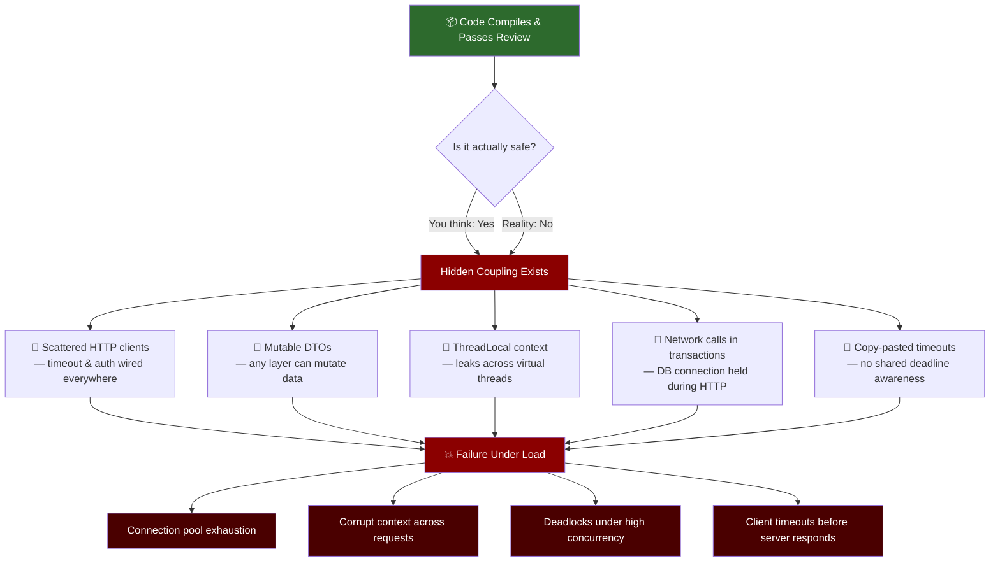

### Why Hidden Coupling is Dangerous

| Visible Problem | Hidden Root Cause |
|---|---|
| Slow responses under load | DB connection held during remote HTTP call |
| Context bleeding between requests | ThreadLocal not cleared across thread-pool reuse |
| Inconsistent error messages | Each team inventing their own error shape |
| Timeout cascades | Each service independently setting its own timeout budget |
| Security audit failures | Raw PII logged in payloads |

> ⚠️ **Warning:** The dangerous part of hidden coupling is that it is *invisible at review time*. A reviewer reads one class at a time. Hidden coupling lives *between* classes — in assumptions that no single file states. That's why each swap in this tutorial ends with a centralized, explicit replacement: the coupling becomes visible because it's written down in one place.

---

## 🏗️ System Architecture: Before & After

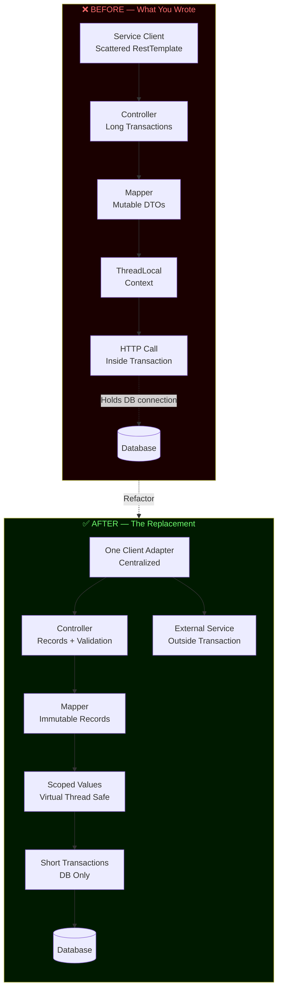

---

## 🔑 The Four Guiding Principles

These four principles explain *why* the swaps work and give you a mental model for future decisions:

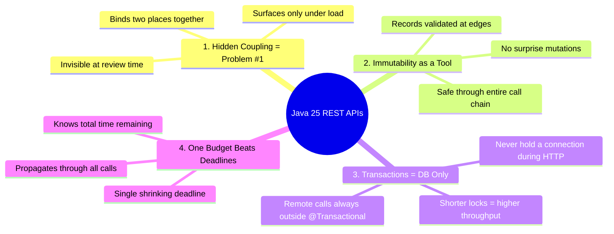

---

## 🔄 The Ten Swaps — Overview

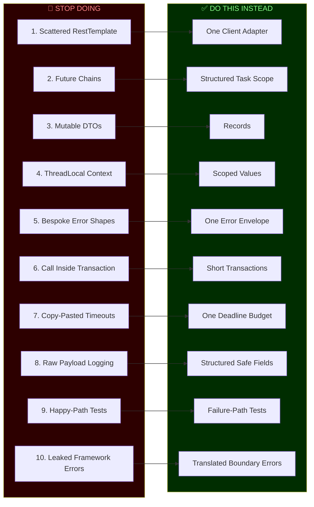

---

## 1️⃣ Swap 1 — Scattered RestTemplate → One Client Adapter

### ❌ The Problem

Every service class independently wires its own `RestTemplate` — complete with its own timeout, retry logic, auth header injection, and base URL. This means:

- Policy changes (e.g., "add a new auth header") require hunting through 20 files
- No single place to observe or trace outbound calls
- Timeout/retry behaviors drift silently across teams

```java
// ❌ STOP DOING — Scattered RestTemplate everywhere
@Service
public class OrderService {
    @Autowired
    private RestTemplate restTemplate;

    public Order createOrder(OrderRequest req) {
        // Auth wired manually — every service does this differently
        HttpHeaders headers = new HttpHeaders();
        headers.set("Authorization", "Bearer " + tokenService.getToken());
        headers.set("X-Correlation-ID", MDC.get("correlationId")); // Easily forgotten

        ResponseEntity<Order> response = restTemplate.exchange(
            "http://inventory-service/api/inventory/check", // Hard-coded URL
            HttpMethod.POST,
            new HttpEntity<>(req, headers),
            Order.class
        );
        return response.getBody();
    }
}

@Service
public class PaymentService {
    @Autowired
    private RestTemplate restTemplate; // Duplicated! Different timeout config!

    public Payment charge(ChargeRequest req) {
        HttpHeaders headers = new HttpHeaders();
        headers.set("Authorization", "Bearer " + tokenService.getToken()); // Again!
        // ... same boilerplate, slightly different, silent drift
    }
}
```

### ✅ The Solution: One Client Adapter

Centralize all outbound HTTP in a single adapter layer with consistent auth, retries, observability, and timeouts.

```java
// ✅ DO THIS INSTEAD — Declarative client interface
@HttpExchange("http://inventory-service")
public interface InventoryClient {

    @PostExchange("/api/inventory/check")
    InventoryStatus checkAvailability(@RequestBody CheckRequest req);

    @GetExchange("/api/inventory/{productId}")
    Product getProduct(@PathVariable String productId);
}

// Centralized configuration — one place for ALL outbound HTTP policy
@Configuration
public class HttpClientConfig {

    @Bean
    public InventoryClient inventoryClient(RestClient.Builder builder) {
        RestClient restClient = builder
            .baseUrl("http://inventory-service")
            .defaultHeader("Authorization", () -> "Bearer " + tokenProvider.getToken())
            .defaultHeader("X-Correlation-ID", () -> MDC.get("correlationId"))
            .build();

        HttpServiceProxyFactory factory = HttpServiceProxyFactory
            .builderFor(RestClientAdapter.create(restClient))
            .build();

        return factory.createClient(InventoryClient.class);
    }
}

// Now your services are clean
@Service
public class OrderService {
    private final InventoryClient inventoryClient; // Injected — no boilerplate

    public OrderService(InventoryClient inventoryClient) {
        this.inventoryClient = inventoryClient;
    }

    public Order createOrder(OrderRequest req) {
        InventoryStatus status = inventoryClient.checkAvailability(
            new CheckRequest(req.productId(), req.quantity())
        );
        // Clean. No auth headers. No URL strings. No timeout config here.
        return processOrder(req, status);
    }
}
```

> 💡 **Tip:** The `defaultHeader(String, Supplier<String>)` overloads are evaluated **per request**, so a rotated token is always current — no stale-token race conditions.

### 📊 Architecture Diagram

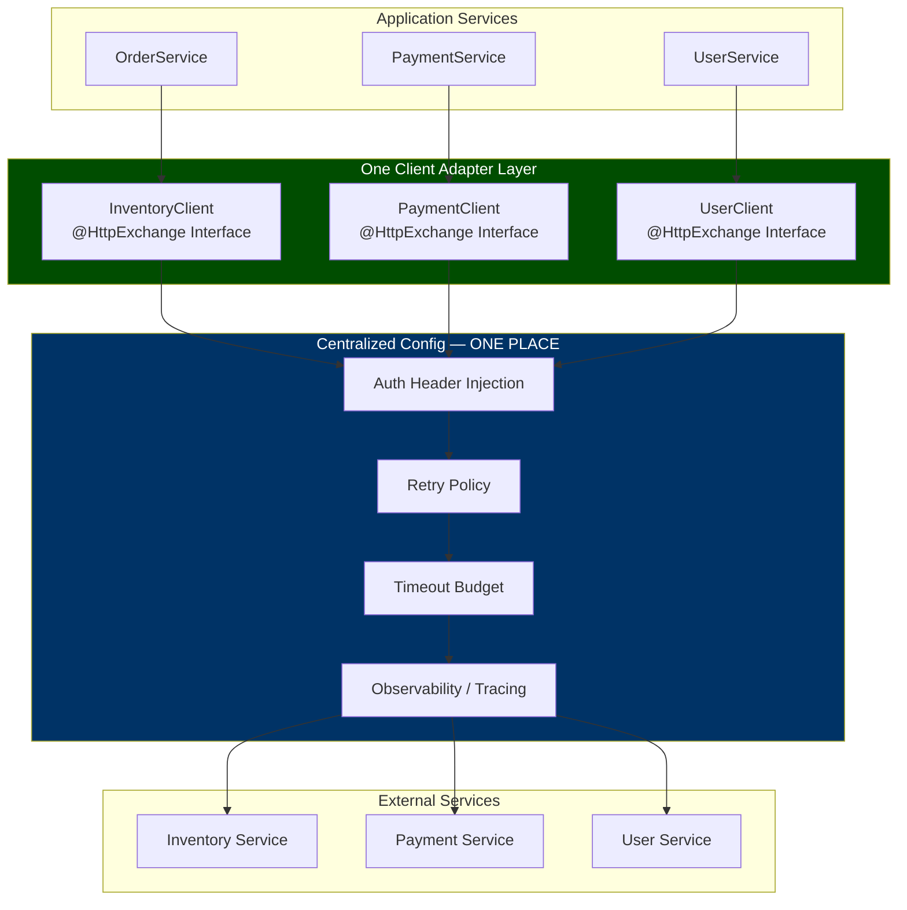

### 🌍 Real-World Use Case

**Scenario:** Your security team mandates rotating API keys every 6 hours.

- ❌ **Before:** You have to find and update 20+ service classes, each with its own auth header wiring. Miss one and you get 401s in production.
- ✅ **After:** Update `HttpClientConfig` in one place. Done. Every service immediately benefits.

---

## 2️⃣ Swap 2 — Future Chains → Structured Task Scope

### ❌ The Problem

`CompletableFuture` chains are powerful but dangerous. Cancellation doesn't propagate, leaked threads are hard to detect, and error handling sprawls across callbacks.

```java
// ❌ STOP DOING — CompletableFuture chains
public DashboardData buildDashboard(String userId) {
    CompletableFuture<User> userFuture = CompletableFuture.supplyAsync(
        () -> userClient.getUser(userId), executor
    );
    CompletableFuture<List<Order>> ordersFuture = CompletableFuture.supplyAsync(
        () -> orderClient.getOrders(userId), executor
    );
    CompletableFuture<Wallet> walletFuture = CompletableFuture.supplyAsync(
        () -> walletClient.getWallet(userId), executor
    );

    return CompletableFuture.allOf(userFuture, ordersFuture, walletFuture)
        .thenApply(ignored -> {
            try {
                // What if userFuture failed? .join() throws here
                User user = userFuture.join();
                List<Order> orders = ordersFuture.join();
                Wallet wallet = walletFuture.join();
                return new DashboardData(user, orders, wallet);
            } catch (Exception e) {
                // swallowed? rethrown? hard to propagate cleanly
                throw new RuntimeException(e);
            }
        })
        .join(); // blocks — thread potentially leaked if one subtask hangs
}
```

### ✅ The Solution: Structured Task Scope (Java 21+ / Java 25)

With `StructuredTaskScope`, all child tasks are scoped to their parent. Cancellation propagates. Failures are explicit. Thread leaks are impossible.

```java
// ✅ DO THIS INSTEAD — Structured Task Scope
public DashboardData buildDashboard(String userId) throws InterruptedException {
    try (var scope = new StructuredTaskScope.ShutdownOnFailure()) {

        // Fork all parallel calls
        StructuredTaskScope.Subtask<User> userTask =
            scope.fork(() -> userClient.getUser(userId));

        StructuredTaskScope.Subtask<List<Order>> ordersTask =
            scope.fork(() -> orderClient.getOrders(userId));

        StructuredTaskScope.Subtask<Wallet> walletTask =
            scope.fork(() -> walletClient.getWallet(userId));

        // Wait for all; if ANY fails, all are cancelled automatically
        scope.join()
             .throwIfFailed(e -> new DashboardException("Failed to load dashboard", e));

        // All tasks succeeded — safe to call .get()
        return new DashboardData(
            userTask.get(),
            ordersTask.get(),
            walletTask.get()
        );
    }
    // Scope closes: all threads are guaranteed to have finished or been cancelled
}
```

**Example: Shutdown on Success (take the first result)**

```java
// Return whichever inventory replica responds first
public InventoryData getInventory(String productId) throws InterruptedException {
    try (var scope = new StructuredTaskScope.ShutdownOnSuccess<InventoryData>()) {

        scope.fork(() -> primaryInventory.get(productId));   // primary datacenter
        scope.fork(() -> replicaInventory.get(productId));   // replica datacenter

        return scope.join().result(); // first success wins, other is cancelled
    }
}
```

> 💡 **Tip:** In Java 25, `StructuredTaskScope` also supports a **joiner-based** API (`StructuredTaskScope.open(Joiner.allSuccessfulOrThrow())`), which replaces the `ShutdownOnFailure` subclass pattern with composable joiners. Both idioms work — pick the one your team standardizes on, and be consistent.

### 📊 Lifecycle Diagram

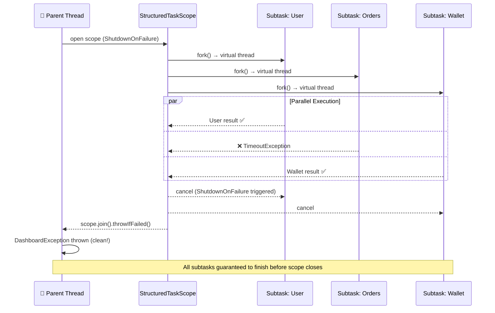

### 🌍 Real-World Use Case

**Scenario:** Building a product page that needs data from user profile, inventory, pricing, and recommendation services.

| Approach | Risk |
|---|---|
| Sequential calls | 400ms + 200ms + 300ms + 150ms = **1050ms total** |
| CompletableFuture | Fast, but one hanging thread can leak indefinitely |
| **Structured Task Scope** | Parallel, bounded, cancel-safe — **max 400ms total** |

---

## 3️⃣ Swap 3 — Mutable DTOs → Records

### ❌ The Problem

Mutable DTOs allow any layer — controller, service, mapper, or even a forgotten filter — to change the data silently. Validation at the controller boundary means nothing if a downstream layer can call `setStatus("APPROVED")`.

```java
// ❌ STOP DOING — Mutable DTO
public class OrderDTO {
    private String id;
    private Long customerId;
    private String status;
    private BigDecimal amount;
    private String currency;

    // Any layer can call these — no way to tell where mutation happened
    public void setStatus(String status) { this.status = status; }
    public void setAmount(BigDecimal amount) { this.amount = amount; }
    // ... plus: equals(), hashCode(), toString() — 30+ lines of boilerplate
}

// In some audit log service, innocently:
orderDTO.setStatus("AUDITED"); // Mutates the same object the controller will serialize!
```

### ✅ The Solution: Records (Java 16+, standard in Java 25)

Records are immutable by default. They validate at creation time. They provide `equals()`, `hashCode()`, and `toString()` automatically. One layer validates; all downstream layers get the guaranteed-valid value.

```java
// ✅ DO THIS INSTEAD — Immutable Record
public record Order(
    String id,
    Long customerId,
    String status,
    BigDecimal amount,
    String currency
) {
    // Compact constructor: validation runs at creation — nowhere else needed
    public Order {
        Objects.requireNonNull(id, "Order ID must not be null");
        Objects.requireNonNull(customerId, "Customer ID must not be null");
        if (amount == null || amount.compareTo(BigDecimal.ZERO) < 0)
            throw new IllegalArgumentException("Amount must be non-negative");
        if (currency == null || currency.length() != 3)
            throw new IllegalArgumentException("Currency must be a 3-letter ISO code");
        // Normalize
        currency = currency.toUpperCase();
    }

    // Derived fields — computed from immutable state
    public boolean isHighValue() {
        return amount.compareTo(new BigDecimal("10000")) > 0;
    }

    // "Mutation" returns a NEW record — original is untouched
    public Order withStatus(String newStatus) {
        return new Order(id, customerId, newStatus, amount, currency);
    }
}

// Usage — safe through every layer
Order order = new Order("ORD-001", 42L, "PENDING", new BigDecimal("99.99"), "usd");
// order.amount = ... — COMPILE ERROR. Cannot mutate.
Order approved = order.withStatus("APPROVED"); // New record, original unchanged.
```

**Example: Nested Records for Complex Payloads**

```java
public record OrderRequest(
    String productId,
    int quantity,
    ShippingAddress shippingAddress,
    PaymentMethod paymentMethod
) {
    public record ShippingAddress(
        String street, String city, String postalCode, String countryCode
    ) {
        public ShippingAddress {
            if (postalCode == null || postalCode.isBlank())
                throw new IllegalArgumentException("Postal code required");
        }
    }

    public record PaymentMethod(String type, String maskedCardNumber) {
        public PaymentMethod {
            Objects.requireNonNull(type, "Payment type required");
        }
    }

    public OrderRequest {
        if (quantity <= 0)
            throw new IllegalArgumentException("Quantity must be positive");
    }
}
```

> 💡 **Tip:** Records pair beautifully with Bean Validation. Put `@NotNull`, `@Size`, `@Positive` annotations on record components and add `@Valid` on the controller parameter — the framework validates before your compact constructor ever runs, and both layers of defense are declarative.

### 📊 Data Flow Diagram

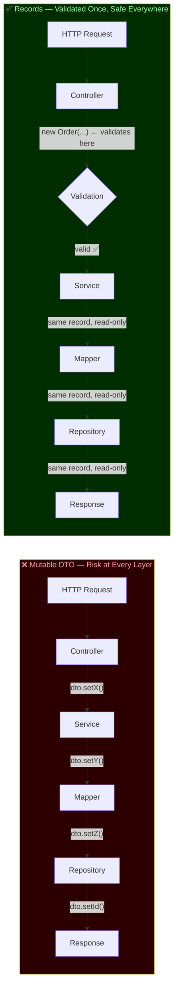

### 🌍 Real-World Use Case

**Scenario:** A price calculation service reads an `OrderDTO`. A bug in the discount logic calls `order.setAmount(discountedPrice)`. The original order is now corrupted — the controller sends back the discounted price *instead of* the original, causing a financial error.

With Records, `order.setAmount(...)` is a **compile-time error**. The discount service must produce a new `Order` with `order.withAmount(discountedPrice)`, keeping the audit trail clear.

---

## 4️⃣ Swap 4 — ThreadLocal Context → Scoped Values

### ❌ The Problem

`ThreadLocal` was designed for platform threads (one request = one thread). Java 25's virtual threads mean one request can *hop between many threads*. A `ThreadLocal` set on thread A is invisible on thread B — and worse, a thread pool can *reuse* thread A for a different request before it's cleared.

```java
// ❌ STOP DOING — ThreadLocal context
public class RequestContext {
    private static final ThreadLocal<String> USER_ID = new ThreadLocal<>();
    private static final ThreadLocal<String> TRACE_ID = new ThreadLocal<>();

    public static void setUserId(String id) { USER_ID.set(id); }
    public static String getUserId() { return USER_ID.get(); } // Returns null on wrong thread!
    public static void clear() { USER_ID.remove(); TRACE_ID.remove(); } // Easy to forget!
}

// In a filter:
RequestContext.setUserId(extractUserId(request));
try {
    chain.doFilter(request, response);
} finally {
    RequestContext.clear(); // What if a virtual thread is still running after this?
}

// In a downstream async service — context is GONE
@Async
public void auditLog(String action) {
    String userId = RequestContext.getUserId(); // null! Different thread!
    log.info("User {} did {}", userId, action); // Logs "null did CREATE_ORDER"
}
```

### ✅ The Solution: Scoped Values (Java 21+, finalized in Java 25)

`ScopedValue` is designed for virtual threads. The value is available to all code *within the scope*, including forked virtual threads, and is automatically cleaned up when the scope exits.

```java
// ✅ DO THIS INSTEAD — Scoped Values
public class RequestContext {
    // Declared as constants — the scoped value holder
    public static final ScopedValue<String> USER_ID = ScopedValue.newInstance();
    public static final ScopedValue<String> TRACE_ID = ScopedValue.newInstance();
    public static final ScopedValue<String> TENANT_ID = ScopedValue.newInstance();
}

// In your filter / interceptor:
@Component
public class RequestContextFilter implements Filter {

    @Override
    public void doFilter(ServletRequest req, ServletResponse res, FilterChain chain)
            throws IOException, ServletException {

        String userId = extractUserId((HttpServletRequest) req);
        String traceId = UUID.randomUUID().toString();
        String tenantId = extractTenantId((HttpServletRequest) req);

        // Bind all context for the duration of this request
        ScopedValue.where(RequestContext.USER_ID, userId)
            .where(RequestContext.TRACE_ID, traceId)
            .where(RequestContext.TENANT_ID, tenantId)
            .run(() -> chain.doFilter(req, res));
        // Values are automatically gone after run() — no .clear() needed
    }
}

// Anywhere in the call stack — even in virtual threads forked during the request:
@Service
public class AuditService {
    public void log(String action) {
        String userId = RequestContext.USER_ID.get();   // Always correct
        String traceId = RequestContext.TRACE_ID.get(); // Always correct
        log.info("User={} TraceId={} Action={}", userId, traceId, action);
    }
}
```

**Example: Multi-Tenant Context**

```java
// Scoped Values compose naturally with Structured Task Scope
public DashboardData buildTenantDashboard(String tenantId, String userId)
        throws InterruptedException {

    return ScopedValue.where(RequestContext.TENANT_ID, tenantId)
        .where(RequestContext.USER_ID, userId)
        .call(() -> {
            try (var scope = new StructuredTaskScope.ShutdownOnFailure()) {
                // Both forked tasks inherit the scoped context automatically
                var ordersTask = scope.fork(() -> orderService.getOrders());
                var profileTask = scope.fork(() -> profileService.getProfile());

                scope.join().throwIfFailed();
                return new DashboardData(ordersTask.get(), profileTask.get());
            }
        });
}
```

> ⚠️ **Warning:** Unlike `ThreadLocal`, a `ScopedValue` cannot be *rebound* inside its scope — bindings are write-once per scope. If you were using `ThreadLocal.set()` to mutate context mid-request (e.g., after authentication), restructure the code so the binding happens *before* the scope opens, or nest a new `ScopedValue.where(...)` block for the authenticated portion of the request.

### 📊 ThreadLocal vs Scoped Values Comparison

```mermaid
sequenceDiagram
    participant R as Request Thread
    participant VT1 as Virtual Thread 1
    participant VT2 as Virtual Thread 2

    rect rgb(80, 0, 0)
        Note over R,VT2: ❌ ThreadLocal — BROKEN with virtual threads
        R->>R: ThreadLocal.set("user-123")
        R->>VT1: fork async task
        VT1->>VT1: ThreadLocal.get() → null ❌
        Note over VT1: Context LOST on different thread!
        R->>VT2: fork async task
        VT2->>VT2: ThreadLocal.get() → stale value ❌
    end

    rect rgb(0, 60, 0)
        Note over R,VT2: ✅ Scoped Values — CORRECT with virtual threads
        R->>R: ScopedValue.where(USER,"user-123").run(...)
        R->>VT1: fork within scope
        VT1->>VT1: ScopedValue.get() → "user-123" ✅
        R->>VT2: fork within scope
        VT2->>VT2: ScopedValue.get() → "user-123" ✅
        Note over R,VT2: Context inherited safely, cleaned up automatically
    end
```

### 🌍 Real-World Use Case

**Scenario:** Your service audits every action with the requesting user ID. Under Java 25 virtual threads, a background audit-log task runs on a different carrier thread. With `ThreadLocal`, the user ID is `null`. With `ScopedValue`, it flows correctly because the scope encloses the entire request lifecycle.

---

## 5️⃣ Swap 5 — Bespoke Error Shapes → One Error Envelope

### ❌ The Problem

Every team invents their own error response format. Clients have to handle five different error shapes depending on which service they're calling.

```java
// ❌ STOP DOING — Each service invents its own error format
// Order service
record OrderError(String orderId, String reason, int errorCode) {}

// User service
record UserError(String message, String field, String description) {}

// Payment service
record PaymentFailure(
    String transactionId, String error,
    boolean retryable, String retryAfter
) {}

// Inventory service — uses a Map!
Map<String, Object> inventoryError = Map.of(
    "msg", "Out of stock",
    "sku", productId,
    "ts", Instant.now()
);
```

### ✅ The Solution: One Error Envelope

Define a single, organization-wide error contract that every service returns.

```java
// ✅ DO THIS INSTEAD — One canonical error envelope
public record ErrorEnvelope(
    String traceId,          // Correlates to distributed trace
    String code,             // Machine-readable: "INVENTORY_INSUFFICIENT"
    String message,          // Human-readable: "Not enough stock for this order"
    List<FieldViolation> violations, // Per-field validation errors
    Instant timestamp
) {
    public record FieldViolation(
        String field,
        String constraint,   // "must be positive", "must not be null"
        Object rejectedValue // The value that failed
    ) {}

    // Factory methods for common cases
    public static ErrorEnvelope notFound(String traceId, String resourceType, String id) {
        return new ErrorEnvelope(
            traceId,
            resourceType.toUpperCase() + "_NOT_FOUND",
            resourceType + " with id '" + id + "' was not found",
            List.of(),
            Instant.now()
        );
    }

    public static ErrorEnvelope validationFailed(String traceId, List<FieldViolation> violations) {
        return new ErrorEnvelope(
            traceId, "VALIDATION_FAILED",
            "The request contained invalid fields",
            violations, Instant.now()
        );
    }

    public static ErrorEnvelope internalError(String traceId) {
        return new ErrorEnvelope(
            traceId, "INTERNAL_ERROR",
            "An unexpected error occurred. Use the traceId to investigate.",
            List.of(), Instant.now()
        );
    }
}

// Centralized exception handler — all services use this
@RestControllerAdvice
public class GlobalExceptionHandler {

    @ExceptionHandler(EntityNotFoundException.class)
    public ResponseEntity<ErrorEnvelope> handleNotFound(
            EntityNotFoundException ex, HttpServletRequest req) {
        return ResponseEntity.status(HttpStatus.NOT_FOUND)
            .body(ErrorEnvelope.notFound(traceId(req), ex.getEntityName(), ex.getId()));
    }

    @ExceptionHandler(ConstraintViolationException.class)
    public ResponseEntity<ErrorEnvelope> handleValidation(
            ConstraintViolationException ex, HttpServletRequest req) {
        List<ErrorEnvelope.FieldViolation> violations = ex.getConstraintViolations()
            .stream()
            .map(v -> new ErrorEnvelope.FieldViolation(
                v.getPropertyPath().toString(),
                v.getMessage(),
                v.getInvalidValue()
            ))
            .toList();
        return ResponseEntity.status(HttpStatus.BAD_REQUEST)
            .body(ErrorEnvelope.validationFailed(traceId(req), violations));
    }

    @ExceptionHandler(Exception.class)
    public ResponseEntity<ErrorEnvelope> handleGeneric(
            Exception ex, HttpServletRequest req) {
        log.error("Unhandled exception [traceId={}]", traceId(req), ex); // Log full details
        return ResponseEntity.status(HttpStatus.INTERNAL_SERVER_ERROR)
            .body(ErrorEnvelope.internalError(traceId(req))); // Reveal nothing to client
    }
}
```

**Example Error Response (JSON)**

```json
{
  "traceId": "4f2c1a9e-8b3d-4e76-a2f5-1c9d0e3b7a2f",
  "code": "VALIDATION_FAILED",
  "message": "The request contained invalid fields",
  "violations": [
    { "field": "quantity", "constraint": "must be positive", "rejectedValue": -1 },
    { "field": "currency", "constraint": "must be a 3-letter ISO code", "rejectedValue": "DOLLARS" }
  ],
  "timestamp": "2025-09-19T10:30:00Z"
}
```

> 💡 **Tip:** Treat the `ErrorEnvelope` like a public API contract: version it, document it in your OpenAPI spec, and publish it in a shared internal library so every service in the organization compiles against the *same* record.

### 🌍 Real-World Use Case

**Scenario:** Your mobile app client handles errors. With bespoke shapes, the frontend team writes a different error-parsing function for every API endpoint. With one envelope, they write it once and it works everywhere. Debugging becomes instant: paste the `traceId` into your tracing system and see the full call chain.

---

## 6️⃣ Swap 6 — Call Inside Transaction → Short Transactions

### ❌ The Problem

Annotating a method with `@Transactional` that also makes a remote HTTP call holds a database connection and possibly a row lock **for the entire duration of the network round trip**. Under load, this exhausts the connection pool.

```java
// ❌ STOP DOING — Network call inside a @Transactional method
@Transactional
public void processOrder(String orderId) {
    // 1. Opens DB connection
    Order order = orderRepo.findById(orderId).orElseThrow(); // Lock acquired

    // 2. DANGER: HTTP call to external payment gateway
    // DB connection held for 200ms–2000ms of network latency!
    // Under 100 concurrent requests: connection pool exhausted
    PaymentResult result = paymentGateway.charge(
        new ChargeRequest(order.amount(), order.customerId())
    );

    // 3. DB write finally happens
    order = order.withStatus("PAID").withPaymentId(result.transactionId());
    orderRepo.save(order);
    // Connection released ONLY after HTTP call + DB write
}
```

### ✅ The Solution: Short Transactions — DB Only

Keep `@Transactional` boundaries around **only database work**. Do all remote calls outside.

```java
// ✅ DO THIS INSTEAD — Short transactions

@Service
public class OrderService {

    // Step 1: Lock order (short transaction)
    @Transactional
    public Order reserveOrder(String orderId) {
        Order order = orderRepo.findById(orderId).orElseThrow();
        if (!"PENDING".equals(order.status()))
            throw new IllegalStateException("Order " + orderId + " is not pending");
        return orderRepo.save(order.withStatus("PROCESSING"));
        // DB connection released here! No external calls yet.
    }

    // Step 2: Charge payment (NO transaction — pure HTTP)
    public PaymentResult chargePayment(Order order) {
        return paymentGateway.charge(
            new ChargeRequest(order.amount(), order.customerId())
        );
        // No DB connection held during this potentially slow call
    }

    // Step 3: Finalize (short transaction)
    @Transactional
    public Order finalizeOrder(String orderId, PaymentResult payment) {
        Order order = orderRepo.findById(orderId).orElseThrow();
        return orderRepo.save(
            order.withStatus("PAID").withPaymentId(payment.transactionId())
        );
        // DB connection released immediately after save
    }

    // Orchestrate from a non-transactional method
    public Order processOrder(String orderId) {
        Order reserved = reserveOrder(orderId);    // Short TX
        PaymentResult payment = chargePayment(reserved); // No TX
        return finalizeOrder(orderId, payment);    // Short TX
    }
}
```

> ⚠️ **Warning:** Spring's `@Transactional` works via proxies — a `this.processOrder()` internal call to `@Transactional` methods on the same bean bypasses the proxy entirely. Either put the orchestration method in a *separate* bean (as shown), or call the transactional methods through the injected proxy. This is the #1 reason "I added @Transactional but the connection is still held" happens.

### 📊 Connection Pool Impact

```mermaid
gantt
    title DB Connection Held: Long vs Short Transaction
    dateFormat  X
    axisFormat %s

    section ❌ Long Transaction
    Open connection + Lock row     :active, 0, 10
    HTTP call to payment gateway   :crit, 10, 210
    DB write + Commit              :active, 210, 230
    Connection RELEASED            :milestone, 230, 230

    section ✅ Short Transactions
    TX1 - Lock + Read (10ms)       :active, a1, 0, 10
    TX1 Released                   :milestone, 10, 10
    HTTP call (200ms) — NO DB hold :done, 10, 210
    TX2 - Write + Commit (20ms)    :active, 210, 230
    TX2 Released                   :milestone, 230, 230
```

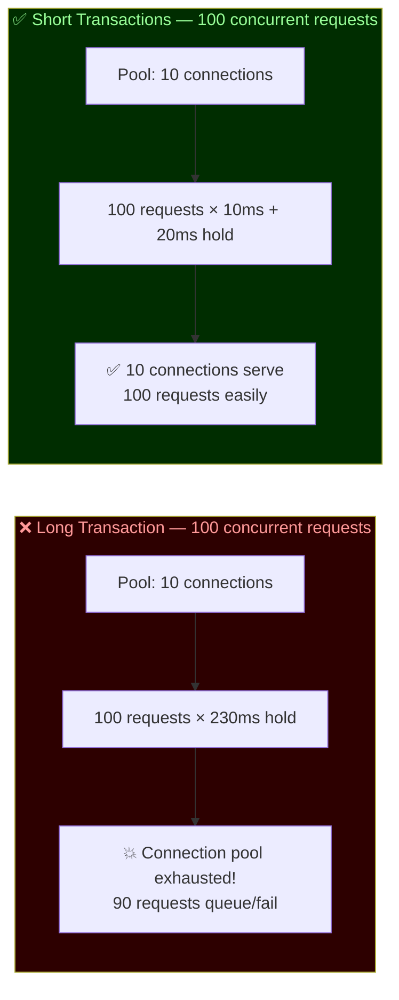

### 🌍 Real-World Use Case

**Scenario:** An e-commerce checkout handles 100 concurrent requests. Payment gateway averages 300ms. With `@Transactional` wrapping the payment call, 10 DB connections hold for 300ms each — serving only **33 requests/second**. With short transactions, the same 10 connections serve **500+ requests/second**.

---

## 7️⃣ Swap 7 — Copy-Pasted Timeouts → One Deadline Budget

### ❌ The Problem

Each service independently sets a timeout. There is no coordination. The caller's timeout expires while internal services are still happily retrying with their own timeouts.

```java
// ❌ STOP DOING — Copy-pasted timeouts with no coordination
public CheckoutResult checkout(CartId cartId) {
    // Each service has its own idea of "how long is too long"
    User user = userClient.getUser(cartId.userId(),
        Duration.ofSeconds(5));     // 5 seconds

    Inventory inv = inventoryClient.checkAll(cartId.items(),
        Duration.ofSeconds(3));     // 3 seconds

    PriceBreakdown pricing = pricingClient.calculate(cartId.items(),
        Duration.ofSeconds(4));     // 4 seconds

    Payment pay = paymentClient.charge(pricing.total(),
        Duration.ofSeconds(10));    // 10 seconds

    // Worst case: 5 + 3 + 4 + 10 = 22 seconds total
    // Your API gateway timeout: 5 seconds
    // Client already got a timeout error at second 5!
    // Yet your services keep working for 17 more seconds — wasting resources
}
```

### ✅ The Solution: One Deadline Budget

Pass a single shrinking deadline through the entire call chain. Every service knows the total time remaining.

```java
// ✅ DO THIS INSTEAD — One Deadline Budget

// Immutable deadline record that tracks remaining time
public record Deadline(Instant expiresAt) {

    public static Deadline in(Duration duration) {
        return new Deadline(Instant.now().plus(duration));
    }

    public Duration remaining() {
        Duration left = Duration.between(Instant.now(), expiresAt);
        if (left.isNegative() || left.isZero())
            throw new DeadlineExceededException("Request deadline has passed");
        return left;
    }

    public boolean isExpired() {
        return Instant.now().isAfter(expiresAt);
    }

    // Return remaining time, but never more than the cap
    public Duration remainingCapped(Duration maxPerCall) {
        return remaining().compareTo(maxPerCall) < 0 ? remaining() : maxPerCall;
    }
}

public class CheckoutService {

    public CheckoutResult checkout(CartId cartId, Deadline deadline) {
        // Each call gets a slice of what's LEFT — not its own budget
        User user = userClient.getUser(
            cartId.userId(),
            deadline.remainingCapped(Duration.ofSeconds(2))
        );

        Inventory inv = inventoryClient.checkAll(
            cartId.items(),
            deadline.remainingCapped(Duration.ofSeconds(2))
        );

        PriceBreakdown pricing = pricingClient.calculate(
            cartId.items(),
            deadline.remainingCapped(Duration.ofSeconds(2))
        );

        Payment pay = paymentClient.charge(
            pricing.total(),
            deadline.remaining() // Give remainder to final call
        );

        return new CheckoutResult(user, inv, pricing, pay);
    }
}

// At the API boundary — set the budget once
@PostMapping("/checkout")
public ResponseEntity<CheckoutResult> checkout(
        @RequestBody CheckoutRequest req,
        @RequestHeader(value = "X-Request-Deadline", required = false) String deadlineHeader) {

    // Either honor the client's deadline or set a service default
    Deadline deadline = deadlineHeader != null
        ? new Deadline(Instant.parse(deadlineHeader))
        : Deadline.in(Duration.ofSeconds(5));

    return ResponseEntity.ok(checkoutService.checkout(req.cartId(), deadline));
}
```

> 💡 **Tip:** Propagate the deadline to downstream services as an HTTP header (`X-Request-Deadline` or the standardized `Deadline` header from gRPC's `grpc-timeout` convention). A deadline that stops at your service edge only protects *your* resources — propagated deadlines protect the whole call graph.

### 📊 Deadline Budget Flow

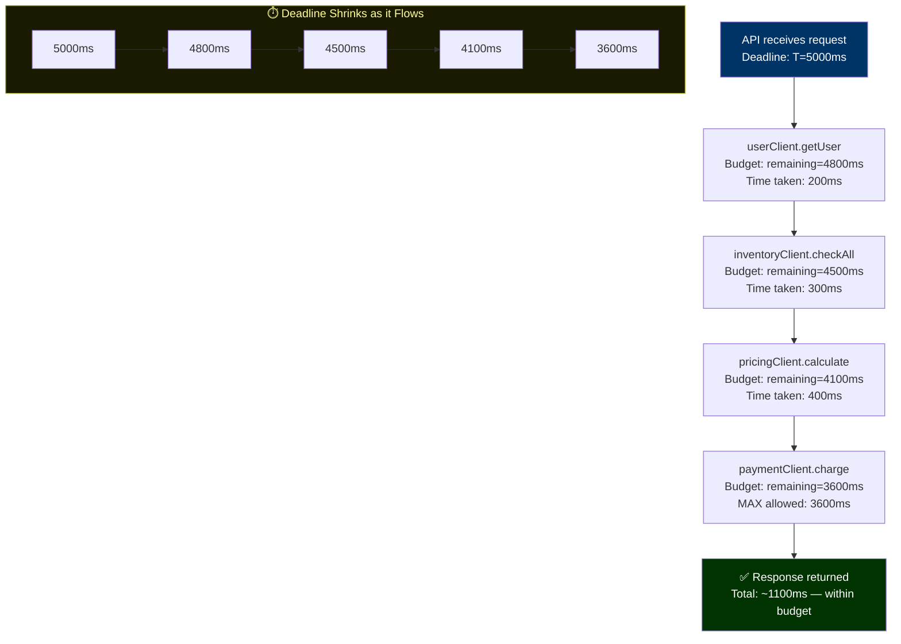

### 🌍 Real-World Use Case

**Scenario:** A mobile client sets a 5-second deadline via `X-Request-Deadline` header. Your checkout service passes this deadline to every downstream call. If the payment service is slow and eats 4 seconds, pricing only gets 800ms. If *that* times out, a `DeadlineExceededException` is thrown — and the client gets a response at second 4.8, within budget. Without a shared deadline, the client gets a timeout at second 5 while your services work for another 15 seconds, burning resources on a request no one will ever receive.

---

## 8️⃣ Swap 8 — Raw Payload Logging → Structured Safe Fields

### ❌ The Problem

Logging the entire request or response body is the fastest path to a GDPR violation, a PCI-DSS audit failure, or a security breach. Sensitive data in logs is often permanently stored in log aggregation services.

```java
// ❌ STOP DOING — Raw payload logging
@PostMapping("/checkout")
public ResponseEntity<Order> checkout(@RequestBody CheckoutRequest request) {
    // This logs EVERYTHING:
    // CheckoutRequest[cardNumber=4532-1234-5678-9012, cvv=789,
    //   customerEmail=john@example.com, billingAddress=123 Main St...]
    log.info("Checkout request received: {}", request);

    // PCI-DSS violation: card data in logs
    // GDPR violation: PII (email, address) in logs
    // Security risk: logs are often less protected than databases
    return ResponseEntity.ok(orderService.checkout(request));
}
```

### ✅ The Solution: Structured Safe Fields

Define explicit safe log projections for every request type. Never let the logger touch the full object.

```java
// ✅ DO THIS INSTEAD — Structured Safe Fields

// A safe-fields projection — only what's safe to log
public record CheckoutAuditLog(
    String customerId,    // Safe: internal ID, not PII
    String sessionId,     // Safe: session reference
    int itemCount,        // Safe: count only
    String currency,      // Safe: currency code
    String region,        // Safe: region, not address
    boolean hasDiscount   // Safe: boolean flag
) {
    public static CheckoutAuditLog from(CheckoutRequest req) {
        return new CheckoutAuditLog(
            req.customerId(),
            req.sessionId(),
            req.items().size(),
            req.currency(),
            req.shippingAddress().countryCode(), // Country only, not street
            req.discountCode() != null
            // NEVER: req.cardNumber(), req.cvv(), req.email(), req.billingAddress()
        );
    }
}

@PostMapping("/checkout")
public ResponseEntity<Order> checkout(
        @RequestBody CheckoutRequest request,
        HttpServletRequest httpReq) {

    // Log only safe fields with structured key-value pairs
    log.info("Checkout initiated",
        Map.of(
            "customerId", request.customerId(),
            "sessionId", request.sessionId(),
            "itemCount", request.items().size(),
            "currency", request.currency(),
            "traceId", RequestContext.TRACE_ID.get()
        )
    );

    Order result = orderService.checkout(request);

    log.info("Checkout completed",
        Map.of(
            "orderId", result.id(),
            "status", result.status(),
            "traceId", RequestContext.TRACE_ID.get()
        )
    );

    return ResponseEntity.ok(result);
}
```

**Example: Masking Utility for Debugging**

```java
// For debugging only — never production logging
public class SafeMask {
    public static String maskCard(String cardNumber) {
        if (cardNumber == null || cardNumber.length() < 4) return "****";
        return "**** **** **** " + cardNumber.substring(cardNumber.length() - 4);
    }

    public static String maskEmail(String email) {
        if (email == null || !email.contains("@")) return "****";
        int atIndex = email.indexOf("@");
        return email.charAt(0) + "****" + email.substring(atIndex);
    }
}
// Usage: log.debug("Card: {}", SafeMask.maskCard(cardNumber))
//         → "Card: **** **** **** 9012"
```

> ⚠️ **Warning:** Records automatically generate a `toString()` that includes **every component**. If a request record contains a card number, any accidental `log.info("req: {}", req)` leaks it. Consider overriding `toString()` in sensitive records to return a masked, redacted form — or better, never pass sensitive data into records that cross logging boundaries.

### 🌍 Real-World Use Case

**Scenario:** A post-incident review requires searching logs for a transaction. With raw payload logging, you'd find card numbers, CVVs, and home addresses in your Elasticsearch cluster — shared with your entire engineering team. A structured-safe log approach means you can search by `customerId` and `orderId` without ever exposing sensitive data, and passes PCI-DSS logging requirements automatically.

---

## 9️⃣ Swap 9 — Happy-Path Tests → Failure-Path Tests

### ❌ The Problem

Test suites that only test the happy path give false confidence. Production failures almost always happen on the paths that were never tested: timeouts, partial failures, dependency downtime, malformed inputs.

```java
// ❌ STOP DOING — Happy-path-only tests
@Test
void shouldCreateOrderSuccessfully() {
    when(inventoryClient.check(any())).thenReturn(InventoryStatus.available());
    when(paymentClient.charge(any())).thenReturn(PaymentResult.success("TXN-001"));

    Order result = orderService.createOrder(validOrderRequest);

    assertEquals("CREATED", result.status());
    verify(inventoryClient).check(any());
    verify(paymentClient).charge(any());
    // Tests only the case where everything goes perfectly
    // Real production: services fail constantly
}
```

### ✅ The Solution: Failure-Path Tests

Test every failure scenario you can think of. If a dependency can fail, it *will* fail in production.

```java
// ✅ DO THIS INSTEAD — Comprehensive failure-path tests

class OrderServiceFailureTests {

    @Test
    void shouldThrowWhenInventoryServiceIsUnavailable() {
        when(inventoryClient.check(any()))
            .thenThrow(new ServiceUnavailableException("Inventory service is down"));

        ServiceUnavailableException ex = assertThrows(
            ServiceUnavailableException.class,
            () -> orderService.createOrder(validOrderRequest)
        );
        assertEquals("Inventory service is down", ex.getMessage());
    }

    @Test
    void shouldThrowWhenInventoryServiceTimesOut() {
        when(inventoryClient.check(any()))
            .thenThrow(new DeadlineExceededException("Inventory check timed out"));

        assertThrows(DeadlineExceededException.class,
            () -> orderService.createOrder(validOrderRequest));
    }

    @Test
    void shouldHandlePartialInventoryAvailability() {
        when(inventoryClient.check("ITEM-1")).thenReturn(InventoryStatus.available(10));
        when(inventoryClient.check("ITEM-2")).thenReturn(InventoryStatus.insufficient(0));

        var request = new OrderRequest(List.of(
            new LineItem("ITEM-1", 2),
            new LineItem("ITEM-2", 1)
        ));

        OrderResult result = orderService.createOrder(request);
        assertEquals(OrderStatus.PARTIAL_FAILURE, result.status());
        assertEquals(1, result.failedItems().size());
        assertEquals("ITEM-2", result.failedItems().getFirst().productId());
    }

    @Test
    void shouldRollbackWhenPaymentFailsAfterInventoryReserved() {
        when(inventoryClient.check(any())).thenReturn(InventoryStatus.available(100));
        when(inventoryClient.reserve(any())).thenReturn(ReservationId.of("RES-001"));
        when(paymentClient.charge(any()))
            .thenThrow(new PaymentDeclinedException("Insufficient funds"));

        assertThrows(PaymentDeclinedException.class,
            () -> orderService.createOrder(validOrderRequest));

        // Verify inventory was released after payment failure
        verify(inventoryClient).release(ReservationId.of("RES-001"));
    }

    @Test
    void shouldExpireBeforePaymentServiceResponds() {
        when(inventoryClient.check(any())).thenReturn(InventoryStatus.available(100));
        when(paymentClient.charge(any())).thenAnswer(invocation -> {
            Thread.sleep(10_000); // Simulate extremely slow payment service
            return PaymentResult.success("TXN-001");
        });

        Deadline tightDeadline = Deadline.in(Duration.ofMillis(100));

        assertThrows(DeadlineExceededException.class,
            () -> orderService.createOrder(validOrderRequest, tightDeadline));
    }

    @Test
    void shouldReturnDegradedResponseWhenRecommendationsUnavailable() {
        when(productClient.getProduct(any())).thenReturn(testProduct());
        when(recommendationClient.getRecommendations(any()))
            .thenThrow(new ServiceUnavailableException("Recommendation service down"));

        // Non-critical service failure → degraded but functional response
        ProductPage result = productPageService.buildPage("PROD-001");

        assertNotNull(result.product());           // Core data present
        assertTrue(result.recommendations().isEmpty()); // Graceful degradation
        assertFalse(result.isFull());              // Signals degraded mode
    }
}
```

**Test Coverage Matrix — What to Always Test**

```java
// Template: For every external dependency, test ALL of these:
record DependencyTestMatrix(
    // Availability failures
    void serviceDownTest(),           // Service unavailable (503)
    void networkTimeoutTest(),        // Timeout / deadline exceeded
    void connectionRefusedTest(),     // Cannot connect at all

    // Data failures
    void malformedResponseTest(),     // Service returns garbage JSON
    void unexpectedNullTest(),        // Required field is null
    void unexpectedStatusCodeTest(),  // 200 body with error flag

    // State failures
    void partialSuccessTest(),        // Some items succeed, some fail
    void idempotencyTest(),           // What if the same request is sent twice?
    void staleDataTest()              // Data changed between read and write
) {}
```

### 🌍 Real-World Use Case

**Scenario:** Your payment service has a 0.1% error rate. With 10,000 orders/day, that's **10 failed checkouts per day** that were never tested. Failure-path tests catch these scenarios before production does.

---

## 🔟 Swap 10 — Leaked Framework Errors → Translated Boundary Errors

### ❌ The Problem

When exceptions from frameworks (Hibernate, Spring, Jackson) bubble up to the client, they reveal:

1. **Implementation details** (your database ORM, your tech stack)
2. **Internal data structure** (table names, column names)
3. **Security vulnerabilities** (attack surface information)
4. **Developer-facing stack traces** (confusing for clients, embarrassing for your API)

```java
// ❌ STOP DOING — Leaked framework errors
// Client receives this 500 response body:
{
  "timestamp": "2025-09-19T10:30:00.000+00:00",
  "status": 500,
  "error": "Internal Server Error",
  "message": "org.hibernate.exception.ConstraintViolationException: could not execute statement [ERROR: duplicate key value violates unique constraint \"orders_pkey\" Detail: Key (id)=(ORD-001) already exists.] [insert into orders (amount,customer_id,id,status) values (?,?,?,?)]",
  "path": "/api/orders"
}
// Reveals: database type (PostgreSQL), table name (orders), column names (amount, customer_id, id, status)
```

### ✅ The Solution: Translated Boundary Errors

Catch all framework exceptions at the API boundary and translate them to your `ErrorEnvelope`.

```java
// ✅ DO THIS INSTEAD — Translated Boundary Errors

@RestControllerAdvice
public class ApiExceptionTranslator {

    private static final Logger log = LoggerFactory.getLogger(ApiExceptionTranslator.class);

    // JPA/Hibernate → 404
    @ExceptionHandler(EntityNotFoundException.class)
    public ResponseEntity<ErrorEnvelope> handleNotFound(
            EntityNotFoundException ex, HttpServletRequest req) {
        // Log internally with full detail
        log.warn("Entity not found [traceId={}]: {}", traceId(req), ex.getMessage());
        // Return nothing about the implementation to the client
        return ResponseEntity.status(404)
            .body(ErrorEnvelope.notFound(traceId(req), "Resource", ex.getMessage()));
    }

    // Spring Data duplicate key → 409 Conflict
    @ExceptionHandler(DataIntegrityViolationException.class)
    public ResponseEntity<ErrorEnvelope> handleDuplicate(
            DataIntegrityViolationException ex, HttpServletRequest req) {
        log.warn("Data integrity violation [traceId={}]", traceId(req), ex);
        return ResponseEntity.status(409)
            .body(new ErrorEnvelope(
                traceId(req),
                "DUPLICATE_RESOURCE",
                "A resource with this identifier already exists",
                List.of(),
                Instant.now()
            ));
    }

    // Jackson deserialization → 400 Bad Request
    @ExceptionHandler(HttpMessageNotReadableException.class)
    public ResponseEntity<ErrorEnvelope> handleMalformedJson(
            HttpMessageNotReadableException ex, HttpServletRequest req) {
        log.debug("Malformed request body [traceId={}]", traceId(req));
        return ResponseEntity.status(400)
            .body(new ErrorEnvelope(
                traceId(req),
                "MALFORMED_REQUEST",
                "The request body could not be parsed",
                List.of(),
                Instant.now()
            ));
    }

    // Your domain exceptions → domain-specific codes
    @ExceptionHandler(InsufficientInventoryException.class)
    public ResponseEntity<ErrorEnvelope> handleInventory(
            InsufficientInventoryException ex, HttpServletRequest req) {
        return ResponseEntity.status(422)
            .body(new ErrorEnvelope(
                traceId(req),
                "INVENTORY_INSUFFICIENT",
                "Insufficient inventory for product: " + ex.getProductId(),
                List.of(),
                Instant.now()
            ));
    }

    // Final catch-all — NEVER reveal internal details
    @ExceptionHandler(Exception.class)
    public ResponseEntity<ErrorEnvelope> handleAll(Exception ex, HttpServletRequest req) {
        // Full exception logged internally for debugging
        log.error("Unhandled exception [traceId={}]", traceId(req), ex);
        // Generic, safe message to client
        return ResponseEntity.status(500)
            .body(ErrorEnvelope.internalError(traceId(req)));
    }

    private String traceId(HttpServletRequest req) {
        return RequestContext.TRACE_ID.isBound()
            ? RequestContext.TRACE_ID.get()
            : UUID.randomUUID().toString();
    }
}
```

### 📊 Error Translation Flow

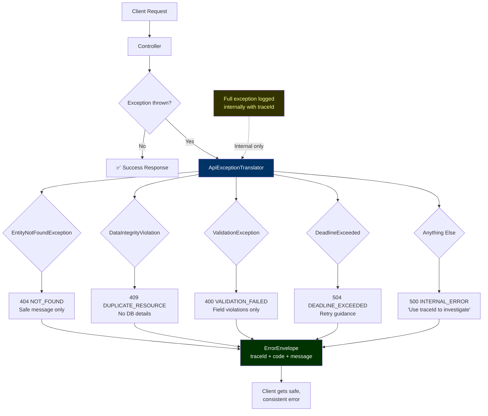

### 🌍 Real-World Use Case

**Scenario:** A security researcher submits a crafted request. With leaked Hibernate errors, they discover your table structure (`orders`, `customers`, column names) in the error response. With translated boundary errors, they get `INTERNAL_ERROR` and a `traceId` — useless for attack planning, but enough for your team to debug the issue.

---

## 📊 Putting It All Together: All 10 Swaps Under Load

```mermaid
graph TB
    subgraph Load["🔥 Under Production Load"]
        REQ[1000 req/s]
    end

    subgraph BadPath["❌ Path With All 10 Anti-Patterns"]
        B1[Scattered RestTemplate<br/>→ inconsistent timeouts]
        B2[Future chains<br/>→ leaked threads]
        B3[Mutable DTOs<br/>→ data corruption]
        B4[ThreadLocal<br/>→ context bleeding]
        B5[Long transactions<br/>→ pool exhaustion]
        B6[No deadline<br/>→ cascade failure]
        B7[Raw logging<br/>→ PII exposure]
        CRASH[💥 System Degradation]
    end

    subgraph GoodPath["✅ Path With All 10 Swaps"]
        G1[One Client Adapter<br/>→ consistent policy]
        G2[Structured Task Scope<br/>→ bounded concurrency]
        G3[Records<br/>→ validated, immutable]
        G4[Scoped Values<br/>→ clean context]
        G5[Short transactions<br/>→ fast DB releases]
        G6[Deadline budget<br/>→ client-aware timeout]
        G7[Safe structured logs<br/>→ compliant observability]
        SUCCESS[✅ Stable, Observable System]
    end

    REQ --> BadPath
    REQ --> GoodPath

    B1 --> B2 --> B3 --> B4 --> B5 --> B6 --> B7 --> CRASH
    G1 --> G2 --> G3 --> G4 --> G5 --> G6 --> G7 --> SUCCESS

    style CRASH fill:#4a0000,color:#ff9999
    style SUCCESS fill:#004a00,color:#99ff99
```

---

## ✅ Quick Reference Checklist

Use this checklist in every code review for Java 25 REST APIs:

### HTTP Client Layer
- [ ] All outbound HTTP goes through a single client adapter interface
- [ ] Auth, retry, and timeout configured in one `@Configuration` class
- [ ] No `RestTemplate` or `WebClient` instantiated inline in services

### Concurrency
- [ ] Parallel async work uses `StructuredTaskScope`, not `CompletableFuture.allOf`
- [ ] All forked tasks are enclosed in a try-with-resources scope
- [ ] No `ThreadLocal` — replaced with `ScopedValue`

### Data
- [ ] All DTOs and request/response types are `record`
- [ ] Validation logic lives in compact constructors, not service methods
- [ ] No `setX()` calls on passed objects (compile check: records enforce this)

### Transactions
- [ ] No `@Transactional` method contains a remote HTTP or RPC call
- [ ] Transaction scope covers only database reads/writes
- [ ] Service orchestration methods are not annotated `@Transactional`

### Error Handling
- [ ] Single `ErrorEnvelope` record used across all services
- [ ] `@RestControllerAdvice` translates all framework exceptions
- [ ] No Hibernate/Jackson/Spring exception type names reach the client

### Timeouts & Deadlines
- [ ] Deadline is created at the API boundary and propagated
- [ ] Each downstream call uses `deadline.remaining()` not a hard-coded value
- [ ] `DeadlineExceededException` is mapped to 504 in the exception translator

### Logging
- [ ] No `log.info("Request: {}", fullRequestObject)` anywhere
- [ ] All logged fields are explicitly selected safe fields
- [ ] No card numbers, SSNs, passwords, emails, or addresses in log statements

### Testing
- [ ] Each external dependency has timeout test
- [ ] Each external dependency has service-unavailable test
- [ ] Partial failure scenarios are tested
- [ ] Rollback/compensation logic is tested

---

## 📚 Summary Table

| # | Stop Doing | Do This Instead | Core Benefit |
|---|---|---|---|
| 1 | Scattered RestTemplate | One client adapter | Single policy enforcement point |
| 2 | Future chains | Structured task scope | No thread leaks, clean cancellation |
| 3 | Mutable DTOs | Records | Validated once, safe everywhere |
| 4 | ThreadLocal context | Scoped Values | Virtual-thread safe context |
| 5 | Bespoke error shapes | One error envelope | Consistent client experience |
| 6 | Call inside transaction | Short transactions | Higher throughput, less pool contention |
| 7 | Copy-pasted timeouts | One deadline budget | Client-aware, cascade-safe timeouts |
| 8 | Raw payload logging | Structured safe fields | GDPR/PCI compliance, security |
| 9 | Happy-path tests | Failure-path tests | Production confidence |
| 10 | Leaked framework errors | Translated boundary errors | Security, API stability |

> **The unifying insight:** Every one of these ten anti-patterns is a form of *hidden coupling* — binding two parts of your system together in a way that's invisible at review time but catastrophic under load. The replacements make those bindings explicit, centralized, and controllable.

---

## 🕳️ Common Pitfalls & Troubleshooting

Even after adopting the ten swaps, these pitfalls surface repeatedly in real codebases. Each entry: **Symptom → Root Cause → Fix**.

### Pitfall 1: `@Transactional` Still Holding a Connection After Refactoring

- **Symptom:** You split the long transaction into short ones (Swap 6), but HikariCP metrics still show connections held for 300ms+.
- **Root Cause:** The orchestration method and the transactional methods are on the *same bean*. Spring's proxy-based `@Transactional` is skipped for self-invocation (`this.method()`), so the outer method — annotated `@Transactional` itself — still wraps everything.
- **Fix:** Move orchestration into a separate bean, or inject the bean into itself (`ObjectProvider<OrderService>`) and call through the proxy. Verify with `TransactionSynchronizationManager.isActualTransactionActive()` inside each step.

### Pitfall 2: Virtual Threads Pinned by `synchronized` Blocks

- **Symptom:** Throughput *drops* after enabling virtual threads; carrier threads (that's what you are measuring) spike to 100% CPU.
- **Root Cause:** `synchronized` blocks and some native/JDBC calls can pin the virtual thread's carrier thread. If all carriers pin, no virtual threads can run.
- **Fix:** On Java 25, most `synchronized` pinning is resolved (JDK 24+ removed pinning for `synchronized` in the vast majority of cases), but audit for `synchronized` around blocking I/O, replace with `ReentrantLock` where contention is high, and monitor `jdk.VirtualThreadPinned` JFR events.

### Pitfall 3: `ScopedValue.get()` Throws `NoSuchElementException` in a Forked Task

- **Symptom:** Code that worked with `ThreadLocal` now throws when read inside a `StructuredTaskScope` subtask.
- **Root Cause:** The subtask was forked *outside* the `ScopedValue.where(...)` binding block, so the binding wasn't in scope when `fork()` captured the context.
- **Fix:** Ensure `scope.fork(...)` is called **within** the `ScopedValue.where(...).run/call(...)` lambda. Bindings are captured at fork time.

### Pitfall 4: Records + JPA `@Entity` = Broken Lazy Loading

- **Symptom:** Migrating entities to records breaks Hibernate: `LazyInitializationException`, or the entity stops being managed.
- **Root Cause:** JPA entities must have a no-arg constructor, mutability for dirty checking, and proxyability. Records have none of these.
- **Fix:** Keep records for **DTOs and API contracts**; keep classes for JPA entities. Map between them at the repository boundary (MapStruct, manual mapping, or Spring Data projections). This split also enforces a healthy layer separation.

### Pitfall 5: `ErrorEnvelope` Handler Fires but Clients Still See Spring's Default Error

- **Symptom:** Some 4xx/5xx responses bypass the `@RestControllerAdvice`.
- **Root Cause:** Exceptions thrown *before* the controller layer (filter-chain security errors, 404s on unmatched paths, Tomcat-level errors) never reach the advice.
- **Fix:** Register an `ErrorController` implementation and/or configure `spring.mvc.throw-exception-if-no-handler-found=true` + `spring.web.resources.add-mappings=false`, and map `NoResourceFoundException` / `AccessDeniedException` explicitly in the advice.

### Pitfall 6: Deadline Budget Expires Immediately

- **Symptom:** `Deadline.remaining()` throws `DeadlineExceededException` on the very first call.
- **Root Cause:** The deadline header was parsed with a stale clock (client clock skew) or the deadline was created once at application startup rather than per request (a cached static `Deadline`).
- **Fix:** Always construct `Deadline` per request; clamp client-supplied deadlines to a sane server maximum (e.g., `min(clientDeadline, now + 30s)`).

### Pitfall 7: Thread Leaks Persist Despite Structured Concurrency

- **Symptom:** Thread count keeps climbing.
- **Root Cause:** A legacy `CompletableFuture.supplyAsync()` (default `ForkJoinPool.commonPool()`) or a raw `new Thread(...)` remains in an unmigrated corner of the codebase.
- **Fix:** Search the codebase: `CompletableFuture.supplyAsync`, `newFixedThreadPool`, `Executors.new`, `new Thread`. Migrate each to a structured scope or an explicitly managed executor. Add an ArchUnit test that bans these APIs.

### 🧯 Troubleshooting Decision Tree

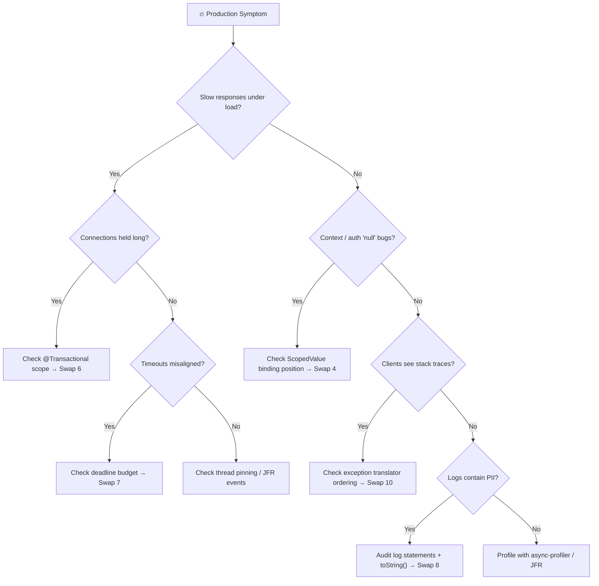

---

## 🌟 Best Practices

Cross-cutting rules of thumb distilled from the ten swaps:

| Area | Best Practice |
|---|---|
| **HTTP Clients** | One `@Configuration` class per outbound dependency; `Supplier`-based default headers for anything time-varying (tokens, trace IDs) |
| **Concurrency** | Always use try-with-resources with `StructuredTaskScope`; never fork outside a scope; prefer `ShutdownOnFailure`/`Joiner.allSuccessfulOrThrow` for all-or-nothing semantics |
| **Context** | Bind `ScopedValue`s as early as possible (filter/interceptor) and read them anywhere; never store mutable objects in a `ScopedValue` |
| **Data** | Validate in compact constructors; expose `withX()` copies instead of setters; keep entities (mutable) and DTOs (records) strictly separated |
| **Transactions** | `@Transactional` only on DB-only methods; orchestration lives in a separate bean; use optimistic patterns or outbox/saga for cross-service state |
| **Errors** | Machine-readable `code` values are part of your API contract — never change them without versioning; always include `traceId` |
| **Deadlines** | Create at the API boundary; propagate via header; cap per-call slices; map expiry to 504 |
| **Logging** | Structured key-value fields only; a safe-projection record per request type; redact `toString()` on sensitive records |
| **Testing** | Every external dependency gets the full failure matrix (down, timeout, malformed, partial, idempotency) |
| **Code Review** | Use the Quick Reference Checklist as a PR template section |

> 💡 **Tip:** Institutionalize the swaps with static analysis: an ArchUnit rule banning `RestTemplate`, `ThreadLocal`, and `CompletableFuture.supplyAsync` in production packages prevents the anti-patterns from creeping back after the refactor.

---

## 🚫 Anti-Patterns Recap

A one-glance reference of everything this tutorial says to stop doing — with the *hidden coupling* each one creates:

| # | Anti-Pattern | Hidden Coupling It Creates | First Symptom |
|---|---|---|---|
| 1 | Inline `RestTemplate` per service | Every service ↔ auth/timeout policy | 401 storms after token rotation |
| 2 | `CompletableFuture` chains | Fire-and-forget tasks ↔ thread pools | Threads climb, GC pressure |
| 3 | Mutable DTOs | Any layer ↔ any field | Mysteriously corrupted responses |
| 4 | `ThreadLocal` context | Request lifecycle ↔ specific carrier thread | `null` user in audit logs |
| 5 | Bespoke error shapes | Each endpoint ↔ its own parser | Client code full of `instanceof` |
| 6 | HTTP inside `@Transactional` | Network latency ↔ DB connection pool | Pool exhaustion at 50 rps |
| 7 | Per-call hard-coded timeouts | Each service ↔ its own time budget | Gateway 504s while services churn |
| 8 | Raw payload logging | Observability ↔ PII exposure | GDPR/PCI audit findings |
| 9 | Happy-path-only tests | Confidence ↔ untested failure modes | Incidents on untested paths |
| 10 | Leaked framework errors | API surface ↔ database schema | Security findings on error bodies |

**The pattern to internalize:** whenever a change in one file forces you to edit another file you've never heard of — that's the coupling this tutorial removes.

---

## ⚡ Performance Considerations

**Where the swaps pay off measurably:**

| Swap | Performance Lever | Typical Impact |
|---|---|---|
| 2 — Structured Task Scope | Parallel fan-out of independent calls | 1050ms → 400ms wall clock (4 calls of 400/200/300/150ms) |
| 6 — Short Transactions | DB connection hold time | 33 rps → 500+ rps on a 10-connection pool (300ms gateway) |
| 7 — Deadline Budget | Early cancellation of doomed work | Wasted downstream work drops from ~15s to ~0 per expired request |
| 4 — Scoped Values | Context lookup cost | Immutable, structured — cheaper and safer than `ThreadLocal` maps under virtual threads |
| 1 — One Client Adapter | Connection reuse via shared `RestClient` | Fewer TLS handshakes; consistent keep-alive pooling |
| 3 — Records | Reduced allocation/aliasing bugs | Marginally fewer defensive copies; correctness is the bigger win |

**Additional guidance:**

- **Size the connection pool to the *short* transaction hold time.** After Swap 6, hold times of 10–20ms mean even a 10-connection pool sustains hundreds of rps. Don't "fix" pool exhaustion by growing the pool — shorten the hold.
- **Virtual threads are cheap, but downstream resources are not.** Unbounded virtual threads + one slow downstream = self-inflicted DDoS. Use a `Semaphore` inside the fork loop or structured-scope concurrency limits to bound fan-out.
- **Keep `scope.join()` non-blocking in carrier terms** — virtual threads parking on `join()` cost almost nothing, which is why structured concurrency scales to millions of concurrent scopes.
- **Watch `remainingCapped()` slices:** if the first call eats 90% of the budget, later calls fail fast. That's correct behavior, but make sure per-call caps reflect actual p99 latencies so healthy requests aren't starved.
- **Measure, don't guess:** add Micrometer timers around each client adapter call and `HikariCP` connection-acquire/hold histograms. The before/after of Swap 6 is visible in the *hold* histogram within minutes of deploy.

---

## 🔐 Security Considerations

| Swap | Security Impact | Concrete Practice |
|---|---|---|
| 8 — Safe logging | GDPR / PCI-DSS compliance | Never log card numbers, CVV, SSN, passwords, emails, addresses; redact `toString()` on sensitive records; safe-projection records per type |
| 10 — Translated errors | Eliminates information disclosure | No ORM names, table/column names, stack traces, or SQL fragments in client responses |
| 1 — One client adapter | Centralized credential handling | Tokens read from a secrets manager and injected per-request; no credentials scattered in service code |
| 4 — Scoped Values | Correct multi-tenant isolation | Tenant ID bound at the filter and inherited by every forked task — no cross-tenant context bleed from thread reuse |
| 7 — Deadline budget | DoS resistance | Expired requests stop consuming downstream capacity quickly; prevents slow-loris-style resource drain |
| 5 — Error envelope | No stack traces to attackers; `traceId` correlation without leaking internals |

> ⚠️ **Warning:** Logs are a data store. Regulators treat them as such. A `log.info(payload)` statement is functionally equivalent to persisting the payload in an unencrypted, widely-accessible database. Audit log statements the same way you audit persistence code — and prefer structured, allow-listed fields over ever serializing a full request object.

> 💡 **Tip:** For the `ErrorEnvelope`, make sure `traceId` cannot be used to enumerate valid requests (it's a random UUID, not sequential), and never include internal hostnames or service names in client-visible messages.

---

## 🧪 Testing Strategies

The testing strategy mirrors the production risk profile:

**1. Unit — failure-path first (Swap 9).** For each external dependency: service-down, timeout, connection-refused, malformed-response, unexpected-null, partial-success, idempotency, stale-data. Use Mockito `thenThrow`/`thenAnswer` for deterministic failure injection.

**2. Unit — records as executable specs.** Compact-constructor tests double as documentation: `assertThrows(IllegalArgumentException.class, () -> new Order(null, 1L, "X", ONE, "USD"))` proves the invariant holds.

**3. Integration — real HTTP with stubs.** Use WireMock or MockWebServer to exercise the `@HttpExchange` client end-to-end: real serialization, real status-code mapping, real timeout behavior.

**4. Transaction-boundary tests.** With Testcontainers (real PostgreSQL), assert that a repository call inside `reserveOrder()` commits *before* the HTTP step runs — and that a payment failure leaves the order in `PROCESSING`, not half-charged.

**5. Concurrency tests.** Fork deliberately-failing subtasks in a structured scope; assert sibling tasks were cancelled (e.g., an `AtomicBoolean` set in a slow sibling's finally block). Run these tests many times (`@RepeatedTest(50)`) to catch timing races.

**6. Load tests.** Gatling/k6 against the refactored endpoints; assert p99 latency and HikariCP hold-time histograms improve after Swaps 6 and 7.


---

## 🧭 Migration Guide

Adopt the swaps incrementally — each one is independently valuable. Recommended order, lowest risk first:

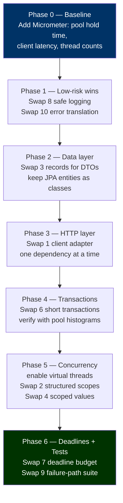

**Phase-by-phase notes:**

| Phase | Key Risks | Mitigations |
|---|---|---|
| 0 — Baseline | You can't prove improvement | Capture before-metrics first; otherwise the refactor becomes a belief argument |
| 1 — Logging/Errors | Client contract changes | Version the error envelope; give clients a dual-read window |
| 2 — Records | JPA breakage, Jackson mapping | Records for DTOs only; verify `@JsonProcessing` round-trips in tests; Jackson supports records natively since 2.12 |
| 3 — Client adapters | Behavior drift (retries, headers) | Golden-file comparison: capture outbound requests before/after with a recording proxy |
| 4 — Short transactions | Partial state between TXs | Order state machine (`PENDING → PROCESSING → PAID`); compensating action on failure; idempotency keys for the payment step |
| 5 — Concurrency | Pinning, context loss | JFR `jdk.VirtualThreadPinned` monitoring; fork only inside `ScopedValue` bindings; `@RepeatedTest` for cancellation races |
| 6 — Deadlines | Clock skew, premature expiry | Clamp client deadlines; per-request construction; 504 mapped in the translator |

**Checklist for each swap adoption:**
- [ ] Deprecate the old pattern in a shared lint/ArchUnit rule
- [ ] Add the failure-path tests for the new component *in the same PR*
- [ ] Roll out to one service → observe → codify → repeat

> 💡 **Tip:** Virtual threads are a *runtime* change (mostly a config flag: `spring.threads.virtual.enabled=true`), but they only pay off *after* Swaps 1/2/4/6 — otherwise you're running your hidden couplings on a million threads instead of two hundred.

---

## 🏋️ Practice Exercises with Solutions

### Exercise 1: Centralize the Client (Swap 1)

**Task:** `NotificationService` builds its own `RestTemplate` call to `http://push-gateway/send`, manually setting an `X-Api-Key` header from a rotating key service and copying `MDC.get("requestId")` into `X-Request-Id`. Refactor it into a declarative client with centralized configuration.

**Solution:**

```java
// 1. Declarative interface
@HttpExchange("http://push-gateway")
public interface PushClient {
    @PostExchange("/send")
    SendResult send(@RequestBody PushNotification notification);
}

// 2. Centralized policy — key rotation + request id live HERE only
@Configuration
public class PushClientConfig {

    @Bean
    public PushClient pushClient(RestClient.Builder builder, ApiKeyService keys) {
        RestClient restClient = builder
            .baseUrl("http://push-gateway")
            .defaultHeader("X-Api-Key", () -> keys.currentKey())      // per-request supplier
            .defaultHeader("X-Request-Id", () -> MDC.get("requestId"))
            .build();
        return HttpServiceProxyFactory
            .builderFor(RestClientAdapter.create(restClient))
            .build()
            .createClient(PushClient.class);
    }
}

// 3. Service is now free of HTTP concerns
@Service
public class NotificationService {
    private final PushClient pushClient;

    public NotificationService(PushClient pushClient) {
        this.pushClient = pushClient;
    }

    public void notify(Order order) {
        pushClient.send(PushNotification.from(order));
    }
}
```

**Key points:** key rotation and request-id propagation now live in exactly one file; changing auth policy touches zero services.

---

### Exercise 2: Immutabilize the DTO (Swap 3)

**Task:** Convert `class CustomerDTO { private String name; private String email; private int loyaltyPoints; /* getters/setters */ }` into a validated record. Rules: name non-blank, email contains `@`, loyalty points ≥ 0. Provide a "mutation" to add loyalty points without mutating.

**Solution:**

```java
public record Customer(String name, String email, int loyaltyPoints) {
    public Customer {
        Objects.requireNonNull(name, "Name must not be null");
        if (name.isBlank()) throw new IllegalArgumentException("Name must not be blank");
        if (email == null || !email.contains("@"))
            throw new IllegalArgumentException("Email must contain '@'");
        if (loyaltyPoints < 0) throw new IllegalArgumentException("Loyalty points must be >= 0");
    }

    // Functional "mutation" — returns a new record
    public Customer withAddedPoints(int points) {
        return new Customer(name, email, loyaltyPoints + points);
    }
}

// Tests as executable spec
@Test
void rejectsNegativePoints() {
    assertThrows(IllegalArgumentException.class, () -> new Customer("Ann", "a@b.co", -1));
}
@Test
void addingPointsDoesNotMutate() {
    var c = new Customer("Ann", "a@b.co", 10);
    var updated = c.withAddedPoints(5);
    assertEquals(10, c.loyaltyPoints());
    assertEquals(15, updated.loyaltyPoints());
}
```

**Key points:** validation is at creation; no setter can bypass it; the "audit service bug" class of error is now a compile error.

---

### Exercise 3: Shorten the Transaction (Swap 6)

**Task:** The method below holds a DB connection during a 400ms refund HTTP call. Refactor into short transactions with an orchestration method, ensuring a refund failure leaves the order in `REFUND_FAILED` (not half-processed).

```java
@Transactional
public void refund(String orderId) {
    Order o = repo.findById(orderId).orElseThrow();
    RefundResult r = refundGateway.refund(o.paymentId(), o.amount()); // 400ms HTTP!
    repo.save(o.withStatus("REFUNDED").withRefundId(r.id()));
}
```

**Solution:**

```java
@Service
public class RefundOrchestrator {   // orchestration bean — NOT transactional
    private final RefundService refundService;  // transactional bean (separate proxy!)
    private final RefundGateway gateway;

    public RefundOrchestrator(RefundService refundService, RefundGateway gateway) {
        this.refundService = refundService;
        this.gateway = gateway;
    }

    public void refund(String orderId) {
        Order o = refundService.markRefundPending(orderId);   // short TX 1
        try {
            RefundResult r = gateway.refund(o.paymentId(), o.amount()); // NO TX
            refundService.completeRefund(orderId, r.id());    // short TX 2
        } catch (RefundDeclinedException e) {
            refundService.markRefundFailed(orderId, e.getMessage()); // short TX 3 — explicit failure state
            throw e;
        }
    }
}

@Service
public class RefundService {
    @Transactional public Order markRefundPending(String orderId) {
        Order o = repo.findById(orderId).orElseThrow();
        return repo.save(o.withStatus("REFUND_PENDING"));
    }
    @Transactional public void completeRefund(String orderId, String refundId) {
        Order o = repo.findById(orderId).orElseThrow();
        repo.save(o.withStatus("REFUNDED").withRefundId(refundId));
    }
    @Transactional public void markRefundFailed(String orderId, String reason) {
        Order o = repo.findById(orderId).orElseThrow();
        repo.save(o.withStatus("REFUND_FAILED").withRefundReason(reason));
    }
}
```

**Key points:** connection is never held during the 400ms call; explicit failure state enables retry; orchestration lives in a separate bean (avoids the proxy self-invocation trap).

---

### Exercise 4: Test the Failure Paths (Swaps 7 + 9)

**Task:** For `PaymentClient.charge(ChargeRequest, Deadline)`, write failure-path tests for: (a) deadline expiry, (b) declined payment, (c) idempotent retry (same idempotency key, second attempt returns the same transaction without double-charging).

**Solution:**

```java
class PaymentClientFailureTests {

    @Test
    void failsFastWhenDeadlineAlreadyExpired() {
        Deadline expired = new Deadline(Instant.now().minusSeconds(1));
        assertThrows(DeadlineExceededException.class,
            () -> paymentClient.charge(new ChargeRequest("o1", TEN), expired));
    }

    @Test
    void declinedPaymentMapsToDomainException() {
        stubFor(post(urlEqualTo("/charge")).willReturn(aResponse().status(402)));
        assertThrows(PaymentDeclinedException.class,
            () -> paymentClient.charge(validRequest(), Deadline.in(Duration.ofSeconds(2))));
    }

    @Test
    void retryWithSameIdempotencyKeyDoesNotDoubleCharge() {
        stubFor(post(urlEqualTo("/charge"))
            .withRequestBody(matching(".*\"idempotencyKey\":\"KEY-1\".*"))
            .willReturn(aResponse().withStatus(200).withBody("{\"transactionId\":\"TX-9\"}")));

        var first  = paymentClient.charge(reqWithKey("KEY-1"), Deadline.in(Duration.ofSeconds(2)));
        var second = paymentClient.charge(reqWithKey("KEY-1"), Deadline.in(Duration.ofSeconds(2)));

        assertEquals(first.transactionId(), second.transactionId()); // same TX returned
        verify(2, postRequestedFor(urlEqualTo("/charge")));          // two calls, one charge
    }
}
```

**Key points:** each test exercises a production failure mode; idempotency is verified against a real HTTP stub (WireMock), not a mock, so serialization and headers are exercised too.

---

## 🧠 Test Your Understanding

Answer these 12 questions, then check the solutions below. (Aim for 9+ correct before moving on.)

1. What is *hidden coupling*, and why does it survive code review?
2. Why does a `ThreadLocal` user ID become `null` in an `@Async` audit method under virtual threads?
3. In Swap 1, why are `defaultHeader` values supplied as `Supplier<String>` instead of plain strings?
4. What happens to sibling subtasks when one subtask fails inside a `StructuredTaskScope.ShutdownOnFailure`?
5. Where does record validation live, and when exactly does it run?
6. Give two reasons a JPA entity cannot be a record.
7. During a 300ms payment HTTP call inside `@Transactional`, what exactly is being held and what fails at 100 concurrent requests?
8. How does `Deadline.remainingCapped(Duration.ofSeconds(2))` behave when only 800ms remains in the budget?
9. Why should `toString()` be overridden on records that carry sensitive data?
10. What HTTP status should `DeadlineExceededException` map to, and why?
11. Name three failure modes in the Dependency Test Matrix beyond "service is down".
12. What is the difference between `ScopedValue` and `ThreadLocal` regarding cleanup?

**Solutions:**

1. Two parts of the system are bound together invisibly — no single file states the binding, so a reviewer reading either part in isolation can't see the dependency. It surfaces only under load or after an unrelated change.
2. `@Async` runs on a different thread (virtual or pooled). `ThreadLocal` is keyed by thread, so the value set on the request thread is invisible — the audit thread reads `null` (or a stale value from a reused thread).
3. The supplier is evaluated per request, so time-varying values (rotating tokens, trace IDs) are always current without rebuilding the client.
4. All sibling subtasks are cancelled; `join()` returns and `throwIfFailed()` raises the mapped exception. No task outlives the scope.
5. In the compact constructor (`public Order { ... }`); it runs at creation time, before the record is visible to any layer.
6. Entities need a no-arg constructor (JPA spec), mutability for Hibernate dirty-checking, and proxyability for lazy loading — records are shallowly immutable, final, with no no-arg constructor.
7. A JDBC connection (and possibly row locks) is held. At 100 concurrent requests a 10-connection pool is fully occupied waiting on HTTP → pool exhaustion → queueing and failures.
8. It returns the *remaining* 800ms (never exceeding the remaining budget), so the call is capped at what's actually left — the cap is `min(remaining, 2s)`.
9. Records generate a `toString()` including every component — logging a sensitive record would leak card numbers/emails. A redacted `toString()` prevents accidental leaks.
10. 504 Gateway Timeout — it tells the client the deadline expired and the request is retryable, mirroring gateway timeout semantics.
11. Network timeout, connection refused, malformed response, unexpected null, unexpected status code, partial success, idempotency, stale data (any three).
12. `ScopedValue` cleanup is automatic and guaranteed at scope exit (no `remove()` to forget); `ThreadLocal` requires explicit `remove()` and leaks on forgotten cleanup or thread reuse.

---

## 💼 Common Interview Questions

**Q1. Why are virtual threads not a silver bullet for concurrency problems?**
A: Virtual threads make *blocking* cheap, but they don't fix hidden coupling — a DB connection held during an HTTP call, or an unbounded fan-out against a slow downstream, still causes exhaustion; virtual threads simply reach the failure faster (a million threads instead of 200). Correct scoping (structured concurrency), short transactions, and deadlines are still required.

**Q2. Compare `CompletableFuture.allOf` with `StructuredTaskScope.ShutdownOnFailure`.**
A: `allOf` schedules tasks with no ownership: cancellation doesn't propagate, a hanging task leaks its thread, error handling is callback-scattered, and there's no guarantee tasks complete. Structured scopes create a parent–child relationship: failure cancels siblings, try-with-resources guarantees completion before the scope closes, and `throwIfFailed()` gives a single explicit error path.

**Q3. How do records interact with Jackson?**
A: Jackson 2.12+ supports records natively: deserialization uses the canonical constructor, `@JsonProperty` works on components, and validation annotations can be placed on components. Invariants enforced in the compact constructor run during deserialization — invalid JSON shapes become construction failures you can translate to 400s.

**Q4. When is it *appropriate* to keep a mutable class instead of a record?**
A: For JPA entities (no-arg constructor, dirty checking, proxying), builders/accumulators, or genuinely mutable domain state (e.g., a shared cache entry). The rule is: API-boundary data carriers are records; persistence and mutable internals can stay classes — with mapping at the layer edge.

**Q5. Explain why `@Transactional` self-invocation is dangerous.**
A: Spring implements transactions with proxies. A method calling `this.transactionalMethod()` bypasses the proxy, so the annotation is ignored. The hidden coupling: the *call graph* determines transaction behavior, which is invisible in the code. Fix by splitting beans or calling through the injected proxy.

**Q6. How would you implement retries without amplifying a cascade failure?**
A: Combine retries with a shared deadline budget: retry loops consult `deadline.remaining()` before each attempt and stop when it's exhausted; use exponential backoff with jitter; only retry idempotent operations; propagate the deadline downstream so no service retries past the caller's budget.

**Q7. What makes `ScopedValue` better than `ThreadLocal` for request context?**
A: Bindings are immutable and scoped to a dynamic extent (`where(...).run(...)`), inherited by forked subtasks, cleaned up automatically, and write-once (no rebind races). `ThreadLocal` is mutable, thread-keyed (wrong unit of decomposition for virtual threads), requires manual cleanup, and leaks through thread-pool reuse.

**Q8. How do you prevent PII from reaching logs in a team of 50 developers?**
A: Structural, not procedural: safe-projection records per request type (allow-list fields), redacted `toString()` on sensitive types, structured logging with explicit key-value pairs, ArchUnit/grep CI checks for `log.*request|payload|body`, and log-scrubbing as defense-in-depth at the appender.

**Q9. Your API's p99 is 8s but the gateway timeout is 5s. What do you do?**
A: Introduce a propagated deadline budget: the service accepts the client's deadline (or a default below the gateway's), slices it across downstream calls via `remainingCapped()`, fails fast with 504 on expiry, and stops all downstream work when the budget is gone. Then fix the actual latency offenders (usually Swap 6 pool contention and unbounded fan-out).

**Q10. What's the difference between an error *code* and an error *message* in an error envelope?**
A: The code is a stable, machine-readable contract token ("INVENTORY_INSUFFICIENT") that clients branch on; the message is human-readable, localizable, and can change freely. Coupling clients to messages is the anti-pattern; coupling them to codes is the design.

**Q11. How do you test cancellation propagation in structured concurrency?**
A: Fork a deliberately slow subtask with a side effect in a `finally` block; fork a fast-failing sibling; assert (after `throwIfFailed`) that the slow subtask's finally ran within the scope's lifetime — repeated across many iterations to catch timing races.

**Q12. When would you choose optimistic concurrency over locking across short transactions?**
A: When the remote step (e.g., payment) makes holding a row lock unacceptable, split the work into short transactions with an explicit state machine, and use optimistic checks (version column / conditional update `WHERE status='PROCESSING'`) at finalize time — failing safely if state changed underneath.

---

## 📝 Comprehensive Question Bank

55 questions across three difficulty tiers. Answers are provided inline for self-study.

### 🟢 Beginner (Q1–Q20)

**Q1. What is the core problem the ten swaps address?**
A: Hidden coupling — invisible bindings between parts of the system that pass review but fail under load.

**Q2. What is a record?**
A: A Java 16+ data-carrier class with immutable components, auto-generated accessors, `equals()`, `hashCode()`, and `toString()`.

**Q3. Why is `RestTemplate` scattered across services a problem?**
A: Auth, timeouts, retries, and URLs drift independently per service; policy changes require editing many files.

**Q4. What does `@HttpExchange` do?**
A: Declares an HTTP endpoint on an interface; Spring generates the implementation via `HttpServiceProxyFactory` + `RestClientAdapter`.

**Q5. What is a virtual thread?**
A: A lightweight thread managed by the JVM (not the OS); blocking is cheap, enabling millions of concurrent tasks (Java 21+, final in 25).

**Q6. Why do `CompletableFuture` chains leak threads?**
A: Tasks scheduled on executors have no owner; a hung task is never cancelled and its thread never returns.

**Q7. What guarantees does try-with-resources give a `StructuredTaskScope`?**
A: On scope close, all forked subtasks have completed or been cancelled — no task outlives the block.

**Q8. What is a compact constructor?**
A: A record constructor form (`public Order { ... }`) that runs before field assignment — ideal for validation and normalization.

**Q9. Why can't you mutate a record's field after construction?**
A: Components are final; there are no setters — changes require constructing a new record (`withX()` pattern).

**Q10. What was `ThreadLocal` designed for?**
A: Platform-thread request handling, where one request maps to exactly one thread for its whole lifetime.

**Q11. What is a `ScopedValue`?**
A: An immutable, scope-bound value: set via `ScopedValue.where(key, value).run(...)`, visible to the whole dynamic extent including forked subtasks.

**Q12. Why do bespoke error shapes hurt clients?**
A: Clients need a different parser per endpoint/service; there's no uniform way to branch on failure.

**Q13. What is an `ErrorEnvelope`?**
A: One canonical error record (traceId, code, message, violations, timestamp) returned by every endpoint.

**Q14. What does `@RestControllerAdvice` do?**
A: Centralizes `@ExceptionHandler` methods that translate exceptions thrown by controllers into consistent HTTP responses.

**Q15. Why is an HTTP call inside `@Transactional` dangerous?**
A: The DB connection (and possibly locks) is held for the network round trip; under load the pool exhausts.

**Q16. What is a deadline budget?**
A: A single deadline created at the API boundary and passed through the call chain; each call consumes the *remaining* time.

**Q17. What status code fits an expired request deadline?**
A: 504 Gateway Timeout.

**Q18. Why is logging a full request body a compliance risk?**
A: Logs persist PII/card data in aggregation systems that are less protected than databases — a GDPR/PCI-DSS violation.

**Q19. What is a failure-path test?**
A: A test that exercises a dependency failing (timeout, outage, partial success, malformed data) rather than the happy path.

**Q20. Why translate framework exceptions at the boundary?**
A: To hide implementation details (ORM, DB schema) from clients and prevent information-disclosure vulnerabilities.

---

### 🟡 Intermediate (Q21–Q40)

**Q21. How does `Supplier`-based `defaultHeader` avoid stale tokens?**
A: The supplier is evaluated per outbound request, so each call reads the current token instead of a value captured at startup.

**Q22. What's the difference between `ShutdownOnFailure` and `ShutdownOnSuccess`?**
A: `ShutdownOnFailure` is all-or-nothing — the first failure cancels siblings and `throwIfFailed()` rethrows. `ShutdownOnSuccess` races — the first success cancels siblings and `result()` returns the winner.

**Q23. Why must `subtask.get()` be called only after `join()`?**
A: Before `join()`, the subtask may not have completed; `get()` before completion throws `IllegalStateException`. After a successful `join()`, results are available.

**Q24. How does record equality work?**
A: Value-based: two records are equal iff they have the same type and equal component values — no identity semantics.

**Q25. How do you normalize data in a record, e.g., uppercasing a currency?**
A: Reassign the parameter in the compact constructor: `currency = currency.toUpperCase();` — the assigned (normalized) value becomes the component value.

**Q26. Why are `ScopedValue` bindings write-once?**
A: Immutability prevents mid-scope rebinding races; nested `where(...)` blocks create a new scope if a different value is needed.

**Q27. How do structured scopes inherit scoped values?**
A: Bindings are captured at `fork()` time — subtasks inherit whatever bindings were in scope where `fork()` was called.

**Q28. Why include `traceId` in every error envelope?**
A: It correlates the client-visible error to logs and distributed traces, enabling debugging without exposing internals.

**Q29. What should the catch-all handler return vs. log?**
A: Log the full exception internally (with traceId); return a generic `INTERNAL_ERROR` envelope revealing nothing.

**Q30. What state machine makes short transactions safe for payments?**
A: Explicit states (`PENDING → PROCESSING → PAID / FAILED`) with compensating actions and idempotency keys on the remote step.

**Q31. Why is `remainingCapped()` better than hard-coded per-call timeouts?**
A: It never grants more than the budget has left, so a slow upstream call automatically shrinks downstream timeouts instead of overshooting the client's patience.

**Q32. How should client-supplied deadlines be validated?**
A: Parse strictly, reject past deadlines, and clamp to a server maximum (e.g., 30s) to prevent absurd budgets.

**Q33. What's wrong with `Map.of("msg", ..., "sku", ...)` as an error body?**
A: It's an unversioned, schemaless contract: no machine-readable code, no correlation ID, fields can change silently.

**Q34. How do you verify transaction boundaries in tests?**
A: Testcontainers + assertions on commit ordering (e.g., order row visible in `PROCESSING` before the HTTP step), or instrument `TransactionSynchronizationManager` in a spy.

**Q35. Why are records a good fit for `Deadline`?**
A: The deadline is a single immutable instant — value semantics, compact validation, and derived methods (`remaining()`) without mutable state.

**Q36. What is the risk of unbounded virtual-thread fan-out?**
A: Self-inflicted overload: millions of concurrent requests hitting one downstream. Bound it with a semaphore or structured concurrency limits.

**Q37. When is graceful degradation appropriate?**
A: When a dependency is non-critical (recommendations, related items): return core data with empty degraded sections and a degraded flag, rather than failing the whole request.

**Q38. How does a safe-projection record prevent PII leaks?**
A: It allow-lists fields at compile time — the projection's constructor literally cannot accept the sensitive fields; loggers only ever see the projection.

**Q39. Why map `HttpMessageNotReadableException` to 400 instead of 500?**
A: Malformed JSON is the client's fault — 400 tells them their payload is the problem, without leaking parser internals.

**Q40. What metrics prove Swap 6 worked?**
A: HikariCP connection hold-time histogram (drops from ~300ms to ~20ms) and throughput at fixed pool size (33 → 500+ rps).

---

### 🔴 Advanced (Q41–Q55)

**Q41. How does structured concurrency relate to the "structured programming" of control flow?**
A: Just as blocks guarantee lexical entry/exit, scopes guarantee dynamic task lifetime: forked work cannot outlive its parent block, so concurrent tasks form a tree with guaranteed join points — eliminating orphaned work by construction.

**Q42. Why does virtual-thread pinning matter, and how do you detect it?**
A: A pinned virtual thread can't unmount from its carrier (e.g., during certain `synchronized`/native sections), so carriers stall and throughput collapses. Detect via JFR `jdk.VirtualThreadPinned` events; fix with `ReentrantLock` or structural changes.

**Q43. How would you design a retry policy that respects a deadline budget?**
A: Compute `deadline.remaining()` before each attempt; retry only if remaining > estimated next-attempt cost; back off exponentially with jitter; give the *remaining* budget to the retry, never the original budget.

**Q44. What are the trade-offs of splitting one transaction into three short ones?**
A: Pro: pool hold time collapses; locks release early. Con: intermediate states are visible and must be valid (state machine), failure between steps needs compensation, and consistency is eventual — a deliberate design shift, not a free refactor.

**Q45. How do you make the finalize step idempotent after a payment succeeded but the finalize transaction failed?**
A: Idempotency key on the payment (so re-charging returns the original transaction), and a conditional update at finalize (`WHERE status='PROCESSING'`); a retry reconciles the recorded payment id without double-charging.

**Q46. Why is a scoped `ThreadLocal`-style MDC unreliable under virtual threads, and what replaces it for log correlation?**
A: MDC is thread-keyed; virtual threads hop/reuse so MDC values vanish or cross-contaminate. Replace with `ScopedValue`-backed context read in a logback/slf4j `MDCAdapter` or structured key-value log arguments.

**Q47. How does the error envelope handle partial validation results?**
A: The `violations` list carries per-field `FieldViolation`s (field, constraint, rejectedValue) so one 400 response communicates *all* invalid fields, not just the first.

**Q48. What's the role of ArchUnit in sustaining these swaps?**
A: Codifying the anti-pattern bans (no `RestTemplate`/`ThreadLocal`/`CompletableFuture.supplyAsync` in production packages, no HTTP calls inside `@Transactional` packages) as automated architecture tests, so compliance survives team turnover.

**Q49. How do you roll out the error envelope without breaking existing clients?**
A: Version it (header or path), dual-write both shapes during a deprecation window, track adoption via the machine-readable code distribution, then retire the legacy shape.

**Q50. Why must sensitive records override `toString()` even if logging is "controlled"?**
A: Defense in depth: `toString()` leaks via debuggers, error messages, serialization to logs by third-party libraries, and future developers who don't share today's discipline.

**Q51. How does `Deadline` interact with `StructuredTaskScope` timeouts?**
A: Cap each subtask's per-call timeout with `deadline.remainingCapped(...)`; the scope's own cancellation handles sibling failures, while the budget bounds total elapsed time — compose both for end-to-end guarantees.

**Q52. What is the failure mode of propagating deadlines across services with clock skew?**
A: A downstream with a fast clock may see an inherited absolute deadline as already expired. Mitigate by propagating *remaining duration* rather than absolute instants, or by clamping with a minimum grace period.

**Q53. How do you decide between fail-fast and degraded responses for a dependency?**
A: Classify dependencies: if the response is core to the request's promise (inventory, pricing), fail fast with a mapped error; if it's enrichment (recommendations), degrade. Make this explicit per dependency, not per developer's judgment.

**Q54. Why is `ErrorEnvelope.internalError(traceId)` safer than returning the exception message?**
A: Exception messages often embed SQL, table names, internal hostnames, or library class names — all reconnaissance for attackers. The generic message discloses nothing while the traceId enables internal debugging.

**Q55. Describe how all ten swaps reinforce each other in one request lifecycle.**
A: The filter binds `ScopedValue` context (S4); the controller validates into records (S3) and creates the `Deadline` (S7); the service fans out via a structured scope (S2) through centralized clients (S1); transactions stay short around DB-only work (S6); failures translate into the one envelope (S5, S10); logging emits only safe structured fields (S8); and the failure-path suite (S9) proves every one of those behaviors holds when things go wrong.

---

## 🎓 Summary & Key Takeaways

1. **Hidden coupling is the enemy.** Ten symptoms, one root cause: bindings between system parts that are invisible at review time. Make every binding explicit and centralized.
2. **Centralize outbound HTTP** in declarative `@HttpExchange` clients — one place for auth, retries, timeouts, and tracing.
3. **Concurrency must be structured.** `StructuredTaskScope` guarantees no task outlives its scope; failures cancel siblings deterministically.
4. **Records validate once, at the edge.** Immutable data carriers with compact-constructor validation make mutation bugs compile errors.
5. **`ScopedValue` replaces `ThreadLocal`** for virtual-thread-safe, auto-cleaned request context.
6. **One error envelope** with machine-readable codes and a `traceId` gives clients a single contract — and gives attackers nothing.
7. **Transactions hold connections for DB work only.** Short transactions + state machines + compensation beat one long transaction every time.
8. **One shrinking deadline budget** beats five independent timeouts — the whole call graph honors the client's patience.
9. **Logs are a data store.** Structured safe fields only; redact `toString()`; audit log statements like persistence code.
10. **Test the failure paths first.** If a dependency can fail, it will — write the outage, timeout, partial-failure, and idempotency tests before production writes them for you.

> **Final thought:** These swaps aren't ten separate tips — they're one discipline applied to ten surfaces. When you feel the urge to reach for a `RestTemplate`, a setter, a `ThreadLocal`, or a hard-coded timeout, you're about to create hidden coupling. Stop, and centralize instead.

---

## 📚 Further Reading & Resources

**Official Documentation**
- [JEP 506: Scoped Values (final in Java 25)](https://openjdk.org/jeps/506)
- [JEP 499: Structured Concurrency (Fourth Preview)](https://openjdk.org/jeps/499) — see JEP 505 (Fifth Preview) and later for the final form
- [JEP 444: Virtual Threads (final in Java 21)](https://openjdk.org/jeps/444)
- [JEP 395: Records](https://openjdk.org/jeps/395)
- [Spring Framework — HTTP Interface Clients (`@HttpExchange`)](https://docs.spring.io/spring-framework/reference/web/webflux-webclient/http-interface.html)
- [Spring Framework — RestClient](https://docs.spring.io/spring-framework/reference/integration/rest-clients.html)
- [Spring Boot — `@Transactional` and proxy mechanics](https://docs.spring.io/spring-framework/reference/data-access/transaction/declarative-annotations.html)

**Books & Deep Dives**
- *Java Concurrency in Practice* — Goetz (foundational; read alongside structured concurrency to see what it replaces)
- OpenJDK Project Loom pages: [wiki.openjdk.org/display/loom](https://wiki.openjdk.org/display/loom)

**Related Tutorials in This Knowledge Base**
- `Design related/Clean Architecture in Spring Boot - A Comprehensive Tutorial.md` — layering that complements the client-adapter and short-transaction patterns
- `Design related/Mitigating Cache Stampedes in Dynamic API Translation Using Java 21 Virtual Threads - Complete Tutorial.md` — virtual threads under real load
- `Design related/The Saga Pattern - Mastering Distributed Transactions in Microservices - Complete Tutorial.md` — compensation for short-transaction workflows
- `Essentials/10 Hidden Spring Boot Features - Complete Tutorial.md` — global exception handling and validation basics

---

## 🚀 Next Steps

1. **Audit your codebase today** against the [Quick Reference Checklist](#quick-reference-checklist) — pick the worst offender and schedule its swap.
2. **Add the metrics first** (pool hold time, client latency, thread counts) so every refactor is provable.
3. **Codify the bans** with ArchUnit rules so the swaps stick.
4. **Adopt one swap per sprint**, starting with logging and error translation (lowest risk, highest compliance value).
5. **Share the error envelope** as an internal library so the whole organization converges on one contract.

---

*Last Updated: 2026-09-19* · *Difficulty: Intermediate* · *Part of the knowledge-base tutorial series, created per `tutorial-preferences.md` requirements.*

*Based on the Java 25 REST API guidelines by [@navyad](https://linkedin.com/in/navyad). Tutorial expanded with examples, diagrams, and production context.*


