# Unified APIs vs. Embedded iPaaS: A Complete Tutorial on Scaling Your SaaS Integration Strategy

## Introduction

If you build a B2B SaaS product, you will eventually have this conversation:

> **Prospect:** "We just need you to sync with our CRM. And our HRIS. Oh, and these three other tools. You can do that, right?"

Your instinct is to reach for the fastest possible fix. That fix is usually a **unified API** — a single, normalized interface that lets you talk to dozens of third-party apps through one schema.

This tutorial walks through:

1. What a unified API actually is and why teams adopt it
2. The hidden architectural ceiling it runs into
3. How to recognize the "workaround trap" before it drains your engineering budget
4. What an **embedded iPaaS** (integration Platform as a Service) is, and how it differs
5. A practical framework for deciding which approach — or combination — fits your product at each stage of growth

By the end, you'll have a mental model (and several diagrams) you can use to explain this trade-off to your own engineering and product leadership.

---

## Part 1: What Is a Unified API?

### 1.1 The Core Idea

Most SaaS applications within a category share overlapping data structures. A few examples:

| Category | Common Objects |
|---|---|
| CRM (Salesforce, HubSpot, Pipedrive) | Contacts, Accounts, Opportunities, Activities |
| HRIS (Workday, BambooHR, Gusto) | Employees, Departments, Compensation |
| Ticketing (Zendesk, Jira, Freshdesk) | Tickets, Users, Statuses |
| ATS (Greenhouse, Lever) | Candidates, Jobs, Applications |

A **unified API** vendor builds an abstraction layer over many apps in the same category. Instead of learning ten different CRM APIs — each with its own auth flow, rate limits, and field names — your developers learn **one** schema, and the vendor translates it to and from each underlying app.

### 1.2 How It Works — Step by Step

1. **You integrate once** with the unified API's SDK or REST endpoints.
2. **The vendor maps** your unified schema (e.g., `contact.email`) to each underlying app's native field (e.g., Salesforce's `Contact.Email`, HubSpot's `properties.email`).
3. **Your customer authenticates** their app (Salesforce, HubSpot, etc.) through the vendor's OAuth flow.
4. **Data flows** through the vendor's servers, gets normalized, and lands in your product in a consistent shape — regardless of which underlying app the customer uses.

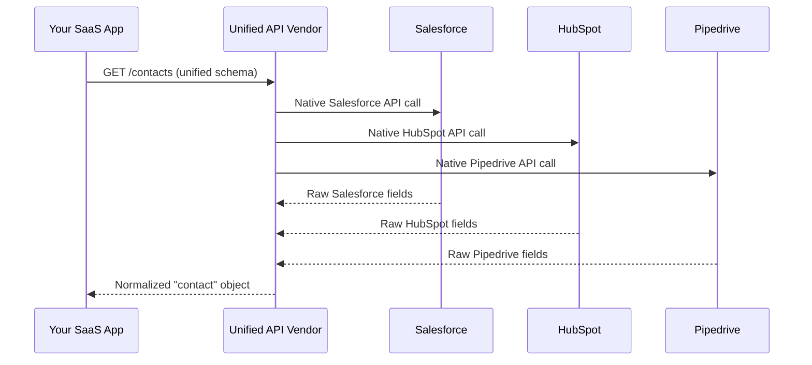

**Example — a normalized contact object:**

```json
{
  "id": "unified_contact_9182",
  "first_name": "Ada",
  "last_name": "Lovelace",
  "email": "ada@example.com",
  "source_system": "salesforce"
}
```

Notice what's missing: any Salesforce-specific custom field (say, `Renewal_Risk_Score__c`) simply isn't in this payload, because HubSpot and Pipedrive have no equivalent field.

### 1.3 Why Teams Choose This First

For an early-stage or mid-market SaaS company under pressure to ship integrations quickly, this trade-off is genuinely worth it:

- **Speed** — One integration effort instead of a dozen.
- **Simplified auth** — One OAuth pattern to build and maintain.
- **Lower initial engineering cost** — Smaller team, faster roadmap delivery.
- **Good enough for standard workflows** — If your customers only need common objects (contacts, tickets, employees), the normalized schema covers them.

**Use Case Example:** A project management SaaS startup wants to let customers sync tasks with whichever CRM they use, just to show deal context inside a task. Nobody needs Salesforce's 40 custom fields — they need `contact.name`, `account.name`, and `deal.stage`. A unified API is the right tool here. It gets the integration checkbox checked in weeks, not quarters.

---

## Part 2: The Lowest Common Denominator Problem

### 2.1 Why Normalization Has a Ceiling

A unified schema is, by mathematical necessity, the **intersection** of the fields across all supported apps — not the union.

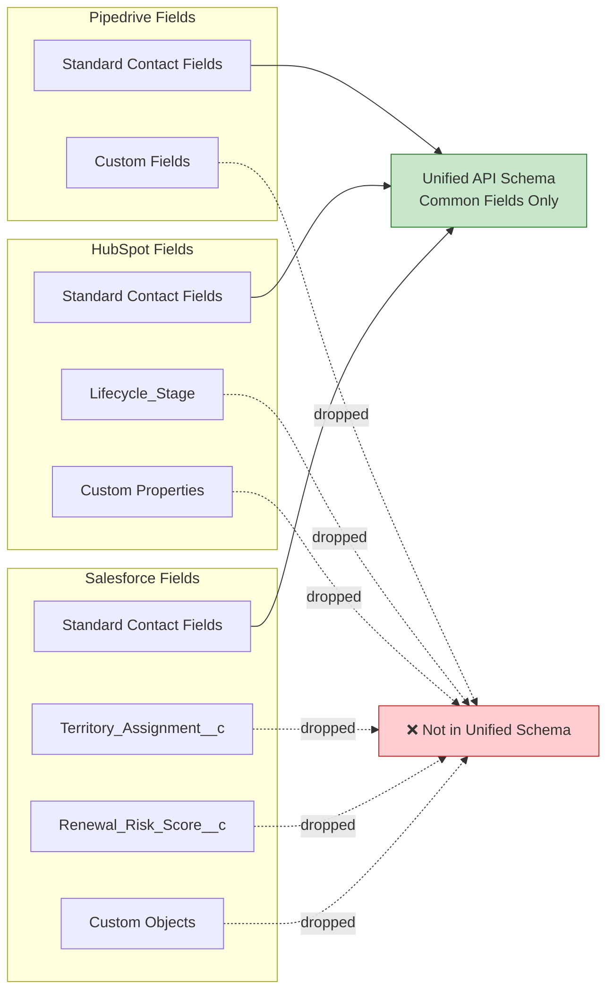

**In plain terms:** the more apps a unified API supports, the smaller the common denominator gets, because every additional app you add to the category shrinks the overlap.

### 2.2 Where This Breaks in Practice

| Scenario | What the Customer Needs | What the Unified API Offers |
|---|---|---|
| Enterprise Salesforce customer | Custom object `Renewal_Risk_Score__c` synced into your product | Not exposed — it's not a standard field |
| Workday customer | Compensation structure specific to their pay-band model | Generic `salary` field only |
| Healthcare vertical | Sync with Epic (EHR system) | Not supported at all — Epic isn't in the vendor's app catalog |
| Manufacturing customer | Sync with a heavily customized NetSuite instance | Partial support, missing custom fields |

### 2.3 The Real-World Consequence

At first these look like isolated edge cases. But there's a pattern hiding in plain sight: **the customers hitting these limits are disproportionately your highest-value, highest-ACV (annual contract value) prospects.** Small, generic customers rarely customize their CRM. Enterprise customers almost always do — because their processes are mature enough to need it.

> **Key insight:** Unified APIs work great for generic customers. Enterprise customers, by definition, stop being generic.

---

## Part 3: The "Zero Maintenance" Promise Doesn't Hold Up

### 3.1 The Marketing Claim vs. Reality

The pitch is simple: *"When the underlying API changes, we handle it — not you."*

In reality, you're not eliminating maintenance. You're **relocating it** — and often making it harder to debug.

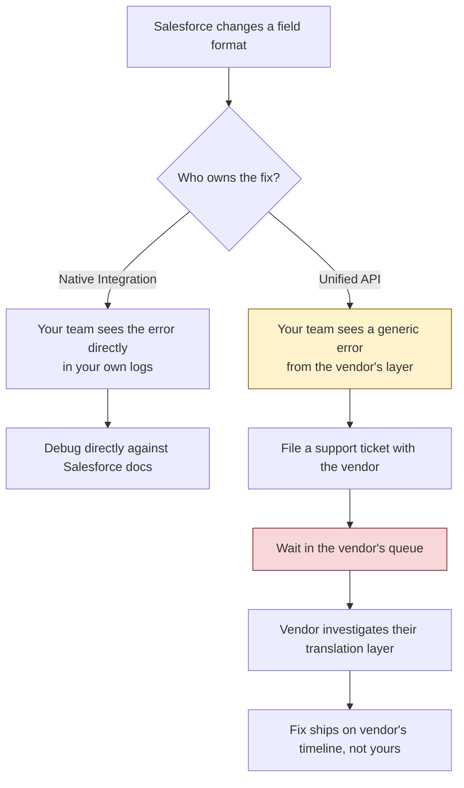

### 3.2 A Concrete Example

Imagine Salesforce silently changes how it paginates a bulk query for accounts with more than 50,000 records. With a native integration:

- Your team's error logs show the exact Salesforce endpoint, exact HTTP status, and exact response body.
- You read Salesforce's own changelog and patch your code in hours.

With a unified API:

- Your team sees an opaque `sync_failed` error from the vendor.
- You can't inspect Salesforce's raw response because you never touched it directly.
- You escalate to vendor support, who must first reproduce the issue, isolate it to Salesforce's pagination behavior, patch their translation layer, and redeploy — a process you have zero visibility or control over.

**Takeaway:** maintenance work didn't disappear. It moved from "your bug, your fix, your timeline" to "someone else's bug, someone else's fix, someone else's timeline" — and that timeline is invisible to you until your enterprise customer is already asking why their data is stale.

---

## Part 4: Complexity Compounds Over Time

The real cost of a unified API strategy rarely shows up on day one. It shows up 12–18 months later, once you've onboarded enough customers to start hitting the schema's edges.

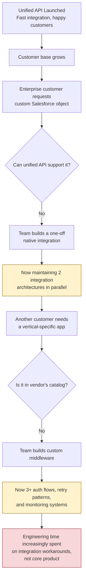

### 4.1 The Four Compounding Costs

**1. Dual Integration Architectures**
Once you need even one custom integration alongside your unified API, you now maintain two systems with different auth flows, error handling, retry logic, and monitoring dashboards. Every new integration request forces a decision: "Which pattern does this go through?"

**2. Data Model Constraints**
Your product connects to the unified schema, not to the real underlying app. When a customer asks for a field the schema doesn't expose, engineers build a manual workaround — which doesn't reduce complexity, it just relocates it into your own codebase.

**3. Vendor Roadmap Dependency**
If the vendor doesn't support a specific endpoint, webhook, or app, you're stuck waiting on their roadmap, or building around them. Either way, the "we handle it" value proposition quietly erodes.

**4. Escalation Cost**
Enterprise deals often include a technical evaluator whose job is to stress-test your integration story. The moment they find a gap, the deal stalls or dies — a cost measured in lost revenue, not engineering hours.

### 4.2 Example Walkthrough: The Workaround Trap

Let's follow one integration team through a realistic 18-month timeline.

| Month | Event | Architecture State |
|---|---|---|
| 1 | Launch unified API for CRM sync | 1 clean integration layer |
| 4 | Land first enterprise deal — needs custom Salesforce field | Native Salesforce connection added |
| 7 | Land healthcare vertical customer — needs Epic (unsupported by vendor) | Custom middleware built for Epic |
| 10 | Manufacturing customer needs a heavily customized NetSuite | Another one-off integration |
| 13 | Team realizes 40% of integration engineering time goes to maintaining workarounds | Technical debt review triggered |
| 18 | Team evaluates embedded iPaaS to consolidate everything | Migration planning begins |

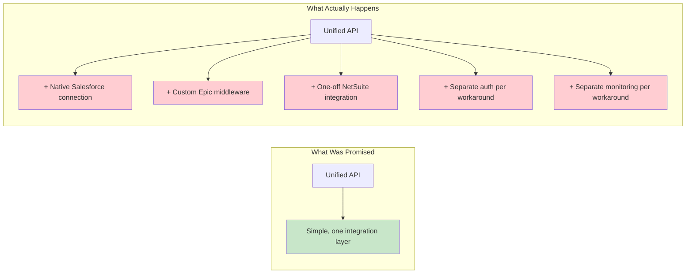

---

## Part 5: Vertical SaaS Makes This Worse Every Year

B2B software isn't consolidating — it's fragmenting. Beyond the mainstream CRM/HRIS/ticketing categories, entire industries run on specialized, vertical-specific software:

- **Healthcare:** Epic, Cerner, athenahealth
- **Construction:** Procore, Buildertrend
- **Manufacturing:** Heavily customized NetSuite or SAP instances
- **Legal:** Clio, PracticePanther
- **Real Estate:** Yardi, AppFolio

These systems rarely conform to any standardized schema, and many never appear in a unified API vendor's supported-apps list at all.

**Use Case Example:** A vertical SaaS company selling into healthcare closes a large hospital network. The hospital's entire operational data lives in Epic. No unified API vendor supports Epic natively — its data model is uniquely complex and heavily regulated. The company must build a direct, purpose-built integration regardless of what abstraction layer they use elsewhere. This is the deal that determines whether the quarter's number gets hit.

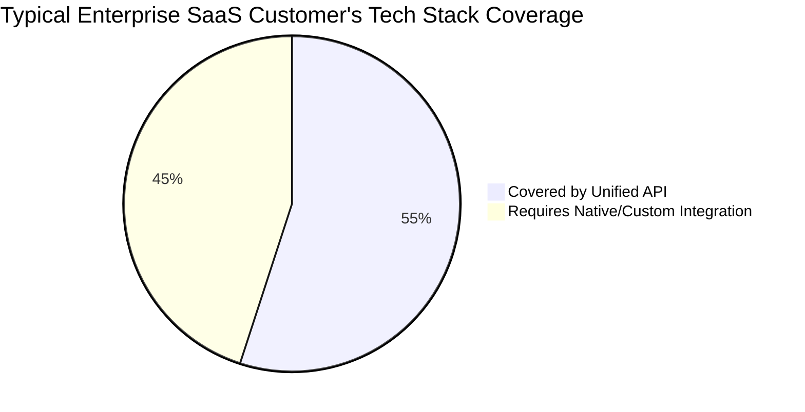

---

## Part 6: What Happens at Scale — The Requirement Shift

As your product matures, the nature of integration requests changes shape:

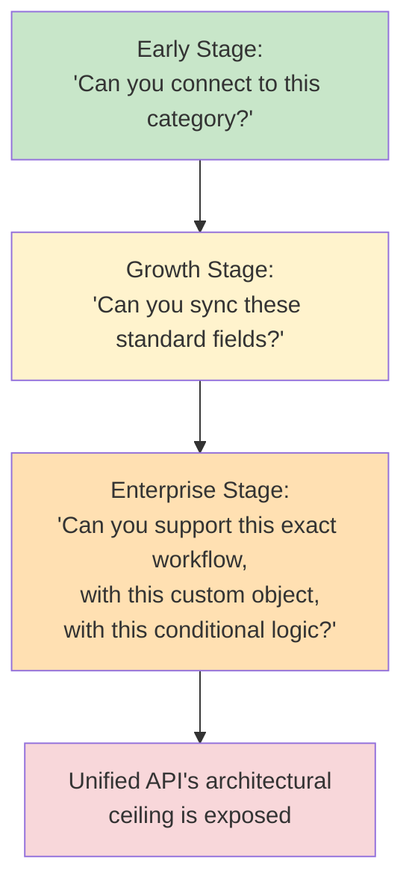

The teams that feel this pain most acutely are the ones who hit the ceiling **mid-deal or mid-contract** — when a prospect's technical evaluator asks a question the architecture simply cannot answer.

---

## Part 7: Embedded iPaaS — The Durable Foundation

### 7.1 What Is an Embedded iPaaS?

An **embedded iPaaS** (integration Platform as a Service) is a white-labeled integration infrastructure that lives inside your product. Unlike a unified API, it isn't constrained to one simplified schema. It gives your engineering team the building blocks — connectors, workflow orchestration, data mapping tools, auth management — to build **both**:

1. Fast, productized integrations for common apps (like a unified API would offer)
2. Deep, flexible, custom integrations for complex or vertical-specific apps (where a unified API breaks down)

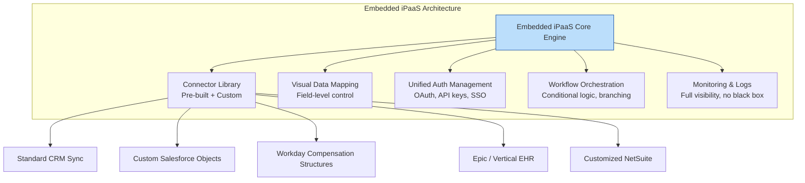

### 7.2 Step-by-Step: How Teams Typically Adopt It

1. **Audit existing integrations** — categorize which are "standard" (contacts, tickets, employees) vs. "complex" (custom objects, conditional workflows, unsupported apps).
2. **Migrate standard integrations** into the embedded iPaaS's pre-built connector templates — this preserves the speed benefit you had with the unified API.
3. **Build custom flows** for the complex, enterprise-specific requirements using the platform's visual workflow builder and field-level data mapping — no more one-off middleware scattered across the codebase.
4. **Consolidate monitoring and auth** into a single system instead of maintaining separate stacks for "unified API integrations" vs. "custom integrations."
5. **Expose self-serve configuration** to customers or your implementation team, so new field mappings or minor workflow tweaks don't require an engineering sprint.

### 7.3 Example: Before and After

**Before (unified API + workaround sprawl):**

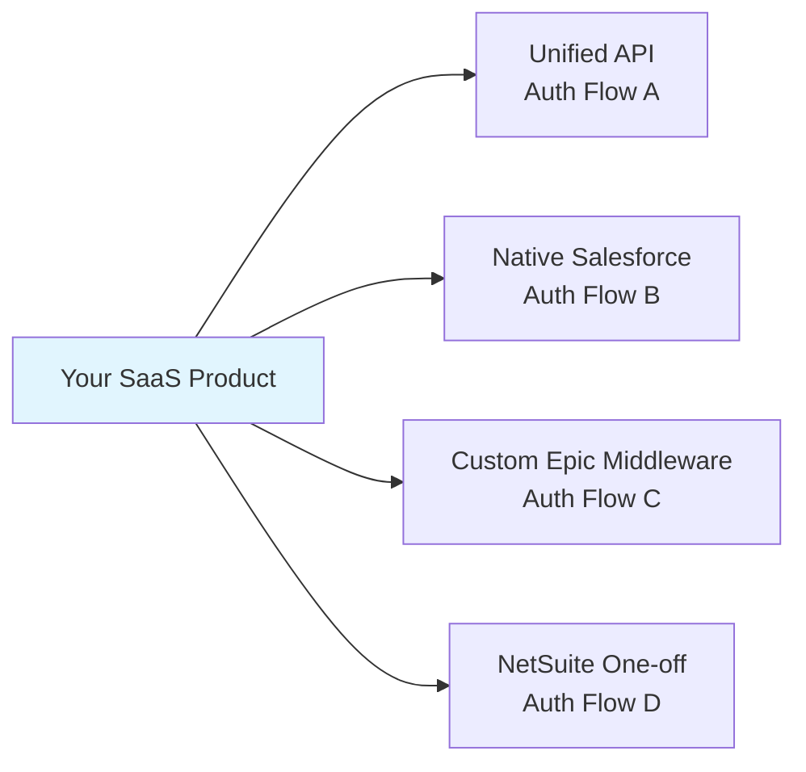

**After (embedded iPaaS):**

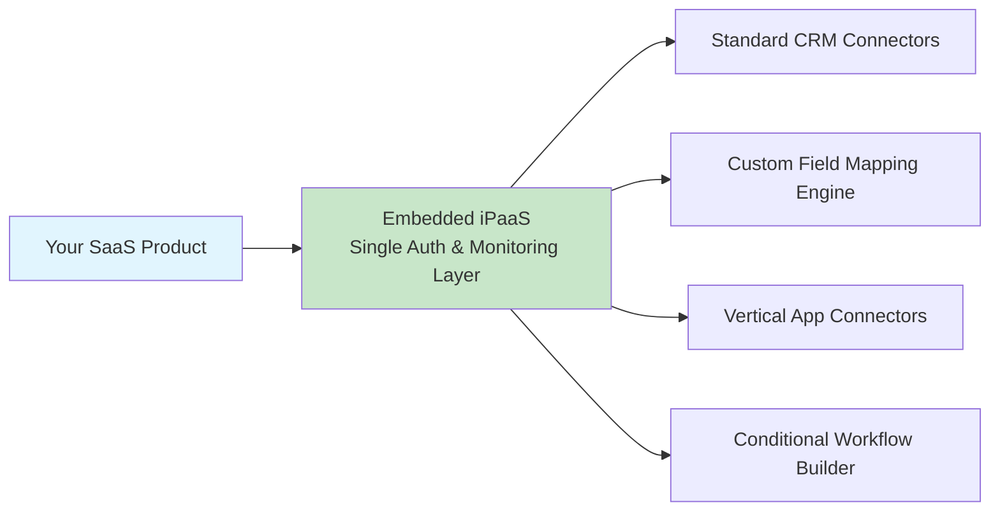

---

## Part 8: Decision Framework — Which Should You Use?

This isn't strictly "unified API vs. embedded iPaaS." Many mature teams use both — a unified API for the easy, standardized 60% of use cases, and an embedded iPaaS (or native integrations) for the complex 40% that determines enterprise deals.

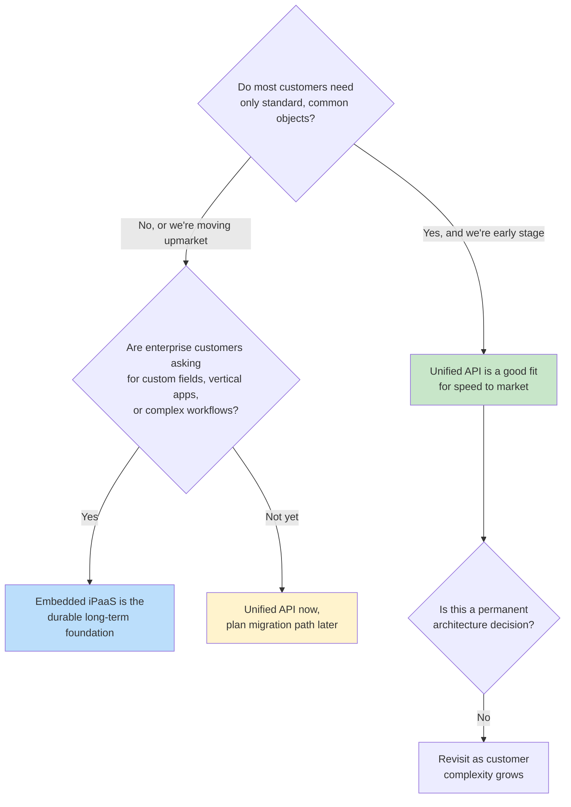

### 8.1 Comparison Table

| Dimension | Unified API | Embedded iPaaS |
|---|---|---|
| Time to first integration | Fastest | Fast to moderate |
| Schema flexibility | Fixed, lowest-common-denominator | Fully flexible, field-level control |
| Support for custom/proprietary fields | No | Yes |
| Support for niche/vertical apps | Limited to vendor's catalog | Extensible — build your own connectors |
| Debugging visibility | Opaque (vendor's black box) | Transparent (your own logs) |
| Maintenance ownership | Vendor owns translation layer | Your team owns, but with tooling |
| Best fit stage | Early-stage, generic customer base | Growth-to-enterprise, complex customer base |
| Long-term scalability | Breaks down as customers customize | Scales with customer complexity |

---

## Part 9: Real-World Use Cases Summary

| Use Case | Recommended Approach | Why |
|---|---|---|
| Early-stage startup syncing basic contact data across 5 CRMs | Unified API | Speed matters more than depth; customers are generic |
| Mid-market company onboarding first enterprise Salesforce customer with custom objects | Embedded iPaaS (or hybrid) | Standard schema can't expose custom fields |
| Vertical SaaS selling into healthcare (Epic, Cerner) | Embedded iPaaS with custom connectors | Unified API vendors rarely support niche EHR systems |
| SaaS product supporting both SMB and enterprise tiers | Hybrid: unified API for SMB, embedded iPaaS for enterprise workflows | Matches integration depth to customer complexity |
| Company whose enterprise deals stall on technical evaluation | Embedded iPaaS migration | Removes the "black box" objection technical evaluators raise |

---

## Part 10: Key Takeaways

1. **Unified APIs are a legitimate first move**, not a mistake — they get you to market fast when your customers are generic.
2. **The lowest-common-denominator schema has a hard ceiling**, and enterprise customers hit it first because they're the ones with customized systems.
3. **"Zero maintenance" is a relocation of effort, not an elimination of it** — you trade visible native-API maintenance for opaque vendor-dependency maintenance.
4. **Complexity compounds silently** — dual architectures, data model constraints, and vendor roadmap dependency accumulate over 12–18 months, not day one.
5. **Vertical SaaS fragmentation guarantees you'll eventually need something a unified API can't offer.**
6. **Embedded iPaaS isn't a replacement for unified APIs — it's the foundation that scales when your unified API's abstraction runs out of road.**

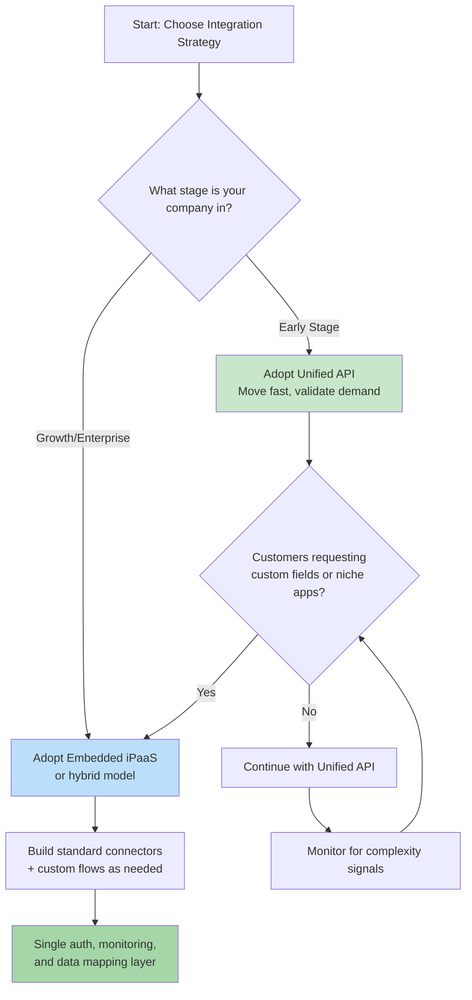

## Conclusion

A unified API is rarely the wrong first decision — but it is, for most B2B SaaS companies, a **way-station rather than a destination**. The mistake isn't choosing a unified API. The mistake is assuming the abstraction will scale indefinitely as your customers grow more complex.

The bigger and more sophisticated your customers become, the more a lowest-common-denominator approach shifts from being a shortcut to being an obstacle. Recognizing that inflection point — before an enterprise technical evaluator finds it for you — is what separates integration strategies that scale from ones that quietly become a tax on your engineering roadmap.