# 🚀 Argo CD: The Complete GitOps Deployment Tutorial

  

> **📚 Difficulty Level:** Intermediate — assumes basic familiarity with Kubernetes (pods, deployments, namespaces) and Git. No prior GitOps experience required.
> **⏱️ Estimated Reading Time:** 90 minutes (plus 2–3 hours for the hands-on lab and exercises)
> **🕒 Last Updated:** 2026-08-31
> **🔖 Applies To:** Argo CD 2.x (stable channel)

## 🧭 Table of Contents

1. [Introduction: What is Argo CD?](#1-introduction-what-is-argo-cd)
2. [Prerequisites](#2-prerequisites)
3. [Learning Objectives](#3-learning-objectives)
4. [Why GitOps? Why Argo CD?](#4-why-gitops-why-argo-cd)
5. [Core Concepts and Architecture](#5-core-concepts-and-architecture)
6. [Installation Guide (Multiple Methods)](#6-installation-guide-multiple-methods)
7. [Hands-On Lab: Your First GitOps Deployment](#7-hands-on-lab-your-first-gitops-deployment)
8. [Managing Applications](#8-managing-applications)
9. [Sync Strategies Explained](#9-sync-strategies-explained)
10. [Application Health and Status](#10-application-health-and-status)
11. [Access Control and Security](#11-access-control-and-security)
12. [Security Deep Dive & Hardening Checklist](#12-security-deep-dive--hardening-checklist)
13. [Secrets Management](#13-secrets-management)
14. [Notifications and Integrations](#14-notifications-and-integrations)
15. [Real-World Use Cases](#15-real-world-use-cases)
16. [Performance Considerations](#16-performance-considerations)
17. [Testing Strategies for GitOps](#17-testing-strategies-for-gitops)
18. [Migration Guide: From Push-Based CI/CD to GitOps](#18-migration-guide-from-push-based-cicd-to-gitops)
19. [Best Practices](#19-best-practices)
20. [Anti-Patterns: What NOT to Do](#20-anti-patterns-what-not-to-do)
21. [Pro Tips from the Trenches](#21-pro-tips-from-the-trenches)
22. [Troubleshooting Guide](#22-troubleshooting-guide)
23. [Practice Exercises (with Solutions)](#23-practice-exercises-with-solutions)
24. [Test Your Understanding](#24-test-your-understanding)
25. [Common Interview Questions](#25-common-interview-questions)
26. [Question Bank (50 Questions)](#26-question-bank-50-questions)
27. [Self-Assessment Checklist](#27-self-assessment-checklist)
28. [Resources for Further Learning](#28-resources-for-further-learning)
29. [Summary](#29-summary)

---

## 1. Introduction: What is Argo CD? <a name="introduction"></a>

**Argo CD** is a declarative, GitOps continuous delivery (CD) tool built specifically for Kubernetes. Instead of pushing deployments imperatively (`kubectl apply`, CI scripts running `helm upgrade`), Argo CD **pulls** the desired state of your applications from a Git repository and continuously reconciles your live cluster to match it.

### The Core Idea in One Sentence
> "Git is the single source of truth. Argo CD makes your cluster look like Git — always."

### A Simple Analogy
Think of Argo CD like a **thermostat** for your Kubernetes cluster:
- Git = the temperature you *set* (desired state)
- Cluster = the current room temperature (live state)
- Argo CD = the thermostat constantly checking and adjusting to match your setting

If someone manually opens a window (i.e., an engineer runs `kubectl edit` directly on the cluster), Argo CD notices the "temperature drifted" and — depending on configuration — either alerts you or automatically corrects it back to what Git says it should be.

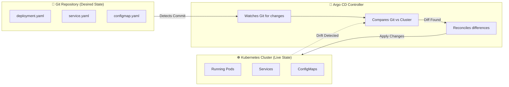

### Quick Recap
- Argo CD is a **pull-based** CD controller running inside your Kubernetes cluster.
- It treats **Git as the single source of truth** for desired state.
- It continuously **reconciles** live cluster state against Git, detecting (and optionally auto-correcting) drift.

> 💡 **Aha moment:** Argo CD does not *build* your application — that is still CI's job (tests, images, artifacts). Argo CD owns **CD**: what runs where, according to Git. CI produces artifacts; GitOps decides deployment.

---
## 2. Prerequisites <a name="prerequisites"></a>

Before starting this tutorial, make sure you have the following in place:

### Knowledge Prerequisites
| Concept | Why You Need It | Recommended Prep |
|---|---|---|
| **Kubernetes basics** | Argo CD deploys Kubernetes resources | Understand Pods, Deployments, Services, Namespaces, ConfigMaps |
| **kubectl** | You will interact with the cluster directly | `kubectl get`, `apply`, `describe`, `logs` |
| **Git fundamentals** | Git is the source of truth | Branching, committing, pull requests |
| **YAML** | All manifests and Argo CD resources are YAML | Basic syntax, multi-document files |
| **Helm/Kustomize (helpful)** | Argo CD renders both natively | Not required — covered in this tutorial |

### Tooling Prerequisites
- ✅ A running Kubernetes cluster (any of these work): **minikube**, **kind**, **k3d**, **Docker Desktop** (Kubernetes enabled), or a managed cluster (EKS/GKE/AKS)
- ✅ `kubectl` configured and pointing at your cluster (`kubectl cluster-info` works)
- ✅ **Git** installed
- ✅ (Optional) **Helm 3** installed — for the Helm installation method
- ✅ (Optional) The **Argo CD CLI** (`argocd`) — [install instructions](https://argo-cd.readthedocs.io/en/stable/cli_installation/)

### Infrastructure Requirements
- ~2 CPU cores and 2–4 GB RAM free in your cluster for Argo CD itself
- Outbound network access from the cluster to GitHub (to clone repos and pull manifests)

> 💡 **No cluster? Fastest local setup:** `kind create cluster --name argocd-lab` gets you a disposable cluster in under 2 minutes. A multi-node `kind` cluster is also perfect for practicing multi-cluster patterns.

---

## 3. Learning Objectives <a name="learning-objectives"></a>

By the end of this tutorial, you will be able to:

1. **Explain** the GitOps model and articulate why pull-based deployment is safer and more auditable than push-based CI/CD
2. **Install** Argo CD three different ways (kubectl manifest, HA manifest, Helm chart) and choose the right one for your context
3. **Create and manage** Argo CD Applications via UI, CLI, and declarative YAML
4. **Configure** sync strategies — manual, automated, self-heal, and auto-prune — and pick the right combination per environment
5. **Interpret** sync status and health status independently and diagnose degraded applications
6. **Implement** RBAC, SSO, and AppProjects to secure a multi-tenant Argo CD installation
7. **Manage secrets** safely using Sealed Secrets, SOPS, or the External Secrets Operator
8. **Build** real-world patterns: App-of-Apps, ApplicationSets for multi-cluster fleets, and progressive delivery with Argo Rollouts
9. **Troubleshoot** common OutOfSync/Degraded issues and use `ignoreDifferences` and Lua health checks
10. **Migrate** an existing push-based CI/CD pipeline to GitOps incrementally and safely

> 🎯 **Learning path recommendation:** Work through sections 4–11 linearly, then do the Hands-On Lab (Section 7) and Practice Exercises (Section 23) before attempting the Question Bank (Section 26). Difficulty ratings throughout: 🟢 Beginner · 🟡 Intermediate · 🔴 Advanced.

---

## 4. Why GitOps? Why Argo CD? <a name="why"></a>

### The Problem GitOps Solves

Before GitOps, most teams deployed to Kubernetes using **imperative pipelines**:

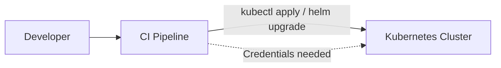

**Problems with this model:**
- CI/CD tools need broad cluster credentials (security risk)
- No single source of truth — cluster state can silently drift from what's in Git
- Hard to audit "who changed what, when"
- Rollbacks require re-running pipelines, not just `git revert`

### The GitOps Model (Pull-Based)

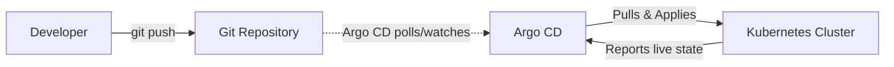

Notice the credentials flow **only one way** — into the cluster, initiated by Argo CD itself (which lives inside the cluster). No external system needs cluster-admin credentials.

### Key Benefits at a Glance

| Benefit | Description | Real-World Impact |
|---|---|---|
| **Declarative** | You describe *what* you want, not *how* | Fewer scripting bugs |
| **Git as source of truth** | Every change is a commit | Full audit trail via `git log` |
| **Visual UI + CLI** | See app topology visually | Faster debugging |
| **Auto/Manual Sync** | Choose your risk tolerance | Flexible for prod vs dev |
| **Drift Detection** | Notices manual `kubectl` changes | Prevents "snowflake" clusters |
| **Multi-cluster support** | One Argo CD, many clusters | Centralized fleet management |
| **RBAC + SSO** | Enterprise-grade access control | Compliance-friendly |

> 💡 **Example scenario:** An engineer accidentally scales a production deployment down to 0 replicas using `kubectl scale`. With Argo CD's self-heal enabled, within seconds the app is automatically restored to match Git — no incident required.

> ⚖️ **Trade-off discussion — when GitOps is NOT the right fit:**
> - **One-time imperative migration logic** (e.g., data migrations) belongs in CI jobs, not Git-tracked manifests
> - **Extremely high-frequency state churn** (thousands of dynamic resource changes per second) can overwhelm the reconciliation loop
> - **Non-Kubernetes infrastructure** needs adjacent tooling (e.g., Terraform via Crossplane, which itself can be managed by Argo CD)

---
## 5. Core Concepts and Architecture <a name="architecture"></a>

### 5.1 The Application Resource 🟢

An Argo CD **Application** is itself a Kubernetes Custom Resource (CRD). It's the fundamental unit Argo CD manages.

```yaml
apiVersion: argoproj.io/v1alpha1
kind: Application
metadata:
  name: guestbook
  namespace: argocd
spec:
  project: default
  source:
    repoURL: https://github.com/argoproj/argocd-example-apps.git
    targetRevision: HEAD
    path: guestbook
  destination:
    server: https://kubernetes.default.svc
    namespace: guestbook
  syncPolicy:
    automated:
      prune: true
      selfHeal: true
```

**Breaking this down:**
- `source` → *where* the desired state lives (repo, branch/tag, path)
- `destination` → *where* it should be deployed (which cluster, which namespace)
- `syncPolicy` → *how* Argo CD should keep them in sync

### 5.2 Repositories 🟢

Argo CD can pull manifests from multiple source types:

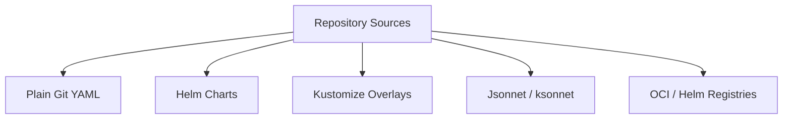

**Example — a Helm-based Application:**
```yaml
spec:
  source:
    repoURL: https://charts.bitnami.com/bitnami
    chart: nginx
    targetRevision: 15.4.4   # pin chart versions! HEAD/ latest invites surprises
    helm:
      values: |
        replicaCount: 3
```

### 5.3 Sync — The Heart of Argo CD 🟢

"Sync" is the process of making the live cluster state match Git.

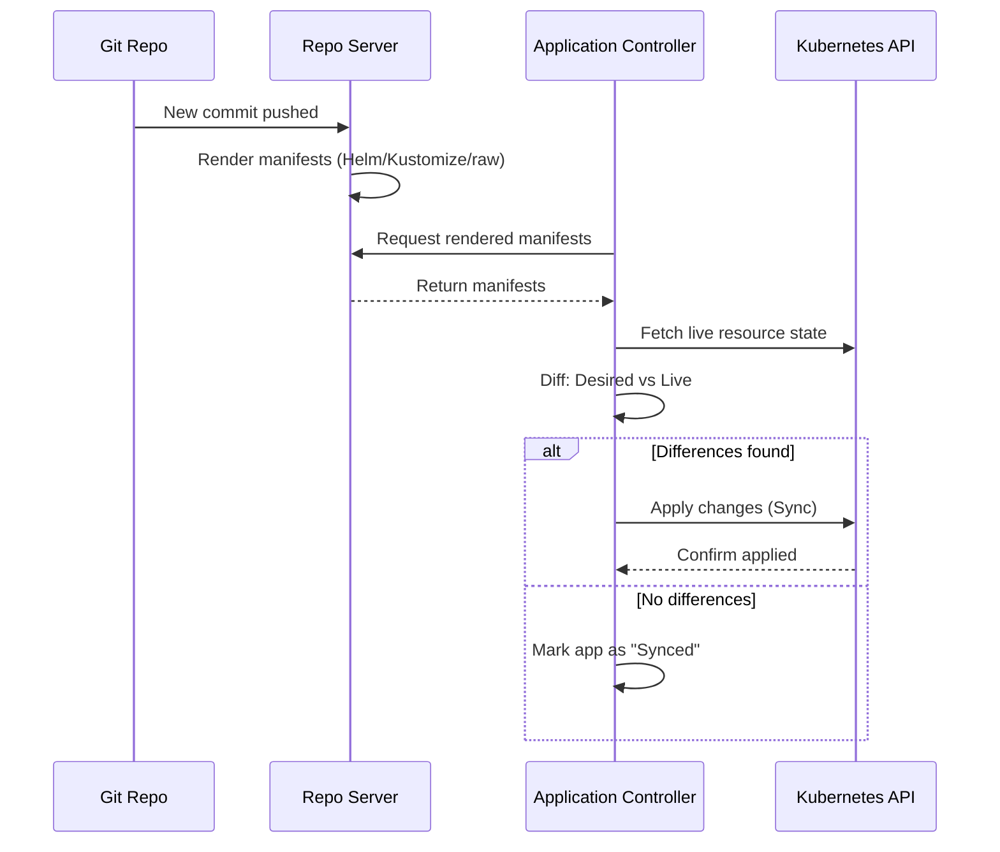

### 5.4 Argo CD Components 🟡

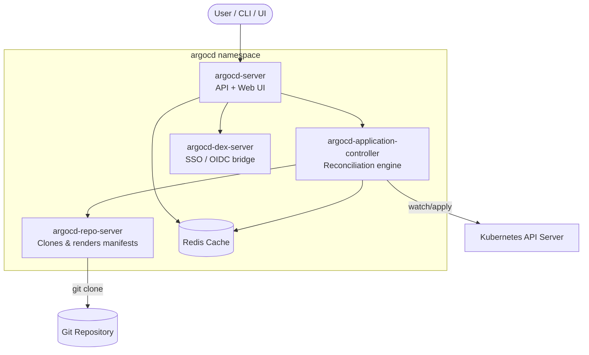

| Component | Responsibility |
|---|---|
| **argocd-server** | Exposes gRPC/REST API and the Web UI; handles auth |
| **argocd-repo-server** | Clones Git repos, renders Helm/Kustomize/Jsonnet into plain manifests |
| **argocd-application-controller** | The reconciliation loop — diffs and applies changes |
| **argocd-dex-server** | Optional SSO bridge for GitHub, LDAP, OIDC, SAML, etc. |
| **Redis** | Caches cluster/app state for performance |

> 💡 **Mental model:** `argocd-repo-server` answers *"what SHOULD the cluster look like?"* (renders Git into manifests). `argocd-application-controller` answers *"what DOES the cluster look like, and what must change?"* (diffs and applies). Most debugging questions decompose into "is it a render problem (repo-server) or a diff/apply problem (controller)?"

---

## 6. Installation Guide <a name="installation"></a>

### Method 1: Standard kubectl Install (Non-HA) 🟢

```bash
kubectl create namespace argocd

kubectl apply -n argocd -f https://raw.githubusercontent.com/argoproj/argo-cd/stable/manifests/install.yaml
```

### Method 2: High-Availability Install (Production) 🟡

```bash
kubectl create namespace argocd
kubectl apply -n argocd -f https://raw.githubusercontent.com/argoproj/argo-cd/stable/manifests/ha/install.yaml
```

> 📌 **When to use HA:** Production clusters with SLAs, where you can't tolerate the `argocd-server` or `argocd-application-controller` being a single point of failure.

### Method 3: Helm Install (Most Common in Real Teams) 🟡

```bash
helm repo add argo https://argoproj.github.io/argo-helm
helm repo update

helm install argocd argo/argo-cd \\
  --namespace argocd \\
  --create-namespace \\
  --values custom-values.yaml
```

This is preferred in real-world setups because it lets you version-control your Argo CD *own* configuration (ironically, GitOps-ing Argo CD itself).

> ✅ **Correct vs incorrect implementation:**
> ```yaml
> # ✅ CORRECT — pinned, declarative, reviewable
> # (in Git: platforms/argocd/values-prod.yaml)
> configs:
>   params:
>     "server.insecure": true   # TLS terminated at ingress
> controller:
>   resources:
>     requests: { cpu: 500m, memory: 1Gi }
> ```
> ```bash
> # ❌ INCORRECT — imperative, unpinned, unreviewable
> helm install argocd argo/argo-cd --set server.extraArgs="{--insecure}"
> ```

### Accessing the UI

```bash
kubectl port-forward svc/argocd-server -n argocd 8080:443
```

Visit: `https://localhost:8080`

### Retrieving the Initial Admin Password

```bash
kubectl -n argocd get secret argocd-initial-admin-secret \\
  -o jsonpath="{.data.password}" | base64 -d
```

### Logging In via CLI

```bash
argocd login localhost:8080 --username admin --password <retrieved-password> --insecure
```

> ⚠️ **Security tip:** Delete the `argocd-initial-admin-secret` after first login and rotate the admin password, or better yet, disable local admin entirely once SSO is configured.

### Installation Decision Flowchart

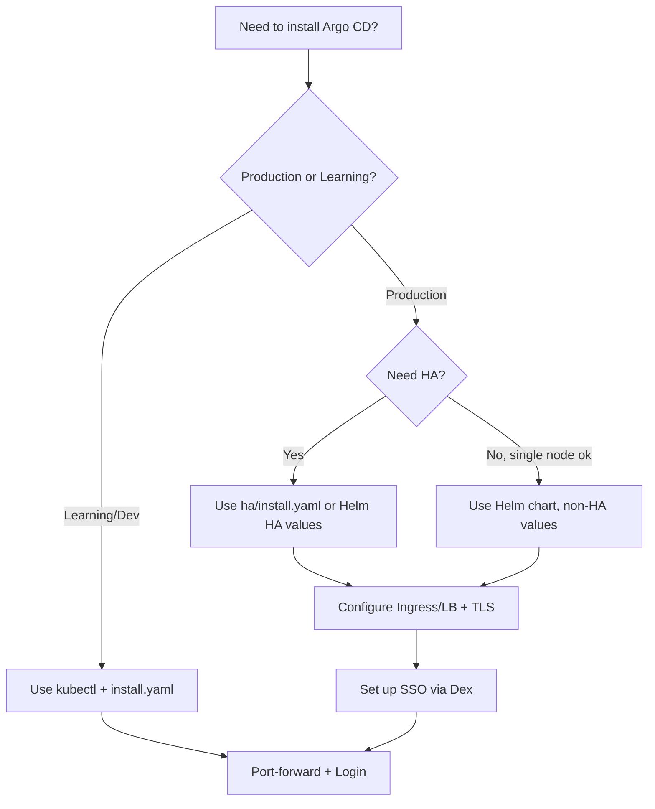

### Verify Your Installation

```bash
# All pods should be Running before proceeding
kubectl get pods -n argocd

# Quick sanity check via CLI
argocd version
```

---
## 7. Hands-On Lab: Your First GitOps Deployment <a name="hands-on-lab"></a>

> 🧪 **Lab goal:** Install Argo CD on a local cluster, deploy an app from a public Git repo with auto-sync + self-heal, then deliberately break it and watch GitOps heal it. Estimated time: 30–45 minutes.

### Step 1 — Install Argo CD
```bash
kubectl create namespace argocd
kubectl apply -n argocd -f https://raw.githubusercontent.com/argoproj/argo-cd/stable/manifests/install.yaml
kubectl wait --for=condition=available --timeout=300s deployment --all -n argocd
```

### Step 2 — Log in
```bash
kubectl port-forward svc/argocd-server -n argocd 8080:443 &

# in another terminal
export ARGO_PWD=$(kubectl -n argocd get secret argocd-initial-admin-secret -o jsonpath="{.data.password}" | base64 -d)
argocd login localhost:8080 --username admin --password $ARGO_PWD --insecure
```

### Step 3 — Create your first Application
```bash
argocd app create guestbook \\
  --repo https://github.com/argoproj/argocd-example-apps.git \\
  --path guestbook \\
  --dest-server https://kubernetes.default.svc \\
  --dest-namespace default \\
  --sync-policy automated \\
  --self-heal
```

### Step 4 — Watch it deploy
```bash
argocd app get guestbook     # Sync Status: Synced, Health: Healthy
argocd app wait guestbook
kubectl get deploy,svc -n default | grep guestbook
```

### Step 5 — Cause drift and watch self-heal 🧨
```bash
# Simulate a rogue engineer changing the cluster directly
kubectl scale deployment guestbook-ui --replicas=0 -n default

# Immediately: pods terminate. Within seconds-to-minutes:
watch kubectl get pods -n default
# Argo CD detects the drift and restores replicas to match Git!
```

> 💡 **What just happened:** the application controller's reconciliation loop compared live state (0 replicas) against Git (1 replica), detected OutOfSync, and self-heal reverted it. Open the Argo CD UI (http://localhost:8080) and you'll see this history in the app's event log.

### Step 6 — Deploy a *change* via Git (the GitOps way)

Fork `argoproj/argocd-example-apps`, edit `guestbook/deployment.yaml` (change the image tag), commit, and either wait for the refresh interval or trigger it:

```bash
argocd app sync guestbook    # or rely on automated sync + webhook
```

### ✅ Lab Success Criteria
- [ ] All Argo CD pods Running
- [ ] `argocd app get guestbook` shows `Synced` + `Healthy`
- [ ] Drift (replicas=0) was auto-reverted without touching the cluster
- [ ] A Git commit changed the running app within one refresh cycle

---

## 8. Managing Applications with Argo CD <a name="applications"></a>

There are three ways to define Applications:

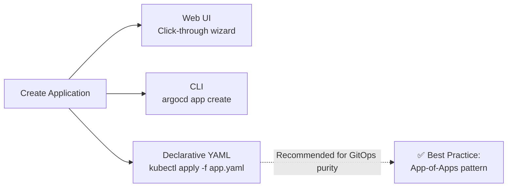

> 💡 **Best practice tip:** Ironically, the most "GitOps" way to manage Argo CD Applications is to **also** define them as YAML files committed to Git — this is called the **"App of Apps" pattern**, covered in Use Cases below.

### 8.1 Creating an Application via CLI 🟢

```bash
argocd app create my-app \\
  --repo https://github.com/your-org/your-repo \\
  --path k8s/app \\
  --dest-server https://kubernetes.default.svc \\
  --dest-namespace default
```

### 8.2 Creating an Application Declaratively (Recommended) 🟢

```yaml
apiVersion: argoproj.io/v1alpha1
kind: Application
metadata:
  name: my-app
  namespace: argocd
spec:
  project: default
  source:
    repoURL: https://github.com/your-org/your-repo
    targetRevision: main
    path: k8s/app
  destination:
    server: https://kubernetes.default.svc
    namespace: default
  syncPolicy:
    automated:
      prune: true
      selfHeal: true
    syncOptions:
      - CreateNamespace=true
```

```bash
kubectl apply -f my-app.yaml -n argocd
```

> ⚠️ **Note:** `CreateNamespace=true` lets Argo CD create the destination namespace on first sync — without it, sync fails if the namespace doesn't exist.

### 8.3 Syncing and Inspecting 🟢

```bash
# Trigger a sync manually
argocd app sync my-app

# View full status, including resource tree
argocd app get my-app

# Watch live sync progress
argocd app wait my-app
```

### 8.4 Example: Multi-Environment Setup 🟡

A very common real-world pattern is one Application per environment, using Kustomize overlays:

```text
repo/
├── base/
│   ├── deployment.yaml
│   ├── service.yaml
│   └── kustomization.yaml
└── overlays/
    ├── dev/
    │   └── kustomization.yaml
    ├── staging/
    │   └── kustomization.yaml
    └── prod/
        └── kustomization.yaml
```

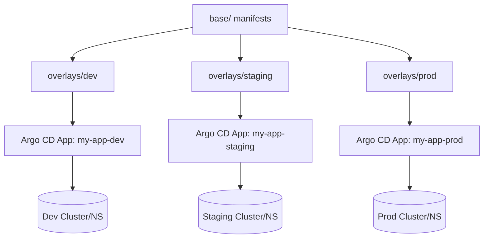

Each environment's Argo CD Application points to the same `base/`, but a different overlay — giving you consistency with environment-specific tweaks (replica counts, resource limits, env vars).

---
## 9. Sync Strategies Explained <a name="sync"></a>

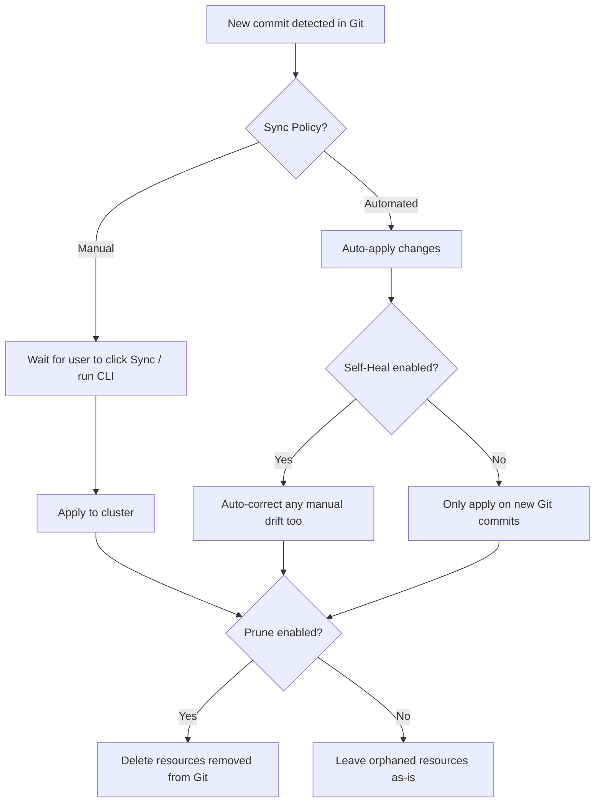

### 9.1 Manual Sync (Default, Safest for Beginners) 🟢

You control exactly when changes go live:

```bash
argocd app sync my-app
```

**Use case:** Early-stage teams, or highly regulated production environments where every deploy needs a human "go" decision.

### 9.2 Automatic Sync 🟢

```bash
argocd app set my-app --sync-policy automated
```

Or declaratively:
```yaml
syncPolicy:
  automated: {}
```

**Use case:** Fast-moving dev/staging environments where you want every merge to `main` to deploy instantly (true continuous deployment).

### 9.3 Self-Heal 🟡

```bash
argocd app set my-app --sync-policy automated --self-heal
```

Argo CD will revert *any* manual change on the cluster back to what's in Git — even if no new commit was made.

> 🧪 **Example:** Someone runs `kubectl edit deployment my-app` and changes the image tag directly. Within the reconciliation interval (default ~3 minutes, or immediately via webhook-triggered refresh), Argo CD detects the drift and reverts it back to the Git-defined image tag.

### 9.4 Auto-Prune 🟡

```bash
argocd app set my-app --sync-policy automated --self-heal --auto-prune
```

When a manifest is **deleted from Git**, prune ensures the corresponding Kubernetes resource is also deleted from the cluster — keeping things perfectly in sync in both directions.

### Comparison Table

| Strategy | New commits applied? | Manual drift corrected? | Deleted-from-Git resources removed? | Risk Level |
|---|---|---|---|---|
| Manual | ❌ (needs trigger) | ❌ | ❌ | 🟢 Low |
| Automated | ✅ | ❌ | ❌ | 🟡 Medium |
| Automated + Self-Heal | ✅ | ✅ | ❌ | 🟠 Medium-High |
| Automated + Self-Heal + Prune | ✅ | ✅ | ✅ | 🔴 Highest (fully autonomous) |

> ⚖️ **Trade-off:** Fully autonomous sync maximizes velocity and consistency but means *every* Git mistake reaches production within one reconciliation cycle. That's why PR review gates on the config repo are non-negotiable in this mode.

### Bonus: Sync Waves & Hooks 🔴

For ordering (e.g., migrations before app deployment), use the `argocd.argoproj.io/sync-wave` annotation. Lower waves sync first, and an app won't proceed to the next wave until earlier resources are healthy:

```yaml
metadata:
  annotations:
    argocd.argoproj.io/sync-wave: "1"   # database/migrations first
# wave 0 → namespace/CRDs, wave 1 → DB + migrations, wave 2 → app
```

**PreSync/PostSync hooks** (e.g., `argocd.argoproj.io/hook: PreSync`) run Jobs before/after the main sync — ideal for smoke tests or cache flushes.

---

## 10. Application Health and Status <a name="health"></a>

Argo CD tracks **two independent dimensions** for every app:

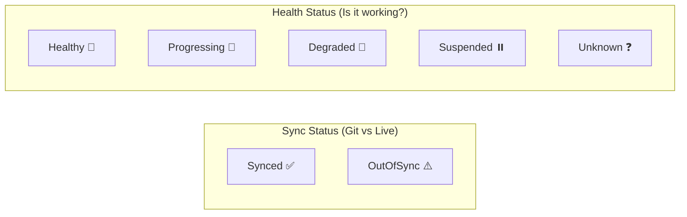

**Why both matter:** An app can be perfectly **Synced** (cluster matches Git exactly) but still be **Degraded** (e.g., you deployed a broken image, and Git even says so). Conversely, an app can be **Healthy** but **OutOfSync** if someone manually scaled it up temporarily.

### Health Status Meanings

| Status | Meaning | Example Trigger |
|---|---|---|
| **Healthy** | All resources report healthy | Deployment has desired replica count all `Running` |
| **Progressing** | Still rolling out | New Deployment rollout in progress |
| **Degraded** | Something failed | CrashLoopBackOff, failed probes |
| **Suspended** | Intentionally paused | A Rollout paused for canary analysis |
| **Unknown** | Argo CD can't determine health | Custom resource with no health check defined |

### Checking Status 🟢

```bash
argocd app get my-app
```

Sample output interpretation:
```text
Name:               my-app
Sync Status:        Synced
Health Status:      Healthy
```

### Custom Health Checks (Advanced) 🔴

For CRDs Argo CD doesn't know natively (e.g., a custom database operator), you can define a health check in `argocd-cm`:

```yaml
data:
  resource.customizations.health.mygroup.io_MyDatabase: |
    hs = {}
    if obj.status ~= nil then
      if obj.status.phase == "Ready" then
        hs.status = "Healthy"
      else
        hs.status = "Progressing"
      end
    end
    return hs
```

This uses **Lua scripting** — a powerful and underused feature for teams with custom operators.

> 💡 **Quick decision heuristic:**
> - **OutOfSync but Healthy** → someone changed the live cluster (or rendering changed). Run `argocd app diff`.
> - **Synced but Degraded** → the *deployed version itself* is broken. Check pod logs/events, then fix the app (via a new Git commit!).

---
## 11. Access Control and Security <a name="security"></a>

### 11.1 RBAC Model 🟡

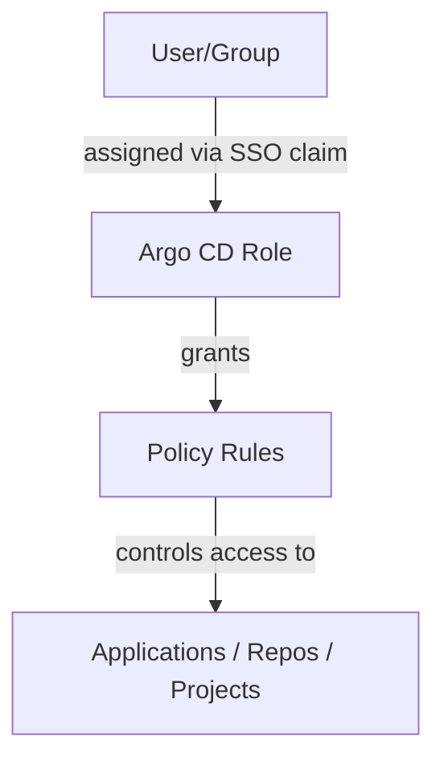

Example `argocd-rbac-cm` ConfigMap for a read-only role:

```yaml
apiVersion: v1
kind: ConfigMap
metadata:
  name: argocd-rbac-cm
  namespace: argocd
data:
  policy.csv: |
    g, read-only, role:readonly
    p, role:readonly, applications, get, */*, allow
    p, role:readonly, applications, action/*, */*, deny
```

**A more realistic, team-based RBAC example:**

```yaml
data:
  policy.csv: |
    # Platform team: full admin
    p, role:platform-admin, applications, *, */*, allow
    p, role:platform-admin, clusters, *, *, allow
    g, platform-team, role:platform-admin

    # App teams: can sync/view only their own project's apps
    p, role:team-alpha, applications, get, team-alpha-project/*, allow
    p, role:team-alpha, applications, sync, team-alpha-project/*, allow
    g, team-alpha-devs, role:team-alpha
  policy.default: role:readonly
```

### 11.2 SSO Integrations 🟡

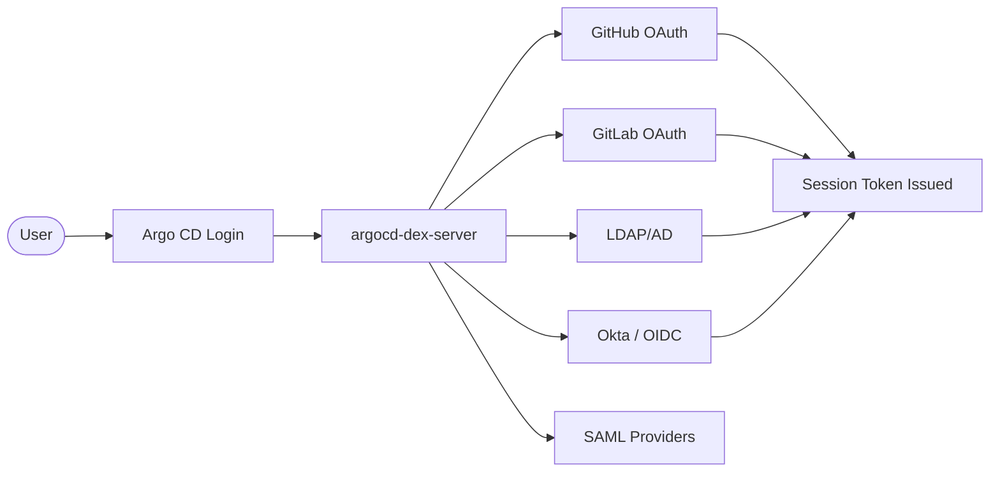

**Example: GitHub SSO config (`argocd-cm`)**
```yaml
data:
  url: https://argocd.example.com
  dex.config: |
    connectors:
      - type: github
        id: github
        name: GitHub
        config:
          clientID: $dex.github.clientID
          clientSecret: $dex.github.clientSecret
          orgs:
            - name: your-org
```

### 11.3 API Tokens for Automation (CI/CD) 🟡

```bash
argocd account generate-token --account ci-bot
```

**Use case:** A CI pipeline that triggers `argocd app sync` after tests pass, using a scoped service account token instead of the admin account — following least-privilege principles.

### 11.4 AppProjects — Multi-Tenancy Boundaries 🟡

`AppProject` resources let you sandbox teams so they can only deploy to specific clusters/namespaces from specific repos:

```yaml
apiVersion: argoproj.io/v1alpha1
kind: AppProject
metadata:
  name: team-alpha-project
  namespace: argocd
spec:
  sourceRepos:
    - https://github.com/your-org/team-alpha-*
  destinations:
    - namespace: 'team-alpha-*'
      server: https://kubernetes.default.svc
  clusterResourceWhitelist: []   # deny cluster-scoped resources
```

**Use case:** In a multi-tenant platform team setup, this ensures "Team Alpha" can never accidentally (or maliciously) deploy to "Team Beta's" namespace or use a repo outside their org.

---

## 12. Security Deep Dive & Hardening Checklist <a name="security-deep-dive"></a>

Security was introduced in Section 11; this section consolidates a **production hardening checklist**. Work through it top to bottom before exposing Argo CD beyond your laptop.

### 12.1 Hardening Checklist 🟡

| # | Control | How | Priority |
|---|---|---|---|
| 1 | **SSO instead of local admin** | Configure Dex/OIDC; then `argocd account update-password` + disable local admin | 🔴 Critical |
| 2 | **Delete initial admin secret** | `kubectl -n argocd delete secret argocd-initial-admin-secret` | 🔴 Critical |
| 3 | **RBAC least privilege** | Team-scoped AppProjects + `policy.csv`; default role = `role:readonly` | 🔴 Critical |
| 4 | **TLS everywhere** | Terminate TLS at ingress with valid certs, or keep TLS on the argocd-server service | 🟠 High |
| 5 | **No secrets in Git** | Sealed Secrets / SOPS / External Secrets Operator (Section 13) | 🔴 Critical |
| 6 | **Scoped CI tokens** | Generate per-pipeline `argocd account generate-token` with expiry; rotate regularly | 🟠 High |
| 7 | **Private repos + deploy keys / workload identity** | Never embed credentials in `repoURL`; use HTTPS creds or SSH keys stored in Argo CD, or IRSA/Workload Identity for cloud Git | 🟠 High |
| 8 | **Audit logging enabled** | Enable Argo CD audit logs; ship to SIEM | 🟡 Medium |
| 9 | **Keep Argo CD patched** | Subscribe to security advisories; upgrade promptly (several CVEs historically affected argocd-server auth) | 🔴 Critical |
| 10 | **Network policy** | Restrict ingress to argocd-server; egress only to Git/registry/cluster API | 🟡 Medium |

### 12.2 The Pull Model's Security Advantage 🔴

In push-based CD, every external system with deploy rights is a credential-leak blast radius. In GitOps:
- Credentials live **inside** the cluster, held by Argo CD
- Git changes require **no** cluster credentials at all — a PR merge is the deploy trigger
- Compromise of your CI system cannot directly touch the cluster (it can only push commits, which pass through PR review)

### 12.3 Threat Scenarios & Mitigations 🔴

| Threat | Mitigation |
|---|---|
| Stolen CI credentials | CI only pushes commits to the config repo (needs Git write, not cluster RBAC); require PR approvals |
| Rogue direct cluster access | Self-heal reverts drift; audit logs expose who/what/when |
| Malicious PR targeting another team's namespace | AppProject `destinations` + `sourceRepos` sandboxing (Section 11.4) |
| Supply-chain: unpinned image tags mutate | Pin digests in manifests; use image signature verification (cosign/kyverno) |
| argocd-server exposed publicly | SSO + RBAC + TLS + keep patched; prefer VPN/ingress allowlists |

> ⚠️ **Remember:** Argo CD itself is a privileged workload — it can deploy anything, anywhere it's allowed. Compromise of the `argocd-application-controller` service account is effectively cluster-admin compromise. Protect the argocd namespace like you protect your control plane.

---
## 13. Secrets Management in Argo CD <a name="secrets"></a>

Since Git is the source of truth, and Git should **never** contain plaintext secrets, teams use one of these patterns:

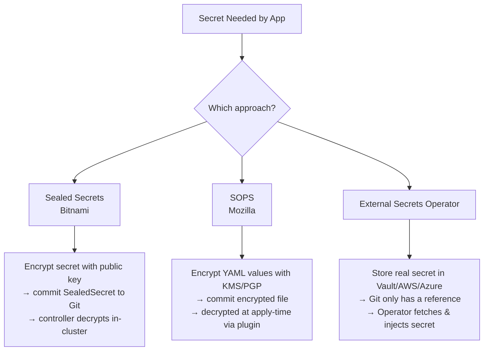

### 13.1 Comparison: Which Secrets Approach? 🟡

| Approach | Where's the real secret? | Best for | Watch out for |
|---|---|---|---|
| **Sealed Secrets** | Encrypted in Git (public key) | Small teams, single cluster | Key rotation per cluster; re-seal on rotation |
| **SOPS + KMS/PGP** | Encrypted in Git, decrypted at apply-time | Teams already using KMS/age | Requires KSOPS plugin on repo-server |
| **External Secrets Operator** | External vault (Vault, AWS, Azure, GCP) | Enterprise, multi-cluster, rotation | Another controller to run; vault availability |

### 13.2 Sealed Secrets Example 🟢

```bash
# Encrypt a plain secret into a SealedSecret
kubeseal --format=yaml < mysecret.yaml > mysealedsecret.yaml
```

The `mysealedsecret.yaml` is safe to commit — only the in-cluster controller (holding the private key) can decrypt it.

### 13.3 External Secrets Operator (Most Popular in Enterprise) 🟡

```yaml
apiVersion: external-secrets.io/v1beta1
kind: ExternalSecret
metadata:
  name: db-credentials
spec:
  secretStoreRef:
    name: aws-secrets-manager
    kind: SecretStore
  target:
    name: db-credentials
  data:
    - secretKey: password
      remoteRef:
        key: prod/db/password
```

**Use case:** A bank's platform team uses AWS Secrets Manager as the single secure vault. Git only ever contains a *reference* (`prod/db/password`), never the actual credential — satisfying compliance audits (SOC 2, PCI-DSS).

> ⚠️ **Never do this:** committing raw `kind: Secret` YAML with base64-encoded (NOT encrypted) values to a public — or even private — Git repo. Base64 is encoding, not encryption, and is trivially reversible.

```yaml
# ❌ INCORRECT — base64 is NOT encryption; this is a leak
apiVersion: v1
kind: Secret
metadata:
  name: db-credentials
stringData:
  password: SuperSecret123
```

> 💡 **If a secret ever lands in Git:** rotate it *first* (the leak is real the moment it's pushed), *then* remove it from history. Removing the file without rotation is security theater.

---

## 14. Notifications and Integrations <a name="notifications"></a>

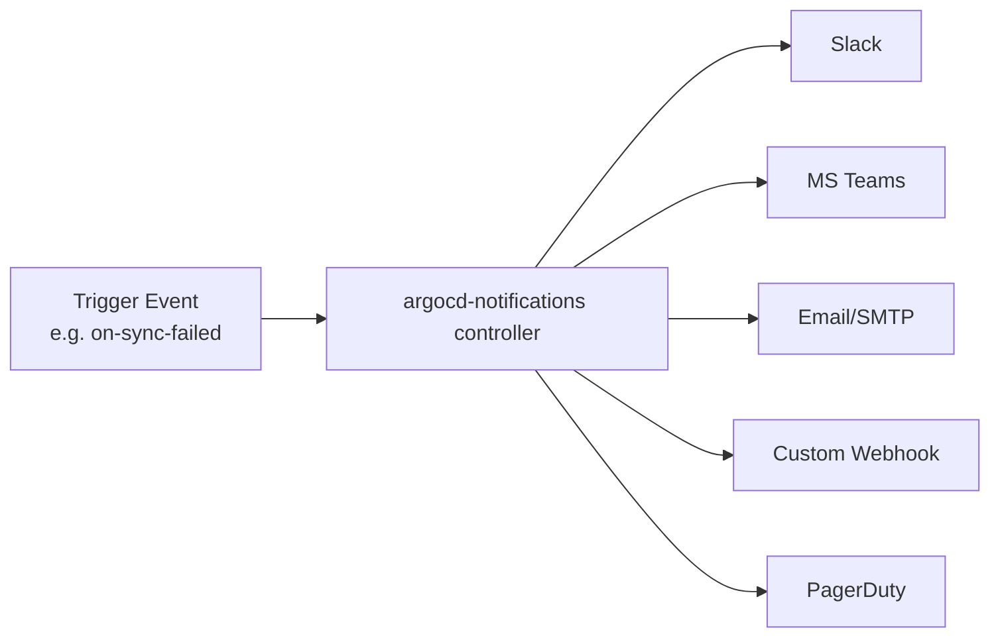

### Example: Slack Notification on Sync Failure 🟡

```yaml
apiVersion: v1
kind: ConfigMap
metadata:
  name: argocd-notifications-cm
data:
  service.slack: |
    token: $slack-token
  trigger.on-sync-failed: |
    - when: app.status.operationState.phase in ['Error', 'Failed']
      send: [app-sync-failed]
  template.app-sync-failed: |
    message: |
      🚨 Sync failed for {{.app.metadata.name}}
      Error: {{.app.status.operationState.message}}
```

Then subscribe an app to it:
```bash
kubectl annotate app my-app \\
  notifications.argoproj.io/subscribe.on-sync-failed.slack=platform-alerts
```

### Real Use Cases for Notifications

1. **Slack alert on sync failure** → on-call engineer investigates within minutes
2. **Email on health degradation** → managers get visibility into prod issues
3. **Webhook to trigger downstream workflow** → e.g., notify a status page or trigger automated rollback pipeline
4. **PagerDuty on repeated sync failures** → escalate to incident response

> 💡 **Pro insight:** notifications run as a separate controller (`argocd-notifications-controller` in recent versions). If alerts mysteriously stop, check that controller's pods and its ConfigMap first — it is a distinct component, not part of the application controller.

---
## 15. Real-World Use Cases <a name="use-cases"></a>

### Use Case 1: The "App of Apps" Pattern (Bootstrapping a Whole Platform) 🔴

A single root Argo CD Application manages *other* Argo CD Applications — enabling you to bootstrap an entire cluster's workloads from one Git commit.

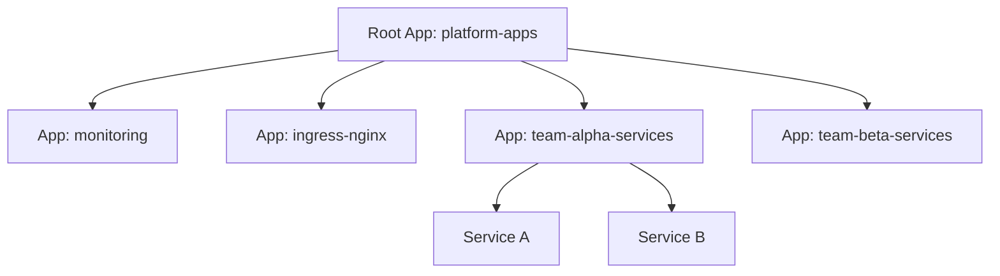

```yaml
apiVersion: argoproj.io/v1alpha1
kind: Application
metadata:
  name: platform-apps
  namespace: argocd
spec:
  source:
    repoURL: https://github.com/your-org/platform-gitops
    path: apps
    targetRevision: main
  destination:
    server: https://kubernetes.default.svc
    namespace: argocd
  syncPolicy:
    automated: {}
```

**Real-world value:** Disaster recovery becomes trivial — spin up a brand-new cluster, apply *one* root Application, and Argo CD rebuilds your entire platform from Git.

> 💡 **Modern note:** For most new setups, prefer **ApplicationSets** (Use Case 3) over hand-rolled App-of-Apps — ApplicationSet is the purpose-built evolution of the same idea.

### Use Case 2: Progressive Delivery with Argo Rollouts 🔴

Combining Argo CD with **Argo Rollouts** enables canary and blue-green deployments:

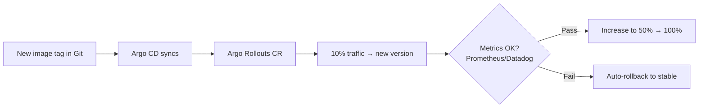

**Use case:** An e-commerce company deploys checkout-service updates to 5% of traffic first, watches error rates via Prometheus, and auto-promotes or auto-rolls-back — all driven from a Git commit.

### Use Case 3: Multi-Cluster Fleet Management 🔴

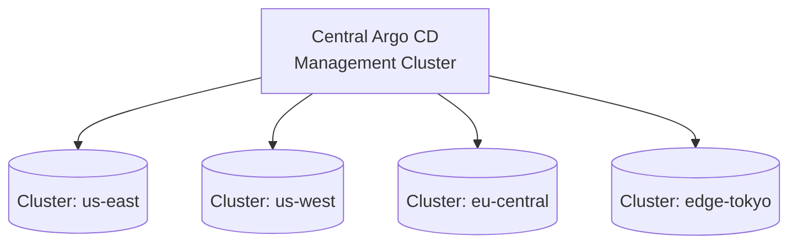

**Use case:** A global SaaS company runs one central Argo CD instance that deploys the same application manifests across four regional clusters, using `ApplicationSet` to generate one Application per cluster automatically:

```yaml
apiVersion: argoproj.io/v1alpha1
kind: ApplicationSet
metadata:
  name: my-app-fleet
spec:
  generators:
    - clusters: {}  # auto-discovers all registered clusters
  template:
    metadata:
      name: '{{name}}-my-app'
    spec:
      source:
        repoURL: https://github.com/your-org/my-app
        path: k8s
      destination:
        server: '{{server}}'
        namespace: my-app
```

### Use Case 4: Disaster Recovery Drills 🟡

Because the cluster state is fully described in Git, teams routinely test DR by:
1. Deleting a namespace entirely
2. Letting Argo CD's auto-sync + self-heal recreate everything within minutes
3. Validating recovery time objective (RTO) compliance

### Use Case 5: Compliance & Audit Trails 🔴

Regulated industries (finance, healthcare) use Argo CD's Git-backed history to answer auditor questions like *"who deployed what, when, and why"* — every change is a Git commit with an author, timestamp, and PR approval trail, satisfying SOC 2 / ISO 27001 change-management controls.

---

## 16. Performance Considerations <a name="performance"></a>

As your fleet grows (hundreds of Applications), Argo CD's defaults need tuning:

### 16.1 Application Controller Sharding 🟠

By default, one controller shard handles all clusters. Scale horizontally by sharding across multiple controller replicas:

```yaml
# Helm values
controller:
  replicas: 3   # each shard owns a subset of clusters
```

**Rule of thumb:** the community guideline is roughly one shard per ~50–100 clusters (or when controller CPU/memory saturates), but measure — resource pressure depends on app count and manifest size, not just cluster count.

### 16.2 Repo-Server Tuning 🟠

The repo-server renders every manifest (Helm/Kustomize) on each refresh — it's usually the first bottleneck:

```yaml
repoServer:
  replicas: 3                              # parallelize rendering
  resources:
    requests: { cpu: 250m, memory: 512Mi }
    limits:   { cpu: '1',  memory: 2Gi }
  env:
    - name: HELM_CACHE_HOME               # persist Helm cache if mounting volumes
      value: /helm-working-dir
```

### 16.3 Reconciliation Intervals 🟠

| Setting | Default | Tuning guidance |
|---|---|---|
| App refresh (poll) | ~3 min | Add **Git webhooks** instead of shortening the poll — near-instant with near-zero load |
| `timeout.reconciliation` | 180s | Increase on huge fleets to reduce API churn |
| Redis caching | On | Keep enabled; disabling it destroys performance |

> 💡 **Webhook over polling:** configure a Git webhook to `https://<argocd>/api/webhook` — commits trigger refreshes in seconds, and you can safely *increase* polling intervals.

### 16.4 Other Performance Levers 🟡
- **Resource limits** on argocd-server, repo-server, and controller (OOMKilled controllers cause mysterious "app missing" symptoms)
- **Reduce Application count** where sensible: group related resources; avoid thousands of tiny apps
- **`resource.exclusions`** in `argocd-cm` to stop watching noisy resource types (e.g., Events) — big memory win
- **Managed namespaces metadata** and `selfService` settings matter at scale in multi-tenant setups
- **Monitor Argo CD itself**: controller goroutine counts, Redis memory, repo-server 5xx rates

> ⚠️ **Anti-tip:** Don't set reconciliation to 10 seconds "to catch drift faster." Use webhooks for responsiveness; aggressive polling just burns Git API rate limits and controller CPU.

---
## 17. Testing Strategies for GitOps <a name="testing"></a>

In GitOps, **the merge to the config repo IS the deployment trigger** — so your "deployment tests" must happen before merge. A layered strategy:

### 17.1 The Testing Pyramid for GitOps 🟡

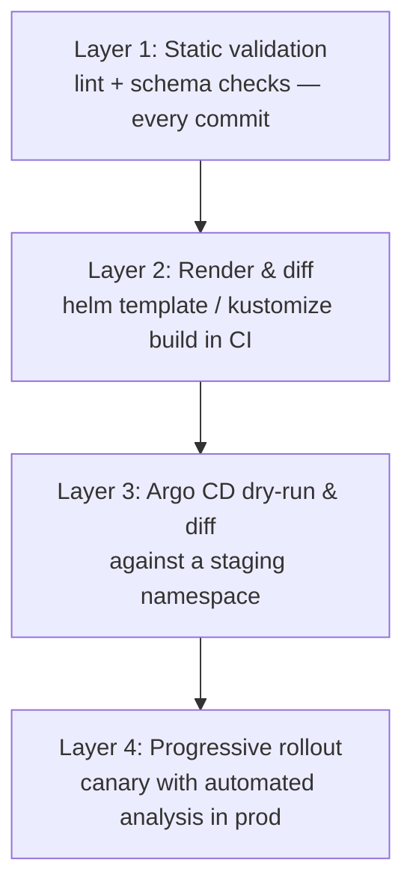

| Layer | Tooling | When it runs |
|---|---|---|
| **1. Static validation** | `kubeconform`, `yamllint`, `helm lint`, `kustomize build` | Every PR |
| **2. Policy checks** | OPA/Gatekeeper/Kyverno policy tests, conftest | Every PR |
| **3. Render & diff** | `argocd app diff --server-side`, preview environments | Every PR (preview) + pre-sync |
| **4. Progressive delivery** | Argo Rollouts AnalysisTemplates (Prometheus queries, error-rate gates) | Production syncs |

### 17.2 Practical Examples 🟡

```bash
# Validate rendered output exactly as Argo CD will see it
kustomize build overlays/staging | kubeconform -strict -summary

# Let Argo CD tell you what a sync WOULD change (no cluster mutation)
argocd app diff my-app --exit-code=false

# Dry-run a sync: applies nothing, surfaces validation errors
argocd app sync my-app --dry-run
```

And an Argo Rollouts analysis gate:
```yaml
apiVersion: argoproj.io/v1alpha1
kind: AnalysisTemplate
metadata:
  name: error-rate-check
spec:
  metrics:
    - name: http-error-rate
      interval: 1m
      failureLimit: 2
      provider:
        prometheus:
          address: http://prometheus.monitoring:9090
          query: |
            sum(rate(http_requests_total{app="checkout",code=~"5.."}[2m]))
            / sum(rate(http_requests_total{app="checkout"}[2m]))
      successCondition: result[0] < 0.01
```

> 💡 **Key mindset shift:** you're no longer testing "does the pipeline script work?" — you're testing "does this Git state produce a healthy cluster?" Preview environments (a temporary namespace per PR, generated by ApplicationSets) are the gold standard for this.

---

## 18. Migration Guide: From Push-Based CI/CD to GitOps <a name="migration"></a>

Migrating an existing `kubectl apply`/`helm upgrade` pipeline to Argo CD is low-risk **if done incrementally**:

### 18.1 Phased Migration Path 🟠

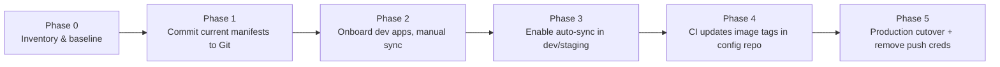

**Phase-by-phase detail:**

1. **Phase 0 — Inventory:** List everything currently deployed imperatively. Export live state (`kubectl get -o yaml`) to see the real drift you've accumulated.
2. **Phase 1 — Codify:** Commit manifests/Helm values/Kustomize overlays to a **config repo**. Clean them; don't dump raw exports.
3. **Phase 2 — Adopt (dev first):** Create Applications pointing at the new repo, **manual sync**, no self-heal. Verify `argocd app diff` is empty — this catches "live cluster was drifting from manifests" surprises.
4. **Phase 3 — Automate:** Enable auto-sync in dev/staging. Let it soak for a sprint.
5. **Phase 4 — Re-wire CI:** Change CI's final step from "helm upgrade against cluster" to "update image tag in config repo and commit" (e.g., via `kustomize edit set image` in a bot PR).
6. **Phase 5 — Cutover:** Move prod to auto-sync (or gated sync), then **revoke CI's cluster credentials** — the whole point of the migration.

> ⚠️ **Migration gotchas:**
> - **"OutOfSync forever" after migration:** resources created by `helm upgrade` have labels/annotations Argo CD doesn't expect. Let Argo CD adopt them, or re-sync with `--force`, or recreate resources via Git.
> - **Do NOT enable self-heal on day one** — first understand your legitimate drift (e.g., HPA-managed replica counts, mutating webhooks). Add `ignoreDifferences` for those.
> - Run both systems in parallel briefly (push CI writes to a *different* tag/namespace, or is paused) — never let two controllers fight over the same resources.

---
## 19. Best Practices <a name="best-practices"></a>

```mermaid
mindmap
  root((Argo CD Best Practices))
    Structure
      Separate config repo from app source repo
      Use folders/branches per environment
      App-of-Apps for bootstrapping
    Security
      RBAC per team via AppProjects
      SSO instead of local admin
      Rotate/disable initial admin account
      Never commit plaintext secrets
    Sync Policy
      Auto-sync + self-heal for non-prod
      Manual or gated sync for prod
      Enable prune carefully
    Observability
      Configure notifications for failures
      Monitor health + sync status dashboards
      Set resource-level health checks for CRDs
    Operations
      Keep Argo CD version updated
      Use ApplicationSets for fleet management
      Version-control Argo CD's own config
```

### Detailed Recommendations

1. **Separate "app source" repos from "config" repos.** Keep application code in one repo, and Kubernetes manifests/Helm values in another (or a clearly separated folder). This lets CI update image tags in the config repo without touching source code history.
2. **Use auto-sync + self-heal in dev/staging, gated sync in production.** This balances developer velocity against production safety.
3. **Enable pruning carefully** — always test in non-prod first, since pruning deletes resources removed from Git.
4. **Set up notifications before you need them** — don't wait for a 2 AM incident to discover Slack alerts weren't configured.
5. **Use AppProjects to enforce multi-tenancy** — never let one team's Application definition reach into another's namespace or cluster.
6. **Keep Argo CD itself upgraded** — it's a critical piece of infrastructure; stale versions miss security patches.
7. **Store secrets outside Git** using Sealed Secrets, SOPS, or External Secrets Operator — never plaintext, never even base64-only.
8. **Pin versions everywhere** — `targetRevision` should be a branch, tag, or commit (never floating expectations); pin Helm chart versions and image digests for production.
9. **Version-control Argo CD's own config** (Helm values for the Argo CD chart) — GitOps all the way down.

---

## 20. Anti-Patterns: What NOT to Do <a name="anti-patterns"></a>

| ❌ Anti-Pattern | Why It Hurts | ✅ Do This Instead |
|---|---|---|
| **Committing `kind: Secret` YAML to Git** | Base64 ≠ encryption; permanent leak | Sealed Secrets / SOPS / External Secrets Operator |
| **Creating all Apps via UI clicks** | Cluster's deploy topology is undocumented & un-recreatable | Declarative YAML in Git (App-of-Apps / ApplicationSets) |
| **Self-heal + prune everywhere from day one** | Every Git mistake & legitimate drift gets auto-reverted/deleted — including prod data-tier surprises | Gradual rollout: manual → auto → self-heal, with `ignoreDifferences` for known noise |
| **One giant "everything" Application** | One bad manifest blocks the whole platform's sync | Logical apps per service/domain; sync waves for ordering |
| **CI deploys directly *and* Argo CD manages the same resources** | Two writers fight; flip-flopping OutOfSync | CI only updates the config repo; Argo CD is the *only* cluster writer |
| **`targetRevision: HEAD` in production** | Someone pushes to an unexpected branch and prod changes | Pin to protected branches/tags (`main`, `v1.4.2`) |
| **Editing resources in the cluster to "hotfix"** | Drift reappears or self-heal undoes your fix — confusing incidents | Emergency change = emergency PR + expedited review; fix forward in Git |
| **Disabling drift detection instead of tuning it** | Hides real problems | Use `ignoreDifferences` for known benign mutations |
| **Keeping CI's cluster-admin credentials after GitOps cutover** | Largest standing security risk you were trying to remove | Revoke push credentials at Phase 5 of migration |
| **Storing Argo CD config only in Helm CLI `--set` flags** | Unreviewable, unreproducible installs | Commit Helm values files to Git |

```yaml
# ❌ INCORRECT — floating production source, no protection
spec:
  source:
    repoURL: https://github.com/your-org/config
    targetRevision: HEAD        # whatever HEAD means today...

# ✅ CORRECT — pinned, protected, reviewed
spec:
  source:
    repoURL: https://github.com/your-org/config
    targetRevision: release-1.4  # protected branch, PR-gated
```

---

## 21. Pro Tips from the Trenches <a name="pro-tips"></a>

1. **`argocd app diff` before every manual prod sync** — it's the safest "what will this change?" command and costs nothing.
2. **Use `syncOptions: [PruneLast=true]`** so deletions happen after everything else is healthy — dramatically reduces risk of prune-induced downtime.
3. **`argocd.argoproj.io/ignore-healthcheck: "true"`** annotation marks resources whose health shouldn't block later sync waves (use sparingly!).
4. **Deletion confirmation:** enable `syncOptions: [RespectIgnoreDifferences=true]` plus a `DeletionGuard` policy so AppProjects can require explicit human approval for resource deletion.
5. **ApplicationSets `goTemplate: true`** (2.x) unlocks full Go templating — much more powerful than fasttemplate for fleet manifests.
6. **`argocd app actions run`** lets you execute defined resource actions (like restarting a deployment) through Argo CD — audited, RBAC-checked, unlike raw kubectl.
7. **Split `argocd` Applications across projects** even on a single team — RBAC and diffing get cleaner, and blast radius shrinks.
8. **Track the `argocd-notifications-controller` separately** when debugging missing alerts — it's an independent component with its own ConfigMap and pods.
9. **`--server-side-generate`** (server-side diff/apply) resolves diffs for very large CRs (e.g., huge CRDs like Crossplane compositions) that trip client-side diffing.

---
## 22. Troubleshooting Guide <a name="troubleshooting"></a>

```mermaid
flowchart TD
    Problem[App shows OutOfSync or Degraded] --> Check1{Sync Status?}
    Check1 -->|OutOfSync| Diff[Run: argocd app diff my-app]
    Check1 -->|Synced but Degraded| Logs[Check pod logs/events]
    Diff --> Manual[Manual change on cluster?]
    Diff --> GitChange[New commit not yet synced?]
    Logs --> CrashLoop[CrashLoopBackOff?]
    Logs --> ProbeFail[Readiness probe failing?]
    CrashLoop --> FixImage[Check image tag / app config]
    ProbeFail --> FixProbe[Check probe path/port/timing]
```

| Symptom | Likely Cause | Fix |
|---|---|---|
| App stuck `Progressing` forever | Missing/incorrect health check for a CRD | Add Lua health check in `argocd-cm` |
| `ComparisonError` | Repo server can't render manifests (bad Helm values, missing dependency) | `argocd app manifests my-app` to debug locally |
| Sync fails with RBAC error | Argo CD's own service account lacks cluster permissions | Review `argocd-application-controller` ClusterRole |
| App flips `OutOfSync` repeatedly | A controller/webhook is mutating resources after apply (e.g., admission webhook injecting sidecars) | Add `ignoreDifferences` in the Application spec |
| Sync hangs at a wave | A resource in that wave never becomes healthy | Check `argocd app get` resource tree; fix or `ignore-healthcheck` |
| CLI/UI shows `permission denied` | RBAC policy doesn't cover your group | Inspect `policy.csv`; remember `g,` group bindings and `policy.default` |
| Apps vanish after controller restart | Controller OOMKilled; Redis cache evictions | Raise controller memory limits; check `kubectl top` |
| Notifications never fire | Notifications controller down, or app not annotated | Check the notifications controller pods + subscription annotations |
| Webhook ignored | Secret token mismatch or wrong URL | Verify webhook payload URL + shared secret in Argo CD settings |

**Example: Ignoring benign diffs (e.g., Istio sidecar injection)**
```yaml
spec:
  ignoreDifferences:
    - group: apps
      kind: Deployment
      jsonPointers:
        - /spec/template/spec/containers/1
```

### Handy Debug Commands
```bash
argocd app diff my-app            # exact desired-vs-live delta
argocd app manifests my-app       # what the repo-server rendered
argocd app events my-app          # chronological history of what happened
kubectl logs -n argocd deploy/argocd-repo-server -f          # render failures
kubectl logs -n argocd deploy/argocd-application-controller -f  # sync/diff issues
```

---

## 23. Practice Exercises (with Solutions) <a name="exercises"></a>

> 🧪 Complete these in your lab cluster from Section 7. Attempt each before reading the solution.

### Exercise 1 — Multi-Environment Kustomize Deployment 🟡

**Task:** Given the repo structure in Section 8.4, create `dev` and `prod` Applications where dev runs 1 replica with auto-sync + self-heal, and prod runs 3 replicas with **manual** sync. Use Kustomize patches.

**Solution:**

```yaml
# overlays/dev/kustomization.yaml
resources:
  - ../../base
patches:
  - target: { kind: Deployment, name: my-app }
    patch: |
      - op: replace
        path: /spec/replicas
        value: 1
```

```yaml
# overlays/prod/kustomization.yaml
resources:
  - ../../base
patches:
  - target: { kind: Deployment, name: my-app }
    patch: |
      - op: replace
        path: /spec/replicas
        value: 3
```

```yaml
# apps/my-app-dev.yaml
apiVersion: argoproj.io/v1alpha1
kind: Application
metadata:
  name: my-app-dev
  namespace: argocd
spec:
  project: default
  source:
    repoURL: https://github.com/your-org/config-repo
    targetRevision: main
    path: overlays/dev
  destination:
    server: https://kubernetes.default.svc
    namespace: my-app-dev
  syncPolicy:
    automated:
      prune: true
      selfHeal: true
    syncOptions: [CreateNamespace=true]
---
# apps/my-app-prod.yaml — same, except:
#   name: my-app-prod, path: overlays/prod, namespace: my-app-prod
#   and NO syncPolicy.automated (manual sync gate)
```

**Key learning:** same base, divergent policies per environment; prod stays gated.

### Exercise 2 — Diagnose and Fix a Flapping OutOfSync App 🟡

**Task:** Your app flips to `OutOfSync` every few minutes even when Git hasn't changed. `argocd app diff my-app` shows `spec.replicas` differing (live: 5, Git: 3). A HorizontalPodAutoscaler manages this deployment.

**Solution:**

The HPA is legitimate — the right fix is telling Argo CD to ignore replica-count diffs, not to fight the HPA:

```yaml
spec:
  ignoreDifferences:
    - group: apps
      kind: Deployment
      jsonPointers:
        - /spec/replicas
```

Or granularly with managedFields (modern approach):

```yaml
spec:
  ignoreDifferences:
    - group: apps
      kind: Deployment
      managedFieldsManagers:
        - kube-controller-manager   # HPA writes replicas via this manager
```

**Key learning:** not every diff is drift — identify the *mutating manager* before "fixing" it.

### Exercise 3 — Build a Sync Wave Deployment Order 🔴

**Task:** Your app needs: (1) namespace + CRDs, (2) a Postgres database, (3) the app itself that connects to Postgres. Configure Argo CD so the app never starts before the database is ready, without three separate Applications.

**Solution:**

One Application, three sync waves:

```yaml
# 00-namespace.yaml
metadata:
  annotations:
    argocd.argoproj.io/sync-wave: "0"
---
# 10-postgres.yaml
metadata:
  annotations:
    argocd.argoproj.io/sync-wave: "1"
---
# 20-app.yaml
metadata:
  annotations:
    argocd.argoproj.io/sync-wave: "2"
```

How it works: the application controller syncs wave 0, **waits for those resources to be Healthy**, then wave 1, then wave 2. Postgres reaching `Healthy` is the gate before the app deploys — no scripts needed.

**Key learning:** sync waves encode dependencies declaratively; health acts as the barrier.

### Exercise 4 — Secret-Safe Onboarding 🔴

**Task:** Your team must add `DB_PASSWORD` to the app, stored in AWS Secrets Manager at `prod/db/password`, without ever committing the value. GitOps repo and ESO are available.

**Solution:**

```yaml
# 1. Declare the provider connection (cluster-scoped)
apiVersion: external-secrets.io/v1beta1
kind: SecretStore
metadata:
  name: aws-secrets-manager
spec:
  provider:
    aws:
      service: SecretsManager
      region: us-east-1
      auth:
        jwt:
          serviceAccountRef:
            name: external-secrets-sa   # IRSA — no static AWS keys!
---
# 2. Reference the secret (this IS what's committed to Git)
apiVersion: external-secrets.io/v1beta1
kind: ExternalSecret
metadata:
  name: db-credentials
spec:
  secretStoreRef:
    name: aws-secrets-manager
    kind: SecretStore
  target:
    name: db-credentials
  data:
    - secretKey: DB_PASSWORD
      remoteRef:
        key: prod/db/password
```

The app consumes the *synced* Secret `db-credentials` via `envFrom`/volume as usual. Git contains only the **reference** `prod/db/password`. Rotation = update in Secrets Manager; ESO refreshes automatically.

**Key learning:** GitOps-compatible secrets keep values in a vault; Git carries pointers, auditable and leak-safe.

---
## 24. Test Your Understanding <a name="test-your-understanding"></a>

Answer these 12 questions (answers below — no peeking!):

1. What are the two independent status dimensions Argo CD tracks per application, and how can an app be "good" in one and "bad" in the other?
2. Which Argo CD component renders Helm charts into plain manifests?
3. What does `selfHeal: true` do that plain `automated` sync does not?
4. What is the security advantage of the pull-based model regarding credentials?
5. Name two ways to make Git commits reach Argo CD faster than the default polling interval.
6. Why can an app be `Synced` but `Degraded`?
7. What does auto-prune do when a manifest is deleted from Git? What is the risk of enabling it?
8. What Kubernetes resource type does an App-of-Apps root Application contain (as its tracked resources)?
9. Write (or describe) the RBAC policy line allowing group `team-alpha-devs` to sync apps in project `team-alpha-project` only.
10. Why is committing base64-encoded Secret YAML to a private repo still a security failure?
11. Which sync-wave number syncs first: `"0"` or `"5"`? What must be true of wave 0 resources before wave 1 starts?
12. What flag combination best answers "what would this sync change?" without touching the cluster?

<details>
<summary><b>✅ Answers (click to expand)</b></summary>

1. **Sync status** (Git vs live) and **health status** (is it working?). You can be Synced but Degraded (deployed a broken image that Git defines) or Healthy but OutOfSync (manual scaling outside Git).
2. **argocd-repo-server**.
3. Self-heal reverts **manual cluster drift** even without new commits; plain automated sync only applies new Git commits.
4. Credentials flow only one way — from Argo CD (inside the cluster) outward. No external system (CI, laptop) holds cluster write credentials; a PR merge becomes the deploy trigger.
5. Configure a **Git webhook** on Argo CD's `/api/webhook` endpoint, and/or trigger a **manual refresh** (`argocd app get <app> --refresh`) or API call.
6. Because Synced only means "live matches Git" — if Git itself describes a broken image, the cluster faithfully deploys something unhealthy.
7. Prune deletes cluster resources whose manifests were removed from Git. Risk: accidental removals (refactors, renames, temporary comments) cascade into production resource deletion.
8. **Other `Application` resources** (argoproj.io/v1alpha1 Applications) committed in the root app's source path.
9. `p, role:team-alpha, applications, sync, team-alpha-project/*, allow` plus `g, team-alpha-devs, role:team-alpha`.
10. Base64 is **encoding, not encryption** — reversible by anyone with the file. Privacy of the repo doesn't protect against repo compromise, over-sharing, or future exfiltration.
11. `"0"` syncs first. Wave 0 resources must become **Healthy** before wave 1 begins.
12. `argocd app diff my-app` (and/or `argocd app sync my-app --dry-run`).

</details>

---

## 25. Common Interview Questions <a name="interview-questions"></a>

1. **Q: Explain the difference between CI and CD in a GitOps world.**
   A: CI builds/tests artifacts (images) and has no cluster access; CD is the reconciler (Argo CD) that pulls the desired state from Git and applies it. CI *updates Git*; GitOps deploys.

2. **Q: How does Argo CD detect changes in Git?**
   A: Periodic polling (default ~3 min) plus optional Git webhooks; manifests are re-rendered by the repo-server and diffed by the application controller.

3. **Q: How would you deploy the same app to 20 clusters with one definition?**
   A: An ApplicationSet with a `clusters` generator templating one Application per registered cluster; or a Git-directory generator per environment path.

4. **Q: A developer hotfixes prod with `kubectl edit`. What happens next?**
   A: With self-heal: automatic revert within the reconciliation interval (or at webhook refresh). Without: app flags OutOfSync; drift visible in `argocd app diff`; fix must land in Git.

5. **Q: How do you handle secrets in GitOps?**
   A: Never plaintext/base64. Options: Sealed Secrets (encrypted in Git), SOPS+KMS/age (encrypted at rest, decrypted via KSOPS plugin), or External Secrets Operator (Git holds only vault references). Mention rotation and audit.

6. **Q: How do you prevent Team A's Application from deploying into Team B's namespace?**
   A: AppProjects constrain `sourceRepos` and `destinations` (namespace globs, cluster servers, `clusterResourceWhitelist`), combined with RBAC policies per group.

7. **Q: What's the difference between sync waves and hooks?**
   A: Waves order *resources* into health-gated phases within a sync; hooks (PreSync/PostSync/SyncFail) run *Jobs* around the sync operation — e.g., DB migration before, smoke test after.

8. **Q: Your Argo CD repo-server is CPU-saturated. What do you do?**
   A: Scale repo-server replicas, raise its resource limits, add webhooks and lengthen polling to cut refresh load, trim watched resource types, split monolithic Helm releases.

9. **Q: What is drift and how does Argo CD handle it?**
   A: Any divergence between live cluster state and Git. Detected by continuous comparison (OutOfSync). Handled by manual correction (revert via sync), self-heal (auto-revert), or `ignoreDifferences` for benign mutations.

10. **Q: How do you roll back a bad deployment in GitOps?**
    A: Revert the commit (or `argocd app rollback <app>` to a previous deployed revision as a temporary measure — then make Git match). Rollback = `git revert`, not pipeline re-runs.

11. **Q: When would you choose manual sync over automated?**
    A: Regulated/production contexts requiring human approval windows; onboarding phases; apps with destructive migrations; when sync timing must align with business events.

12. **Q: How do you secure Argo CD itself?**
    A: SSO + RBAC least privilege, AppProjects multi-tenancy, delete initial admin secret / disable local admin, TLS, network policies, scoped CI tokens, prompt patching, audit logging, and protecting the argocd namespace as privileged infrastructure.

---
## 26. Question Bank (50 Questions) <a name="question-bank"></a>

> 📊 Difficulty spread: 20 🟢 Beginner · 20 🟡 Intermediate · 10 🔴 Advanced. Answers in bold after each question.

### 🟢 Beginner (1–20)

1. What does Argo CD stand for in the delivery pipeline? — **The CD (continuous delivery) tool; CI still belongs to your build system**
2. What is the single source of truth in GitOps? — **The Git repository (desired state)**
3. Does Argo CD push or pull deployments? — **Pulls: it runs in-cluster and pulls desired state from Git**
4. What Kubernetes resource type represents a deployable app in Argo CD? — **`Application` (argoproj.io/v1alpha1)**
5. Which three fields define an Application's source? — **`repoURL`, `targetRevision`, `path`**
6. What command shows an app's sync and health status? — **`argocd app get <app>`**
7. What status means live state matches Git? — **`Synced`**
8. Name the five health statuses. — **Healthy, Progressing, Degraded, Suspended, Unknown**
9. What is the default sync policy? — **Manual (no `automated` block)**
10. Which flag enables reverting manual cluster changes? — **`selfHeal: true`**
11. What command triggers an immediate sync? — **`argocd app sync <app>`**
12. Where does Argo CD store the initial admin password? — **The `argocd-initial-admin-secret` Secret in the argocd namespace**
13. What tool encrypts a Secret into a SealedSecret? — **`kubeseal`**
14. Which component provides the Web UI and API? — **argocd-server**
15. What is base64 in a Secret manifest — encryption or encoding? — **Encoding (reversible, NOT encryption)**
16. What does `CreateNamespace=true` do? — **Sync option that creates the destination namespace if missing**
17. What are sync waves used for? — **Ordering resources within a sync, health-gated**
18. Can Argo CD deploy Helm charts directly? — **Yes — point source at a chart repo with `chart` + `targetRevision`**
19. What annotation namespace do Argo CD's own extensions use? — **`argocd.argoproj.io/...` (e.g., sync-wave, hook)**
20. What two clusters can an Application deploy to by default? — **The local cluster (`https://kubernetes.default.svc`) plus any explicitly registered clusters**

### 🟡 Intermediate (21–40)

21. Explain why an app can be Healthy but OutOfSync. — **Live state drifted from Git (e.g., manual scale-up) while still functioning fine**
22. Difference between `prune` and `selfHeal`? — **Prune deletes resources removed from Git; selfHeal reverts live resources that differ from Git**
23. How does the application controller decide a sync is needed? — **Compares rendered manifests (from repo-server) against live cluster state**
24. What is an AppProject and what does it constrain? — **A boundary resource: allowed `sourceRepos`, `destinations`, and cluster/resource whitelists**
25. Write the RBAC policy format components. — **`p, role, resource, action, object, effect` (and `g, subject, role` bindings)**
26. What is `policy.default: role:readonly` used for? — **Default RBAC role for authenticated users not matched by other policies**
27. How do Git webhooks help? — **Trigger instant refreshes on commit instead of waiting for the poll interval**
28. What is the App-of-Apps pattern? — **A root Application managing other Application resources — platform bootstrapping from one app**
29. What is an ApplicationSet generator? — **A template engine that creates Applications automatically (clusters, git dirs, PRs, etc.)**
30. How do you handle a mutating webhook that breaks sync? — **`ignoreDifferences` (jsonPointers or managedFieldsManagers)**
31. How do sync waves gate execution? — **Lower wave first; next wave starts only when earlier resources are Healthy**
32. What is a PreSync hook typically used for? — **Jobs that must run before deploy — DB migrations, cache warm-up**
33. Difference between Sealed Secrets and ESO? — **Sealed Secrets encrypt values into Git; ESO stores real values in an external vault and syncs them in**
34. Why is pruning risky in production? — **Temporary/accidental manifest removals translate directly into resource deletion**
35. What does `argocd app diff` give you? — **Exact delta between desired (rendered Git) and live state, without syncing**
36. How do you scope a CI bot's permissions? — **A dedicated Argo CD account + `argocd account generate-token` + RBAC limited to specific apps/projects**
37. What's the trade-off of shortening the reconciliation interval? — **Faster drift detection but higher Git/API/controller load; webhooks are usually better**
38. How does Argo CD track which cluster to deploy to? — **`destination.server` (API URL) or `destination.name` of a registered cluster**
39. What happens to resources managed by an Application you delete from argocd? — **By default they remain (cascade=false behavior depends on setting); App deletion doesn't necessarily delete resources — cascaded deletion is opt-in via `syncOptions`/propagationPolicy**
40. Which ConfigMaps hold RBAC and core settings? — **`argocd-rbac-cm` (policies) and `argocd-cm` (general config, SSO, customizations)**
### 🔴 Advanced (41–50)

41. How does controller sharding work and when do you enable it? — **Multiple controller replicas each own a subset of registered clusters; enable when a single shard saturates CPU/memory across large fleets**
42. What is `managedFieldsManagers` in `ignoreDifferences` and why is it superior to `jsonPointers` for controllers? — **It ignores fields written by specific field managers (e.g., kube-controller-manager/HPA) regardless of JSON path — more precise than blanket path exclusion**
43. Describe a safe strategy for rotating Sealed Secrets master keys. — **Create a new key, re-seal all SealedSecrets with `kubeseal --re-encrypt`, rollout secrets, then remove the old key — ordering matters to avoid decryption gaps**
44. How would you implement ephemeral preview environments per PR? — **ApplicationSet with a PullRequest generator (or Git directory generator) creating per-branch Applications against a preview namespace; cleanup via automation/PR-close deletion**
45. What breaks when you migrate from `helm upgrade` to Argo CD, and how do you smooth it? — **Label/annotation and ownership mismatches cause OutOfSync; adopt resources, align labels, or recreate under Argo CD management; handle CRDs and release history separately**
46. How do you make prod sync require two approvers? — **Keep prod apps on manual sync (or separate prod config repo/branch) with PR-based approvals; optionally use a PostSync gate or `argocd app sync` executed only by a CI job with scoped RBAC**
47. What does server-side diffing/apply (`--server-side-generate`) solve? — **Client-side rendering/diff limits with very large resources or complex CRDs; apply uses SSA (server-side apply) field ownership**
48. How do you detect and alert on someone bypassing Argo CD entirely (e.g., direct kubectl in prod)? — **Drift becomes OutOfSync; enable self-heal or alerts on OutOfSync status; plus Kubernetes audit logs for API access outside the argocd service account**
49. What are the risks of `automated: { prune: true, selfHeal: true }` on a stateful app? — **Data-loss paths: deleted PVCs/StatefulSets get pruned; drift-revert may clobber ops interventions; use sync options (RespectIgnoreDifferences), DeletionGuard, and exclude stateful resources from prune**
50. Design a DR plan using only Git + Argo CD. — **All state in config repos (apps + platform + Argo CD's own Helm values); new cluster → install Argo CD → apply root Application (App-of-Apps/ApplicationSet) → reconcile everything; validate RTO via scheduled DR drills**

---

## 27. Self-Assessment Checklist <a name="self-assessment"></a>

Tick each item honestly. **All boxes = production-ready fundamentals.**

### Concepts
- [ ] I can explain pull vs push deployment and the credential-security implications
- [ ] I can name all five Argo CD components and their responsibilities
- [ ] I understand sync status vs health status independently
- [ ] I can explain what self-heal, auto-prune, and manual sync each do

### Hands-On
- [ ] I have installed Argo CD at least one way and retrieved the admin password
- [ ] I have created an Application via YAML (not just the UI)
- [ ] I have triggered drift manually and watched self-heal correct it
- [ ] I have used `argocd app diff` to preview a sync
- [ ] I have configured sync waves or hooks for ordered deployment

### Security
- [ ] I know why base64 Secrets in Git are unsafe and three alternatives
- [ ] I can write a basic RBAC policy with role + group bindings
- [ ] I understand how AppProjects sandbox teams
- [ ] I know the hardening checklist items for a public-facing Argo CD

### Operations
- [ ] I can troubleshoot `ComparisonError` and flapping OutOfSync
- [ ] I know when to scale repo-server vs application-controller
- [ ] I can outline a phased migration from push-based CI/CD
- [ ] I know how App-of-Apps/ApplicationSet enable full-cluster DR

---
## 28. Resources for Further Learning <a name="resources"></a>

- 📖 Official Docs: https://argo-cd.readthedocs.io/
- 💻 GitHub Repository: https://github.com/argoproj/argo-cd
- 🔐 RBAC Guide: https://argo-cd.readthedocs.io/en/stable/operator-manual/rbac/
- 🔔 Notifications Controller: https://github.com/argoproj-labs/argocd-notifications
- 🔄 Auto-Sync Docs: https://argo-cd.readthedocs.io/en/stable/user-guide/auto_sync/
- 🚦 Argo Rollouts (Progressive Delivery): https://argoproj.github.io/argo-rollouts/
- 🏗️ ApplicationSet Controller: https://argo-cd.readthedocs.io/en/stable/operator-manual/applicationset/
- 🧪 Example Apps Repo (used in this tutorial's labs): https://github.com/argoproj/argocd-example-apps
- 🏆 GitOps Principles (OpenGitOps): https://opengitops.dev/
- 💬 Community: CNCF Slack `#argo-cd` channel

**Suggested next steps after this tutorial:**
1. Build an App-of-Apps repository for a personal lab cluster
2. Add a Git webhook and measure sync latency
3. Try an Argo Rollouts canary with a Prometheus AnalysisTemplate
4. Generate an ApplicationSet across two `kind` clusters
5. Set up Slack notifications for sync failures before you need them

---

## 29. Summary <a name="summary"></a>

```mermaid
flowchart LR
    Git[📁 Git = Source of Truth] --> ArgoCD[🔄 Argo CD = Reconciliation Engine]
    ArgoCD --> Cluster[☸️ Kubernetes = Live State]
    Cluster -.->|Continuous Feedback Loop| ArgoCD
```

Argo CD transforms Kubernetes deployment from a fragile, imperative process into a **declarative, auditable, self-healing system**. By treating Git as the single source of truth, teams gain:

- **Speed** — automated sync means merges become deployments
- **Safety** — drift detection and self-healing prevent configuration decay
- **Security** — pull-based model avoids exposing cluster credentials externally
- **Visibility** — every change is a Git commit, every state is inspectable

> **Argo CD = GitOps + Kubernetes + Automation + Security**

Whether you're running a single-cluster startup or a multi-region enterprise fleet, mastering the concepts in this tutorial — Applications, sync strategies, health monitoring, RBAC, secrets management, and progressive delivery — gives you a production-grade foundation for continuous delivery on Kubernetes.

### Key Takeaways (Feynman-style recap)

1. **Git is the plan; the cluster is reality; Argo CD is the enforcer** that keeps reality matching the plan.
2. **Two dials matter:** *sync status* (does the cluster match Git?) and *health status* (is the app actually working?).
3. **Sync policies are a risk dial:** manual → automated → self-heal → prune. Turn it up gradually, environment by environment.
4. **Security is structural, not bolted on:** pull model + SSO + RBAC + AppProjects + vault-backed secrets.
5. **Scale is a solved problem:** webhooks, sharding, repo-server replicas, ApplicationSets.
6. **Rollback is `git revert`** — that's the whole point.

---

*📚 Tutorial generated per knowledge-base preferences: comprehensive deep-dive format · Intermediate level · Mermaid-visualized · with practice exercises, 50-question bank, interview prep, and self-assessment. Last Updated: 2026-08-31.*
