# 7 Clean Code Truths That Look Wrong Until You Gain Experience
### A Comprehensive, Judgment-Driven Tutorial on Software Design

| | |
|---|---|
| **Difficulty Level** | 🟡 Intermediate |
| **Estimated Reading Time** | ~75–90 minutes (including exercises) |
| **Language Focus** | TypeScript (with cross-language notes) |
| **Prerequisites** | See [Prerequisites](#prerequisites) below |
| **Last Updated** | 2026-08-29 |

> *"Clean code is not code that follows the most rules. It is code that makes the next correct change easier to reason about."*

---

## Introduction: Why This Tutorial Exists

Most developers learn clean code as a checklist:

- Keep functions short
- Don't repeat yourself (DRY)
- Let the code speak for itself instead of using comments
- Break big classes into layers and abstractions
- Validate defensively

These rules are taught early because they *are* useful early. They protect beginners from the most common and most damaging mistakes: giant tangled functions, copy-pasted logic scattered across a codebase, and code that nobody can safely touch.

But there's a stage of growth that almost every experienced engineer eventually hits: **the rules stop being enough.** Applying them mechanically — without asking *why* they exist — starts producing code that *looks* clean but is actually harder to change.

This tutorial expands on the seven lessons that mark that transition. Each section includes:

- A plain-language explanation of the principle
- Multiple worked code examples (in TypeScript, with cross-language notes)
- A mermaid diagram illustrating the underlying trade-off
- Real-world use cases where the "wrong-looking" choice is actually correct
- A quick self-check you can apply during code review

By the end, you won't just know the seven lessons — you'll have a repeatable framework for deciding, case by case, which clean-code rule to apply and when to break it deliberately.

> 💡 **Aha Moment:** The single question that replaces every clean-code rule is: *"Will this change make the next correct change cheaper or more expensive?"* Everything else in this tutorial is a specialized version of that question.

---

<a id="prerequisites"></a>
## Prerequisites

To get the most from this tutorial, you should have:

| Prerequisite | Why It Matters | Level Needed |
|---|---|---|
| **TypeScript basics** (interfaces, unions, generics) | All code examples are TypeScript; Lesson 5 uses discriminated unions | Comfortable reading/typing |
| **Any OO or procedural language** (Java, Python, C#, Go) | Cross-language notes appear throughout; concepts apply universally | Intermediate |
| **Real project experience** | The lessons are about judgment, which requires having felt the pain of the trade-offs | 1+ year professional or substantial personal projects |
| **Basic git workflow** (log, blame) | Lesson 1 uses commit history as a design signal | Basic commands |
| **Familiarity with clean-code rules** (DRY, small functions, SRP, layering) | This tutorial teaches *when to break* these rules, so knowing them matters | Introduced, at minimum |

> ⚠️ **Warning:** If you have never applied DRY or extracted small functions before, this tutorial may read as permission to skip discipline. It is the opposite. Learn the rules first; then learn when they stop paying.

---

## Learning Objectives

After completing this tutorial, you will be able to:

1. **Decide** whether two similar code blocks should be merged or kept separate, using the "same reason to change" test and version-control evidence (Lesson 1).
2. **Evaluate** whether a function extraction reduces or merely relocates complexity, using the "navigational complexity" concept (Lesson 2).
3. **Choose** between explicit branches, registries, and hybrid designs based on case count, growth rate, and ownership (Lesson 3).
4. **Classify** comments into those that preserve irrecoverable knowledge versus those that restate code — and defend the former in code review (Lesson 4).
5. **Model** impossible states out of existence with discriminated unions and transition functions instead of piling up defensive checks (Lesson 5).
6. **Audit** architectural layers by asking what each one *protects*, and collapse layers that only forward input (Lesson 6).
7. **Measure** code quality by change cost under a real requirement, not by appearance (Lesson 7).
8. **Apply** a repeatable PR review checklist that operationalizes all seven lessons.

---

## How to Use This Tutorial

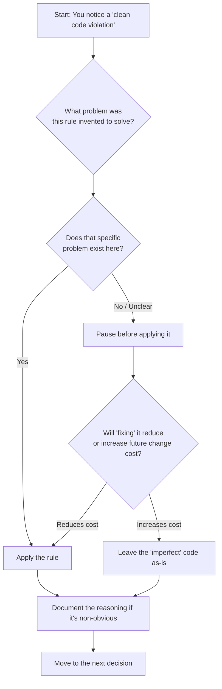

Keep this loop in mind. Every section below is really just this flowchart applied to a different clean-code rule.

---

## Table of Contents

1. [Duplication Can Be Cheaper Than the Wrong Abstraction](#1)
2. [A Longer Function Can Be Cleaner Than Five Tiny Ones](#2)
3. [Explicit Code Is Often Cleaner Than Clever Reuse](#3)
4. [Comments Are Not a Failure When They Preserve Why](#4)
5. [Sometimes the Cleanest Refactor Is Stronger Validation](#5)
6. [More Layers Do Not Automatically Create Better Separation](#6)
7. [Clean Code Is About Change Cost, Not Appearance](#7)
8. [Putting It All Together: A Practical Review Checklist](#checklist)
9. [Best Practices](#best-practices)
10. [Anti-Patterns](#anti-patterns)
11. [Common Pitfalls & Troubleshooting](#pitfalls)
12. [Performance Considerations](#performance)
13. [Security Considerations](#security)
14. [Testing Strategies](#testing)
15. [Multiple Implementation Approaches](#approaches)
16. [Real-World Case Studies](#case-studies)
17. [Hands-On Labs](#labs)
18. [Practice Exercises (with Solutions)](#exercises)
19. [Test Your Understanding](#tyu)
20. [Common Interview Questions](#interview)
21. [Question Bank (50+ Questions)](#question-bank)
22. [Self-Assessment Checklist](#self-check)
23. [Pro Tips](#pro-tips)
24. [Learning Path & Next Steps](#next-steps)
25. [Further Reading & Resources](#reading)

---

<a id="1"></a>
## Lesson 1: Duplication Can Be Cheaper Than the Wrong Abstraction

### The Core Idea

DRY ("Don't Repeat Yourself") is one of the first principles beginners internalize. Two blocks of similar-looking code trigger an almost reflexive urge to merge them. But **visual similarity is not the same as semantic similarity.** Two pieces of code can look identical today and still represent two completely different business concepts that just happen to compute the same result *right now*.

The real question isn't "does this code look the same?" It's:

> **"If one of these changes next month, is there a real reason the other should change too?"**

### Example 1 — The Classic Pricing Trap (❌ Incorrect Merge)

```typescript
// Before: two "duplicate" functions
function calculateRetailPrice(order: Order) {
  return order.total * 0.95;
}

function calculateWholesalePrice(order: Order) {
  return order.total * 0.95;
}
```

The tempting "clean" refactor:

```typescript
// After: one "DRY" function — looks right, ages badly
function calculateDiscountedPrice(order: Order) {
  return order.total * 0.95;
}
```

Six months later, retail pricing needs promotions and loyalty tiers, while wholesale needs contract rates and minimum order quantities. The single abstraction mutates into this:

```typescript
// ❌ Incorrect: one function serving two unrelated business domains
function calculatePrice(order: Order, options: {
  customerType: 'retail' | 'wholesale';
  applyPromotion?: boolean;
  useContractRate?: boolean;
  includeTax?: boolean;
  minimumQuantity?: number;
}) {
  // A tangle of conditional logic that serves
  // two unrelated business domains at once
  if (options.customerType === 'wholesale') {
    if (options.useContractRate) { /* ... */ }
    if (options.minimumQuantity) { /* ... */ }
  } else {
    if (options.applyPromotion) { /* ... */ }
  }
  // ...
}
```

Every future change now risks breaking the *other* customer type, and every reviewer must understand both domains just to touch one.

### Example 2 — A Case Where Merging *Was* Right (✅ Correct Merge)

Contrast this with a tax-rounding rule used in both an invoicing service and a refund service:

```typescript
// ✅ Correct: both are the SAME business rule, not a coincidence
function roundToCurrency(amount: number, currency: Currency): number {
  return roundHalfUp(amount, currency.decimalDigits);
}
```

If finance says "we round refunds and invoices identically, and that will always be true because it's a legal requirement," this is a stable shared responsibility. Merging it into one function is correct DRY — because the *reason* for the duplication (a shared legal rounding rule) really is one reason, not two disguised as one.

### Example 3 — A Middle-Ground Signal: Parallel Change History

A practical heuristic: check your version control history.

```bash
# If retail and wholesale pricing have been edited
# in separate commits, by separate reasons, that's
# a strong signal they are NOT one concept.
git log --follow -p -- src/pricing/retail.ts
git log --follow -p -- src/pricing/wholesale.ts
```

If the git blame shows the two functions being edited independently, for independent reasons, that's concrete evidence — not a guess — that keeping them separate is correct.

### Cross-Language Notes

- **Java:** The same trap appears as merging two service methods behind one interface with a `CustomerType` enum parameter. Prefer deliberate duplication until a real coupling requirement appears.
- **Python:** The lure is often a decorator or a `**kwargs`-based unified function. Keyword-flag soup is the Python face of the same problem.
- **Go:** Go's culture of "a little copying is better than a little dependency" (Rob Pike) institutionalizes this lesson at the module level.

### Diagram: Duplication vs. the Wrong Abstraction

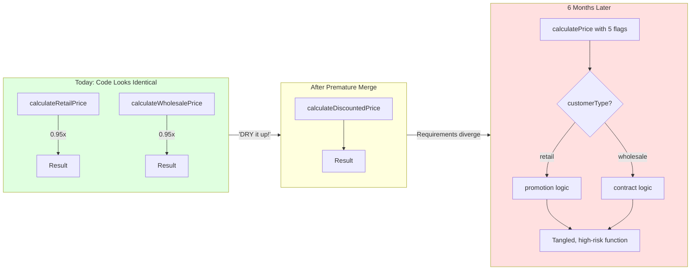

### Use Cases

| Scenario | Merge or Keep Separate? | Why |
|---|---|---|
| Tax rounding used in invoicing & refunds | **Merge** | Same legal rule, same reason to change |
| Retail vs. wholesale pricing | **Keep separate** | Different business domains, different future evolution |
| Two microservices validating the same email regex | **Merge into a shared library** | Format rules are genuinely universal |
| Two UI components that render a "confirm" button identically today | **Keep separate** | Design systems evolve per-context; a shared button often grows a dozen boolean props |
| Logging format used across all services | **Merge** | Observability standards should be enforced centrally |

### Self-Check
> "If I change implementation A next sprint, would I *also* want implementation B to change — and for the same underlying business reason?" If you can't answer confidently, don't merge yet.

---

<a id="2"></a>
## Lesson 2: A Longer Function Can Be Cleaner Than Five Tiny Ones

### The Core Idea

"Small functions are easier to understand" is true when a function is doing several *unrelated* things. It becomes false when you split a single coherent workflow into fragments connected only by call order — because now the reader has to reconstruct that workflow by jumping between files.

This is called **navigational complexity**: the cognitive cost of *finding* behavior, as opposed to the cost of *reading* it once found.

### Example 1 — A Cohesive Workflow (✅ Should Probably Stay Together)

```typescript
async function processOrder(order: Order) {
  if (order.status !== 'pending') {
    throw new Error('Order is not pending');
  }
  if (order.items.length === 0) {
    throw new Error('Order has no items');
  }

  const total = order.items.reduce(
    (sum, item) => sum + item.price * item.quantity,
    0,
  );

  const payment = await paymentProvider.charge({
    customerId: order.customerId,
    amount: total,
  });

  order.status = 'paid';
  order.paymentId = payment.id;

  await inventory.reserve(order.items);
  await orders.save(order);
}
```

Every step of "how an order gets paid for" is visible in one scroll. That's a *feature*, not a flaw.

### Example 2 — Over-Extraction (❌ The "Clean-Looking" Trap)

```typescript
// ❌ Incorrect: the workflow has been scattered into fragments
async function processOrder(order: Order) {
  validateOrder(order);
  const total = calculateTotal(order);
  const payment = await chargeCustomer(order, total);
  updateOrderStatus(order, payment);
  await reserveInventory(order);
  await persistOrder(order);
}

function validateOrder(order: Order) { /* 6 lines, in another file */ }
function calculateTotal(order: Order) { /* 3 lines, in another file */ }
async function chargeCustomer(order: Order, total: number) { /* 5 lines */ }
function updateOrderStatus(order: Order, payment: Payment) { /* 2 lines */ }
async function reserveInventory(order: Order) { /* 1 line */ }
async function persistOrder(order: Order) { /* 1 line */ }
```

The top-level function reads beautifully. But understanding *what actually happens* now requires opening six functions (possibly six files), tracing parameters, and checking for hidden side effects in each. Nothing got simpler — the complexity just got relocated and multiplied by file-switching overhead.

### Example 3 — A Justified Extraction (✅)

Contrast with this: `chargeCustomer` wraps a genuinely complex external integration (retries, idempotency keys, webhook reconciliation). *That* deserves its own function and even its own file, because it is independently complex and independently testable:

```typescript
// ✅ Correct: this extraction hides GENUINE complexity
async function chargeCustomer(order: Order, total: number): Promise<Payment> {
  const idempotencyKey = buildIdempotencyKey(order);
  return paymentProvider.chargeWithRetry({
    customerId: order.customerId,
    amount: total,
    idempotencyKey,
    maxRetries: 3,
  });
}
```

This extraction earns its existence: it hides *genuine* complexity (retry logic, idempotency), not just two lines of arithmetic.

### Cross-Language Notes

- **Java:** The same trap is the "one class per method" style — `OrderValidator`, `OrderTotalCalculator`, `OrderPaymentCharger` — connected by an orchestrator that adds no logic.
- **Python:** List comprehensions and generator pipelines are idiomatic *because* they keep transformations inline; wrapping each step in a one-call function works against the language's readability model.
- **Go:** Go's convention of moderately long, linear functions in `main`-style workflows reflects the same judgment explicitly.

### Diagram: Cohesion vs. Fragmentation

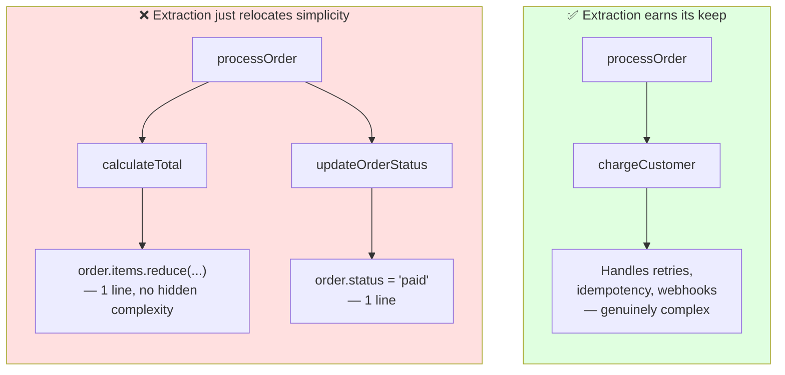

### Use Cases

- **API request handlers** that validate → transform → call a service → format response: keeping this sequence visible in one function often beats scattering it, *unless* one step (like validation) is reused across many endpoints.
- **Data pipeline "orchestrator" functions**: extracting each transform step is justified when each step is independently testable and reused; not justified when it's a single `.map()` call wrapped in a name.
- **React components**: a component with one `useEffect`, one render path, and no branching logic often reads better inline than split into `useOrderEffect`, `useOrderRender`, etc., unless those pieces are reused elsewhere.

### Self-Check
> "If I open this extracted function, will I find something that *deserves* to be hidden (real complexity, external integration, reusable logic) — or will I just find two lines I already understood from the name?"

---

<a id="3"></a>
## Lesson 3: Explicit Code Is Often Cleaner Than Clever Reuse

### The Core Idea

Generic, table-driven, or registry-based designs *reduce visible repetition* — but they don't eliminate decisions, they relocate them. For a small, stable set of cases, explicit branches can communicate business intent better than an abstraction that hides "what happens for each case" behind indirection.

### Example 1 — Explicit Branches (✅ Often Clearer for Few, Stable Cases)

```typescript
// ✅ Correct for 3 core cases: every business decision is visible
if (status === 'pending') {
  sendPendingEmail();
}
if (status === 'paid') {
  sendReceipt();
}
if (status === 'cancelled') {
  sendCancellation();
}
```

A new engineer can read this in five seconds and know exactly what the system does for every known state.

### Example 2 — The Generic Version (✅ Better for Many, Growing Cases)

```typescript
// ✅ Correct at scale: 30+ cases, multiple teams, frequent additions
const handlerRegistry: Record<OrderStatus, () => void> = {
  pending: sendPendingEmail,
  paid: sendReceipt,
  cancelled: sendCancellation,
  refunded: sendRefundNotice,
  disputed: sendDisputeAlert,
  // ... 25 more entries, added by different teams over 2 years
};

handlerRegistry[status]?.();
```

With 3 cases, this is overkill and hides intent. With 30 cases spread across teams, the registry becomes the *right* choice — it turns "add a new status" into "add one line to a table" instead of "find and edit a giant if/else chain."

### Example 3 — A Hybrid That Often Wins in Practice (✅)

```typescript
// ✅ Correct hybrid: core cases legible, long tail extensible
// Explicit for the 3 cases that are core business logic...
switch (status) {
  case 'pending':
    sendPendingEmail();
    break;
  case 'paid':
    sendReceipt();
    break;
  case 'cancelled':
    sendCancellation();
    break;
  default:
    // ...and a registry only for the long tail of edge cases
    edgeCaseHandlers[status]?.();
}
```

This keeps the important cases legible while still allowing extensibility for rarely-touched states.

### Cross-Language Notes

- **Java:** `switch` expressions (Java 14+) with pattern matching give you explicit branches with exhaustiveness checking — often the best of both worlds for small, closed sets.
- **Python:** `match` statements (3.10+) serve the same role; dict-based dispatch remains the idiomatic registry at scale.
- **Go:** `switch` without an expression plus type switches make explicit dispatch cheap; registries appear mainly at plugin boundaries.

### Diagram: When Abstraction Pays Off

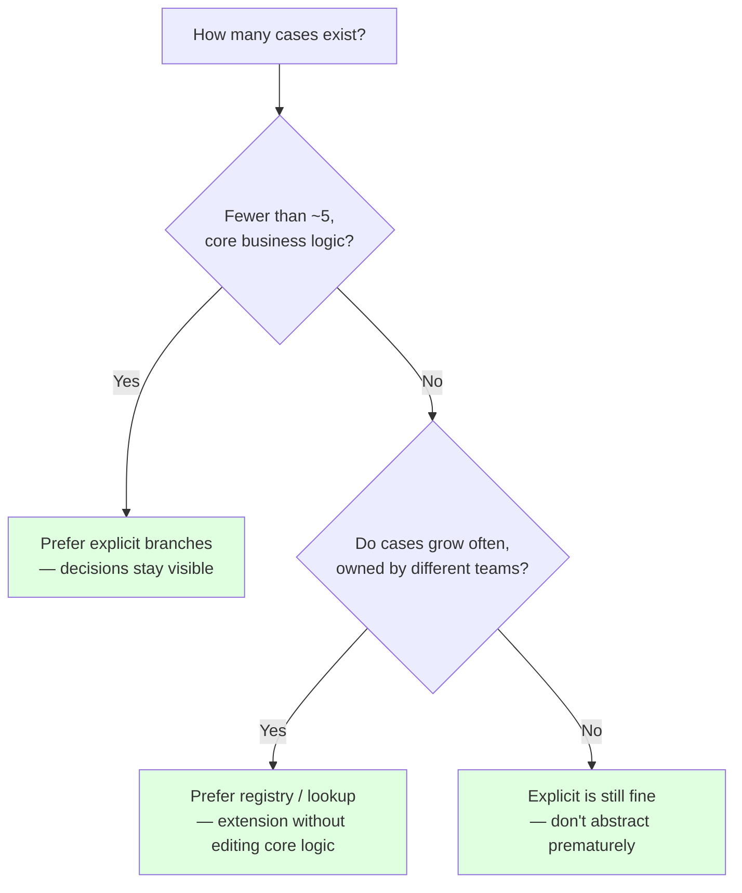

### Use Cases

- **Payment status emails (3–5 cases)** → explicit branches.
- **Plugin systems where third parties register handlers** → registry/lookup is the *only* viable design.
- **Feature flags with 2 states** → explicit `if`; a "flag engine" abstraction would be overkill.
- **Tax calculation across 40+ jurisdictions** → a rules table or strategy registry, because explicit branches would become unreadable.

### Self-Check
> "Does this abstraction remove noise, or does it remove the ability to see which business decisions this code actually makes?"

---

<a id="4"></a>
## Lesson 4: Comments Are Not a Failure When They Preserve *Why*

### The Core Idea

"Code should explain itself" is good advice against comments that just restate *what* the code does. It is bad advice when applied to *why* the code does something — especially when the reason lives outside the code, in an external system, a historical incident, or a business constraint that no naming convention can capture.

### Example 1 — A Genuinely Useless Comment (❌ Delete This)

```typescript
// ❌ The code already says this — zero information added
// Increment retry count
retryCount++;
```

The code already says this. The comment adds zero information and will silently go stale the moment the logic changes.

### Example 2 — A Comment That Encodes External Knowledge (✅ Keep This)

```typescript
// ✅ Keep: knowledge from an external system that exists nowhere else
// Keep retries inside the provider's documented
// duplicate-detection window. After this window,
// reconcile the payment before attempting another charge.
const RETRY_WINDOW_MS = 30_000;
```

Even with a great name:

```typescript
const PROVIDER_DUPLICATE_DETECTION_WINDOW_MS = 30_000;
```

...the *name* tells you what the number means, but not what breaks if you change it, or what to do instead if you need a longer retry window. That knowledge came from reading a payment provider's API docs — it doesn't live in this codebase anywhere else.

### Example 3 — A "Do Not Simplify This" Guard Comment (✅ Keep This)

```typescript
// ✅ Keep: prevents a future "cleanup" PR from reintroducing a bug
// NOTE: This looks like it could be a simple `.sort()`, but Safari's
// Array.prototype.sort was not guaranteed stable before v14.
// We are still supporting Safari 12 per the browser-support matrix
// (see docs/browser-support.md). Do not replace with a plain sort
// until that matrix drops Safari < 14.
function stableSortByDate(items: Item[]): Item[] {
  return items
    .map((item, index) => ({ item, index }))
    .sort((a, b) => a.item.date - b.item.date || a.index - b.index)
    .map(({ item }) => item);
}
```

Without this comment, a well-meaning "cleanup" PR will "simplify" this into a plain `.sort()` — reintroducing a bug that took hours to diagnose the first time.

### Cross-Language Notes

- **Java:** Javadoc is documentation, not justification — put `// See XYZ-123: JDK-8207000 means this map is not thread-safe` style notes at *use sites*, not only in interfaces.
- **Python:** PEP 8's famous line "comments should be complete sentences" applies doubly to why-comments; also use `# noqa: <code>` with a reason.
- **Go:** Doc comments are mandated for exported symbols, but Go culture also strongly endorses contextual "why" comments at tricky spots.

### Categories of Comments Worth Keeping

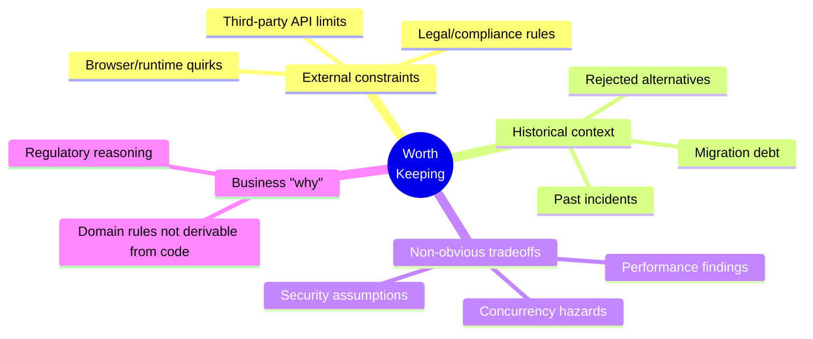

### Use Cases

- **Payment/finance code**: comments citing the specific regulation or provider doc section save the next engineer from re-discovering it.
- **Browser compatibility hacks**: without a comment, these get "cleaned up" and silently break in older environments.
- **Performance-sensitive code that looks unnecessarily manual** (e.g., a hand-rolled loop instead of an idiomatic array method): a comment with a benchmark link prevents someone from "simplifying" it back into a regression.
- **Security-relevant code**: comments explaining *why* an input is sanitized a particular way prevent a "simplification" from reopening a vulnerability.

### Self-Check
> "If I deleted this comment, could a future engineer reconstruct the reasoning purely from the code and its name? If the reasoning lives in an external doc, a past incident, or an API contract — keep the comment."

---

<a id="5"></a>
## Lesson 5: Sometimes the Cleanest Refactor Is Stronger Validation

### The Core Idea

Piles of defensive `if` checks often look like a *refactoring* problem ("clean up this validation logic"), but they're frequently a *modeling* problem: the system is allowing an impossible state to exist in the first place, and every downstream consumer has to defend against it.

### Example 1 — The Defensive Pile (❌ Symptom)

```typescript
// ❌ Each check defends against a state that shouldn't exist at all
if (!order.customerId) {
  throw new Error('Missing customer');
}
if (order.deliveryType === 'delivery' && !order.shippingAddress) {
  throw new Error('Missing address');
}
if (
  order.deliveryType === 'delivery' &&
  order.status === 'shipped' &&
  !order.trackingNumber
) {
  throw new Error('Missing tracking number');
}
```

That last check should raise a bigger question: **how did a "shipped" order without a tracking number ever get created?**

### Example 2 — Fixing It at the Boundary (✅ Type-Level)

```typescript
// ❌ Before: one loose type allows contradictory states
interface Order {
  status: 'pending' | 'shipped' | 'delivered';
  deliveryType: 'pickup' | 'delivery';
  trackingNumber?: string;
}

// ✅ After: the type system makes the impossible state unrepresentable
type Order =
  | { status: 'pending'; deliveryType: 'pickup' | 'delivery' }
  | { status: 'shipped'; deliveryType: 'delivery'; trackingNumber: string }
  | { status: 'delivered'; deliveryType: 'delivery'; trackingNumber: string };
```

Now `order.status === 'shipped'` **cannot** exist without `trackingNumber`. The downstream `if` check becomes unnecessary — not because you deleted the safety, but because the safety moved to where the state is *created*, not where it's *consumed*.

### Example 3 — Fixing It at the Transition (✅ State Machine)

```typescript
// ✅ Correct: all status changes funnel through controlled transitions
function markAsShipped(order: Order, trackingNumber: string): Order {
  if (order.status !== 'pending') {
    throw new Error('Only pending orders can be shipped');
  }
  return { ...order, status: 'shipped', trackingNumber };
}
```

By funneling all status changes through controlled transition functions, you guarantee tracking numbers exist *before* an order can become "shipped" — eliminating the need to re-check it in every consumer downstream (reports, emails, the UI, other services).

### Cross-Language Notes

- **Java:** Sealed interfaces (Java 17+) + pattern-matching `switch` give the same discriminated-union power: `sealed interface Order permits PendingOrder, ShippedOrder, DeliveredOrder`.
- **Python:** Use `dataclass` variants with `typing.Union` / `Literal` and `TypeGuard`; or libraries like Pydantic with discriminated unions for boundary validation.
- **Go:** Go lacks sum types; simulate them with sealed interface + unexported marker methods, or accept runtime validation at constructors (the "smart constructor" pattern).

### Diagram: Defense vs. Prevention

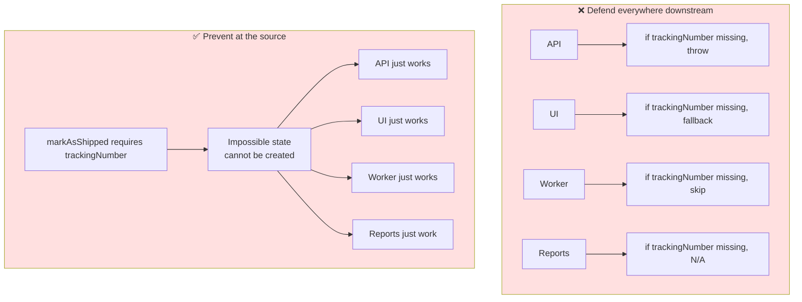

### Use Cases

- **E-commerce order pipelines** (as above): enforce required fields at state transitions, not at every read site.
- **Form-heavy applications**: instead of validating "email is required if `notify=true`" in five places, model it as a discriminated union so the invalid combination can't be constructed.
- **Database migrations from legacy systems**: here, defensive checks at the boundary (parsing untrusted legacy data) are *still justified* — this lesson applies to state your *own* system creates, not to external/historical data you don't control.

### Self-Check
> "Is this defensive check protecting against a state my system *creates*, or a state that arrives from *outside* my system (legacy data, third-party APIs, user input)? The former is often better solved upstream; the latter usually still needs a guard."

---

<a id="6"></a>
## Lesson 6: More Layers Do Not Automatically Create Better Separation

### The Core Idea

Architecture diagrams with many boxes look rigorous. But a layer only earns its place if it protects something — isolates infrastructure, guards domain policy, or enforces a contract (transactions, permissions). A layer that just forwards its input to the next layer is **ceremony**, not separation.

### Example 1 — A Layer That Does Nothing (❌ Ceremony)

```typescript
// ❌ Incorrect: three layers, zero protection — pure indirection

// Controller layer
class OrderController {
  execute(input: CreateOrderInput) {
    return this.orderUseCase.execute(input);
  }
}

// "Use case" layer
class CreateOrderUseCase {
  execute(input: CreateOrderInput) {
    return this.orderService.create(input);
  }
}

// Service layer
class OrderService {
  create(input: CreateOrderInput) {
    return this.orderRepository.save(input);
  }
}
```

Three layers, same method signature, same input, all the way down. Nothing here is isolated from anything else — a change to `CreateOrderInput` ripples through all three files identically. This is indirection without protection.

### Example 2 — A Layer That Earns Its Place (✅ Real Separation)

```typescript
// ✅ Correct: each layer answers a concrete "what does this protect?"

// Domain layer: pure business rules, no framework, no I/O
class Order {
  static create(input: CreateOrderInput): Order {
    if (input.items.length === 0) {
      throw new DomainError('Order must have at least one item');
    }
    return new Order(input.customerId, input.items);
  }
}

// Repository: isolates persistence technology
class OrderRepository {
  constructor(private db: PostgresConnection) {}
  async save(order: Order): Promise<void> {
    await this.db.query('INSERT INTO orders ...', [order]);
  }
}

// Use case: owns the transaction boundary
class CreateOrderUseCase {
  async execute(input: CreateOrderInput): Promise<Order> {
    const order = Order.create(input);          // domain rule enforced
    await this.db.transaction(async (tx) => {    // transaction boundary
      await this.orderRepository.save(order, tx);
      await this.inventoryRepository.reserve(order.items, tx);
    });
    return order;
  }
}
```

Here, each layer answers a concrete question:
- **Domain** protects business rules from persistence/framework details.
- **Repository** isolates the database technology (swap Postgres for Mongo without touching business logic).
- **Use case** owns an actual contract — the transaction boundary spanning two repositories.

### Cross-Language Notes

- **Java:** Spring's Controller → Service → Repository convention is often followed without asking what each layer protects; the "service" layer frequently degenerates into a passthrough. Ask what the service would need to do before creating it.
- **Python:** Django's "fat models, thin views" and Flask's minimalism both embody this lesson — add a service layer only when transactions or domain rules actually span models.
- **Go:** Go's standard library and community style strongly discourage interface ceremony; define interfaces at the *consumer* side, only when a seam is genuinely needed.

### Diagram: Ceremony vs. Real Separation

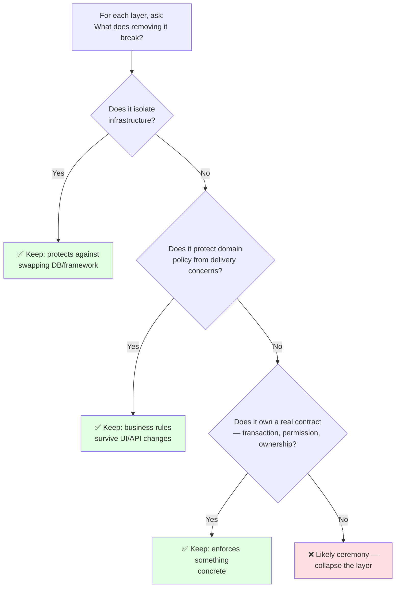

### Use Cases

- **Small internal admin tools**: a `Controller → Service → Repository` chain where every layer just forwards data is pure overhead — one function per endpoint is often genuinely cleaner.
- **Multi-tenant SaaS with strict domain rules**: a domain layer that prevents invalid business states regardless of which API version calls it is essential.
- **Systems planning a database migration**: a repository layer that truly isolates SQL from business logic pays for itself the day you need to migrate.
- **Microservices with independent deploy cycles**: adapter layers around external APIs are justified because the *external* API will change on its own schedule.

### Self-Check
> "If I deleted this layer and called the next one directly, what would I lose — swappable infrastructure, protected domain rules, an enforced contract? Or just a method that had the same name and same arguments as the one below it?"

---

<a id="7"></a>
## Lesson 7: Clean Code Is About Change Cost, Not Appearance

### The Core Idea

You cannot evaluate "clean code" from a single snapshot. Two codebases can look wildly different in quality on first read, and the *only* real test is: **what happens when a real, unplanned requirement hits it?**

### Example — Two Codebases, One Requirement

**Codebase A** ("textbook clean"): tiny functions, zero duplication, interfaces everywhere, strict layering, almost no comments.

**Codebase B** ("looks messier"): a few longer functions, some deliberate duplication (retail vs. wholesale pricing kept separate, per Lesson 1), explicit conditionals (per Lesson 3), comments explaining external constraints (per Lesson 4), and fewer architectural layers (per Lesson 6).

New requirement arrives: *"Retail customers can now stack a loyalty discount with a promotional code."*

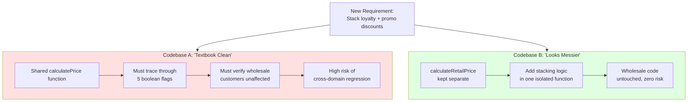

Codebase B — despite "violating" DRY, having longer functions, and using explicit conditionals — is measurably safer and faster to change *for this specific requirement*, because the earlier "imperfect" decisions were made with future change cost in mind, not visual tidiness.

### The Meta-Lesson

| Rule | Matters when... | Becomes harmful when... |
|---|---|---|
| DRY | Knowledge must stay consistent | Code merely *looks* alike today |
| Small functions | Boundaries isolate real responsibilities | Splitting only reduces line count |
| Explicit code | Important decisions should stay visible | The mechanism itself is repetitive noise |
| Comments | Reasoning can't be recovered from syntax | They just restate what code already says |
| Validation | It eliminates impossible states | It's just organizing checks that shouldn't exist |
| Layers | They protect independent change/ownership | They only forward the same input downward |

### Quick Recap

> Every clean-code rule is a *compression* of a historical pain. Before applying (or enforcing) one, recover the pain it was compressing and check whether that pain exists in your specific case. Rules applied without their context produce code that looks clean but costs more to change.

---

<a id="checklist"></a>
## 8. Putting It All Together: A Practical Review Checklist

Use this the next time you're reviewing a PR — your own or someone else's — and something *feels* clean but you're not sure it *is* clean.

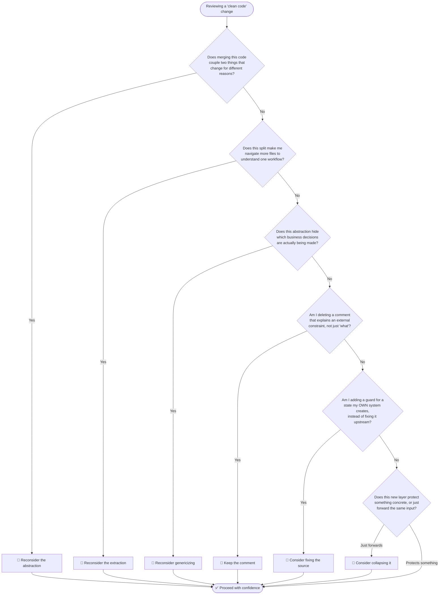

### Quick Reference Card

1. **Duplication** → Ask: *same reason to change, or coincidence?*
2. **Function length** → Ask: *coherent workflow, or arbitrary line-count reduction?*
3. **Generic mechanisms** → Ask: *does this hide business decisions or hide noise?*
4. **Comments** → Ask: *is the reasoning recoverable from the code alone?*
5. **Validation** → Ask: *is this state impossible, or just inconvenient to create?*
6. **Layers** → Ask: *what does removing this layer actually break?*
7. **Overall** → Ask: *what happens to change cost when a real requirement arrives?*

---

<a id="best-practices"></a>
## 9. Best Practices

1. **State the reason before the refactor.** Write one sentence: "This merge/extraction/layer will reduce change cost because ___." If you can't finish the sentence, don't do it.
2. **Duplicate first, merge later (rule of three).** Allow duplication until the third occurrence; by then, the shared *reason* is usually visible and stable.
3. **Use git history as evidence.** Independent edit histories across duplicated code are proof they aren't one concept; synchronized edits are proof they are.
4. **Keep the workflow scrollable.** Prefer a 40-line linear function over six 6-line fragments, unless a fragment hides genuine complexity.
5. **Make impossible states unrepresentable.** Reach for discriminated unions and transition functions before adding downstream guards.
6. **Boundaries stay defensive.** User input, third-party APIs, and legacy data always get validation — Lesson 5 applies only to state your own system creates.
7. **Write why-comments with an expiry condition.** "Do not simplify until Safari < 14 is dropped from the support matrix" ages gracefully; "this is a hack" does not.
8. **Every layer must name what it protects.** If a class can be deleted with zero behavioral or isolation loss, delete it.
9. **Review for change cost, not style.** In PRs, ask "what requirement would be hardest to implement after this change?" — not "does this match the style guide?"
10. **Document deliberate rule-breaking.** A comment explaining *why* you kept duplication or skipped a layer prevents future "fixes" from undoing a correct decision.

---

<a id="anti-patterns"></a>
## 10. Anti-Patterns

| Anti-Pattern | Description | Lesson | Fix |
|---|---|---|---|
| **Flag-Parameter God Function** | One shared function with 4+ booleans/enums switching between unrelated domains | 1 | Split back into domain-specific functions |
| **Premature Unification** | Merging code because it *looks* identical today | 1 | Apply the "same reason to change" test; check git history |
| **Fragmented Workflow** | A coherent process split into one-line functions across multiple files | 2 | Inline trivial fragments; keep only genuinely complex extractions |
| **Navigational Hopscotch** | Understanding one behavior requires opening 5+ files | 2 | Measure "files touched to understand one change" and reduce it |
| **Premature Registry** | A lookup table / DI plugin system for 3 fixed cases | 3 | Use explicit branches; add the registry when cases actually grow |
| **Hidden Constraint Code** | External/legacy constraints with no comment, later "simplified" away | 4 | Guard-comment anything whose reason lives outside the code |
| **Restate-the-Code Comments** | `// increment counter` above `counter++` | 4 | Delete; the code is the what-comment |
| **Defensive Pile** | Repeated guards against states the system itself creates | 5 | Model states as unions; funnel mutations through transitions |
| **Passthrough Layer Cake** | Controller → Service → Repository where each only forwards | 6 | Collapse layers until each one protects something concrete |
| **Architecture Astronautics** | Abstractions for requirements that don't exist yet | 3, 6 | Build for today's requirement; refactor when the second case appears |

---

<a id="pitfalls"></a>
## 11. Common Pitfalls & Troubleshooting

Each pitfall follows a **symptom → diagnosis → fix** format.

### Pitfall 1: "We DRY'd it up and now every pricing change breaks something else"

- **Symptom:** One shared function with flags; every fix for domain A risks domain B; PR review time for pricing changes keeps growing.
- **Diagnosis:** Two domains were merged on visual similarity (Lesson 1). Git history likely shows independent edit streams.
- **Fix:** Split into `calculateRetailPrice` and `calculateWholesalePrice`. Accept the temporary duplication. Document why with a why-comment.

### Pitfall 2: "New engineers can't trace how an order gets processed"

- **Symptom:** Onboarding takes weeks for a simple flow; devs keep asking "where does X actually happen?"
- **Diagnosis:** Navigational complexity from over-extraction (Lesson 2).
- **Fix:** Inline fragments that hide nothing. Keep extractions only where there is real complexity (retries, external APIs) or genuine reuse.

### Pitfall 3: "Our 'extensible' handler system is impossible to debug"

- **Symptom:** Nobody can list what the system does for a status without running it; adding a case requires understanding the registration lifecycle.
- **Diagnosis:** A registry built for 3 stable cases (Lesson 3).
- **Fix:** Either collapse to explicit branches, or keep the registry *and* add a startup-time assertion/test that prints or verifies the full case table.

### Pitfall 4: "Someone 'simplified' our sort and older Safari users broke"

- **Symptom:** A regression reappears after a cleanup PR that had green tests.
- **Diagnosis:** A guard comment was deleted or never existed (Lesson 4); the constraint lived outside the code.
- **Fix:** Restore the workaround, add the why-comment with an expiry condition, and add a lint/test hook if possible (e.g., a unit test asserting stable sort behavior).

### Pitfall 5: "We added the missing-tracking-number check in 7 places — there are now 9"

- **Symptom:** The same guard keeps spreading; each new consumer adds another one.
- **Diagnosis:** An impossible state is representable (Lesson 5); defense is at the consumption sites instead of the creation site.
- **Fix:** Introduce a discriminated union or transition function so the invalid state can't be constructed. Keep guards only at system boundaries.

### Pitfall 6: "Every endpoint change touches 4 files with identical signatures"

- **Symptom:** Adding one request field means editing Controller, UseCase, Service, and Repository in lockstep.
- **Diagnosis:** Passthrough layers (Lesson 6).
- **Fix:** Collapse layers that protect nothing; keep only layers owning transactions, permissions, or infrastructure isolation.

### Troubleshooting Decision Table

| Observation | Most Likely Lesson | First Action |
|---|---|---|
| Flags/enums branching inside a shared function | 1 | Split by domain |
| "Where does this actually happen?" questions in onboarding | 2 | Inline trivial fragments |
| Registry/dictionary with fewer than 5 entries | 3 | Replace with explicit branches |
| Regression after a "cleanup" PR | 4 | Add why-comments + regression test |
| Same guard in many consumers | 5 | Move safety to state creation |
| Identical method signatures across 3+ classes | 6 | Collapse passthrough layers |

---

<a id="performance"></a>
## 12. Performance Considerations

The primary "performance" metric in this tutorial is **change cost**, but runtime and build-time effects matter too. Here is an honest accounting:

### Runtime Effects of These Patterns

| Pattern | Runtime Impact | Verdict |
|---|---|---|
| Keeping duplicate functions separate | None (or a few duplicated CPU instructions) | Negligible; clarity wins |
| One large cohesive function vs. many small ones | Modern JITs (V8, JVM) inline small functions; usually zero difference | Never split for performance; never merge for performance — decide on readability |
| Explicit branches vs. registry lookup | Both are O(1)-ish; a switch/branch chain on few cases can be faster than a hash lookup, but the difference is nanoseconds | Decide on maintainability |
| Fewer layers | Removes function-call overhead and (in some stacks) serialization between layers | Micro at runtime; macro at debugging time — fewer hops = fewer places latency hides |
| Discriminated unions | Property access on a narrowed type is as fast as on a loose type; no runtime cost | Strictly positive: moves errors from production to compile time |
| Why-comments | Zero runtime cost | Pure win |

### Performance-Sensitive Code and the "Simplification Risk"

Performance work frequently produces code that *looks* inefficient:

```typescript
// ⚠️ Benchmark: hand-rolled loop is ~2.3x faster than reduce() here
// for 100k+ line-item orders (see bench/pricing.bench.ts, 2026-04 run).
// Re-run the benchmark before replacing this with a functional style.
let total = 0;
for (let i = 0; i < items.length; i++) {
  total += items[i].price * items[i].quantity;
}
```

> 💡 **Pro Tip:** Always pair a performance-motivated "ugly" construct with (a) the benchmark that justifies it, (b) the date of the run, and (c) the input scale where it matters. Benchmarks age; without the date and scale, the next engineer can't tell whether the comment still applies.

### Measurement Guidelines

1. **Measure change cost with a "requirement rehearsal":** sketch how you'd implement a plausible future requirement; count files touched and risks introduced.
2. **Measure navigational complexity:** for a given feature, count files a reader must open. Above ~3 for a simple flow, consider inlining.
3. **Benchmark before optimizing:** never let performance be the *stated* reason for complexity without a benchmark link (Lesson 4).

---

<a id="security"></a>
## 13. Security Considerations

Security is the domain where several lessons flip their default — because the threat model includes *adversaries*, not just future requirements.

### Where the Lessons Apply Differently

| Lesson | Default Guidance | Security Adjustment |
|---|---|---|
| 1 (Duplication) | Prefer duplication until a shared reason is proven | Security utilities (sanitization, auth checks) should usually be **merged** into one audited implementation — divergence means some path skips the fix |
| 2 (Function length) | Keep workflows inline | Security-critical validation steps may still merit extraction **if** they're reused across entry points — one canonical validator beats five near-copies |
| 3 (Explicit code) | Prefer explicit branches for few cases | **Always** explicit for authorization decisions; a permission *registry* is acceptable, but never dynamic/metaprogrammed dispatch for authz |
| 4 (Comments) | Keep why-comments for external constraints | **Mandatory**: document the threat model behind sanitization ("this escapes HTML *and* attribute context because...") — its loss is how vulnerabilities get reintroduced |
| 5 (Validation) | Eliminate own-system impossible states | Boundary validation (user input, third-party data) **always stays**, regardless of type-level guarantees — types don't defend against malicious input |
| 6 (Layers) | Collapse ceremony | A security boundary (auth middleware, permission check layer) is a *real contract* — it earns its place by Lesson 6's own test |

### Example: The One Place Defense-in-Depth Is Always Correct

```typescript
// ✅ Keep BOTH: type-level guarantee AND runtime guard.
// Why both? Type guarantees are compile-time only; API payloads are
// runtime data. A malicious client can send anything.
type ShippedOrder = { status: 'shipped'; trackingNumber: string };

function refundShippedOrder(order: ShippedOrder) { /* ... */ }

// At the API boundary — untrusted input, runtime guard required:
function parseOrderFromApi(raw: unknown): Order {
  if (!isOrder(raw)) {
    throw new ValidationError('Invalid order payload');  // never trust the wire
  }
  return raw;
}
```

> ⚠️ **Warning:** Lesson 5 ("make impossible states unrepresentable") applies to state **your system creates**. Data crossing a trust boundary — HTTP requests, message queues, database rows written by older versions — must be validated at runtime no matter how precise your types are. Types are not a security control.

### Security Comment Checklist

- [ ] Does every sanitization/escaping step say *which* contexts it covers?
- [ ] Does every auth rule cite the policy or requirement it enforces?
- [ ] Do rate limits and timeouts cite the external constraint that set them?
- [ ] Is there a comment on anything deliberately "weaker-looking" for compatibility reasons?

---

<a id="testing"></a>
## 14. Testing Strategies

Tests are where judgment-driven design gets *verified*. Each lesson suggests a distinct testing posture.

### Testing Postures per Lesson

| Lesson | Testing Posture |
|---|---|
| 1 (Duplication) | Keep domain test suites **independent** (retail tests, wholesale tests). If you merged correctly, a shared-rule test suite (e.g., rounding) covers both. If tests start copy-pasting, that's data — re-examine the merge. |
| 2 (Function length) | Test the **workflow** through its public entry point (`processOrder`), not each fragment. If a fragment needs its own tests to be understandable, that's a signal it hides real complexity — and should stay extracted. |
| 3 (Explicit vs. registry) | Explicit branches: table-driven tests over statuses. Registries: add a **completeness test** asserting every `OrderStatus` has a handler. |
| 4 (Comments) | Convert fragile "don't touch this" knowledge into **regression tests** where possible (e.g., assert sort stability). A test is a comment the machine enforces. |
| 5 (Validation) | Test the **transition functions** exhaustively (valid + invalid transitions). Downstream consumers then need only happy-path tests — that's the payoff. |
| 6 (Layers) | Test the use case through a fake repository; test the domain with zero mocks. If a layer can't be tested in isolation, it protects nothing. |

### Example: A Completeness Test for a Registry (Lesson 3)

```typescript
describe('order status handlers', () => {
  it('has a handler for every known status', () => {
    const allStatuses: OrderStatus[] = [
      'pending', 'paid', 'cancelled', 'refunded', 'disputed' /* ... */,
    ];
    for (const status of allStatuses) {
      expect(handlerRegistry[status] ?? edgeCaseHandlers[status]).toBeDefined();
    }
  });
});
```

### Example: Exhaustive Transition Tests (Lesson 5)

```typescript
describe('order state machine', () => {
  it('creates shipped orders with a tracking number', () => {
    const pending: Order = { status: 'pending', deliveryType: 'delivery' };
    const shipped = markAsShipped(pending, 'TRACK-123');
    if (shipped.status !== 'shipped') throw new Error('unreachable');
    expect(shipped.trackingNumber).toBe('TRACK-123');
  });

  it('rejects shipping an already-shipped order', () => {
    const shipped: Order = {
      status: 'shipped', deliveryType: 'delivery', trackingNumber: 'T-1',
    };
    expect(() => markAsShipped(shipped, 'T-2')).toThrow('Only pending orders');
  });
});
```

### Anti-Pattern: Testing Fragments Instead of Behavior

If your test file mocks five internal functions to exercise one workflow, the workflow was over-extracted (Lesson 2). Mock *boundaries* (payment providers, databases), never internal steps of the same module.

---

<a id="approaches"></a>
## 15. Multiple Implementation Approaches

Three recurring design decisions appear throughout the lessons. Here are the viable approaches, compared honestly.

### Approach Comparison 1: Handling a Set of Cases

| Approach | Best When | Pros | Cons |
|---|---|---|---|
| **Explicit if/switch** | ≤5 cases, stable, core logic | All decisions visible; trivially debuggable; exhaustive checking in TS | Grows unwieldy past ~10 cases |
| **Registry / lookup table** | Many cases, growing, multi-team | Add-a-line extension; uniform structure | Hides decisions; no exhaustiveness without a completeness test |
| **Strategy classes / polymorphism** | Cases share a rich interface; behavior bundles data+logic | Open/closed; testable per strategy | Heavy for simple cases; interface churn when cases differ |
| **Hybrid (explicit core + registry long tail)** | Few core cases + growing edge cases | Legibility where it matters, extensibility where needed | Two mechanisms to understand |

### Approach Comparison 2: Structural Depth

| Approach | Best When | Pros | Cons |
|---|---|---|---|
| **Single module, linear functions** | Small apps, internal tools, scripts | Zero navigation overhead; fast onboarding | Can degrade without discipline as it grows |
| **Domain + thin I/O adapters** | Real business rules; framework churn expected | Rules survive framework/DB changes | Requires up-front modeling effort |
| **Full layered (Controller/UseCase/Service/Repo)** | Large teams; boundaries genuinely enforced | Parallel ownership; enforced contracts | Ceremony risk; lockstep changes across files |

### Approach Comparison 3: Representing Domain State

| Approach | Best When | Pros | Cons |
|---|---|---|---|
| **Loose interface + runtime guards everywhere** | Quick prototypes, small apps | Zero modeling effort | Guards multiply; invalid states reach production |
| **Discriminated unions + transition functions** | State your own system creates | Compile-time safety; downstream simplification | Requires refactoring all constructors/mutations |
| **Union at edges + runtime parsing (boundary validation)** | Real systems with external input | Both safety and defense at trust boundaries | Most code; worth it for anything user-facing |

### Choosing Between Them: A Meta-Flow

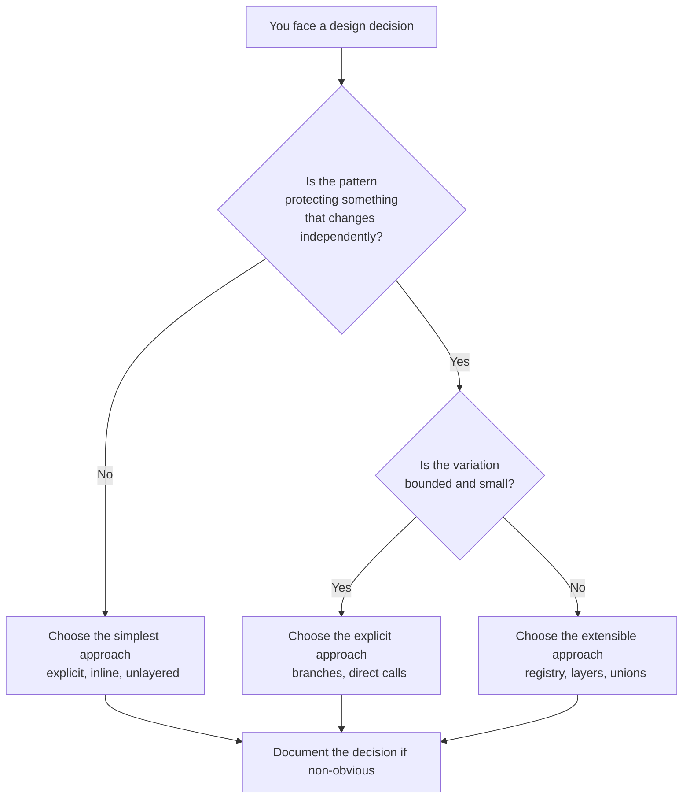

---

<a id="case-studies"></a>
## 16. Real-World Case Studies

### Case Study 1: E-Commerce Pricing Divergence (Lesson 1)

A marketplace merged retail and wholesale discount logic into one service "to keep pricing consistent." Eighteen months later: 11 boolean config fields, a 600-line function, and a change-failure rate on pricing deploys 4x the team average. The fix — splitting back into two pricing modules — took two weeks and cut pricing-related incidents to near zero. **Cost of the premature merge: ~18 months of elevated risk.**

### Case Study 2: The Safari Sort Regression (Lesson 4)

A team "simplified" a hand-rolled stable sort to `[...items].sort()` after lint flagged the custom comparator. The app's admin panel began silently reordering audit logs for users on older embedded WebViews. The bug cost a week to diagnose and spawned this rule: *any workaround must carry a comment naming the environment, the behavior, and the expiry condition.*

### Case Study 3: The Migration That Paid for the Repository (Lesson 6)

A SaaS company kept a genuine repository layer despite pressure to "remove abstraction." When they migrated from self-hosted Postgres to a managed service with different driver semantics, the change touched 3 files in 2 days — no business logic changes. The layer was kept because it *isolated infrastructure*, and the migration proved the protection was real.

### Case Study 4: The Tracking-Number Audit (Lesson 5)

A logistics team ran an audit and found 9 separate guards for "shipped without tracking number" across API, workers, and reports — plus two production incidents where a guard was missing. They introduced transition functions (`markAsShipped`, `markAsDelivered`) and a discriminated order type. Six months later: zero incidents, and the guards at consumption sites were deleted one by one.

### Case Study 5: The 3-Case Plugin System (Lesson 3)

An internal tool adopted a DI-based plugin architecture "for extensibility" with exactly 3 notification channels. Adding a 4th channel (the first in two years) required understanding the container lifecycle, two abstract base classes, and a registration manifest. A competitor added the same channel in an afternoon with an `if` branch. **Extensibility you never use is just cost you always pay.**

---

<a id="labs"></a>
## 17. Hands-On Labs

Complete these in any TypeScript sandbox (e.g., the TypeScript Playground, or a scratch repo with `ts-node`).

### Lab 1: The Merge Audit (≈25 min)

1. Pick two similar-looking functions in a codebase you know (or use the retail/wholesale example from Lesson 1).
2. Run `git log --follow -p` on both. Record: how many commits touched each, whether reasons overlapped, and whether any commit touched both.
3. Write a 3-sentence verdict: merge or keep separate, and the evidence.
4. If you conclude "keep separate," add a one-line comment to each explaining the decision.

**Success criteria:** Your verdict cites evidence (commit history or a stated business rule), not aesthetics.

### Lab 2: The Inline Refactor (≈30 min)

1. Start from the over-extracted `processOrder` in Lesson 2 (Example 2).
2. Implement the six fragment functions as trivial stubs, then inline the trivial ones back into `processOrder`, keeping only `chargeCustomer` extracted.
3. Write a test suite that exercises the workflow through `processOrder` only, mocking just the payment provider and inventory.
4. Verify: to understand the payment flow, how many files must a reader open? (Target: 1–2.)

### Lab 3: Impossible States (≈40 min)

1. Start with the loose `Order` interface from Lesson 5.
2. Convert it to the discriminated union and implement `markAsShipped` and `markAsDelivered` as transition functions.
3. Try to construct a shipped order without a tracking number. Confirm the compiler rejects it.
4. Delete the "missing tracking number" guard from a downstream consumer (e.g., a `formatShippingLabel` function) and confirm the compiler still guarantees safety.

**Success criteria:** `tsc` fails on invalid state construction; downstream code compiles with fewer guards.

---

<a id="exercises"></a>
## 18. Practice Exercises (with Detailed Solutions)

### Exercise 1 — Merge or Keep Separate? (Beginner → Intermediate)

For each pair, decide **merge** or **keep separate**, and justify with the "same reason to change" test:

1. `formatDateForDisplay` used in a React dashboard and a React Native app.
2. `slugifyTitle` used by the blog engine and by the marketing-site CMS.
3. `calculateVat(amount, country)` used by the invoicing module and the refunds module; VAT rules are set by statute.
4. `validatePasswordStrength` used by sign-up and by the admin user-creation form.

#### Solution

1. **Keep separate (probably).** Display conventions (locale, layout, truncation) evolve per-surface. The formats *look* the same today; their reasons to change differ. If both surfaces share an explicit "one product, one date format" standard owned by design, merge.
2. **Merge.** A slug is the same artifact wherever it's generated — mismatches cause real bugs (link breakage). The reason to change (slug rules) is one reason.
3. **Merge.** Statutory VAT is a single external constraint; both modules must change together by law. This is correct DRY.
4. **Merge.** Password policy is one security rule; divergent implementations mean the weaker one silently becomes the policy. (Note: this is also the security adjustment to Lesson 1.)

### Exercise 2 — Rescue the Fragmented Workflow (Intermediate)

The following "clean" code was written by a junior engineer following "functions should be short":

```typescript
function handleSignup(req: Request) {
  validateEmail(req.body.email);
  validatePassword(req.body.password);
  const hash = hashPassword(req.body.password);
  const user = buildUser(req.body, hash);
  persistUser(user);
  sendWelcomeEmail(user);
  trackAnalytics(user);
}
```

Each helper is 1–5 lines and lives in a different file. The team complains that signup bugs take too long to diagnose. Diagnose the problem and rewrite.

#### Solution

**Diagnosis (Lesson 2 — navigational complexity):** The signup workflow is coherent and linear; the split relocates simplicity across files without hiding any genuine complexity. Diagnosis time rises because a debugger now hops across six files, and side effects (persistence, email) are invisible at the call site.

**Rewrite:**

```typescript
async function handleSignup(req: Request) {
  // Validation stays extracted: reused across endpoints, genuinely reusable
  validateEmail(req.body.email);
  validatePassword(req.body.password);

  const hash = await hashPassword(req.body.password);
  const user = { email: req.body.email, passwordHash: hash, createdAt: new Date() };

  await users.save(user);          // persistence is visible here
  await email.sendWelcome(user);   // so is the side effect
  analytics.track('signup', { userId: user.id });
}
```

**Judgment applied:**
- Kept `validateEmail`/`validatePassword` extracted — reused across many endpoints (a real reason).
- Inlined `buildUser` and `persistUser` — one-liners hiding nothing.
- Kept `hashPassword` extracted — it wraps crypto library details (genuine complexity + a security seam).

### Exercise 3 — Model the Impossible State Away (Intermediate → Advanced)

A subscription service has this type and guard spreading through the codebase:

```typescript
interface Subscription {
  state: 'trialing' | 'active' | 'cancelled' | 'expired';
  trialEndsAt?: Date;      // only meaningful while trialing
  cancelledReason?: string; // only meaningful when cancelled
}

function chargeSubscription(s: Subscription) {
  if (s.state !== 'active' && s.state !== 'trialing') {
    throw new Error('Cannot charge a non-active subscription');
  }
  if (s.state === 'trialing' && !s.trialEndsAt) {
    throw new Error('Trialing subscription missing trial end');
  }
  // ... charge logic
}
```

Refactor to eliminate the guards for states **your own system creates**. Keep boundary validation for data from the database.

#### Solution

```typescript
// Discriminated union: each state carries only its own fields
type Subscription =
  | { state: 'trialing'; trialEndsAt: Date }
  | { state: 'active'; cancelAtPeriodEnd: boolean }
  | { state: 'cancelled'; reason: string; cancelledAt: Date }
  | { state: 'expired' };

// Charging is only expressible for chargeable states — the invalid
// states are unrepresentable as arguments.
type ChargeableSubscription = Extract<Subscription, { state: 'trialing' | 'active' }>;

function chargeSubscription(s: ChargeableSubscription) {
  // No state guard needed: the type system already guarantees it.
  // No trialEndsAt guard needed: 'trialing' requires the field.
}

// Transitions are the only way to change state:
function cancel(s: ChargeableSubscription, reason: string): Subscription {
  return { state: 'cancelled', reason, cancelledAt: new Date() };
}

// Boundary: database rows are untrusted — parse before trusting them.
function subscriptionFromRow(row: SubscriptionRow): Subscription {
  // runtime validation here (e.g., zod discriminated union)
}
```

**Judgment applied (Lesson 5):**
- Guards for own-created states → replaced by types + transitions.
- The DB boundary keeps runtime validation — types don't defend against stale/corrupt rows.
- `Extract` gives charge-logic a precise input type; the compiler now rejects `chargeSubscription(cancelledSub)`.

### Exercise 4 — The Layer Audit (Advanced)

A team's codebase has these four classes for every entity (User, Product, Invoice, Shipment):

```typescript
class UserController      { get(id) { return this.userService.get(id); } }
class UserService         { get(id) { return this.userRepository.get(id); } }
class UserRepository      { get(id) { return this.db.query('SELECT ...', [id]); } }
class UserSnapshotService { get(id) { return this.userService.get(id); } }  // ???
```

Audit each layer: keep or collapse? Justify per Lesson 6's three-question test (infrastructure? domain policy? real contract?).

#### Solution

| Layer | Verdict | Reasoning |
|---|---|---|
| `UserController` | **Keep (thin, but justified)** | It owns a real contract: HTTP mapping (status codes, auth context, request parsing). Keep it *thin* — mapping only. |
| `UserService` | **Collapse today** | Forwards identically; protects nothing yet. **Reintroduce it the day it owns a transaction, a permission check, or cross-repository orchestration.** Document that trigger. |
| `UserRepository` | **Keep** | Isolates SQL/infrastructure — it passes the "swap the DB" test and keeps queries testable. |
| `UserSnapshotService` | **Collapse (or rename and earn it)** | Pure passthrough plus an extra hop. If it was meant to own caching or read-model mapping, it currently doesn't — delete until it does. |

**Key insight:** The verdicts differ per layer even within one stack. Layers are not a uniform — each one stands or falls on what it protects. Also note the *conditional* verdict on `UserService`: "collapse now, reintroduce when X" is a perfectly good architectural decision, provided X is written down.

---

<a id="tyu"></a>
## 19. Test Your Understanding (10 Questions)

Answer from memory first, then check against the lessons. Brief answers are provided.

1. What single question replaces the reflexive "these look the same, so merge them"? — *See answer*
2. Define **navigational complexity** and explain how it differs from reading difficulty.
3. Give two pieces of *evidence* (not opinions) that two code blocks are not one concept.
4. Why can a 40-line linear function be cleaner than six 6-line functions?
5. When is a registry/lookup design the *wrong* choice, and when is it the only viable one?
6. Name the four categories of comments worth keeping.
7. What distinguishes a state that should be modeled away from one that legitimately needs a runtime guard?
8. In Lesson 6's test, what three things can justify keeping a layer?
9. Why do security boundaries *always* keep runtime validation even with precise types?
10. What is the "requirement rehearsal" technique for measuring change cost?

<details>
<summary><strong>Answers</strong></summary>

1. *"If one of these changes next month, is there a real reason the other should change too?"*
2. Navigational complexity is the cost of *finding* behavior (files opened, hops traced), as opposed to the cost of *reading* it once found. Over-extraction doesn't reduce reading cost much but multiplies navigation cost.
3. (a) Independent git history — the blocks were edited separately, for separate reasons; (b) a stated external rule that ties them together (or fails to).
4. Because the workflow is coherent; the fragments hide no genuine complexity, so the split only adds file-switching overhead and hides side effects.
5. Wrong: few (≲5), stable, core-logic cases — it hides decisions. Only viable: plugin systems where third parties register handlers at runtime.
6. External constraints; historical context; non-obvious tradeoffs; business "why."
7. Own-system-created states should be made unrepresentable (types/transitions); states arriving across trust boundaries (user input, third-party APIs, legacy/DB data) legitimately need runtime guards.
8. It isolates infrastructure, protects domain policy from delivery concerns, or owns a real contract (transaction, permission, ownership).
9. Types are compile-time only; data crossing a trust boundary is runtime and potentially malicious. Types are not a security control.
10. Sketch how you'd implement a plausible future requirement *before* merging a refactor; count files touched, risks introduced, and code that must be understood — that's the true measure of "clean."

</details>

---

<a id="interview"></a>
## 20. Common Interview Questions (10 Questions)

1. **"Isn't DRY a fundamental principle? When would you intentionally duplicate code?"**
   Model answer: DRY is about knowledge, not text. When two code blocks serve different business domains, merging couples their change cycles. I duplicate until there's evidence — git history or a stated business rule — that they change for the same reason.

2. **"How do you decide how long a function should be?"**
   Model answer: By cohesion, not line count. A function should hold a complete, coherent workflow visible in one place. I extract only when a piece hides genuine complexity (external integrations, retries), is reused, or is independently testable.

3. **"Tell me about a time you deleted an abstraction."**
   Model answer: Describe the flag-parameter god function rescue (Lesson 1) or the passthrough layer collapse (Lesson 6): the symptom, the evidence, the split, and the measured outcome (fewer incidents, faster reviews).

4. **"What's your position on comments in code?"**
   Model answer: What-comments are usually code smells; why-comments are often the only place certain knowledge lives. I keep comments that capture external constraints, incident history, and non-obvious tradeoffs — with expiry conditions where possible.

5. **"How would you prevent a 'shipped order without a tracking number' from existing?"**
   Model answer: Model it. Discriminated union so the state is unrepresentable, transition functions as the only mutation path, runtime parsing at trust boundaries. Downstream guards then become unnecessary.

6. **"When is a layered architecture worth its cost?"**
   Model answer: When each layer protects something concrete — infrastructure isolation, domain policy, or a real contract like a transaction boundary. I audit with the question: "If I deleted this layer, what would break besides call routing?"

7. **"A PR 'simplifies' a workaround and all tests pass. Do you approve?"**
   Model answer: Not without checking why the workaround exists. Tests passing means the environment tested doesn't reproduce the constraint. I look for the guard comment, the linked incident/issue, and the expiry condition before deciding.

8. **"How do you evaluate code quality objectively?"**
   Model answer: Change cost under real requirements — requirement rehearsals, files-touched counts, change-failure rates per module. Appearance metrics (function length, comment count, layer count) are inputs, not the measure.

9. **"Explicit branches vs. handler registries — how do you choose?"**
   Model answer: Case count, growth rate, and ownership. Few stable core cases → explicit (decisions stay visible). Many growing cases across teams → registry (extension without touching core logic). Often a hybrid wins.

10. **"Isn't 'clean code' subjective?"**
    Model answer: The *rules* are heuristics, but the underlying objective — minimizing the cost of the next correct change — is measurable. That's why I argue about trade-offs with evidence (git history, benchmarks, rehearsal sketches) rather than style opinions.

---

<a id="question-bank"></a>
## 21. Question Bank (52 Questions)

### Beginner (Questions 1–17)

1. What does DRY stand for, and what problem was it invented to solve?
2. What is the difference between visual similarity and semantic similarity?
3. Why can merging two identical-looking functions be a mistake?
4. What question should you ask before merging duplicate code?
5. What is navigational complexity?
6. What is one benefit of keeping a whole workflow visible in one function?
7. When is a registry-based design clearly better than explicit branches?
8. What kind of comment is almost always safe to delete?
9. What four categories of comments are worth keeping?
10. What is a "defensive pile" of checks a symptom of?
11. What is a discriminated union?
12. What does "make impossible states unrepresentable" mean?
13. What is a transition function in state modeling?
14. What is a passthrough layer?
15. Name three things that can justify keeping an architectural layer.
16. What is the only real test of code quality according to Lesson 7?
17. What is a "requirement rehearsal"?

**Beginner answers:**

1. Don't Repeat Yourself — prevents the same knowledge existing in several places.
2. Visual = looks alike; semantic = same business concept/reason to change.
3. The two blocks may serve different domains that diverge later, coupling them.
4. "If one changes next month, must the other change too — for the same reason?"
5. The cognitive cost of finding behavior across files/hops.
6. Side effects and sequence are visible without navigation; easier debugging and review.
7. Many (≳15–30) growing cases, often owned by different teams.
8. A comment that restates what the code already says.
9. External constraints, historical context, non-obvious tradeoffs, business "why."
10. An impossible/invalid state that the system allows to be created.
11. A union type where each variant carries a discriminant tag and only its own fields.
12. Designing types/constructors so invalid combinations cannot be instantiated.
13. The only sanctioned way to change state; it validates the transition and produces the next valid state.
14. A layer that only forwards its input to the next layer unchanged.
15. Infrastructure isolation, domain-policy protection, ownership of a real contract.
16. What happens to change cost when a real, unplanned requirement arrives.
17. Sketching how a plausible future requirement would be implemented to estimate change cost.

### Intermediate (Questions 18–35)

18. How can git history provide *evidence* in a merge/keep-separate decision?
19. What is the "rule of three" and why does it help?
20. Why is a flag-parameter function (`options.customerType`, `options.applyPromotion`...) a design smell?
21. When should validation logic stay extracted even in a mostly-inline workflow?
22. What distinguishes an extraction that "earns its existence"?
23. Why does a registry *relocate* rather than eliminate decisions?
24. Describe the hybrid dispatch pattern and when it wins.
25. What is a guard comment with an "expiry condition"? Give an example.
26. Why can a well-named constant still need a comment?
27. What are the risks of deleting a browser-compatibility workaround?
28. How do you decide whether a defensive check should be deleted or moved?
29. Which kinds of data always deserve runtime validation despite precise types?
30. Explain how `Extract<Subscription, { state: 'trialing' | 'active' }>` improves a function signature.
31. What test do you write to make a registry safe against missing handlers?
32. How do tests interact with over-extraction (Lesson 2)?
33. What questions does the Lesson 6 layer audit ask, in order?
34. Give an example of a "conditional" architectural verdict and why it's valid.
35. How would you measure whether a refactor actually reduced change cost?

**Intermediate answers:**

18. `git log --follow -p` per block: independent edit streams → separate concepts; synchronized edits → one concept.
19. Allow duplication until the third occurrence — by then the shared reason is usually real and stable, avoiding premature abstraction.
20. It couples unrelated domains into one signature; every caller and reviewer must know all flags; changes for one domain risk the other.
21. When it's reused across many endpoints or wraps external/crypto/library details.
22. It hides genuine complexity (retries, integration), enables reuse, or is independently testable.
23. The dispatch mechanism hides which business decisions exist; decisions now live in registration tables/handler files.
24. Explicit switch for core cases + registry fallback for the long tail — legibility where it matters, extensibility where needed.
25. A why-comment that says when the workaround can be removed (e.g., "until Safari < 14 leaves the support matrix").
26. Names say what a value is, not what breaks when it changes or where the value came from (e.g., a provider's documented window).
27. Regression silently reappears in untested environments (older browsers/WebViews); tests are green because CI doesn't run there.
28. Own-system-created state → move safety upstream (types/transitions); external/untrusted data → keep the guard at the boundary.
29. Anything crossing a trust boundary: HTTP payloads, queue messages, DB rows from older versions, third-party APIs.
30. It narrows the accepted input to chargeable states, so the compiler rejects invalid states and the function needs no state guard.
31. A completeness test iterating all known status values and asserting a handler exists.
32. Needing to mock many internal fragments to test one workflow is evidence the workflow was over-extracted.
33. Does it isolate infrastructure? Protect domain policy? Own a real contract? If none → ceremony.
34. "Collapse UserService today; reintroduce when it owns a transaction or permission check" — valid if the trigger is documented.
35. Requirement rehearsal before/after; count files touched; change-failure rate per module; review time for related PRs.

### Advanced (Questions 36–52)

36. Argue for or against: "Every abstraction should be justified by a second concrete use case."
37. How would you operationalize "change cost" as a team-level metric without gaming it?
38. When is *semantic* versioning of internal abstractions relevant to the duplication decision?
39. How do discriminated unions interact with exhaustiveness checking, and why does that matter for refactoring?
40. What is the difference between a sum type and a loose interface with optional fields, in terms of proof obligations?
41. Describe a scenario where a repository layer is justified *even though* no DB migration is planned.
42. How should security review change your default on code duplication?
43. Why is "tests are green" insufficient evidence when deleting a compatibility workaround?
44. How do you review a refactor PR when the author claims "it's cleaner" without further justification?
45. When would you accept a larger function specifically *because* of concurrency concerns?
46. How can performance benchmarks serve as "comments" (Lesson 4) in machine-enforced form?
47. What organizational signals suggest a team is over-layering?
48. How would you safely unwind a flag-parameter god function in a live system?
49. Explain the trade-off between completeness tests and compiler-enforced exhaustiveness for registries.
50. How does "documentation debt" differ from "comment debt," and which decays faster?
51. Construct an argument for keeping a deliberately "messier" codebase to a skeptical tech lead, using only measurable claims.
52. What future trends (AI-assisted refactoring, etc.) could change the calculus of these lessons, and which lessons become *more* important?

**Advanced answers:**

36. Against as an absolute — one-use abstractions that isolate infrastructure or enforce contracts are valid; for as a default — speculative generality is the most common abstraction failure.
37. Sample real requirement rehearsals quarterly; track lead time + change-failure rate per module; review PR diff size for related features; avoid per-developer metrics (they get gamed).
38. If two modules must stay behaviorally in sync (shared rule), versioning a shared package with strict semver makes the coupling explicit and auditable — sometimes better than duplication at scale.
39. A `switch` over a discriminated union with `never`-checking gives compile-time exhaustiveness; adding a variant then flags every unhandled site — refactoring becomes compiler-guided.
40. A sum type forces every consumer to handle each variant (proof at compile time); optional fields defer the proof to runtime checks at every consumer, which can be forgotten.
41. Isolating a slow/complex query layer for testability; shielding business logic from an ORM's leaky abstractions; preparing for multi-region sharding; enabling parallel team ownership of persistence code.
42. Security utilities usually *should* be single-sourced and audited — divergence means some path misses the next CVE fix; the "duplicate first" default flips.
43. CI runs in one environment; the constraint lives in environments you don't test (older engines, specific configs), so absence of failure isn't evidence of safety.
44. Ask for the change-cost argument: requirement rehearsal, files-touched delta, what it protects or exposes; require the PR to show the "next change" it makes cheaper.
45. When interleaved locking/transaction scopes must stay in one visible scope — splitting across functions can hide lock ordering and deadlocks; visibility of the critical section outweighs brevity.
46. A benchmark test in CI that fails when a "simplification" regresses performance converts a comment's warning into an enforced check.
47. Lockstep edits across many files per feature; long onboarding; "where does X happen" questions; high test-mocking overhead; PRs dominated by forwarding changes.
48. Strangler-style: keep the shared function but delegate to two new domain functions internally; migrate callers by domain; delete the flags once callers are migrated; keep behavior locked by characterization tests.
49. Completeness tests catch missing handlers at test time but only for *known* statuses; compiler exhaustiveness (`Record<OrderStatus, Handler>`) fails at build time and updates automatically as the union grows — prefer compiler enforcement where the language allows.
50. Comment debt decays fast (comments drift from code silently within weeks); documentation debt decays slower but is more visible; why-comments with expiry conditions are the slowest-decaying form.
51. Lead-time and change-failure deltas per module; rehearsal demonstrations; onboarding time; incident counts tied to specific abstractions — appearance claims excluded.
52. AI-assisted refactoring lowers the cost of *mechanical* cleanup, which increases the risk of well-executed wrong abstractions; the judgment lessons (same-reason test, change cost, boundary validation) become more important, while mechanical rules (style, formatting) become less differentiating.

---

<a id="self-check"></a>
## 22. Self-Assessment Checklist

Rate yourself honestly. For each item, check only if you could do it *today* on a real codebase.

### Concepts
- [ ] I can explain the difference between visual and semantic duplication with an example from my own codebase.
- [ ] I can define navigational complexity and give a case where it bit my team.
- [ ] I know the four categories of why-comments and can cite one real comment I wrote or kept.
- [ ] I can state which states in my current project are "impossible" but representable.
- [ ] I can name what every layer in my current stack protects — or name the ones that protect nothing.

### Skills
- [ ] I have used `git log --follow -p` to settle a merge/keep-separate debate.
- [ ] I have inlined an over-extracted function (or written one deliberately cohesive).
- [ ] I have modeled a state as a discriminated union and deleted downstream guards.
- [ ] I have written a guard comment with an expiry condition.
- [ ] I have collapsed a passthrough layer (or documented the trigger to reintroduce one).

### Judgment
- [ ] Before a refactor, I write one sentence stating what future change it makes cheaper.
- [ ] In code review, I ask about change cost, not just style compliance.
- [ ] I can disagree with a clean-code rule out loud and give evidence.
- [ ] I distinguish own-system state from cross-boundary data in every validation discussion.

**Scoring:** 0–5 → revisit the lessons; 6–10 → solid foundation, do the labs; 11–14 → strong; 15 → teach this material to your team.

---

<a id="pro-tips"></a>
## 23. Pro Tips

1. **Codify verdicts as ADRs.** A one-paragraph Architecture Decision Record per contested decision ("we keep retail/wholesale pricing separate because...") outlives team memory and prevents relitigating.
2. **Make the compiler your comment enforcer.** Prefer types that make wrong changes fail (`Record<OrderStatus, Handler>` for registries, `never`-exhaustive switches) over relying on reviewers to remember constraints.
3. **Use characterization tests before unwinding abstractions.** When splitting a god function in a live system, lock current behavior with tests first, then strangle it caller by caller.
4. **Timebox "temporary" duplication with issues.** If you keep separate code but suspect eventual merging, open an issue: "Merge if retail and wholesale both need X." That converts a vague suspicion into a monitored trigger.
5. **Read the diff, not the file.** The strongest signal in review is what the *change* couples or uncouples — a diff that touches one domain is cheap; one that threads through shared code is expensive.
6. **Beware "abstraction gravity" in shared libraries.** Once a util accepts options, callers add options instead of writing their own function. Reserve shared-library APIs for genuinely universal behavior.
7. **Run the checklist on your *own* PR first.** Self-review with the six flags catches most judgment errors before anyone else sees them — and models the behavior for the team.
8. **Teach with incidents.** The Safari-sort story lands harder than any principle statement. Collect your team's own incident stories and link them to lessons — they become your best why-comments' origin material.

---

<a id="next-steps"></a>
## 24. Learning Path & Next Steps

### Where You Are

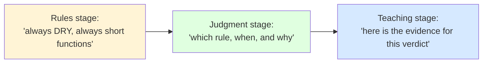

### Recommended Sequence After This Tutorial

1. **This week:** Run Lab 1 (the merge audit) on your own codebase. One real verdict beats ten hypotheticals.
2. **This sprint:** Apply the Section 8 checklist to your next three PR reviews. Note which flags you hit.
3. **This quarter:** Pick one *symptom* from the troubleshooting table that exists in your codebase and fix it (e.g., collapse one passthrough layer, model one impossible state).
4. **Ongoing:** Collect incident stories; attach why-comments to the code they explain.

### Suggested Next Topics

- **Domain modeling deep-dive:** discriminated unions, smart constructors, and state machines in TypeScript (extends Lesson 5).
- **Refactoring safely at scale:** characterization tests, strangler-fig migrations, branch-by-abstraction (extends Lessons 1 and 6).
- **Architecture decision records:** making judgment durable across team turnover (extends Lessons 6–7).

---

## Conclusion

None of this is a license to write sloppy code, skip abstraction, or avoid documentation discipline. It's the opposite: it's a call to apply clean-code principles with the same rigor you'd apply to any other engineering trade-off — by asking what problem the rule solves, whether that problem exists in front of you, and what the "fix" will cost the next person who has to change this code.

Early in a career, rules are training wheels — they build the instinct to notice long functions, tangled logic, and duplicated knowledge. With experience, the training wheels come off, and the real skill emerges: **judging, case by case, which rule serves the code and which rule has started serving only itself.**

### Reflection Prompt

> Which clean-code rule did *you* follow mechanically early on, before you understood the tradeoff it was protecting you from? Walk through the checklist above the next time you catch yourself applying a rule "because that's just what clean code looks like" — and see if the rule still earns its place.

---

<a id="reading"></a>
## 25. Further Reading & Resources

### Foundational
- Sandi Metz — *"Duplication Is Far Cheaper Than the Wrong Abstraction"* (the canonical statement of Lesson 1)
- John Ousterhout — *A Philosophy of Software Design* (deep vs. shallow modules — the theory behind Lessons 2 and 6)
- Robert C. Martin — *Clean Code* (read *with* this tutorial: know the rules to know when they stop paying)
- Martin Fowler — *Refactoring* (2nd ed.); *Patterns of Enterprise Application Architecture* (where layering guidance came from — and its caveats)

### TypeScript & Type-Level Design
- TypeScript Handbook — *Narrowing*, *Discriminated Unions*, *Generics*
- Matt Pocock — *Total TypeScript* (free tutorials on type-driven modeling)

### Architecture & Trade-offs
- Sam Newman — *Building Microservices* (when service boundaries — and their layers — genuinely pay)
- Michael Nygard — *Documenting Architecture Decisions* (the original ADR article)
- Kent Beck — *Tidy First?* (small, reversible structural changes as a change-cost discipline)

### Community & Evidence
- Google Engineering Practices — *How to do a code review* (review for change cost, not just style)
- "The Wrong Abstraction" — Sandi Metz (2016) — full essay behind Lesson 1
- Your own `git log`. Seriously. It is the most underused design evidence in most teams.

---

## Document Info

| | |
|---|---|
| **Version** | 1.0 |
| **Last Updated** | 2026-08-29 |
| **Diagrams** | 11 Mermaid diagrams |
| **Exercises** | 4 (with solutions) + 3 hands-on labs |
| **Questions** | 52-question bank + 10 Test-Your-Understanding + 10 interview questions |

*Note: The case studies in Section 16 are illustrative composites drawn from common industry patterns, not citations of specific companies.*

