# Vinix OS: A Complete Tutorial on the Non-Linux OS That Runs Linux Apps, Docker, QEMU, and Games

> **Status warning:** Vinix is early-stage software. It is not meant for daily use or production environments. Treat it as something to explore, learn from, and test in a virtual machine.

---

## Table of Contents

1. [What Is Vinix?](#1-what-is-vinix)
2. [Background Concepts You Need First](#2-background-concepts-you-need-first)
3. [Why Does Vinix Exist?](#3-why-does-vinix-exist)
4. [Architecture Deep Dive](#4-architecture-deep-dive)
5. [How Vinix Runs Linux Apps Without Being Linux](#5-how-vinix-runs-linux-apps-without-being-linux)
6. [Docker on Vinix](#6-docker-on-vinix)
7. [QEMU and Games on Vinix](#7-qemu-and-games-on-vinix)
8. [Security Model: OpenBSD-Inspired](#8-security-model-openbsd-inspired)
9. [Project History and People](#9-project-history-and-people)
10. [Hands-On: Getting and Running Vinix](#10-hands-on-getting-and-running-vinix)
11. [Installing and Using Apps with `pkg`](#11-installing-and-using-apps-with-pkg)
12. [Real-World Use Cases](#12-real-world-use-cases)
13. [Limitations and Roadmap](#13-limitations-and-roadmap)
14. [Vinix vs. Linux vs. macOS vs. BSD](#14-vinix-vs-linux-vs-macos-vs-bsd)
15. [Quick Reference and Summary](#15-quick-reference-and-summary)
16. [Practice Questions](#16-practice-questions)

---

## 1. What Is Vinix?

**Vinix is an operating system with its own kernel, written mostly in the V programming language.** It is **not** a Linux distribution, because it does not use the Linux kernel. Yet it can run many Linux applications, including Docker, QEMU, Chromium, GIMP, Wine, and even games like DOOM and Minecraft.

This is the surprising part. Linux programs normally expect a Linux kernel underneath them. Vinix gets around this by **re-implementing the interface** that those programs talk to, so the programs cannot tell the difference.

### The one-paragraph summary

| Aspect | Vinix |
|---|---|
| **Kernel type** | Monolithic, written from scratch |
| **Main language** | V (plus some C and assembly) |
| **Bootloader** | Limine |
| **Desktop** | Native desktop built with V UI2, rendering through the framebuffer |
| **Optional sessions** | X.org and Hyprland (ARM64) |
| **Package source** | Alpine Linux aarch64 packages, installed via `pkg` |
| **Libc / userland** | musl and BusyBox (Alpine-style) |
| **Primary target** | Apple Silicon Macs (M1 currently) |
| **Footprint** | About 50 MB RAM after boot, about 1 GB disk once installed |
| **Maturity** | Early stage, not for production |

### Headline capabilities

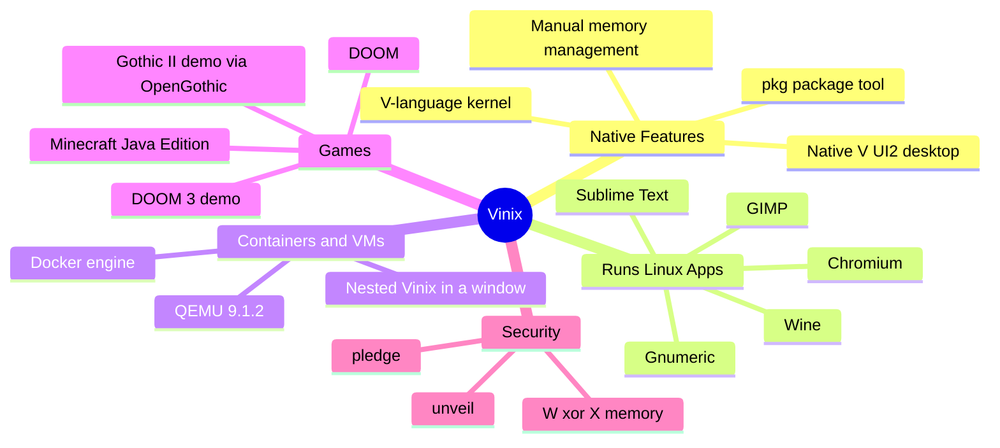

---

## 2. Background Concepts You Need First

If you are a beginner, a few terms in the original article may feel dense. This section explains each one with simple analogies.

### 2.1 Kernel vs. Operating System vs. Distribution

- **Kernel:** The core program that talks to hardware and manages memory, processes, and files.
- **Operating System (OS):** The kernel plus everything around it, such as the shell, libraries, tools, and desktop.
- **Distribution (distro):** A packaged flavor of Linux, meaning the Linux kernel plus a chosen set of software (Ubuntu, Fedora, Alpine, and so on).

**Analogy:** Think of a car. The **kernel** is the engine, the **OS** is the whole car, and a **distro** is a specific model with a particular trim level. Vinix builds a *different engine* but makes it fit the same *driver controls* (the system call interface) that Linux apps expect.

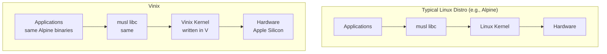

The only layer that changes is the kernel. That is the whole trick.

### 2.2 System Calls (Syscalls)

A **system call** is how a program asks the kernel to do something privileged: open a file, allocate memory, create a process, send network data.

**Example:** When a program runs `cat notes.txt`, it ultimately triggers syscalls like:

1. `openat()` to open the file
2. `read()` to read bytes
3. `write()` to print them to the terminal
4. `close()` to release the file

If a different kernel provides the *same syscalls with the same numbers and behaviors*, the program runs without modification.

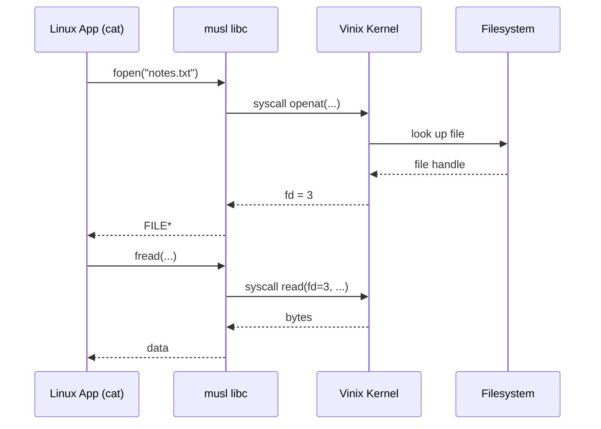

### 2.3 ELF (Executable and Linkable Format)

**ELF** is the binary file format used by Linux and many Unix-like systems. It describes how an executable is laid out: code sections, data sections, entry point, and required libraries.

For Vinix to run a Linux program, its loader must understand ELF files. Vinix does, so an Alpine `aarch64` binary can be loaded and launched directly.

**Quick check on a Linux machine:**

```bash
file /bin/busybox
# Example output: ELF 64-bit LSB executable, ARM aarch64, ...
```

### 2.4 musl and BusyBox

- **musl:** A small, clean C standard library. It is what Alpine uses instead of the more common glibc.
- **BusyBox:** A single tiny binary that bundles hundreds of basic commands (`ls`, `cp`, `sh`, and so on).

Vinix mimics the behavior musl relies on, which is why Alpine's userland feels at home there.

### 2.5 Namespaces, cgroups, overlayfs, seccomp

These four kernel features are the building blocks of containers. Docker needs them.

| Feature | What it does | Simple analogy |
|---|---|---|
| **Namespaces** | Give a process its own isolated *view* of the system (processes, network, mounts) | Separate apartments in the same building, each with its own address numbering |
| **cgroups** | Limit and account for resources (CPU, memory) used by a group of processes | A utility meter and circuit breaker per apartment |
| **overlayfs** | Stack filesystem layers so changes go on top without altering the base | Transparent sheets laid over a printed page; you draw on the top sheet only |
| **seccomp** | Restrict which syscalls a process may use | A building rule that says "this tenant may use the front door but not the roof" |

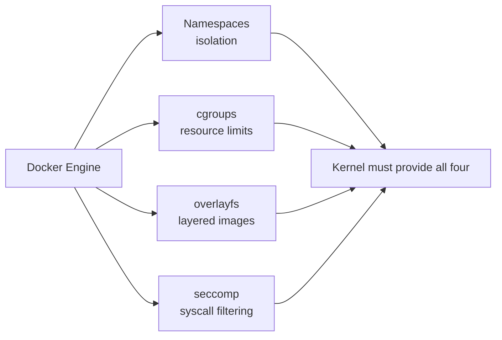

Linux provides these natively. Vinix had to **implement its own versions** of them so the stock Alpine Docker engine on ARM64 would run unchanged.

### 2.6 Garbage Collection (and why avoiding it matters)

A **garbage collector (GC)** automatically frees memory that a program no longer uses. It is convenient, but it can pause the program at unpredictable moments to do cleanup.

Inside a kernel, such a pause could happen in the middle of a system call or while the screen compositor is drawing a frame, causing stutter or worse. Vinix's kernel uses **manual memory management**, so cleanup only happens when the code explicitly says so.

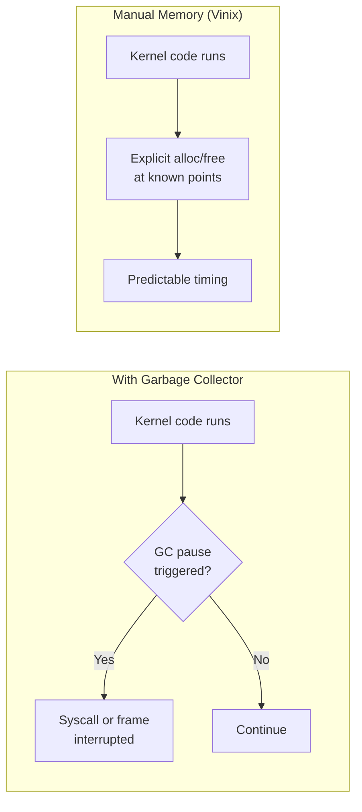

### 2.7 Monolithic Kernel

A **monolithic kernel** runs core services (drivers, filesystems, networking, scheduling) all inside one privileged program. This differs from a **microkernel**, which keeps most services in separate user-space processes.

Vinix is monolithic, and its drivers are **built into the image** rather than loaded as separate modules.

---

## 3. Why Does Vinix Exist?

The stated motivation is straightforward: **give MacBooks a fast, minimal, open-source OS**, motivated by the perception that macOS grows slower and more bloated with every release.

### Design goals

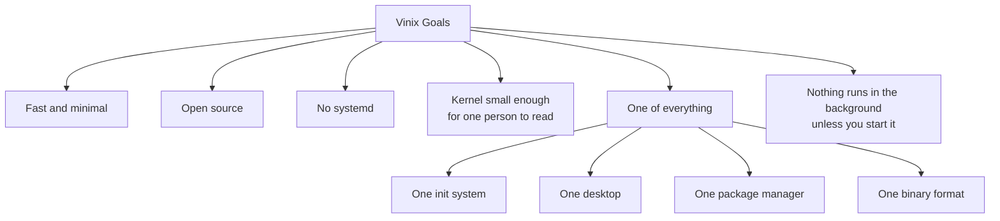

### What "one of everything" means in practice

Many Linux distros offer choices: systemd or OpenRC, GNOME or KDE or Xfce, apt or dnf or pacman, and so on. Choice is powerful but adds complexity. Vinix intentionally limits itself to:

| Component | Vinix choice |
|---|---|
| Init system | A single init (no systemd) |
| Desktop | One native desktop (V UI2) |
| Package manager | `pkg` |
| Binary format | ELF |

### Hardware targets

- **Currently supported:** Apple M1
- **Coming soon:** M3, M4, M5 (the plan is to eventually cover the whole M-series)
- **Also available:** An x86_64 ISO for Intel and AMD systems
- **Work in progress:** GPU drivers

---

## 4. Architecture Deep Dive

### 4.1 Layered view

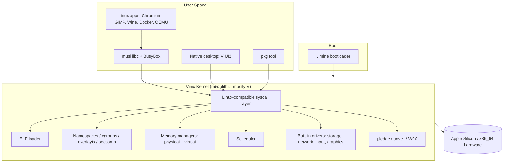

### 4.2 Languages used

- **V**: Majority of the codebase. Chosen for fast compile times and a small, readable design.
- **C and assembly**: Used where needed (for example, low-level boot and CPU code).

The project also acts as a **testbed for bare-metal programming in V**, which makes it interesting to language enthusiasts as well as OS developers.

### 4.3 The desktop

The native desktop is built with **V UI2** and renders directly through the **framebuffer**. A framebuffer is a region of memory whose contents are shown on screen, so drawing there needs no heavy graphics stack.

On ARM64 you can also choose **X.org** or **Hyprland** sessions.

**Claimed footprint:**

- About **50 MB RAM** after boot
- About **1 GB disk** once installed

For comparison, a typical modern desktop OS idles at several hundred megabytes to over a gigabyte of RAM.

### 4.4 Boot sequence

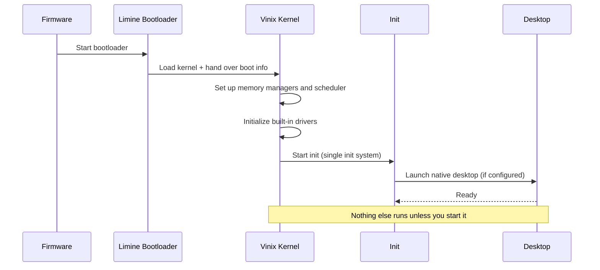

---

## 5. How Vinix Runs Linux Apps Without Being Linux

This is the core idea of the project, so let's walk through it carefully.

### 5.1 The compatibility recipe

Vinix can run a Linux app because it answers **three things** the app depends on:

1. **System calls** the app makes.
2. **The ELF format** the app is packaged in.
3. **musl behavior** the app (via its libc) expects.

Because the app binary is built for **aarch64 Alpine**, Vinix targets Alpine's aarch64 packages directly. The result is **native execution**, with **no VM and no emulator** in between.

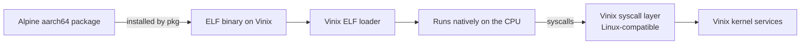

### 5.2 Compatibility vs. emulation vs. virtualization

| Approach | How it works | Speed | Example |
|---|---|---|---|
| **Native compatibility (Vinix)** | Kernel implements the syscall interface the app expects | Near-native | Vinix running Alpine ARM64 binaries |
| **Emulation** | Software translates CPU instructions | Slow | QEMU TCG mode |
| **Virtualization** | A hypervisor runs a full guest OS | Fast with hardware support | VirtualBox, KVM |
| **Syscall translation layer** | A userspace or kernel layer converts foreign calls | Fast | WSL1, FreeBSD Linuxulator |

Vinix's approach is closest to the **FreeBSD Linuxulator** or **WSL1** idea, but Vinix implements the compatibility directly in its own kernel.

### 5.3 Where compatibility breaks

The article gives a clear caveat: **this is limited to ARM64 and selected packages**. If a program relies on a Linux kernel feature that Vinix has not implemented, it may not run properly.

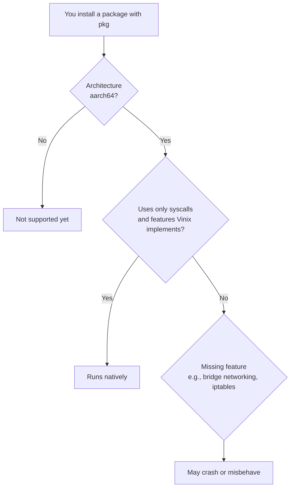

### 5.4 Apps reported to work

| App | Category | Why it's notable |
|---|---|---|
| **Chromium** | Web browser | A very large and demanding codebase |
| **GIMP** | Image editor | Complex GUI toolkit stack |
| **Sublime Text** | Text editor | Commercial-grade GUI app |
| **Gnumeric** | Spreadsheet | GTK-based productivity app |
| **Wine** | Compatibility layer | Lets Windows software potentially run (see below) |

### 5.5 A word on Wine

**Wine** translates Windows API calls into Unix-style calls. If Vinix supports Wine, it opens a path where **Windows programs could run on a non-Linux, non-Windows OS**. That is a layered stack:

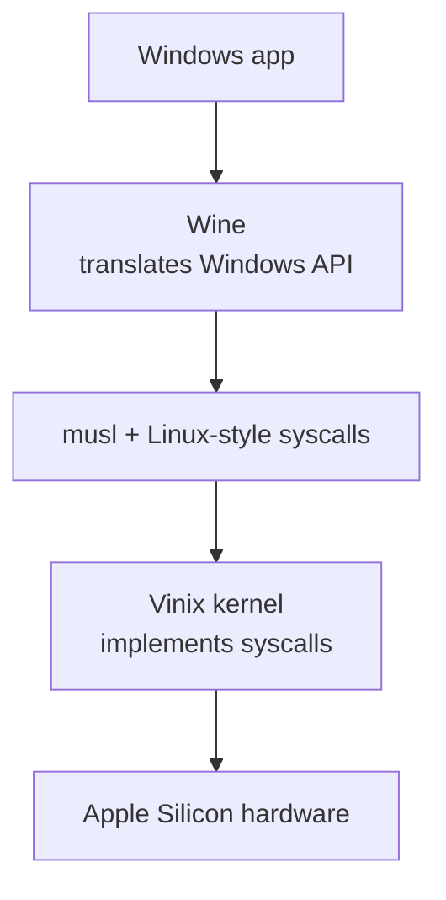

> Keep expectations realistic. Support depends on both Wine's needs and Vinix's maturity.

---

## 6. Docker on Vinix

### 6.1 Why this is a big deal

Docker relies on Linux-specific kernel features. For Docker to work on Vinix, the kernel needed:

- **Namespaces**
- **cgroups**
- **overlayfs**
- **seccomp**

Vinix implements **its own versions** of all four. The result is that the **stock Alpine Linux Docker engine for ARM64 runs unmodified**.

### 6.2 How a container starts (conceptually)

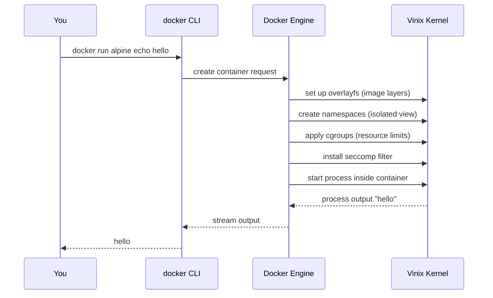

### 6.3 Example commands (what you would try)

These are standard Docker commands. On Vinix they should behave as normal *within the stated limitations*.

```bash
# 1. Check that Docker is available
docker --version

# 2. Run a simple container using host networking-free tasks
docker run --rm alpine echo "Hello from a container on Vinix"

# 3. List images
docker images

# 4. Run an interactive shell
docker run --rm -it alpine sh
```

**What works vs. what may not:**

| Task | Expected on Vinix |
|---|---|
| Running a container that just computes or prints | Should work |
| Layered images (overlayfs) | Supported |
| Syscall filtering (seccomp) | Supported |
| Default bridge network between containers | **Not supported yet** |
| iptables-based port mapping (`-p 8080:80`) | **Not supported yet** (no iptables rules) |

### 6.4 Why bridge networking and iptables matter

On Linux, Docker creates a virtual **bridge** (usually `docker0`) and uses **iptables** to route and NAT traffic. Without them, containers cannot get their usual private network, and published ports will not work.

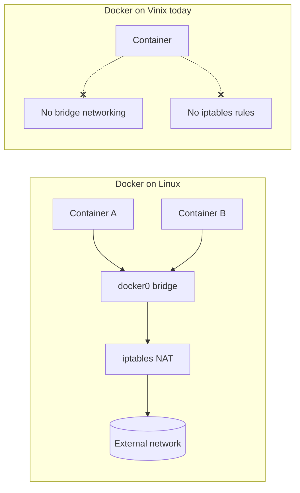

### 6.5 Practical tips

- Use containers for **offline or CPU-bound tasks** (scripts, build steps, tests) first.
- Avoid examples that need `-p` port publishing until networking support lands.
- Report issues to the project repository so developers can prioritize what matters.

---

## 7. QEMU and Games on Vinix

### 7.1 QEMU 9.1.2

QEMU is a machine emulator and virtualizer. On Vinix, **QEMU 9.1.2 runs**, and notably it can **boot a second Vinix inside a window of the first**.

**Current limitation:** QEMU runs on **software emulation** for now, meaning it does not use hardware virtualization acceleration. It is correct but slow.

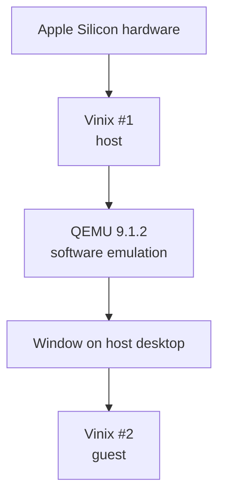

**Why this is a good test:** Running QEMU exercises large parts of the kernel (memory mapping, threads, graphics output, input), so booting a nested OS is a strong stress test.

**Conceptual example** (generic QEMU usage for ARM64, adapt paths to your setup):

```bash
qemu-system-aarch64 \
  -M virt \
  -cpu cortex-a72 \
  -m 2G \
  -cdrom vinix-aarch64.iso \
  -display sdl
```

> This command is illustrative. Check the Vinix repository for the exact supported QEMU flags.

### 7.2 Games

Games are demanding because they combine graphics, input, audio, timing, and threading. The article lists these:

| Game | Notes |
|---|---|
| **DOOM** | Runs |
| **DOOM 3 (demo)** | Runs at about **13 FPS** under software rendering |
| **Gothic II (demo)** | Via **OpenGothic** |
| **Minecraft Java Edition** | Runs in **interpreter mode on one CPU core** |

### 7.3 Why performance is limited

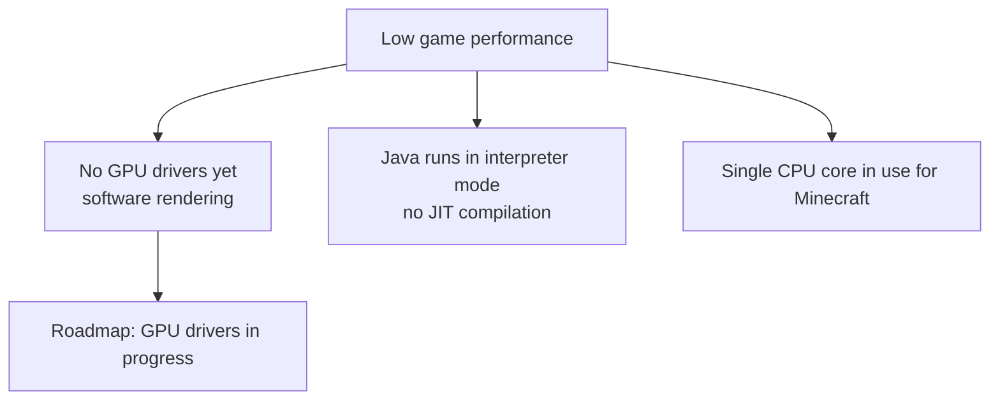

**Plain-language explanation:**

- **Software rendering:** The CPU draws every pixel instead of the GPU. It is far slower.
- **Interpreter mode (Java):** Normally Java uses a JIT compiler to turn bytecode into fast machine code. Interpreter mode executes bytecode step by step, which is slower.
- **One CPU core:** Work is not spread across cores.

### 7.4 What the gaming demos prove

Even at low frame rates, these demos show the kernel supports:

- Graphics output and input handling
- Threads and timers
- Large, complex programs (Java, OpenGL-style stacks via software rendering)
- Long-running, memory-heavy processes

---

## 8. Security Model: OpenBSD-Inspired

Vinix models its security approach after **OpenBSD**. Two key mechanisms are available: **pledge** and **unveil**.

### 8.1 pledge

`pledge` lets a program promise to use only a limited set of capabilities (for example, "only read files and print to the terminal"). If it breaks the promise, the kernel terminates it.

### 8.2 unveil

`unveil` restricts which parts of the filesystem a program can see. Everything not unveiled effectively does not exist for that program.

### 8.3 Opt-in design

> **Important:** Apps **must opt in**. Merely running on Vinix does not wrap every program in a pledge.

### 8.4 W^X (write XOR execute)

By default, **user memory cannot be both writable and executable**. This blocks a classic attack where injected data is executed as code.

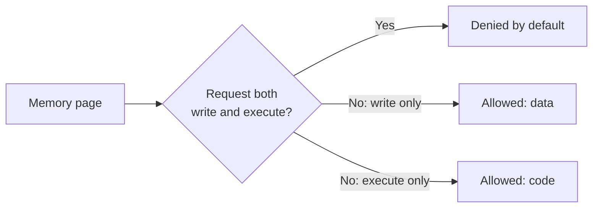

### 8.5 Illustrative pledge/unveil flow (conceptual)

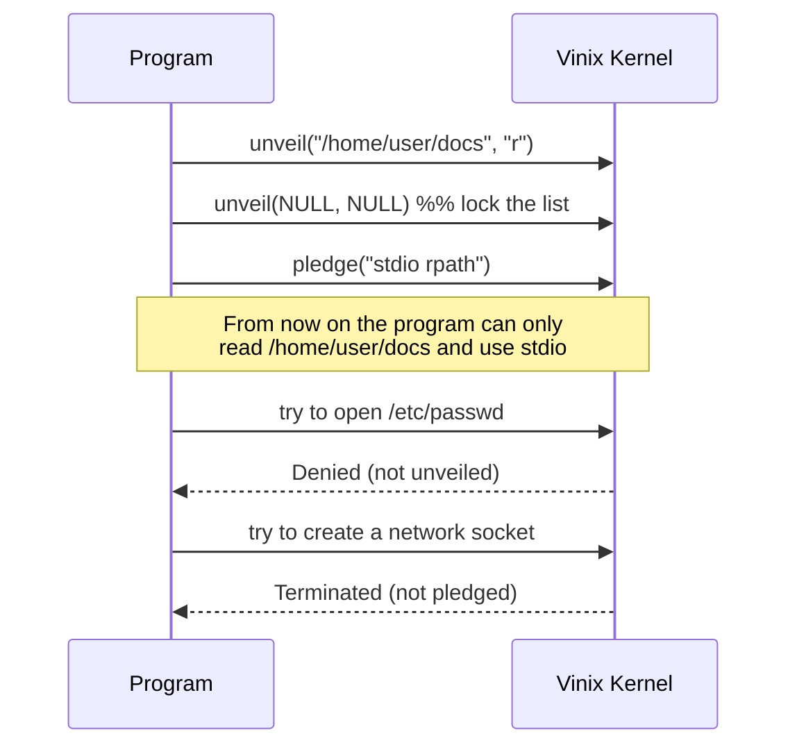

### 8.6 What is NOT supported yet

**Verified boot**, meaning verification of the bootloader, kernel, and root filesystem, is **not yet supported**. Without it, a tampered boot chain would not be detected.

| Security feature | Status |
|---|---|
| pledge | Available (opt-in) |
| unveil | Available (opt-in) |
| W^X user memory | Default |
| seccomp (for Docker) | Implemented |
| Verified boot (bootloader, kernel, rootfs) | Not yet supported |

---

## 9. Project History and People

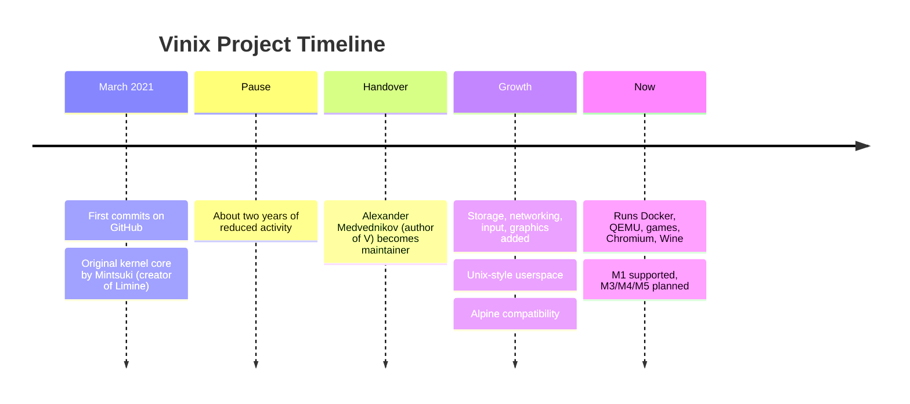

**Key people:**

- **Mintsuki** wrote the original kernel core: the physical and virtual memory managers and the scheduler. Mintsuki also created the **Limine** bootloader that Vinix uses.
- **Alexander Medvednikov**, creator of the **V programming language**, took over as maintainer after the pause.

**What was added since the handover:**

1. Storage support
2. Networking
3. Input handling
4. Graphics
5. A Unix-style userspace
6. Alpine Linux compatibility

---

## 10. Hands-On: Getting and Running Vinix

### 10.1 Download options

| Source | What you get | Intended for |
|---|---|---|
| **Official website** | `.dmg` installer | M1 Macs |
| **Project repository releases** | **ARM64 ISO** | QEMU and VirtualBox on Apple Silicon Macs |
| **Project repository releases** | **x86_64 ISO** | Intel and AMD systems |
| **Source code** | Build it yourself | Developers |

### 10.2 Minimum VM requirements

- **Memory:** at least 4 GB
- **Storage:** 4 GB or more

### 10.3 Decision flow: which download should I pick?

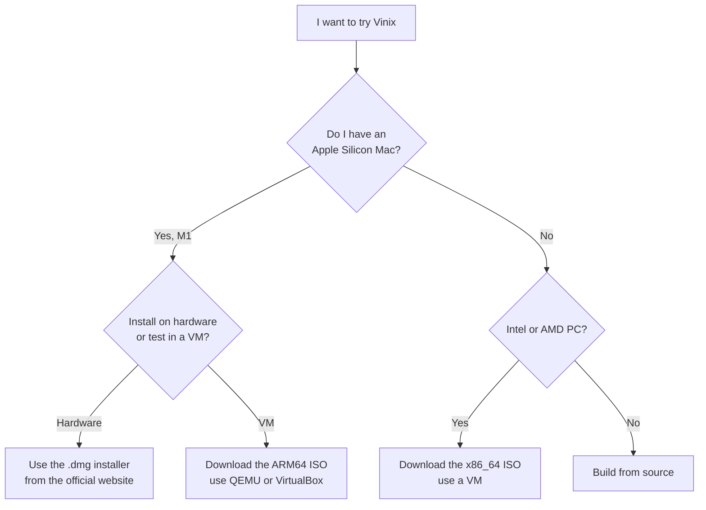

### 10.4 Tutorial A: Try Vinix in a VM (safest path)

**Step 1: Download the ISO.**
Go to the project's GitHub releases page and download the ISO that matches your CPU architecture.

**Step 2: Create a virtual machine.**
In VirtualBox (or QEMU), create a new VM with:

- 4 GB RAM or more
- 4 GB disk or more
- Architecture matching the ISO (ARM64 or x86_64)

**Step 3: Attach the ISO and boot.**
Set the ISO as the optical drive and start the VM.

**Step 4: Explore.**
You should land in the native desktop. Open a terminal and look around:

```bash
uname -a        # see the kernel name (it will not say Linux)
ls /            # inspect the filesystem layout
free            # check memory usage (about 50 MB claimed after boot)
df -h           # check disk usage
```

> `uname -a` is a quick demonstration that Vinix is not Linux, even though Linux apps run on it.

**Step 5: Try package installation** (see next section).

### 10.5 Tutorial B: Boot Vinix with QEMU from the command line (illustrative)

```bash
# Example for an ARM64 ISO on an Apple Silicon Mac (adjust as needed)
qemu-system-aarch64 \
  -machine virt \
  -accel hvf \
  -cpu host \
  -m 4G \
  -cdrom vinix-aarch64.iso \
  -device virtio-gpu-pci \
  -device virtio-keyboard-pci \
  -device virtio-mouse-pci \
  -display cocoa
```

> Exact flags depend on the release. Always check the project's README for the supported command.

### 10.6 Tutorial C: Build from source (high level)

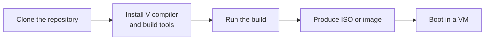

Typical shape of the workflow:

```bash
git clone https://github.com/vlang/vinix.git
cd vinix
# Follow the repository README for exact build steps and dependencies
```

---

## 11. Installing and Using Apps with `pkg`

`pkg` is Vinix's command-line package tool. It **pulls packages from Alpine's aarch64 repositories**, which is why Alpine apps run on Vinix.

### 11.1 How `pkg` fits in

```mermaid
flowchart LR
    U[You: pkg install gimp] --> P[pkg tool]
    P --> R[(Alpine aarch64 repository)]
    R --> P
    P --> I[Install binaries + dependencies]
    I --> RUN[Launch app on Vinix]
```

### 11.2 Example workflows

> The exact subcommands may vary by release. These examples show the typical pattern for a package manager of this kind. Check `pkg --help` on your system.

**Example 1: Install a spreadsheet app**

```bash
pkg install gnumeric
gnumeric
```

**Example 2: Install an image editor**

```bash
pkg install gimp
gimp
```

**Example 3: Install a browser**

```bash
pkg install chromium
chromium
```

**Example 4: Install Wine and run a simple Windows program**

```bash
pkg install wine
wine notepad
```

### 11.3 Understanding dependency resolution

When you install `gimp`, `pkg` also fetches libraries it needs (GTK, image codecs, and so on).

```mermaid
flowchart TD
    GIMP[gimp] --> GTK[gtk libraries]
    GIMP --> BABL[babl / gegl]
    GIMP --> PNG[libpng / libjpeg]
    GTK --> GLIB[glib]
    GTK --> CAIRO[cairo / pango]
    GLIB --> MUSL[musl libc]
    PNG --> MUSL
    CAIRO --> MUSL
```

### 11.4 Troubleshooting checklist

| Symptom | Likely cause | What to try |
|---|---|---|
| App will not start | Needs a kernel feature Vinix lacks | Check the project's issue tracker |
| "Exec format error" | Wrong architecture (not aarch64) | Use only aarch64 packages on ARM64 |
| Very slow graphics | No GPU driver yet | Expect software rendering |
| Container networking fails | Bridge and iptables unsupported | Use containers without network features |

---

## 12. Real-World Use Cases

### Use Case 1: Learning how operating systems work

**Scenario:** A student wants to understand kernels but finds Linux's millions of lines overwhelming.

**Why Vinix fits:** The goal is a kernel *small enough for one person to read*. Written mostly in V with readable design, it makes a manageable study object.

**Practical steps:**

1. Clone the repository.
2. Start with the memory managers and scheduler (the original core).
3. Trace how a syscall like `read` travels from user space into the kernel.
4. Boot it in QEMU and add a `print` statement to see your change run.

### Use Case 2: Experimenting with systemd-free systems

**Scenario:** A sysadmin wants to see what a minimal, single-init system feels like.

**Why Vinix fits:** There is one init system and nothing runs in the background unless you start it.

### Use Case 3: Testing the V programming language for systems work

**Scenario:** A developer wants to know whether V is viable for bare-metal code.

**Why Vinix fits:** The project is a living testbed for bare-metal V.

### Use Case 4: Lightweight Apple Silicon experimentation

**Scenario:** A Mac user is curious about an alternative to macOS on M1 hardware.

**Why Vinix fits:** It targets Apple Silicon and aims to be lean (about 50 MB RAM after boot).

> Because it is early-stage, use a **test machine or VM**, not your daily driver.

### Use Case 5: Researching OS compatibility layers

**Scenario:** A researcher is studying how a non-Linux kernel can host Linux software.

**Why Vinix fits:** It implements Linux-compatible syscalls, namespaces, cgroups, overlayfs, and seccomp from scratch.

### Use Case 6: Security education

**Scenario:** A security student wants to practice with pledge/unveil and W^X concepts outside of OpenBSD.

**Why Vinix fits:** It borrows OpenBSD's security model, giving a second platform to compare.

### Use Case 7: Testing containerized workflows on a new kernel

**Scenario:** A developer wants to see how well container tooling copes on an unfamiliar kernel.

**Why Vinix fits:** The stock Alpine Docker engine runs, making it a unique test target (keeping the networking limits in mind).

### Use-case summary map

```mermaid
flowchart LR
    V[Vinix] --> L[Learning OS internals]
    V --> S[systemd-free experimentation]
    V --> VL[V language testbed]
    V --> AS[Apple Silicon experiments]
    V --> CR[Compatibility-layer research]
    V --> SE[Security education]
    V --> CT[Container tooling tests]
```

---

## 13. Limitations and Roadmap

### 13.1 Current limitations

| Area | Limitation |
|---|---|
| **Maturity** | Early stage, not for daily or production use |
| **Hardware** | Only M1 supported among Apple chips; M3, M4, M5 coming |
| **GPU** | Drivers still a work in progress |
| **Docker** | No bridge networking or iptables rules |
| **QEMU** | Software emulation only |
| **Minecraft** | Interpreter mode, one CPU core |
| **DOOM 3** | About 13 FPS with software rendering |
| **App compatibility** | ARM64 and selected packages only |
| **Security** | No verified boot (bootloader, kernel, rootfs) |

### 13.2 Roadmap at a glance

```mermaid
flowchart LR
    NOW[Today:<br/>M1, software rendering,<br/>basic Docker] --> NEXT1[M3 / M4 / M5 support]
    NOW --> NEXT2[GPU drivers]
    NOW --> NEXT3[Docker bridge networking + iptables]
    NOW --> NEXT4[Hardware-accelerated QEMU]
    NOW --> NEXT5[Verified boot]
    NEXT1 --> GOAL[Full M-series coverage]
    NEXT2 --> GOAL
    NEXT3 --> GOAL
    NEXT4 --> GOAL
    NEXT5 --> GOAL
```

> The items above are inferred from the stated limitations and "coming soon" notes. Treat anything beyond M3/M4/M5 and GPU drivers as *potential direction*, not a promise.

---

## 14. Vinix vs. Linux vs. macOS vs. BSD

| Feature | Vinix | Linux distro | macOS | OpenBSD |
|---|---|---|---|---|
| **Kernel** | Custom (V) | Linux | XNU | OpenBSD |
| **Open source** | Yes | Yes | Partly | Yes |
| **systemd** | No | Often yes | No (launchd) | No |
| **Runs Linux apps natively** | Yes (selected, ARM64) | Yes | No | Limited |
| **Docker** | Yes (limited) | Yes | Via VM | No |
| **Security approach** | pledge/unveil, W^X | SELinux/AppArmor, others | Sandboxing | pledge/unveil, W^X |
| **Maturity** | Early | Mature | Mature | Mature |
| **Apple Silicon support** | M1 | Varies (Asahi etc.) | Native | Limited |

### Who should consider what?

```mermaid
flowchart TD
    Q[What do you need?] --> A{Stable daily driver?}
    A -->|Yes| L[Use macOS or a mainstream Linux distro]
    A -->|No, I want to learn or experiment| B{Interest area?}
    B -->|Kernel internals and V| VX[Try Vinix]
    B -->|Security-focused Unix| OB[Try OpenBSD]
    B -->|Linux on Apple Silicon| AS[Try Asahi Linux]
```

---

## 15. Quick Reference and Summary

### Key facts cheat sheet

- Vinix is **not Linux**. It has its own monolithic kernel written mostly in **V**.
- It uses the **Limine** bootloader.
- It runs **Alpine aarch64** binaries natively thanks to a Linux-compatible syscall layer, ELF support, and musl behavior.
- It implements **namespaces, cgroups, overlayfs, and seccomp**, enough for the stock **Alpine Docker engine**.
- It runs **QEMU 9.1.2** (software emulation) and can boot a nested Vinix.
- It runs **DOOM, DOOM 3 demo, Gothic II demo (OpenGothic), and Minecraft Java Edition**.
- Packages install with **`pkg`** from Alpine repositories.
- Security is **OpenBSD-inspired** (pledge, unveil, W^X) but verified boot is missing.
- Install options: `.dmg` for M1 Macs, ARM64 ISO, or x86_64 ISO; VMs need **4 GB RAM and 4 GB disk**.
- It is **early-stage**. Use it for learning and testing, not production.

### Final concept map

```mermaid
flowchart TB
    VINIX[Vinix OS] --> KERNEL[Custom V kernel<br/>monolithic, manual memory]
    VINIX --> COMPAT[Linux compatibility]
    VINIX --> SEC[OpenBSD-style security]
    VINIX --> UI[Native V UI2 desktop]
    COMPAT --> SYSCALL[Syscalls + ELF + musl behavior]
    COMPAT --> CONTAINERS[Namespaces, cgroups, overlayfs, seccomp]
    CONTAINERS --> DOCKER[Docker engine]
    COMPAT --> APPS[Chromium, GIMP, Wine, etc.]
    APPS --> GAMES[Games and QEMU]
    KERNEL --> HW[Apple M1 and x86_64]
```

---

## 16. Practice Questions

Test your understanding. Answers follow.

1. Why can Vinix run Alpine Linux apps even though it is not Linux?
2. Name the four kernel features Vinix implemented so Docker could run.
3. Why does the Vinix kernel avoid a garbage collector?
4. What are two Docker features that currently do not work on Vinix?
5. Why is Minecraft slow on Vinix today?
6. What does `unveil` do?
7. Which bootloader does Vinix use, and who created it?
8. What are the minimum VM requirements for trying Vinix?

<details>
<summary>Show answers</summary>

1. Because it implements the Linux-style syscalls, handles the ELF format, and mimics musl behavior that those binaries rely on, so the binaries run natively.
2. Namespaces, cgroups, overlayfs, and seccomp.
3. A garbage collection pass could interrupt a system call or the compositor, so manual memory management gives predictable timing.
4. Bridge networking and iptables rules.
5. It runs in Java interpreter mode on a single CPU core, and there are no GPU drivers yet.
6. It restricts which parts of the filesystem a program can see.
7. Limine, created by Mintsuki (who also wrote the original Vinix kernel core).
8. At least 4 GB of memory and 4 GB or more of storage.

</details>

---

**Further exploration:** Visit the official Vinix website and the project repository on GitHub for the latest releases, build instructions, and the Minecraft and DOOM 3 test notes.