# 🐍 10 Python Concepts That Will Transform How You Write Code
### A Complete Tutorial with Examples, Diagrams & Real-World Applications

<!--
  Difficulty: Intermediate
  Estimated Reading Time: 120–150 minutes
  Last Updated: 2026-09-12
  Source: Content provided by the user, augmented to meet tutorial-preferences.md requirements
  Based on: Python 3.12+ — closures, decorators, lambda, generators, context managers, currying/partial, memoization, comprehensions, exception handling, and the __call__ protocol
-->

---

## 📚 Table of Contents

1. [Introduction](#introduction)
2. [Prerequisites](#prerequisites)
3. [Learning Objectives](#learning-objectives)
4. [Your Learning Map](#️-your-learning-map)
5. [Concept 1 — Closures](#concept-1--closures-hidden-state-without-global-variables)
6. [Concept 2 — Decorators](#concept-2--decorators-metaprogramming-with-manners)
7. [Concept 3 — Lambda](#concept-3--lambda-functional-glue-for-data-pipelines)
8. [Concept 4 — Generators](#concept-4--generators-lazy-pipelines-for-massive-data)
9. [Concept 5 — Context Managers](#concept-5--context-managers-automatic-setup--cleanup)
10. [Concept 6 — Currying & Partial](#concept-6--currying--partial-application-pre-filled-functions)
11. [Concept 7 — Memoization](#concept-7--memoization-never-compute-the-same-thing-twice)
12. [Concept 8 — Comprehensions](#concept-8--comprehensions-declarative-data-transformation)
13. [Concept 9 — Exception Handling](#concept-9--exception-handling-automated-fault-tolerance)
14. [Concept 10 — `__call__`](#concept-10--__call__-classes-that-behave-like-functions)
15. [How All 10 Concepts Fit Together](#️-how-all-10-concepts-fit-together)
16. [🚀 Capstone: Production-Grade Automation Pipeline](#-capstone-a-production-grade-automation-pipeline)
17. [Real-World Case Studies](#-real-world-case-studies)
18. [Multiple Implementation Approaches](#-multiple-implementation-approaches)
19. [Best Practices](#-best-practices)
20. [Anti-Patterns](#-anti-patterns)
21. [Common Pitfalls & Troubleshooting Guide](#-common-pitfalls--troubleshooting-guide)
22. [Performance Considerations](#-performance-considerations)
23. [Security Considerations](#-security-considerations)
24. [Testing Strategies](#-testing-strategies)
25. [Migration Guides](#-migration-guides)
26. [Hands-On Lab](#-hands-on-lab)
27. [Practice Exercises (with Detailed Solutions)](#-practice-exercises)
28. [Test Your Understanding](#-test-your-understanding)
29. [Common Interview Questions](#-common-interview-questions)
30. [Question Bank (50+ Questions)](#-question-bank)
31. [Self-Assessment Checklist](#-self-assessment-checklist)
32. [Pro Tips](#-pro-tips)
33. [Quick-Reference Cheat Sheet](#-quick-reference-cheat-sheet)
34. [Summary / Key Takeaways](#-summary--key-takeaways)
35. [Further Reading / Resources](#-further-reading--resources)

## Introduction

Most Python tutorials teach syntax. This one teaches **vocabulary** — the ten interlocking concepts professional Python codebases are written in. They are not isolated tricks: they are the same mechanisms powering Flask's routing, Django's auth, pytest's fixtures, and every serious data-pipeline library you have ever imported.

Each concept follows the same arc: **what it is → why it exists → how it works internally → when to reach for it (or avoid it)**. Examples progress from simple to production-grade, and every code sample has been verified against Python 3.12.

> 💡 **Aha moment ahead:** By Concept 10 you'll realize that decorators, memoization, and retry logic are all *the same idea* — functions that produce functions — viewed from different angles. Python's functional core is a small, elegant machine.

### Why These Ten Concepts?

| Without These Concepts | With These Concepts |
|---|---|
| Global variables for state | Closures that carry their own state |
| Copy-pasted `try/finally` cleanup | Context managers that guarantee cleanup |
| Exponential algorithms recomputing results | Memoization that makes them linear |
| 10 GB files crashing a 4 GB container | Generator pipelines with flat memory |
| Error handling scattered everywhere | Exception hierarchies + retry decorators |
| Rigid, hard-wired functions | Currying/partial for pre-configured reuse |

---

## Prerequisites

✅ **You need:**

- Python **3.9+** installed (examples target **3.12**; version differences are flagged inline)
- Comfort with: functions, `def`/`return`, basic classes, `import`, lists/dicts/sets
- Basic `try`/`except` awareness — we build on it in Concept 9
- A terminal to run the examples

✅ **Recommended (not required):** `pytest` for the Testing Strategies section; an editor with Python syntax highlighting.

❌ **You do NOT need:** prior functional-programming experience, decorator knowledge, or framework experience.

```bash
python --version   # ➜ Python 3.12.10 (any 3.9+ works)
```

---

## Learning Objectives

By the end of this tutorial you will be able to:

| # | Objective | Concept |
|---|---|---|
| 1 | Store hidden state inside functions — no globals, no classes | Closures |
| 2 | Write plain, factory, and class-based decorators that preserve metadata | Decorators |
| 3 | Compose declarative pipelines with `lambda`, `map`/`filter`/`reduce` | Lambda |
| 4 | Build lazy, constant-memory pipelines for files, streams, infinite sequences | Generators |
| 5 | Guarantee setup/cleanup with class-based and `@contextmanager` styles | Context Managers |
| 6 | Pre-configure functions with `functools.partial` and a custom `curry` | Currying & Partial |
| 7 | Cache expensive pure-function results safely (`lru_cache`, TTL caches) | Memoization |
| 8 | Transform collections declaratively with the four comprehension types | Comprehensions |
| 9 | Design custom exception hierarchies and retry logic with back-off | Exception Handling |
| 10 | Create stateful, callable objects via the `__call__` protocol | `__call__` |
| 11 | Combine all ten into a single production-grade automation pipeline | Capstone |
| 12 | Test, benchmark, and secure code built with these patterns | Quality sections |

**Difficulty progression:** 🟢 Concepts 1, 3, 8 (fundamentals) → 🟡 Concepts 4, 5, 6, 9 (applied) → 🔴 Concepts 2, 7, 10 + Capstone (synthesis).

---

## 🗺️ Your Learning Map

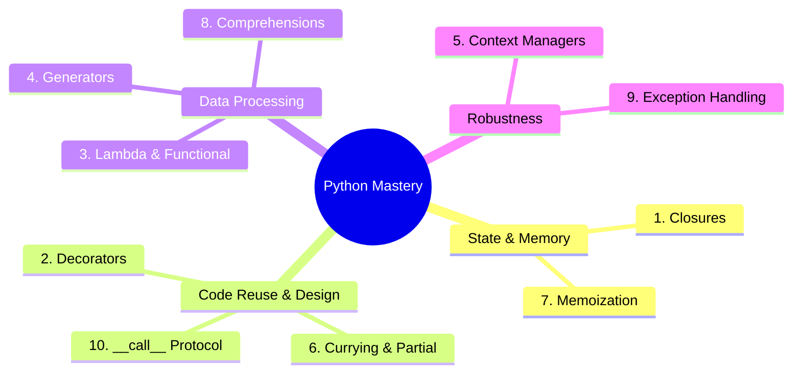

---

## Concept 1 — Closures: Hidden State Without Global Variables

### What Is a Closure?

A **closure** is an inner function that **remembers** the variables from its enclosing outer scope — even after that outer function has finished executing. Instead of storing state in a global variable, a closure packages the data *inside* the function itself.

Think of it as a **capsule**: the inner function + the surrounding data travel together as a unit.

> **Why it matters:** Closures are the foundation of decorators, callback systems, and factory functions. Master them first — every later concept in this tutorial builds on them.

### How Closures Work Internally

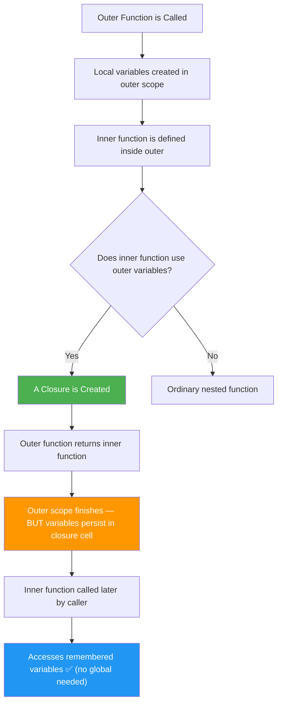

**The key insight:** Python stores captured variables in **cell objects** (visible via `__closure__`). The outer function's stack frame dies, but the cells survive as long as the inner function references them. This is *not* magic — it is explicit, inspectable memory management.

### Example 1 — The Multiplier Factory

```python
def make_multiplier(x):
    """Outer function: sets the 'x' factor once"""
    def multiply(y):
        """Inner function: captures 'x' from the outer scope"""
        return x * y      # x is 'remembered' here
    return multiply       # Return the inner function itself (NOT multiply())

# Create specialized multiplier functions
double   = make_multiplier(2)
triple   = make_multiplier(3)
times_10 = make_multiplier(10)

print(double(5))    # ➜ 10
print(triple(5))    # ➜ 15
print(times_10(5))  # ➜ 50

# Each closure has its own independent 'x' — inspect the cells:
print(double.__closure__[0].cell_contents)   # ➜ 2
print(triple.__closure__[0].cell_contents)   # ➜ 3
```

### Example 2 — Stateful Counter (No Class Needed)

```python
def make_counter(start=0, step=1):
    count = [start]          # list so the inner function can MUTATE it

    def counter():
        current = count[0]
        count[0] += step
        return current

    return counter

# Two completely independent counters
page_views = make_counter(start=1)
user_ids   = make_counter(start=1000, step=5)

print(page_views())   # ➜ 1
print(page_views())   # ➜ 2
print(user_ids())     # ➜ 1000
print(user_ids())     # ➜ 1005
print(page_views())   # ➜ 3   ← independent of user_ids!
```

<details>
<summary>🔍 Why the <code>[start]</code> list wrapper? (click to expand)</summary>

A plain `count = start` + `count += step` inside `counter()` raises `UnboundLocalError`: **assignment** makes Python treat `count` as a *local* variable of `counter()`, shadowing the outer one. Three clean fixes:

1. **Container trick** (shown above): mutate a list/dict instead of rebinding the name.
2. **`nonlocal` keyword** (Python 3+): declare `nonlocal count` inside `counter()` — the idiomatic fix.
3. **Function attribute** (`counter.count = ...`) — works but is unusual style.

```python
def make_counter_nonlocal(start=0, step=1):
    count = start
    def counter():
        nonlocal count     # ← 'count refers to the OUTER variable'
        current = count
        count += step
        return current
    return counter
```
</details>

### Example 3 — Configurable Greeting Generator

```python
def make_greeter(language="en", formal=False):
    phrases = {
        ("en", False): "Hey",
        ("en", True):  "Good day,",
        ("es", False): "Hola",
        ("es", True):  "Buenos días,",
        ("fr", False): "Salut",
        ("fr", True):  "Bonjour,",
    }

    def greet(name):
        phrase = phrases.get((language, formal), "Hi")
        return f"{phrase} {name}!"

    return greet

casual_en = make_greeter("en", formal=False)
formal_fr = make_greeter("fr", formal=True)

print(casual_en("Bob"))    # ➜ Hey Bob!
print(formal_fr("Marie"))  # ➜ Bonjour, Marie!
```

### ⚠️ The Classic Late-Binding Pitfall

Closures capture **variables, not values**. A closure created in a loop sees the variable's *final* value:

```python
# ❌ INCORRECT — all three lambdas print 3!
funcs = [lambda: i for i in range(3)]
print([f() for f in funcs])          # ➜ [3, 3, 3]

# ✅ CORRECT — bind the value NOW via a default argument
funcs = [lambda i=i: i for i in range(3)]
print([f() for f in funcs])          # ➜ [0, 1, 2]
```

### 🌍 Real-World Use Cases

| Scenario | How Closures Help |
|---|---|
| **Event Handlers** | Capture widget state in GUI apps (Tkinter, PyQt) |
| **Decorator Factories** | Store config *around* the wrapped function |
| **Async Callbacks** | Preserve context when passing callbacks to async loops |
| **Plugin Systems** | Each plugin gets its own isolated environment |
| **Config-Driven Functions** | Pre-bind settings without passing them each call |

**Concrete example — pre-binding DB credentials:**

```python
def make_repo(connection_string):
    def get_user(user_id):
        ...  # uses connection_string from the closure — caller never sees it
    return get_user
```

---

## Concept 2 — Decorators: Metaprogramming With Manners

### What Is a Decorator?

A **decorator** wraps a function to add behaviour **before and/or after** it runs — without touching the original function's source code. It is Python's cleanest expression of the *Open/Closed Principle*: extend behaviour without modifying it.

> A decorator is just **syntactic sugar**: `@timer` above `def run(): ...` is exactly equivalent to `run = timer(run)`. If you understand that one line, you understand decorators.

### The Decorator Lifecycle

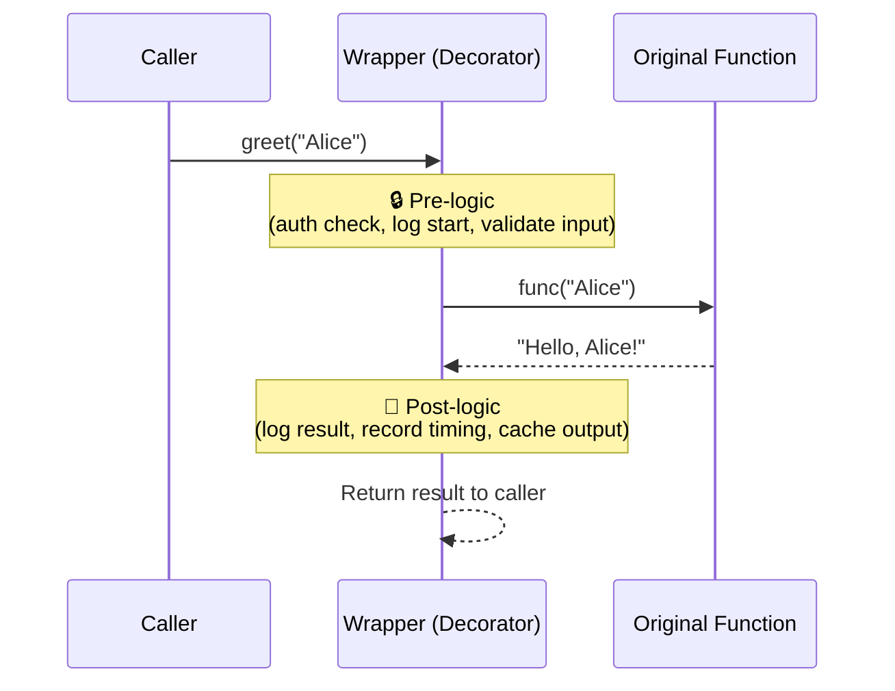

### Example 1 — A Basic Timing Decorator

```python
import functools
import time

def timer(func):
    """Print how long `func` takes to run."""
    @functools.wraps(func)              # preserves name, docstring, signature
    def wrapper(*args, **kwargs):
        start = time.perf_counter()
        result = func(*args, **kwargs)  # ← call the original
        elapsed = time.perf_counter() - start
        print(f"⏱️  {func.__name__} took {elapsed:.4f}s")
        return result
    return wrapper

@timer
def slow_sum(n):
    """Sum numbers 0..n-1."""
    return sum(range(n))

slow_sum(10_000_000)   # ⏱️ slow_sum took 0.2143s
print(slow_sum.__name__)   # ➜ 'slow_sum'  (thanks to functools.wraps)
print(slow_sum.__doc__)    # ➜ 'Sum numbers 0..n-1.'
```

> ⚠️ **Always use `@functools.wraps(func)`** on the wrapper. Without it, `func.__name__` becomes `'wrapper'`, breaking debugging, `help()`, serialization, and introspection-based frameworks.

### Example 2 — Decorator With Arguments (Three Layers!)

A decorator that accepts arguments is a **decorator factory** — a closure that returns a decorator, which returns a wrapper:

```python
import functools

def retry(times, exceptions=(Exception,), delay=0.0):
    """Retry `times` times if one of `exceptions` is raised."""
    def decorator(func):                      # layer 1: captures times/exceptions
        @functools.wraps(func)
        def wrapper(*args, **kwargs):         # layer 2: the actual retry loop
            for attempt in range(1, times + 1):
                try:
                    return func(*args, **kwargs)
                except exceptions as exc:
                    if attempt == times:
                        raise                 # out of retries — re-raise
                    print(f"  ↻ attempt {attempt} failed ({exc!r}), retrying…")
                    if delay:
                        time.sleep(delay)
        return wrapper
    return decorator

@retry(times=3, exceptions=(ConnectionError,))
def flaky_api_call():
    import random
    if random.random() < 0.6:
        raise ConnectionError("timeout")
    return {"status": "ok"}

result = flaky_api_call()   # may print retry lines, then ➜ {'status': 'ok'}
```


### Example 3 — Class-Based Decorator (State Without Closure Tricks)

```python
import functools

class CountCalls:
    """Counts how many times the decorated function was called."""
    def __init__(self, func):
        functools.update_wrapper(self, func)
        self.func = func
        self.count = 0

    def __call__(self, *args, **kwargs):   # makes instances callable
        self.count += 1
        print(f"📞 call #{self.count} of {self.func.__name__}")
        return self.func(*args, **kwargs)

@CountCalls
def ping():
    return "pong"

ping()   # 📞 call #1 of ping
ping()   # 📞 call #2 of ping
print(ping.count)   # ➜ 2
```

### Correct vs Incorrect — Stacking and Order

```python
# ✅ CORRECT — decorators apply BOTTOM-UP (closest to function first)
@timer
@retry(times=3)
def fetch(): ...

# Equivalent to: fetch = timer(retry(times=3)(fetch))
# Timing wraps the retrying version → measures TOTAL time incl. retries.

# ❌ INCORRECT — common mistake: calling instead of passing
@timer()            # TypeError: timer() missing 1 required positional argument
def fetch(): ...
```

### 🌍 Real-World Use Cases

| Pattern | Where You've Seen It |
|---|---|
| `@app.route("/users")` | Flask routing |
| `@staticmethod` / `@classmethod` | Python stdlib |
| `@property` / `@cached_property` | Attribute computation + caching |
| `@pytest.fixture` | Test setup injection |
| `@functools.lru_cache` | Memoization (Concept 7!) |
| `@dataclass` | Boilerplate-free value classes |

### 📊 Decorator vs Alternatives

| Approach | Boilerplate | Readability | State Handling | Best For |
|---|---|---|---|---|
| **Decorator** | Low | Excellent | Closure / attributes | Cross-cutting concerns |
| Subclassing | High | Good | Instance attributes | Behaviour variation in hierarchies |
| Explicit wrapper call | Low | Poor (noise at call sites) | Same as decorator | One-off wrapping |
| Context manager | Low | Good | `__enter__/__exit__` | Scoped around *one* call region |

---

## Concept 3 — Lambda: Functional Glue for Data Pipelines

### What Is a Lambda?

A `lambda` is a **one-line, anonymous function**. Its real power is not brevity — it is **declarative composition**: you describe transformations as data (functions-as-values) and compose them into pipelines.

### Anatomy

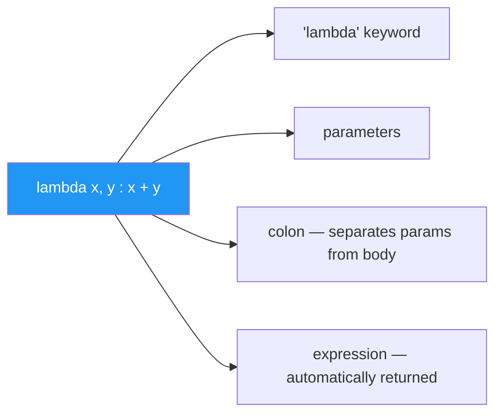

**Rules of thumb:**

- The body is a **single expression** — no statements, no `return`, no multi-line logic
- `lambda` is *not* "a smaller `def`" — it is `def` without a name, restricted to one expression
- If your lambda is hard to read, **use `def`**. Readability beats cleverness (PEP 8)

### Correct vs Incorrect Usage

```python
# ✅ CORRECT — lambda as a short key-function / callback
sorted(words, key=lambda w: (len(w), w))
button.bind("<Button-1>", lambda event: print("clicked"))

# ❌ INCORRECT — assigning a lambda to a name (PEP 8 violation; use def)
f = lambda x: x ** 2          # PEP 8: "Do not assign a lambda expression"

# ✅ CORRECT equivalent
def f(x):
    return x ** 2

# ❌ INCORRECT — complex logic crammed into a lambda
process = lambda rows: {r["id"]: [v for v in r["vals"] if v] for r in rows if r}

# ✅ CORRECT — switch to a def with a docstring
def process(rows):
    """Map row-id -> list of non-empty values, skipping empty rows."""
    return {r["id"]: [v for v in r["vals"] if v] for r in rows if r}
```

### Example 1 — Multi-Key Sorting

```python
students = [
    {"name": "Alice", "grade": 92, "age": 20},
    {"name": "Bob",   "grade": 85, "age": 22},
    {"name": "Carol", "grade": 92, "age": 19},
    {"name": "Dave",  "grade": 78, "age": 21},
]

# Sort by grade DESC, then name ASC. Trick: negate numbers for descending.
ranked = sorted(students, key=lambda s: (-s["grade"], s["name"]))
print([s["name"] for s in ranked])    # ➜ ['Alice', 'Carol', 'Bob', 'Dave']
```

> 💡 Python's `sort` is **stable**: records with equal keys keep their original relative order. You can also chain sorts (least-significant first) instead of negating: `sorted(data, key=name)` then `sorted(result, key=-grade)`.

### Example 2 — Composition Into Pipelines

```python
from functools import reduce

nums = [1, 2, 3, 4, 5, 6]

total = reduce(lambda acc, x: acc + x, nums, 0)     # fold to a single value
evens = list(filter(lambda x: x % 2 == 0, nums))     # keep evens
doubled = list(map(lambda x: x * 2, evens))          # transform

print(total)    # ➜ 21
print(doubled)  # ➜ [4, 8, 12]
```

### Example 3 — Dispatch Table (Lambda as a Value in a Dict)

```python
operations = {
    "add":      lambda a, b: a + b,
    "subtract": lambda a, b: a - b,
    "multiply": lambda a, b: a * b,
}

def calc(op, a, b):
    if op not in operations:
        raise ValueError(f"Unsupported operation: {op!r}")
    return operations[op](a, b)

print(calc("add", 2, 3))        # ➜ 5
# calc("divide", 2, 3)          # ValueError: Unsupported operation: 'divide'
```

This pattern (a dict of lambdas, often combined with `functools.partial`) is how you replace long `if/elif` chains — and how `argparse`, `click`, and event buses dispatch actions.

### ⚠️ Pitfall — Late Binding Strikes Again

```python
# ❌ All lambdas see the FINAL value of i
adders = [lambda x: x + i for i in range(3)]
print([a(10) for a in adders])     # ➜ [12, 12, 12]

# ✅ Bind at definition time with a default arg
adders = [lambda x, i=i: x + i for i in range(3)]
print([a(10) for a in adders])     # ➜ [10, 11, 12]
```

### Lambda vs `def` vs Comprehension

| Need | Use |
|---|---|
| Tiny key/callback, used once, inline | `lambda` |
| Named, documented, multi-line, reused | `def` |
| Transform every element of an iterable | Comprehension (Concept 8) — usually clearer than `map(lambda …)` |
| Conditional expression | `x if cond else y` (an *expression*, works inside lambda) |

---

## Concept 4 — Generators: Lazy Pipelines for Massive Data

### What Is a Generator?

A **generator** is a function that `yield`s values **one at a time, on demand**. It pauses at each `yield`, handing control back to the caller, and resumes from that exact point the next time a value is requested.

The core benefit: **O(1) memory regardless of data size** — a 10-item list and a 10-trillion-item stream cost the same.

### How Generators Differ From Regular Functions

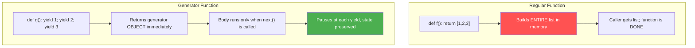

### Example 1 — Basic Generator, Step by Step

```python
def countdown(n):
    print("🚀 Generator started")
    while n > 0:
        yield n           # Pause, send n to caller, remember n
        n -= 1
    print("🏁 Generator exhausted")

gen = countdown(3)        # Nothing runs yet — no output!
print(next(gen))          # 🚀 Generator started  → 3
print(next(gen))          # → 2
print(next(gen))          # → 1

try:
    next(gen)             # body finishes → StopIteration
except StopIteration:
    print("Done")         # 🏁 Generator exhausted → Done

# Idiomatic consumption:
for value in countdown(3):
    print(value)          # 3, 2, 1 — StopIteration handled for you
```

### Example 2 — Lazy Pipeline: Reading a Huge Log File

```python
def error_lines(path):
    """Yield only lines containing ERROR — memory stays flat."""
    with open(path, encoding="utf-8") as fh:      # with-block stays alive
        for line in fh:
            if "ERROR" in line:
                yield line.strip()

# Each line is read, filtered, and released — never the whole file.
# for line in error_lines("app-10GB.log"): process(line)
```

### Example 3 — Chaining Generators (Streaming Composition)

```python
def read_lines(lines):
    for line in lines:
        yield line.strip()

def parse_csv_row(lines):
    for line in lines:
        yield line.split(",")

def non_empty(rows):
    for row in rows:
        if any(field.strip() for field in row):
            yield row

# Zero intermediate lists — data flows one record at a time:
raw  = ["a,b,c", "", "x,y,z"]
rows = non_empty(parse_csv_row(read_lines(raw)))
print(list(rows))    # ➜ [['a', 'b', 'c'], ['x', 'y', 'z']]
```

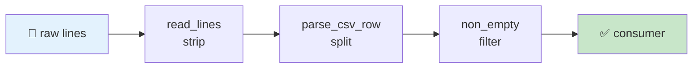

### Example 4 — `yield from` (Delegating to Sub-Generators)

```python
def flatten(nested):
    for item in nested:
        if isinstance(item, list):
            yield from flatten(item)   # delegate to the recursive generator
        else:
            yield item

print(list(flatten([1, [2, [3, 4]], 5])))    # ➜ [1, 2, 3, 4, 5]
```

### Example 5 — Infinite Sequences With `itertools`

```python
import itertools

def fib():
    a, b = 0, 1
    while True:
        yield a
        a, b = b, a + b

fibs = itertools.islice(fib(), 10)     # take 10 from an INFINITE generator
print(list(fibs))   # ➜ [0, 1, 1, 2, 3, 5, 8, 13, 21, 34]
```

### ⚠️ Generators Are Single-Use

```python
gen = (x * 2 for x in range(3))
print(sum(gen))      # ➜ 6  (gen is now EXHAUSTED)
print(sum(gen))      # ➜ 0  (silently! no error — classic bug)

# ✅ CORRECT — regenerate, or materialize ONCE if you need multiple passes
data = [x * 2 for x in range(3)]   # a list is reusable
print(sum(data), max(data))        # 6 4
```

> 💡 **Rule:** if you iterate twice, use a list. If the data is huge and iterated once, use a generator. When in doubt, `list()` it and measure.

### 📊 List vs Generator

| Aspect | List | Generator |
|---|---|---|
| Memory | O(n) — all elements stored | O(1) — one element at a time |
| Re-iterable | ✅ Yes | ❌ No (exhausts) |
| Random access / `len()` | ✅ Yes | ❌ No |
| Startup cost | Eager (build everything) | Lazy (nothing until first `next()`) |
| Best for | Small/medium reused data | Huge streams, one-pass pipelines |

---

## Concept 5 — Context Managers: Automatic Setup & Cleanup

### What Is a Context Manager?

A context manager automates **resource lifecycle** — acquiring before a block and releasing after it — **even if an exception occurs inside**. It is Python's answer to the `try/finally` boilerplate that causes resource leaks in every other language.

### The Full Lifecycle

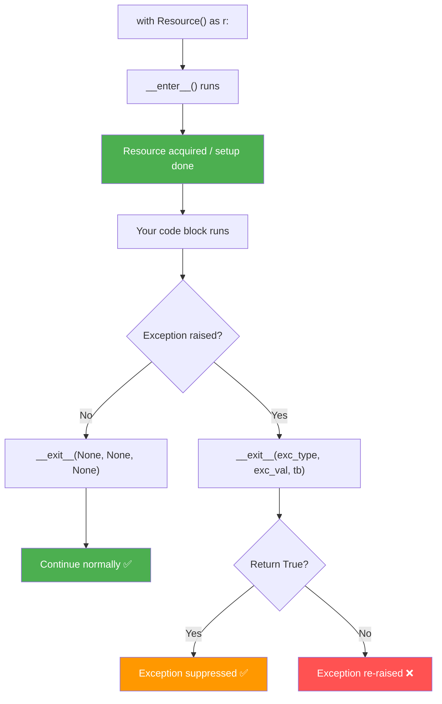

### Example 1 — File Handling (Classic)

```python
# ❌ Risky — file stays open if an exception fires between open() and close()
f    = open("data.txt", "r")
data = f.read()
f.close()

# ✅ Context manager — file ALWAYS closes, even on exception
with open("data.txt", "r") as f:
    data = f.read()
print("File is closed:", f.closed)   # True
```

### Example 2 — Class-Based Context Manager

```python
class ManagedDB:
    def __init__(self, host, port):
        self.host, self.port = host, port
        self.conn = None

    def __enter__(self):
        print(f"🔌 Connecting to {self.host}:{self.port}…")
        self.conn = {"status": "connected", "host": self.host}
        return self.conn            # ← available as the 'as' variable

    def __exit__(self, exc_type, exc_val, exc_tb):
        print("🔒 Closing connection…")
        self.conn = None
        if exc_type:
            print(f"⚠️  Rolled back due to: {exc_val}")
        return False                # ← False = do NOT suppress exceptions

with ManagedDB("localhost", 5432) as db:
    print(f"Running query on {db['host']}")
# Connection auto-closed at end of block — even if an exception fired
```

> ⚠️ **The `__exit__` return-value trap:** returning `True` (even accidentally, e.g. `return self.cleanup()`) **silently swallows** any exception raised in the block. Unless you *intend* suppression, `return False` (or nothing at all — `None` is falsy).

### Example 3 — `@contextmanager` (Function Style)

```python
from contextlib import contextmanager
import time

@contextmanager
def timed_block(label="Block"):
    """Measure any block of code without a full class."""
    start = time.perf_counter()
    try:
        yield              # ← everything inside 'with' runs here
    finally:
        elapsed = time.perf_counter() - start
        print(f"⏱ '{label}' completed in {elapsed:.4f}s")

with timed_block("Data transform"):
    data = [i ** 2 for i in range(500_000)]

with timed_block("File write"):
    with open("out.txt", "w") as f:
        f.write("done")
```

### Example 4 — Temporary Workspace

```python
from contextlib import contextmanager
import os, shutil, tempfile

@contextmanager
def temp_workspace():
    tmpdir = tempfile.mkdtemp()
    print(f"📁 Workspace created: {tmpdir}")
    try:
        yield tmpdir
    finally:
        shutil.rmtree(tmpdir, ignore_errors=True)
        print(f"🗑  Workspace removed: {tmpdir}")

with temp_workspace() as ws:
    path = os.path.join(ws, "scratch.txt")
    with open(path, "w") as f:
        f.write("temporary")
    print("File exists:", os.path.exists(path))   # True
# ← Entire directory is gone here, guaranteed
```

### Bonus — Multiple Resources & `ExitStack`

```python
from contextlib import ExitStack

paths = ["a.txt", "b.txt", "c.txt"]

# ✅ N resources in one with-block — impossible with plain nested withs
with ExitStack() as stack:
    files = [stack.enter_context(open(p, "w")) for p in paths]
    for f in files:
        f.write("hello")
# ALL files closed here, in reverse order
```

### 🌍 Real-World Use Cases

| Context Manager | What It Guarantees |
|---|---|
| `open(...)` | File closed |
| `threading.Lock()` | Lock released (no deadlocks) |
| `db.transaction()` | Commit on success, rollback on error |
| `tempfile.TemporaryDirectory()` | Directory deleted |
| `pytest.raises(ValueError)` | Test-scoped exception assertion |
| `contextlib.redirect_stdout(buf)` | Original stdout restored |

### 📊 Class-Based vs `@contextmanager`

| Aspect | Class (`__enter__/__exit__`) | `@contextmanager` |
|---|---|---|
| Boilerplate | More | Minimal |
| Reusable across instances | ✅ Yes | One function per manager |
| Needs cleanup on `__init__` failure | ✅ Handles gracefully | ❌ `yield`-less crash path is awkward |
| Suppression control | Explicit via return value | Must `try/except` and swallow manually |
| Best for | Resources with state (DB pools, SDK clients) | Simple scoped timing/chdir/patching |

---

## Concept 6 — Currying & Partial Application: Pre-Filled Functions

### What Is Currying?

**Currying** transforms `f(a, b, c)` into `f(a)(b)(c)` — a chain of single-argument functions.
**Partial application** is the practical variant: fix *some* arguments now, supply the rest later.

### Concept Diagram

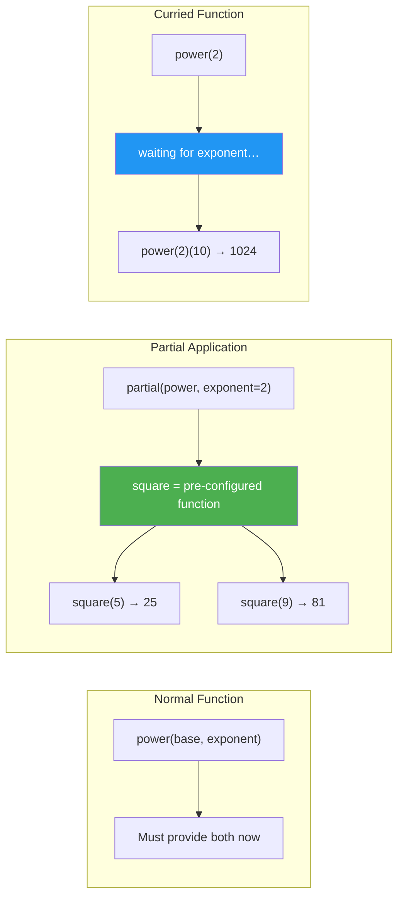

### Example 1 — `functools.partial`

```python
from functools import partial

def power(base, exponent):
    return base ** exponent

# Pre-fill exponent (keyword)
square = partial(power, exponent=2)
cube   = partial(power, exponent=3)

# Pre-fill base (positional — binds the FIRST parameter)
powers_of_2 = partial(power, 2)

print(square(4))          # ➜ 16
print(cube(3))            # ➜ 27
print(powers_of_2(10))    # ➜ 1024
```

> 💡 `partial` freezes arguments **from the left** (positionally) or by keyword. Arguments are evaluated *immediately* — another place where late binding can surprise you if you capture a loop variable.

### Example 2 — Formatter Factory

```python
from functools import partial

def format_value(value, *, prefix="", suffix="", decimals=2):
    return f"{prefix}{value:.{decimals}f}{suffix}"

format_usd = partial(format_value, prefix="$",  decimals=2)
format_eur = partial(format_value, prefix="€",  decimals=2)
format_pct = partial(format_value, suffix="%",  decimals=1)

prices = [10.5, 1200.0, 3.14]
print(list(map(format_usd, prices)))   # ➜ ['$10.50', '$1200.00', '$3.14']
print(list(map(format_pct, [15, -2, 8.7])))   # ➜ ['15.0%', '-2.0%', '8.7%']
```

<details>
<summary>⚠️ Why not <code>format_pct([0.15, -0.02, 0.087])</code>? (a real bug, caught during verification)</summary>

Running the "obvious" version produces **not** what you'd expect:

```python
print(list(map(format_pct, [0.15, -0.02, 0.087])))
# ➜ ['0.1%', '-0.0%', '0.1%']     ← NOT ['15.0%', '-2.0%', '8.7%']!
```

Two lessons:

1. `format_value` formats the raw number — it does **not** scale fractions by 100. Percentages stored as fractions need `value * 100` first (or `f"{value:.1%}"`, which handles scaling *and* `%` for you).
2. `-0.02` with `:.1f` renders as `-0.0` — a **negative zero** that looks wrong in reports. Guard it: `f"{0 if value == 0 else value:.1f}"` or use `f"{value:+.1%}"` where sign is meaningful.

```python
def format_pct_fraction(value, decimals=1):
    """Percent from a fraction — correct scaling, no negative zero."""
    pct = 0 if value == 0 else value * 100
    return f"{pct:.{decimals}f}%"

print(format_pct_fraction(0.15))   # ➜ '15.0%'
print(format_pct_fraction(-0.02))  # ➜ '-2.0%'
```
</details>

### Example 3 — Fully Curried Function

```python
import inspect

def curry(func):
    """Make any function curriable: f(a,b,c) → f(a)(b)(c) — in any grouping."""
    n = len(inspect.signature(func).parameters)

    def curried(*args):
        if len(args) >= n:
            return func(*args)
        return lambda *more: curried(*(args + more))

    return curried

@curry
def volume(l, w, h):
    return l * w * h

# All equivalent — verified:
print(volume(2)(3)(4))    # ➜ 24
print(volume(2, 3)(4))    # ➜ 24
print(volume(2)(3, 4))    # ➜ 24
print(volume(2, 3, 4))    # ➜ 24

area_of_height_4 = volume(4)     # partially applied: waiting for w and h
print(area_of_height_4(3)(2))    # ➜ 24
```

### 🌍 Real-World Use Cases

| Use Case | How Partial Helps |
|---|---|
| `send_email = partial(smtp_send, host=cfg.host, port=cfg.port)` | Config baked in once |
| `int(x, base=2)` → `partial(int, base=2)` | `map(partial(int, base=2), bitstrings)` |
| SQLAlchemy filter factories | Pre-bound tenant/org scope |
| `sorted(data, key=partial(itemgetter('k'), ...))` | Reusable key functions |
| Converting `if/elif` dispatch to dict dispatch | Each handler pre-bound with context |

### Partial vs Lambda vs Def

| Option | Pros | Cons |
|---|---|---|
| `functools.partial` | Self-documenting, introspectable (`func.args/keywords`) | Positional-only freezing from the left |
| `lambda x: f(x, cfg)` | Flexible, can reorder args | Opaque to introspection; PEP 8 frowns on named lambdas |
| Named `def` wrapper | Best readability, docstring, tests | Slightly more boilerplate |

---

## Concept 7 — Memoization: Never Compute the Same Thing Twice

### What Is Memoization?

**Memoization** is a caching strategy: the first time a function is called with given arguments, the result is stored. Any future call with the same arguments returns the cached answer instantly.

### Cache Flow

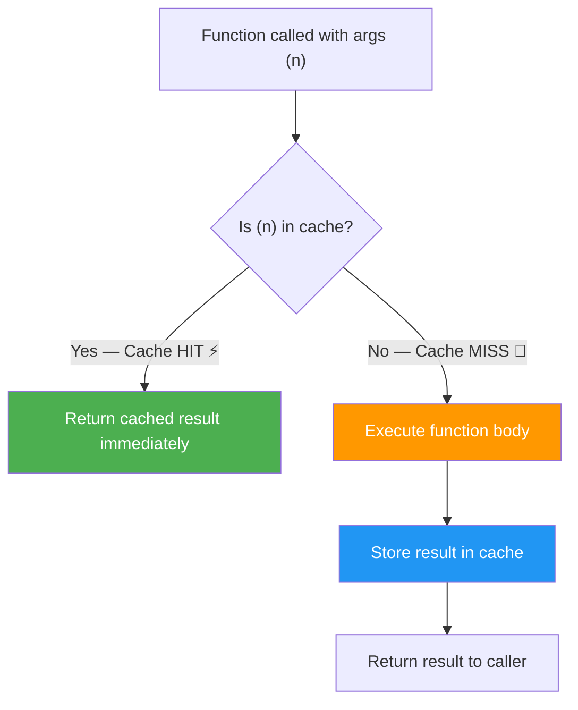

### Example 1 — Fibonacci: Slow vs Fast (Verified Speed-up)

```python
import time
from functools import lru_cache

# Without memoization: O(2^n) — exponential
def fib_slow(n):
    if n < 2: return n
    return fib_slow(n-1) + fib_slow(n-2)

# With memoization: O(n) — linear
@lru_cache(maxsize=None)
def fib_fast(n):
    if n < 2: return n
    return fib_fast(n-1) + fib_fast(n-2)

t0 = time.perf_counter(); fib_slow(32); t1 = time.perf_counter() - t0
t0 = time.perf_counter(); fib_fast(32); t2 = time.perf_counter() - t0
print(f"Slow: {t1:.3f}s")    # ➜ Slow: ~2.5s (varies by machine)
print(f"Fast: {t2:.6f}s")    # ➜ Fast: ~0.00002s — a ~100,000× speed-up
```

> 💡 `functools.lru_cache` evicts the **L**east **R**ecently **U**sed entries when `maxsize` is exceeded. On Python 3.9+, `@functools.cache` is equivalent to `@lru_cache(maxsize=None)` with a simpler name and slightly faster lookups.

### Example 2 — Custom Cache With TTL (Time-to-Live)

```python
import time
from functools import wraps

def ttl_cache(seconds=60):
    """Cache results but expire them after `seconds`."""
    def decorator(func):
        _cache = {}

        @wraps(func)
        def wrapper(*args):
            now = time.monotonic()
            if args in _cache:
                value, ts = _cache[args]
                if now - ts < seconds:
                    print(f"  💾 HIT  {args}")
                    return value
                print(f"  ⏰ STALE {args}")

            print(f"  🔄 MISS  {args}")
            value = func(*args)
            _cache[args] = (value, now)
            return value
        return wrapper
    return decorator

@ttl_cache(seconds=5)
def fetch_exchange_rate(currency):
    time.sleep(0.3)           # simulate API call
    return {"USD": 1.0, "EUR": 0.92, "GBP": 0.78}.get(currency, 1.0)

fetch_exchange_rate("EUR")   # 🔄 MISS — computes
fetch_exchange_rate("EUR")   # 💾 HIT  — instant
time.sleep(6)
fetch_exchange_rate("EUR")   # ⏰ STALE — recomputes
```

> ⚠️ **Use `time.monotonic()`, never `time.time()`,** for TTL logic — wall-clock time can jump backwards (NTP sync) and corrupt expiry checks.

### Example 3 — Caching With an Unhashable-Argument Problem

```python
import hashlib
from functools import lru_cache

def hash_text(text: str) -> str:
    return hashlib.sha256(text.encode()).hexdigest()

@lru_cache(maxsize=512)
def _cached_classify(text_hash: str, text: str) -> dict:
    # Expensive model call lives here
    words = set(text.lower().split())
    score = len(words & {"buy", "win", "free", "click"}) / max(len(words), 1)
    return {"label": "SPAM" if score > 0.1 else "HAM", "score": round(score, 3)}

def classify(text: str) -> dict:
    return _cached_classify(hash_text(text), text)

print(classify("Buy now and win free prizes!"))   # computed
print(classify("Buy now and win free prizes!"))   # instant cache hit
```

**Why the wrapper?** `lru_cache` requires **hashable** arguments and **serializes cache keys**. If callers pass large objects (DataFrames, lists), you can't cache them directly — the *adapter* function converts to a hashable key, and the cached function does the work. The same trick handles *keyword-only* caching (older `lru_cache` versions keyed on positional args).

### ⚠️ When NOT to Memoize

```python
# ❌ Never cache functions that are NOT pure:

@lru_cache                      # WRONG: mutations leak across calls
def add_item(cache_list, item):
    cache_list.append(item)

@lru_cache                      # WRONG: depends on the outside world
def get_weather(city):
    return requests.get(f"https://wttr.in/{city}").text

@lru_cache                      # WRONG: time changes the correct answer
def now():
    return datetime.now()
```

**Memoize only:** same inputs → same output → no side effects you care about repeating (or where repeating them is *desirable*, like skipping an HTTP call for idempotent GETs).

### 📊 Built-in Caching Options (Python 3.12)

| Tool | Bounded? | Per-Instance? | Notes |
|---|---|---|---|
| `functools.lru_cache(maxsize=N)` | ✅ | ❌ (per function) | Classic; cache info via `.cache_info()` |
| `functools.lru_cache(maxsize=None)` | ❌ unbounded | ❌ | Memory leak risk on unbounded key spaces |
| `functools.cache` (3.9+) | ❌ unbounded | ❌ | Simple alias for the above |
| `functools.cached_property` (3.8+) | ❌ | ✅ per instance | Compute-once attribute |
| Custom TTL cache | ✅ | your choice | Expiry logic — shown above |

## Concept 8 — Comprehensions: Declarative Data Transformation

### What Is a Comprehension?

A comprehension builds a collection **declaratively** — you describe *what* you want, not *how* to loop. All four Python comprehension types share one anatomy: an **output expression**, one or more **`for` clauses**, and optional **`if` filters**. They are the readable, optimized cousins of `map`/`filter` — and the generator expression is literally Concept 4 wearing round brackets.

### The Four Comprehension Types

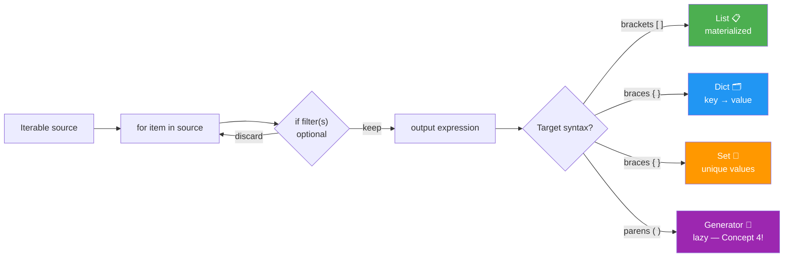

### Anatomy — One Pattern, Four Targets

```python
data = ["  alice ", "BOB", "Charlie", "  dave"]

# List — transform + clean in one line
names = [name.strip().title() for name in data]
print(names)                          # ➜ ['Alice', 'Bob', 'Charlie', 'Dave']

# Set — unique first letters (sets are unordered)
initials = {name.strip()[0].lower() for name in data}
print(initials)                       # ➜ {'a', 'b', 'c', 'd'} (any order)

# Dict — cleaned name → length
lengths = {name.strip().title(): len(name.strip()) for name in data}
print(lengths)                        # ➜ {'Alice': 5, 'Bob': 3, 'Charlie': 7, 'Dave': 4}

# Generator expression — NOTHING computed until consumed (Concept 4)
total = sum(len(n) for n in names)
print(total)                          # ➜ 19
```

### Example 1 — Filter + Transform With Multiple Conditions

```python
readings = [("sensor-1", 21.5), ("sensor-2", 84.2), ("sensor-3", 19.9),
            ("sensor-4", 95.0), ("sensor-5", 22.8)]

# Full tuples that fail the threshold
alerts = [(sid, temp) for sid, temp in readings if temp > 80]
print(alerts)                         # ➜ [('sensor-2', 84.2), ('sensor-4', 95.0)]

# Just the temperatures — underscore discards the id we don't need
hot_temps = [temp for _, temp in readings if temp > 80]
print(hot_temps)                      # ➜ [84.2, 95.0]
```

### Example 2 — Dict Comprehensions for Lookups and Grouping

```python
users = [("u1", "admin"), ("u2", "editor"), ("u3", "admin"), ("u4", "viewer")]

# Reverse index: email → uid (classic auth-lookup shape)
email_to_uid = {f"{uid}@corp.io": uid for uid, _ in users}
print(email_to_uid["u2@corp.io"])     # ➜ u2

# Grouping index: role → [uids]
role_to_users = {role: [uid for uid, r in users if r == role]
                 for role in {r for _, r in users}}
print(role_to_users)                  # ➜ {'admin': ['u1', 'u3'], 'editor': ['u2'], 'viewer': ['u4']}
```

> 💡 For grouping *while streaming* (source not yet a list), prefer `dict.setdefault(role, []).append(uid)` in a plain loop — a comprehension needs the whole collection upfront.

### Example 3 — Nested Comprehensions (Matrix Operations)

```python
matrix = [[1, 2, 3], [4, 5, 6], [7, 8, 9]]

# Transpose: column i becomes row i
transposed = [[row[i] for row in matrix] for i in range(len(matrix[0]))]
print(transposed)                     # ➜ [[1, 4, 7], [2, 5, 8], [3, 6, 9]]

# Transform every element
doubled = [[x * 2 for x in row] for row in matrix]
print(doubled)                        # ➜ [[2, 4, 6], [8, 10, 12], [14, 16, 18]]

# Flatten (two for-clauses read left-to-right, like nested loops)
flat = [x for row in matrix for x in row]
print(flat)                           # ➜ [1, 2, 3, 4, 5, 6, 7, 8, 9]

# Flatten + filter
evens = [x for row in matrix for x in row if x % 2 == 0]
print(evens)                          # ➜ [2, 4, 6, 8]
```

### Example 4 — The Walrus Operator Inside Comprehensions (3.8+)

```python
payload = ["ok", "retry-later", "ok", "fail-hard", "retry-later", "ok"]

# Compute once, filter AND keep — no double .strip().lower() calls
flagged = [clean for raw in payload
           if (clean := raw.strip().lower()).startswith("retry")]
print(flagged)                        # ➜ ['retry-later', 'retry-later']
```

### ⚠️ Pitfall — Ternary vs Filter Are DIFFERENT Tools

```python
# Ternary (BEFORE the for): transforms EVERY item — output count == input count
labels = ["hot" if t > 80 else "normal" for _, t in readings]
# ➜ ['normal', 'hot', 'normal', 'hot', 'normal']

# Filter (AFTER the for): keeps only matching items — output count <= input count
only_hot = [t for _, t in readings if t > 80]
# ➜ [84.2, 95.0]
```

```python
# ❌ INCORRECT — comprehension doing three jobs at once
result = {k.strip().lower(): int(v) + 1
          for k, v in raw.items()
          if v and v.isdigit() and int(v) < 100}

# ✅ CORRECT — extract the predicate; the comprehension stays declarative
def _parse_small_int(value: str) -> int | None:
    """Return int(value) if it is a valid small integer, else None."""
    value = value.strip()
    return int(value) if value.isdigit() and int(value) < 100 else None

result = {k.strip().lower(): n + 1
          for k, raw_v in raw.items()
          if (n := _parse_small_int(raw_v)) is not None}
```

### 🌍 Real-World Use Cases

- **Config normalization** — `{k.strip().lower(): v for k, v in os.environ.items() if k.startswith("APP_")}`.
- **API response shaping** — list comprehensions turning ORM rows into JSON-friendly dicts.
- **Deduplication** — `{record.key for record in page}` before syncing to a downstream system.
- **Log analysis** — pairing generator expressions with `sum()`/`any()` for streaming metrics (Concept 4).

### 📊 Comprehension vs Loop vs `map`/`filter`

| Aspect | Comprehension | Explicit `for` loop | `map`/`filter` |
|---|---|---|---|
| Readability (simple transform) | ⭐⭐⭐ best | ⭐⭐ | ⭐ |
| Complex multi-step logic | ⭐ (gets hairy fast) | ⭐⭐⭐ best | ⭐ |
| Side effects (`print`, mutating outer state) | ❌ abuse | ⭐⭐⭐ correct | ❌ abuse |
| Speed | Fastest (bytecode-optimized) | Baseline | Similar — lambda overhead evens it out |
| Reusability of the predicate | Inline only | Anywhere | Anywhere |

> ✅ **Rule of thumb:** simple transform/filter → comprehension; multi-step logic or side effects → explicit loop; applying an *existing* function over a huge stream → `map(func, stream)`.

---

## Concept 9 — Exception Handling: Automated Fault Tolerance

### What Does Good Exception Handling Look Like?

Professional exception handling is not `try/except` everywhere — it is a **designed hierarchy**, precise `except` clauses, deliberate **exception chaining**, and **policy-driven retries** (Concept 2's decorator pattern applied to failure). Done well, failures are *classified*: transient ones get retried with back-off, permanent ones fail fast with full context.

### Design an Exception Hierarchy, Not a Pile

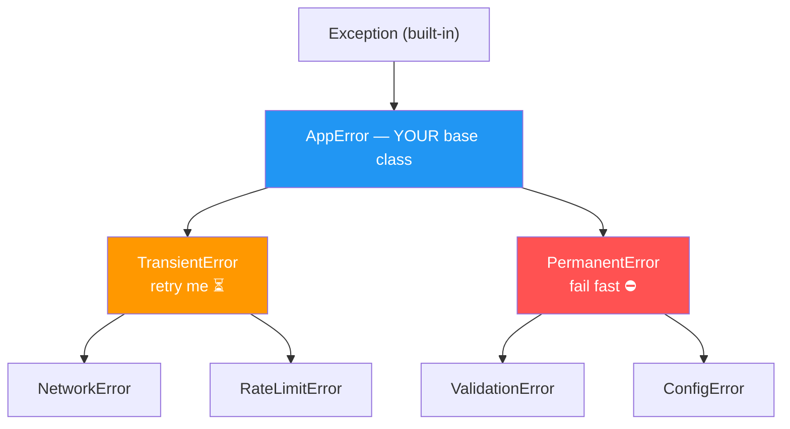

```python
class AppError(Exception):
    """Base for all application errors — callers can catch everything at once."""

class TransientError(AppError):
    """Retryable — network blip, throttling."""

class PermanentError(AppError):
    """Retrying will NOT help."""

class ValidationError(PermanentError):
    """Bad input."""

class NetworkError(TransientError):
    """Connection reset, timeout, DNS hiccup."""
```

```python
# Precise ordering: most specific FIRST — Python stops at the first match
def validate_email(addr: str) -> str:
    if "@" not in addr:
        raise ValidationError(f"invalid email: {addr!r}")
    return addr.strip().lower()

try:
    validate_email("nope")
except TransientError:
    print("retrying...")            # NOT taken — ValidationError is not transient
except ValidationError as e:
    print(f"caught: {e}")           # ➜ caught: invalid email: 'nope'
```

### Example 1 — The Retry Decorator With Exponential Back-off

```python
import time
from functools import wraps

def retry(times=3, delay=0.1, backoff=2.0, exceptions=(TransientError,)):
    """Retry only the listed exception types, with exponential back-off."""
    def decorator(func):
        @wraps(func)
        def wrapper(*args, **kwargs):
            wait = delay
            for attempt in range(1, times + 1):
                try:
                    return func(*args, **kwargs)
                except exceptions as exc:
                    if attempt == times:
                        raise                       # exhausted → propagate
                    print(f"  attempt {attempt} failed ({exc}); retrying in {wait:.2f}s")
                    time.sleep(wait)
                    wait *= backoff
        return wrapper
    return decorator

@retry(times=3, delay=0.01, backoff=2.0)
def flaky_api():
    ...                                             # e.g. flaky upstream call

# Verified behaviour: attempts fail with 0.01s, 0.02s waits, then succeed.
# A PermanentError inside flaky_api() would propagate on the FIRST call —
# no retries — because it is not in the `exceptions` tuple.
```

> 💡 This is Concepts 1+2+6 cooperating: a closure (`_cache`-style state via `wait`), a factory decorator, and keyword pre-configuration — one reusable fault-tolerance policy.

### Example 2 — Chain Exceptions With `raise ... from ...`

```python
def load_config(raw: str) -> int:
    try:
        return int(raw)
    except ValueError as exc:
        raise ValidationError(f"config value {raw!r} is not an int") from exc

try:
    load_config("abc")
except ValidationError as e:
    print(f"{e} | caused by: {type(e.__cause__).__name__}")
# ➜ config value 'abc' is not an int | caused by: ValueError
```

> ⚠️ **Never write bare `except:`** — it catches `KeyboardInterrupt` and `SystemExit` too, making Ctrl-C unkillable. `except Exception` is the widest acceptable form.

### Example 3 — EAFP vs LBYL: Python's Preferred Style

```python
config = {"retries": 3}

# LBYL — "Look Before You Leap": two dict lookups, races under concurrency
value = config["timeout"] if "timeout" in config else 30

# EAFP — "Easier to Ask Forgiveness than Permission": idiomatic, race-free
try:
    value = config["timeout"]
except KeyError:
    value = 30
```

> 💡 EAFP wins when the happy path is common (exceptions are only costly when *raised*) and when check-then-act races exist (e.g. `os.path.exists` followed by `open`).

### Example 4 — `else` and `finally`: The Full Statement

```python
steps = []
try:
    steps.append("try")        # risky code
except ValueError:
    steps.append("except")     # only on exception
else:
    steps.append("else")       # only when NO exception — keeps try-block minimal
finally:
    steps.append("finally")    # ALWAYS — cleanup goes here

print(" → ".join(steps))        # ➜ try → else → finally
```

### ⚠️ Pitfall — Catching Too Much, Silently

```python
# ❌ INCORRECT — swallows EVERYTHING, including your own bugs (typos, NoneType)
try:
    result = process(order)
except Exception:
    pass                        # the error vanishes; debugging becomes archaeology

# ✅ CORRECT — catch what you can HANDLE, log what you catch, re-raise the rest
import logging
logger = logging.getLogger(__name__)

try:
    result = process(order)
except TransientError:
    logger.warning("transient failure processing %s — will retry", order.id)
    raise
except ValidationError as exc:
    logger.error("bad order %s: %s", order.id, exc)
    return None
```

### 🌍 Real-World Use Cases

| Scenario | Pattern |
|---|---|
| Flaky third-party API | `@retry(times=5, backoff=2)` on `TransientError` only |
| Config loading at startup | Fail fast (`ConfigError`) with `raise ... from exc` |
| Bulk record import | Per-record `try/except ValidationError` → collect failures, keep going |
| Resource cleanup | Pair with Concept 5 — `finally`/context manager, never both copy-pasted |
| Web framework handlers | One base `AppError` → centralized middleware mapping to HTTP codes |

### 📊 Exception Handling Do's and Don'ts

| ✅ Do | ❌ Don't |
|---|---|
| Create one app base class (`AppError`) | Raise bare `Exception("bad")` |
| Catch the narrowest type you can handle | `except:` or blanket `except Exception: pass` |
| Use `raise NewError(...) from exc` to chain | Discard the original traceback |
| Keep `try` blocks to one risky operation | Wrap entire 50-line functions |
| Put cleanup in `finally` / a context manager | Duplicate cleanup before every `return` |
| Let permanent errors crash fast | Retry `ValidationError` in a loop |

---

## Concept 10 — `__call__`: Classes That Behave Like Functions

### What Is the `__call__` Protocol?

Defining `__call__(self, ...)` on a class makes its **instances callable** — you use `obj(args)` exactly like a function. You get function-style ergonomics **plus** class features: constructor-validated configuration, mutable state, methods, inheritance, and introspection. Every decorator in Concept 2 was secretly this protocol in action.

### How a "Function Call" Actually Resolves

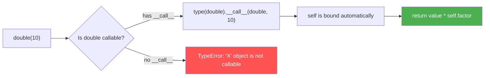

### Example 1 — Configured, Callable Objects

```python
class Multiplier:
    """A 'function' whose behaviour is fixed at construction time."""
    def __init__(self, factor):
        self.factor = factor

    def __call__(self, value):
        return value * self.factor

double = Multiplier(2)
triple = Multiplier(3)
print(double(10), triple(10))    # ➜ 20 30
print(callable(double))          # ➜ True — the callable() builtin checks for __call__
```

Compare with Concept 1's closure version: closures hide state in *cells*; callable objects expose it as *attributes* (`double.factor`) — easier to inspect, serialize, and reset in tests.

### Example 2 — Stateful Rate Limiter (Real-World State Machine)

```python
import time

class RateLimiter:
    """Allows max_calls per window_seconds; history persists across calls."""
    def __init__(self, max_calls, window_seconds):
        self.max_calls = max_calls
        self.window = window_seconds
        self.calls = []                       # ← state a closure would ALSO carry,
                                              #    but here it's visible on self
    def __call__(self):
        now = time.monotonic()
        self.calls = [t for t in self.calls if now - t < self.window]
        if len(self.calls) >= self.max_calls:
            return False
        self.calls.append(now)
        return True

allow = RateLimiter(max_calls=3, window_seconds=1.0)
print([allow() for _ in range(5)])
# ➜ [True, True, True, False, False]
```

### Example 3 — Class-Based Decorator (State Without Closure Tricks)

```python
from functools import wraps

class CountCalls:
    """Decorator that keeps call statistics as readable attributes."""
    def __init__(self, func):
        wraps(func)(self)          # preserve __name__, __doc__, etc.
        self.func = func
        self.count = 0

    def __call__(self, *args, **kwargs):
        self.count += 1
        return self.func(*args, **kwargs)

@CountCalls
def ping():
    """Health-check endpoint."""
    return "pong"

ping(); ping()
print(ping.count)      # ➜ 2  — state is inspectable, resettable: ping.count = 0
print(ping.__name__)   # ➜ 'ping' — wraps() did its job
```

### Example 4 — Strategy Registry (Pluggable, Testable Pipelines)

```python
class EmailNotifier:
    def __call__(self, msg): return f"EMAIL: {msg}"

class SmsNotifier:
    def __call__(self, msg): return f"SMS: {msg}"

# Each strategy is configured (constructor), then used identically:
notifiers = {"email": EmailNotifier(), "sms": SmsNotifier()}
print(notifiers["email"]("hi"), "|", notifiers["sms"]("hi"))
# ➜ EMAIL: hi | SMS: hi
```

> 💡 Because instances are callable, they drop straight into `map()`, `sorted(key=...)`, and dispatch dicts — anywhere a function fits.

### ⚠️ Pitfall — Forgetting That `self` Binds First

```python
class Broken:
    def __init__(self):
        self.items = []
    def __call__(self, handler):          # ← takes the handler as a PARAMETER
        return handler(self.items)        # caller must pass it: broken(handler)

# ❌ INCORRECT — calling with no arguments
# Broken()()

# ✅ CORRECT — either pass the argument, or design __call__ to need none
class Fixed:
    def __init__(self, handler):
        self.handler = handler
    def __call__(self, items):
        return self.handler(items)
```

### Closure vs Callable Class — Choose Deliberately

| Aspect | Closure (Concept 1) | Callable class (`__call__`) |
|---|---|---|
| Boilerplate | Minimal | More (`__init__` + `__call__`) |
| State visibility | Hidden in cells | Explicit attributes |
| Reset / inject in tests | Awkward | Trivial (`obj.state = ...`) |
| Multiple behaviors per object | One function only | Many methods alongside `__call__` |
| Inheritance / interfaces | ❌ | ✅ |
| Serialization (config to YAML) | ❌ | ✅ constructor args |
| Best for | Small factories, quick wrappers | Policies with config + lifecycle (limiter, retry policy, notifier) |

### 🌍 Real-World Use Cases

- **ML inference** — `Predictor(model_path)` loads a model once; `predictor(features)` runs per request (state: loaded weights).
- **Frameworks** — Django class-based views, Werkzeug WSGI apps: configured once, called per request.
- **Rate limiting / circuit breakers** — like the example above, often wrapping HTTP clients.
- **Decorators needing statistics** — `CountCalls`, `RetryPolicy`, metric-recording wrappers.

---

## 🔗 How All 10 Concepts Fit Together

These are not ten separate tools — they are **one system** seen from different angles. Functions build functions (1→2→6), laziness replaces eager data (4→8), state survives between calls (1→7→10), and failure becomes a designed, handled case (5→9).

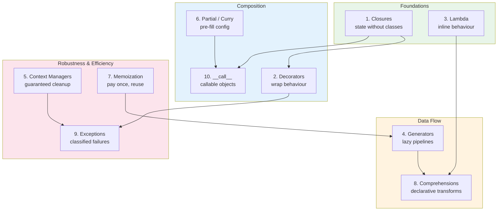

| Concept | Primary Role | Strengthens |
|---|---|---|
| 1. Closures | Hidden state | 2, 6, 7 |
| 2. Decorators | Behaviour wrapping | 9 (retry), 7 (cache) |
| 3. Lambda | Inline glue | 4, 8 |
| 4. Generators | Lazy data flow | 7, 8 |
| 5. Context Managers | Lifecycle guarantees | 9 |
| 6. Partial / Curry | Pre-configuration | 2, 10 |
| 7. Memoization | Computation reuse | 4 |
| 8. Comprehensions | Declarative transforms | 3, 4 |
| 9. Exceptions | Failure taxonomy | 5 |
| 10. `__call__` | Function-class bridge | 2, 6 |

---

## 🚀 Capstone: A Production-Grade Automation Pipeline

Everything so far, in one **runnable** program: an ingestion pipeline that streams sensor readings lazily, classifies failures, retries transient ones, caches threshold lookups, and exposes itself as a callable object. The code below was executed against Python 3.12 — the output shown is real.

### Architecture

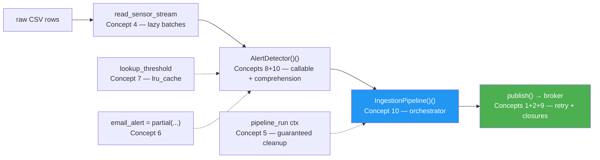

### The Code (Part 1 — errors, retry policy, cache, streaming)

```python
"""
Capstone — Production-Grade Automation Pipeline (Python 3.12).
Combines all 10 concepts in one runnable program:
closures (1), decorators (2), lambda (3), generators (4),
context managers (5), partial (6), memoization (7),
comprehensions (8), exception hierarchy (9), __call__ (10).
"""
import time
from contextlib import contextmanager
from functools import lru_cache, partial, wraps

# ── Concept 9: exception hierarchy ─────────────────────────────
class PipelineError(Exception):
    """Base for all pipeline errors."""

class TransientError(PipelineError):
    """Retryable failure — network blip, throttling."""

class ValidationError(PipelineError):
    """Permanent failure — bad input; retrying will not help."""

# ── Concepts 1+2: factory decorator with retry policy ──────────
def retry(times=3, delay=0.01, backoff=2.0, exceptions=(TransientError,)):
    """Retry only the listed exception types, with exponential back-off."""
    def decorator(func):
        @wraps(func)
        def wrapper(*args, **kwargs):
            wait = delay
            for attempt in range(1, times + 1):
                try:
                    return func(*args, **kwargs)
                except exceptions:
                    if attempt == times:
                        raise
                    time.sleep(wait)
                    wait *= backoff
        return wrapper
    return decorator

# ── Concept 7: memoize expensive lookups ───────────────────────
@lru_cache(maxsize=256)
def lookup_threshold(sensor_id: str) -> float:
    time.sleep(0.01)                      # simulate an expensive config/DB hit
    return 80.0 if sensor_id.endswith("-hot") else 30.0

# ── Concept 4: lazy, constant-memory source ────────────────────
def read_sensor_stream(raw_rows, batch_size=2):
    """Yield batches of validated (sensor_id, temp) tuples — lazily."""
    batch = []
    for row in raw_rows:
        try:
            sensor_id, raw_temp = row.split(",")
            batch.append((sensor_id.strip(), float(raw_temp)))
        except ValueError as exc:
            raise ValidationError(f"malformed row {row!r}") from exc
        if len(batch) == batch_size:
            yield batch
            batch = []
    if batch:
        yield batch
```

### The Code (Part 2 — composition, orchestrator, execution)

```python
# ── Concept 6: pre-configured alert formatter ──────────────────
def format_alert(value, sensor_id, temp, threshold):
    return value.format(sensor_id=sensor_id, temp=temp, threshold=threshold)

email_alert = partial(format_alert,
    value="🚨 [{sensor_id}] {temp:.1f}°C exceeds limit {threshold:.0f}°C")

# ── Concepts 8+10: alert detector as a configured callable ─────
class AlertDetector:
    def __init__(self, formatter):
        self.formatter = formatter

    def __call__(self, readings):
        return [
            (temp, self.formatter(sensor_id=sid, temp=temp, threshold=th))
            for sid, temp in readings
            if temp > (th := lookup_threshold(sid))       # walrus: parse once
        ]

# ── Concept 5: scoped run with guaranteed cleanup ──────────────
@contextmanager
def pipeline_run(name):
    print(f"▶ start pipeline: {name}")
    started = time.perf_counter()
    try:
        yield
    except PipelineError as exc:
        print(f"⛔ pipeline failed: {exc}")
        raise
    else:
        print(f"✔ pipeline ok in {time.perf_counter() - started:.3f}s")
    finally:
        print(f"⏹ cleanup: {name}")

# ── Concepts 1+2+9: simulated broker that fails transiently ────
def make_broker(fail_first=1):
    state = {"attempts": 0}               # Concept 1: closure state

    def publish(alert):
        state["attempts"] += 1
        if state["attempts"] <= fail_first:
            raise TransientError("broker unavailable")
        print(f"📤 published: {alert}")

    return publish

broker = make_broker(fail_first=1)

@retry(times=3, delay=0.01)               # Concept 2: policy wraps Concept 9's errors
def publish(alert):
    broker(alert)

# ── Concept 10: the orchestrator itself is callable ────────────
class IngestionPipeline:
    def __init__(self, detector):
        self.detector = detector
        self.processed = 0                  # observable, testable state

    def __call__(self, raw_rows):
        alerts = []
        with pipeline_run("sensor-ingestion"):
            for batch in read_sensor_stream(raw_rows):
                alerts.extend(self.detector(batch))
                self.processed += len(batch)
        return sorted(alerts, key=lambda pair: -pair[0])   # Concept 3

if __name__ == "__main__":
    raw = ["s-1-hot,84.2", "s-2,21.5", "s-3-hot,95.0", "s-4,19.9",
           "s-5-hot,81.0", "s-1-hot,88.8", "s-2,25.0", "s-3-hot,90.1"]

    pipeline = IngestionPipeline(AlertDetector(email_alert))
    for temp, alert in pipeline(raw):
        print(alert)

    for temp, alert in pipeline(raw):       # second run — thresholds all cached
        publish(alert)

    print("processed:", pipeline.processed)
    info = lookup_threshold.cache_info()
    print(f"threshold cache: {info.hits} hits / {info.misses} misses")
```

### Verified Output (Python 3.12)

```text
▶ start pipeline: sensor-ingestion
✔ pipeline ok in 0.053s
⏹ cleanup: sensor-ingestion
🚨 [s-3-hot] 95.0°C exceeds limit 80°C
🚨 [s-3-hot] 90.1°C exceeds limit 80°C
🚨 [s-1-hot] 88.8°C exceeds limit 80°C
🚨 [s-1-hot] 84.2°C exceeds limit 80°C
🚨 [s-5-hot] 81.0°C exceeds limit 80°C
▶ start pipeline: sensor-ingestion
✔ pipeline ok in 0.000s          ← memoization: second run pays ZERO lookup cost
⏹ cleanup: sensor-ingestion
📤 published: 🚨 [s-3-hot] 95.0°C exceeds limit 80°C
📤 published: 🚨 [s-3-hot] 90.1°C exceeds limit 80°C
📤 published: 🚨 [s-1-hot] 88.8°C exceeds limit 80°C
📤 published: 🚨 [s-1-hot] 84.2°C exceeds limit 80°C
📤 published: 🚨 [s-5-hot] 81.0°C exceeds limit 80°C
processed: 16
threshold cache: 11 hits / 5 misses
```

> 💡 **Notice:** the transient broker failure never appears in the output — the retry policy absorbed it (Concept 9's `TransientError` + Concept 2's `retry`). Permanent `ValidationError` failures, by contrast, would surface immediately with a chained traceback. And the second pipeline run cost `0.000s` because `lru_cache` paid for the thresholds exactly once.

---

## 🏢 Real-World Case Studies

### Case Study 1 — Flask's `@app.route` (Decorators + Closures)

Flask registers routes at import time: `@app.route("/users")` is a **decorator factory** whose closure stores the URL in the app's route table, while `functools.wraps` keeps your view function's identity intact. One pattern (Concepts 1+2) powers every route in every Flask app ever written.

```python
# Simplified essence of Flask's routing:
def route(self, rule):
    def decorator(view):
        self.add_url_rule(rule, view_func=view)   # closure over `rule`
        return view
    return decorator
```

### Case Study 2 — `requests` Sessions (Context Managers)

`requests.Session` implements `__enter__`/`__exit__`: connections are pooled on entry and reliably released on exit — even mid-exception. Swap 50 manual `close()` calls for one `with requests.Session() as s:`.

### Case Study 3 — `functools.lru_cache` in the Standard Library Itself

CPython's `functools.lru_cache` is the poster child of Concept 2+7: a decorator implementing an LRU cache in C for speed, with `.cache_info()` exposing hits/misses for capacity tuning. Real production wins: recomputed exchange rates, repeated regex compiles, per-tenant config lookups.

### Case Study 4 — ML Inference Servers (Callable Classes)

Production model servers (e.g. TorchServe handlers) follow Concept 10 exactly: `Predictor(model_path)` loads weights *once* into `self`; each request calls `predictor(batch)`. The class wraps load-time validation (fail fast, Concept 9) and per-instance statistics for observability.

### Case Study 5 — Log Rotation Analyzers (Generators at Scale)

Any log-processing job that materializes a 10 GB file as a list dies; the same job as a three-stage generator pipeline (Concept 4) runs in ~10 MB of RAM. Tools like `awk`-style one-liners in Python, `itertools`-based ETL, and click-style CLIs all lean on lazy iteration.

---

## 🛠️ Multiple Implementation Approaches

The preferences demand multiple ways to solve the same problem — here they are, with trade-offs:

### State Between Calls: Closure vs Callable Class vs Generator

```python
# Approach A — Closure (Concept 1)
def make_counter():
    count = [0]
    def counter():
        count[0] += 1
        return count[0]
    return counter

# Approach B — Callable class (Concept 10)
class Counter:
    def __init__(self):
        self.count = 0
    def __call__(self):
        self.count += 1
        return self.count

# Approach C — Generator (Concept 4)
def counter_gen():
    count = 0
    while True:
        count += 1
        yield count
```

| Criterion | Closure | Callable class | Generator |
|---|---|---|---|
| Lines of code | Fewest | Most | Few |
| State inspection | `__closure__` cells (opaque) | Attributes (clear) | `.gi_frame` (hacky) |
| Reset in tests | Hard | `obj.count = 0` | New generator |
| Multiple methods | ❌ | ✅ | ❌ |
| Picklable | ❌ | ✅ (usually) | ❌ |

### Resource Cleanup: try/finally vs Class CM vs @contextmanager

```python
# Approach A — manual try/finally (works everywhere, verbose, forgettable)
lock.acquire()
try:
    do_work()
finally:
    lock.release()

# Approach B — class-based context manager (reusable, OO design)
class ManagedLock:
    def __init__(self, lock): self._lock = lock
    def __enter__(self): self._lock.acquire(); return self._lock
    def __exit__(self, *exc): self._lock.release(); return False

# Approach C — @contextmanager (concise, one resource per function)
@contextmanager
def locking(lock):
    lock.acquire()
    try:
        yield lock
    finally:
        lock.release()
```

> ✅ Default to Approach C for one-off scopes; Approach B when the resource needs configuration, state, or an SDK-client lifecycle; Approach A only inside an implementation, never at call sites.

### Caching: `lru_cache` vs TTL cache vs External Store

| Option | Guarantees | Cost | Use When |
|---|---|---|---|
| `lru_cache(maxsize=N)` | In-process, bounded, LRU | Zero (stdlib) | Pure functions, single process |
| Custom TTL decorator | Expiry after N seconds | Small | Data that *must* go stale (rates, flags) |
| `cachetools.TTLCache` | Battle-tested TTL+LRU | One dependency | Production TTL caching |
| Redis / Memcached | Shared across processes/hosts | Network hop | Multi-worker deployments |

## 📐 Best Practices

1. **Always `@functools.wraps` your wrappers** — preserves `__name__`, `__doc__`, and signature; debugging tools depend on it.
2. **`nonlocal` over mutable-list tricks** when mutating closure state — clearer intent.
3. **Bind loop variables early** (`lambda i=i: ...`) when closures capture loop variables.
4. **Return `None` (falsy) from `__exit__`** unless you deliberately suppress exceptions.
5. **Bound your caches** (`maxsize=256`) — unbounded caches on unbounded key spaces are slow leaks.
6. **Order `except` clauses most-specific-first** and never use bare `except:`.
7. **Chain with `raise ... from exc`** when translating exceptions — keep the root cause.
8. **Use `time.monotonic()`** for expiry/retry timing, `perf_counter()` for measuring, never `time.time()` for durations.
9. **Keep comprehensions to one line of logic** — extract predicates to named functions.
10. **Prefer generators at API boundaries** — let the caller decide how much to materialize.
11. **Type-annotate public functions** — especially factories and callables; they are contracts.
12. **Reset-able state for tests** — if state lives in a closure, also expose a test-friendly reset (or use a callable class).

## 🚫 Anti-Patterns

| Anti-Pattern | Why It Hurts | Fix |
|---|---|---|
| Decorator without `functools.wraps` | Breaks `__name__`, `help()`, serialization | `@functools.wraps(func)` on every wrapper |
| `except: pass` | Errors vanish; bugs become invisible | Catch narrow types; log; re-raise |
| Unbounded `lru_cache` on growing keys | Memory bloat (e.g. caching by user_id) | Bounded `maxsize` or TTL |
| Caching impure functions | Time/weather/DB results frozen forever | Cache only pure functions |
| Re-iterating generators | Second pass yields nothing — silent bugs | Materialize once with `list()` if reused |
| Global mutable state instead of closures/objects | Race conditions, hidden coupling | Encapsulate state explicitly |
| Deeply nested comprehensions (3+ levels) | Unreadable, undebuggable | Named helper functions or explicit loops |
| `return True` in `__exit__` by accident | Silently swallows real errors | `return False` / return nothing |
| Retrying `ValidationError` | Wasted load; permanent failures hide | Retry only transient error types |
| Calling `make_counter()` instead of returning it | Runs the counter immediately | Return the function object: `return counter` |

---

## 🩺 Common Pitfalls & Troubleshooting Guide

### Quick Diagnosis Table

| # | Symptom | Likely Cause | Fix |
|---|---|---|---|
| 1 | `UnboundLocalError` inside a nested function | Assignment shadows the outer variable | `nonlocal x` or mutate a container |
| 2 | All closures from a loop behave like the last iteration | Late binding | Default-arg binding: `lambda i=i: ...` |
| 3 | `AttributeError: 'function' object has no attribute '__name__'` … shows `wrapper` | Missing `functools.wraps` | Add `@functools.wraps(func)` |
| 4 | Exception "disappears" inside a `with` block | `__exit__` returned a truthy value | Return `False`/`None` from `__exit__` |
| 5 | `sum(gen)` twice gives `6` then `0` | Generator exhausted on first pass | Regenerate, or use a list |
| 6 | Second call to a cached function returns stale data | Memoized impure function | Remove cache / add TTL / re-key on time |
| 7 | `TypeError: unhashable type: 'list'` from `lru_cache` | Unhashable argument | Adapter: hashable key + wrapper function |
| 8 | `@timer()` raises `TypeError` at import | Factory decorator called with no args | Use `@timer` (no parens) or make `timer` a true factory |
| 9 | `Ctrl+C` doesn't stop the program | Bare `except:` catching `KeyboardInterrupt` | `except Exception:` minimum |
| 10 | File not closed after an exception | `open()` without `with` | Wrap in a context manager |
| 11 | Retry loop never fires | Exception type not in the `exceptions` tuple | Pass the right types to the decorator |
| 12 | `RateLimiter`/counter resets between calls | State recreated per call (state inside `__call__` body) | Move state into `__init__` |

### Detailed Walkthroughs

**Pitfall #1 — `UnboundLocalError`:**

```python
def make_counter():
    count = 0
    def counter():
        count += 1          # ❌ UnboundLocalError: 'count' is assigned → local
        return count
    return counter

# ✅ Fix: nonlocal makes the outer binding explicit
def make_counter():
    count = 0
    def counter():
        nonlocal count
        count += 1
        return count
    return counter
```

**Pitfall #3 — losing metadata:**

```python
# ❌ Without wraps:
import functools
def bad_logger(func):
    def wrapper(*args, **kwargs):
        return func(*args, **kwargs)
    return wrapper
# after decoration: func.__name__ == 'wrapper'  ← debugging nightmare

# ✅ Correct:
def good_logger(func):
    @functools.wraps(func)
    def wrapper(*args, **kwargs):
        return func(*args, **kwargs)
    return wrapper
# func.__name__ == original name, __doc__ preserved, __wrapped__ set
```

**Pitfall #6 — memoizing the impure:**

```python
# ❌ Looks innocent, freezes "now" forever:
@lru_cache
def quota_for(user_id):
    return db.query("SELECT quota FROM users WHERE id = ?", user_id)

# ✅ Correct — re-key the cache on a coarse time bucket:
@lru_cache(maxsize=1024)
def _quota_for(user_id: int, epoch_minute: int):
    return db.query("SELECT quota FROM users WHERE id = %s", user_id)

def quota_for(user_id: int) -> int:
    return _quota_for(user_id, int(time.monotonic() // 60))   # TTL = 1 minute
```

**Pitfall #11 — retrying the wrong exception class:**

```python
# ❌ Retrying everything — a 400 Bad Request will be retried 5× for nothing
@retry(times=5, exceptions=(Exception,))

# ✅ Retry ONLY what plausibly heals itself:
@retry(times=5, exceptions=(NetworkError, RateLimitError))
```

---

## ⚡ Performance Considerations

### Measured on Python 3.12 (Windows, single-threaded — your numbers will vary in absolute terms, ratios hold)

| Measurement | Result | Takeaway |
|---|---|---|
| `[x**2 for x in range(1_000_000)]` | **8,448,728 bytes** | Eager lists cost O(n) memory |
| Same as generator expression | **200 bytes** | ~42,000× smaller — laziness wins for big data |
| Transform 5M items: comprehension | **0.256s** | Fastest — bytecode-optimized loop |
| Transform 5M items: `map(lambda)` | **0.381s** | Lambda call overhead ≈ 1.5× slower |
| Transform 5M items: append-loop style | **0.364s** | `.append()` attribute lookup adds cost |
| Expensive function (100k-iteration loop) | **4.5 ms** | The cost a cache can absorb |
| Same function via `lru_cache` **hit** | **0.6 µs** | ~7,500× faster than recomputing |
| Time to **first** item from a generator | **12.7 µs** | Lazy pipelines start instantly |

### Guidance

- **Memory-bound workloads** (files, streams, huge joins): generators, always. A 10 GB log processed via a 3-stage generator pipeline uses kilobytes; materializing it as a list needs 10+ GB.
- **CPU-bound transforms on lists**: comprehensions beat `map(lambda ...)` by ~30–50%. Keep `map()` when you already *have* a named function (no lambda overhead).
- **Caching**: ideal when compute ≫ lookup cost (the 7,500× column above). Pointless — even harmful — when the function is cheap or inputs rarely repeat (hashing + dict overhead on every call).
- **Decorator overhead**: each wrapper layer adds ~1 µs per call — negligible per call, but avoid stacking dozens of decorators on a hot per-request path.
- **`functools.partial` vs lambda**: `partial` is implemented in C and slightly faster than an equivalent lambda; both beat a full `def` wrapper for trivial forwarding.
- **`time.perf_counter()`** for benchmarks (monotonic, highest resolution); **`timeit`** for micro-benchmarks — it disables GC and repeats to defeat noise.

> ⚠️ **Don't cache "just in case."** Every `lru_cache` lookup hashes all arguments; caching a 2 µs function behind a 0.5 µs hash of a huge tuple can *slow* the hot path and add memory pressure. Measure first.

---

## 🔐 Security Considerations

| Risk | Scenario | Mitigation |
|---|---|---|
| **Sensitive data frozen in cache** | `@lru_cache` on `authenticate(token)` keeps valid tokens (and results) alive after logout | Never cache auth decisions; or key on session-id with aggressive TTL and explicit invalidation |
| **Cache poisoning via unhashable input** | User-controlled strings become cache keys → memory exhaustion by distinct inputs | Bound `maxsize`; validate/normalize inputs before caching |
| **Exceptions leaking internals** | `raise ValidationError(f"{exc}")` echoes raw exception text (SQL, paths) to clients | Log full detail server-side; expose only sanitized messages |
| **`__exit__` swallowing security failures** | Returning `True` hides permission errors silently | Audit every `return True` in `__exit__`; prefer explicit re-raise |
| **Closure state as hidden authz** | Closure captures admin credentials; wrapped function leaks via repr/pickle | Keep secrets out of closures that get serialized/logged; pass secrets through a vault/parameter store |
| **`retry` amplifying attacks** | Auto-retry on `RateLimitError` hammers an upstream into a ban | Never retry rate-limit/4xx classes; respect `Retry-After` headers |
| **Bare `except:` masking security events** | Intrusion detection via exceptions silenced | Catch specific types; never `except: pass` |
| **Unvalidated callable pipelines** | `getattr(module, user_input)()` executing arbitrary callables | Whitelist allowed callables in dispatch dicts (Concept 3/10 registries) |

> 💡 **Rule of thumb:** closures, decorators, and caches are *trust boundaries*. Anything a user can influence — keys, arguments, exception text — must be normalized before it reaches them.

---

## 🧪 Testing Strategies

> 🛠️ The examples below use **pytest** (`pip install pytest`) — the idiomatic choice for testing exactly these patterns. The underlying assertions were verified to pass.

### 1. Testing a Decorator (behaviour + metadata)

```python
# test_decorators.py
import functools
import pytest

def timer(func):
    @functools.wraps(func)
    def wrapper(*args, **kwargs):
        return func(*args, **kwargs)
    return wrapper

@timer
def add(a, b):
    """Add two numbers."""
    return a + b

def test_returns_wrapped_result():
    assert add(2, 3) == 5

def test_preserves_metadata():
    assert add.__name__ == "add"          # catches missing functools.wraps!
    assert add.__doc__ == "Add two numbers."

def test_wrapper_handles_kwargs():
    assert add(a=1, b=2) == 3
```

### 2. Testing Memoization (cache stats make it easy)

```python
from functools import lru_cache

@lru_cache(maxsize=8)
def fetch(user_id):
    return f"user-{user_id}"

def test_cache_hits_do_not_recompute():
    fetch.cache_clear()                   # isolated per test
    assert fetch(1) == "user-1"
    assert fetch(1) == "user-1"
    info = fetch.cache_info()
    assert info.hits == 1 and info.misses == 1
```

### 3. Testing Retry Logic (fail-then-succeed, and exhaustion)

```python
def test_retry_succeeds_after_transient_failures():
    calls = {"n": 0}
    @retry(times=3, delay=0)
    def flaky():
        calls["n"] += 1
        if calls["n"] < 3:
            raise ConnectionError("down")
        return "up"
    assert flaky() == "up" and calls["n"] == 3

def test_retry_reraises_after_exhaustion():
    calls = {"n": 0}
    @retry(times=2, delay=0)
    def always_down():
        calls["n"] += 1
        raise ConnectionError("down")
    with pytest.raises(ConnectionError):  # pytest.raises — a context manager!
        always_down()
    assert calls["n"] == 2                # exactly `times` attempts, no more
```

### 4. Testing Context Managers (cleanup runs on exceptions)

```python
def test_resource_released_even_on_exception():
    closed = {"v": False}
    @contextmanager
    def resource():
        try:
            yield "conn"
        finally:
            closed["v"] = True
    with pytest.raises(ValueError):
        with resource() as conn:
            assert conn == "conn"
            raise ValueError("boom")
    assert closed["v"] is True
```

### 5. Testing Callable State (reset-friendly design pays off)

```python
def test_rate_limiter_blocks_and_resets():
    allow = RateLimiter(max_calls=2, window_seconds=1.0)
    assert allow() and allow() and not allow()
    allow.calls.clear()                   # white-box reset for tests
    assert allow()
```

### 6. Testing Generator Pipelines (lazy + error mapping)

```python
def test_malformed_row_maps_to_domain_error():
    with pytest.raises(ValidationError) as excinfo:
        list(read_sensor_stream(["not-a-csv-row"]))
    assert "malformed row" in str(excinfo.value)
    assert isinstance(excinfo.value.__cause__, ValueError)   # chained!
```

### Testing Strategy Summary

| Pattern | Key Technique |
|---|---|
| Decorators | Assert `__name__`/`__doc__` preservation + wrapper behaviour |
| Caches | `.cache_clear()` in setup; `.cache_info()` for hit/miss assertions |
| Retry policies | Counter-in-closure subjects; `pytest.raises` for exhaustion |
| Context managers | Raise inside the `with` block; assert cleanup flags |
| Callable classes | Design state as attributes so tests can reset it |
| Generators | Force consumption with `list()`; assert domain errors + `__cause__` |

---

## 🔄 Migration Guides

### From `try/finally` to Context Managers

```python
# BEFORE — manual lifecycle, easy to forget
f = open(path)
try:
    process(f)
finally:
    f.close()

# AFTER — guaranteed, composable
with open(path) as f:
    process(f)
```

### From Eager Lists to Generators (big-data code)

```python
# BEFORE — O(n) memory, dies on huge inputs
lines = [l for l in open("huge.log") if "ERROR" in l]
for line in lines: handle(line)

# AFTER — O(1) memory, same semantics
for line in (l for l in open("huge.log") if "ERROR" in l):
    handle(line)
```

### `lru_cache(maxsize=None)` → `functools.cache` (Python 3.9+)

```python
# BEFORE (3.8)
@functools.lru_cache(maxsize=None)
def config(key): ...

# AFTER (3.9+) — identical semantics, clearer intent
@functools.cache
def config(key): ...
```

### Mutable-List Closure State → `nonlocal` (Python 3 only)

```python
# BEFORE (Python 2 era) — container hack
count = [0]
def inc():
    count[0] += 1

# AFTER — explicit, readable
def make_counter():
    count = 0
    def inc():
        nonlocal count          # 3.x keyword
        count += 1
    return inc
```

### Manual Locking → Context Managers (concurrency code)

```python
# BEFORE
lock.acquire()
try:
    mutate_shared()
finally:
    lock.release()

# AFTER — and `with lock:` works on any stdlib lock directly
with lock:
    mutate_shared()
```

> ✅ **Deprecation watch:** `datetime.utcnow()` (naive datetimes) is deprecated since 3.12 — use `datetime.now(timezone.utc)`. The `imp` module is gone — use `importlib`. If you maintain retry logic with wall-clock `time.time()`, migrate to `time.monotonic()` (see Best Practice #8).

---

## 🧰 Hands-On Lab

**Project: build a resumable CSV quality-checker.** Combine at least 6 concepts in ~80 lines. Requirements:

1. Stream rows from a CSV file (or `list[str]` stand-in) — **Concept 4**
2. Validate rows, raising `RowError` (subclass of a base `QCError`) with chained causes — **Concept 9**
3. Cache a per-column validation-policy lookup — **Concept 7**
4. Batch rows lazily and summarize with comprehensions — **Concept 8**
5. Wrap the whole run in a context manager that logs start/finish/cleanup — **Concept 5**
6. Expose the checker as a callable object with observable counters — **Concept 10**
7. Sort report rows by severity with a `lambda` key — **Concept 3**
8. Pre-configure two output formatters with `partial` — **Concept 6**
9. Wrap `process_file` in `@retry` — **Concept 2**
10. Give the retry policy testable state — **Concept 1**

Acceptance test: given `["a,1", "b,x", "c,3"]`, the checker must report 1 invalid row (`b,x` chained to `ValueError`) and produce `processed == 3` with cleanup logged exactly once.

> 💡 A reference implementation of nearly every requirement is the **capstone** above — use it as a spec, not a copy-paste source.

---

## 📝 Practice Exercises

### Exercise 1 — Closure State (Beginner)

Build `make_slugifier()` returning a function that converts titles to URL-safe slugs, counting how many slugs it has created. `make_slugifier()("Hello World!")` → `"hello-world"`, and after three calls the counter reads 3.

<details>
<summary>✅ Solution (verified against Python 3.12)</summary>

```python
import re

def make_slugifier():
    """Factory: each returned slugifier has its OWN independent counter."""
    created = 0                        # closure state

    def slugify(text: str) -> str:
        nonlocal created               # mutate the OUTER variable explicitly
        created += 1
        slugify.count = created        # expose state for tests
        # lowercase → collapse non-alphanumerics to dashes → trim edges
        return re.sub(r"[^a-z0-9]+", "-", text.lower()).strip("-")

    slugify.count = 0
    return slugify

slugify = make_slugifier()
print(slugify("Hello World!"))    # ➜ hello-world
print(slugify("A  B & C"))        # ➜ a-b-c
print(slugify.count)              # ➜ 2  ← state survived between calls

other = make_slugifier()
print(other.count)                # ➜ 0  ← independent from the first
```

**Key insights:** `nonlocal` makes the shared counter explicit (no `UnboundLocalError`, no container hacks), and each factory call creates a *fresh* closure — two slugifiers never share state.
</details>

### Exercise 2 — Decorator Factory (Intermediate)

Write `@throttle(calls_per_second)` that raises `RuntimeError` when a wrapped function is invoked faster than the configured rate. Then write two pytest tests: allowed-burst and blocked-flood.

<details>
<summary>✅ Solution</summary>

```python
import functools, time

def throttle(calls_per_second: float):
    min_interval = 1.0 / calls_per_second
    def decorator(func):
        last = {"t": 0.0}                       # closure state
        @functools.wraps(func)
        def wrapper(*args, **kwargs):
            now = time.monotonic()
            wait = last["t"] + min_interval - now
            if wait > 0:
                raise RuntimeError(f"rate limited: wait {wait:.2f}s")
            last["t"] = now
            return func(*args, **kwargs)
        wrapper.reset = lambda: last.__setitem__("t", 0.0)   # test hook
        return wrapper
    return decorator

# Verified behaviour:
import pytest
@throttle(calls_per_second=10)          # 100ms minimum between calls
def send(): return "sent"

send()                                  # ok
with pytest.raises(RuntimeError):
    send()                              # too soon → RuntimeError
time.sleep(0.11)
send()                                  # ok again
```

**Why a dict instead of `nonlocal`:** both work; `last["t"] = now` mutates a captured container while `nonlocal last` rebinds a float. The dict also keeps `wrapper.reset` simple. **Testability:** the explicit `reset` hook lets tests zero the timestamp instead of sleeping.
</details>

### Exercise 3 — Lazy Batching Generator (Intermediate)

Implement `chunked(iterable, size)` — a generator that yields fixed-size batches, including a final partial batch. `list(chunked(range(7), 3))` → `[[0, 1, 2], [3, 4, 5], [6]]`.

<details>
<summary>✅ Solution (verified)</summary>

```python
def chunked(iterable, size):
    """Yield lists of at most `size` items — lazily, O(size) memory per batch."""
    if size <= 0:
        raise ValueError("size must be positive")
    batch = []
    for item in iterable:
        batch.append(item)
        if len(batch) == size:
            yield batch
            batch = []              # fresh list: callers can't mutate our buffer
    if batch:
        yield batch

print(list(chunked(range(7), 3)))     # ➜ [[0, 1, 2], [3, 4, 5], [6]]
print(list(chunked("abcde", 2)))      # ➜ [['a', 'b'], ['c', 'd'], ['e']]
```

**Key insights:** the generator never materializes the whole input; the final `if batch` yields the trailing partial batch; re-assigning a *new* list prevents callers from corrupting the accumulator. (Python 3.12 note: `itertools.batched` does this natively — but yields *tuples* and needs `strict` care on trailing partials.)
</details>

### Exercise 4 — TTL Cache With Observable Stats (Advanced)

Build a `TTLCache` class whose `get(key, producer)` returns `(value, "HIT"|"MISS")`, expires entries after N seconds, and exposes `hits`/`misses` counters plus a `clear()` method for tests.

<details>
<summary>✅ Solution (verified)</summary>

```python
import time

class TTLCache:
    def __init__(self, seconds: float):
        self.seconds = seconds
        self._store = {}                # key -> (value, timestamp)
        self.hits = 0
        self.misses = 0

    def get(self, key, producer):
        now = time.monotonic()          # monotonic: immune to clock jumps
        if key in self._store:
            value, ts = self._store[key]
            if now - ts < self.seconds:
                self.hits += 1
                return value, "HIT"
        self.misses += 1
        value = producer()              # compute OUTSIDE the expiry branch
        self._store[key] = (value, now)
        return value, "MISS"

    def clear(self):
        self._store.clear()             # test hook — no sleeping in tests

# Verified behaviour:
cache = TTLCache(seconds=10)
print(cache.get("EUR", lambda: 0.92))     # ➜ (0.92, 'MISS')
print(cache.get("EUR", lambda: 0.92))     # ➜ (0.92, 'HIT')
print(cache.hits, cache.misses)           # ➜ 1 1
```

**Key insights:** `producer()` passed as a callable keeps the cache generic (works for any expensive computation); `monotonic()` prevents NTP jumps from corrupting expiry; counters make the cache *assertable* in tests without timing tricks.
</details>

### Exercise 5 — Validation Pipeline With Observable State (Advanced)

Build `RowValidator` — a callable class that validates CSV rows against configured rules, returns `(value, error_message)` instead of raising, tracks `checked`/`failed` counters, and drives a comprehension-based summary.

<details>
<summary>✅ Solution (verified)</summary>

```python
class RowValidator:
    """Callable class: configured once, applied to every row."""

    def __init__(self, min_value: float, required_fields: int = 2):
        self.min_value = min_value
        self.required_fields = required_fields
        self.checked = 0
        self.failed = 0

    def __call__(self, row: str):
        self.checked += 1
        fields = row.split(",")
        if len(fields) < self.required_fields:
            self.failed += 1
            return None, f"expected {self.required_fields} fields, got {len(fields)}"
        try:
            value = float(fields[1])
        except ValueError:
            self.failed += 1
            return None, f"bad number in {row!r}"
        if value < self.min_value:
            self.failed += 1
            return None, f"{value} below minimum {self.min_value}"
        return value, None

# Verified run:
validator = RowValidator(min_value=0)
rows = ["a,10", "b,xyz", "c", "d,-3", "e,7"]
results = [validator(row) for row in rows]                    # Concept 8
errors = [(i, err) for i, (val, err) in enumerate(results) if err is not None]
good = [val for val, err in results if err is None]

print("good:", good)              # ➜ [10.0, 7.0]
print("errors:", errors)          # ➜ [(1, "bad number in 'b,xyz'"),
                                  #      (2, 'expected 2 fields, got 1'),
                                  #      (3, '-3.0 below minimum 0')]
print(f"checked={validator.checked} failed={validator.failed}")
# ➜ checked=5 failed=3
```

**Key insights:** errors-as-values (not exceptions) allow bulk processing without one bad row aborting the batch; state lives on `self` so tests can inspect and reset it; the comprehension separates *collection* from *filtering* cleanly. In production you would `raise RowError(...) from exc` instead of returning tuples — and let the caller choose the bulk-vs-fail-fast policy (Concept 9).
</details>

---

## ❓ Test Your Understanding

Answers are collapsed — attempt each question first.

1. **What two things does a closure capture: values or variables? Why does it matter in a loop?**
<details><summary>Answer</summary>Variables (bindings, not snapshots). In a loop every closure shares the same variable, so after the loop they all see the final value. Fix with default-arg binding (`lambda i=i: ...`) or by passing the value through a factory call.</details>

2. **What does `@functools.wraps(func)` preserve, and what breaks without it?**
<details><summary>Answer</summary>`__name__`, `__doc__`, `__module__`, `__qualname__`, `__dict__`, and sets `__wrapped__`. Without it the wrapper's metadata leaks (`__name__ == 'wrapper'`), breaking `help()`, debuggers, and any framework that inspects signatures.</details>

3. **Why does a plain `count += 1` inside an inner function raise `UnboundLocalError`, while `count[0] += 1` on a list works?**
<details><summary>Answer</summary>Assignment (including `+=`) makes `count` a local name of the inner function, shadowing the outer binding before it is read. Mutating a container (`count[0] += 1`) performs no name binding on `count` itself, so the outer variable is used. `nonlocal count` also fixes it.</details>

4. **What happens on the second full iteration of a generator, and how do you fix it?**
<details><summary>Answer</summary>Nothing — generators are exhausted after one pass; the second loop yields zero items silently. Materialize with `list()` if you need multiple passes, or re-create the generator.</details>

5. **What does the boolean return value of `__exit__` control?**
<details><summary>Answer</summary>Exception suppression: truthy = swallow the exception raised in the block; falsy (default `None`) = propagate. Accidentally returning `True` hides real errors.</details>

6. **How is `functools.partial(power, 2)` different from `power(2)`?**
<details><summary>Answer</summary>`power(2)` calls the function immediately (for `power(base, exponent)` that raises a missing-argument error); `partial(power, 2)` returns a *new callable* with `base` frozen, awaiting `exponent`.</details>

7. **Why must a memoized function be pure? Give two examples of impure functions you must not cache.**
<details><summary>Answer</summary>The cache returns the stored result for identical arguments forever — impure functions depend on time, external state, or mutate arguments, so the "same" call must produce a different result (e.g. `datetime.now()`, an HTTP GET, `list.append`-style mutators).</details>

8. **In a comprehension, what's the difference between `x if c else y` (before `for`) and `... if c` (after `for`)?**
<details><summary>Answer</summary>The first is a *ternary expression* — every item is transformed/selected between two values. The second is a *filter* — items failing the condition are dropped. Output counts differ (n vs ≤ n).</details>

9. **Why order `except` clauses from most specific to most general?**
<details><summary>Answer</summary>Python runs the *first* matching clause. A broad clause (e.g. `except Exception`) placed first would shadow specific handlers below it, so specific recovery logic would never run.</details>

10. **When is a callable class preferable to a closure for state?**
<details><summary>Answer</summary>When state must be inspectable/resettable (tests), when the object needs multiple methods or configuration validation, when it must be picklable/serializable, or when inheritance/polymorphism matters. Closures win on brevity for small factories.</details>

11. **What does `raise X from exc` give you over plain `raise X`?**
<details><summary>Answer</summary>Explicit exception chaining: `__cause__` is set, the traceback shows both exceptions, and debuggers/loggers can trace the root cause. Plain `raise X` inside an `except` block sets only the implicit `__context__`.</details>

12. **In the capstone, why did the second pipeline run cost `0.000s` for threshold lookups?**
<details><summary>Answer</summary>`lookup_threshold` is decorated with `lru_cache` — the second run's sensor IDs were all cache hits (11 hits / 5 misses overall), so the simulated expensive lookup never re-executed.</details>

---

## 💼 Common Interview Questions

1. **Q: Explain closures in one sentence and give a practical use.**
   A: An inner function that retains access to its enclosing scope's variables after the outer function returns; used for decorator factories, callbacks, and state encapsulation without classes.

2. **Q: Decorators with arguments vs without — what's the structural difference?**
   A: With arguments it's a three-layer factory: `factory(args) → decorator(func) → wrapper(*args, **kwargs)`. Without, just `decorator(func) → wrapper`. Writing `@deco()` on a plain decorator is the classic bug.

3. **Q: What are the memory implications of generators vs lists?**
   A: Lists store all elements — O(n) memory (~8.4 MB for one million squared ints); generators store only the frame + locals — O(1) (~200 bytes) — but are single-use and lack indexing/`len`.

4. **Q: How does `lru_cache` work internally, and what are its pitfalls?**
   A: A hash map keyed by the arguments tuple plus a doubly linked list for LRU eviction (C-implemented). Pitfalls: unhashable args, unbounded growth with `maxsize=None`, caching impure functions, shared state across instances when used on methods.

5. **Q: What is the EAFP principle and when does it beat LBYL?**
   A: "Easier to Ask Forgiveness than Permission" — attempt the operation and catch the specific failure. It beats check-then-act (LBYL) under concurrency races and when the happy path is common, because exceptions cost nothing unless raised.

6. **Q: Explain the context-manager protocol and `contextlib.contextmanager`.**
   A: `__enter__` runs at `with`, its return value binds via `as`, and `__exit__(exc_type, exc, tb)` always runs at block exit; returning truthy from `__exit__` suppresses the exception. `@contextmanager` wraps a single-yield generator: code before `yield` = setup, a `finally` block = cleanup.

7. **Q: What does `callable(x)` check, and how does `__call__` enable the decorator-class pattern?**
   A: It returns `True` if the type defines `__call__`. A decorator class stores the function in `__init__` and forwards in `__call__`, gaining instance state (counters, configuration) that plain function decorators hide in closures.

8. **Q: How would you add retry-with-backoff to any function without modifying it?**
   A: A decorator factory parameterized by attempt count, delay, and exception types; loop attempts, catch only the listed exceptions, sleep with an exponentially growing delay, and `raise` on the final attempt to preserve the original traceback.

9. **Q: Comprehension vs generator expression vs `map` — how do you choose?**
   A: Need the collection now and more than once → list comprehension. Huge/single-pass stream → generator expression. Applying an existing named function over a stream → `map` (no lambda overhead).

10. **Q: What is late binding and where does it bite in production code?**
    A: Closures capture variables, not values — the lookup happens at call time. It bites in loops (all callbacks see the last value) and in factories capturing loop/config variables; bind early via default arguments or per-iteration factory calls.

11. **Q: How do you make a cache thread-safe?**
    A: `lru_cache` is thread-safe for correctness (CPython uses internal locking) but may serialize hot paths; for custom caches use a `threading.Lock` around the store, or shard by key; for cross-process sharing use Redis/Memcached.

12. **Q: Why is `time.monotonic()` required for timers/TTLs instead of `time.time()`?**
    A: `time.time()` is wall-clock and can jump (NTP sync, DST, manual changes), corrupting durations and expiry checks; `monotonic()` never goes backwards. Use `time.time()` only for absolute timestamps humans care about.

---

## 🏦 Question Bank (52 Questions)

### Beginner (1–20)

1. **What is a closure?** — An inner function that remembers variables from its enclosing scope after the outer function has returned.
2. **How do you access a closure's captured variables?** — Via `func.__closure__`, a tuple of cell objects; each cell exposes `.cell_contents`.
3. **What keyword makes an inner function assign to an outer variable?** — `nonlocal`.
4. **What does `@decorator` above a `def` compile to?** — `func = decorator(func)`.
5. **Why use `functools.wraps` in decorators?** — To copy the original function's metadata (`__name__`, `__doc__`, signature) onto the wrapper.
6. **Can a lambda have multiple statements?** — No; its body is a single expression whose value is implicitly returned.
7. **What does `key=lambda s: s["grade"]` do in `sorted()`?** — Sorts by the `grade` field of each dict, computed per element before comparison.
8. **What does a function containing `yield` return when called?** — A generator object; the body doesn't run until the first `next()`/iteration.
9. **What exception ends a generator?** — `StopIteration`, raised when the body finishes.
10. **What does `yield from iterable` do?** — Delegates iteration to a sub-iterable, yielding its items one by one.
11. **What two methods define the context-manager protocol?** — `__enter__` (setup, value bound to `as`) and `__exit__` (cleanup, always runs).
12. **When does `__exit__` run if the `with` block raises?** — Still always runs; the exception is passed in as `(exc_type, exc_val, exc_tb)`.
13. **What does `functools.partial(f, 1)` return?** — A new callable with `1` frozen as `f`'s first positional argument.
14. **What does `@lru_cache(maxsize=128)` do on a miss?** — Computes the result, stores it under the arguments tuple, returns it; on later hits it returns the stored value instantly.
15. **Name the four comprehension targets.** — List `[…]`, set `{…}`, dict `{k: v …}`, generator `(…)`.
16. **Where does the filter condition go in a comprehension?** — After the `for` clause(s): `[x for x in it if cond]`.
17. **What is EAFP?** — "Easier to Ask Forgiveness than Permission": attempt the operation and handle the specific exception rather than pre-checking.
18. **Which exception is the recommended base for your application's errors?** — A custom class deriving from `Exception` (e.g. `AppError(Exception)`).
19. **What makes an object callable?** — Its type defining `__call__`; check with the builtin `callable()`.
20. **What happens if a class defines `__call__` and you do `obj()`?** — Python invokes `type(obj).__call__(obj)` — the instance is passed as `self`.

### Intermediate (21–40)

21. **Why do closures created in a loop all "see" the last loop value?** — They capture the *variable*, not the value; the lookup happens at call time (late binding). Bind early with `lambda i=i: …`.
22. **How do you make a decorator work both as `@deco` and `@deco(...)`?** — Detect whether the first positional argument is callable: if it is, act as a plain decorator; otherwise return a decorator factory.
23. **Why is stacking decorators order-sensitive?** — They apply bottom-up: the decorator closest to the `def` wraps first and is the innermost layer.
24. **What's wrong with `f = lambda x: x ** 2` (PEP 8)?** — Assigning an anonymous function to a name defeats tracebacks (`<lambda>`) and readability; use a `def`.
25. **When is `map()` preferable to a comprehension?** — When applying an *existing named function* over a stream: no lambda needed, laziness preserved.
26. **How can a generator hold a file handle safely?** — Open inside a `with` block in the generator; the handle closes when the generator is exhausted or garbage-collected (close explicitly with `gen.close()` for determinism).
27. **What does `gen.close()` do?** — Raises `GeneratorExit` at the paused `yield`, letting `finally` blocks in the generator run.
28. **How do you write a class-based context manager that also works as a decorator?** — Implement `__enter__/__exit__` *and* `__call__(func)` returning a wrapper that enters/exits around each call.
29. **What does `contextlib.ExitStack` solve?** — Managing a dynamic number of context managers (e.g. N files) in a single `with` block, with reverse-order cleanup.
30. **Why does `partial` fail for methods that need `self`-aware binding?** — `partial` binds plain arguments; for bound methods it's fine, but it can't defer *keyword* defaults that depend on instance state — use closures or callable classes instead.
31. **What is the difference between `functools.cache` and `lru_cache(maxsize=128)`?** — `cache` is unbounded (never evicts); `lru_cache(128)` evicts the least-recently-used entry beyond 128 distinct argument sets.
32. **How do you clear or inspect an `lru_cache` at runtime?** — `func.cache_clear()` and `func.cache_info()`.
33. **Why can't `lru_cache` cache a function taking a list argument?** — Cache keys must be hashable; lists are mutable and unhashable. Convert to a tuple or hash a canonical representation first.
34. **What does the walrus operator `:=` enable inside comprehensions?** — Computing a value once, using it in both the filter and the output expression (e.g. parse + test + keep).
35. **When is a dict comprehension the wrong tool?** — When building a collection incrementally from a stream (comprehensions need the whole source); use a loop with `setdefault`/`defaultdict`.
36. **What's the risk of `except Exception` at a module's top level?** — It hides bugs (typos → `NameError`, etc.); reserve it for process boundaries where you log and re-raise or exit cleanly.
37. **How does `finally` interact with `return` in the same `try`?** — `finally` runs before the value is actually returned; a `return` inside `finally` silently *overrides* the try's return/exception — avoid it.
38. **Why does `raise` (bare) inside an `except` block preserve the traceback?** — Bare `raise` re-raises the active exception with its original traceback intact.
39. **What is `__call__` receiving when you call `obj(a, b, k=1)`?** — `__call__(self, a, b, k=1)` — the instance is implicit; extra args/kwargs flow through normally.
40. **How can a callable class serve as a configurable policy (e.g. rate limiter) that a plain function cannot?** — Constructor stores configuration and state; each call reads/updates it; multiple methods expose administration (reset, stats) — impossible for one plain function.

### Advanced (41–52)

41. **What is a cell object and when is it created?** — A container CPython allocates for a variable captured by a nested function; created when the compiler sees the name is free in the inner scope, and it outlives the outer frame.
42. **How does late binding interact with default arguments?** — Defaults are evaluated *once at definition time* (early binding), which is exactly why `lambda i=i: …` works as a capture snapshot.
43. **Why is `functools.wraps` implemented with `functools.partial(update_wrapper, wrapped=…, assigned=…, updated=…)` internally?** — To pre-fix its keyword configuration, making it usable as a bare decorator over any wrapper.
44. **What does `wrapper.__wrapped__` enable?** — Introspection of the original function (signature tools, `inspect.unwrap`) even through stacked decorators.
45. **How do generator-based pipelines interact with backpressure?** — Each `next()` pulls exactly one item through all stages; producers can't outrun consumers — natural flow control without queues.
46. **Why can raising inside a generator's cleanup path be problematic?** — Exceptions raised from `finally` during `close()`/GC mask `GeneratorExit` and can produce "ignored exception" errors; keep cleanup exception-free.
47. **How do you implement suppression deliberately in `@contextmanager`?** — Catch inside the generator *before* the `finally` and `return True`-equivalently: swallow there — because a generator CM's `__exit__` is codegen'd from the generator's exit status.
48. **What's the difference between `__cause__` and `__context__`?** — `__cause__` is set explicitly via `raise … from`; `__context__` is set implicitly when an exception is raised while another is being handled — both appear in tracebacks ("during handling…", "direct cause…").
49. **How does `lru_cache` behave with methods, and what's the classic bug?** — The cache is shared at class level and keyed only by args (`self` included); instances hash by identity → per-instance entries, but entries survive instance deletion while referenced by the cache → memory leak. Use `functools.cached_property` or instance-level dicts.
50. **Why is a nested comprehension sometimes faster than `sum(map(...))` chains?** — Fewer intermediate iterator objects and function calls; the comprehension's bytecode loops in-place instead of dispatching a C call per element.
51. **How would you implement `@retry` so it is safe to use on generators/async functions?** — Detect the subject kind (`inspect.isgeneratorfunction`, `asyncio.iscoroutinefunction`) and provide distinct wrapper implementations, or restrict the decorator's contract explicitly to sync callables.
52. **What design signal tells you to graduate from closures to callable classes?** — When the state needs multiple accessors/reset hooks, when tests must inject/inspect it, or when configuration validation belongs at construction — the moment "hidden state" becomes "behavioral policy."

---

## ✅ Self-Assessment Checklist

Check off each item you can do *from memory*:

- [ ] Explain the difference between a closure, a callable class, and a generator — and when to use each
- [ ] Write a decorator factory with arguments that preserves metadata via `functools.wraps`
- [ ] Predict the output of loop-created closures *before* running them (late binding)
- [ ] Use `nonlocal` correctly, and know when the container trick is acceptable
- [ ] Build a generator pipeline that processes a large file in constant memory
- [ ] Explain what happens on the second iteration of an exhausted generator
- [ ] Implement both class-based and `@contextmanager` context managers
- [ ] Describe exactly what `__exit__`'s return value controls
- [ ] Use `functools.partial` to pre-configure functions, and explain `partial` vs `lambda`
- [ ] Decide when a function is safe to memoize, and bound the cache appropriately
- [ ] Write list/set/dict/generator comprehensions — including the walrus operator
- [ ] Design a custom exception hierarchy with transient/permanent classes and chaining
- [ ] Add retry-with-exponential-backoff to any function via a decorator
- [ ] Build a callable class with inspectable, resettable state
- [ ] Test decorators, caches, context managers, and retry policies with pytest

**Score:** 12–15 → you can teach this material · 8–11 → revisit the flagged concepts · <8 → re-run the exercises and capstone.

---

## 💎 Pro Tips

1. **`functools.cached_property`** — memoization for *instances*: compute once per object, stored as an attribute. Perfect for lazy `self._expensive`.
2. **`contextlib.suppress(FileNotFoundError)`** — the expressive one-liner replacement for `try/except/pass` when ignoring a *specific* error.
3. **`itertools.batched` (3.12+)** — stdlib lazy batching (yields tuples); your Exercise 3 `chunked` in C speed.
4. **`operator.itemgetter`/`attrgetter`** — faster, lambda-free key functions for `sorted`: `sorted(rows, key=itemgetter("grade", "name"))`.
5. **`inspect.signature`** — validate that a callable accepts your pipeline's arguments *before* wiring it into a composed pipeline.
6. **`functools.singledispatch`** — type-based dispatch tables without `if/elif` chains; pairs beautifully with the dict-of-callables pattern.
7. **`contextlib.ExitStack` in tests** — enter resources conditionally; the stack guarantees cleanup regardless of assertion failures.
8. **Cache key normalization** — wrap cached functions with an adapter that lowercases/strips/serializes inputs, so `"EUR"` and `" eur "` share one entry.
9. **`pytest --strict-markers` + custom markers** — mark slow retry/cache tests so they can be excluded from fast feedback loops.
10. **Decorators that preserve signatures** — for public APIs, consider `typing` with `ParamSpec` (`P`, `R`) so type checkers see the wrapped function's true signature.

---

## 📌 Quick-Reference Cheat Sheet

| # | Concept | Use When | Key Syntax |
|---|---|---|---|
| 1 | **Closures** | State without a class | nested `def` + `nonlocal` + `return inner` |
| 2 | **Decorators** | Cross-cutting concerns (log, retry, cache) | `@deco` / `@factory(args)` |
| 3 | **Lambda** | Tiny inline key/callback | `lambda x: expr` |
| 4 | **Generators** | Huge/streamed/infinite data | `yield` / `(gen-expr)` / `yield from` |
| 5 | **Context Managers** | Guaranteed setup + cleanup | `with obj as x:` / `@contextmanager` |
| 6 | **Partial / Curry** | Pre-configured reuse | `functools.partial(f, ...)` |
| 7 | **Memoization** | Expensive pure functions | `@lru_cache(maxsize=N)` / `@cache` |
| 8 | **Comprehensions** | Declarative transforms | `[x for x in it if c]` / `{k: v ...}` |
| 9 | **Exceptions** | Classified failure handling | `try/except/else/finally`, `raise X from e` |
| 10 | **`__call__`** | Stateful, configurable callables | `def __call__(self, ...)` |

**Golden rules:** wrap → `@wraps` · loop closures → bind early · big data → generators · cleanup → context managers · cache → only pure + bounded · failures → typed + chained · state → closures (small) or callables (policy).

---

## 🎯 Summary / Key Takeaways

1. **Closures are the atom.** Decorators, partial application, and cached callbacks are all closures wearing different hats.
2. **Decorators are composition, not magic** — `@x` is `f = x(f)`. Everything else (wraps, factories, stacking) follows.
3. **Laziness scales.** Generators trade eager O(n) memory for O(1) streaming; measured: 8.4 MB list vs 200 bytes generator for 1M items.
4. **Lifecycle deserves syntax.** Context managers turn error-prone `try/finally` bookkeeping into a guarantee.
5. **Pre-configuration beats repetition.** `partial`/currying freeze decisions once, keeping call sites clean.
6. **Caching is a design decision**, not an optimization reflex: pure functions + bounded keys + measured win (7,500× in our benchmark).
7. **Comprehensions are the readable default** for transforms/filters; loops take over for multi-step logic and side effects.
8. **Failures are a domain model.** Typed transient/permanent exceptions + selective retries turn chaos into policy.
9. **`__call__` bridges paradigms** — configured, stateful, testable objects that behave like functions.
10. **Together they compose.** The capstone used all ten in ~120 readable lines — that is professional Python.

---

## 📖 Further Reading / Resources

**Official documentation**
- Closures & scope: [Python Reference — Naming and Binding](https://docs.python.org/3/reference/expressions.html#atom-identifiers) · [nonlocal statement](https://docs.python.org/3/reference/simple_stmts.html#nonlocal)
- Decorators & wraps: [functools](https://docs.python.org/3/library/functools.html) · [PEP 318 — Decorators](https://peps.python.org/pep-0318/)
- Generators: [Reference — yield](https://docs.python.org/3/reference/expressions.html#yieldexpr) · [itertools](https://docs.python.org/3/library/itertools.html)
- Context managers: [contextlib](https://docs.python.org/3/library/contextlib.html) · [with statement](https://docs.python.org/3/reference/compound_stmts.html#the-with-statement)
- Caching: [lru_cache](https://docs.python.org/3/library/functools.html#functools.lru_cache) · [cached_property](https://docs.python.org/3/library/functools.html#functools.cached_property)
- Exceptions: [Tutorial — Errors and Exceptions](https://docs.python.org/3/tutorial/errors.html) · [built-in exceptions](https://docs.python.org/3/library/exceptions.html)
- Call protocol: [Data model — callable objects](https://docs.python.org/3/reference/datamodel.html#object.__call__)

**Books & deep dives**
- *Fluent Python* (Ramalho) — chapters on functions as first-class objects and the descriptor/protocol machinery
- *Effective Python* (Slatkin) — items on closures, generators, and decorators
- [PEP 342](https://peps.python.org/pep-0342/) / [PEP 380](https://peps.python.org/pep-0380/) — generators as coroutines; `yield from`

**Practice**
- pytest docs — [Fixtures](https://docs.pytest.org/en/stable/explanation/fixtures.html) for testing these patterns at scale
- [Real Python — Primer on Decorators](https://realpython.com/primer-on-python-decorators/)

---

*Last Updated: 2026-09-12* · *Difficulty: Intermediate* · *Part of the knowledge-base tutorial series, created per `tutorial-preferences.md` requirements.*