# 🔴 How Caches Can Go Wrong — Complete Tutorial

> **A complete, production-focused deep dive** into the four critical cache failure modes — **Thunder Herd**, **Cache Penetration**, **Cache Breakdown**, and **Cache Crash** — plus cache eviction policies, caching design patterns, monitoring, cache warming, production Redis configuration, and testing strategies. Includes real-world examples, detailed Mermaid diagrams, working Python code, practice exercises with solutions, and a 50+ question knowledge bank.

| 📌 | Metadata |
|---|---|
| **Difficulty Level** | 🟡 Intermediate |
| **Estimated Reading Time** | ⏱️ 55–65 minutes |
| **Prerequisites** | Basic Redis, Python, relational databases |
| **Code Language** | Python (as used in original content) |
| **Last Updated** | 2026-09-14 |

---

## 📋 Table of Contents

- [1. Introduction to Caching](#1-introduction-to-caching)
- [2. Prerequisites](#2-prerequisites)
- [3. Learning Objectives](#3-learning-objectives)
- [4. Overview of Cache Failure Modes](#4-overview-of-cache-failure-modes)
- [5. ⚡ Thunder Herd Problem](#5-thunder-herd-problem)
- [6. 🕳️ Cache Penetration](#6-cache-penetration)
- [7. 💥 Cache Breakdown](#7-cache-breakdown)
- [8. 💀 Cache Crash](#8-cache-crash)
- [9. Side-by-Side Comparison](#9-side-by-side-comparison)
- [10. 🗑️ Cache Eviction Policies](#10-cache-eviction-policies)
- [11. 📐 Cache Design Patterns](#11-cache-design-patterns)
- [12. 📊 Monitoring & Observability](#12-monitoring--observability)
- [13. 🔥 Cache Warming Strategies](#13-cache-warming-strategies)
- [14. ⚙️ Redis Production Configuration Reference](#14-redis-production-configuration-reference)
- [15. 🧪 Testing Your Cache Layer](#15-testing-your-cache-layer)
- [16. 🚧 Common Pitfalls & Troubleshooting](#16-common-pitfalls--troubleshooting)
- [17. ❌ Anti-Patterns](#17-anti-patterns)
- [18. ✅ Best Practices Checklist](#18-best-practices-checklist)
- [19. 🔐 Security Considerations](#19-security-considerations)
- [20. ⚡ Performance Considerations](#20-performance-considerations)
- [21. 🏋️ Practice Exercises (with Solutions)](#21-practice-exercises-with-solutions)
- [22. 🧠 Test Your Understanding](#22-test-your-understanding)
- [23. 💼 Common Interview Questions](#23-common-interview-questions)
- [24. 📚 Question Bank (50+ Questions)](#24-question-bank-50-questions)
- [25. 📋 Self-Assessment Checklist](#25-self-assessment-checklist)
- [26. 🧑‍🔬 Hands-On Labs](#26-hands-on-labs)
- [27. 💎 Pro Tips](#27-pro-tips)
- [28. 🎯 Summary](#28-summary)
- [29. 📖 Further Reading & Resources](#29-further-reading--resources)

---

## 1. Introduction to Caching

Caching sits at the heart of every high-performance system. Tools like **Redis**, **Memcached**, and in-memory stores dramatically reduce latency and database load by keeping frequently accessed data close to the application layer.

**A healthy, working cache flow looks like this:**

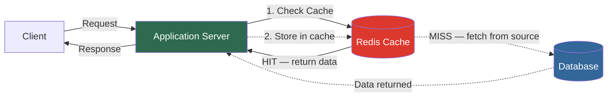

Caches are your system's best friend — **until they're not**. When a cache misbehaves, it can amplify your traffic problems rather than absorb them, potentially bringing down your entire system in seconds.

This tutorial explores the **four most dangerous and common ways caches can fail**, why each is dangerous, and how to defend against them in production systems.

> 💡 **Key Insight:** A cache is an *amplifier*. When healthy, it absorbs load. When it fails, it redirects 100% of that load to your weakest component — usually the database — in an instant.

---

## 2. Prerequisites

To get the most out of this tutorial, you should have:

- ✅ **Basic Redis knowledge** — `GET`, `SET`, `SETEX`, `DEL`, TTL concepts (see [Redis docs](https://redis.io/docs/latest/commands/))
- ✅ **Python fundamentals** — functions, exceptions, `threading` basics
- ✅ **Relational database basics** — what a query is, what connection pools and CPU saturation mean
- ✅ **HTTP/API basics** — requests, latency, timeouts, and 503 responses
- ✅ *(Optional)* Docker installed for the Hands-On Labs in [Section 26](#26-hands-on-labs)

> 💡 New to Redis? Complete a quick-start tutorial first — this guide assumes you know what a cache key, TTL, and eviction are.

---

## 3. Learning Objectives

By the end of this tutorial, you will be able to:

1. **Distinguish** the four cache failure modes — Thunder Herd, Cache Penetration, Cache Breakdown, and Cache Crash — by their trigger, scope, and DB impact
2. **Diagnose** which failure mode is occurring from monitoring signals (hit rate, DB spikes, query patterns)
3. **Implement** production-grade defenses in Python: TTL jitter, null caching, Bloom filters, mutex locks, logical expiration, and circuit breakers
4. **Choose** the right Redis eviction policy (`allkeys-lru` vs `allkeys-lfu` vs `noeviction`) for your workload
5. **Select** the appropriate caching design pattern (Cache-Aside, Read-Through, Write-Through, Write-Behind, Refresh-Ahead) based on consistency and performance trade-offs
6. **Configure** Redis for production: memory, persistence, replication, and slow log
7. **Monitor** the four golden cache metrics and set actionable alert thresholds
8. **Test** your cache layer with unit, integration, chaos, and load tests

---

## 4. Overview of Cache Failure Modes

```mermaid
flowchart TD
    ROOT[How Caches Can Go Wrong] --> P1
    ROOT --> P2
    ROOT --> P3
    ROOT --> P4

    P1[⚡ Thunder Herd Problem]
    P2[🕳️ Cache Penetration]
    P3[💥 Cache Breakdown]
    P4[💀 Cache Crash]

    P1 --> P1A[Many keys expire simultaneously]
    P1 --> P1B[Mass DB queries at same instant]
    P1 --> P1S[✅ Fix: Random TTL Jitter]

    P2 --> P2A[Requests for keys that do not exist]
    P2 --> P2B[Cache cannot store anything — DB always hit]
    P2 --> P2S[✅ Fix: Bloom Filter + Null Caching]

    P3 --> P3A[A single HOT key expires]
    P3 --> P3B[Thousands of concurrent queries for one key]
    P3 --> P3S[✅ Fix: No TTL for hot keys / Mutex Lock]

    P4 --> P4A[Entire cache server goes down]
    P4 --> P4B[100% of traffic rerouted to DB]
    P4 --> P4S[✅ Fix: Circuit Breaker + HA Cluster]

    style P1 fill:#E65100,color:#fff
    style P2 fill:#6A1B9A,color:#fff
    style P3 fill:#C62828,color:#fff
    style P4 fill:#212121,color:#fff
    style P1S fill:#2E7D32,color:#fff
    style P2S fill:#2E7D32,color:#fff
    style P3S fill:#2E7D32,color:#fff
    style P4S fill:#2E7D32,color:#fff
```

Each failure mode has a **different trigger**, **different impact**, and requires a **different fix**. Let's deep-dive into each one.

---

## 5. ⚡ Thunder Herd Problem

### What Is It?

The **Thunder Herd Problem** (also called a **Cache Stampede**) occurs when a **large number of cache keys expire at the same time**, causing every client to experience a cache miss simultaneously and flood the database with queries.

Think of it like a herd of buffaloes stampeding through a gate — your database is standing right in their path.

### How It Happens — Step by Step

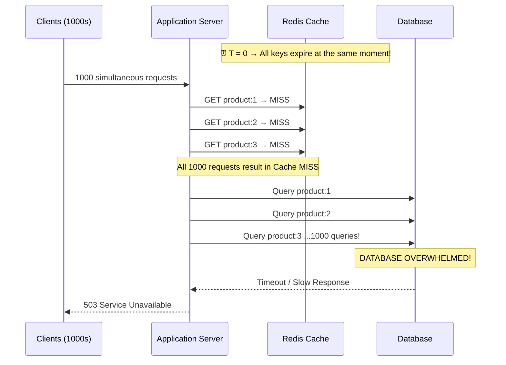

### Root Cause Diagram

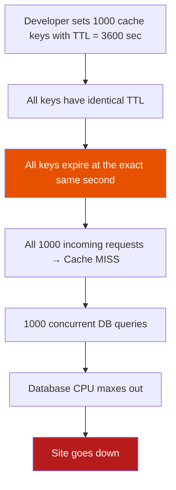

---

### Real-World Examples

**Example 1: E-Commerce Flash Sale**
An online store caches all 500 product listings at 8:00 AM with a fixed TTL of 2 hours. At exactly 10:00 AM — when Black Friday traffic is at its peak — every cached key expires simultaneously. 50,000 concurrent users find a cache miss, and all 50,000 requests attempt to query the database.

**Example 2: Social Media Feed Cache**
A social media platform refreshes all user feed caches at midnight with the same 24-hour TTL. The next midnight, 2 million users are logged in. Every feed cache expires at exactly the same second. The database receives millions of simultaneous feed-rebuild queries.

**Example 3: CDN Edge Cache Sync**
A news site pushes content to edge cache nodes across regions at the top of every hour with a 60-minute TTL. At the next hour mark, every edge node's cache expires simultaneously. A popular breaking news article that was receiving 100,000 views per minute now drives all that traffic to the origin database.

### ✅ Solutions

#### Solution 1: Random TTL Jitter

Add a **random offset** to each key's TTL so they expire at different, staggered times rather than all at once.

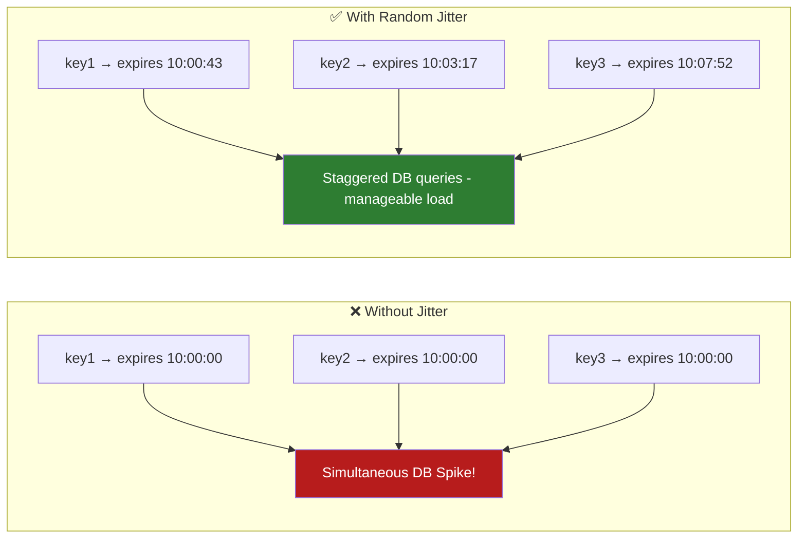

**Python Implementation:**

```python
import random
import redis

r = redis.Redis(host='localhost', port=6379, decode_responses=True)

def set_with_jitter(key: str, value: str, base_ttl: int, jitter_range: int = 300):
    """
    Cache a value with a randomized TTL to prevent mass expiry.

    Args:
        key:          Cache key (e.g., "product:123")
        value:        Serialized value to store
        base_ttl:     Base TTL in seconds (e.g., 3600 = 1 hour)
        jitter_range: Max random seconds to add (default: 5 minutes)
    """
    jitter = random.randint(0, jitter_range)
    final_ttl = base_ttl + jitter
    r.setex(key, final_ttl, value)
    return final_ttl

# Bulk cache set — each key gets a different TTL
for product_id in product_ids:
    ttl = set_with_jitter(
        key=f"product:{product_id}",
        value=serialize(get_product(product_id)),
        base_ttl=3600  # 1 hour ± up to 5 minutes
    )
    # product:1  → TTL: 3643 sec
    # product:2  → TTL: 3719 sec
    # product:3  → TTL: 3547 sec  ← all different!
```

#### Solution 2: Protect Core Data — Single DB Access Policy

When a cache miss occurs, only allow **one request** to rebuild the cache. All others wait or serve a degraded response.

```python
import threading

_rebuild_locks: dict[str, threading.Lock] = {}

def get_with_protection(key: str, fetch_fn, ttl: int = 3600):
    """
    Ensure only ONE thread rebuilds the cache on a miss.
    All others wait for the rebuilt value.
    """
    # Fast path: cache hit
    cached = r.get(key)
    if cached:
        return cached

    # Slow path: acquire per-key lock
    lock = _rebuild_locks.setdefault(key, threading.Lock())
    with lock:
        # Double-check after acquiring lock
        cached = r.get(key)
        if cached:
            return cached  # Another thread already rebuilt it

        # Only ONE thread reaches here
        data = fetch_fn(key)
        if data:
            r.setex(key, ttl + random.randint(0, 300), serialize(data))
        return data
```

---

## 6. 🕳️ Cache Penetration

### What Is It?

**Cache Penetration** happens when clients repeatedly request **keys that do not exist** in either the cache or the database. Since there's no real data to cache, every request falls all the way through to the database — permanently bypassing the cache.

This is particularly dangerous because **malicious actors can deliberately exploit it** to DoS-attack your database with keys they know don't exist.

### How It Happens — Step by Step

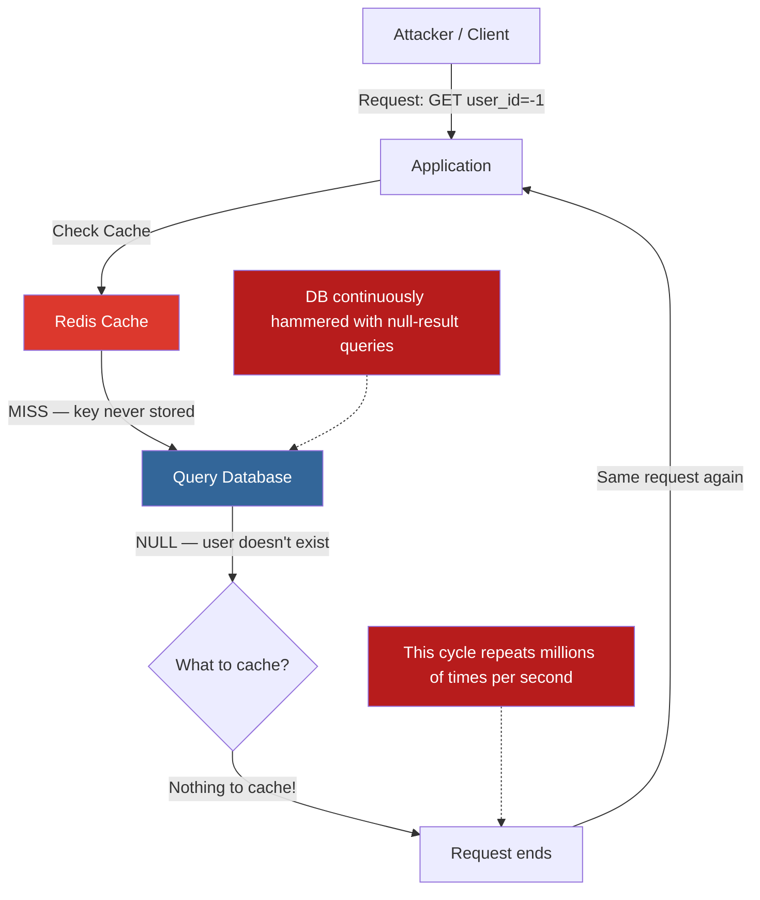

> ⚠️ **The vicious cycle:** Cache penetration is unique because the cache can never help — there is nothing to cache. Without an explicit defense, every request for a non-existent key is a guaranteed database hit, forever.

### Real-World Examples

**Example 1: Malicious DDoS via Invalid IDs**
An attacker scripts millions of requests targeting user IDs that don't exist: `/api/user/-1`, `/api/user/999999999`, `/api/user/abc`. Each bypasses the cache (since the data was never cached), hits the database, gets a NULL result, and returns nothing to cache. The database reaches 100% CPU and stops serving legitimate users.

**Example 2: Deleted Records Still Linked**
A company deletes a promotional campaign from the database, but thousands of external websites still link to it. Users clicking those links trigger cache misses (record gone from cache), DB misses (record deleted), and no data to cache — a flood of viral traffic means the DB is hammered continuously.

**Example 3: Bot Scraper Testing IDs**
An automated scraper probes `/product/1`, `/product/2`, through `/product/999999` to enumerate your catalog. The vast majority of those IDs don't exist, causing sustained, constant DB load.

### ✅ Solutions

#### Solution 1: Cache NULL (Empty) Results

If the database returns nothing, **cache the fact that nothing exists** — with a short TTL.

```python
NULL_SENTINEL = '__NULL__'

def get_user(user_id: int):
    cache_key = f"user:{user_id}"

    # Step 1: Check cache
    cached = r.get(cache_key)
    if cached is not None:
        if cached == NULL_SENTINEL:
            return None  # Cached absence — avoid DB entirely
        return deserialize(cached)

    # Step 2: Cache miss — query DB
    user = db.execute("SELECT * FROM users WHERE id = ?", user_id)

    if user is None:
        # ✅ KEY INSIGHT: Cache the NULL result with a SHORT TTL
        r.setex(cache_key, 60, NULL_SENTINEL)  # 60-second null cache
        return None

    # Step 3: Cache real result with normal TTL
    r.setex(cache_key, 3600, serialize(user))
    return user
```

> 💡 **Why short TTL for null results?** If the data is later created, the null cache will expire quickly and the real data will be fetched on the next request.

---

#### Solution 2: Bloom Filter

A **Bloom Filter** is a probabilistic data structure that answers one question with 100% accuracy in one direction: *"Is this key definitely NOT in the database?"*

| Bloom Filter Says | Meaning |
|---|---|
| **NO** | Key is **guaranteed absent** — skip cache and DB entirely |
| **MAYBE YES** | Key *might* exist — proceed with normal cache → DB lookup |

It never gives false negatives (it will never say "NO" when the key actually exists), though it may rarely give false positives (saying "MAYBE" when the key doesn't exist — but this just causes a normal lookup, not a crash).

**How a Bloom Filter Works:**

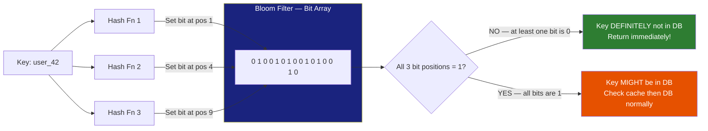

**Full Request Flow with Bloom Filter:**

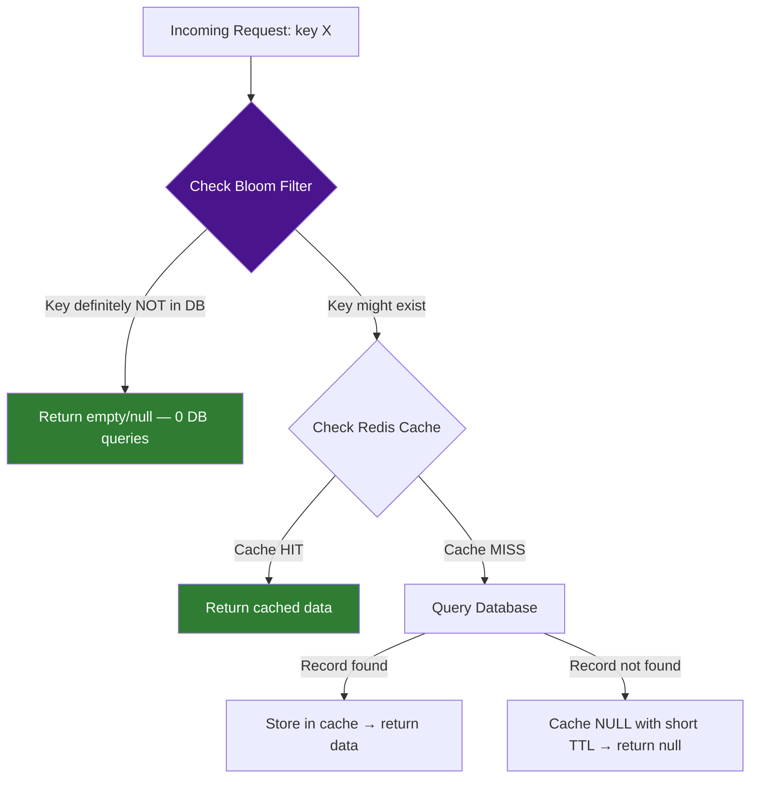

**Bloom Filter with Redis (using RedisBloom):**

```python
import redis

r = redis.Redis(host='localhost', port=6379, decode_responses=True)

# --- Setup ---
def init_bloom_filter():
    """Create bloom filter: 1M items, 1% false positive rate."""
    r.execute_command('BF.RESERVE', 'user_ids_bloom', '0.01', '1000000')

def index_user(user_id: int):
    """Add a user ID to the bloom filter when they are created."""
    r.execute_command('BF.ADD', 'user_ids_bloom', str(user_id))

# --- Usage ---
def get_user_safe(user_id: int):
    # Step 1: Bloom filter check — O(1), extremely fast
    might_exist = r.execute_command('BF.EXISTS', 'user_ids_bloom', str(user_id))

    if not might_exist:
        # Bloom says: DEFINITELY does not exist — no DB query needed!
        return None

    # Step 2: Bloom says "maybe" — proceed normally
    cache_key = f"user:{user_id}"
    cached = r.get(cache_key)
    if cached:
        return deserialize(cached) if cached != '__NULL__' else None

    user = db.get_user(user_id)
    if user:
        r.setex(cache_key, 3600, serialize(user))
        return user
    else:
        r.setex(cache_key, 60, '__NULL__')  # Belt and suspenders
        return None
```

---

## 7. 💥 Cache Breakdown

### What Is It?

**Cache Breakdown** is the "hot key" variant of the Thunder Herd problem. Instead of many keys expiring at once, a **single, extremely popular cache key expires**. Because that one key receives thousands (or millions) of requests per second, its expiry instantly floods the database with a concentrated burst of identical queries.

### Thunder Herd vs. Cache Breakdown

| | ⚡ Thunder Herd | 💥 Cache Breakdown |
|---|---|---|
| **Keys affected** | Many keys expire together | One single hot key expires |
| **Request scope** | Many different queries | Thousands of identical queries |
| **DB impact** | Distributed spike across many tables | Concentrated, identical query hammering one row |
| **Harder to detect?** | No — mass expiry is visible in monitoring | Yes — a single key looks innocent |

### How It Happens — Step by Step

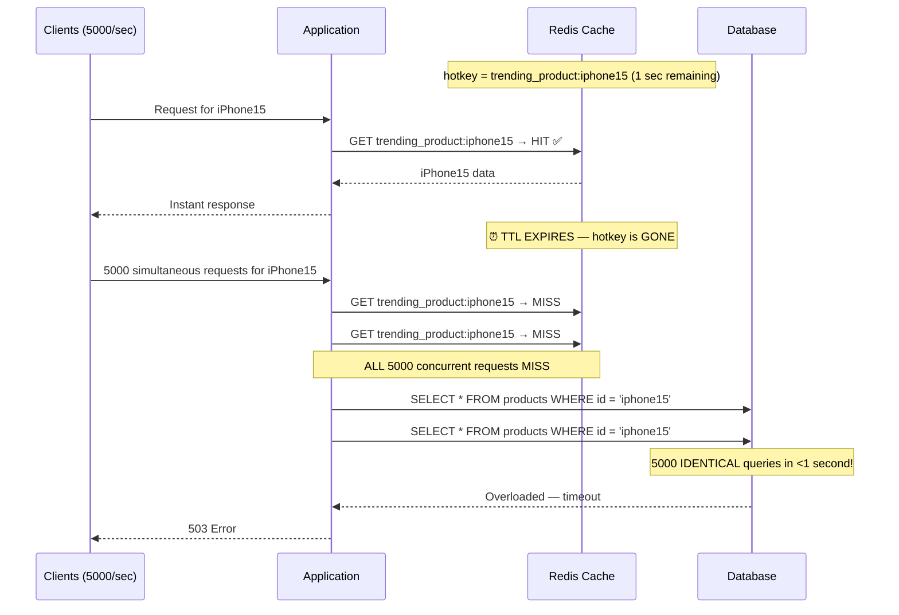

### Real-World Examples

**Example 1: Flash Sale Item**
Amazon's "Deal of the Day" product is cached as a hot key. The cache was set at 8:00 AM with a 1-hour TTL. At exactly 9:00 AM — when 200,000 users refresh to see if the price dropped — the hot key expires. 200,000 identical database queries arrive within milliseconds.

**Example 2: Viral Tweet or Post**
Elon Musk posts a tweet that receives 500,000 views/minute. The tweet content is cached. The moment its cache key expires, half a million requests simultaneously hit the database for the exact same tweet record.

**Example 3: Live Sports Score**
The World Cup final score is stored in a hot cache key. Every connected TV app, phone, and browser tab is polling for score updates. When the key expires mid-game, millions of simultaneous requests hammer a single database row.

### ✅ Solutions

#### Solution 1: No Expiry Time for Hot Keys

The simplest and most effective solution: **never set a TTL on hot keys**. Instead, invalidate them manually when the underlying data changes.

```python
def set_hot_key(key: str, value):
    """Store a hot key PERMANENTLY — no TTL."""
    r.set(key, serialize(value))  # No expiry argument!

def update_hot_key(key: str, new_value):
    """Called explicitly when the data changes in the database."""
    db.update(key, new_value)         # Update source of truth first
    r.set(key, serialize(new_value))  # Then update cache — no TTL

def remove_hot_key(key: str):
    """Explicitly remove when data is deleted or no longer hot."""
    r.delete(key)

# Usage in an event-driven system
def on_product_updated(product_id: str, new_data: dict):
    """Triggered by DB change event (e.g., via CDC or pub/sub)."""
    if product_id in HOT_KEYS:
        update_hot_key(f"product:{product_id}", new_data)
```

> 💡 **When to use:** Configuration data, homepage hero products, leaderboard snapshots — anything accessed millions of times but updated rarely.


#### Solution 2: Mutex / Distributed Lock

Allow **only one request** to rebuild the hot key when it expires. All others wait briefly and then read the freshly rebuilt cache.

```python
import time

def get_with_mutex(key: str, fetch_fn, ttl: int = 3600, lock_timeout: int = 10):
    """
    Only one thread rebuilds the cache on a miss.
    All others wait, then read the rebuilt value.
    """
    cached = r.get(key)
    if cached:
        return deserialize(cached)

    lock_key = f"rebuild_lock:{key}"

    # Attempt to acquire distributed lock (nx=True means "only if not exists")
    lock_acquired = r.set(lock_key, "1", nx=True, ex=lock_timeout)

    if lock_acquired:
        try:
            data = fetch_fn(key)
            if data:
                r.setex(key, ttl, serialize(data))
            return data
        finally:
            r.delete(lock_key)  # Always release the lock
    else:
        # Wait a moment and retry — the lock holder will have rebuilt the cache
        time.sleep(0.05)
        return get_with_mutex(key, fetch_fn, ttl, lock_timeout)
```

#### Solution 3: Logical Expiration (Serve Stale, Refresh Async)

The key **never actually expires in Redis**. Instead, the value itself stores a logical expiry timestamp. When the logical TTL has passed, the application serves the **stale data immediately** while triggering a **background thread to refresh** — zero wait time for clients.

```python
import json
import threading
from datetime import datetime, timedelta

def set_with_logical_ttl(key: str, value: dict, ttl_seconds: int):
    """Store data with an embedded expiry timestamp. No Redis TTL."""
    logical_expiry = (datetime.utcnow() + timedelta(seconds=ttl_seconds)).isoformat()
    payload = json.dumps({"data": value, "expires_at": logical_expiry})
    r.set(key, payload)  # No TTL — stays in Redis indefinitely

def get_with_logical_ttl(key: str, fetch_fn, ttl_seconds: int = 3600):
    raw = r.get(key)

    if not raw:
        # Cold start: fetch synchronously just this once
        data = fetch_fn(key)
        set_with_logical_ttl(key, data, ttl_seconds)
        return data

    payload = json.loads(raw)
    expires_at = datetime.fromisoformat(payload["expires_at"])

    if datetime.utcnow() < expires_at:
        return payload["data"]  # Still fresh — return immediately

    # Logically expired: serve stale data, refresh in background
    threading.Thread(
        target=_background_refresh,
        args=(key, fetch_fn, ttl_seconds),
        daemon=True
    ).start()

    return payload["data"]  # Return stale data instantly — no wait!

def _background_refresh(key: str, fetch_fn, ttl_seconds: int):
    """Refresh cache in the background. Only one thread at a time."""
    lock_key = f"refresh_lock:{key}"
    if r.set(lock_key, "1", nx=True, ex=30):
        try:
            new_data = fetch_fn(key)
            set_with_logical_ttl(key, new_data, ttl_seconds)
        finally:
            r.delete(lock_key)
```

#### Cache Breakdown — Solution Comparison

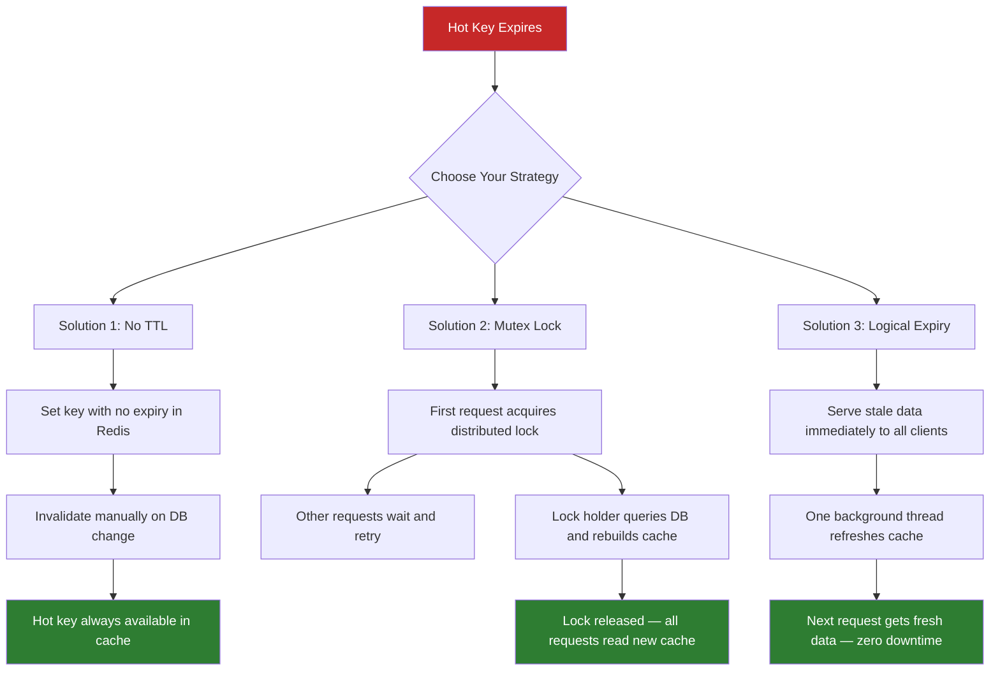
---

## 8. 💀 Cache Crash

### What Is It?

**Cache Crash** is the most catastrophic failure mode: the **entire cache layer becomes unavailable**. Whether due to a Redis server crash, out-of-memory (OOM) kill, network partition, or hardware failure, every request that would have been served by the cache now falls directly to the database.

A typical production database handles perhaps 1,000 req/sec. A cache might handle 100,000 req/sec. A cache crash instantly sends all that traffic to the DB — a 100x increase — almost always causing a complete system outage.

### How It Happens — Step by Step

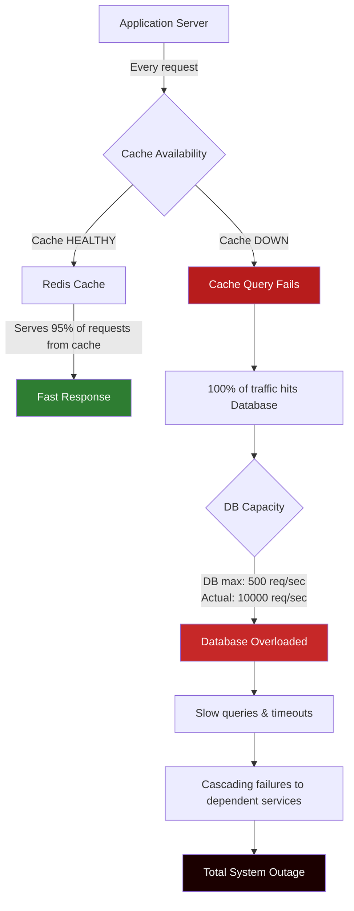

### Real-World Examples

**Example 1: Redis OOM Kill**
Redis is configured with `maxmemory 4gb` and `maxmemory-policy noeviction`. A burst of traffic populates the cache beyond the 4 GB limit. Redis refuses new writes. Linux's OOM killer terminates the Redis process entirely. Your application has no fallback — 50,000 requests per minute now hit MySQL, which collapses under the load.

**Example 2: Network Partition**
A network switch misconfiguration partitions application servers from the Redis cluster. All cache connections time out. Applications mark the cache as unavailable. In 30 seconds, database connections spike from 200 to 15,000. Max DB connections are reached — new queries are rejected outright.

**Example 3: Redis Version Upgrade**
An engineer upgrades Redis during off-peak hours using a rolling upgrade. Momentarily, one Redis node is unavailable. 20% of cache requests fail. Those failures cause the DB to spike. The engineer rolls back, causing another brief disruption. The DB struggles through the whole episode.

### ✅ Solutions

#### Solution 1: Circuit Breaker Pattern

A **Circuit Breaker** sits in front of the cache and monitors its health. When failures exceed a threshold, it "opens" — automatically bypassing the cache and routing to a fallback — preventing your application from wasting time on a broken dependency.

**Circuit Breaker State Machine:**

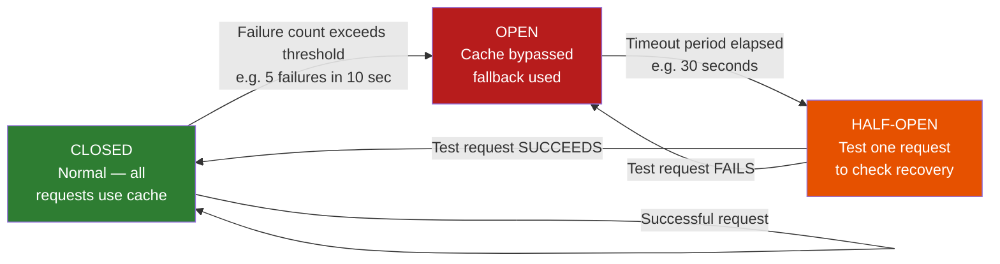

**Python Circuit Breaker Implementation:**

```python
from enum import Enum
from datetime import datetime, timedelta
from typing import Callable, Any

class CircuitState(Enum):
    CLOSED = "closed"        # Normal: use cache
    OPEN = "open"            # Cache down: bypass entirely
    HALF_OPEN = "half_open"  # Testing: allow one request through

class CacheCircuitBreaker:
    def __init__(self, failure_threshold: int = 5, timeout_sec: int = 30):
        self.state = CircuitState.CLOSED
        self.failure_count = 0
        self.failure_threshold = failure_threshold
        self.timeout = timedelta(seconds=timeout_sec)
        self.last_failure_time = None

    def call(self, key: str, fallback: Callable) -> Any:
        """
        Try to get a value from cache.
        If circuit is OPEN, use fallback immediately.
        """
        if self.state == CircuitState.OPEN:
            if datetime.now() - self.last_failure_time > self.timeout:
                self.state = CircuitState.HALF_OPEN
                print(f"Circuit HALF-OPEN: testing cache recovery...")
            else:
                return fallback(key)  # Skip cache entirely

        try:
            result = r.get(key)
            self._on_success()
            return result
        except Exception as exc:
            print(f"Cache failure: {exc}")
            self._on_failure()
            return fallback(key)   # Fall back to database

    def _on_success(self):
        if self.state == CircuitState.HALF_OPEN:
            print("Circuit CLOSED: cache recovered!")
        self.failure_count = 0
        self.state = CircuitState.CLOSED

    def _on_failure(self):
        self.failure_count += 1
        self.last_failure_time = datetime.now()
        if self.failure_count >= self.failure_threshold:
            self.state = CircuitState.OPEN
            print(f"Circuit OPEN: bypassing cache for {self.timeout.seconds}s")

# --- Usage ---
breaker = CacheCircuitBreaker(failure_threshold=5, timeout_sec=30)

def get_product(product_id: int):
    return breaker.call(
        key=f"product:{product_id}",
        fallback=lambda k: db.get_product(product_id)
    )
```

---

#### Solution 2: Highly Available Cache Cluster

A single Redis instance is a single point of failure. Use **Redis Sentinel** (for automatic failover) or **Redis Cluster** (for horizontal scaling + failover) to eliminate this risk.

**Redis Sentinel Architecture:**

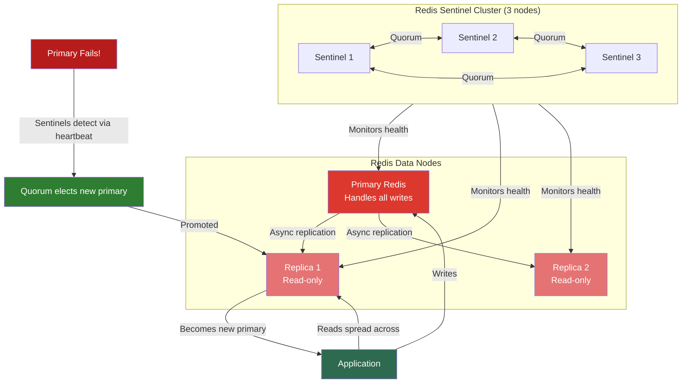

**Redis Sentinel Configuration:**

```conf
# /etc/redis/sentinel.conf

# Monitor 'mymaster' at 127.0.0.1:6379
# 2 = minimum sentinels that must agree a master is down (quorum)
sentinel monitor mymaster 127.0.0.1 6379 2

# Declare master down after 5 seconds of no heartbeat
sentinel down-after-milliseconds mymaster 5000

# Failover must complete within 60 seconds
sentinel failover-timeout mymaster 60000

# Only 1 replica syncs with new master at a time during failover
sentinel parallel-syncs mymaster 1
```

**Python with Sentinel for Auto-Failover:**

```python
from redis.sentinel import Sentinel

sentinel = Sentinel(
    sentinels=[
        ('sentinel1.example.com', 26379),
        ('sentinel2.example.com', 26379),
        ('sentinel3.example.com', 26379),
    ],
    socket_timeout=0.1
)

# Always connects to current primary (even after failover)
master = sentinel.master_for('mymaster', socket_timeout=0.1)

# Distributes reads across replicas for load balancing
slave = sentinel.slave_for('mymaster', socket_timeout=0.1)

# Writes always go to primary
master.set('hot_key', value)
master.set('config:feature_flag', 'enabled')

# Reads can be served by any replica
user_data = slave.get('user:1234')
product = slave.get('product:5678')
```

**Combined Defense — Cache Crash Full Architecture:**

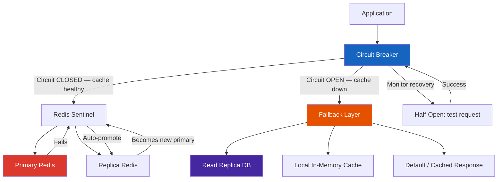

---

## 9. Side-by-Side Comparison

| | ⚡ Thunder Herd | 🕳️ Cache Penetration | 💥 Cache Breakdown | 💀 Cache Crash |
|---|---|---|---|---|
| **Root Cause** | Mass key expiry at same time | Requests for non-existent keys | Single hot key expiry | Cache server unavailable |
| **Keys Affected** | Many keys simultaneously | Any key (especially invalid ones) | One hot key | ALL keys |
| **DB Impact** | Sudden distributed spike | Sustained, continuous DB drain | Massive concentrated spike | 100% traffic immediately |
| **Exploitable?** | Indirectly | ✅ Yes — easy DDoS vector | Indirectly | No (infrastructure fault) |
| **Detection Signal** | Periodic DB spikes on a schedule | High DB load for non-existent records | One query pattern spiking | Cache health check fails |
| **Primary Fix** | Random TTL jitter | Bloom Filter | No TTL for hot keys | Circuit Breaker |
| **Secondary Fix** | Core data gate | Null result caching | Mutex Lock / Logical Expiry | HA Redis Cluster |
| **Recovery Speed** | Self-healing once caches rebuild | Immediate after fix deployed | Fast after hot key re-cached | Minutes (with HA) / Hours (without) |
| **Severity** | High | High | High | Critical |

---

## 10. 🗑️ Cache Eviction Policies

When a cache runs out of memory, it must decide which data to remove. Choosing the wrong eviction policy is a silent killer — it turns your cache into a liability instead of an asset, and can silently contribute to all four failure modes described above.

### The Major Eviction Policies

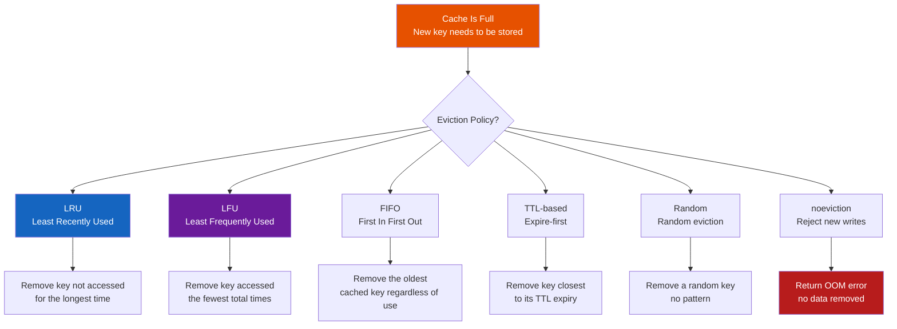

### LRU — Least Recently Used *(Most Common)*

Evicts the key that has not been accessed for the longest time. Works well for data with time-based access patterns (hot data is recent, cold data is old).

```
Timeline:                CACHE STATE (capacity: 3)
Access A:  [A]
Access B:  [A, B]
Access C:  [A, B, C]   ← Cache Full
Access A:  [B, C, A]   ← A moved to front (recently used)
Access D:  [C, A, D]   ← B evicted (least recently used)
```

**Redis config:** `maxmemory-policy allkeys-lru`

### LFU — Least Frequently Used *(Best for Hot Keys)*

Evicts the key accessed the fewest total times. Protects truly "hot" keys that are accessed millions of times, even if they haven't been used in the past few minutes.

```
Key      | Access Count
---------|-------------
product:iphone    | 1,200,000   ← Never evicted (very hot)
product:obscure   |          3  ← Evicted first
user:session:xyz  |        500  ← Evicted second
```

**Redis config:** `maxmemory-policy allkeys-lfu`

> ⚠️ **Critical insight:** Using `allkeys-lru` when you have hot keys can accidentally evict them during a traffic spike because LRU only considers recency, not frequency. If a hot key wasn't accessed in the last few minutes (e.g., during a deployment restart), LRU will evict it. Use `allkeys-lfu` when your system has clear hot keys.

### noeviction — The Dangerous Default

With `noeviction`, Redis returns an **OOM error** when memory is full rather than evicting anything. This is appropriate only for use as a message queue or when you must never lose data. For a general-purpose cache, it will cause writes to fail and can trigger Cache Crash behavior.

```python
# What noeviction looks like in practice:
try:
    r.set("new_key", value)
except redis.exceptions.ResponseError as e:
    if "OOM" in str(e):
        # Cache is full and refusing new data
        # Falls through to DB — potentially triggering Cache Crash!
        return db.get(key)
```

### Eviction Policy Decision Guide

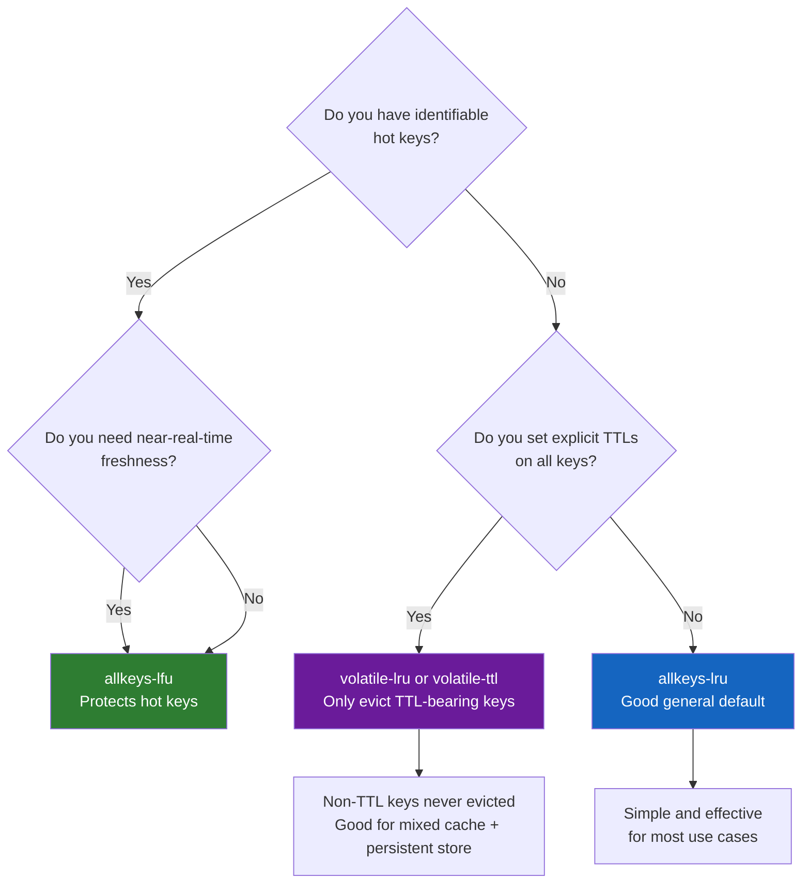

---

## 11. 📐 Cache Design Patterns

Beyond knowing how caches fail, you must understand the architectural patterns that control **when** data is loaded into the cache and **how** writes are handled. Each pattern has trade-offs around consistency, complexity, and performance.

### The Five Core Cache Patterns

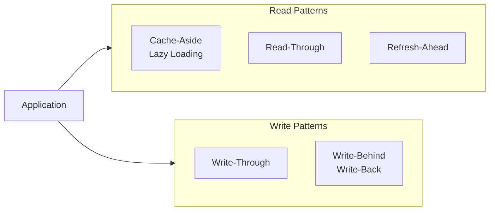

### Pattern 1: Cache-Aside (Lazy Loading) *(Most Common)*

The application itself manages the cache. On a miss, it fetches from the DB and populates the cache manually.

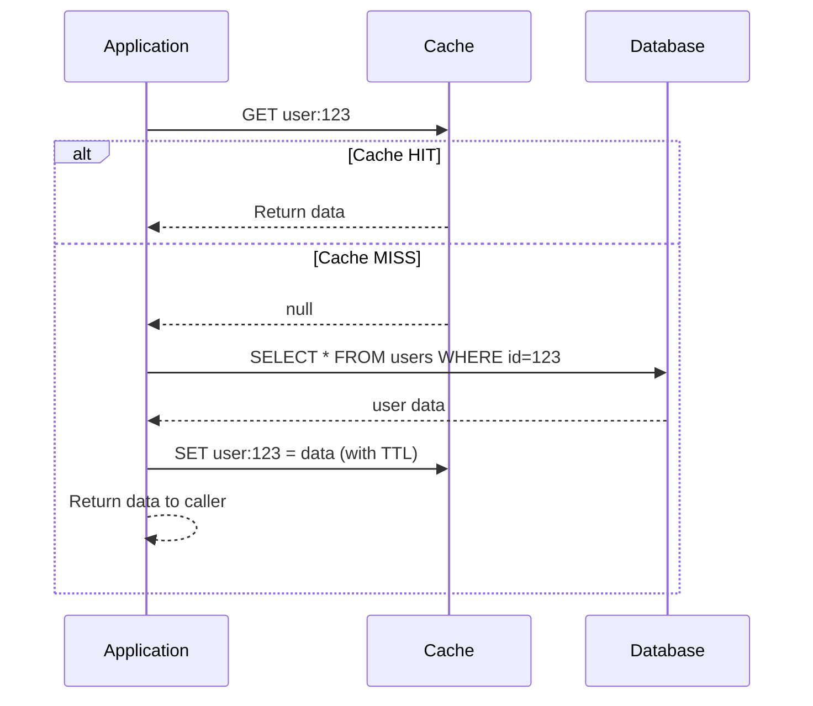

**Code:**

```python
def get_user(user_id: int):
    key = f"user:{user_id}"
    cached = r.get(key)                          # 1. Check cache
    if cached:
        return deserialize(cached)               # 2. HIT — return

    user = db.query("SELECT * FROM users WHERE id=?", user_id)  # 3. MISS — query DB
    if user:
        r.setex(key, 3600, serialize(user))       # 4. Populate cache
    return user
```

**Pros:** Simple; only loads data that is actually requested; resilient (cache crash doesn't block reads, just slows them).
**Cons:** Cache miss adds latency; stale data possible between DB write and cache invalidation.

### Pattern 2: Read-Through

The cache layer itself is responsible for loading from the DB on a miss. The application only ever talks to the cache.

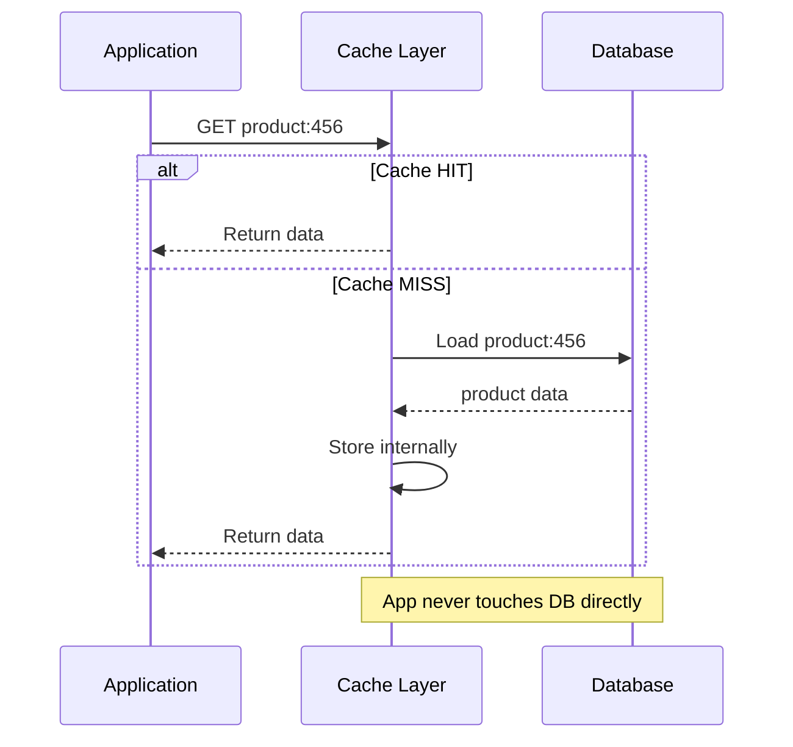

**Best for:** Libraries like Spring Cache, AWS ElastiCache DAX for DynamoDB, or read-heavy microservices where you want to decouple caching logic from business logic.

### Pattern 3: Write-Through *(Strong Consistency)*

Every write goes to the cache **and** the database synchronously, in the same operation. Data is always consistent.

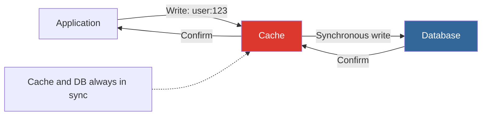

```python
def update_user(user_id: int, data: dict):
    key = f"user:{user_id}"
    db.execute("UPDATE users SET ... WHERE id=?", user_id, data)  # Write DB first
    r.setex(key, 3600, serialize(data))                            # Then update cache
```

**Pros:** Cache is always fresh; no stale reads.
**Cons:** Higher write latency (two writes per operation); cache fills with data that may never be read.

### Pattern 4: Write-Behind (Write-Back) *(Highest Write Performance)*

Writes go to the cache **immediately**, and the cache asynchronously flushes to the database in the background. Used when write throughput is the top priority.

```mermaid
sequenceDiagram
    participant App as Application
    participant Cache as Cache
    participant Queue as Write Queue
    participant DB as Database

    App->>Cache: Write user:123 (instant ACK)
    Cache->>Queue: Enqueue DB write
    Cache-->>App: Acknowledge immediately

    Note over Queue,DB: Async background flush
    Queue->>DB: Batch write to DB
    DB-->>Queue: Confirmed
```

**Pros:** Extremely fast writes; DB writes are batched for efficiency.
**Cons:** Risk of data loss if cache crashes before flush; complex to implement correctly.

### Pattern 5: Refresh-Ahead *(Proactive Caching)*

The cache **proactively refreshes** keys before they expire, based on predicted access patterns. Eliminates cache miss latency for hot data entirely.

```mermaid
flowchart TD
    KEY[Cached Key: product:iphone] --> TTL_CHECK{TTL < 20% remaining?}
    TTL_CHECK -->|No| SERVE[Serve from cache normally]
    TTL_CHECK -->|Yes| PRELOAD[Trigger background refresh]
    PRELOAD --> FETCH[Fetch fresh data from DB]
    FETCH --> UPDATE[Update cache with new TTL]
    UPDATE --> SERVE2[Next request served from refreshed cache\nZero miss latency!]

    style PRELOAD fill:#1565C0,color:#fff
    style SERVE2 fill:#2E7D32,color:#fff
```

### Pattern Comparison

| Pattern | Read Latency | Write Latency | Consistency | Complexity | Best For |
|---|---|---|---|---|---|
| **Cache-Aside** | Miss = slow | Fast | Eventual | Low | Most use cases |
| **Read-Through** | Miss = slow | N/A | Eventual | Medium | Read-heavy apps |
| **Write-Through** | Fast | Slow | Strong | Medium | Financial, inventory |
| **Write-Behind** | Fast | Very fast | Eventual (risk) | High | High write throughput |
| **Refresh-Ahead** | Always fast | N/A | Near-real-time | High | Hot keys, real-time dashboards |

---

## 12. 📊 Monitoring & Observability

You cannot defend against cache failures you cannot see. These are the essential metrics and alerts every production cache system must emit.

### The Four Golden Cache Metrics

```mermaid
flowchart TD
    ROOT[Cache Monitoring] --> HR[1. Hit Rate]
    ROOT --> ML[2. Miss Latency]
    ROOT --> EP[3. Eviction Rate]
    ROOT --> MU[4. Memory Usage]

    HR --> HR_D[Percentage of requests served from cache\nHealthy: 90-99%\nDanger: below 80%]
    ML --> ML_D[Time spent on cache misses\nShould stay under 5ms for hot paths]
    EP --> EP_D[Keys evicted per second\nHigh eviction = cache too small or wrong policy]
    MU --> MU_D[Memory used vs maxmemory\nAlert at 80% — act before OOM]

    style ROOT fill:#1565C0,color:#fff
    style HR fill:#2E7D32,color:#fff
    style ML fill:#E65100,color:#fff
    style EP fill:#6A1B9A,color:#fff
    style MU fill:#C62828,color:#fff
```

### Alerting Thresholds Reference

| Metric | Healthy | Warning | Critical | Action |
|---|---|---|---|---|
| **Cache Hit Rate** | > 95% | 80–95% | < 80% | Investigate access patterns; size cache up |
| **Redis Memory Usage** | < 70% | 70–85% | > 85% | Scale memory; review eviction policy |
| **Eviction Rate** | ~0 | > 0 | Sustained high | Cache too small; increase maxmemory |
| **DB Query Rate** | Baseline | 2× baseline | 5× baseline | Check for cache failure modes |
| **Cache Connection Errors** | 0 | Any | Sustained | Circuit breaker; investigate Redis health |
| **Replication Lag** | < 10ms | 10–100ms | > 100ms | Network issue; consider topology change |

### Key Redis Monitoring Commands

```bash
# Real-time stats dashboard
redis-cli monitor

# Hit rate, memory, evictions — check these constantly
redis-cli info stats | grep -E "keyspace_hits|keyspace_misses|evicted_keys"
redis-cli info memory | grep -E "used_memory_human|maxmemory_human"

# Calculate hit rate manually
# hit_rate = keyspace_hits / (keyspace_hits + keyspace_misses) * 100

# Slowlog — find slow operations (>10ms = suspicious)
redis-cli slowlog get 10
redis-cli slowlog len

# Connected clients
redis-cli info clients

# Replication health
redis-cli info replication
```

### Prometheus + Grafana Integration

```python
# Using redis-py with custom metrics export
from prometheus_client import Counter, Gauge, Histogram
import redis

cache_hits = Counter('cache_hits_total', 'Total cache hits', ['key_pattern'])
cache_misses = Counter('cache_misses_total', 'Total cache misses', ['key_pattern'])
cache_latency = Histogram('cache_op_duration_seconds', 'Cache operation latency')

@cache_latency.time()
def monitored_get(key: str):
    result = r.get(key)
    pattern = key.split(':')[0]  # e.g., "user", "product"
    if result:
        cache_hits.labels(key_pattern=pattern).inc()
    else:
        cache_misses.labels(key_pattern=pattern).inc()
    return result
```

---

## 13. 🔥 Cache Warming Strategies

A cold cache (empty after a restart or deployment) is dangerous — it exposes your database to full traffic load until the cache repopulates naturally. Cache warming pre-populates the cache before traffic hits.

### The Three Warming Approaches

```mermaid
flowchart TD
    DEPLOY[New Deployment / Cache Restart] --> WARM_STRAT{Warming Strategy}

    WARM_STRAT --> EAGER[Eager Warming\nPre-load everything\nbefore going live]
    WARM_STRAT --> LAZY[Lazy Warming\nLet traffic rebuild\nthe cache naturally]
    WARM_STRAT --> SHADOW[Shadow Warming\nReplay recent traffic\nin background]

    EAGER --> EG_PRO[Pro: Zero cold-start latency]
    EAGER --> EG_CON[Con: Slow startup; may cache stale data]

    LAZY --> LZ_PRO[Pro: Only caches what is needed]
    LAZY --> LZ_CON[Con: High DB load during warm-up period]

    SHADOW --> SH_PRO[Pro: Realistic warm-up with real access patterns]
    SHADOW --> SH_CON[Con: Requires traffic replay infrastructure]

    style EAGER fill:#1565C0,color:#fff
    style LAZY fill:#E65100,color:#fff
    style SHADOW fill:#6A1B9A,color:#fff
```

### Eager Warming — Pre-Load Critical Data

```python
import logging
import random
from concurrent.futures import ThreadPoolExecutor

logger = logging.getLogger(__name__)

CRITICAL_KEYS = [
    ("config:feature_flags",   load_feature_flags,   86400),
    ("leaderboard:global",     load_leaderboard,      300),
    ("categories:all",         load_all_categories,  3600),
]

def warm_cache(workers: int = 10):
    """Pre-load critical cache keys before the app accepts traffic."""
    logger.info("Starting cache warm-up...")
    succeeded = 0

    def warm_key(item):
        key, loader_fn, ttl = item
        try:
            data = loader_fn()
            r.setex(key, ttl + random.randint(0, 60), serialize(data))
            return True
        except Exception as e:
            logger.warning(f"Failed to warm key {key}: {e}")
            return False

    with ThreadPoolExecutor(max_workers=workers) as pool:
        results = pool.map(warm_key, CRITICAL_KEYS)
        succeeded = sum(results)

    logger.info(f"Cache warm-up complete: {succeeded}/{len(CRITICAL_KEYS)} keys loaded")

# Called at application startup, before the load balancer adds the instance
if __name__ == "__main__":
    warm_cache()
    start_application()
```

### Graduated Traffic Ramp-Up

Never send 100% of traffic to a new instance with a cold cache. Use your load balancer to gradually introduce traffic.

```mermaid
flowchart LR
    subgraph Ramp["Traffic Ramp-Up Plan"]
        T0[T=0 min\n0% traffic\nWarm cache]
        T1[T=5 min\n10% traffic\nMonitor DB load]
        T2[T=10 min\n25% traffic\nCheck hit rate]
        T3[T=15 min\n50% traffic\nHit rate > 80%?]
        T4[T=20 min\n100% traffic\nFull production]
        T0 --> T1 --> T2 --> T3 --> T4
    end

    style T0 fill:#1565C0,color:#fff
    style T4 fill:#2E7D32,color:#fff
```

---

## 14. ⚙️ Redis Production Configuration Reference

Poor Redis configuration silently enables every failure mode covered in this tutorial. Here is a production-ready `redis.conf` with explanations.

```ini
# ─────────────────────────────────────────────
# MEMORY — Prevent OOM-triggered Cache Crash
# ─────────────────────────────────────────────

# Set max memory to ~75% of available RAM
# Leave headroom for replication and OS buffers
maxmemory 6gb

# Evict least-frequently-used keys when full
# Protects hot keys; prevents Cache Breakdown
maxmemory-policy allkeys-lfu

# ─────────────────────────────────────────────
# PERSISTENCE — Survive restarts without cold cache
# ─────────────────────────────────────────────

# AOF: log every write for point-in-time recovery
appendonly yes
appendfsync everysec      # Balance: flush every second (not after every write)
auto-aof-rewrite-percentage 100

# RDB snapshot: periodic full dump for fast restart
save 900 1                # Snapshot if ≥1 key changed in 900 seconds
save 300 10               # Snapshot if ≥10 keys changed in 300 seconds
save 60 10000             # Snapshot if ≥10000 keys changed in 60 seconds

# ─────────────────────────────────────────────
# NETWORKING — Performance & Safety
# ─────────────────────────────────────────────

# Disable slow operations in production
# rename-command FLUSHALL ""
# rename-command CONFIG ""

# Connection timeout
timeout 300
tcp-keepalive 60

# Max clients (tune to your app's connection pool size × server count)
maxclients 10000

# ─────────────────────────────────────────────
# SLOW LOG — Detect performance problems early
# ─────────────────────────────────────────────

# Log commands taking longer than 10ms
slowlog-log-slower-than 10000
slowlog-max-len 128

# ─────────────────────────────────────────────
# REPLICATION — For HA (used with Sentinel)
# ─────────────────────────────────────────────

# On replicas: serve slightly stale data rather than refusing reads
replica-serve-stale-data yes
replica-read-only yes

# On primary: stop accepting writes if replicas fall too far behind
# Prevents split-brain in network partition scenarios
min-replicas-to-write 1
min-replicas-max-lag 10
```

### Configuration vs. Failure Mode Matrix

| Config Setting | Thunder Herd | Cache Penetration | Cache Breakdown | Cache Crash |
|---|---|---|---|---|
| `maxmemory-policy allkeys-lfu` | ✅ Protects hot keys | — | ✅ Hot keys not evicted | — |
| `appendonly yes` | — | — | — | ✅ Fast recovery |
| `save ...` (RDB) | — | — | — | ✅ Warm restart |
| `min-replicas-to-write` | — | — | — | ✅ Prevent data divergence |
| `replica-serve-stale-data yes` | — | — | ✅ Serve during rebuild | ✅ Replicas still serve reads |
| `slowlog-log-slower-than` | ✅ Detect spike | ✅ Detect penetration | ✅ Detect breakdown | ✅ Detect degradation |

---

## 15. 🧪 Testing Your Cache Layer

A cache system you haven't tested is a system you don't trust. Here are the essential tests to write.

```mermaid
flowchart TD
    ROOT[Cache Testing Strategy] --> UNIT[Unit Tests\nIndividual functions]
    ROOT --> INT[Integration Tests\nEnd-to-end with real Redis]
    ROOT --> CHAOS[Chaos Tests\nDeliberate failure injection]
    ROOT --> LOAD[Load Tests\nHigh concurrency simulation]

    UNIT --> U1[Test cache hit path returns cached value]
    UNIT --> U2[Test cache miss path queries DB and populates cache]
    UNIT --> U3[Test null result caching for non-existent keys]
    UNIT --> U4[Test jitter does not produce identical TTLs]

    INT --> I1[Test mutex prevents concurrent DB queries]
    INT --> I2[Test Bloom Filter blocks invalid key lookups]
    INT --> I3[Test circuit breaker opens after N failures]
    INT --> I4[Test logical expiration serves stale + refreshes async]

    CHAOS --> C1[Kill Redis mid-request — does circuit breaker activate?]
    CHAOS --> C2[Fill Redis to maxmemory — does eviction behave correctly?]
    CHAOS --> C3[Expire 1000 keys simultaneously — Thunder Herd test]

    LOAD --> L1[10000 concurrent requests to a single key]
    LOAD --> L2[Simulate attacker with 1M requests for invalid IDs]

    style CHAOS fill:#C62828,color:#fff
    style ROOT fill:#1565C0,color:#fff
```

### Sample Test: Thunder Herd Prevention

```python
import pytest
import time
from unittest.mock import MagicMock, call
import redis

def test_jitter_prevents_simultaneous_expiry():
    """Verify that set_with_jitter produces different TTLs across keys."""
    ttls = []
    for i in range(100):
        ttl = set_with_jitter("key", "val", base_ttl=3600, jitter_range=300)
        ttls.append(ttl)

    # No two keys should have the exact same TTL (with overwhelming probability)
    unique_ttls = set(ttls)
    assert len(unique_ttls) > 90, "Jitter should produce diverse TTLs"

    # All TTLs must be within valid range
    assert all(3600 <= t <= 3900 for t in ttls), "TTLs must be within jitter bounds"


def test_mutex_prevents_thundering_herd():
    """Only one of N concurrent threads should query the DB."""
    import threading

    db_call_count = 0
    db_lock = threading.Lock()

    def mock_fetch(key):
        nonlocal db_call_count
        time.sleep(0.05)  # Simulate DB latency
        with db_lock:
            db_call_count += 1
        return {"data": "value"}

    r.delete("test_key")  # Ensure cold cache

    threads = [
        threading.Thread(target=get_with_mutex, args=("test_key", mock_fetch))
        for _ in range(50)
    ]
    for t in threads:
        t.start()
    for t in threads:
        t.join()

    assert db_call_count == 1, f"Expected 1 DB call, got {db_call_count}"
```

### Sample Test: Circuit Breaker

```python
def test_circuit_breaker_opens_on_repeated_failures():
    breaker = CacheCircuitBreaker(failure_threshold=3, timeout_sec=5)
    fallback_called = 0

    def fallback(key):
        nonlocal fallback_called
        fallback_called += 1
        return "fallback"

    # Simulate Redis being down (force failures)
    with patch.object(r, 'get', side_effect=ConnectionError("Redis down")):
        for _ in range(5):
            result = breaker.call("some_key", fallback)

    assert breaker.state == CircuitState.OPEN
    assert fallback_called == 5  # All calls fell back to DB
```

---

## 16. 🚧 Common Pitfalls & Troubleshooting

Use this symptom → root cause → fix table when your cache behaves unexpectedly in production.

| 🚨 Symptom | 🔍 Likely Cause | 🛠️ Fix |
|---|---|---|
| DB spikes repeat at fixed intervals (e.g., every hour) | Thunder Herd — keys share the same TTL | Add random TTL jitter; stagger cache population |
| DB load constantly high, hit rate near 0% for specific endpoints | Cache Penetration — queries for non-existent keys | Null caching + Bloom Filter + input validation |
| One endpoint's DB query rate spikes massively after a cache expiry | Cache Breakdown — hot key expired | No TTL for hot keys; mutex or logical expiration |
| Everything is slow; Redis connection errors in logs | Cache Crash — Redis down or unreachable | Circuit breaker + fallback; restore Redis (Sentinel/Cluster) |
| `OOM command not allowed` errors from Redis | `noeviction` policy with full memory | Switch to `allkeys-lfu`/`allkeys-lru`; increase maxmemory |
| Stale data served for hours after DB update | Write path doesn't invalidate cache; TTL too long | Invalidate/update cache on write (Write-Through or event-driven invalidation) |
| Hit rate drops right after every deployment | Cold cache on new instances | Cache warming + graduated traffic ramp-up |
| Mutex deadlocks; requests hang indefinitely | Lock holder crashed without releasing lock | Set `ex` timeout on lock keys; add retry limit with fallback |
| Bloom filter says "maybe" for obviously invalid IDs | False positives are normal OR filter wasn't populated | Populate filter on entity creation; tune false-positive rate |
| Redis memory grows unbounded | Keys without TTL are never cleaned | Set TTLs on cacheable keys; audit with `SCAN` + `TTL`; reserve no-TTL for managed hot keys only |
| Intermittent timeouts on cache reads | Connection pool exhaustion or slow commands | Pool sizing; check `slowlog`; avoid `KEYS`/`SMEMBERS` on large sets |

> 💡 **Troubleshooting rule of thumb:** Start with the *hit rate*. A sudden hit-rate drop almost always correlates with one of the four failure modes — the timing and scope of the drop tells you which one.

---

## 17. ❌ Anti-Patterns

Avoid these common mistakes — each one directly enables one or more failure modes.

### ❌ Anti-Pattern 1: Uniform TTLs Across Bulk-Cached Keys

**Bad:**

```python
# ALL 10,000 keys expire at the exact same moment
for pid in product_ids:
    r.setex(f"product:{pid}", 3600, serialize(get_product(pid)))
```

**Good:**

```python
for pid in product_ids:
    r.setex(f"product:{pid}", 3600 + random.randint(0, 300), serialize(get_product(pid)))
```

*Enables:* Thunder Herd.

### ❌ Anti-Pattern 2: Caching Nothing When the DB Returns Nothing

**Bad:** returning `None` without caching — every repeated request hits the DB.

**Good:** cache a null sentinel with a short TTL (or gate with a Bloom Filter).

*Enables:* Cache Penetration (and is trivially exploitable as a DoS vector).

### ❌ Anti-Pattern 3: TTLs on Viral/Hot Keys

**Bad:** giving the "Deal of the Day" key a 1-hour TTL.

**Good:** no TTL + event-driven invalidation, or logical expiration with background refresh.

*Enables:* Cache Breakdown.

### ❌ Anti-Pattern 4: Single Unprotected Redis Instance in Production

**Bad:** one standalone Redis node, no persistence, no fallback.

**Good:** Sentinel/Cluster + circuit breaker + defined fallback data source.

*Enables:* Cache Crash.

### ❌ Anti-Pattern 5: Cache Write Before DB Write

**Bad:**

```python
r.setex(key, 3600, serialize(new_data))      # Cache first!
db.execute("UPDATE users SET ...")            # Then DB — if DB fails, cache is wrong
```

**Good:** update the source of truth first, then the cache (or invalidate and let the next read repopulate).

*Enables:* permanent stale data; consistency bugs that look like caching failures.

### ❌ Anti-Pattern 6: Using `KEYS *` or Unbounded Operations

`KEYS` blocks the single-threaded Redis server — a classic self-inflicted outage. Use `SCAN` for enumeration and keep sets/collections bounded.

### ❌ Anti-Pattern 7: Ignoring the Null Path in Concurrent Rebuilds

A mutex that only caches *successful* fetches lets non-existent keys bypass the lock's benefits — pair locking with null caching.

---

## 18. ✅ Best Practices Checklist

### Implementation Roadmap

```mermaid
flowchart TD
    START[Building a Cache Layer?] --> T1

    T1[Always add random jitter to TTL values\ne.g. base_ttl + randint-0-300] --> T2
    T2[Never cache many keys with identical TTLs] --> T3
    T3[Identify hot keys before they go live] --> T4
    T4[Set hot keys without TTL — use event-driven invalidation] --> T5
    T5[Implement null result caching for missing records] --> T6
    T6[Add a Bloom Filter for large-scale key spaces] --> T7
    T7[Add a Mutex or Logical Expiry for hot key rebuilds] --> T8
    T8[Deploy Redis Sentinel or Redis Cluster — never single node] --> T9
    T9[Wrap all cache calls in a Circuit Breaker] --> T10
    T10[Define fallback behavior for every cache call] --> T11
    T11[Set up cache hit-rate and DB load monitoring] --> DONE

    DONE[Production-Ready Cache Architecture!]

    style START fill:#1565C0,color:#fff
    style DONE fill:#2E7D32,color:#fff
    style T4 fill:#2d3436,color:#fff
    style T8 fill:#2d3436,color:#fff
    style T9 fill:#2d3436,color:#fff
```

### Checklist by Problem

**Against Thunder Herd:**
- [ ] All cache keys use `base_ttl + random_jitter` — never a fixed TTL
- [ ] Monitor DB query spike patterns that repeat on a schedule
- [ ] Warm caches proactively before expected traffic spikes (pre-population)
- [ ] Implement cache refresh scheduling to stagger re-population

**Against Cache Penetration:**
- [ ] Bloom Filter in place for large entity key spaces (users, products, orders)
- [ ] NULL results cached with a short TTL (30–60 seconds)
- [ ] Input validation rejects obviously invalid keys (negative IDs, non-numeric IDs)
- [ ] Rate limiting per IP to detect and block abuse patterns

**Against Cache Breakdown:**
- [ ] Hot key registry maintained (list of keys that must never expire)
- [ ] All hot keys set without TTL; invalidated via event/pub-sub on data change
- [ ] Distributed lock prevents concurrent cache rebuilds
- [ ] Consider logical expiration with background refresh for near-real-time data

**Against Cache Crash:**
- [ ] Redis deployed as Sentinel or Cluster — never standalone single node
- [ ] Circuit Breaker wraps all cache reads/writes
- [ ] Fallback data source defined (read replica DB, CDN, default values)
- [ ] Redis persistence enabled (AOF for durability, RDB for snapshots)
- [ ] Failover tested regularly — chaos engineering for cache
- [ ] Cache health check endpoint monitored by alerting system

---

## 19. 🔐 Security Considerations

Caching failures are not just reliability problems — several of them are **exploitable attack surfaces**.

### Cache Penetration as a DDoS Vector

- **The threat:** An attacker who understands your key structure (`/api/user/{id}`) can generate millions of *guaranteed* misses, turning your cache into a liability and routing the attack straight to your database.
- **Defenses:**
  - ✅ Bloom Filter in front of the DB path (unknown keys are rejected in O(1) at the cache layer)
  - ✅ Cache null results so even non-Bloom-filtered misses stop hitting the DB
  - ✅ Input validation at the edge: reject negative, non-numeric, or absurdly large IDs *before* they reach the cache layer
  - ✅ Rate limiting per IP/API key, with stronger limits on 404-heavy clients

### Cache Poisoning

- **The threat:** If user-supplied input becomes part of the cache key without sanitization (`/api/products?sort=<script>...`), an attacker can store malicious content under a shared key that other users then read.
- **Defenses:**
  - ✅ Build cache keys from validated, canonical parameters only
  - ✅ Normalize/encode keys; exclude user-specific tokens from shared keys
  - ✅ Keep the `Vary` semantics in mind for HTTP-layer caches (CDNs)

### Redis Hardening

```conf
# redis.conf — security essentials
requirepass <strong-password>          # Or use ACLs in Redis 6+
rename-command FLUSHALL ""             # Disable destructive commands
rename-command FLUSHDB ""
rename-command CONFIG ""               # Prevent runtime reconfiguration
rename-command DEBUG ""
bind 10.0.0.0/8                        # Never expose Redis to the public internet
protected-mode yes
aclfile /etc/redis/users.acl           # Role-based access (Redis 6+)
```

- ✅ Run Redis in a **private subnet**; access only from application security groups
- ✅ Enable **TLS** for client connections and replication (`tls-port`, `tls-replication yes`)
- ✅ Use **ACLs** so app services get read/write only on their key prefixes
- ✅ Disable dangerous commands via `rename-command` (as above)

### Key Naming Hygiene

- ✅ Never embed secrets, session tokens, or PII in cache keys — keys are visible in `MONITOR`, `SCAN`, and logs
- ✅ Encrypt sensitive values before caching if the Redis layer is shared between services

---

## 20. ⚡ Performance Considerations

### Latency Budgets (Typical Targets)

| Operation | Target | Notes |
|---|---|---|
| Cache HIT (same DC) | < 1 ms | Redis handles 100k+ ops/sec per node |
| Cache MISS → DB read | 5–50 ms | This is why hit rate matters so much |
| Cache MISS → DB complex query | 50–500 ms | Hot key misses amplify this massively |
| Circuit breaker overhead | ~0 | Pure in-memory state check |
| Bloom filter check | < 0.1 ms | O(k) hash operations, k = number of hash functions |
| Mutex lock wait (p50) | 1–50 ms | Equal to DB query time; retry loop sleeps 50 ms |
| Logical expiration read | < 1 ms | Stale data returned instantly |

### Memory Sizing Rules of Thumb

- Keep Redis memory ≤ **75%** of the machine's RAM (headroom for replication buffers and fork() during RDB saves)
- Estimate: `avg_value_size × key_count × 1.5` (redis-py overhead, fragmentation) — then add 30% growth headroom
- Monitor `mem_fragmentation_ratio`: healthy is **1.0–1.5**; > 1.5 indicates fragmentation issues

### Throughput Benchmarks (Reference Points)

| Scenario | Approximate Throughput |
|---|---|
| Redis GET/SET (pipelined, same DC) | 500k–1M ops/sec per node |
| Redis GET (non-pipelined) | 80k–150k ops/sec per node |
| MySQL simple indexed SELECT | 1k–5k queries/sec |
| Redis with persistence (AOF everysec) | ~10–20% throughput reduction |
| Circuit breaker (open state) | Zero cache overhead — fallback only |

> 💡 **The 100x rule:** A cache typically serves ~100x the traffic of the database behind it. Every percentage point of hit rate you protect is worth its weight in database capacity.

### Optimization Checklist

- ✅ Use **connection pooling** (never open a connection per request)
- ✅ **Pipeline** bulk reads/writes (`r.pipeline()`) to cut round trips
- ✅ Use `MGET` for multi-key reads instead of N × `GET`
- ✅ Keep values small — serialize compactly (msgpack/protobuf vs. pretty JSON)
- ✅ Prefer `UNLINK` over `DEL` for large keys (async, non-blocking)
- ✅ Avoid `HGETALL` on huge hashes; use `HSCAN` or fetch specific fields

---

## 21. 🏋️ Practice Exercises (with Solutions)

### Exercise 1 — Build a Thunder Herd-Proof Cache Setter 🟢 Beginner

**Task:** An e-commerce team caches 10,000 product listings with `r.setex(key, 3600, value)` in a loop. Every day at the same minute, the site slows down dramatically.

1. Identify the failure mode and explain why it happens.
2. Rewrite the loop so it cannot happen. Your solution must guarantee no two keys expire within the same second *on average*.
3. State one additional defense you would deploy.

**Solution:**

1. This is the **⚡ Thunder Herd**: all 10,000 keys share the same 3600-second TTL, so they all expire simultaneously, every request misses, and the DB receives a synchronized spike.

2. Add random jitter to each key's TTL:

```python
import random

def cache_products(product_ids):
    for pid in product_ids:
        value = serialize(get_product(pid))
        ttl = 3600 + random.randint(0, 300)   # 1 hour ± up to 5 minutes
        r.setex(f"product:{pid}", ttl, value)
```

With 10,000 keys spread over a 300-second jitter window, expirations average ~33 keys/second instead of 10,000 in one second — a load reduction of ~99.7% at the spike point.

3. Additional defenses (any one): pre-warm caches on a staggered schedule *before* the mass-expiry window; monitor DB query rate for repeating spikes; or use refresh-ahead so keys are re-populated before expiry.

### Exercise 2 — Implement a Safe Distributed Mutex Rebuild 🟡 Intermediate

**Task:** Implement `get_with_mutex` hardening: (a) prevent infinite retry loops when the DB is down, (b) ensure a crashed lock holder cannot deadlock everyone, (c) cache null results so penetration attacks cannot bypass the lock's benefits.

**Solution:**

```python
import time

NULL_SENTINEL = "__NULL__"

def get_with_mutex(key: str, fetch_fn, ttl: int = 3600,
                   lock_timeout: int = 10, max_retries: int = 20):
    cached = r.get(key)
    if cached is not None:
        return None if cached == NULL_SENTINEL else deserialize(cached)

    lock_key = f"rebuild_lock:{key}"
    lock_acquired = r.set(lock_key, "1", nx=True, ex=lock_timeout)  # (b) ex = auto-expiry

    if lock_acquired:
        try:
            data = fetch_fn(key)
            if data:
                r.setex(key, ttl, serialize(data))
                return data
            # (c) Null path: cache absence so repeated misses stop hitting the DB
            r.setex(key, 60, NULL_SENTINEL)
            return None
        finally:
            r.delete(lock_key)

    retries = 0
    while retries < max_retries:                     # (a) bounded retries
        time.sleep(0.05)
        cached = r.get(key)
        if cached is not None:
            return None if cached == NULL_SENTINEL else deserialize(cached)
        retries += 1
    raise TimeoutError(f"Cache rebuild for {key} did not complete in time")
```

- **(a)** The retry loop is bounded (`max_retries`); after ~1 second it fails loudly instead of hanging.
- **(b)** The lock key always carries `ex=lock_timeout`, so a crashed holder's lock self-destructs.
- **(c)** Null results are cached with a 60-second TTL — penetration requests now stop at the cache.

### Exercise 3 — Diagnose the Production Incident 🔴 Advanced

**Task:** You are on call. Grafana shows: hit rate fell from 96% → 61% at 14:00 exactly; DB CPU went 30% → 100%; the slowlog shows *one* query repeated thousands of times: `SELECT * FROM products WHERE slug = 'iphone-15'`. Yesterday the same thing happened at 13:00. Identify the failure mode, explain the evidence, and prescribe a fix.

**Solution:**

- **Failure mode:** 💥 **Cache Breakdown** — a single hot key expired.
- **Evidence:**
  - One repeated identical query → not Thunder Herd (that spreads across many keys/queries)
  - Not penetration: the query targets a key that *definitely exists* and the drop is episodic, not sustained
  - The daily timing (14:00 today, 13:00 yesterday) = the product page's cache TTL expiring on a 24-hour cycle — an extremely hot key
  - Hit rate dropped ~35 points because one key normally absorbs a huge share of traffic
- **Fix (pick per freshness needs):**
  1. **No TTL + event invalidation:** set the key with no expiry; refresh it via a CDC/pub-sub event when the product changes.
  2. **Logical expiration:** serve the stale value instantly and refresh in a background thread — zero client-visible latency.
  3. **Mutex rebuild** as the minimal fix: only one request hits the DB on expiry; others wait for the rebuilt value.
- **Verification:** after deploying, watch hit rate hold steady through the next expiry window and confirm zero identical-query spikes in the slowlog.

### Exercise 4 — Layered Defenses for a User Lookup API 🔴 Advanced

**Task:** Design the request flow for `GET /users/{id}` so that: invalid IDs never reach the DB, deleted users do not hammer the DB, and a total Redis outage does not take the API down. Sketch the flow and justify each layer.

**Solution:**

```
Request → [1] Input validation → [2] Bloom Filter → [3] Circuit Breaker → [4] Redis
                                                                        ↓ miss
                                                                   [5] DB (+ null caching)
                                        ↘ (circuit open) [6] Fallback: read replica / default response
```

1. **Input validation** — reject negative/non-numeric/oversized IDs at the edge; kills the cheapest attacks for free.
2. **Bloom Filter** — guaranteed-absent users return immediately with 0 DB queries; O(1) cost; false positives just fall through to normal lookup.
3. **Circuit Breaker** — wraps steps 4–5; when Redis fails, the circuit opens and requests go to the fallback instead of timing out and piling up.
4. **Redis cache** — normal TTL'd caching of real users.
5. **DB + null caching** — cache `__NULL__` for 60s on misses so deleted users stop generating DB load (also covers Bloom false positives).
6. **Fallback** — degraded-but-alive behavior (read replica, cached default) when the circuit is open.

Each layer handles a different failure mode: 1–2 → penetration, 3–6 → crash, 4–5 → herd/breakdown rebuild costs.

---

## 22. 🧠 Test Your Understanding

Answer each question, then check the solution that follows it.

**Q1. What is the defining characteristic that separates Thunder Herd from Cache Breakdown?**

> **A1:** Scope — Thunder Herd is *many keys* expiring simultaneously (distributed spike across many queries); Cache Breakdown is *one single hot key* expiring (a concentrated burst of identical queries).

**Q2. Why can't the cache itself ever absorb Cache Penetration traffic by default?**

> **A2:** Because there is no data to cache — the key doesn't exist in the DB either. A miss yields nothing to store, so every subsequent identical request misses again, permanently bypassing the cache unless you explicitly cache the null result or gate with a Bloom Filter.

**Q3. A Bloom Filter says "NO" for key X. What do you know about X, and what do you do?**

> **A3:** X is **definitely absent** from the set (no false negatives). Return the empty result immediately — skip both cache and DB.

**Q4. Why are null results cached with a *short* TTL (e.g., 60s) instead of the normal 1 hour?**

> **A4:** So that if the record is created shortly after (or was temporarily unavailable), the stale "absence" marker expires quickly and real data is fetched on the next request — bounding staleness while still blocking the flood.

**Q5. Name the three states of the circuit breaker and what each does.**

> **A5:** **CLOSED** (normal — all requests use the cache), **OPEN** (cache bypassed — fallback used immediately), **HALF-OPEN** (a single test request probes the cache; success closes the circuit, failure reopens it).

**Q6. Why does `nx=True, ex=lock_timeout` matter when acquiring a distributed rebuild lock?**

> **A6:** `nx=True` guarantees only ONE client acquires the lock (atomic set-if-not-exists); `ex=lock_timeout` auto-expires the lock so a crashed lock holder cannot deadlock everyone forever.

**Q7. What does logical expiration store, and why does the Redis key have no TTL?**

> **A7:** The value payload embeds an `expires_at` timestamp. The Redis key has no TTL so the data *never disappears* — when the logical expiry passes, the app serves the (stale) value instantly while a background thread refreshes it. Zero client wait.

**Q8. Your system has clearly identifiable hot keys. Should you use `allkeys-lru` or `allkeys-lfu`, and why?**

> **A8:** `allkeys-lfu`. LRU evicts on *recency* — a hot key untouched during a brief lull (e.g., a deployment restart) can be evicted. LFU evicts on *frequency*, protecting keys with millions of cumulative accesses.

**Q9. What is the risk of `noeviction` as a cache policy?**

> **A9:** When memory is full, Redis rejects new writes with an OOM error — your cache stops accepting data, misses spike, and the DB absorbs the traffic. This is a slow-motion Cache Crash. `noeviction` is only appropriate for queues/never-lose-data uses.

**Q10. In Write-Behind caching, what is the trade-off that makes it risky?**

> **A10:** Durability — writes are acknowledged from the cache and flushed to the DB asynchronously. If the cache crashes before flushing, acknowledged writes are lost. It buys maximum write throughput at the cost of data-loss risk.

**Q11. What monitoring signal most strongly indicates Cache Penetration (vs. the other modes)?**

> **A11:** *Sustained* high DB load composed of queries for records that return NULL/404 — continuous, not episodic; the hit rate stays low for those key patterns indefinitely (Thunder Herd is periodic, Breakdown is a single-key spike, Crash correlates with cache health failure).

**Q12. Why must the cache be updated *after* the database in a Write-Through flow?**

> **A12:** The DB is the source of truth. If the cache is written first and the DB write fails, the cache now serves data that was never persisted — a permanent inconsistency until the TTL expires. DB-first bounds the inconsistency window.

---

## 23. 💼 Common Interview Questions

**Q1. Explain the difference between cache penetration, cache breakdown, and cache avalanche (Thunder Herd).**

> **Model answer:** Penetration = requests for keys that exist *nowhere* (cache **and** DB), so every request hits the DB forever — fix with null caching + Bloom Filters. Breakdown = one *hot key* expires, funneling thousands of identical concurrent queries to the DB — fix with no-TTL hot keys, mutexes, or logical expiration. Avalanche/Thunder Herd = *many keys* expire simultaneously (often identical TTLs), flooding the DB with a distributed spike — fix with TTL jitter and staggered warming.

**Q2. How would you design a cache key expiration strategy for a flash-sale system?**

> **Model answer:** Hot sale items get no TTL with event-driven invalidation; secondary keys get base TTL plus random jitter; the cache is pre-warmed before the sale window; a mutex/logical-expiration guards rebuilds; circuit breaker plus DB fallback protect against cache-layer failure during the peak.

**Q3. What is a Bloom Filter and why is it useful for caching?**

> **Model answer:** A probabilistic bit-array + hash-functions structure that can say "definitely not present" with zero false negatives but may rarely say "maybe" for absent keys. In caching it sits in front of cache/DB lookups: absent keys are rejected in O(1), blocking penetration attacks. False positives only cost a normal lookup. Standard RedisBloom: `BF.RESERVE`/`BF.ADD`/`BF.EXISTS`.

**Q4. Walk me through the circuit breaker pattern as applied to a cache.**

> **Model answer:** Three states: CLOSED (normal), OPEN (failures exceeded threshold — all cache calls short-circuit to a fallback), HALF-OPEN (after a timeout, one probe request tests the cache; success closes, failure reopens). It stops the app from paying timeout costs on a dead cache and, critically, prevents the fallback DB from being hit *synchronously* by every request.

**Q5. Why is LRU sometimes wrong for caches with hot keys? What do you use instead?**

> **Model answer:** LRU evicts on recency only; a hot key untouched for a few minutes (deployment restart, lull) becomes an eviction candidate even though it has millions of lifetime accesses. LFU (Redis `allkeys-lfu`) evicts on frequency, protecting consistently hot keys.

**Q6. Compare Write-Through and Write-Behind caching. When would you choose each?**

> **Model answer:** Write-Through: synchronous cache+DB write per operation — strong consistency, higher write latency; choose for financial/inventory data. Write-Behind: acknowledge from cache, async batch flush to DB — very fast writes but risk of data loss on cache crash; choose for write-heavy, loss-tolerant workloads (counters, analytics, activity streams).

**Q7. How do you prevent a thundering herd on cache rebuild in a distributed system (multiple app servers)?**

> **Model answer:** A local in-process lock only guards one server — you need a *distributed* mutex: `SET lock_key 1 NX EX timeout` in Redis. The single lock holder rebuilds and releases; others poll briefly for the rebuilt value with bounded retries; the lock's EX prevents deadlocks from crashed holders. Logical expiration is an alternative that avoids waiting entirely.

**Q8. Your Redis memory usage alert fired at 85%. What do you do?**

> **Model answer:** Triage: check `info memory` (fragmentation, maxmemory), `info stats` for `evicted_keys`, and slowlog. Immediate: confirm eviction policy is lfu/lru (not noeviction) and that all cacheable keys have TTLs; audit no-TTL keys with SCAN. Short-term: raise maxmemory if headroom exists or remove low-value key families. Long-term: capacity plan — hit-rate-vs-memory curve, consider cluster sharding, and fix growth source (e.g., unbounded values, missing TTLs).

**Q9. What is cache stampede protection via "logical expiration," and what consistency trade-off does it make?**

> **Model answer:** The key never expires in Redis; the payload embeds a logical `expires_at`. On logical expiry, callers instantly receive stale data while one background thread refreshes under a lock. Trade-off: bounded staleness (clients may read briefly outdated data) in exchange for zero miss latency and zero DB stampedes.

**Q10. How would you make cache warming safe after a deployment?**

> **Model answer:** Pre-load critical keys at startup before the LB routes traffic (eager warming, with jittered TTLs), then ramp traffic gradually (0→10→25→50→100%) while watching hit rate and DB load; optionally shadow-warm by replaying recent production traffic patterns. This converts a full-traffic cold-start DB spike into a managed warm-up.

**Q11. An attacker discovers your API returns 404s slowly. What is happening and what is your remediation plan?**

> **Model answer:** Cache penetration — the 404 keys were never cached, so every request is a DB hit (a cheap DoS). Remediation: cache null results with short TTL, add a Bloom filter over valid IDs, validate inputs at the edge, rate-limit 404-heavy clients, and alert on the "DB queries returning NULL" metric.

**Q12. Explain how `min-replicas-to-write` protects a Redis HA setup.**

> **Model answer:** If the primary loses connectivity to its replicas (network partition), continuing to accept writes would create divergence — writes the promoted replica never saw (split-brain data loss). `min-replicas-to-write 1` + `min-replicas-max-lag 10` makes the primary stop accepting writes when no replica is within 10s of lag, trading availability for consistency until the partition heals.

---

## 24. 📚 Question Bank (50+ Questions)

Test yourself across difficulty levels. Answers are in the [Answer Key](#answer-key) at the end of this section.

### 🟢 Beginner (1–20)

1. What is a cache, and why do systems use one?
2. What does TTL stand for, and what does it control?
3. What is a "cache hit" vs a "cache miss"?
4. Name the four cache failure modes covered in this tutorial.
5. What everyday analogy describes the Thunder Herd problem?
6. What happens to the database when a Thunder Herd occurs?
7. How does adding random jitter to TTLs help prevent Thunder Herd?
8. What is cache penetration in one sentence?
9. Why do requests for non-existent keys always reach the database without defenses?
10. What is a null sentinel in the context of null caching?
11. Why are null results cached with a shorter TTL than real results?
12. What is a Bloom Filter in one sentence?
13. Can a Bloom Filter ever say "definitely present" when the key is absent? What is that called?
14. Can a Bloom Filter ever say "definitely absent" when the key is present?
15. What is a hot key?
16. What is the simplest solution for hot keys that are read millions of times but rarely change?
17. Name the three states of a circuit breaker.
18. What does a circuit breaker do when it is OPEN?
19. What does Redis `noeviction` do when memory is full?
20. Which Redis config directive sets the memory limit?

### 🟡 Intermediate (21–40)

21. Explain why identical TTLs across bulk-cached keys lead to a synchronized DB spike.
22. How does the "double-check after acquiring lock" pattern prevent duplicate DB queries?
23. In `get_with_protection`, why is the cache checked a second time *after* acquiring the lock?
24. What is the difference between a local (in-process) mutex and a distributed mutex? When is each sufficient?
25. How does `r.set(lock_key, "1", nx=True, ex=10)` provide both mutual exclusion and crash safety?
26. Describe the logical expiration pattern step by step.
27. What consistency trade-off does logical expiration make?
28. In the Thunder Herd vs. Breakdown comparison, why is Breakdown considered harder to detect?
29. What RedisBloom commands reserve a filter, add an item, and test membership?
30. What is a Bloom Filter false positive, and why is it usually acceptable?
31. How does the circuit breaker's HALF-OPEN state decide whether to close or reopen?
32. What is Redis Sentinel's quorum, and why does it matter?
33. During a Sentinel failover, what happens to the promoted replica?
34. Compare LRU and LFU: which is better for protecting hot keys, and why?
35. Why is `noeviction` dangerous for a general-purpose cache but reasonable for a queue?

### 🔴 Advanced (41–55)

36. Design the layered defense (validation → Bloom → circuit breaker → cache → DB → fallback) for `GET /orders/{id}`. Which failure mode does each layer address?
37. How does `min-replicas-to-write` combined with `min-replicas-max-lag` prevent split-brain data loss?
38. In Write-Behind caching, what specific failure scenario loses data, and how would you mitigate it?
39. Why does a cache-aside implementation that caches *before* the DB commit create inconsistency? Describe the failure window.
40. A hot key with logical expiration is being refreshed by two app servers simultaneously — how does the design prevent double refreshes, and what if the refresh fails?
41. Explain how `appendonly yes` with `appendfsync everysec` balances durability and performance. What can still be lost?
42. Why does `KEYS *` threaten Redis availability, and what should you use instead?
43. How would you size a Bloom Filter for 100M user IDs at a 1% false-positive rate, conceptually (memory vs. hash functions)?
44. Your hit rate drops 30 points every day at exactly 12:00. Walk through your diagnosis and the metrics you would check.
45. How do graduated traffic ramp-ups interact with cache warming after a deploy?
46. What is the relationship between eviction rate and cache size? What does sustained eviction tell you?
47. Explain how cache penetration can become a denial-of-service attack, and quantify why (relative QPS of cache vs. DB).
48. How would you make the mutex rebuild pattern resilient when the database itself is down (lock holders failing mid-rebuild)?
49. Compare Cache-Aside and Read-Through in terms of who owns cache-fill logic and the operational consequences.
50. When would you choose volatile-ttl over allkeys-lru? What must be true about your keys?
51. How does `replica-serve-stale-data yes` help during failover windows?
52. Describe how a circuit breaker could mask a *partial* cache failure (some keys failing) and what metric guards against that.
53. What does `mem_fragmentation_ratio` measure, and what ranges are healthy vs. concerning?
54. How would you test your cache layer for the Thunder Herd before it ever reaches production?
55. Explain why the fallback layer (read replica, local cache, defaults) must be designed *before* an incident, not during one.

### ✅ Answer Key

| Q | Answer |
|---|---|
| 1 | A fast in-memory layer storing frequently accessed data in front of a slower store; reduces latency and DB load. |
| 2 | Time To Live — how many seconds a key lives before Redis expires it. |
| 3 | Hit = key found in cache (fast path); miss = not found, must fetch from the source of truth. |
| 4 | Thunder Herd, Cache Penetration, Cache Breakdown, Cache Crash. |
| 5 | A herd of buffaloes stampeding through a gate — the DB is in their path. |
| 6 | It receives a synchronized spike of queries (often 100% of traffic at that instant), exceeding its capacity. |
| 7 | Expirations are spread over a window, so DB rebuild load is staggered rather than simultaneous. |
| 8 | Repeated requests for keys that exist in neither cache nor DB, permanently bypassing the cache. |
| 9 | Nothing is stored on a miss (there is no data), so every subsequent request misses again. |
| 10 | A sentinel value (e.g., `__NULL__`) stored under a key meaning "this record does not exist." |
| 11 | To bound staleness — if the record is created later, the absence marker expires quickly. |
| 12 | A probabilistic bit-array structure that can prove a key is definitely absent, using multiple hash functions. |
| 13 | Yes — it may say "maybe present" for absent keys; that is a false positive. |
| 14 | No — false negatives are impossible by design. |
| 15 | A cache key that receives a disproportionately huge share of reads (thousands+ QPS). |
| 16 | Store it with no TTL and invalidate explicitly on data change (event-driven invalidation). |
| 17 | CLOSED, OPEN, HALF-OPEN. |
| 18 | It bypasses the cache entirely and immediately uses the fallback (e.g., DB) without attempting cache calls. |
| 19 | Returns an OOM error for new writes; existing keys are never evicted. |
| 20 | `maxmemory`. |
| 21 | All keys expire at the same instant → every request misses at once → synchronized DB spike of the full traffic. |
| 22 | The first lock holder rebuilds; waiters that acquire the lock afterwards re-check the cache and find it already filled. |
| 23 | Another thread/client may have rebuilt the cache between our first check and acquiring the lock. |
| 24 | Local mutex guards threads within one process; distributed mutex (e.g., Redis NX lock) guards across servers. Multiple app servers require the distributed one. |
| 25 | `nx=True` makes set-if-not-exists atomic (one winner); `ex=10` auto-expires the lock so crashed holders cannot deadlock. |
| 26 | Store value + embedded `expires_at` with no Redis TTL; on read, if `expires_at` passed, return the (stale) value and trigger a background refresh under a lock. |
| 27 | Clients may briefly receive stale data — in exchange for zero miss latency and no stampede. |
| 28 | A single key looks innocent in monitoring; only one query pattern spikes, unlike mass expiry which is visible on schedules. |
| 29 | `BF.RESERVE`, `BF.ADD`, `BF.EXISTS`. |
| 30 | The filter says "maybe present" for an absent key; the cost is one unnecessary (normal) lookup — cheap and safe. |
| 31 | One probe request goes through: success → reset failures and CLOSE; failure → record failure and reopen. |
| 32 | The minimum number of Sentinels that must agree the master is down before failing over; prevents a lone/misbehaving Sentinel from triggering failovers. |
| 33 | It is promoted to primary and clients (via Sentinel) are redirected to it. |
| 34 | LFU — it evicts by access frequency, so keys with huge cumulative access counts survive brief recency lulls. |
| 35 | For a cache, full memory means writes fail and misses spike (slow-motion crash). For a queue, losing old data by eviction is worse than refusing new writes. |
| 36 | Validation → penetration (cheap attack kill); Bloom → penetration (absent IDs, 0 DB queries); circuit breaker → crash (bypass on failure); cache → normal load absorption; DB + null caching → herd/penetration residue; fallback → crash (graceful degradation). |
| 37 | The primary stops accepting writes when no replica is within the lag bound, so a partitioned primary cannot accumulate writes a promoted replica would never see. |
| 38 | Cache acknowledges writes then crashes before async flush → acknowledged data never reaches the DB. Mitigate with WAL/persistent queue, replication of the write queue, or sync flush for critical writes. |
| 39 | If the cache write succeeds but the DB commit fails/rolls back, the cache serves data that was never persisted — inconsistent until TTL/invalidation. DB-first bounds the window. |
| 40 | The refresh lock (`refresh_lock:{key}` with NX+EX) ensures one refresher; if it fails, the lock expires and the next logically-expired read retries the refresh. |
| 41 | Writes are logged to AOF, fsynced once per second — at most ~1 second of writes lost on crash, far better throughput than per-write fsync. |
| 42 | It scans the entire keyspace synchronously, blocking the single-threaded server for O(N); use cursor-based `SCAN` instead. |
| 43 | Bit array of ~1.2 bits/element ≈ 120 MB for 100M keys, with ~7 hash functions (k = ln(1/0.01)/ln2 ≈ 6.64); larger m or optimal k reduces false positives. |
| 44 | Episodic drop at a fixed daily time → breakdown or herd. Check slowlog for repeated identical queries (breakdown) vs. many distinct queries (herd); check which keys expired at that minute (`keyspace` misses by pattern); confirm hot-key registry. |
| 45 | Warming pre-loads critical keys before routing; ramp-up meters traffic so residual misses arrive gradually — combined, they flatten the cold-start DB spike. |
| 46 | Sustained eviction means the working set exceeds memory — cache too small or wrong policy; hit rate suffers and hot keys may be evicted (breakdown risk). |
| 47 | Each invalid request costs an attacker one cheap HTTP call but forces a DB query; DB capacity (~1–5k QPS) is ~100x smaller than cache capacity, so a modest request rate saturates it. |
| 48 | Lock EX expiry releases stuck locks; a new holder retries the rebuild; bounded retries + circuit breaker on the DB path prevent pile-ups; optionally degrade to stale/no-cache responses. |
| 49 | Cache-Aside: app owns fill logic (more code, more inconsistency windows, but cache-technology agnostic). Read-Through: cache layer fills itself (cleaner app code, vendor/library lock-in, e.g., DAX, Spring Cache). |
| 50 | When you must never evict some keys (persistent/hot) and all *other* keys carry TTLs — volatile-* policies only evict TTL-bearing keys. |
| 51 | Replicas keep answering reads (possibly stale) instead of erroring while the failover completes. |
| 52 | The breaker aggregates all cache failures; partial key-space failures (e.g., one shard) open the circuit for everything. Guard with per-shard/per-key-pattern error metrics. |
| 53 | Ratio of OS-reported memory to Redis allocator memory: healthy 1.0–1.5; >1.5 signals fragmentation (swap risk); <1 signals swapping. |
| 54 | Load test with N concurrent threads requesting many keys with identical TTLs and assert DB call count stays near the key count (not the request count); plus the jitter unit test from Section 15. |
| 55 | Fallbacks define degraded-mode behavior under stress; inventing them mid-incident guarantees wrong choices (e.g., fallback that also overloads the DB). Pre-designed + chaos-tested. |

---

## 25. 📋 Self-Assessment Checklist

Check off each item you can confidently do. Revisit any unchecked item before calling yourself cache-failure-ready.

- [ ] I can define all four failure modes and give a real-world example of each
- [ ] I can identify the failure mode from monitoring signals alone (hit rate, DB spikes, slowlog)
- [ ] I have implemented TTL jitter and can explain why it works
- [ ] I have implemented null caching and know why the TTL is short
- [ ] I can explain Bloom Filter guarantees (no false negatives, rare false positives)
- [ ] I have implemented a distributed mutex rebuild with bounded retries and lock expiry
- [ ] I can implement logical expiration and state its staleness trade-off
- [ ] I can implement a circuit breaker and name its three states
- [ ] I know when to use `allkeys-lru` vs `allkeys-lfu` vs `noeviction`
- [ ] I can choose among the five cache design patterns and justify the consistency/performance trade-off
- [ ] I can configure Redis for production (memory, persistence, replication, slowlog)
- [ ] I know the four golden cache metrics and sensible alert thresholds
- [ ] I can write a test proving a mutex prevents concurrent DB rebuilds
- [ ] I have chaos-tested a cache (killed Redis mid-traffic)
- [ ] I can harden Redis (ACLs, TLS, disabled commands, private networking)
- [ ] I understand why DB-first writes matter for cache consistency

**Scoring:** 13–16 = production-ready 🏆 · 9–12 = solid, review gaps 📖 · <9 = re-read sections 5–8 and redo the exercises 💪

---

## 26. 🧑‍🔬 Hands-On Labs

Run these locally with Docker. They deliberately reproduce the failure modes from this tutorial.

### Lab 0 — Environment Setup

```bash
# Start a local Redis
docker run -d --name cache-lab-redis -p 6379:6379 redis:7

pip install redis pytest prometheus-client
```

### Lab 1 — Reproduce the Thunder Herd (30 min)

1. Write a mock `db` whose `get()` sleeps 100 ms and counts calls.
2. Set 100 keys with identical TTL of 2 seconds.
3. Launch 50 threads per key after expiry; record total DB calls.
4. Re-run with `set_with_jitter` TTLs; record again.

**Expected result:** identical TTLs → ~5000 DB calls; jittered → each key rebuilt once (~100 calls). You just *felt* the herd.

### Lab 2 — Break the Cache On Purpose (45 min)

1. Reuse Lab 1 setup with a mutex-protected `get_with_mutex`.
2. While load is running, kill Redis: `docker stop cache-lab-redis`.
3. Observe exceptions/latency; then add `CacheCircuitBreaker` with a DB fallback and re-run.
4. Restart Redis (`docker start cache-lab-redis`) and watch the HALF-OPEN → CLOSED transition in logs.

**Expected result:** without the breaker — errors/timeouts; with it — graceful fallback, then automatic recovery.

### Lab 3 — Penetration Attack Simulation (30 min)

1. Pre-populate a Bloom filter with user IDs 1–1000 (`BF.RESERVE` 0.01 / `BF.ADD`).
2. Fire 10,000 requests for IDs 5000–6000 (non-existent) with and without the filter + null caching.
3. Compare DB call counts and latency.

**Expected result:** without defenses — ~10,000 DB hits; with defenses — ~0 (Bloom rejects) plus at most a handful (false positives) absorbed by null caching.

### Lab 4 — Watch the Metrics (20 min)

```bash
# While any lab is running:
redis-cli info stats | grep -E "keyspace_hits|keyspace_misses|evicted_keys"
redis-cli slowlog get 10
```

Compute hit rate before/after each lab and correlate with what you observed.

---

## 27. 💎 Pro Tips

- 💡 **Jitter window sizing:** make the jitter range at least ~10% of the base TTL. A 60-second TTL with a 5-second jitter barely spreads expiry; 3600s with 300s spreads well.
- 💡 **Lock keys are data too** — monitor them. A growing set of orphaned `rebuild_lock:*` keys means crashed holders; the `ex` timeout cleans them, but alert if it happens often.
- 💡 **Per-key-pattern hit rates beat one global number.** `user:*` at 99% and `report:*` at 20% averages to a misleading 85%. Segment metrics by key prefix (as the Prometheus example does).
- 💡 **Probe TTLs with `TTL key`** in tests to assert jitter actually landed — don't trust the code path, verify the stored state.
- 💡 **Reserve no-TTL keys for the hot-key registry only.** Everything else gets a TTL. Audit quarterly: keys with `-1` TTL outside the registry are a bug.
- 💡 **Failover is a *test*, not a config.** Run chaos drills (kill primary during peak-peak traffic) in staging monthly — Sentinel configs that were never exercised are hope, not HA.
- 💡 **`UNLINK` > `DEL`** for big values; `DEL` blocks the event loop exactly when you can least afford it.
- 💡 **Shard your hot keys** (`key:shard0` … `key:shardN`) when a single key's network throughput — not memory — becomes the bottleneck.
- 💡 **Log the decision, not just the value:** when a circuit opens, a mutex waits, or a Bloom filter rejects, emit a metric — these events are your earliest failure-mode signals.

---

## 28. 🎯 Summary

```mermaid
flowchart LR
    subgraph Causes["Cache Failure Causes"]
        C1[Mass key expiry\nSame TTL set]
        C2[Non-existent key requests\nMalicious or stale links]
        C3[Hot key TTL expires\nHigh traffic on single key]
        C4[Cache server down\nHardware or OOM failure]
    end

    subgraph Solutions["Production Solutions"]
        S1[Random TTL Jitter\nCore Data Protection]
        S2[Bloom Filter\nNull Result Caching]
        S3[No TTL for Hot Keys\nMutex Lock\nLogical Expiry]
        S4[Circuit Breaker\nRedis Sentinel or Cluster]
    end

    C1 -->|Fix| S1
    C2 -->|Fix| S2
    C3 -->|Fix| S3
    C4 -->|Fix| S4

    style C1 fill:#E65100,color:#fff
    style C2 fill:#6A1B9A,color:#fff
    style C3 fill:#C62828,color:#fff
    style C4 fill:#212121,color:#fff
    style S1 fill:#1B5E20,color:#fff
    style S2 fill:#1B5E20,color:#fff
    style S3 fill:#1B5E20,color:#fff
    style S4 fill:#1B5E20,color:#fff
```

Caching is not a "set it and forget it" strategy. Each failure mode strikes differently and under different conditions. Here's your one-line mental model for each:

| Problem | Mental Model |
|---|---|
| **Thunder Herd** | *"All the buffaloes charge at once"* — stagger your TTLs |
| **Cache Penetration** | *"Asking for something that was never there"* — gate with a Bloom Filter |
| **Cache Breakdown** | *"The VIP door collapses"* — keep hot key doors permanently open |
| **Cache Crash** | *"The bouncer disappears"* — have a backup plan and HA infrastructure |

Building a cache layer without accounting for these failure modes is like building a skyscraper without a fire escape plan. These patterns are not edge cases — every production system at scale has encountered at least one of them. Understanding them is what separates a good engineer from a great one.

---

## 29. 📖 Further Reading & Resources

**Official Documentation**

- [Redis Documentation](https://redis.io/docs/latest/) — commands, data types, administration
- [Redis Persistence (RDB & AOF)](https://redis.io/docs/latest/operate/manual/data-persistence/) — how snapshots and AOF work
- [Redis Sentinel](https://redis.io/docs/latest/operate/managed-instances/high-availability/sentinel/) — HA and automatic failover
- [Redis Cluster](https://redis.io/docs/latest/operate/oss_and_stack/management/scaling/) — sharding and horizontal scaling
- [RedisBloom (Bloom & Cuckoo filters)](https://redis.io/docs/latest/develop/data-types/probabilistic/bloom-filter/) — probabilistic data structures
- [Redis Security](https://redis.io/docs/latest/operate/oss_and_stack/management/security/) — ACLs, TLS, hardening

**Deeper Dives & References**

- Martin Kleppmann, *Designing Data-Intensive Applications* — Chapter 3 (caching trade-offs) and Chapter 9 (consistency)
- [Amazon ElastiCache caching strategies](https://docs.aws.amazon.com/whitepapers/latest/database-caching-strategies-using-redis/caching-patterns.html) — lazy loading vs. write-through in practice
- [AWS caching best practices](https://docs.aws.amazon.com/whitepapers/latest/database-caching-strategies-using-redis/database-caching-strategies-using-redis.pdf)
- [Microsoft Azure — Circuit Breaker pattern](https://learn.microsoft.com/en-us/azure/architecture/patterns/circuit-breaker) — canonical pattern reference
- [Stripe: Lessons from scaling Redis](https://newsletter.pragmaticengineer.com/p/stripe-redis) — real-world Redis operational lessons
- [GitHub's 2018 incident report](https://github.blog/2018-10-30-oct21-post-incident-analysis/) — what a 24-hour+ outage looks like when orchestration and caching layers interact

**Tools Mentioned in This Tutorial**

- [`redis-py`](https://redis-py.readthedocs.io/) — Python client (incl. Sentinel support)
- [`prometheus-client`](https://prometheus.github.io/client_python/) — metrics export
- [`pytest`](https://docs.pytest.org/) — the testing framework used in Section 15

---

*Last Updated: 2026-09-14*
