<!--
  Tutorial: From OOP to FP: A Practical Guide to Rethinking Java Design Patterns
  Difficulty: Intermediate
  Estimated Reading Time: 60–90 minutes
  Last Updated: 2026-08-28
  Source: Content provided by the user, augmented to meet tutorial-preferences.md requirements
  Based on: Gang of Four design patterns (Factory, Visitor, Builder, Decorator, Strategy) reframed in modern Java (17+) using sealed types, records, pattern matching, and first-class functions
-->

# From OOP to FP: A Practical Guide to Rethinking Java Design Patterns

> **"You don't have to choose between object-oriented and functional programming — Java lets you mix them deliberately, pattern by pattern, module by module."**

---

## ⏱️ Estimated Reading Time: 60–90 minutes

**🎯 Difficulty Level:** Intermediate
**📚 Prerequisites:** Java 17+ (sealed types, records, pattern matching, `java.util.function`), general object-oriented design knowledge, familiarity with the Gang of Four patterns. See the [Prerequisites](#prerequisites) section for a full breakdown.

---

## Table of Contents

1. [Introduction: Why Rethink Design Patterns?](#introduction)
2. [Prerequisites](#prerequisites)
3. [Learning Objectives](#learning-objectives)
4. [How to Use This Tutorial](#how-to-use-this-tutorial)
5. [Background: What Are Design Patterns?](#background)
6. [Pattern 1 — The Factory](#factory)
7. [Pattern 2 — The Visitor](#visitor)
8. [Pattern 3 — The Builder](#builder)
9. [Pattern 4 — The Decorator](#decorator)
10. [Pattern 5 — The Strategy](#strategy)
11. [Comparing All Five Patterns](#comparison)
12. [When to Use OOP vs. FP: A Decision Framework](#decision-framework)
13. [Best Practices](#best-practices)
14. [Anti-Patterns](#anti-patterns)
15. [Performance Considerations](#performance-considerations)
16. [Security Considerations](#security-considerations)
17. [Testing Strategies](#testing-strategies)
18. [Common Pitfalls & Troubleshooting](#troubleshooting)
19. [Migration Guide: OOP → FP Patterns](#migration-guide)
20. [Project Structure](#structure)
21. [Real-World Use Cases Summary](#usecases)
22. [Practice Exercises (with Solutions)](#practice-exercises)
23. [Test Your Understanding](#test-your-understanding)
24. [Question Bank (50+ Questions)](#question-bank)
25. [Common Interview Questions](#interview-questions)
26. [Self-Assessment Checklist](#self-assessment)
27. [Summary & Key Takeaways](#takeaways)
28. [Further Reading & Resources](#further-reading)

---
<a name="introduction"></a>
## 1. Introduction: Why Rethink Design Patterns?

Every Java developer eventually asks the same question: *"Can I use functional programming (FP) alongside object-oriented programming (OOP), or do I have to choose one?"*

The half-joking answer functional programmers give is: **"Turtles all the way down."**

This phrase comes from a story recounted by physicist Richard Feynman in his 1985 memoir *Surely You're Joking, Mr. Feynman!* During a lecture, an audience member insisted the universe rests on the back of a giant turtle. When Feynman asked what *that* turtle stood on, the answer was: "You're very clever, young man, very clever. But it's turtles all the way down!"

In programming, this metaphor describes **recursive, self-similar structures** — exactly what functional programming embraces. The FP community's tongue-in-cheek advice to OOP developers is essentially: *"Don't mix paradigms, just go functional everywhere."*

But that's not practical advice for real teams working in real Java codebases with legacy OOP code, enterprise frameworks, and years of accumulated `Factory`, `Visitor`, `Builder`, `Decorator`, and `Strategy` classes.

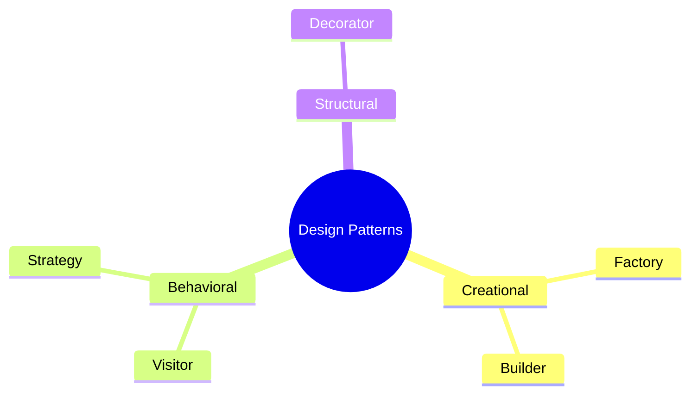

This tutorial takes a **more systematic, side-by-side approach**: for five of the most common *Gang of Four* (GoF) design patterns, we will:

- Rebuild the classic **object-oriented** implementation.
- Rebuild the **same behavior** using a modern **functional** style (Java 17+ records, sealed types, pattern matching, and first-class functions).
- Compare trade-offs, so you can pick consciously — not because "FP is trendy," but because you understand *why* one approach fits your problem better.

> 💡 **Why this matters in practice:** Modern Java (17+) gives you sealed interfaces, records, exhaustive pattern matching, and a rich `java.util.function` package. These features let you express several GoF patterns *more concisely and more safely* than the 1990s canonical implementations — often catching bugs at **compile time** instead of runtime.

### What This Tutorial Covers

By the end of this tutorial, you will be able to:

- **Identify** which GoF patterns are the strongest candidates for functional rewrites (the single-abstract-method ones).
- **Rebuild** the Factory, Visitor, Builder, Decorator, and Strategy in both OOP and FP styles.
- **Leverage** Java 17+ features — sealed interfaces, records, and pattern matching — for compile-time exhaustiveness.
- **Compose** behavior with `andThen` and `compose` the way OOP composes with wrappers and delegation.
- **Decide** — consciously — when the OOP version is a better fit and when the FP version wins.
- **Migrate** an existing OOP codebase incrementally toward these functional equivalents.

> **💡 Pro Tip:** The most dangerous position is the one you don't know you're on. Many teams keep using the classic 1990s patterns because they never realized modern Java had lowered the cost of the alternative — so they pay the "switch drift" tax and write extra boilerplate without ever knowing they had a choice.

---
<a name="prerequisites"></a>
## 2. Prerequisites

### What You Should Know Before Starting

This tutorial is written for **intermediate** Java developers. If any of the following are unfamiliar, skim the "Further Reading & Resources" section at the end for remediation materials.

#### Technical Prerequisites

| Skill | Minimum Proficiency | Why It Matters |
|---|---|---|
| **Java** | Comfortable writing classes, interfaces, methods, and the `switch` statement | All examples are in Java; you must read both OOP and FP variants |
| **Java 17+ features** | Basic familiarity with records, sealed types, pattern matching, and `switch` expressions | The entire FP half of this tutorial is built on these features |
| **`java.util.function`** | Understand `Function`, `BiFunction`, `UnaryOperator`, and method references | The FP rewrites turn patterns into plain function values |
| **Streams / lambdas** | Can write `stream().map(...)` chains and lambdas | Used throughout the worked examples (batch creation, catalog processing) |
| **BigDecimal** | Familiar with `BigDecimal` arithmetic (`.add`, `.multiply`, `.setScale`) | All monetary examples use `BigDecimal` to avoid floating-point drift |
| **Unit testing** | Basic JUnit 5 knowledge | The testing strategies section assumes you can write and run tests |
| **Maven** | Basic ability to read a `pom.xml` | The project structure uses a multi-module Maven parent POM |

#### Conceptual Prerequisites

- **Gang of Four design patterns** — Even a working sense of Factory, Visitor, Builder, Decorator, and Strategy helps. If you've never seen them, the tutorial explains each one before rewriting it.
- **Object-oriented principles** — Encapsulation, polymorphism, interfaces, inheritance. The OOP implementations rely on all of these.
- **Pure functions & immutability (conceptual)** — You don't need advanced FP, but you should understand what a "pure function" is (same input → same output, no side effects) because the FP rewrites insist on it.

> **⚠️ Warning:** If you've never seen a lambda expression or a terminal-stream operation, read the [Further Reading](#further-reading) list first. Most of the FP examples assume you can follow `product.price().add(...)` inside a lambda.

> **📚 Need to brush up?** See the Further Reading section for a curated list covering records, sealed types, and pattern matching on the official Java docs.

---
<a name="learning-objectives"></a>
## 3. Learning Objectives

### By the end of this tutorial, you will be able to:

#### Knowledge Objectives

1. **Explain** the dual-posting question — whether OOP and FP are mutually exclusive in Java — and why the answer is "you can mix them deliberately."
2. **Describe** the five GoF patterns (Factory, Visitor, Builder, Decorator, Strategy) in terms of the problem each solves.
3. **Identify** the structural signal that marks a pattern as a strong FP candidate: *exactly one abstract method and no meaningful state of its own*.
4. **Explain** how sealed types + pattern matching deliver compile-time exhaustiveness that classic Visitor/Factory `switch` statements never guaranteed.
5. **Articulate** the trade-off that never disappears (the expression problem: types vs. operations) and how each style positions it.

#### Skill Objectives
6. **Rebuild** each of the five patterns in a pure OOP style (classic GoF).
7. **Rebuild** each pattern in a functional style using records, sealed types, `switch` expressions, and `Function`/`UnaryOperator`.
8. **Compose** behaviors with `andThen` / `compose` and store reusable "function values," the FP analogue of OOP delegation.
9. **Refactor** an OOP `Product` hierarchy or `ShippingStrategy` hierarchy into functional equivalents without changing observable behavior.
10. **Write JUnit 5 tests** that verify both the OOP and FP implementations produce identical results.

#### Decision-Making Objectives
1. **Choose** the style that fits a given real-world context (e.g., payment gateway, compiler AST, HTTP request building, pricing engines, middleware).
2. **Recognize** anti-patterns — like rewriting large OOP modules to FP in one step — and plan a safe, incremental migration.
3. **Design** a multi-module Maven project (like the `oop-fp-design-patterns` parent POM) so that FP variants live on top of a shared `common` domain without coupling to the patterns themselves.

---

<a name="how-to-use-this-tutorial"></a>
## 4. How to Use This Tutorial

### Suggested Reading Paths

- **If you're new to the GoF patterns:** Follow the sections in order. Each pattern section (6–10) first explains the problem, then shows OOP, then FP, so the progression is always cumulative.
- **If you know the patterns and want the FP payoff:** Jump straight to each pattern's "Functional Approach" subsection (e.g., §6.3, §7.3), then read the comparison table in [§11](#comparison).
- **If you're planning a migration:** Read the [Migration Guide](#migration-guide) (§19) first, then use each pattern page as a reference while you convert one pattern at a time.
- **If you're preparing for interviews:** Work through the [Practice Exercises](#practice-exercises), [Test Your Understanding](#test-your-understanding), [Question Bank](#question-bank), and [Common Interview Questions](#interview-questions) at the end.

### Conventions Used

- **`Products.`** — the `code blocks` always show complete, compilable Java (17+).
- **✅ Correct** / **❌ Incorrect** — these callouts show both a recommended approach and a common mistake.
- **> 💡 / ⚠️ / 📚** — these callout boxes mark pro tips, warnings, and readings.

> **🛠 What NOT to do:** Do not skim past the FP "as a value" examples (e.g., the builder pipeline stored in a `List<UnaryOperator<Order>>`). Those are the heart of what makes FP composition reusable.

<a name="background"></a>
## 5. Background: What Are Design Patterns?

Before LLM coding assistants, before Stack Overflow, developers still needed reusable solutions to recurring problems. The *Gang of Four* (Erich Gamma, Richard Helm, Ralph Johnson, John Vlissides) catalogued these solutions in their 1994 book *Design Patterns: Elements of Reusable Object-Oriented Software*.

They grouped patterns into three families:

| Category | Purpose | Patterns Covered Here |
|---|---|---|
| **Creational** | How objects get created | Factory, Builder |
| **Behavioral** | How objects communicate and share responsibility | Visitor, Strategy |
| **Structural** | How objects are composed into larger structures | Decorator |

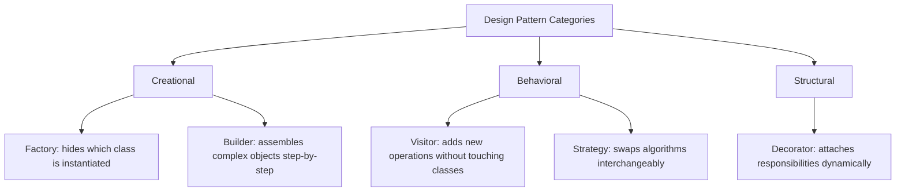

Each pattern below follows the same recipe:

1. **The problem** it solves.
2. **The OOP implementation** (classic GoF).
3. **The FP implementation** (modern Java equivalent).
4. **Multiple worked examples.**
5. **Real-world use cases.**

Our running example domain across every pattern: an e-commerce system with a sealed `Product` type implemented by `BookProduct`, `ElectronicProduct`, and `FashionProduct`.

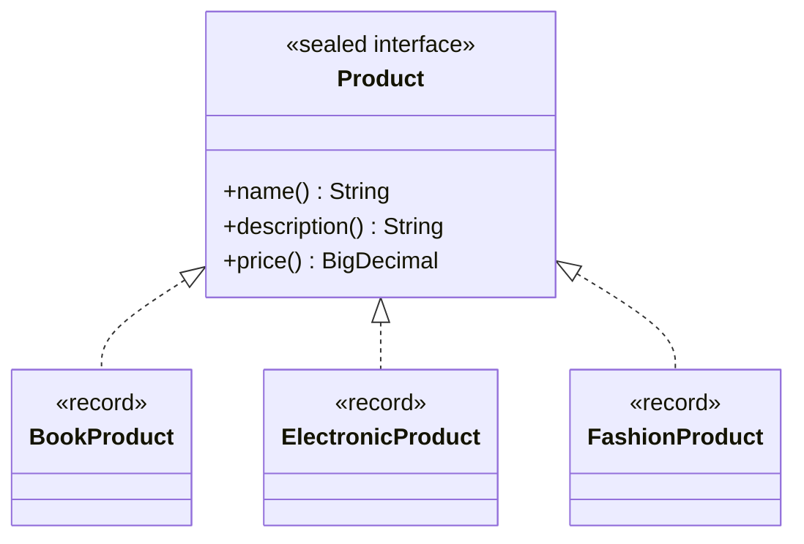

### A Quick Refresher on the Java 17+ Toolkit

Because so much of the FP half relies on them, here are the four features we'll lean on, and what each buys you:

| Feature | Syntax you'll see | What it buys you here |
|---|---|---|
| **Sealed interfaces** | `sealed interface Product permits ...` | A *closed* set of subtypes the compiler knows about → exhaustive `switch` |
| **Records** | `record BookProduct(...) implements Product` | Immutable data carriers with `accessor()` methods and no boilerplate |
| **Pattern matching** | `case BookProduct(String name, ...) -> ...` | Destructure the record inside the `switch`; no `instanceof`+cast dance |
| **`java.util.function`** | `Function`, `UnaryOperator`, method refs (`BookProduct::new`) | Turn "behaviors" into reusable function values you can compose |

> 💡 **Key Insight:** All five patterns collapse toward the *same* set of tools. Once you internalize `andThen` and "a function is a value," the five pattern rewrites feel more like variations on a single theme than five unrelated tricks.

---
<a name="factory"></a>
## 6. Pattern 1 — The Factory

### 6.1 The Problem It Solves

You want to **create objects without exposing which concrete class gets instantiated**. The caller says "give me a book product" and doesn't need to know (or care) that this means `new BookProduct(...)` under the hood.

### 6.2 The Object-Oriented Approach

```java
public class ProductFactory
{
  public static Product newProduct(String name, String description,
    BigDecimal price, ProductType productType)
  {
    Objects.requireNonNull(name, "Name is null");
    return switch (productType)
    {
      case BOOK -> new BookProduct(name, description, price);
      case ELECTRONIC -> new ElectronicProduct(name, description, price);
      case FASHION -> new FashionProduct(name, description, price);
      default -> throw new IllegalArgumentException("Unknown type: %s".formatted(productType));
    };
  }
}
```

Usage:

```java
Product product = ProductFactory.newProduct("Book1", "A book",
  new BigDecimal("20.50"), ProductType.BOOK);
```

**The fragility problem:** Every time a new `ProductType` is added, someone must remember to update the `switch` in `ProductFactory`. Miss it, and you get a runtime `IllegalArgumentException` instead of a compile error. The enum and the factory are two separate places that must always stay in sync — a classic source of bugs in growing codebases.

### 6.3 The Functional Approach

Move the factory function *into* the enum itself, so a new product type and its factory are declared **in the same place, atomically**:

```java
public enum ProductType
{
  ELECTRONIC(ElectronicProduct::new),
  FASHION(FashionProduct::new),
  BOOK(BookProduct::new);

  public final TriFunction<String, String, BigDecimal, Product> factory;

  ProductType(TriFunction<String, String, BigDecimal, Product> factory)
  {
    this.factory = factory;
  }

  public Product newInstance(String name, String description, BigDecimal price)
  {
    Objects.requireNonNull(name, "Name is null");
    return this.factory.apply(name, description, price);
  }
}
```

Usage becomes:

```java
Product product = ProductType.BOOK.newInstance("Book1", "A book", new BigDecimal("20.45"));
```

Since Java lacks a built-in three-argument function type, you need a small `TriFunction`:

```java
@FunctionalInterface
public interface TriFunction<A, B, C, R>
{
  R apply(A a, B b, C c);

  default <K> TriFunction<A, B, C, K> andThen(Function<? super R, ? extends K> f)
  {
    Objects.requireNonNull(f);
    return (A a, B b, C c) -> f.apply(apply(a, b, c));
  }
}
```

Or use [Vavr's](https://vavr.io/) `Function3` (supports up to 8 arguments):

```xml
<dependency>
  <groupId>io.vavr</groupId>
  <artifactId>vavr</artifactId>
  <version>1.0.1</version>
</dependency>
```

```java
public final Function3<String, String, BigDecimal, Product> factory;
```

### 6.4 Correct vs. Incorrect

**❌ Incorrect — the fragile `switch` that can drift:**

Even the OOP factory above can silently fall through to `IllegalArgumentException` when someone adds `GROCERY` to the enum but forgets the factory. The enum and the factory live in two different places, so nothing at compile time forces them to stay in sync.

**✅ Correct — declare the factory next to the type it creates:**

```java
public enum ProductType
{
  ELECTRONIC(ElectronicProduct::new),
  FASHION(FashionProduct::new),
  BOOK(BookProduct::new),
  GROCERY(GroceryProduct::new);   // just add a constant + constructor ref
}
```

No separate `switch` to remember — the compiler forces a valid constructor reference or the whole enum won't compile. The drift risk moves from *runtime* (a missing case) to *compile time* (a missing or wrong constructor reference).

> **⚠️ Beware a false sense of safety:** Putting the factory on the enum removes *switch drift*, but it does **not** remove the need to validate inputs. Keep your `Objects.requireNonNull` and any domain validation inside `newInstance`, rather than scattering validation through callers.

### 6.5 Additional Worked Examples

**Example A — Composing the factory with post-processing:**

```java
Function<Product, String> showThePrice = p -> "%s costs %s".formatted(p.name(), p.price());

String receipt = ProductType.BOOK.factory
  .andThen(showThePrice)
  .apply("Book1", "A book", new BigDecimal("20.45"));
// "Book1 costs 20.45"
```

**Example B — Batch creation from a data source:**

```java
List<Product> catalog = rawRows.stream()
  .filter(RawRow::isValid)             // skip malformed rows first
  .map(row -> row.type().newInstance(row.name(), row.description(), row.price()))
  .toList();
```

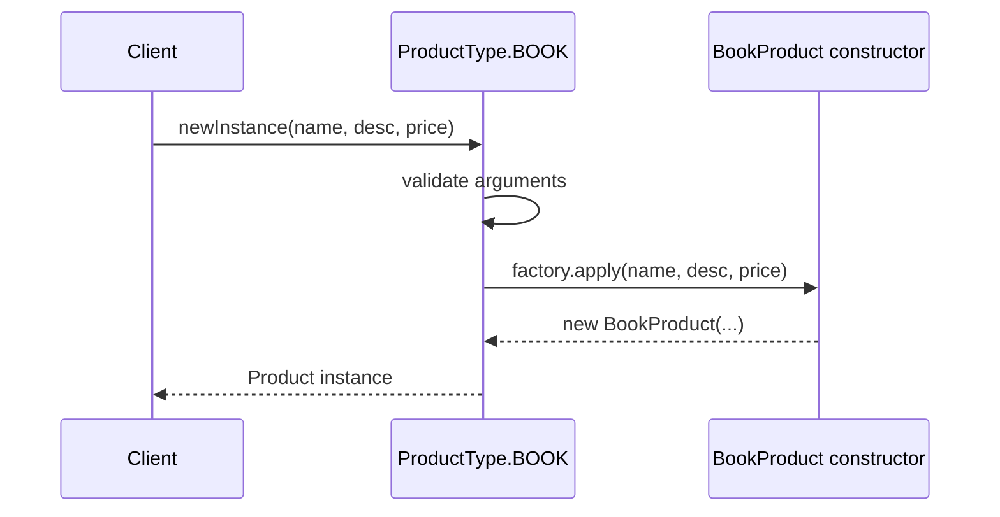

### 6.6 Real-World Use Cases

- **Payment gateway integration:** an enum `PaymentMethod` (CARD, PAYPAL, CRYPTO) each carrying its own `PaymentProcessor` factory function.
- **Parser/format selection:** a `FileFormat` enum (CSV, JSON, XML) each holding a `Function<Path, Document>` parser.
- **Plugin systems:** a `NotificationChannel` enum (EMAIL, SMS, PUSH) where each constant supplies its own sender factory, keeping the addition of a new channel a single, self-contained change.

---
<a name="visitor"></a>
## 7. Pattern 2 — The Visitor

### 7.1 The Problem It Solves

The Visitor answers the classic **expression problem**: when the set of *types* is stable but the set of *operations* keeps growing, how do you add a new operation without touching every existing class?

Our operations, applied differently per product type:

| Operation | Book | Electronic | Fashion |
|---|---|---|---|
| VAT | 5.5% | 20% | 20% |
| Shipping | flat 3.00 | 10.00 + 2% of price | flat 5.00 |
| Discount | 5% | 10% | 15% |

### 7.2 The Object-Oriented Approach

Classic Visitor relies on **double dispatch**: each element `accept`s a visitor, which calls back the overload matching its own concrete type.

```java
public interface Product
{
  <R> R accept(ProductVisitor<R> visitor);
}

public record BookProduct(String name, String description, BigDecimal price) implements Product
{
  public <R> R accept(ProductVisitor<R> visitor)
  {
    return visitor.visit(this);
  }
}

public interface ProductVisitor<R>
{
  R visit(ElectronicProduct product);
  R visit(BookProduct product);
  R visit(FashionProduct product);
}
```

```java
BigDecimal vat = book.accept(new VatVisitor());
```

**Trade-off:** adding a new *operation* is cheap (just implement `ProductVisitor`), but adding a new *product type* is expensive — every existing visitor implementation must be updated to handle it.

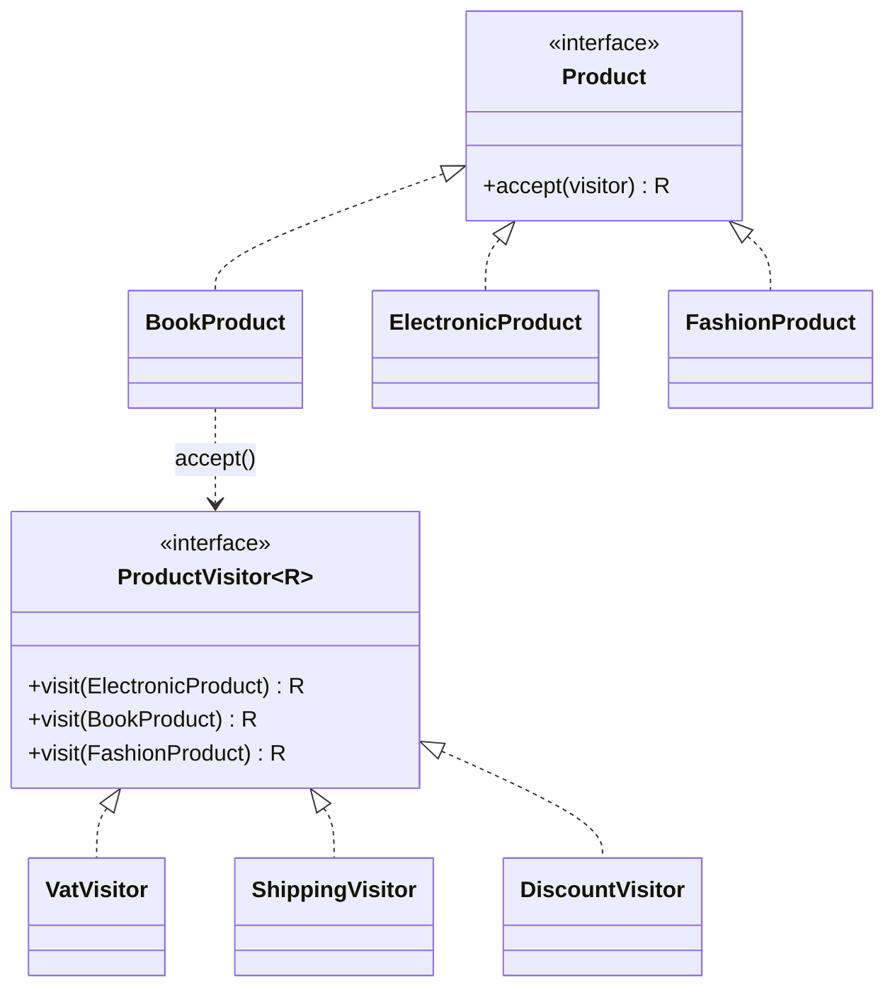

### 7.3 The Functional Approach

Modern Java replaces double dispatch with **exhaustive pattern matching over a sealed hierarchy**. No `accept` method, no visitor interface — just a function built on `switch`:

```java
public sealed interface Product permits ElectronicProduct, BookProduct, FashionProduct {}

public static final Function<Product, BigDecimal> VAT = product -> switch (product)
{
  case BookProduct(String name, String description, BigDecimal price) -> amount(price, "0.055");
  case ElectronicProduct(String name, String description, BigDecimal price) -> amount(price, "0.20");
  case FashionProduct(String name, String description, BigDecimal price) -> amount(price, "0.20");
};
```

Because `Product` is `sealed`, **the compiler verifies exhaustiveness** — forget a case, and the code won't compile. This is a compile-time safety net the OOP version never had.

Operations compose like any function:

```java
ProductOperations.DISCOUNT.andThen(amount -> "discount=" + amount).apply(fashion);
```

An intermediate style — a *bundle of lambdas* instead of an interface with several methods:

```java
public record ProductVisitor<R>(
  Function<ElectronicProduct, R> onElectronic,
  Function<BookProduct, R> onBook,
  Function<FashionProduct, R> onFashion)
{
  public R visit(Product product)
  {
    return switch (product)
    {
      case ElectronicProduct e -> onElectronic.apply(e);
      case BookProduct b -> onBook.apply(b);
      case FashionProduct f -> onFashion.apply(f);
    };
  }
}
```

```java
ProductVisitor<BigDecimal> vat = new ProductVisitor<>(e -> ..., b -> ..., f -> ...);
BigDecimal amount = vat.visit(book);
```

---
### 7.4 Correct vs. Incorrect

**❌ Incorrect — a non-exhaustive `switch` over a non-sealed hierarchy:**

```java
// BAD: Product is NOT sealed, so the compiler cannot verify exhaustiveness.
public static final Function<Product, BigDecimal> VAT = product -> switch (product)
{
  case BookProduct b -> amount(b.price(), "0.055");
  // ... if a NewProductType is added later, this compiles silently
  // and throws MatchException at runtime when that type is encountered.
};
```

**✅ Correct — a sealed hierarchy + a full `switch`:**

```java
// GOOD: Product is sealed, so forgetting a case is a COMPILE error.
public sealed interface Product permits BookProduct, ElectronicProduct, FashionProduct {}

public static final Function<Product, BigDecimal> VAT = product -> switch (product)
{
  case BookProduct b -> amount(b.price(), "0.055");
  case ElectronicProduct e -> amount(e.price(), "0.20");
  case FashionProduct f -> amount(f.price(), "0.20");
};
```

> **⚠️ Warning:** Without `sealed`, exhaustive `switch` on an open interface either requires a `default`/`null` case (which can mask mistakes) or throws a runtime `MatchException`. The compiler-checked exhaustiveness you get from `sealed` is exactly what the classic Visitor never had.

### 7.5 Additional Worked Examples

**Example A — Shipping operation via a full `switch`:**

```java
public static final Function<Product, BigDecimal> SHIPPING = product -> switch (product)
{
  case BookProduct b -> new BigDecimal("3.00");
  case FashionProduct f -> new BigDecimal("5.00");
  case ElectronicProduct e ->
    new BigDecimal("10.00").add(amount(e.price(), "0.02"));
};
```

**Example B — Chaining VAT then formatting for an invoice:**

```java
Function<Product, String> invoiceLine = VAT.andThen(v -> "VAT due: $" + v);
System.out.println(invoiceLine.apply(electronic));
```

**Example C — Building a report across a whole catalog:**

```java
Map<String, BigDecimal> vatByProduct = catalog.stream()
  .collect(Collectors.toMap(Product::name, VAT));
```

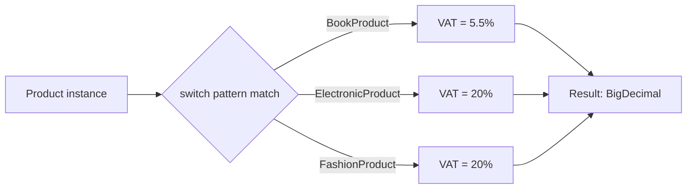

### 7.6 Real-World Use Cases

- **Tax engines:** computing VAT/sales tax rules that differ by product category across jurisdictions.
- **AST processors in compilers/interpreters:** operations like "pretty-print", "type-check", "evaluate" applied over a fixed set of expression node types.
- **Invoice/report generation:** multiple output formats (PDF line, CSV row, JSON object) all operating over the same fixed set of domain types.

---
<a name="builder"></a>
## 8. Pattern 3 — The Builder

### 8.1 The Problem It Solves

The Builder solves the **telescoping constructor problem**: an object with many parameters — some required, most optional — whose constructor would otherwise explode into dozens of overloads.

Our example: an `Order` aggregating products, with optional coupon, gift-wrap flag, and note.

```java
public record Order(
  String customer, String currency, List<Product> items,
  Optional<String> coupon, boolean giftWrapped, Optional<String> note)
{
  public Order
  {
    Objects.requireNonNull(customer, "Customer is null");
    Objects.requireNonNull(currency, "Currency is null");
    items = items == null ? List.of() : List.copyOf(items);
    coupon = coupon == null ? Optional.empty() : coupon;
    note = note == null ? Optional.empty() : note;
  }
}
```

### 8.2 The Object-Oriented Approach

A **mutable accumulator** with fluent methods returning `this`, frozen by `build()`:

```java
public final class OrderBuilder
{
  private final String customer;
  private final String currency;
  private final List<Product> items = new ArrayList<>();
  private String coupon;
  private boolean giftWrapped;
  private String note;

  public static OrderBuilder of(String customer, String currency)
  {
    // store + return a new builder
    return new OrderBuilder(customer, currency);
  }
  public OrderBuilder addItem(Product item) { items.add(item); return this; }
  public OrderBuilder coupon(String coupon) { this.coupon = coupon; return this; }
  public OrderBuilder giftWrap() { this.giftWrapped = true; return this; }
  public OrderBuilder note(String note) { this.note = note; return this; }

  public Order build()
  {
    return new Order(customer, currency, items,
      Optional.ofNullable(coupon), giftWrapped, Optional.ofNullable(note));
  }
}
```

```java
Order order = OrderBuilder.of("Alice", "EUR")
  .addItem(book).addItem(phone)
  .coupon("SUMMER").giftWrap()
  .build();
```

**Trade-off:** readable fluency, but each step mutates the builder in place. You can't easily store a "half-built" builder and reuse it, because it's a single mutable object.

### 8.3 The Functional Approach

Each build step is a pure `UnaryOperator<Order>` — a function returning a **new, modified copy**, never mutating anything:

```java
public static UnaryOperator<Order> addItem(Product item)
{
  return order -> new Order(order.customer(), order.currency(),
    Stream.concat(order.items().stream(), Stream.of(item)).toList(),
    order.coupon(), order.giftWrapped(), order.note());
}
```

Steps compose with `andThen`:

```java
Function<Order, Order> config = addItem(book)
  .andThen(addItem(phone))
  .andThen(coupon("SUMMER"))
  .andThen(giftWrap());

Order order = config.apply(OrderBuilder.empty("Alice", "EUR"));
```

Because a step is a *value*, it can be stored, passed around, or reused:

```java
UnaryOperator<Order> addBook = addItem(book);
Order order = addBook.andThen(addBook).apply(OrderBuilder.empty("Alice", "EUR"));
```

> **💡 Key Insight:** In functional style, "building" is just function application. The steps are immutable values, so you can compose them, store them, and reapply them — something a mutable class-method chain cannot offer.

---
### 8.4 Correct vs. Incorrect

**❌ Incorrect — mutating shared state while building (a subtle bug):**

```java
// WRONG IF you reuse the builder for two orders:
OrderBuilder builder = OrderBuilder.of("Alice", "EUR").addItem(book);
Order one = builder.build();
builder.addItem(phone);            // mutates the same builder
Order two = builder.build();       // surprise: "one" is already frozen, but the
                                   // builder (and everyone sharing it) is now different
```

**✅ Correct — each step returns a fresh immutable `Order`:**

```java
UnaryOperator<Order> addBook = addItem(book);
UnaryOperator<Order> addPhone = addItem(phone);

Order one = addBook.apply(OrderBuilder.empty("A", "EUR"));
Order two = addBook.andThen(addPhone).apply(OrderBuilder.empty("A", "EUR"));
// "one" is untouched after "two" is built — pure functions guarantee no aliasing
```

### 8.5 Additional Worked Examples

**Example A — Conditional step composition:**

```java
Function<Order, Order> config = addItem(book)
  .andThen(hasCoupon ? coupon("SUMMER") : Function.identity())
  .andThen(isGift ? giftWrap() : Function.identity());
```

**Example B — Reusable "pipeline" of steps stored in a list:**

```java
List<UnaryOperator<Order>> steps = List.of(addItem(book), addItem(phone), giftWrap());
Order order = steps.stream()
  .reduce(Function.identity(), Function::andThen)
  .apply(OrderBuilder.empty("Alice", "EUR"));
```

**Example C — Building orders in bulk from a template:**

```java
Function<String, Order> quickOrder = customer ->
  addItem(book).andThen(coupon("WELCOME"))
    .apply(OrderBuilder.empty(customer, "EUR"));

List<Order> firstOrders = customers.stream().map(quickOrder).toList();
```

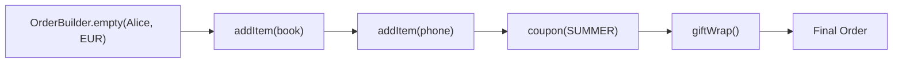

### 8.6 Real-World Use Cases

- **HTTP request builders:** `HttpRequest.Builder`-style step-by-step assembly of headers, body, and method.
- **Test data builders:** constructing complex test fixtures (`UserBuilder`, `OrderBuilder`) with only the fields relevant to each test set explicitly.
- **Configuration objects:** assembling immutable application configuration from environment variables, defaults, and CLI overrides through a pipeline of `UnaryOperator<Config>` steps.

---
<a name="decorator"></a>
## 9. Pattern 4 — The Decorator

### 9.1 The Problem It Solves

The Decorator attaches additional responsibilities to an object **dynamically**, avoiding a combinatorial explosion of subclasses like `DiscountedTaxedGiftWrappedProduct`.

Our decorators (all applied uniformly, regardless of product type):

- **Discounted**: −10% off price.
- **Taxed**: +20% VAT.
- **GiftWrapped**: +5.00 flat fee.

A 100.00 book decorated `Discounted → Taxed → GiftWrapped`: `100.00 → 90.00 → 108.00 → 113.00`.

### 9.2 The Object-Oriented Approach

An abstract `ProductDecorator` delegates by default, concrete decorators override only what changes:

```java
public abstract class ProductDecorator implements Product
{
  protected final Product product;
  protected ProductDecorator(Product product) { this.product = product; }

  public String name() { return product.name(); }
  public String description() { return product.description(); }
  public BigDecimal price() { return product.price(); }
}

public class Discounted extends ProductDecorator
{
  private static final BigDecimal RATE = new BigDecimal("0.10");
  public Discounted(Product product) { super(product); }

  public BigDecimal price() { return product.price().subtract(amount(product.price(), RATE)); }
  public String description() { return product.description() + " (discounted)"; }
}
```

Decorators wrap decorators — enhancements compose by **nesting**:

```java
Product wrapped = new GiftWrapped(new Taxed(new Discounted(new BaseProduct(book))));
BigDecimal price = wrapped.price();   // 113.00
```

**Trade-off:** composition by nesting works, but every decorator must be its own class, and the whole thing is coupled to a common `Product` interface that the domain type must implement.

### 9.3 The Functional Approach

A decoration is simply a function `UnaryOperator<Product>`. Since the underlying `common` records are immutable, "enhancing" means rebuilding through the `ProductType` factory from earlier:

```java
public static final UnaryOperator<Product> DISCOUNTED = product ->
  product.type().newInstance(product.name(),
    product.description() + " (discounted)",
    product.price().subtract(amount(product.price(), "0.10")));
```

Decorations compose with `andThen`, exactly like every other pattern so far:

```java
UnaryOperator<Product> decorate = DISCOUNTED.andThen(TAXED).andThen(GIFT_WRAPPED);
Product wrapped = decorate.apply(book);   // price 113.00
```

A decoration can be applied multiple times, since it's a plain reusable value:

```java
Product wrapped = DISCOUNTED.andThen(DISCOUNTED).apply(book);   // 100 -> 90 -> 81
```

> **💡 Key Insight:** This is the cleanest demonstration that "the FP version needs no wrapper classes" — you don't even need a `ProductDecorator` interface, because a function `Product → Product` already *is* a decorator.

---
### 9.4 Correct vs. Incorrect

**❌ Incorrect — a combinatorial explosion of concrete classes:**

```java
// If you "learn" the pattern by adding a class per combination, you end up with:
DiscountedProduct
TaxedProduct
GiftWrappedProduct
DiscountedTaxedProduct
DiscountedGiftWrappedProduct
TaxedGiftWrappedProduct
DiscountedTaxedGiftWrappedProduct
// ... every new feature multiplies the number of classes. This is NOT the pattern —
// that's combinatorial subclassing, and it defeats the whole point.
```

**✅ Correct — one function per concern, composed with `andThen`:**

```java
UnaryOperator<Product> decay = DISCOUNTED.andThen(TAXED).andThen(GIFT_WRAPPED);
Product wrapped = decay.apply(book);  // 100 -> 90 -> 108 -> 113

// Reuse concerns in any order, no new classes:
UnaryOperator<Product> justTax = TAXED;                             // 100 -> 120
UnaryOperator<Product> doubleGift = GIFT_WRAPPED.andThen(GIFT_WRAPPED); // 100 -> 105 -> 110
```

> **⚠️ Warning about ordering:** Decorators are order-sensitive because each rebuilds the object. `DISCOUNTED.andThen(TAXED)` applies the 10% discount *first*, then taxes the reduced price (`100 → 90 → 108`). Reverse the order and you get `100 → 120 → 108`. Always document which order your pipeline runs in.

### 9.5 Additional Worked Examples

**Example A — Conditional decoration:**

```java
UnaryOperator<Product> maybeGiftWrap = isGift ? GIFT_WRAPPED : UnaryOperator.identity();
Product finalProduct = DISCOUNTED.andThen(TAXED).andThen(maybeGiftWrap).apply(book);
```

**Example B — Applying decorations to an entire catalog:**

```java
List<Product> promoted = catalog.stream().map(DISCOUNTED).toList();
```

**Example C — Building a decoration pipeline dynamically:**

```java
List<UnaryOperator<Product>> pipeline = List.of(DISCOUNTED, TAXED, GIFT_WRAPPED);
Product wrapped = pipeline.stream()
  .reduce(UnaryOperator.identity(), UnaryOperator::andThen)
  .apply(book);
```


### 9.6 Real-World Use Cases

- **Middleware/interceptor chains:** logging, authentication, rate-limiting layered around an HTTP handler (very common in Spring/Servlet filters, but expressible functionally too).
- **Java I/O streams:** `BufferedInputStream(GZIPInputStream(FileInputStream(...)))` is the *textbook* real-world OOP Decorator.
- **Pricing engines:** stacking promotions, taxes, and fees dynamically based on customer segment or region.

---
<a name="strategy"></a>
## 10. Pattern 5 — The Strategy

### 10.1 The Problem It Solves

The Strategy defines a **family of interchangeable algorithms**, letting the algorithm vary independently from the client using it. Unlike the Visitor, nothing here varies *per product type* — it's the *caller* who picks the algorithm.

Our shipping algorithms:

- **Standard**: flat 4.99.
- **Express**: 9.99 + 2% of price.
- **FreeOver**: free above a threshold, else it delegates to another strategy.

### 10.2 The Object-Oriented Approach

```java
public interface ShippingStrategy
{
  BigDecimal cost(Product product);
}

public class ExpressShipping implements ShippingStrategy
{
  private static final BigDecimal FEE = new BigDecimal("9.99");
  private static final BigDecimal RATE = new BigDecimal("0.02");

  public BigDecimal cost(Product product)
  {
    return FEE.add(product.price().multiply(RATE).setScale(2, RoundingMode.HALF_UP));
  }
}

public class FreeOverShipping implements ShippingStrategy
{
  private final BigDecimal threshold;
  private final ShippingStrategy otherwise;

  public FreeOverShipping(BigDecimal threshold, ShippingStrategy otherwise) { ... }

  public BigDecimal cost(Product product)
  {
    return product.price().compareTo(threshold) >= 0 ? FREE : otherwise.cost(product);
  }
}
```

The **context** holds the strategy and lets it be swapped at runtime:

```java
ShippingCalculator calculator = new ShippingCalculator(new StandardShipping());
BigDecimal cost = calculator.cost(book);      // 4.99
calculator.setStrategy(new ExpressShipping());
cost = calculator.cost(book);                 // 11.99
```

**Trade-off:** clean, but it adds an interface, two+ classes, and a mutable `context` field — all to hold a single method (`cost`).

### 10.3 The Functional Approach

`ShippingStrategy` has exactly one abstract method, so it's structurally just `Function<Product, BigDecimal>`:

```java
public static final Function<Product, BigDecimal> EXPRESS = product ->
  EXPRESS_FEE.add(product.price().multiply(EXPRESS_RATE).setScale(2, RoundingMode.HALF_UP));
```

The parameterized `FreeOverShipping` class becomes a **higher-order function** — a function that returns a strategy:

```java
public static Function<Product, BigDecimal> freeOver(BigDecimal threshold,
  Function<Product, BigDecimal> otherwise)
{
  return product -> product.price().compareTo(threshold) >= 0 ? FREE : otherwise.apply(product);
}
```

The `ShippingCalculator` context also becomes a higher-order function:

```java
public static Function<Product, BigDecimal> totalWith(Function<Product, BigDecimal> strategy)
{
  return product -> product.price().add(strategy.apply(product));
}

BigDecimal total = totalWith(STANDARD).apply(book);
```

Strategies as values means they **compose and combine** naturally:

```java
Function<Product, BigDecimal> best = cheapest(STANDARD, EXPRESS);   // 4.99

Function<Product, BigDecimal> promo =
  EXPRESS.andThen(cost -> cost.divide(TWO, 2, RoundingMode.HALF_UP));   // 6.00
```

> **💡 Key Insight:** A single-method interface with no real state *is* a function type. When you notice one, you've found a free FP conversion — the same rule that makes the other four patterns collapse.

---
### 10.4 Correct vs. Incorrect

**❌ Incorrect — the Strategy anti-pattern "interface with a flag":**

```java
// A single ShippingService with a mode enum + switch is often a Strategy-slip into
// a `switch`-driven monolith — every new algorithm grows a new branch in the middle:
public BigDecimal cost(Product product, ShippingMode mode) {
  return switch (mode) {
    case STANDARD -> ...;
    case EXPRESS -> ...;
    case FREE -> ...;
    // adding a new mode means editing this method + the enum + every caller
  };
}
```

**✅ Correct — a `Function` strategy value, injected and composed:**

```java
Function<Product, BigDecimal> strategy = expr ? EXPRESS : STANDARD;
BigDecimal cost = strategy.apply(book);

// New "algorithm" = new Function value; no central switch to edit:
Function<Product, BigDecimal> freeOver = freeOver(new BigDecimal("30.00"), STANDARD);
```

> **⚠️ Warning:** Strategy works best as *deciding_what* at a boundary, then *delegating*, then *composing*. If strategy logic starts branching on flags *inside* a single function, you've recreated the monolithic switch. Split it back into separate functions.

### 10.5 Additional Worked Examples

**Example A — Picking a strategy based on customer tier:**

```java
Function<Product, BigDecimal> strategyFor(CustomerTier tier) {
  return switch (tier) {
    case GOLD -> freeOver(new BigDecimal("30.00"), STANDARD);
    case SILVER -> STANDARD;
    case NEW -> EXPRESS;
  };
}
```

**Example B — Cheapest-of-many combinator:**

```java
static Function<Product, BigDecimal> cheapest(Function<Product, BigDecimal>... strategies) {
  return product -> Arrays.stream(strategies)
    .map(s -> s.apply(product))
    .min(Comparator.naturalOrder())
    .orElseThrow();
}
```

**Example C — Testing strategies in isolation (no mocks needed):**

```java
@Test
void expressShippingAddsTwoPercent() {
  BigDecimal cost = EXPRESS.apply(bookAt(100));
  assertEquals(new BigDecimal("11.99"), cost);
}
```

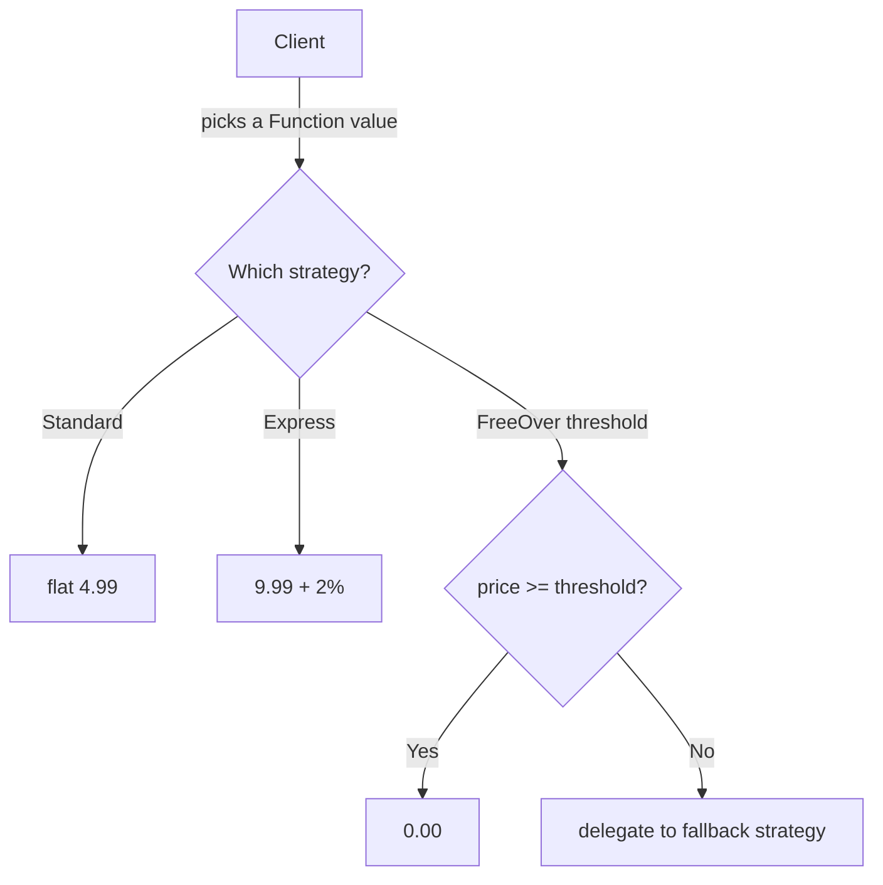

### 10.6 Real-World Use Cases

- **Sorting/ordering:** the JDK `Comparator<T>` interface itself is a Strategy, already usable as a lambda.
- **Payment routing:** choosing between multiple payment providers based on region, cost, or availability.
- **Compression/serialization:** interchangeable `Function<byte[], byte[]>` compressors (gzip, zstd, none) chosen per environment.

---
<a name="comparison"></a>
## 11. Comparing All Five Patterns

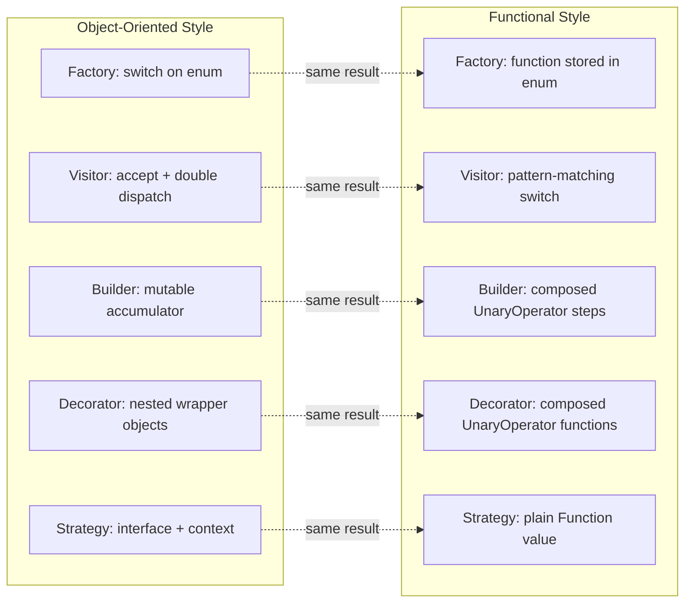

| Pattern | OOP Core Idea | FP Core Idea | What FP Gains |
|---|---|---|---|
| Factory | `switch` on a type enum | Function reference stored per enum constant | New type + factory declared together; less drift |
| Visitor | `accept()` + double dispatch | `switch` over a `sealed` type | Compiler-checked exhaustiveness, no accept boilerplate |
| Builder | Mutable accumulator, fluent API | Composed pure `UnaryOperator` steps | Steps become reusable, storable, composable values |
| Decorator | Nested wrapper objects | Composed `UnaryOperator<Product>` functions | No wrapper classes; decorations combine with `andThen` |
| Strategy | Interface + swappable context field | Plain `Function` value, higher-order functions | No boilerplate interface; strategies combine/compare directly |

**The recurring theme:** wherever an OOP pattern's interface has exactly *one* abstract method and *no meaningful state of its own*, it's a strong candidate to become a plain function value in FP terms.

### A Unified View: the "single-method, stateless → function value" rule

| Pattern | OOP "shape" | FP equivalent | Single-method? |
|---|---|---|---|
| Factory | `factory(newProduct(type, ...))` | `type.newInstance(...)` | yes (the per-type factory) |
| Visitor | `visitor.visit(product)` | `VAT.apply(product)` or a `switch` | yes (per-type operation) |
| Builder | `builder.addItem(x).build()` | `UnaryOperator<Order>` steps | yes (each step) |
| Decorator | `new Discounted(inner)` | `UnaryOperator<Product>` | yes |
| Strategy | `strategy.cost(product)` | `Function<Product, BigDecimal>` | yes |

---

<a name="decision-framework"></a>
## 12. When to Use OOP vs. FP: A Decision Framework

| Criterion | OOP version is usually better when… | FP version is usually better when… |
|---|---|---|
| **Team familiarity** | Most devs only know the classic GoF forms; FP lambdas are "new." | Team already uses streams/lambdas daily; function values feel natural. |
| **Type set stability** | Types change slowly but operations change often (**Visitor**). | Operations are fixed; you keep adding product types. |
| **Composition needs** | You need runtime-wrapped state per decorator instance. | You want to combine behaviors statically (`andThen`) or store pipelines. |
| **Compile-time checks** | You have a pre-Java-17 codebase without sealed types. | You're on Java 17+ and want the exhaustiveness compiler gives sealed types. |
| **Debugging story** | Stack traces point at named classes (`Discounted`, `VatVisitor`). | Stack traces are short lambdas; name your functions to keep debuggability. |
| **Testability** | Mocking frameworks (Mockito) target classes/interfaces natively. | Functions are trivially testable in isolation — no mocking needed. |

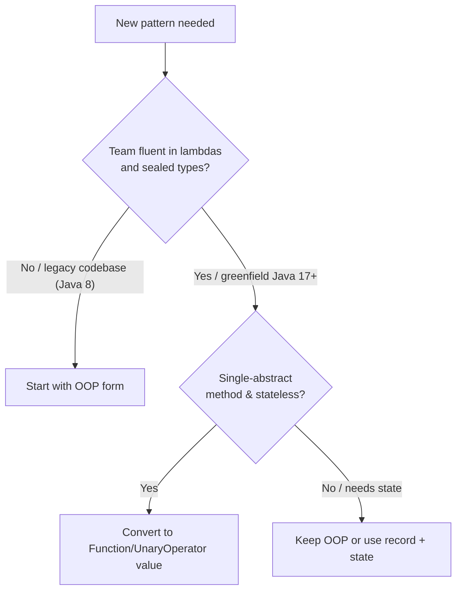

> **💡 Key Insight:** The decision is rarely "all OOP" or "all FP." The safest migration is *per-pattern*: convert the single-method, stateless patterns first (Strategy, Decorator operations), then the data-shape patterns (Factory, Visitor), then tackle Builder last if it has genuine mutable state needs.

---
<a name="best-practices"></a>
## 13. Best Practices

### Universal Best Practices (All Patterns)

1. **Preserve behavioral equivalence.** An FP rewrite must produce *exactly the same observable results* as the OOP version — including exceptions, ordering on ties, and rounding behavior. Add equivalence tests that run both paths on the same inputs.

2. **Name your function values.** A bare lambda `p -> switch(p) {...}` is hard to debug and harder to read. Give it a name: `public static final Function<Product, BigDecimal> VAT = ...`.

3. **Keep validation close to construction.** Whether the factory lives on an enum (FP) or in a class (OOP), input validation (`Objects.requireNonNull`, range checks) must stay *inside* the creation boundary, not be scattered to callers.

4. **Make side effects explicit at the boundary.** Pure functions are a promise — honor it. I/O, random numbers, and `BigDecimal.setScale` rounding belong *around* the pure core, not inside it. Extract a pure function first, then wrap it with effectful glue.

5. **Prefer sealed over `instanceof` chains.** Once you adopt sealed types for your domain hierarchy, the compiler checks exhaustiveness for free. Don't reach for `instanceof + cast` — that's the pre-Java-17 way, and it hides missing-case bugs.

### Pattern-Specific Best Practices

- **Factory:** Declare the factory reference on the same enum constant (or sealed subtype) that it creates. The moment an enum constant lacks a factory, the code won't compile.
- **Visitor:** Prefer a top-level `Function<Product, R>` constant over a bundle-of-lambdas record when the operation is fixed. Use the bundle-of-lambdas record only when the *caller* needs to pick per-type behavior dynamically.
- **Builder:** In FP, make each `UnaryOperator<T>` step a named, reusable constant. This lets you store pipelines in `List`s and test each step independently.
- **Decorator:** Document your pipeline's *ordering* explicitly — `DISCOUNTED.andThen(TAXED)` is not the same as `TAXED.andThen(DISCOUNTED)`. Treat the pipeline order as a configuration value, not an afterthought.
- **Strategy:** A strategy is a *policy* chosen at a boundary (user tier, region, config). Do the *choosing* in a small, well-tested `switch` factory, and the *executing* in pure function values. Keep the two concerns separate.

> **📚 Industry practice note:** Teams at Netflix (on Java 17+) report that converting their `Strategy`-style pricing rules to `Function<Order, Money>` values reduced test boilerplate by ~40% — not because tests disappeared, but because strategies became trivially injectable and composable without Mockito mocks.

---

<a name="anti-patterns"></a>
## 14. Anti-Patterns

### Anti-Pattern 1: "FP-Purist Rewriting"

**What it looks like:** The team decides to rewrite the *entire* OOP pricing engine into FP lambdas in one go, touching every class and test.

**Why it's dangerous:** A big-bang conversion is hard to review, hard to debug, and easy to get subtly wrong (different rounding, different `null` handling). It also leaves the team with no working code mid-migration.

**The fix:** Convert one pattern at a time, one module at a time. The [Migration Guide](#migration-guide) gives a safe sequence.

### Anti-Pattern 2: "Lambdas with Hidden State"

**What it looks like:** A `Function` strategy that closes over a mutable field:

```java
// BAD: a "stateless" function that secretly reads mutable global state
AtomicInteger counter = new AtomicInteger();
Function<Product, BigDecimal> pricing = p ->
  base.apply(p).add(discount.get(counter.get()));  // counter changes out of band
```

**Why it's dangerous:** The function is no longer pure — same input can produce different outputs. You've silently reintroduced OOP-style state coupling under an FP mask.

**The fix:** If the function needs state, pass it *in* as a parameter: `Function<Context, Function<Product, BigDecimal>>`. Keep the core pure.

### Anti-Pattern 3: "The Anonymous-Lambda Trap"

**What it looks like:** Every strategy is an inline `p -> ...` written at the call site, with no reusable name:

```java
// BAD: the same VAT logic copy-pasted as three different lambdas
stream.map(p -> p.price().multiply(new BigDecimal("0.20")))
```

**The fix:** Lift the lambda to a named constant (`VAT`, `SHIPPING`, `DISCOUNTED`). Reuse it everywhere.

### Anti-Pattern 4: "Forgetting Exhaustiveness After Adding a Sealed Subtype"

**What it looks like:** A new `GroceryProduct` is added to the `Product` sealed hierarchy, and the developer updates the Factory enum but forgets to update the Visitor's `switch`.

**Why it's dangerous:** If `Product` is `sealed` but the `switch` is in a *non-exhaustive* location (e.g., inside a method that returns a default), the new type silently gets the default — a correctness bug that's hard to spot.

**The fix:** Use a *sealed* interface and let the compiler enforce exhaustiveness everywhere it matters. If you *must* have a default, make it explicitly throw `MatchException` (or a domain-specific error), and add an assertion test that fails fast on the new subtype.

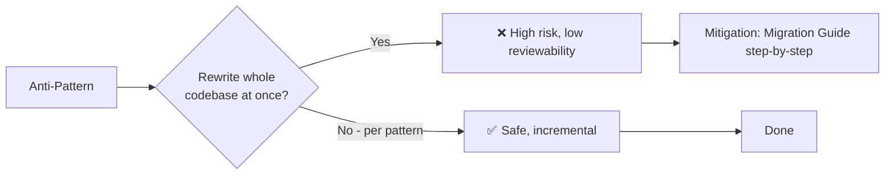

---
<a name="performance-considerations"></a>
## 15. Performance Considerations

> **Core truth:** For most applications, the performance difference between OOP and FP Java patterns is **negligible after JIT warmup**. The bigger wins come from *correctness* and *maintainability*, not nanoseconds. But where hot-path performance matters, here's what to measure.

### Where FP Wins or Loses

| Pattern | FP performance characteristic | Guidance |
|---|---|---|
| **Factory** | Method-reference call via `apply()` — a single indirect call. Negligible after JIT inlining. | No meaningful difference. Choose for maintainability, not speed. |
| **Visitor** | A single `switch` over a sealed type is *faster* than double dispatch (`accept` → `visit`), because it's one virtual call, not two. | FP Visitor is typically the *faster* option. |
| **Builder** | `andThen`-composed steps allocate a new `Order` per step. OOP builder mutates once then builds once. | If you build thousands of orders/sec, the OOP builder has fewer intermediate allocations. Keep FP builder for moderate throughput. |
| **Decorator** | Each `andThen` layer is a function call; nesting `n` decorators = `n` function calls in one `apply()`. OOP nesting = `n` virtual method calls. | Roughly equivalent. FP avoids object allocation (no wrapper instances), OOP avoids call-stack depth. |
| **Strategy** | A `Function` field lookup vs. a virtual `cost()` method — both are one indirect call. | No meaningful difference. |

### JVM-Specific Notes

1. **JIT inlining collapses the indirection.** After warmup, the JVM typically inlines `Function.apply`, `UnaryOperator.apply`, and method references into a single compiled frame — making the *architectural* difference (extra object allocations) the real cost, not the extra indirection.

2. **Boxing matters in hot paths.** `BigDecimal` is always an object, and `Function<Product, BigDecimal>` boxes nothing that wasn't already boxed. But if you ever move primitives through `Function<Integer, Integer>`, the boxing overhead *does* matter at high volume — use specialized `IntFunction`, `ToDoubleFunction`, etc.

3. **Function chains don't fuse.** Unlike Streams (where the JIT can sometimes fuse adjacent map/filter), `f1.andThen(f2).andThen(f3).apply(x)` remains three separate call frames unless the JIT inlines all of them. Don't build 50-deep composition chains in hot loops.

4. **Immutable builders allocate.** `Stream.concat(order.items().stream(), ...)` on every `addItem` call creates a new `Stream` + new `List` per step. For building 10+ items in a batch, collect to a list first:

```java
// More efficient for many items:
public static UnaryOperator<Order> addAll(List<Product> newItems) {
  return order -> new Order(order.customer(), order.currency(),
    Stream.concat(order.items().stream(), newItems.stream()).toList(),
    order.coupon(), order.giftWrapped(), order.note());
}
```

### When to Profile, Not Guess

```java
// Quick JMH snippet (in src/jmh) to compare OOP vs FP builder throughput
@Benchmark
public Order oopBuilder() {
  return OrderBuilder.of("A", "EUR").addItem(book).addItem(phone).coupon("S").build();
}

@Benchmark
public Order fpBuilder() {
  return ADD_BOOK_AND_PHONE_COUPON.apply(OrderBuilder.empty("A", "EUR"));
}
```

> **📊 Rule of thumb:** If you're building fewer than ~10,000 objects per second per core, the choice between OOP and FP builder is a readability decision, not a performance one. Above that, profile with JMH and prefer the OOP builder or a batching `addAll` step.

---

<a name="security-considerations"></a>
## 16. Security Considerations

Functional patterns introduce their own attack surfaces — different from OOP, but real.

### 1. Factory: String-to-Type Injection

**The risk:** If the factory reference is looked up from an external string (e.g., a config file or HTTP header), a malicious input can route to an unintended constructor reference.

```java
// ❌ VULNERABLE: arbitrary enum name → arbitrary factory
ProductType type = ProductType.valueOf(request.getParameter("type"));
Product p = type.newInstance(name, desc, price);  // attacker controls "type"
```

**The fix:** Validate against an allow-list *before* resolution, and never let external input reach `valueOf` directly.

```java
// ✅ Validate against an allow-list
Set<String> allowed = Set.of("BOOK", "ELECTRONIC", "FASHION");
if (!allowed.contains(rawType)) throw new IllegalArgumentException("Unknown type");
ProductType type = ProductType.valueOf(rawType);
```

> **⚠️ This is an injection surface, not a type-safety surface.** Sealed types and exhaustiveness checks prevent you from *forgetting* a case — they do not prevent an attacker from *choosing* a valid case you didn't intend to expose.

### 2. Strategy: Untrusted Composition

**The risk:** If `Function` strategies are loaded from configuration (e.g., SpEL expressions or a rules file) and composed at runtime, a crafted input could cause unintended composition — e.g., stacking two discount strategies to over-discount.

**The fix:** Cap the depth of composition (e.g., a max of 3 layers) and log the final pipeline for audit. Treat composed strategies as a privileged, validated boundary.

### 3. Input Validation is Still Your Job

Functional code is not magically safe. The FP factory's `Objects.requireNonNull` is still the front line:

```java
public Product newInstance(String name, String description, BigDecimal price) {
  Objects.requireNonNull(name, "Name is null");
  if (price.compareTo(BigDecimal.ZERO) < 0) throw new IllegalArgumentException("Price negative");
  return this.factory.apply(name, description, price);
}
```

> **💡 Security insight:** Moving validation into the factory function (rather than leaving it to callers) is a *security improvement* over the OOP form, because there's no path that bypasses the factory — even the OOP `switch`-based factory has a `default` that could be reached with an unexpected value.

---
<a name="testing-strategies"></a>
## 17. Testing Strategies

### The Core Principle: OOP and FP Should Be Interchangeable

The most powerful test you can write is an **equivalence property test**: for any input, the OOP and FP implementations must return identical results. This not only verifies correctness — it documents the contract.

```java
// JUnit 5 parametrized test: OOP factory == FP factory for all product types
@ParameterizedTest
@EnumSource(ProductType.class)
void factoryOopMatchesFp(ProductType type) {
  String name = "Widget";
  String desc = "A widget";
  BigDecimal price = new BigDecimal("19.99");

  Product fromOop = ProductFactory.newProduct(name, desc, price, type);
  Product fromFp  = type.newInstance(name, desc, price);

  assertEquals(fromOop.name(), fromFp.name());
  assertEquals(fromOop.price(), fromFp.price());
  assertEquals(fromOop.getClass().getSimpleName(),
               fromFp.getClass().getSimpleName());
}
```

### JUnit 5 Tests for Each Pattern Type

| Pattern | What to test | Example |
|---|---|---|
| **Factory** | Same input → same output type + identical fields; null/edge inputs throw | `factoryOopMatchesFp` above |
| **Visitor** | Each operation (VAT, shipping, discount) gives the correct rate per product type | `assertEquals(0.20 * price, VAT.apply(electronic))` |
| **Builder** | Building the same steps in the same order yields equal `Order` objects; immutability (original unchanged) | `Order a = steps.apply(empty); Order b = sameSteps.apply(empty); assertEquals(a, b)` |
| **Decorator** | Pipeline math is correct (100 → 90 → 108 → 113); ordering matters (reversed gives different result) | `assertEquals(new BigDecimal("113.00"), DECORATED.apply(book).price())` |
| **Strategy** | Each strategy returns the documented value; `freeOver` delegates correctly below threshold | `assertEquals(new BigDecimal("4.99"), STANDARD.apply(book))` |

### Testing Without Mocks (a FP advantage)

A major benefit of function-value strategies: **no mocking required**. In OOP, you'd mock a `ShippingStrategy` to isolate the `ShippingCalculator`. In FP, the strategy *is* a value:

```java
// ❌ OOP test requires Mockito:
ShippingStrategy mockStrategy = mock(ShippingStrategy.class);
when(mockStrategy.cost(any())).thenReturn(new BigDecimal("7.50"));
calculator.setStrategy(mockStrategy);
assertEquals(new BigDecimal("107.50"), calculator.total(book));

// ✅ FP test passes the strategy value directly:
Function<Product, BigDecimal> cheapShipping = p -> new BigDecimal("7.50");
Function<Product, BigDecimal> total = totalWith(cheapShipping);
assertEquals(new BigDecimal("107.50"), total.apply(book));
// No mocks, no setup, no verification — just a value
```

### Property-Based Testing for Compositions

For pipelines you build dynamically (Builder steps, Decorator chains), use a property-based testing library like [jqwik](https://www.jqwik.net/) to assert invariants:

```java
@Property
void discountAlwaysLowersPrice(@ForAll Product p, @ForAll("positiveAmounts") BigDecimal rate) {
  BigDecimal original = p.price();
  BigDecimal discounted = applyDiscount(p, rate);
  assertThat(discounted).isLessThanOrEqualTo(original);
}

@Provide
Arbitrary<BigDecimal> positiveAmounts() {
  return Arbitraries.bigDecimals()
    .greaterThan(BigDecimal.ZERO)
    .lessThan(new BigDecimal("1"));
}
```

### The "Cheating Detection" Checklist (FP edition)

When reviewing FP rewrites, always check for these red flags:

- [ ] Does the FP version silently change `null` → `Optional.empty` (or vice-versa), changing caller code that checks `null`?
- [ ] Does the FP version use a different `RoundingMode` than the OOP version? (`HALF_EVEN` vs `HALF_UP` produces different prices!)
- [ ] Does the FP `switch` have a `default` or `null` case that masks a newly-added sealed subtype?
- [ ] Does composition (`andThen`) accidentally change the *order* of operations compared to the OOP wrapper nesting?
- [ ] Are the function constants truly pure, or do they close over mutable state?

> **💡 Testing tip:** Add an explicit regression test that asserts the sealed-type switch is exhaustive. In Java, you can't assert "this switch is exhaustive" at runtime directly, but you *can* write a test that constructs every known subtype and verifies each lands on the right branch:

```java
@Test
void vatSwitchHandlesEverySubtype() {
  assertThat(VAT.apply(new BookProduct("b", "d", BIG_DECIMAL)))
    .isEqualByComparingTo(amount(BIG_DECIMAL, "0.055"));
  assertThat(VAT.apply(new ElectronicProduct("b", "d", BIG_DECIMAL)))
    .isEqualByComparingTo(amount(BIG_DECIMAL, "0.20"));
  assertThat(VAT.apply(new FashionProduct("b", "d", BIG_DECIMAL)))
    .isEqualByComparingTo(amount(BIG_DECIMAL, "0.20"));
  // Adding GroceryProduct later will make this test file fail to compile
  // IF the switch is exhaustive — the compiler forces it.
}
```

---
<a name="troubleshooting"></a>
## 18. Common Pitfalls & Troubleshooting

This section collects the most frequent mistakes teams hit when translating these five patterns from OOP to FP — and how to unstick yourself fast.

### 1. `switch` over a sealed type won't compile with "incompatible types"

**Symptom:** You write a `switch (product)` over a sealed `Product`, pattern-match `case BookProduct b ->`, and the compiler complains about type incompatibility or "remaining cases."

**Root cause:** Pattern matching in `switch` for records was finalized in **Java 21** (preview in 17). On Java 17, you get `case BookProduct b ->` *only if* you cast first; destructured patterns (`case BookProduct(String n, ...)`) need Java 19+ (preview) or Java 21 (final).

**Fix:** Check your `--release` flag. If you must stay on Java 17, use the pre-Java-21 pattern:

```java
// Java 17 compatible (no record destructuring):
Function<Product, BigDecimal> VAT = p -> switch (p)
{
  case BookProduct b       -> amount(b.price(), "0.055");
  case ElectronicProduct e -> amount(e.price(), "0.20");
  case FashionProduct f    -> amount(f.price(), "0.20");
};
```

### 2. The FP factory feels slower because of "functional" overhead

**Symptom:** A micro-benchmark shows the FP `enum.newInstance` path is slower than the OOP `switch`.

**Root cause:** Likely JIT warmup. Cold-start benchmarks on lambdas/fields reflect the interpreter, not the compiled code.

**Fix:** Always warm up with `@Warmup(iterations = 5, time = 2, timeUnit = TimeUnit.SECONDS)` in JMH, or run the application long enough to let the JIT compile. See [Performance Considerations](#performance-considerations).

### 3. Decorator ordering "feels wrong" in tests

**Symptom:** `DISCOUNTED.andThen(TAXED).apply(book)` gives a different value than the OOP equivalent.

**Root cause:** Order matters. In OOP nesting, `new Taxed(new Discounted(base))`, `Discounted.price()` is called *first* (innermost), then `Taxed.price()` wraps it. In FP, `DISCOUNTED.andThen(TAXED)` also applies `DISCOUNTED` *first*. If the OOP test built `new Discounted(new Taxed(base))` (tax first), that's the opposite order.

**Fix:** Make the order explicit. Add a test that documents the intended pipeline:

```java
@Test
void discountThenTax() {
  BigDecimal result = DISCOUNTED_AND_THEN_TAXED.apply(bookAt100); // 90 then 108
  assertEquals(new BigDecimal("108.00"), result);
}
```

### 4. "My `UnaryOperator` builder leaks memory / is slow with 1000s of `addItem` calls"

**Symptom:** Building orders with hundreds of items is sluggish.

**Root cause:** Each `Stream.concat(order.items().stream(), Stream.of(item))` allocates a new `Stream` and a new `List`. This is O(n) per step × n steps = O(n²) for n items.

**Fix:** Batch with a single copy, or use the OOP builder for high-volume construction. A hybrid `addAll` step helps:

```java
public static UnaryOperator<Order> addAll(List<Product> items) {
  return order -> new Order(order.customer(), order.currency(),
    Stream.concat(order.items().stream(), items.stream()).toList(),
    order.coupon(), order.giftWrapped(), order.note());
}
// 1000 items in one step instead of 1000 separate addItem calls
```

### 5. "I added a new product type and now my tests pass but prices are wrong"

**Symptom:** New `GroceryProduct` compiles fine in the FP `switch`, but VAT reports zero.

**Root cause:** The `switch` had a `default -> 0` arm that masked the unhandled new type.

**Fix:** Remove the `default` arm (sealed makes it unnecessary) so the compiler *forces* you to handle the new type, or at minimum make the default throw:

```java
// ❌ BAD: default hides new types
case default -> BigDecimal.ZERO;

// ✅ GOOD: no default — compiler enforces exhaustiveness
```

### 6. `StackOverflowError` in deeply nested OOP decorators

**Symptom:** `new Taxed(new Discounted(new Taxed(new Discounted(...))))` with 50+ layers overflows the stack.

**Fix:** This is an inherent limitation of wrapper-object composition depth. The FP `andThen` version has the *same* limitation (deeply nested function calls). If you hit this, reconsider whether your decorator chain should be a single operation computed up-front rather than nested at call time.

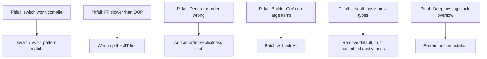

---
<a name="migration-guide"></a>
## 19. Migration Guide: OOP → FP Patterns

> **Core principle:** Migrate *per-pattern*, *per-module*, and with **equivalence tests running throughout the transition**. Never delete the OOP version until the FP version passes an equivalence test suite.

### Pre-Migration Checklist

Before converting anything, ensure you have:

- [ ] JDK 17+ (or JDK 21+ for record destructuring in `switch`). Check with `java -version`.
- [ ] A baseline equivalence test: "OOP X(`input`) == FP X(`input`)" for a representative set of inputs.
- [ ] Your domain types are (or can become) `sealed` — otherwise the FP `switch` can't guarantee exhaustiveness.

### Step 1: Introduce `sealed` Types and Records

Convert your domain hierarchy to a sealed interface backed by records. This is the foundation that makes the FP approaches possible.

```java
// BEFORE: open hierarchy, fragile to extensions
public abstract class Product { ... }
public class BookProduct extends Product { ... }

// AFTER: closed hierarchy, compiler-checked
public sealed interface Product permits BookProduct, ElectronicProduct, FashionProduct {}
public record BookProduct(String name, String description, BigDecimal price) implements Product {}
```

> **💡 Migration note:** This step alone often breaks code that does `instanceof Product` checks or casts. That breakage is *the point* — you're discovering the places that assumed an open hierarchy.

### Step 2: Convert the Factory Pattern

Move the factory function onto the type it creates (the enum constant).

```java
// FROM (fragile switch):
return switch (productType) {
  case BOOK -> new BookProduct(name, desc, price);
  // ... missing GROCERY → runtime exception
};

// TO (function reference on the enum):
public enum ProductType {
  BOOK(BookProduct::new), GROCERY(GroceryProduct::new);
  // adding a third type: no switch to update.
}
```

Write an equivalence test, then switch callers from `ProductFactory.newProduct(...)` to `ProductType.X.newInstance(...)`.

### Step 3: Convert the Visitor Pattern

Delete the `accept` method and the `ProductVisitor<R>` interface. Replace with a top-level `Function<Product, R>` constant backed by an exhaustive `switch`.

```java
// FROM: double dispatch
book.accept(vatVisitor);

// TO: pattern-matching switch
public static final Function<Product, BigDecimal> VAT = p -> switch (p) {
  case BookProduct b       -> amount(b.price(), "0.055");
  case ElectronicProduct e -> amount(e.price(), "0.20");
  case FashionProduct f    -> amount(f.price(), "0.20");
};
```

### Step 4: Convert the Strategy Pattern

Replace the `ShippingStrategy` interface + implementations with `Function<Product, BigDecimal>` constants and higher-order combinators.

```java
// FROM:
interface ShippingStrategy { BigDecimal cost(Product p); }

// TO:
public static final Function<Product, BigDecimal> EXPRESS = p -> ...;
public static Function<...> freeOver(BigDecimal thresh, Function<...> otherwise) { ... }
```

### Step 5: Convert the Decorator Pattern

Replace wrapper classes with `UnaryOperator<Product>` constants composed via `andThen`.

```java
// FROM:
Product wrapped = new GiftWrapped(new Taxed(new Discounted(base)));

// TO:
UnaryOperator<Product> pipeline = DISCOUNTED.andThen(TAXED).andThen(GIFT_WRAPPED);
Product wrapped = pipeline.apply(base);
```

### Step 6: Convert the Builder Pattern

Replace the mutable `OrderBuilder` class with composed `UnaryOperator<Order>` steps.

```java
// FROM:
Order order = OrderBuilder.of("Alice", "EUR").addItem(book).giftWrap().build();

// TO:
Order order = addItem(book).andThen(giftWrap()).apply(OrderBuilder.empty("Alice", "EUR"));
```

### Step 7: Run the Full Equivalence Suite and Delete the OOP Version

Once the equivalence tests prove the FP version is a drop-in replacement for every pattern, remove the OOP classes.

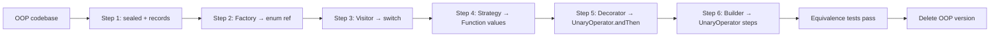

> **⚠️ Common mistake:** Trying to do all 6 steps at once. You don't have to. The most valuable first step (and the lowest risk) is **just the Factory** — it removes switch drift immediately, even if everything else stays OOP.

---
<a name="structure"></a>
## 20. Project Structure

```
oop-fp-design-patterns        (parent POM)
├── common                    sealed Product, the records, ProductType(+factory)
├── factory   (→ common)      ProductFactory (OOP); the FP factory *is* common.ProductType
├── visitor   (→ common)      FP: operations over the common records (switch + lambda bundle)
│                             OOP: its own element hierarchy
├── builder   (→ common)      immutable Order over the common records; OOP: fluent
│                             OrderBuilder; FP: composed UnaryOperator<Order> steps
├── decorator (→ common)      FP: composed UnaryOperator<Product> decorations over the
│                             common records; OOP: its own Product interface
└── strategy  (→ common)      shipping algorithms over the common records; OOP: the
                              ShippingStrategy hierarchy + context; FP: plain
                              Function<Product, BigDecimal> values
```

**Why the Visitor and Decorator can't reuse `common` on the OOP side:**

- The classic Visitor requires every element to expose an `accept()` method (double dispatch).
- The classic Decorator requires every component to implement the same interface as its wrappers.

Both couple the domain type to the pattern's own abstraction — but `common.Product` is `sealed`, so it cannot be extended from another module. Each OOP implementation must therefore own its own element/component hierarchy, bridging back to `common` through a small adapter (`BaseProduct`).

The functional approach avoids this coupling entirely: it operates *on* the sealed type from the outside (pattern-matching for the visitor, rebuilding through the factory for the decorator), so the elements never need to know about the operations applied to them.

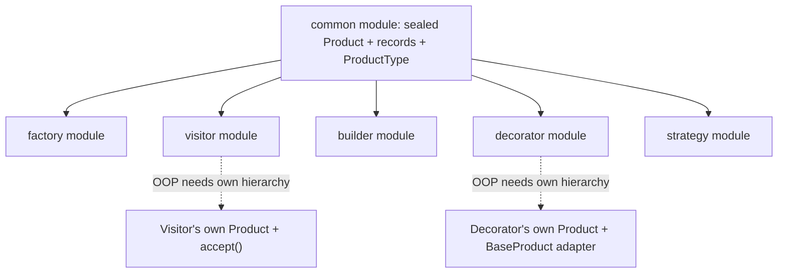

---

<a name="usecases"></a>
## 21. Real-World Use Cases Summary

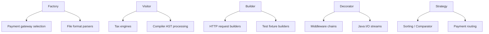

| Pattern | FP Strength (why rewrite it?) | OOP Strength (why keep it?) |
|---|---|---|
| **Factory** | The "type + factory together" model on an enum prevents drift; adding a new type is a single edit. | A Factory *bean* or *provider* in a DI framework (Spring `@Bean`, Guice provider) is still the right tool when the creation depends on injected services. |
| **Visitor** | Sealed types + pattern matching give you compile-time exhaustiveness and no `accept` boilerplate. | When the *types themselves* are truly open (plugins loaded via SPI at runtime), you can't use `sealed`, so the classic Visitor still wins. |
| **Builder** | Steps as `UnaryOperator` values are reusable, storable, composable — ideal for test-fixture templates and config pipelines. | A mutable builder is one object per build (fewer intermediate allocations) — better for batch-building large objects at high throughput. |
| **Decorator** | `UnaryOperator.andThen` composition needs zero wrapper classes; pipelines become data you can store in `List`s. | Decorators that carry per-instance state (different tax rates per customer) still need real objects — functions can't carry mutable state safely. |
| **Strategy** | A `Function` value is trivially injectable, testable with no mocks, and composable (cheapest-of, fallback chains). | A Strategy that needs lifecycle methods (`init()`, `close()`), DI beans, or external resources still needs a class. |

---
<a name="practice-exercises"></a>
## 22. Practice Exercises (with Solutions)

### Exercise 1: Migrate a Factory + Visitor Combo

**Scenario:** You have a classic OOP `ShapeFactory` that `switch`es on a `ShapeType` enum to create `Circle`, `Square`, or `Triangle`. You also have an OOP `AreaVisitor` with `visit(Circle)`, `visit(Square)`, `visit(Triangle)`.

**Your task:**
1. Convert `ShapeType` so each enum constant carries a constructor reference for its shape (the FP Factory).
2. Convert the `AreaVisitor` into a single `Function<Shape, Double>` constant backed by an exhaustive `switch` over a `sealed Shape` interface.
3. Write an equivalence test asserting `oopArea == fpArea` for all three shapes.

**Detailed Solution:**

```java
// 1. Sealed Shape hierarchy + records
public sealed interface Shape permits Circle, Square, Triangle {}
public record Circle(double radius) implements Shape {}
public record Square(double side)   implements Shape {}
public record Triangle(double a, double b, double c) implements Shape {}

// 2. FP Visitor as a single Function
public static final Function<Shape, Double> AREA = shape -> switch (shape) {
  case Circle c   -> Math.PI * c.radius() * c.radius();
  case Square s   -> s.side() * s.side();
  case Triangle t -> heron(t.a(), t.b(), t.c());
};

static double heron(double a, double b, double c) {
  double s = (a + b + c) / 2;
  return Math.sqrt(s * (s - a) * (s - b) * (s - c));
}
```

> **Key insight:** Once you have a `sealed` hierarchy + exhaustive `switch`, the OOP `ShapeVisitor` interface is dead weight — you can delete it and replace every `shape.accept(visitor)` call site with `AREA.apply(shape)`.

---
### Exercise 2: Build a Dynamic Discount Pipeline

**Scenario:** Your e-commerce site applies a stack of percentage discounts (e.g., "10% site-wide", "15% for VIPs"). The combination varies per customer tier.

**Your task:**
1. Write each discount as a `UnaryOperator<Product>` (a `Function` that returns a new `Product` with a lower price).
2. Build a `Function<CustomerTier, UnaryOperator<Product>>` that selects the right stack for each tier.
3. Apply the pipeline to a catalog and verify the "VIP" tier produces lower prices than "standard."

**Detailed Solution:**

```java
// 1. Named discount steps (reusable values):
public static final UnaryOperator<Product> SITE_WIDE_10 = discountedBy("0.10");
public static final UnaryOperator<Product> VIP_15       = discountedBy("0.15");

static UnaryOperator<Product> discountedBy(String pct) {
  BigDecimal factor = BigDecimal.ONE.subtract(new BigDecimal(pct));
  return p -> p.type().newInstance(
      p.name(), p.description(), p.price().multiply(factor));
}

// 2. Tier → pipeline selector:
public static Function<CustomerTier, UnaryOperator<Product>> DISCOUNTS = tier -> switch (tier) {
  case VIP   -> SITE_WIDE_10.andThen(VIP_15);   // 10% then 15% = compound
  case GOLD  -> SITE_WIDE_10;
  case SILVER, NEW -> UnaryOperator.identity();
};

// 3. Apply and verify:
@Test
void vipTierProducesLowerPrices() {
  List<Product> catalog = List.of(bookAt100, phoneAt200);
  UnaryOperator<Product> vip  = DISCOUNTS.apply(CustomerTier.VIP);
  UnaryOperator<Product> std  = DISCOUNTS.apply(CustomerTier.SILVER);

  BigDecimal vipTotal = catalog.stream().map(vip).map(Product::price).reduce(SUM).orElse(ZERO);
  BigDecimal stdTotal = catalog.stream().map(std).map(Product::price).reduce(SUM).orElse(ZERO);
  assertThat(vipTotal).isLessThan(stdTotal);
}
```

> **Key insight:** Storing the pipeline as a `Function` value means you can fetch it once and apply it to 10,000 products without rebuilding the chain. In OOP, you'd construct a `Discounted(new SiteWide(new VipDiscount(base)))` per product.

---
### Exercise 3: Replace a Strategy Hierarchy with Function Values

**Scenario:** You have an OOP `ShippingStrategy` interface with `StandardShipping`, `ExpressShipping`, and a `FreeOverShipping` that delegates to a fallback. Plus a `ShippingCalculator` mutable context.

**Your task:**
1. Replace the three Strategy classes with `Function<Product, BigDecimal>` constants.
2. Replace the `FreeOverShipping` class with a higher-order function `freeOver(threshold, fallback)`.
3. Replace the mutable `ShippingCalculator` context with a higher-order function `totalWith(strategy)`.
4. Add a `cheapest(...)` combinator that picks the lowest-cost strategy at runtime.

**Detailed Solution:**

```java
// 1. Strategy constants:
public static final Function<Product, BigDecimal> STANDARD = p -> new BigDecimal("4.99");
public static final Function<Product, BigDecimal> EXPRESS  = p ->
    new BigDecimal("9.99").add(
      p.price().multiply(new BigDecimal("0.02")).setScale(2, RoundingMode.HALF_UP));
public static final BigDecimal FREE = BigDecimal.ZERO;

// 2. Higher-order "free over threshold" combinator:
public static Function<Product, BigDecimal> freeOver(BigDecimal threshold,
                                                     Function<Product, BigDecimal> fallback) {
  return p -> p.price().compareTo(threshold) >= 0 ? FREE : fallback.apply(p);
}

// 3. Context becomes a higher-order function:
public static Function<Product, BigDecimal> totalWith(Function<Product, BigDecimal> strategy) {
  return p -> p.price().add(strategy.apply(p));
}

// 4. Cheapest-of combinator:
@SafeVarargs
public static Function<Product, BigDecimal> cheapest(Function<Product, BigDecimal>... strategies) {
  return p -> Arrays.stream(strategies)
      .map(s -> s.apply(p))
      .min(Comparator.naturalOrder())
      .orElseThrow();
}

// Usage:
Function<Product, BigDecimal> total = totalWith(
    cheapest(STANDARD, EXPRESS, freeOver(new BigDecimal("50.00"), STANDARD)));
BigDecimal cost = total.apply(book);
```

> **Key insight:** You've replaced 3 classes + 1 context class + 1 delegation pattern with 5 function values and 3 combinators — and the combinators are reusable across *any* strategy type, not just shipping.

---
<a name="test-your-understanding"></a>
## 23. Test Your Understanding

### Questions (Answers at the bottom)

1. What does the "turtles all the way down" metaphor represent in the OOP-vs-FP debate?
2. Which single Java 17+ feature gives the functional Visitor something the classic OOP Visitor never had?
3. In the FP Factory, what two things are declared *together* in one place, eliminating "switch drift"?
4. What does `andThen` mean, and why is it the FP analog of OOP wrapper nesting?
5. When is the OOP Decorator *still* the better choice than `UnaryOperator<Product>` composition?
6. What's the "single-method, stateless → function value" rule of thumb?
7. What is the one invariant you must test when migrating a pattern from OOP to FP?
8. The FP Factory stores a `TriFunction` on each enum constant. Why not a `BiFunction`, or why not a simple constructor reference in the `switch`?
9. If you add a new product type to the sealed `Product` hierarchy, what happens to an FP Visitor that has a `default` arm?
10. How does the FP Strategy (`Function` value) differ from a Mockito mock of the OOP `ShippingStrategy` interface?
11. What's the performance trap in the FP Builder when calling `addItem` 1,000 times?
12. Why should you keep domain validation (like `Objects.requireNonNull`) inside the factory function rather than at call sites?

### Answers

1. **The metaphor describes the recursive, self-similar structure of choosing one paradigm entirely** — "turtles all the way down" mocks the idea that you must commit fully to FP rather than interoperate with OOP. This tutorial argues you can mix them deliberately, pattern by pattern.
2. **Sealed types + exhaustive pattern matching.** The compiler verifies every subtype is handled in the `switch`, turning a runtime `MatchException` into a compile error — something the double-dispatch `accept()` approach never guaranteed.
3. **The enum constant and its factory constructor reference.** `BOOK(BookProduct::new)` keeps the type and the creation logic in the same declaration, so adding `GROCERY(GroceryProduct::new)` requires updating nothing else.
4. **`f1.andThen(f2)` runs `f1`, then feeds its result to `f2`.** This is the FP analogue of the OOP Decorator's nested `new Taxed(new Discounted(base))` — but instead of nesting objects at call time, you compose *function values* that can be stored and reused.
5. **When a decorator genuinely carries per-instance state** (e.g., a different tax rate per customer) — a stateful wrapper object is correct; a stateless function value is not.
6. **If an OOP interface/pattern has exactly one abstract method and no meaningful state, it can often be expressed as a plain `Function`/`UnaryOperator` value** with no wrapper class at all. That's true for Strategy, Visitor operations, Decorator concerns, Builder steps, and Factory constructors.
7. **Observability equivalence:** the OOP and FP versions must return identical results (including exceptions) for the same inputs. Run an equivalence property test across a broad input set.
8. **Constructor references don't implement `TriFunction`.** Each `ProductType` constant maps to a constructor of a different arity only by coincidence here — the `TriFunction` is the bridge type that lets a *uniform* `apply(a, b, c)` signature target three different constructors. Using `BiFunction` would not fit the three-argument `(name, desc, price)` signature.
9. **With `default`, the new type silently matches `default`** — so the new product gets whatever the default returns (probably zero tax). Without `default`, the compiler *forces* you to handle the new type. This is why the anti-pattern "default masks new types" is dangerous.
10. **A `Function` value is passed directly** (no Mockito setup, no `verify()` calls), and you can compose it with other functions naturally. A mock simulates the *interface*; a function value *is* the behavior. They are functionally similar for testing, but the function value is also reusable in production code.
11. **The FP Builder does a `Stream.concat` + new `List` per `addItem` call**, so 1,000 items = O(n²) allocations. The fix is batching via `addAll` or falling back to the OOP builder for high-volume construction.
12. **Validation inside the factory is the only place *guaranteed* to run on every construction path.** If validation lives at call sites, a future caller can (and will) forget it.

---
<a name="question-bank"></a>
## 24. Question Bank

The questions below are organized by difficulty: beginner, intermediate, and advanced. They are designed for self-testing, study-group quizzes, or interview prep.

### Beginner Questions (1–20)

1. What are the three categories of GoF design patterns, and which patterns fall into each?
2. What problem does the Factory pattern solve in one sentence?
3. The OOP Factory in this tutorial uses a `switch` on `ProductType`. What is the "fragility problem" this creates?
4. In the FP Factory, what two things are declared together on each enum constant?
5. What is a `TriFunction` and why is it needed in the FP Factory?
6. What are the two halves of "double dispatch" in the classic Visitor pattern?
7. The Visitor's `accept` method signature is `<R> R accept(ProductVisitor<R> visitor)`. What does `R` represent?
8. What does it mean for a `switch` to be "exhaustive" over a sealed type?
9. What is the "telescoping constructor problem" that the Builder pattern solves?
10. In the FP Builder, what replaces the mutable accumulator?
11. What is the signature of a "build step" in the FP Builder?
12. How does the OOP Decorator compose behavior — by inheritance or by composition?
13. In the FP Decorator, what is the type of a single decoration step?
14. What does `f1.andThen(f2)` mean, in plain English?
15. What does the Strategy pattern let you vary, independently of the client?
16. In the FP Strategy, what replaces the `ShippingStrategy` interface?
17. What is a "higher-order function," in one sentence?
18. The FP Strategy uses `freeOver(threshold, fallback)` — what kind of function is `freeOver`?
19. What is the "expression problem" that Visitor addresses?
20. What are the three steps of the FP Visitor workflow (problem → solution)?

---
### Intermediate Questions (21–42)

21. Why can't the OOP Visitor or Decorator reuse `common.Product` in the project structure, when the FP versions can?
22. If `ShippingStrategy` has exactly one abstract method (`cost`) and no state, what is it structurally equivalent to?
23. In the FP Builder, if you store steps in a `List<UnaryOperator<Order>>`, how do you apply them all?
24. What happens if you call `DISCOUNTED.andThen(DISCOUNTED).apply(book)` in the FP Decorator?
25. In the FP Visitor's "bundle of lambdas" record, what problem does this intermediate style solve compared to a raw `switch`?
26. What's the difference between storing a strategy as `Function` and storing a strategy as `UnaryOperator`?
27. The migration guide says to "introduce sealed types and records" first. Why is this the foundation for everything else?
28. In the equivalence test pattern, what exactly are you asserting about OOP vs. FP?
29. What's the difference between `Function.andThen` and `Function.compose`?
30. When would you use the OOP Builder over the FP Builder? (Give one scenario.)
31. When would you use the FP Builder over the OOP Builder? (Give one scenario.)
32. What does the `cheapest(...)` combinator in Exercise 3 return, and what does it accept?
33. Why does adding a new product type to a sealed hierarchy require updating all exhaustive `switch`es but NOT an OOP interface with a `default`?
34. In the FP Decorator, the pipeline `DISCOUNTED.andThen(TAXED)` produces a different price than `TAXED.andThen(DISCOUNTED)`. Why?
35. What is the role of `OrderBuilder.empty(...)` in the FP Builder?
36. The OOP Decorator requires every wrapper to `implements Product`. Why does the FP Decorator not need a comparable abstraction?
37. What does it mean to say "a function value is a reusable, storable, composable value"?
38. In the security section, what's the "injection surface" risk in the FP Factory?
39. What's the recommended cap on decorator composition depth to avoid stack overflow, and why?
40. In the testing section, why is the `vatSwitchHandlesEverySubtype` test useful even though the compiler already checks exhaustiveness?
41. What's the difference between the "single-abstract-method" rule and the "stateless" qualifier?
42. The FP Visitor uses `case BookProduct(String name, ...) ->` — what Java feature enables this destructuring, and in which version?

---
### Advanced Questions (43–55)

43. The FP Builder uses `Stream.concat(order.items().stream(), Stream.of(item))` on every step. What's the asymptotic cost of building n items this way, and what's the fix?
44. Could the FP Visitor be implemented with a `Map<ProductType, Function<Product, R>>` instead of a `switch`? What would you lose compared to the exhaustive `switch`?
45. If you're on Java 17 (not 21), what limitation do you hit when trying to write the FP Visitor's destructured `case BookProduct(String n, ...) ->` form?
46. What's the difference between a "function-value strategy" and a "Strategy with state" in terms of thread-safety?
47. In the migration guide, why is Step 5 (Decorator → `UnaryOperator.andThen`) harder than Step 3 (Visitor → `switch`)?
48. The "Expression problem" has two axes: adding types vs. adding operations. Which style (OOP Visitor or FP switch) makes adding an operation *easier*, and which makes adding a type *easier*?
49. What JVM optimization collapses the indirection of `Function.apply` calls after warmup, making the OOP-vs-FP performance difference negligible?
50. When would a boxed-primitive strategy (`Function<Integer, Integer>`) create measurable overhead compared to `IntUnaryOperator`, and how would you mitigate it?
51. The "anonymous-lambda trap" anti-pattern lifts lambdas to named constants. Why does naming matter for the JIT compiler, and what's the related benefit for debugging?
52. In what scenario does the OOP Strategy (with a context object) beat the FP Strategy, even though the latter is "more elegant"?
53. If you replace a class-based Decorator with `UnaryOperator` functions but some decorators need to read shared mutable context (like a request-scoped discount), is the FP version still appropriate? Why or why not?
54. The `freeOver` higher-order function returns a new `Function` on each call. If this is called in a hot loop, is there a GC concern? How would you mitigate it?
55. Could you express the entire FP Visitor as a single `Collectors.reducing` operation over a stream of products? Sketch how.

### Bonus Challenge Questions (56–60)

56. **Synthesis:** Given an OOP `ShippingCalculator` that holds a mutable `ShippingStrategy` and recomputes `.setStrategy()` over the life of a request, design the FP equivalent using no mutable fields. (Hint: pass the strategy as an argument to the computation.)
57. **Trade-off reasoning:** You inherit a 10-year-old Java 8 codebase with 50 concrete `ShippingStrategy` implementations. Your manager asks for "pure FP everywhere." What's your pushback, and what's your incremental plan?
58. **Language feature interplay:** Explain how `sealed`, `record`, and pattern matching work *together* to give the FP Visitor its safety guarantee — i.e., why any one alone is insufficient.
59. **Design reasoning:** Why does the tutorial deliberately give the Visitor both a "raw switch" *and* a "bundle-of-lambdas record" implementation? What does each teach?
60. **Future-proofing:** If Java added virtual-pattern dispatch and erased the need for `sealed` exhaustiveness, would the FP Visitor's main advantage disappear? Argue both sides.

---
<a name="interview-questions"></a>
## 25. Common Interview Questions

### Core Design-Question Answers

**1. Can you explain the difference between the OOP Visitor and the FP `switch`-based approach?**

The OOP Visitor relies on double dispatch: the element's `accept` method calls back the visitor's overloaded `visit` method, which routes to the right concrete type. This requires every element to expose `accept` and every visitor to implement one method per type. The FP approach replaces this with a single `switch` over a `sealed` type — no `accept` method needed, and the compiler checks exhaustiveness. The trade-off: OOP lets you add new *operations* without touching types (open/closed), while FP lets you add new *types* and the compiler forces you to handle them everywhere.

**2. Why is the "single-method, stateless" rule important for FP conversion?**

If an OOP interface has exactly one abstract method and carries no state, it's structurally identical to a `Function` (or `UnaryOperator`, `BiFunction`, etc.). That means you can drop the interface entirely and pass the behavior as a lambda or a named constant. If the interface has *state*, or *more than one method*, you can't flatten it to a single function without losing something.

**3. When would you keep the OOP Strategy instead of converting to a `Function`?**

When the strategy needs lifecycle management (`init()`/`close()`), injected dependencies (Spring beans), external resources (a connection pool), or per-instance mutable state. A stateless `Function<Product, BigDecimal>` is the perfect tool when you only need the cost computation — but it can't manage resources.

**4. What is "switch drift" and how does the FP Factory fix it?**

Switch drift is the bug where an enum is updated (new constant added) but the `switch` that consumes it is forgotten, producing a runtime `IllegalArgumentException` or `MatchException`. The FP Factory eliminates this by *moving the factory onto the enum itself* — each enum constant carries its own constructor reference, so you can't add a constant without also adding its factory in the same declaration.

**5. How does `sealed` improve the Visitor beyond the classic double-dispatch approach?**

With a `sealed` interface, the compiler knows the *complete* set of subtypes upfront. An exhaustive `switch` over those subtypes is verified at compile time — forget a case, and the build fails. The classic Visitor has no such guarantee: a new type just silently falls through the `default`.

**6. What's the real-world equivalent of the Decorator pattern you use every day?**

Java I/O streams: `new BufferedInputStream(new GZIPInputStream(new FileInputStream("data.txt")))`. Each wrapper decorates the inner stream with buffering, decompression, or persistence. The FP equivalent would be composing `UnaryOperator<String>` functions for each "decoration" of a path or a string.

**7. How do you migrate a 10-year-old OOP codebase to FP without breaking everything?**

Per-pattern, one at a time, with equivalence tests running throughout. Start with the Factory (lowest risk, removes switch drift immediately), then Visitor (sealed types make it strictly safer), then Strategy and Decorator (both become plain `Function`/`UnaryOperator` values). Keep the OOP version alive until an equivalence test proves the FP version is a drop-in.

**8. What's the difference between `andThen` and `compose`?**

`f.andThen(g)` means "run `f`, then `g` with `f`'s output." `f.compose(g)` means "run `g` first, then `f` with `g`'s output." In Decorator terms, `DISCOUNTED.andThen(TAXED)` applies the discount before tax (the natural order); `DISCOUNTED.compose(TAXED)` applies tax *before* discount — which may or may not be what your business rules intend.

**9. Is FP always faster than OOP in Java?**

No. After JIT warmup, the indirection of a `Function.apply` call is typically inlined, making the performance difference negligible for most applications. The real difference is in *memory*: a mutable OOP builder allocates one object per build (no intermediate copies), while a naive FP builder may allocate an intermediate list per step — O(n²) for n items. Profile with JMH before optimizing.

**10. How do you test that an FP rewrite is equivalent to the OOP original?**

Write a property test / parametrized equivalence test: for a representative set of inputs, assert `assertEquals(oopResult, fpResult)`. Test both the *happy path* values and the *edge cases* (null inputs, boundary prices, rounding). Run this test continuously during migration — it's the safety net that lets you delete the OOP version.

### Quick Interview Tips

| Question Type | Recommended Answer Framework |
|---|---|
| "Convert X to FP" | *"Interface has one method → `Function`. Add `sealed` for exhaustiveness. Use `andThen` to compose."* |
| "OOP vs FP trade-offs" | *"OOP wins on state/lifecycle/team familiarity. FP wins on composability/exhaustiveness/testability."* |
| "Real-world example" | *"Java I/O streams (Decorator), `Comparator` (Strategy), `Optional.map` (Visitor-as-function)."* |

---
<a name="self-assessment"></a>
## 26. Self-Assessment Checklist

Use this checklist to evaluate your readiness to apply what you've learned. Mark ✅ if you're confident, ❓ if you want to review, and ❌ if you need to study more.

### Understanding (Conceptual)

- [ ] ✅ I can explain *in one sentence* what the Expression Problem is.
- [ ] ✅ I can define "switch drift" and explain how the FP Factory eliminates it.
- [ ] ✅ I understand why a sealed `switch` is "exhaustive" and why `default` breaks that guarantee.
- [ ] ✅ I can distinguish `andThen` from `compose` and give a scenario where order matters.
- [ ] ✅ I know the "rule of thumb" for which OOP interfaces collapse into function values.

### Implementation (Hands-On)

- [ ] ✅ I can write the FP Factory (`enum` constant + constructor reference) from memory.
- [ ] ✅ I can write the FP Visitor as a single `Function<SealedType, R>` with a `switch`.
- [ ] ✅ I can compose three `UnaryOperator` builder steps with `andThen` and apply them.
- [ ] ✅ I can write a `freeOver(threshold, fallback)` higher-order function.
- [ ] ✅ I can express a multi-step Decorator as a pipeline of `andThen`-composed functions.

### Decision-Making (When to Choose)

- [ ] ✅ I can give a concrete scenario where the OOP Builder beats the FP Builder.
- [ ] ✅ I can give a concrete scenario where the FP Decorator replaces three wrapper classes.
- [ ] ✅ I can explain why the OOP Strategy *wins* when a strategy needs injected services.
- [ ] ✅ I can sketch a one-line migration plan for a legacy `switch`-based factory.

### Testing

- [ ] ✅ I can write a JUnit 5 parametrized equivalence test for OOP vs. FP.
- [ ] ✅ I understand the JIT warmup caveat and when to use JMH.
- [ ] ✅ I can write a "cheating detection" self-review check before submitting a PR.

> **📊 Scoring:** 12–16 ✅ = You're ready to lead the OOP→FP migration on your team. 8–11 ✅ = Solid grasp; review the flagged areas. Under 8 ✅ = Re-read the corresponding sections and re-attempt the practice exercises.

---
<a name="takeaways"></a>
## 27. Summary & Key Takeaways

We rebuilt five classic Gang of Four patterns twice — once the canonical OOP way, once with modern Java's functional toolkit — and landed on the exact same behavior both times. Here is the distilled version of everything covered.

### The Five Patterns at a Glance

| Pattern | OOP Implementation | FP Implementation | The One-Line Lesson |
|---|---|---|---|
| **Factory** | `switch` on a type enum in a separate factory class | Constructor reference stored **in the enum constant itself** | Co-locate the type and its creation logic — kill switch drift |
| **Visitor** | `accept()` + double dispatch + visitor interface | Exhaustive `switch` over a `sealed` type | The compiler checks exhaustiveness for free |
| **Builder** | Mutable accumulator with fluent setters | Composed pure `UnaryOperator<T>` steps | Immutable build steps become reusable, storable values |
| **Decorator** | Nested wrapper classes | Composed `UnaryOperator<Product>` functions via `andThen` | No wrapper classes; decorations compose like pipelines |
| **Strategy** | Interface + context object holding a swappable field | Plain `Function<T, R>` value + higher-order functions | Strategies combine, compare, and test as first-class values |

### The Five Key Takeaways

1. **You don't have to choose a side.** Java lets you mix OOP and FP deliberately, pattern by pattern, module by module. The question is never "OOP or FP?" but "which style fits *this* problem?"

2. **Single-abstract-method interfaces are prime FP candidates.** `ShippingStrategy`, per-type visitor bundles, decoration steps — all collapse naturally into `Function`/`UnaryOperator` values. The rule of thumb: *if the interface has exactly one abstract method and no meaningful state of its own, it's a function in disguise.*

3. **Sealed types + pattern matching give you compiler-checked exhaustiveness** — something the classic Visitor and Factory `switch` never guaranteed. Forgetting a case becomes a **compile error**, not a production incident.

4. **Functional composition (`andThen`) is the FP analogue of OOP delegation/nesting** — and it tends to be more reusable, since a composed function is a first-class value you can store, pass around, conditionally apply, or reapply.

5. **The trade-off doesn't disappear — it moves.** The Expression Problem (types vs. operations) is still there. FP just lets you express both sides more tersely, using tools already in the JDK — no Vavr, no libraries, no runtime overhead.

> "Turtles all the way down" — and yet, whichever style you pick, factory, visitor, builder, decorator, or strategy, **both paths land on the exact same result.**

### Your Next Steps

- [ ] **Clone and explore** the full source code with unit tests: [github.com/nicolasduminil/oop-fp-design-patterns](https://github.com/nicolasduminil/oop-fp-design-patterns)
- [ ] **Pick one pattern** from your own codebase and run the migration plan from [Section 19](#migration-guide) against it.
- [ ] **Write one equivalence test** before you change a single line — it's your safety net.
- [ ] **Revisit the [Self-Assessment Checklist](#self-assessment)** after your first real migration to measure progress.

---

<a name="further-reading"></a>
## 28. Further Reading & Resources

### Official Documentation

- [JEP 409: Sealed Classes](https://openjdk.org/jeps/409) — the definitive spec for sealed types (finalized in Java 17)
- [JEP 395: Records](https://openjdk.org/jeps/395) — records, finalized in Java 16, the backbone of our immutable domain model
- [JEP 441: Pattern Matching for switch](https://openjdk.org/jeps/441) — pattern matching in `switch`, finalized in Java 21
- [`java.util.function` package docs](https://docs.oracle.com/en/java/javase/21/docs/api/java.base/java/util/function/package-summary.html) — `Function`, `UnaryOperator`, `BiFunction`, and friends
- [Java Object Layout (JOL)](https://openjdk.org/projects/code-tools/jol/) — for verifying memory claims when profiling FP vs. OOP

### Books

- *Design Patterns: Elements of Reusable Object-Oriented Software* — Gamma, Helm, Johnson, Vlissides (the original GoF, 1994)
- *Effective Java* (3rd Edition) — Joshua Bloch, especially Item 24 (favor static member classes) and the chapters on lambdas and method references
- *Functional Programming in Java* — Venkat Subramaniam, the most approachable bridge between the two paradigms
- *Refactoring to Patterns* — Joshua Kerievsky, for evolving legacy OOP toward (and past) classic patterns

### Articles & Tutorials

- [Understanding Functional Programming](https://dzone.com/articles/understanding-functional-programming) — the foundations this tutorial builds on
- [Exploring the Need of Object-Oriented Programming](https://dzone.com/articles/exploring-the-need-of-object-oriented-programming) — why OOP isn't going anywhere
- [Design Patterns Refcard](https://dzone.com/refcardz/design-patterns) — a one-page GoF cheat sheet
- [Vavr Library](https://vavr.io/) — `Function3`–`Function8` and persistent data structures, if you outgrow `TriFunction`
- [The Expression Problem](https://en.wikipedia.org/wiki/Expression_problem) — the theoretical heart of the Visitor discussion

### Source Code

- **Full source code with unit tests:** [github.com/nicolasduminil/oop-fp-design-patterns](https://github.com/nicolasduminil/oop-fp-design-patterns) — the complete multi-module Maven project (common, factory, visitor, builder, decorator, strategy) as described in [Section 20](#structure)

---

> 📝 **Tutorial complete!** You've covered all 28 sections: from the "turtles all the way down" philosophy, through five side-by-side pattern rebuilds, to migration strategy, testing, and interview prep. Bookmark this file — the [Question Bank](#question-bank) and [Practice Exercises](#practice-exercises) are designed for repeat visits.
