# 🔄 Understanding Git Revert and Revert Conflicts — Complete Tutorial

> **Git revert tries to undo an earlier commit. But if a later commit changed the same lines, Git can't auto-undo them — causing a revert conflict.**

| 📌 Metadata | Details |
|---|---|
| **Difficulty Level** | 🟡 Intermediate |
| **Estimated Reading Time** | ⏱️ ~50 minutes (plus ~90 minutes for hands-on labs) |
| **Last Updated** | 2026-09-14 |
| **Applies To** | Git 2.x (Windows, macOS, Linux) |
| **Format** | Comprehensive deep dive: Mermaid diagrams, labs, exercises, and a 50-question bank |

---

## 📚 Table of Contents

1. [Introduction / Overview](#1-introduction--overview)
2. [Prerequisites](#2-prerequisites)
3. [Learning Objectives](#3-learning-objectives)
4. [What is Git Revert?](#4-what-is-git-revert)
5. [How Git Revert Works Internally](#5-how-git-revert-works-internally)
6. [What are Revert Conflicts?](#6-what-are-revert-conflicts)
7. [Step-by-Step Walkthrough](#7-step-by-step-walkthrough)
8. [Understanding Conflict Markers](#8-understanding-conflict-markers)
9. [Conflict Resolution — Complete Workflow](#9-conflict-resolution--complete-workflow)
10. [Real-World Use Cases](#10-real-world-use-cases)
11. [Git Revert vs Git Reset vs Git Restore](#11-git-revert-vs-git-reset-vs-git-restore)
12. [Advanced Scenarios](#12-advanced-scenarios)
13. [Best Practices & Configuration](#13-best-practices--configuration)
14. [Common Pitfalls & Troubleshooting](#14-common-pitfalls--troubleshooting)
15. [Anti-Patterns](#15-anti-patterns)
16. [Performance Considerations](#16-performance-considerations)
17. [Security Considerations](#17-security-considerations)
18. [Testing Strategies](#18-testing-strategies)
19. [Hands-On Labs](#19-hands-on-labs)
20. [Practice Exercises with Detailed Solutions](#20-practice-exercises-with-detailed-solutions)
21. [Test Your Understanding](#21-test-your-understanding)
22. [Common Interview Questions](#22-common-interview-questions)
23. [Question Bank — 50 Questions](#23-question-bank--50-questions)
24. [Self-Assessment Checklist](#24-self-assessment-checklist)
25. [Pro Tips from the Trenches](#25-pro-tips-from-the-trenches)
26. [Summary Cheatsheet & Key Takeaways](#26-summary-cheatsheet--key-takeaways)
27. [Further Reading & Resources](#27-further-reading--resources)

---

## 1. Introduction / Overview

Undoing work is one of the most common — and most misunderstood — tasks in version control. When a commit turns out to be wrong, `git revert` is Git's **safe, history-preserving undo**: it creates a brand-new commit that applies the exact inverse of a bad commit, leaving the full audit trail intact.

But reverting is not always automatic. If a **later commit modified the same lines** that the revert needs to touch, Git pauses mid-operation with a **revert conflict** and asks *you* to decide what "undone" should look like. This tutorial walks you through the entire journey: how revert works internally, why conflicts happen, how to resolve them confidently, and how to use revert safely in production environments.

> 💡 **Analogy — the newspaper correction**: `git reset` is like recalling every printed copy of yesterday's newspaper. `git revert` is like printing tomorrow's edition with a clearly labeled **correction notice**. Everyone can still see what happened, when, and why. Distributed teams — like distributed newspapers — should always prefer the correction notice.

### What You Will Learn

- How `git revert` computes and applies an "anti-commit"
- Why revert conflicts happen — and how to predict them before they happen
- How to resolve revert conflicts by hand, with confidence
- How to revert ranges, merge commits, and even previous reverts
- How to choose between `git revert`, `git reset`, and `git restore`
- Production-grade practices: testing, security, and CI/CD integration

> ✅ **Quick Recap**: Revert = a new commit that reverses an old one. Conflicts happen when later commits touch the same lines. Everything else is detail — and the rest of this tutorial is full of it.

---

## 2. Prerequisites

Before you start, make sure you have:

| Requirement | How to Check / Notes |
|---|---|
| Git 2.x installed | Run `git --version` |
| User identity configured | `git config --global user.name` and `git config --global user.email` |
| Basic Git fluency | Comfortable with `commit`, `add`, `status`, `log`, `push` |
| Command-line access | Any shell: Bash, zsh, PowerShell |
| (Optional) A visual merge tool | VS Code, Meld, IntelliJ — configuration covered in Section 13 |

### Concepts You Should Already Know

| Concept | Meaning |
|---|---|
| **Commit hash** | The SHA identifier of a commit (e.g., `a3f2c91`) |
| **HEAD** | A pointer to the commit you currently have checked out |
| **Staging area (index)** | The snapshot that will become your next commit |
| **Working tree** | The files you actually see and edit on disk |
| **Three-way merge** | Git's algorithm for combining two snapshots via a common base |
| **Conflict markers** | The `<<<<<<<` / `=======` / `>>>>>>>` block Git injects when it cannot merge automatically |

---

## 3. Learning Objectives

By the end of this tutorial, you will be able to:

1. **Explain** how `git revert` works internally (inverse patch + three-way merge).
2. **Predict** when a revert will conflict — and why.
3. **Resolve** revert conflicts manually: read the three-way context, choose a resolution, stage, and continue.
4. **Revert** single commits, ranges of commits (newest-first), and merge commits (`-m 1`).
5. **Batch** multiple reverts into a single commit with `--no-commit`.
6. **Choose** correctly between `git revert`, `git reset`, and `git restore`.
7. **Configure** productivity helpers: `diff3` conflict style, visual merge tools, and aliases.
8. **Avoid** the classic anti-patterns (resetting shared commits, re-merging reverted branches, committing leftover conflict markers).
9. **Test and verify** reverts so that a rollback never becomes a second incident.

---

## 4. What is Git Revert?

`git revert` is a **safe, non-destructive undo operation** that creates a *new commit* which applies the exact inverse of a previous commit's changes — all without erasing or rewriting history.

> 💡 **Mental model**: Think of `git revert` as creating an "anti-commit" — a receipt saying *"we officially undid this"* — rather than pretending the original commit never existed.

### Key Characteristics

| Feature | Description |
|---|---|
| **History-safe** | Never erases commits; always adds a new one |
| **Auditable** | Creates a permanent trail: what was undone, when, and why |
| **Targeted** | Can undo any specific commit, not just the most recent one |
| **Collaborative** | Safe to use on shared/public branches |
| **Conflict-prone** | Can cause conflicts when later commits touch the same lines |

### Basic Syntax

```bash
# Revert a specific commit by its hash
git revert <commit-hash>

# Revert the most recent commit (HEAD)
git revert HEAD

# Revert without opening an editor (uses default message)
git revert <commit-hash> --no-edit

# Stage the revert changes without auto-committing
git revert <commit-hash> --no-commit

# Revert a range of commits (applied newest-first)
git revert <oldest-hash>..<newest-hash>
```

---

## 5. How Git Revert Works Internally

When you execute `git revert C2`, Git performs these precise internal steps:

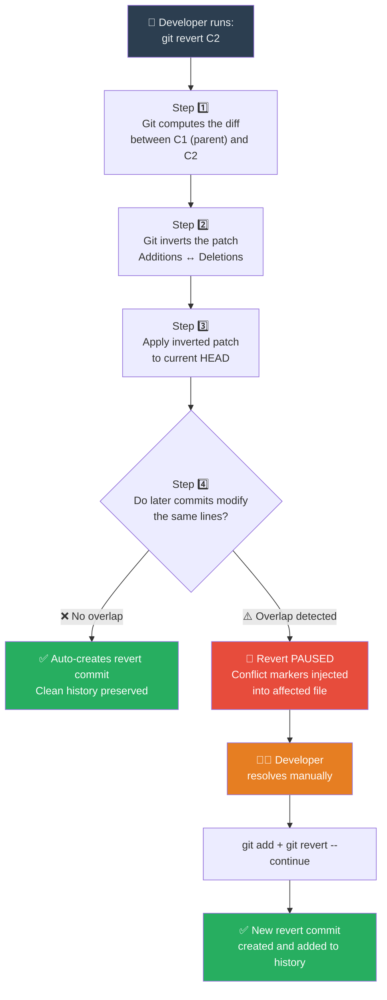

### What "inverting the patch" means in practice

| Original C2 Action | Inverted (Revert) Action |
|---|---|
| Added line `Implement user login` | Removes line `Implement user login` |
| Deleted line `Draft documentation` | Re-adds line `Draft documentation` |
| Modified `foo = 1` → `foo = 2` | Restores `foo = 2` → `foo = 1` |

> 🔬 **Under the hood**: A revert is actually a **three-way merge** where the *merge base* is the commit being reverted, *ours* is your current HEAD, and *theirs* is the reverted commit's parent. Conflicts arise for exactly the same reasons they arise in merges — the three snapshots disagree in incompatible ways.

---

## 6. What are Revert Conflicts?

A **revert conflict** arises when Git tries to undo a commit, but a **later commit has already modified the same lines** that the revert needs to touch. Git cannot automatically determine which version is authoritative, so it pauses and asks you to decide.

### The Core Conflict Principle

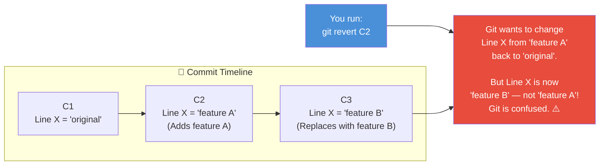

### Conflict vs. Clean Revert — The Decision Table

| Scenario | What Git Does |
|---|---|
| No later commit touched those lines | ✅ Clean revert — auto-creates new commit |
| A later commit modified the same lines | ⚠️ Conflict — manual resolution required |
| A later commit deleted those lines | ⚠️ Conflict — can't restore deleted content automatically |
| The commit being reverted was already reverted | ✅ Usually clean — the inverse of an inverse is original |

> 💡 **Key insight**: Conflicts are not errors — they are Git *protecting you*. Refusing to guess is what makes revert safe. A silent wrong guess would be far more dangerous.

---

## 7. Step-by-Step Walkthrough

Let's trace through the exact scenario illustrated in the diagram using a real `Project.txt` file.

### The Commit History Setup

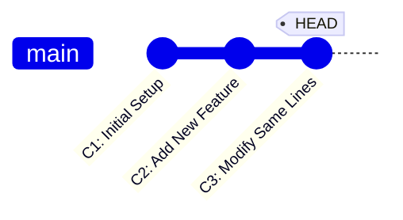

### File State at Each Commit

**📄 After C1 — Initial Setup:**
```
- Setup repository
- Define milestones
- Draft documentation
```

**📄 After C2 — Add New Feature:**
```
- Setup repository
- Define milestones
- Draft documentation
- Implement user login        ← ✨ C2 added this line
```

**📄 After C3 — Modify Same Lines (Current HEAD):**
```
- Setup repository
- Define milestones
- Draft docs and diagrams     ← 🔄 C3 modified this line
- Build authentication module ← 🔄 C3 replaced C2's line
```

### Step 1️⃣ — Developer Executes `git revert C2`

```bash
$ git revert a3f2c91   # C2's commit hash
```

Git computes: *"C2 added `Implement user login`. My job is to remove it. But the current file has `Build authentication module` there, not `Implement user login`. I can't cleanly undo this."*

**Terminal output:**

```
error: could not revert a3f2c91... Add new feature
hint: After resolving the conflicts, mark them with
hint: "git add/rm <pathspec>", then run
hint: "git revert --continue".
hint: You can instead skip this commit with "git revert --skip".
hint: To abort and get back to the state before "git revert",
hint: run "git revert --abort".
```

### Step 2️⃣ — Git Injects Conflict Markers

`Project.txt` now contains:

```
- Setup repository
- Define milestones
<<<<<<< HEAD (C3)
- Draft docs and diagrams
- Build authentication module
=======
- Draft documentation
- Implement user login
>>>>>>> revert C2
```

### Step 3️⃣ — Conflict Resolution

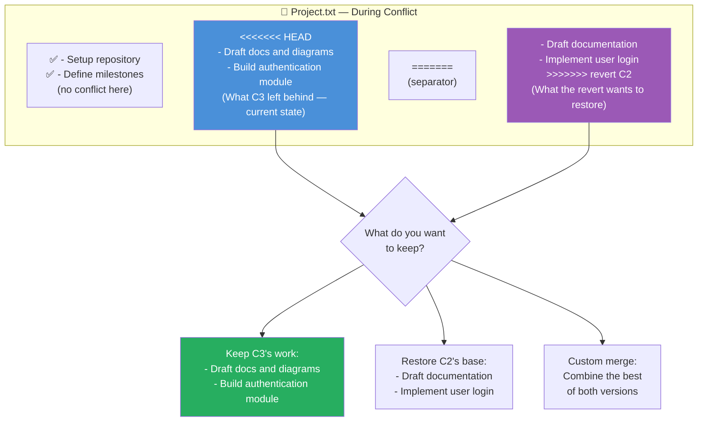

**Goal**: We want to undo C2 (remove `Implement user login`) but keep C3's improvements.

**✅ Manually resolved `Project.txt`:**

```
- Setup repository
- Define milestones
- Draft docs and diagrams         ← Keep C3's improvement
- Build authentication module     ← Keep C3's improvement
```

*(Removed `Implement user login` because that's exactly what C2 introduced — mission accomplished. The old `Draft documentation` was already superseded by C3's better version, so we keep C3's wording.)*

### Step 4️⃣ — Stage the Resolved File

```bash
$ git add Project.txt
```

### Step 5️⃣ — Continue the Revert

```bash
$ git revert --continue
# Your editor opens with the default message:
# "Revert 'Add new feature'"
# Modify the message if needed, save and exit.
```

### Step 6️⃣ — The Final History

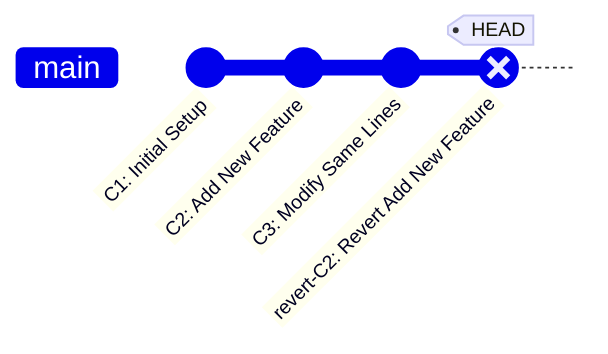

```bash
$ git log --oneline
a7b3c21 (HEAD -> main) Revert "Add new feature"
f8d2e10 C3: Modify same lines
a3f2c91 C2: Add new feature
1e9b4c0 C1: Initial Setup
```

> ✅ **C2 still exists in the log.** `git revert` never erases history — it adds a new commit that undoes the effect. The audit trail is complete.

> ✅ **Quick Recap**: Revert = inverse patch + three-way merge against HEAD. Clean apply → automatic revert commit. Any disagreement with later commits → conflict markers → resolve, `git add`, `git revert --continue`.

---

## 8. Understanding Conflict Markers

Conflict markers follow a consistent 3-part pattern in every Git conflict:

```
<<<<<<< [source A — usually your current HEAD]
  ... your current code (what HEAD has now) ...
=======
  ... the incoming version (what the operation wants to apply) ...
>>>>>>> [source B — the operation or branch]
```

### Marker Reference

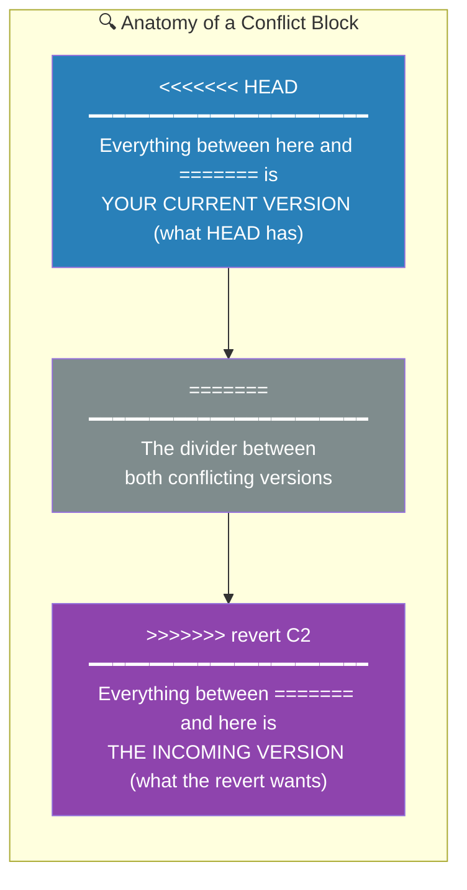

### Multiple Conflict Blocks in One File

A single file can have **multiple independent conflict blocks** if the revert touches several different regions:

```
- Setup repository         ← No conflict
<<<<<<< HEAD
- Draft docs and diagrams  ← Conflict block #1: current version
=======
- Draft documentation      ← Conflict block #1: revert's version
>>>>>>> revert C2
- Define milestones        ← No conflict
<<<<<<< HEAD
- Build auth module        ← Conflict block #2: current version
=======
- Implement user login     ← Conflict block #2: revert's version
>>>>>>> revert C2
```

> 💡 **Pro Tip**: Add `git config --global merge.conflictstyle diff3` to your setup. This adds a third section showing the **original base** before either change — making it much easier to understand what each side did.

With `diff3` style:

```
<<<<<<< HEAD
- Draft docs and diagrams
||||||| base (before C3 or C2 changed it)
- Draft documentation
=======
- Draft documentation
>>>>>>> revert C2
```

---

## 9. Conflict Resolution — Complete Workflow

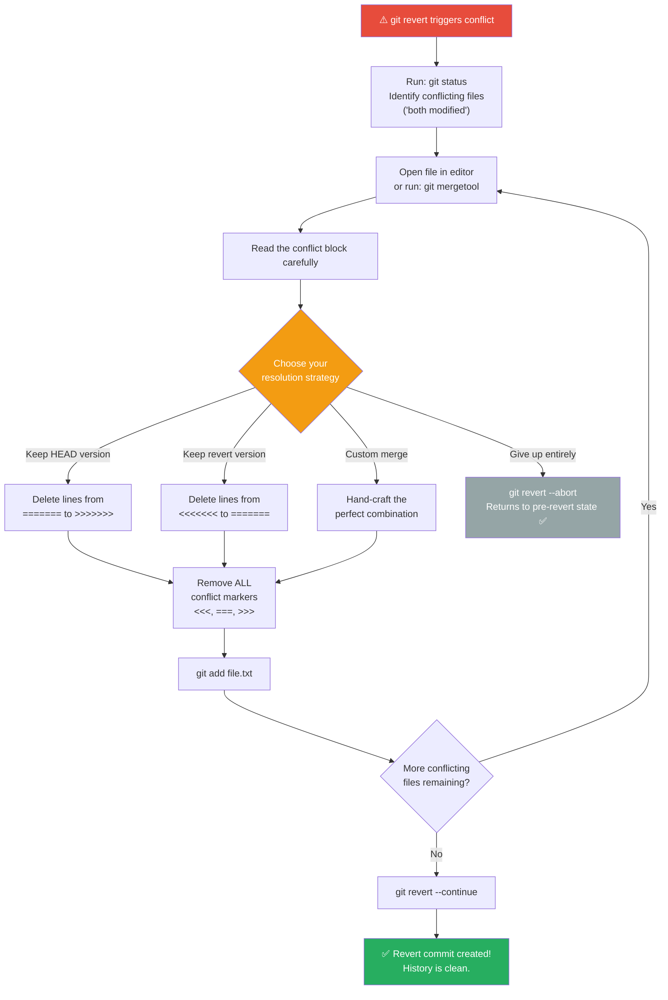

### Commands Cheatsheet During Resolution

```bash
# See which files need resolution
git status

# Inspect conflict markers in detail
git diff

# Find leftover conflict markers anywhere in the tree
git diff --check

# Launch a visual merge tool (configured separately)
git mergetool

# After editing a file to resolve conflict, stage it
git add <resolved-file>

# Finish the revert after staging all resolved files
git revert --continue

# Skip this particular commit (revert does nothing for it)
git revert --skip

# Cancel entirely — returns to your exact pre-revert state
git revert --abort
```

> ✅ **Quick Recap**: HEAD section = what you have now; after `=======` = what the operation wants. Resolution = edit to the desired final state, remove every marker, stage, continue. Unsure? `--abort` restores the exact pre-revert state.

---

## 10. Real-World Use Cases

### 🚨 Use Case 1: Emergency Production Rollback

**Problem**: A bug shipped in commit `C42` is causing 500 errors in production. Commits `C43`–`C47` have been merged in the meantime with unrelated fixes.

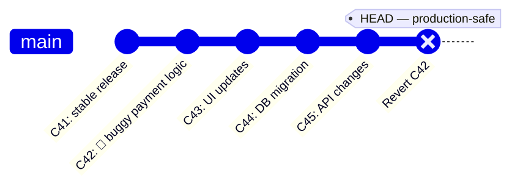

```bash
# Precisely remove just the bad commit
git revert a3f2c91   # C42's hash

# Resolve any conflicts from C43–C45 touching same code
git add payment.js
git revert --continue

# Deploy the single revert commit to fix production
git push origin main
```

> ✅ **C43–C45 are completely unaffected.** Only C42's bug is surgically removed.

### 🔌 Use Case 2: Cutting a Feature Before Release

**Problem**: Feature X was merged but must be cut from the upcoming release at the last minute (regulatory hold, not ready, etc.).

```bash
# Find the merge commit that brought in the feature
git log --oneline --merges

# Revert the entire merge commit
# -m 1 = treat the first parent (main branch) as authoritative
git revert -m 1 <merge-commit-hash>
```

### ⏪ Use Case 3: Reverting Multiple Sequential Commits

**Problem**: Three consecutive commits (C5, C6, C7) implement an experimental feature that must be removed entirely.

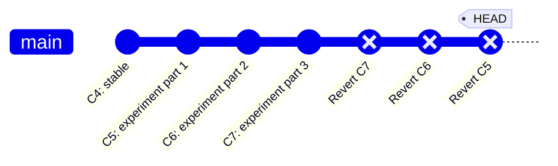

```bash
# Option A: Revert a range (MUST go newest-first to avoid cascading conflicts)
git revert C7 --no-edit
git revert C6 --no-edit
git revert C5 --no-edit

# Option B: One-liner range notation
git revert HEAD~3..HEAD --no-edit
```

> ⚠️ **Always revert newest-first** when reverting a sequence. Reverting oldest-first causes unnecessary conflicts because you're undoing changes that later commits depend on.

### ⚙️ Use Case 4: Undoing a Broken Configuration Change

**Problem**: A commit modified `config/production.yml` and broke deployments. But a later commit also touched the same file.

```bash
git revert <config-commit-hash>
# Likely conflict in production.yml

# Open the file, remove only the bad setting,
# keep everything else from both versions
vim config/production.yml

git add config/production.yml
git revert --continue
```

### 🤝 Use Case 5: Reverting an Open Source PR Merge

**Problem**: A merged PR was found to contain security issues. The maintainer must cleanly undo it without breaking other merged PRs.

```bash
# Find the PR merge commit
git log --oneline --merges | grep "Merge pull request #1234"

# Revert the merge commit with mainline = first parent (main)
git revert -m 1 abc1234

# Push to trigger CI/CD and notify contributors
git push origin main
```

### 📊 Use Case 6: Reverting a Data Migration Script

**Problem**: A database migration script was accidentally committed and run in staging. The migration must be rolled back from the codebase (while the DB team handles the actual rollback separately).

```bash
git revert <migration-commit-hash>
# In your commit message, clearly explain:
# "Revert 'Add user_preferences migration'
#  Migration caused column type mismatch.
#  DB team rolling back with separate script.
#  Tracking: JIRA-4521"
git push origin main
```

---

## 11. Git Revert vs Git Reset vs Git Restore

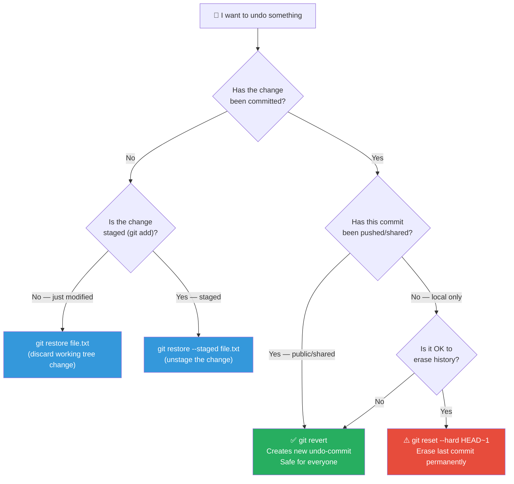

### Full Comparison Table

| Feature | `git revert` | `git reset` | `git restore` |
|---|---|---|---|
| Creates new commit | ✅ Yes | ❌ No | ❌ No |
| Modifies history | ❌ Never | ✅ Yes (erases) | ❌ No |
| Safe on public branches | ✅ Always | ❌ Dangerous | ✅ Yes (files only) |
| Targets specific old commit | ✅ Yes | ✅ Yes | ✅ Yes (files) |
| Can cause conflicts | ✅ Sometimes | ❌ No | ❌ No |
| Works on pushed commits | ✅ Yes | ⛔ Don't | ✅ Yes (files) |
| Auditable trail | ✅ Full trail | ❌ Erased | ❌ No record |

> 💡 **Rule of thumb**: If anyone else may have the commit — or it's on CI, a backup, or a fork — use `revert`. Only use `reset` for local commits you are certain nobody has seen.

---

## 12. Advanced Scenarios

### Reverting a Merge Commit

Merge commits have **two parents**. You must specify which parent to treat as the "mainline" using `-m`:

```bash
# -m 1 → treat parent 1 (main branch) as the mainline
# This effectively reverts the feature branch's changes
git revert -m 1 <merge-commit-hash>

# -m 2 → treat parent 2 (feature branch) as the mainline
# Rarely used; undoes the main branch changes
git revert -m 2 <merge-commit-hash>
```

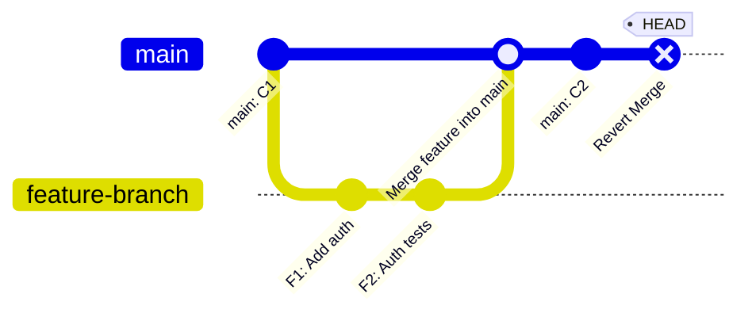

### Reverting a Revert (Re-applying Changes)

If a revert was done by mistake and you need to re-apply the original changes:

```bash
# Find the "Revert 'Add new feature'" commit
git log --oneline | grep "Revert"

# Revert the revert commit
git revert <revert-commit-hash>
# This creates a "Revert of Revert" commit = original changes restored
```

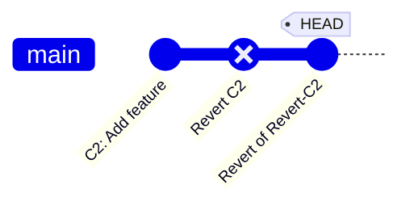

> The last commit effectively re-applies C2's original changes cleanly.

### Using `--no-commit` for Batch Reverts

```bash
# Stage revert changes from C5, C6, C7 without committing after each
git revert C7 --no-commit
git revert C6 --no-commit
git revert C5 --no-commit

# Review all staged changes together
git diff --cached

# Commit them all as one single revert commit
git commit -m "Revert experimental feature set (C5-C7)"
```

### Configuring Visual Merge Tools

```bash
# VS Code
git config --global merge.tool vscode
git config --global mergetool.vscode.cmd 'code --wait $MERGED'

# IntelliJ / WebStorm
git config --global merge.tool intellij
git config --global mergetool.intellij.cmd 'idea merge $LOCAL $REMOTE $BASE $MERGED'

# Meld (Linux)
git config --global merge.tool meld

# Launch during a conflict
git mergetool
```

---

## 13. Best Practices & Configuration

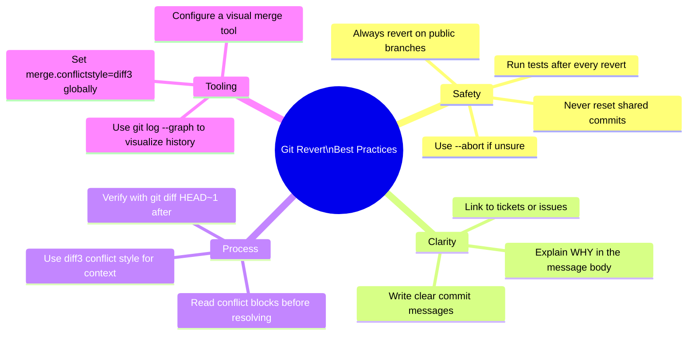

### Recommended Global Configuration

```bash
# Show the shared base in conflict markers (highly recommended)
git config --global merge.conflictstyle diff3

# Set a visual merge tool (example: VS Code)
git config --global merge.tool vscode
git config --global mergetool.vscode.cmd 'code --wait $MERGED'

# Better default git log for visualizing history
git config --global alias.lg "log --oneline --graph --decorate --all"

# Use with:
git lg
```

### Writing Great Revert Commit Messages

**❌ Bad:**
```
Revert "Add user login"
```

**✅ Good:**
```
Revert "Add user login" — caused DB timeout in prod

The user login feature introduced N+1 queries in the
authentication middleware, causing DB connection pool
exhaustion under load.

Reverts commit a3f2c91.
Tracking: JIRA-4521, Incident-202
```

### The Golden Rules of `git revert`

1. **Always `revert` on public/shared branches**, never `reset --hard`
2. **Revert sequences newest-first** to minimize cascading conflicts
3. **Read every conflict block carefully** — understand what each version represents before choosing
4. **`git revert --abort` is your safety net** — if confused, abort and re-examine
5. **Test thoroughly after reverting** — the revert might have kept code that depended on the reverted feature
6. **Write meaningful commit messages** — future you and your teammates will be grateful

---

## 14. Common Pitfalls & Troubleshooting

### 14.1 Common Pitfalls

| # | Pitfall | Why It Happens | How to Avoid |
|---|---|---|---|
| 1 | Using `git reset --hard` on a shared branch | Muscle memory from local work | Ask first: *"could anyone else have this commit?"* If yes → revert |
| 2 | Committing files that still contain conflict markers | Rushing through resolution | Run `git diff --check` before every commit |
| 3 | Reverting a range oldest-first | Misreading range notation | `git revert <oldest>..<newest>` applies newest-first — keep that order |
| 4 | Reverting a merge commit without `-m` | Forgetting merges have two parents | Git will refuse; supply `-m 1` for a normal `main` merge |
| 5 | Assuming revert erased the commit | Misremembering the mental model | Remember: revert **adds** an anti-commit; the original stays in the log |
| 6 | Forgetting `git add` before `--continue` | Edit-and-run habit | Stage every resolved file, then continue |
| 7 | Starting a revert with a dirty working tree | Uncommitted edits lying around | Commit or `git stash` first — revert refuses to run otherwise |
| 8 | Re-merging a branch after its merge was reverted | Expecting re-merge to restore the feature | Git remembers the merge; **revert the revert** instead (Section 12) |
| 9 | Resolving conflicts without understanding both sides | Panic-clicking "accept mine" | Enable `diff3` and read the base before deciding |
| 10 | Reverting a hash that changed after a rebase | Hash-based workflow assumptions | Locate commits by message: `git log --oneline --grep "Add new feature"` |

### 14.2 Troubleshooting Guide

| ⚠️ Symptom | 🔍 Likely Cause | ✅ Fix |
|---|---|---|
| `error: could not revert a3f2c91...` | Conflict with later commits | Resolve markers → `git add` → `git revert --continue` |
| `fatal: your local changes would be overwritten` | Dirty working tree | `git stash` or commit first, then retry |
| `CONFLICT (content): Merge conflict in <file>` | Overlapping changes | Manual resolution workflow (Section 9) |
| `CONFLICT (modify/delete)` | Revert wants to modify a file that was later deleted | Decide: restore file (`git add`) or drop it (`git rm`) |
| `git revert --continue` says no reverts in progress | Revert already finished or aborted | If resolution work remains, make a normal commit instead |
| `<<<<<<< HEAD` found in production code | Markers were committed accidentally | New fix commit removing markers; clean up history later locally |
| Revert appears to change nothing | Commit was empty or already reverted | Inspect with `git show <hash>` first |
| Editor opens unexpectedly during revert | Git asks for the revert commit message | Use `--no-edit`, or set `GIT_EDITOR` / `core.editor` |
| `error: commit ... is a merge but no -m option was given` | Reverting a merge commit | Re-run with `-m 1` (or `-m 2` for the other mainline) |
| Merge conflict cascade when reverting a range | Reverted oldest-first | Abort, then revert newest-first |

### 14.3 The Universal Diagnostic Sequence

When anything goes wrong during a revert, run these in order:

```bash
git status              # 1. What state am I in? Which files conflict?
git diff                # 2. What exactly disagrees?
git log --oneline -5    # 3. Where is HEAD right now?
git revert --abort      # 4. Escape hatch — only if you want to bail out
```

> 🆘 **Remember**: `git revert --abort` returns you to the exact state before the revert began — including any conflicts you had already resolved. It is always safe.

---

## 15. Anti-Patterns

### ❌ Anti-Pattern 1: `git reset --hard` on a Shared Branch

```bash
# ❌ NEVER do this on main/develop after others have pulled
git reset --hard HEAD~3
git push --force
```

**Why it's bad**: Everyone who pulled the original commits now diverges from the remote. Merges, lost work, and very angry teammates follow.
**✅ Instead**: `git revert <oldest>..<newest> --no-edit` and push normally.

### ❌ Anti-Pattern 2: Blind Conflict Resolution

```bash
# ❌ Accepting a whole side without reading it
git checkout --ours conflicted.js
git add conflicted.js
git revert --continue
```

**Why it's bad**: "Ours" in a revert is HEAD — accepting it wholesale may silently *keep* the very code you meant to remove.
**✅ Instead**: Read the block (with `diff3` context), hand-craft the final state, then stage.

### ❌ Anti-Pattern 3: The Revert War

Developer A reverts B's commit; B reverts A's revert; the ping-pong continues while CI burns.
**✅ Instead**: A revert should always be accompanied by a comment/ticket explaining *why*. If a revert is disputed, discuss — don't escalate through the commit log.

### ❌ Anti-Pattern 4: Giant Unreviewed Batch Reverts

```bash
# ❌ 40 commits reverted blind into one commit, straight to main
git revert HEAD~40..HEAD --no-edit && git push
```

**✅ Instead**: Batch reverts belong on a branch, through a pull request, with CI and review — exactly like any risky change.

### ❌ Anti-Pattern 5: Re-merging a Reverted Merge

```bash
git revert -m 1 <merge>          # ✅ correct rollback...
# ...weeks later:
git merge feature-branch         # ❌ brings back NOTHING
```

**Why it's bad**: Git sees the feature branch commits are already "in history" (the merge commit exists) and only applies commits *since* the merge — the feature stays gone.
**✅ Instead**: `git revert <revert-commit>` (revert the revert) or rebase the branch to create fresh commits.

### ❌ Anti-Pattern 6: Committing Leftover Conflict Markers

```
<<<<<<< HEAD
...shipped to production...
```

**✅ Instead**: Always run `git diff --check` (flags leftover markers) before committing, and grep CI: `grep -rnE '^(<{7}|={7}|>{7})' src/`.

### ❌ Anti-Pattern 7: Force-Pushing to "Clean Up" After a Bad Revert

A messy revert history is embarrassing but honest; a force-push on shared history is a team-wide outage.
**✅ Instead**: Let history be history. Fix forward with a new revert or correction commit.

### ❌ Anti-Pattern 8: Reverting Without Testing

A revert that compiles is not a revert that works — surviving code may have depended on the removed feature.
**✅ Instead**: Full build + test suite after every revert (see Section 18).

> 💡 **Aha moment**: Most revert disasters are not caused by `git revert` itself, but by *surrounding* habits — force-pushes, blind resolutions, and skipped tests. The command is safe; the workflow must be too.

---

## 16. Performance Considerations

`git revert` is a local operation, but at scale a few factors matter:

| Factor | Impact | Mitigation |
|---|---|---|
| **Commit size** | Revert cost scales with the diff being inverted (diff computation + three-way merge) | Keep commits small and atomic — small patches revert cleanly and fast |
| **Rename detection** | Large diffs hitting `diff.renameLimit` / `merge.renameLimit` disable rename tracking, causing spurious conflicts | Raise limits for big repos: `git config merge.renameLimit 5000` |
| **Range reverts** | `git revert A..B` performs one merge per commit — N commits = N sequential merge operations | Prefer one `--no-commit` batch pass and a single commit; avoids N editor launches |
| **Large binary files** | Binary conflicts can't be line-merged; Git just flags them, and files sit unmerged in the index | Store binaries in Git LFS; revert binary changes by explicit file replacement |
| **Monorepo status overhead** | Large working trees slow `git status` during conflict resolution | Enable `core.fsmonitor` and `core.untrackedCache` |
| **CI concurrency** | Parallel CI jobs running reverts can hit `index.lock` contention | Serialize Git mutations in the pipeline; use one job for rollbacks |
| **Editor round-trips** | Each auto-commit opens an editor in scripted rollbacks | Use `--no-edit` or `--no-commit` in scripts and CI |

> ⚡ **Performance rule of thumb**: *The fastest revert is the one that resolves cleanly.* Small, focused commits are the best performance optimization — for reverts and for merges alike.

---

## 17. Security Considerations

> 🚨 **The single most important security fact about revert**: reverting a commit does **not** remove it from history. The commit — including any secrets in it — remains reachable by hash, in clones, in CI caches, and on the remote.

### 17.1 Revert Is Not a Secret-Removal Tool

If a commit contained an API key, password, or token:

1. **Rotate the credential first** — treat it as compromised from the moment it was committed. Rotation is the real fix; history surgery is cleanup.
2. **Purge history** with `git filter-repo` or BFG Repo-Cleaner, then coordinate a force-push *and* have every teammate re-clone.
3. **Never** rely on revert alone for this.

```bash
# History purge outline (do NOT do casually — coordinate with your team!)
git clone --mirror <repo-url>
pip install git-filter-repo
git filter-repo --replace-text expressions.txt   # replace secret with ***REMOVED***
# then force-push all refs and invalidate CI caches / forks
```

### 17.2 What to Keep Out of Revert Commit Messages

- 🚫 Stack traces containing internal hostnames or connection strings
- 🚫 The secret value itself ("reverting commit that leaked `sk_live_...`")
- ✅ Ticket numbers, incident IDs, and *why* the revert happened

### 17.3 Process & Supply-Chain Considerations

| Concern | Recommendation |
|---|---|
| Review gates | Perform reverts on shared branches **through pull requests**, so CI and code review gate the rollback |
| Signed commits | The revert commit is brand-new and authored by you — sign it (`git revert -S <hash>`) to keep your branch protection satisfied |
| Dependency reverts | Reverting a dependency bump can silently reintroduce a known CVE — check the advisory database before reverting version bumps |
| Branch protection | Ensure protected branches disallow force-pushes, so history-erasing "fixes" are impossible even by mistake |
| Automated rollbacks | Scripted `revert + push` pipelines must still pass CI — never push rollbacks from a compromised or untrusted runner |

> ✅ **Security takeaway**: Revert is the *safe collaboration* tool, not the *data destruction* tool. For secrets: rotate → purge → prevent (with secret scanning and pre-commit hooks).

---

## 18. Testing Strategies

A revert changes real code — it deserves the same testing rigor as any change, or more, because it's often done under time pressure.

### 18.1 The Post-Revert Testing Pyramid

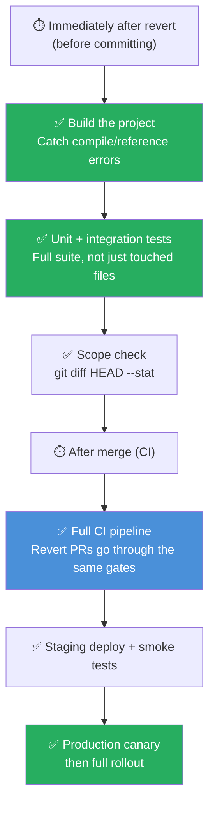

### 18.2 Verification Checklist

```bash
# 1. Confirm the revert contains ONLY what you intended
git show HEAD --stat
git diff HEAD~1

# 2. Confirm no conflict markers survived
git diff --check

# 3. Confirm the reverted behavior is really gone (or restored)
#    — run the specific tests that covered the reverted feature
```

### 18.3 Test Types by Revert Scenario

| Revert Scenario | Tests to Prioritize |
|---|---|
| Feature removal | Compile/build; integration tests of dependent features; UI smoke tests |
| Merge-commit revert (`-m 1`) | **Full suite** — merge reverts can undo many commits at once |
| Configuration revert | Deploy to staging first; config-schema validation; smoke test the service start |
| Dependency version revert | Vulnerability scan; compatibility tests; lockfile diff review |
| Database migration revert | Verify migration rollback scripts; run against a staging DB snapshot |
| Batch (`--no-commit`) revert | Extra scrutiny: review the combined `git diff --cached` before the single commit |

> 💡 **Why this matters**: The most dangerous failure mode of a revert isn't the conflict — it's the *silent semantic breakage* where the code still compiles but a surviving module depended on the reverted feature. Tests are the only reliable detector.

---

## 19. Hands-On Labs

🧪 **Do these in a scratch repository — never in real project repos.** Each lab takes 15–30 minutes.

### 🧪 Lab 1: The Classic Revert Conflict

**Goal**: Reproduce the tutorial's walkthrough scenario end-to-end.

**Setup:**

```bash
mkdir revert-lab && cd revert-lab
git init
echo "- Setup repository" > Project.txt
echo "- Define milestones" >> Project.txt
echo "- Draft documentation" >> Project.txt
git add . && git commit -m "C1: Initial Setup"

echo "- Implement user login" >> Project.txt
git add . && git commit -m "C2: Add new feature"

# C3 modifies the same region C2 touched
echo "- Draft docs and diagrams" > Project.txt
echo "- Build authentication module" >> Project.txt
git add . && git commit -m "C3: Modify same lines"
```

**Tasks:**
1. Run `git revert <C2-hash>` and observe the conflict.
2. Inspect `Project.txt` — identify the HEAD block, the divider, and the revert block.
3. Resolve so that C3's improvements stay but `Implement user login` is removed.
4. Stage, run `git revert --continue`, and inspect `git log --oneline`.

**✅ Expected result**: A 4-commit history ending in `Revert "C2: Add new feature"`, with `Project.txt` containing `- Draft docs and diagrams` and `- Build authentication module`, and no conflict markers anywhere (`git diff --check` is silent).

### 🧪 Lab 2: Range Revert, Newest-First

**Goal**: Remove three consecutive feature commits cleanly.

**Setup:**

```bash
for i in 5 6 7; do echo "experiment line $i" >> notes.txt; git add .; git commit -m "C$i: experiment part $((i-4))"; done
```

**Tasks:**
1. Revert all three commits as **one single commit** using `--no-commit`.
2. Review the staged result with `git diff --cached --stat`.
3. Commit with message `Revert experimental feature set (C5-C7)`.
4. Now try again in a fresh repo reverting oldest-first with individual commits — observe how much harder it gets.

**✅ Expected result**: `notes.txt` no longer contains any experiment lines; one revert commit exists; `git log --oneline` shows C5–C7 still present.

### 🧪 Lab 3: Revert a Merge Commit (and Revert the Revert)

**Goal**: Master `-m 1` and the revert-of-revert pattern.

**Setup:**

```bash
git checkout -b feature
echo "feature code" > feature.js
git add . && git commit -m "F1: Add feature"
git checkout main
git merge feature --no-edit      # creates a merge commit
git log --oneline --graph       # note the merge commit hash
```

**Tasks:**
1. Revert the merge with `git revert -m 1 <merge-hash> --no-edit`.
2. Confirm `feature.js` is gone.
3. Try `git merge feature` again — observe that nothing re-appears (Anti-Pattern 5 live!).
4. Fix it properly: `git revert <the-revert-commit> --no-edit` and confirm `feature.js` is back.

**✅ Expected result**: You've demonstrated the full rollback → restore cycle with merge commits.

> ✅ **Lab takeaway**: If you can do Lab 3 from memory, you understand 90% of real-world revert operations.

---

## 20. Practice Exercises with Detailed Solutions

### 📝 Exercise 1 (Beginner): Predict the Conflict

**Given** this history and file states:

- C1: `config.txt` contains `timeout=30`
- C2: changes `timeout=30` → `timeout=60`
- C3: changes `timeout=60` → `timeout=90`

**Question**: You run `git revert <C2-hash>`. Does it conflict? If yes, write the exact conflict block Git would leave in `config.txt`.

**✅ Detailed Solution**

Yes — it conflicts. C2's inverted patch wants `timeout=60` → `timeout=30`, but the file currently has `timeout=90` (C3's edit), not `timeout=60`. The three-way merge finds no context line matching `timeout=60`:

```
<<<<<<< HEAD
timeout=90
=======
timeout=30
>>>>>>> parent of a3f2c91 (change timeout)
```

Resolution depends on intent: keep `timeout=30` (fully undo C2 *and* C3's later adjustment) or keep `timeout=90` (acknowledge later commits superseded C2). Either way, remove the markers, `git add config.txt`, `git revert --continue`.

### 📝 Exercise 2 (Intermediate): Debug a Botched Resolution

A teammate did this after a revert conflict:

```bash
git revert a3f2c91
# conflict!
vim app.js          # edited the file, but left the <<<<<<< block in place
git revert --continue   # committed anyway
git push origin main
```

**Question**: Identify **three mistakes** and give the corrected workflow.

**✅ Detailed Solution**

1. **Mistake 1 — committed conflict markers**: They never removed the `<<<<<<<` / `=======` / `>>>>>>>` lines, so broken syntax is now in `app.js` on `main`.
2. **Mistake 2 — never staged a resolved file deliberately**: `git revert --continue` auto-staged the *conflicted* file; there was no conscious `git add` after real resolution.
3. **Mistake 3 — pushed untested, unverified work**: No `git diff --check`, no build, no tests, and it went straight to a shared branch.

**Corrected workflow:**

```bash
git revert a3f2c91            # conflict
# edit app.js: craft final state, remove ALL markers
git diff --check              # verify no markers remain
git add app.js
git revert --continue         # complete the revert commit
# run build + tests
git push origin main          # only now
```

If the bad push already happened, fix forward with a follow-up commit that removes the markers (and file a post-incident note — no force-push on shared history!).

### 📝 Exercise 3 (Intermediate/Advanced): Scripted Feature Removal

History (oldest → newest): C1 `init`, C2 `add feature`, C3 `tweak feature`, C4 `unrelated fix`, C5 `polish feature`.

**Question**: Write the command sequence to remove *only* the feature (C2, C3, C5) as **one commit**, without touching C4, and keeping history intact.

**✅ Detailed Solution**

Since C4 sits between them, a single range revert won't work. Batch individual reverts:

```bash
git revert C5 --no-commit
git revert C3 --no-commit
git revert C2 --no-commit

git diff --cached          # review the combined result
git commit -m "Revert feature (C2, C3, C5); keep unrelated fix C4"
```

Key points: newest-first ordering minimizes conflicts; `--no-commit` accumulates everything into one commit; C4's fix remains untouched; all original commits remain in history (audit trail preserved). If any single revert conflicts, resolve or `git revert --abort` and reconsider.

### 📝 Exercise 4 (Advanced): The Merge-Commit Trap

Your team merged `feature/payments` (commits F1–F3) via merge commit M, then shipped M. Production breaks; you revert M with `git revert -m 1 M`. A week later the feature is fixed and a teammate re-runs `git merge feature/payments` — **nothing happens**. Why? And what are the two correct fixes?

**✅ Detailed Solution**

**Why**: `git merge` only brings in commits reachable from `feature/payments` that aren't already reachable from `main`. F1–F3 *are* already reachable from `main` (through M), so Git concludes there's nothing to merge — even though their content was reverted. The revert only changed the *content* on main; it didn't change commit reachability.

**Fix 1 — revert the revert** (preferred, preserves audit trail):

```bash
git log --oneline | grep "Revert"       # find the revert commit
git revert <revert-commit-hash> --no-edit
# then commit the new fixes on feature/payments and merge as usual
```

**Fix 2 — rebase the feature branch** so it contains *new* commits:

```bash
git checkout feature/payments
git rebase main        # F1-F3 are rewritten as fresh commits
git checkout main && git merge feature/payments
```

Now the commits are new objects not reachable from main's history, so the merge applies them. Document whichever approach you pick — future archaeologists will thank you.

---

## 21. Test Your Understanding

Answer all questions first, then check the answers below. Aim for 10/12.

**Q1.** What is the fundamental difference between `git revert` and `git reset`?

**Q2.** A revert conflicts when ______ has modified the same lines the revert needs to touch.

**Q3.** In a conflict block, what does the section between `<<<<<<< HEAD` and `=======` represent?

**Q4.** Which command cancels an in-progress revert and restores the exact pre-revert state?

**Q5.** True or false: after `git revert C2`, commit C2 is removed from `git log`.

**Q6.** What does `-m 1` mean in `git revert -m 1 <merge-hash>`?

**Q7.** Why should a sequence of commits be reverted newest-first?

**Q8.** Which flag stages revert changes without creating a commit, enabling batch reverts?

**Q9.** What does `git diff --check` do, and why is it valuable before committing a resolution?

**Q10.** What does the `diff3` conflict style add to a conflict block?

**Q11.** After reverting merge commit M, why does re-merging the feature branch bring back nothing?

**Q12.** Name two commands you can use to escape a problematic revert mid-conflict-resolution.

### ✅ Answers

1. Revert creates a **new commit** inverting an old one (history preserved); reset **moves the branch pointer**, erasing commits from the branch (history rewritten).
2. A **later commit**.
3. Your current version — what HEAD contains right now ("ours").
4. `git revert --abort`.
5. False — C2 remains in the log; a new revert commit undoes its *effect*.
6. Treat **parent 1** of the merge (the branch you merged *into*, e.g., `main`) as the mainline; the revert then removes the feature branch's changes.
7. Later commits depend on earlier ones; undoing the newest first avoids cascading conflicts.
8. `--no-commit`.
9. It scans for leftover conflict markers (and whitespace errors); it catches markers accidentally committed.
10. A third section showing the **common base** (`|||||||`) — the file content before either side changed it.
11. Because the feature branch's commits are still **reachable** from `main` via M — Git only merges commits that aren't already in main's history, regardless of content.
12. `git revert --abort` (cancel everything) and `git revert --skip` (in multi-commit sequences); you can also quit and later abort.

> 📊 **Scored 10+?** You're ready for the interview questions and the advanced question bank below.

---

## 22. Common Interview Questions

**Q1. What is the difference between `git revert` and `git reset`? When would you use each?**
> Revert adds a new commit that inverts an old one — safe for shared branches because history is preserved. Reset moves the branch pointer and can erase commits — acceptable only on local, unpushed work. Use revert for anything pushed or collaborative; reset for private cleanup.

**Q2. Walk me through what Git does internally when you run `git revert <hash>`.**
> Git computes the patch between the commit and its parent, inverts it, then performs a three-way merge with the reverted commit as merge base, HEAD as ours, and the parent as theirs. If the merge is clean it auto-commits `Revert "..."`; otherwise it stops with conflict markers and enters a sequencer state.

**Q3. When does a revert conflict occur, and why doesn't Git just force the undo?**
> When later commits modified the same lines (or deleted the file). Git refuses to guess because the correct result depends on intent — silently overwriting later work would be destructive. Conflicts are Git asking for a human decision.

**Q4. How do you revert a merge commit, and what does `-m 1` specify?**
> `git revert -m 1 <merge-hash>`. Merge commits have two parents; `-m 1` declares parent 1 (the branch you merged into) as the mainline, so the revert removes the changes the feature branch introduced.

**Q5. You reverted a merge, but now need the feature back. Why doesn't re-merging work, and what do you do?**
> Re-merge brings nothing because the feature commits are still reachable from main via the original merge — reachability, not content, drives merges. Fix by reverting the revert, or rebasing the feature branch to create new commits.

**Q6. How would you safely remove five consecutive feature commits from a shared branch?**
> Newest-first: either `git revert <oldest>..<newest> --no-edit` (applies newest-first) or five individual reverts; for one clean commit, use `--no-commit` on each and commit once. Then run the test suite and push via normal review.

**Q7. What is `git revert --no-commit` useful for?**
> Batching multiple reverts into a single reviewed commit, and for pre-commit verification — you can inspect `git diff --cached` and run tests before finalizing.

**Q8. Explain the roles of `--continue`, `--skip`, and `--abort` during a revert.**
> `--continue` finishes the current revert after conflicts are resolved and staged; `--skip` abandons the current commit's revert and moves on (multi-commit sequences); `--abort` cancels the whole operation, restoring the exact pre-revert state.

**Q9. A commit contains a leaked API key. Can `git revert` solve this?**
> No. Revert only hides the effect going forward; the key remains in history and every clone. Rotate the credential immediately, then purge history with `git filter-repo` or BFG and coordinate a force-push, plus prevent recurrence with secret scanning.

**Q10. What is the `diff3` conflict style and why do many teams enable it globally?**
> `merge.conflictstyle diff3` adds the common base section (`|||||||`) to conflict blocks, showing what the file looked like before either side changed. It makes both sides' edits interpretable, so resolutions are faster and safer.

**Q11. What happens if you revert a commit that was already reverted?**
> You re-apply the original changes — the inverse of the inverse. This is the standard, history-preserving way to restore a feature after a rollback.

**Q12. How does revert fit into CI/CD rollback strategy?**
> It's the gold standard: an auditable, reviewable, forward-moving change that passes the same CI gates as any commit. Unlike redeploying an old artifact, it fixes the source of truth, works with branch protection, and requires no history rewriting or force-push.

---

## 23. Question Bank — 50 Questions

*Fifty questions across three difficulty levels, each with a concise answer. Cover the answers and quiz yourself.*

### 🟢 Beginner (Q1–Q15)

**Q1. What does `git revert` do?**  
Creates a new commit that applies the inverse of a previous commit's changes.

**Q2. Does `git revert` rewrite or erase history?**  
No — it always adds a new commit; the original commit remains in the log.

**Q3. Which command reverts the most recent commit?**  
`git revert HEAD`

**Q4. How do you revert without Git opening an editor?**  
Add `--no-edit` (uses the default `Revert "..."` message).

**Q5. Name the three lines that make up a conflict block.**  
`<<<<<<<` (start of ours), `=======` (divider), `>>>>>>>` (end of theirs).

**Q6. What does the section between `=======` and `>>>>>>>` contain?**  
The incoming version — what the revert wants to apply.

**Q7. Which command cancels an in-progress revert entirely?**  
`git revert --abort`

**Q8. How do you mark a file as resolved?**  
`git add <file>` (or `git rm <file>` if it should be deleted).

**Q9. What command finalizes a revert after resolving conflicts?**  
`git revert --continue`

**Q10. What does `git status` show for a file with a revert conflict?**  
`both modified:` in the "Unmerged paths" section.

**Q11. Is `git revert` safe to use on a branch other people have pulled?**  
Yes — that's precisely what it's designed for.

**Q12. What does HEAD refer to?**  
The commit currently checked out (usually the tip of your active branch).

**Q13. What does `git revert --skip` do?**  
Abandons the revert of the current commit and moves to the next one in the sequence.

**Q14. What is the default commit message Git generates for a revert?**  
`Revert "<original commit subject>"`.

**Q15. Which command lists the files that still need conflict resolution?**  
`git status`

### 🟡 Intermediate (Q16–Q35)

**Q16. Describe the three-way merge Git performs during a revert.**  
Merge base = the commit being reverted; ours = current HEAD; theirs = the reverted commit's parent.

**Q17. What does `-m 1` mean when reverting a merge commit?**  
Treat parent 1 (the branch merged into, e.g., main) as the mainline and undo the other side's changes.

**Q18. In what order does `git revert <oldest>..<newest>` apply the reverts?**  
Newest-first, automatically — which is why the range notation is safe for sequences.

**Q19. What does the `diff3` conflict style add, and how do you enable it?**  
A base (`|||||||`) section showing the common ancestor content; enable with `git config --global merge.conflictstyle diff3`.

**Q20. What does `git diff --check` do?**  
Reports leftover conflict markers and whitespace errors in the diff.

**Q21. What happens if you revert a commit that was already reverted?**  
Usually a clean revert that re-applies the original changes (inverse of the inverse).

**Q22. What is the benefit of `--no-commit` when reverting multiple commits?**  
It accumulates all reverts in the staging area so they can be reviewed and committed once.

**Q23. Can a revert conflict even if no one edited "your" line?**  
Yes — nearby context lines, deletions, renames, or file-level modify/delete disagreements can all conflict.

**Q24. What is a modify/delete conflict?**  
The revert wants to modify a file that a later commit deleted (or vice versa); you choose to restore or remove it.

**Q25. What error does Git give if you revert a merge commit without `-m`?**  
`error: commit ... is a merge but no -m option was given` — it refuses to guess the mainline.

**Q26. How do you find the merge commit that brought a feature into main?**  
`git log --oneline --merges` (or the platform UI's merge history).

**Q27. Where does Git store the in-progress revert state?**  
In `.git/sequencer/` — that's what `--continue`, `--skip`, and `--abort` operate on.

**Q28. How do you preview a revert's full effect before committing it?**  
`git revert <hash> --no-commit` then `git diff --cached`.

**Q29. Why revert newest-first within a sequence?**  
Because later commits may build on earlier ones; undoing newest first keeps each inverse patch applicable.

**Q30. What is a "mainline" parent?**  
The parent of a merge commit representing the primary branch you merged into — usually parent 1.

**Q31. How can you find all past reverts in a repository?**  
`git log --oneline --grep "Revert"`.

**Q32. What's the difference between `git cherry-pick` and `git revert`?**  
Cherry-pick applies a commit's patch onto HEAD; revert applies its inverse.

**Q33. What does `git revert --abort` restore exactly?**  
HEAD and the working tree to the exact state before the revert started, including discarding any resolutions made so far.

**Q34. What happens if you start a revert with uncommitted changes in the working tree?**  
Git refuses: `your local changes would be overwritten` — commit or stash first.

**Q35. How do you revert only part of a commit's changes (specific files)?**  
`git revert <hash> --no-commit`, then `git restore --staged --worktree -- <paths-to-keep>` (or check out those paths from HEAD), and commit the remainder.

### 🔴 Advanced (Q36–Q50)

**Q36. Why is the reverted commit itself the merge base of the revert's three-way merge?**  
Because the inverse patch is derived from the diff between that commit and its parent; using it as base lets Git detect exactly where later commits diverge from that patch.

**Q37. Explain why commit *reachability*, not content, causes the re-merge-after-revert trap.**  
Merge only transports commits not already reachable from the target branch. After reverting merge M, the feature commits are still reachable through M, so Git considers them merged regardless of the reverted content.

**Q38. How can `git rerere` make repeated revert conflict resolution cheaper?**  
With `rerere.enabled=true`, Git records each hand-resolved conflict and automatically replays the same resolution when the identical conflict reappears — useful in revert-revert cycles and long-lived release branches.

**Q39. What happens if a revert resolves cleanly but produces a commit identical to HEAD (a no-op)?**  
The sequencer stops with an empty-commit error before creating anything; you either `--skip` the commit or use `--allow-empty` deliberately (rare — usually it means you misunderstood the patch).

**Q40. Which merge strategy does revert use, and can strategy options help resolve conflicts automatically?**  
The default `ort` strategy; you can pass strategy options like `git revert -X ours <hash>` or `-X theirs` to auto-resolve conflicting hunks in a preferred direction — powerful but must be reviewed carefully.

**Q41. How do you revert a commit on a detached HEAD, and what's the caveat?**  
`git revert <hash>` works, but the resulting commit isn't on any branch and can be orphaned — create/switch to a branch first (`git switch -c fix-branch`).

**Q42. What happens to submodules when you revert a commit that bumped a submodule pointer?**  
The gitlink is reverted in the parent repo, but the submodule's working tree must be synced manually (`git submodule update --init --recursive`) or the parent will show a dirty submodule.

**Q43. How can you predict which commits will conflict with a revert before running it?**  
Inspect overlap with `git log -L` / `git blame` on the affected lines, list later commits touching the same files with `git log --oneline <hash>..HEAD -- <paths>`, or dry-run the merge with `git merge-tree` (Git 2.38+).

**Q44. How does revert interact with signed commits and branch protection?**  
The revert is a brand-new commit authored by you; sign it with `git revert -S <hash>` so GPG/signature-required branch protection accepts the push.

**Q45. What are the trade-offs between `git revert -m 1` and rewriting the branch with `git reset`/`filter-repo` after a bad merge?**  
`-m 1` preserves history and is push-safe but leaves bad content reachable; history rewriting truly removes content but breaks every clone and requires force-push coordination — reserved for secrets/legal issues.

**Q46. In a sequencer with multiple reverts, the second one conflicts. What are your options and their consequences?**  
Resolve + `--continue` (proceeds to remaining commits), `--skip` (drops this revert only, later reverts still run), or `--abort` (undoes all reverts done so far, restoring the original state).

**Q47. Why might a revert of a commit that renamed files produce surprising conflicts?**  
Rename detection during the three-way merge can pair files incorrectly (or hit `merge.renameLimit` and be disabled), so hunks land in the wrong file — raise limits and verify with `git show --stat -M`.

**Q48. How do you revert a commit that has been cherry-picked onto multiple release branches?**  
Revert on each branch separately (hashes differ per branch); automate via `git cherry-pick` of the revert or per-branch `git revert` of the local cherry-picked copy, and track each branch's PR.

**Q49. What does `git revert --edit` vs `--no-edit` control, and why does it matter in CI?**  
It controls whether an editor opens for the revert message; in CI there is no TTY, so scripts must use `--no-edit`/`-m` with `GIT_EDITOR=true` to avoid hanging.

**Q50. Describe a production rollback playbook using revert end-to-end.**  
Confirm the bad commit → open a revert PR (branch protection) → `git revert <hash>` resolving any conflicts → full CI + tests → staged canary deploy with smoke tests → push/tag release → post-incident note linking the revert commit and ticket.

---

## 24. Self-Assessment Checklist

Check off each item honestly — re-study any unchecked item before moving on.

- [ ] I can explain `git revert` as an "anti-commit" and describe its four internal steps
- [ ] I can predict whether a revert will conflict by examining later commits
- [ ] I can identify all three parts of a conflict block, and what `diff3` adds
- [ ] I can resolve a revert conflict by hand: edit → remove markers → `git add` → `--continue`
- [ ] I know when to use `--abort` vs `--skip` vs `--continue`
- [ ] I can revert a range of commits newest-first, and batch them with `--no-commit`
- [ ] I can revert a merge commit with `-m 1` and explain what mainline means
- [ ] I understand why re-merging a reverted merge brings nothing back — and two fixes
- [ ] I can choose correctly between `revert`, `reset`, and `restore` in any scenario
- [ ] I have configured `merge.conflictstyle diff3` and a visual merge tool
- [ ] I always run `git diff --check` and the test suite after a revert
- [ ] I know revert does not remove secrets — and the correct response (rotate → purge → prevent)
- [ ] I can write a revert commit message that explains *why* and links a ticket
- [ ] I have completed all three hands-on labs in a scratch repository
- [ ] I scored 10+ on Test Your Understanding and 40+ on the Question Bank

---

## 25. Pro Tips from the Trenches

> ⭐ **Tip 1 — Auto-check for leftover markers**: `git diff --check` right before every commit. It catches the `<<<<<<<` you missed at 2 a.m.

> ⭐ **Tip 2 — Let Git remember your resolutions**: `git config --global rerere.enabled true`. Git records every conflict resolution and replays it automatically when the same conflict reappears — invaluable during revert/re-apply cycles.

> ⭐ **Tip 3 — Auto-resolve conflicts in a known-safe direction**: `git revert -X ours <hash>` (keep HEAD's version of conflicting hunks) or `-X theirs`. Review the result with `git show` — strategy options are powerful but not clairvoyant.

> ⭐ **Tip 4 — Handy aliases**:

```bash
git config --global alias.rv 'revert --no-edit'          # git rv <hash>
git config --global alias.undo 'revert --no-edit HEAD'   # git undo
git config --global alias.lg 'log --oneline --graph --decorate --all'
```

> ⭐ **Tip 5 — Read the patch before reverting it**: `git show <hash>` first. Thirty seconds of reading prevents thirty minutes of conflict archaeology.

> ⭐ **Tip 6 — Keep the trail connected**: reference the reverted hash and the ticket in the revert message. `git log --grep JIRA-4521` then reconstructs the whole story.

> ⭐ **Tip 7 — In CI, never let an editor hang your pipeline**: always `--no-edit` (or `GIT_EDITOR=true`) for scripted reverts.

> ⭐ **Tip 8 — Practice the escape hatches**: `--abort` is safe and repeatable. Developers who have *deliberately* aborted a revert once are far calmer during real incidents.

---

## 26. Summary Cheatsheet & Key Takeaways


### Quick Reference Command Table

| Situation | Command |
|---|---|
| Revert a specific commit | `git revert <hash>` |
| Revert last commit silently | `git revert HEAD --no-edit` |
| Stage revert without committing | `git revert <hash> --no-commit` |
| Revert a range of commits | `git revert <oldest-hash>..<newest-hash>` |
| Revert a merge commit | `git revert -m 1 <merge-hash>` |
| Check conflicting files | `git status` |
| View conflict details | `git diff` |
| Detect leftover conflict markers | `git diff --check` |
| Launch visual merge tool | `git mergetool` |
| Stage a resolved file | `git add <filename>` |
| Complete after resolving | `git revert --continue` |
| Skip this commit entirely | `git revert --skip` |
| Cancel the entire operation | `git revert --abort` |

### Key Takeaways

1. **Revert = anti-commit.** It adds history; it never erases it. This is what makes it safe for shared branches.
2. **Conflicts are questions, not errors.** Git refuses to guess what "undone" means when later commits touched the same lines.
3. **The three-way merge is the key mental model**: base = reverted commit, ours = HEAD, theirs = reverted commit's parent.
4. **Sequences revert newest-first**; batch with `--no-commit` for one clean, reviewable commit.
5. **Merge commits need `-m`** — and re-merging a reverted merge is a no-op; revert the revert instead.
6. **Configure for clarity**: `diff3` conflict style, a visual merge tool, and `git lg` make every conflict easier.
7. **Verify, always**: `git diff --check`, a full build, and the test suite turn a rollback from a gamble into a procedure.
8. **Revert is not a security tool.** Secrets need rotation plus history purging; revert is for behavior, not for evidence.

> **The Core Philosophy**: `git revert` never destroys history. It adds a new commit that undoes a previous one — creating a **clear, auditable, collaborative-safe trail** of exactly what was undone, when, and by whom. It is the correct tool for any undo operation on code that has already been shared with others.

---

## 27. Further Reading & Resources

### Official Documentation

| Resource | Link |
|---|---|
| `git-revert` reference | https://git-scm.com/docs/git-revert |
| `git-reset` reference | https://git-scm.com/docs/git-reset |
| `git-restore` reference | https://git-scm.com/docs/git-restore |
| `git-mergetool` reference | https://git-scm.com/docs/git-mergetool |
| Pro Git (free book) — Undoing Things & Advanced Merging chapters | https://git-scm.com/book/en/v2 |

### Tools Mentioned in This Tutorial

| Tool | Purpose | Link |
|---|---|---|
| git filter-repo | History rewriting for secret/data removal | https://github.com/newren/git-filter-repo |
| BFG Repo-Cleaner | Simpler secret-purging alternative | https://rtyley.github.io/bfg-repo-cleaner/ |
| Meld / VS Code / IntelliJ | Visual merge & conflict resolution | https://meldmerge.org / https://code.visualstudio.com |

### Suggested Learning Path (Next Topics)

1. **`git rebase` & interactive rebase** — cleaning up history *before* it's shared (the complement of revert)
2. **`git bisect`** — using binary search to *find* the commit you'll then revert
3. **`git reflog`** — recovering "lost" commits (your safety net when reset goes wrong)
4. **`git cherry-pick`** — the positive twin of revert
5. **Trunk-based development & feature flags** — architectures where reverts are the primary rollback mechanism

### Community Best Practices Worth Adopting

- Enable `merge.conflictstyle diff3` and `rerere.enabled` on every machine and in container images
- Make revert PRs a formal incident-response artifact: linked ticket, post-mortem reference, signed commit
- Add conflict-marker detection (`grep -E '^(<{7}|={7}|>{7})'`) to CI lint stages
- Document your team's rollback playbook — including when to revert vs. when to fix forward

---

*Tutorial created following the knowledge-base tutorial preferences (comprehensive deep-dive format).*  
**Last Updated:** 2026-09-14  
**Applies to:** Git 2.x · Version-specific notes: `git merge-tree` dry-runs require Git 2.38+
