<!--
  Tutorial: How SSH Works - Complete Tutorial: From TCP Handshake to Encrypted Session
  Difficulty: Intermediate
  Estimated Reading Time: 90-120 minutes
  Last Updated: 2026-10-03
  Source: Content provided by the user, augmented to meet tutorial-preferences.md requirements
  Based on: SSHv2 RFCs 4251-4254, OpenSSH 9.x, Ed25519, ECDH key exchange, tunnels and jump hosts
-->

# How SSH Works - Complete Tutorial: From TCP Handshake to Encrypted Session

> **"SSH = secure tunnel first, login second, work third. Asymmetric crypto bootstraps trust; symmetric crypto does the heavy lifting."**

---

## ⏱️ Estimated Reading Time: 90-120 minutes

**Difficulty Level:** Intermediate
**Prerequisites:** Basic terminal use, TCP/IP basics, Linux file permissions. See [Prerequisites](#2-prerequisites).
**Last Updated:** 2026-10-03

---

## Table of Contents

1. [Introduction / Overview](#1-introduction--overview)
2. [Prerequisites](#2-prerequisites)
3. [Learning Objectives](#3-learning-objectives)
4. [How to Use This Tutorial](#4-how-to-use-this-tutorial)
5. [Background: Three Layers, Three Phases](#5-background-three-layers-three-phases)
6. [Phase 1: Transport Setup, Steps 1-8](#6-phase-1-transport-setup-steps-1-8)
7. [Phase 2: User Authentication, Steps 9-15](#7-phase-2-user-authentication-steps-9-15)
8. [Phase 3: Encrypted Session, Steps 16-20](#8-phase-3-encrypted-session-steps-16-20)
9. [The Complete 20-Step Sequence](#9-the-complete-20-step-sequence)
10. [Hands-On Labs](#10-hands-on-labs)
11. [Real-World Examples and Use Cases](#11-real-world-examples-and-use-cases)
12. [Multiple Implementation Approaches](#12-multiple-implementation-approaches)
13. [Best Practices](#13-best-practices)
14. [Anti-Patterns](#14-anti-patterns)
15. [Performance Considerations](#15-performance-considerations)
16. [Security Considerations](#16-security-considerations)
17. [Testing Strategies](#17-testing-strategies)
18. [Common Pitfalls and Troubleshooting](#18-common-pitfalls-and-troubleshooting)
19. [Migration Guide](#19-migration-guide)
20. [Practice Exercises with Solutions](#20-practice-exercises-with-solutions)
21. [Test Your Understanding](#21-test-your-understanding)
22. [Question Bank](#22-question-bank-55-questions)
23. [Common Interview Questions](#23-common-interview-questions)
24. [Self-Assessment Checklist](#24-self-assessment-checklist)
25. [Summary and Key Takeaways](#25-summary-and-key-takeaways)
26. [Further Reading and Resources](#26-further-reading-and-resources)

---

<a name="1-introduction--overview"></a>
## 1. Introduction / Overview

**SSH (Secure Shell)** is the protocol behind `ssh user@server`, `git push` over SSH, `rsync -e ssh`, and SFTP. It replaced **Telnet (port 23)**, **rlogin**, and **FTP**, which sent passwords and data in **plain text**.

| Feature | Telnet / rlogin / FTP | SSH (port 22) |
|---|---|---|
| Encryption | None | AES-GCM, ChaCha20-Poly1305 |
| Server identity check | None | Host keys plus `known_hosts` |
| Password sniffing risk | High | Very low (encrypted, keys preferred) |
| Key-based login | No | Yes (Ed25519, RSA, ECDSA, certs) |
| Tunneling / port forwarding | No | Yes (`-L`, `-R`, `-D`) |
| Multiplexing | No | Yes (shell plus SFTP plus forwards) |

SSH gives you three guarantees:

1. **Confidentiality:** nobody on the network can read your data.
2. **Integrity:** nobody can modify your data undetected.
3. **Authentication:** you know it is the real server, and the server knows who you are.

> 💡 **Mental model:** SSH first builds an **encrypted pipe** and verifies the **server**, then verifies **you**, then lets you work (shell, commands, files, tunnels) inside that pipe.

| Use SSH when... | Avoid / supplement SSH when... |
|---|---|
| Remote shell admin on VMs, network devices | Browser-facing traffic — use TLS/HTTPS |
| Git auth, deploys, `rsync`/`borg` backups, SFTP | Permanent site-to-site links — use VPN / PrivateLink |
| Ad-hoc access to private DBs via `-L` tunnels | Hundreds of hosts with short-lived identity — add SSH certificates or an identity-aware proxy |
| Agentless automation (Ansible, Fabric) | High-throughput bulk transfer — consider tuned HTTPS/CDN |

Related guides in this knowledge base: `A Visual Guide to SSH Tunnels.md`, `Guide to Create SSH Keys and Configure Passwordless Login.md`, `Passwordless SSH Login Using SSH Key Authentication.md`, `Generating and Using SSH Keys for Git Access via Git Bash.md`. This tutorial is the canonical deep dive; those are quick companions.

---

<a name="2-prerequisites"></a>
## 2. Prerequisites

### What You Should Know

| Skill | Minimum Proficiency | Why It Matters |
|---|---|---|
| Terminal / shell | Run commands, edit files, `chmod` | All labs are CLI |
| TCP/IP basics | IP, ports, 3-way handshake | Step 1 assumes this |
| Linux permissions | Read `ls -l`, `700` vs `644` | Most key failures are permissions |
| Public-key intuition | Public vs private key | Core of Steps 4-5, 12-14 |
| OpenSSH client | `ssh -V` works | Needed everywhere |

```bash
ssh -V
# Example: OpenSSH_9.6p1 Ubuntu-3ubuntu13.5, OpenSSL 3.0.13
```

- **Option A:** Any Linux VM / cloud VM / WSL2 / Git Bash.
- **Option B:** Two Docker containers (client plus server) for Lab 0.
- **Option C:** No server? You can still do key generation, config, and log-reading labs.

> ⚠️ **Safety rule:** keep one working SSH session open while hardening `sshd_config`. Test from a second session so a typo cannot lock you out.

---

<a name="3-learning-objectives"></a>
## 3. Learning Objectives

By the end you will be able to:

1. Explain the **three layers** (Transport RFC 4253, User Auth RFC 4252, Connection RFC 4254) and map them to **three phases / 20 steps**.
2. Read `ssh -vv` output and name the step each line belongs to.
3. Explain **DH/ECDH** via analogy *and* numbers, and define **Perfect Forward Secrecy**.
4. Explain server auth (host-key signature over hash `H`) and `known_hosts` / TOFU.
5. Explain why session keys are **derived locally, never sent**, with per-direction keys.
6. Set up **Ed25519 login** (`ssh-keygen`, `ssh-copy-id`, perms, agent, config).
7. Walk through public-key auth: offer, `authorized_keys` lookup, sign with session ID, verify.
8. Use channels: shell, `exec`, SFTP, `-L` / `-R` / `-D`, `-J` / `ProxyJump`.
9. Harden `sshd_config` and validate with `sshd -t`.
10. Diagnose the top 7 failures with logs and `ssh -vvv`.
11. Compare keys vs passwords vs certificates by scale.
12. Avoid top anti-patterns (blind TOFU, `ForwardAgent` to untrusted hosts).

---

<a name="4-how-to-use-this-tutorial"></a>
## 4. How to Use This Tutorial

- **New to SSH?** Read linearly, do Labs 1-4 as you go.
- **Debugging?** Jump to [Section 18](#18-common-pitfalls-and-troubleshooting) plus Exercise 4, then backfill Phase 2.
- **Hardening?** Jump to [Section 13](#13-best-practices) plus [Section 16](#16-security-considerations).
- **Interview prep?** Do [Section 21](#21-test-your-understanding) then [Section 23](#23-common-interview-questions).

> 💡 **After this:** SSH certificates at scale, bastion architecture, Ansible over SSH. Note: SSH keys are for *authentication*, not general file encryption (use age/GPG for that).

**Quick Recap:** SSH replaces plain-text protocols with an encrypted, integrity-protected, mutually-authenticated channel on TCP/22.

---

<a name="5-background-three-layers-three-phases"></a>
## 5. Background: Three Layers, Three Phases

SSH version 2 (RFCs 4251-4254) stacks three protocols:

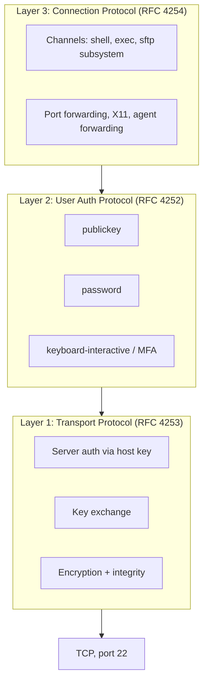

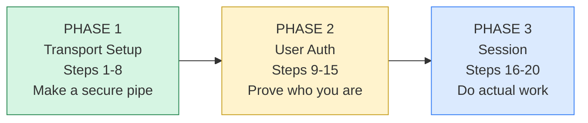

| Phase | Steps | Question answered | Result |
|---|---|---|---|
| 1. Transport setup | 1-8 | Can we talk privately, and is this the right server? | Encrypted tunnel |
| 2. User auth | 9-15 | Are you who you claim to be? | Authenticated user |
| 3. Session | 16-20 | What do you want to do? | Commands run securely |

> 💡 **Aha moment:** there are **two separate identity checks**: the server proves itself first (host key, Phase 1), then *you* prove yourself (user key, Phase 2). Most confusion comes from mixing these up.

---

<a name="6-phase-1-transport-setup-steps-1-8"></a>
## 6. Phase 1: Transport Setup (Steps 1-8)

Goal: build an encrypted tunnel and verify the **server** before any login.

### Step 1: TCP connection

SSH rides on TCP, so the **three-way handshake** (`SYN to SYN-ACK to ACK`) to port 22 happens first.

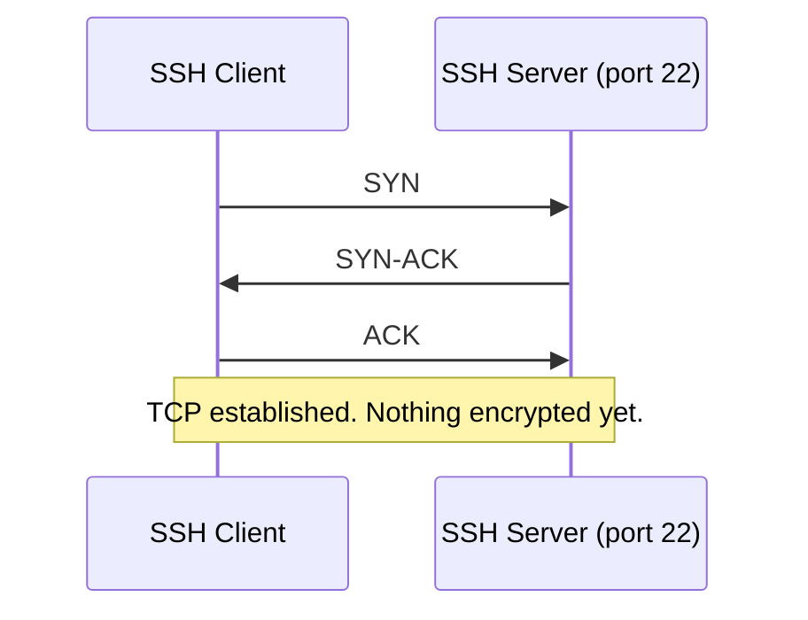

```bash
# Check reachability BEFORE debugging SSH itself:
nc -vz example.com 22
# Connection to example.com 22 port [tcp/ssh] succeeded!
```

> ⚠️ If this fails you have a network/firewall problem, not an SSH problem. See [Section 18](#18-common-pitfalls-and-troubleshooting).

### Step 2: Version strings

Each side sends a plain-text line: `SSH-<proto>-<software>`, e.g. `SSH-2.0-OpenSSH_9.6`.

| String | Meaning |
|---|---|
| `SSH-2.0-OpenSSH_9.6` | OpenSSH, protocol 2.0 |
| `SSH-2.0-dropbear_2022.83` | Dropbear (embedded) |
| `SSH-2.0-paramiko_3.4.0` | Python Paramiko |
| `SSH-1.99-...` | Legacy v1+v2 server — avoid |

> ⚠️ **SSH-1 is obsolete and broken.** Modern servers speak only SSH-2.

### Step 3: Negotiate algorithms (KEXINIT)

Both sides send `SSH_MSG_KEXINIT` listing supported algorithms in preference order. First client offer the server also supports wins.

| Category | Purpose | Modern choice |
|---|---|---|
| Key exchange | Shared secret | `curve25519-sha256`, `sntrup761x25519-sha512` |
| Host key | Server identity | `ssh-ed25519`, `rsa-sha2-512` |
| Cipher | Encryption | `chacha20-poly1305@openssh.com`, `aes256-gcm@openssh.com` |
| MAC | Tamper detection | Built into AEAD, else `hmac-sha2-256-etm@openssh.com` |
| Compression | Optional | `none`, `zlib@openssh.com` |

```bash
# See negotiation live:
ssh -vv user@host 2>&1 | grep -E "kex:|cipher:|MAC:"
# Force / restrict (legacy or hardening):
ssh -o KexAlgorithms=curve25519-sha256 -o Ciphers=aes256-gcm@openssh.com user@host
```

### Step 4: Key exchange (cryptographic core)

Client and server end up with the **same secret** without ever sending it.

**Paint-mixing analogy:**

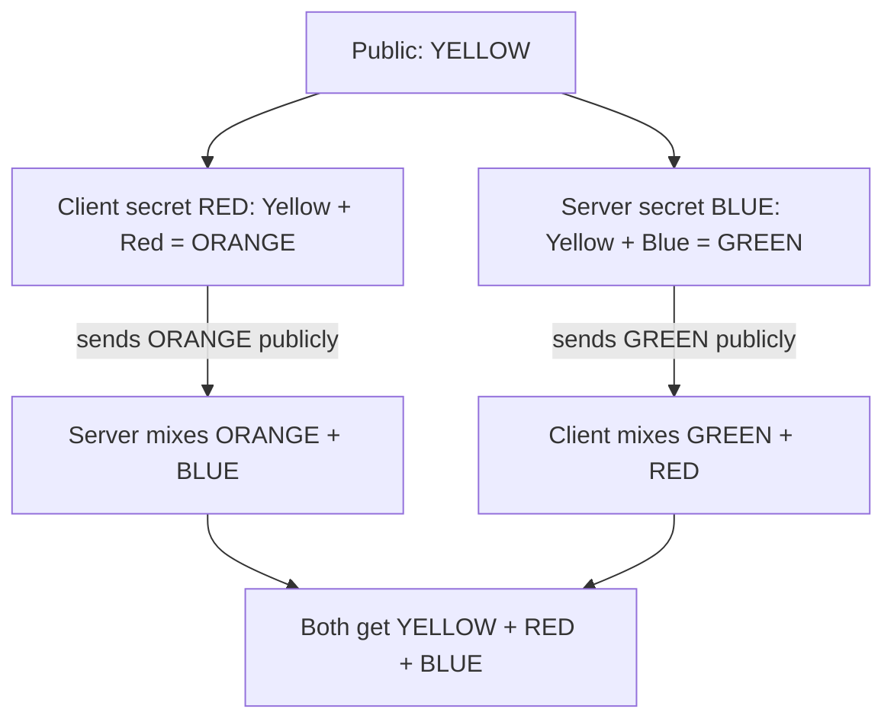

**Numeric example** (tiny, insecure, illustrative) — DH with `p=23, g=5`:

| Step | Client | Server |
|---|---|---|
| Private | `a = 6` | `b = 15` |
| Public | `A = 5^6 mod 23 = 8` | `B = 5^15 mod 23 = 19` |
| Exchange | sends **8** | sends **19** |
| Secret | `19^6 mod 23 = 2` | `8^15 mod 23 = 2` |

> 💡 **Ephemeral = Perfect Forward Secrecy:** fresh key pairs per connection. Stealing the host key tomorrow cannot decrypt today’s traffic.

### Step 5: Host key plus signature

In `KEX_ECDH_REPLY` the server sends: (1) **host public key**, (2) ephemeral public value, (3) **signature** over exchange hash `H` (versions, KEXINITs, host key, both ephemeral values, shared secret).

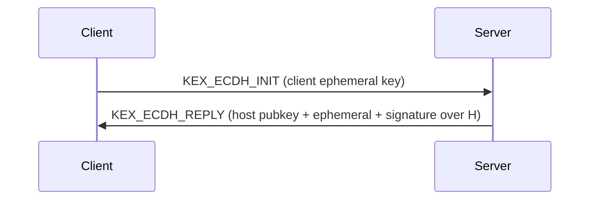

Signature proves: I hold the private host key and took part in this exact exchange.

### Step 6: Verify signature and check known_hosts

Check A: signature valid? Check B: trust this host key via `~/.ssh/known_hosts`?

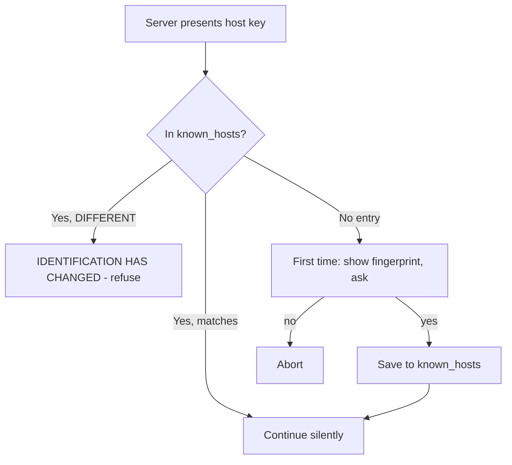

```text
The authenticity of host 'example.com (203.0.113.10)' can't be established.
ED25519 key fingerprint is SHA256:Lc9d0...kQ8.
Are you sure you want to continue connecting (yes/no/[fingerprint])?
```

```bash
ssh-keyscan -t ed25519 example.com | ssh-keygen -lf -
ssh-keygen -R example.com   # remove stale entry after legit rebuild
```

> 🛡️ This defeats MITM: attacker cannot forge the signature without the private host key. Always verify the fingerprint out-of-band on first use.

### Step 7: Derive session keys locally (never sent)

From secret `K` plus hash `H` (first `H` = session ID), each side derives six keys: IVs, encryption keys, integrity keys — one set per direction. Per-direction keys stop reflection attacks. Symmetric crypto is ~1000x faster than asymmetric.

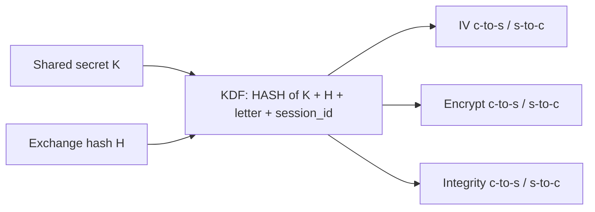

### Step 8: NEWKEYS

Each side sends `SSH_MSG_NEWKEYS` (from next packet on, use new keys). After it, **everything is encrypted**. OpenSSH rekeys roughly every 1 GB / 1 hour for some ciphers.

```text
debug1: SSH2_MSG_NEWKEYS sent
debug1: expecting SSH2_MSG_NEWKEYS
debug1: SSH2_MSG_NEWKEYS received
```

---

<a name="7-phase-2-user-authentication-steps-9-15"></a>
## 7. Phase 2: User Authentication (Steps 9-15)

Tunnel is up, server verified. Now the server verifies **you**. Below is public-key auth, the gold standard.

### Step 9: Start user auth

Client requests `ssh-userauth`. Server lists allowed methods:

```text
debug1: Authentications that can continue: publickey,password,keyboard-interactive
```

| Method | How it works | Security |
|---|---|---|
| `publickey` | Prove possession of private key | Best |
| `password` | Password inside encrypted tunnel | Weak to brute force |
| `keyboard-interactive` | Challenge/response, MFA/OTP | Good with MFA |
| `gssapi-with-mic` | Kerberos SSO | Good in enterprises |
| Certificates | CA-signed keys | Best at scale |

### Step 10: Offer a public key

Client says: I am `alice`, would you accept this public key? **Query only — no signature yet.** Server can reject cheaply before client does signing work.

### Step 11: Server checks authorized_keys

Server looks in `~alice/.ssh/authorized_keys`:

```text
ssh-ed25519 AAAAC3NzaC1lZDI1NTE5AAAAIOMq... alice@laptop
ssh-ed25519 AAAAC3NzaC1lZDI1NTE5AAAAIPxy... alice@desktop
```

Per-key restrictions are powerful (place before the key):

```text
from="203.0.113.5",command="/usr/local/bin/backup.sh",no-port-forwarding,no-pty ssh-ed25519 AAAAC3... backup-bot
```

If matched, server replies `SSH_MSG_USERAUTH_PK_OK` (go ahead and prove it).

### Step 12: Sign with the private key (never leaves client)

Client signs a blob containing **session ID** plus username, service, public key:

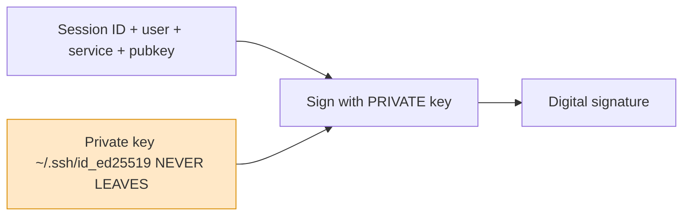

> 🛡️ Session ID is unique per connection, so a captured signature is useless elsewhere. Replay fails.

### Step 13-15: Send, verify, success

Step 13: client sends the signature (encrypted inside tunnel). Step 14: server verifies with the public key from `authorized_keys` — only the private-key holder could have made it. Step 15: server sends `SSH_MSG_USERAUTH_SUCCESS`.

```text
debug1: Authentication succeeded (publickey).
Authenticated to example.com ([203.0.113.10]:22) using "publickey".
```

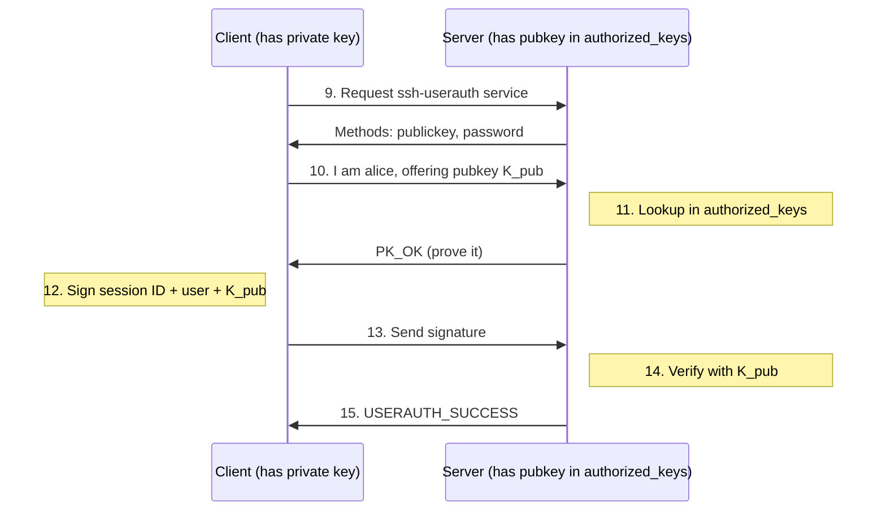

> 💡 **Analogy:** public key = padlock you leave on the server’s door; private key = the only key that opens it. You prove identity by opening the lock without handing over the key.

**CORRECT vs INCORRECT:**

```bash
# CORRECT: private key stays client-side, public key copied to server
ssh-copy-id -i ~/.ssh/id_ed25519.pub alice@example.com

# INCORRECT: never copy the private key to the server
# scp ~/.ssh/id_ed25519 alice@example.com:~/.ssh/  # DO NOT DO THIS
```

---

<a name="8-phase-3-encrypted-session-steps-16-20"></a>
## 8. Phase 3: Encrypted Session (Steps 16-20)

### Step 16: Open a session channel

The connection protocol multiplexes logical **channels** over one encrypted connection. Client opens a `session` channel, then requests what it wants:

| Request | Purpose |
|---|---|
| `pty-req` | Pseudo-terminal for interactive login |
| `shell` | User login shell |
| `exec` | One command (`ssh host uptime`) |
| `subsystem` | e.g. `sftp` |
| `env` | Environment variables |
| `direct-tcpip` / `tcpip-forward` | Port forwarding |

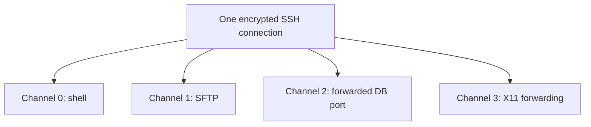

### Steps 17-20: Encrypted round trip

Step 17: each keystroke/command is framed, encrypted with client-to-server key, MAC/AEAD-tagged, with implicit sequence numbers (detect replay/reorder).


Step 18: server decrypts, verifies, runs command **as the authenticated user**. Step 19: output encrypted back with server-to-client key. Step 20: client decrypts and displays.

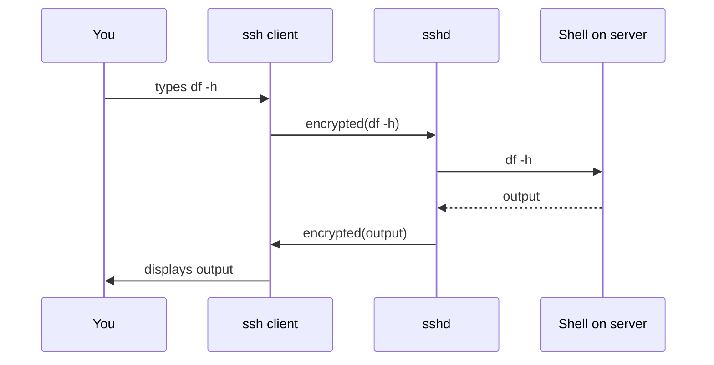

An eavesdropper sees `7f3a9c...e1`, not `ls -la`.

---

<a name="9-the-complete-20-step-sequence"></a>
## 9. The Complete 20-Step Sequence

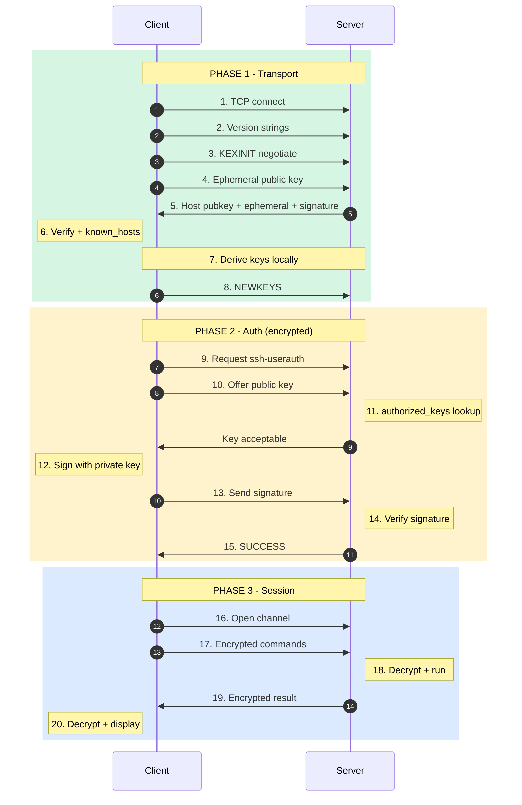

### Who holds what?

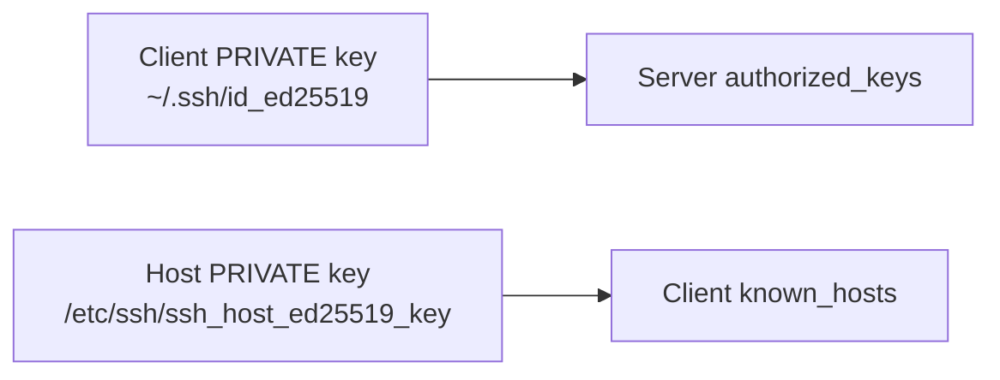

| File | Location | Holds | Used for |
|---|---|---|---|
| `~/.ssh/id_ed25519` | Client | Private user key | Signing |
| `~/.ssh/id_ed25519.pub` | Client | Public user key | Copy to servers |
| `~/.ssh/known_hosts` | Client | Server host pubkeys | Verify servers |
| `~/.ssh/authorized_keys` | Server | Allowed user pubkeys | Verify users |
| `/etc/ssh/ssh_host_*_key` | Server | Private host key | Prove server identity |
| `/etc/ssh/sshd_config` | Server | Daemon policy | Server config |

### Cheat sheet: all 20 steps

| # | Step | Key concept |
|---|---|---|
| 1 | TCP connect to port 22 | Transport |
| 2 | Version strings | Compatibility |
| 3 | Algorithm negotiation | Crypto agility |
| 4 | Ephemeral DH/ECDH | Forward secrecy |
| 5 | Host key + signature | Server auth |
| 6 | `known_hosts` check | Anti-MITM, TOFU |
| 7 | Derive keys locally | Never sent |
| 8 | NEWKEYS | Encryption on |
| 9 | Start user auth | Method negotiation |
| 10 | Offer public key | Query only |
| 11 | `authorized_keys` lookup | Authorization |
| 12 | Sign (session ID + data) | Proof of possession |
| 13 | Send signature | Encrypted tunnel |
| 14 | Verify with pubkey | Identity confirmed |
| 15 | Auth success | USERAUTH_SUCCESS |
| 16 | Open channel | Multiplexing |
| 17 | Send encrypted data | Confidentiality + integrity |
| 18 | Server decrypts | Run as user |
| 19 | Encrypted result | Back over tunnel |
| 20 | Client decrypts | Display output |

---

<a name="10-hands-on-labs"></a>
## 10. Hands-On Labs

### Lab 0: Local two-container playground (optional)

```bash
# Terminal 1: server
docker run --rm -d --name ssh-server -p 2222:22 \
  -e ROOT_PASSWORD=devpass linuxserver/openssh-server 2>/dev/null \
  || docker run --rm -d --name ssh-server -p 2222:22 rastasheep/ubuntu-sshd:18.04
# Terminal 2: client
ssh -p 2222 root@localhost
# Use port 2222 in all labs below if using this setup.
```

### Lab 1: Generate an Ed25519 key pair

```bash
ssh-keygen -t ed25519 -C "alice@laptop" -f ~/.ssh/id_ed25519
# Enter a strong passphrase when prompted.
chmod 600 ~/.ssh/id_ed25519
chmod 644 ~/.ssh/id_ed25519.pub
ssh-keygen -lf ~/.ssh/id_ed25519.pub   # show fingerprint
```

| Key type | Size | Recommendation |
|---|---|---|
| `ed25519` | 256-bit | Default choice: short, fast, safe |
| `ecdsa` | 256/384/521 | Acceptable |
| `rsa` | 3072+ bits | Legacy compatibility only |
| `dsa` | 1024-bit | Deprecated, disabled |

### Lab 2: Install your public key on the server

```bash
# Easiest:
ssh-copy-id -i ~/.ssh/id_ed25519.pub alice@example.com
# Manual (equivalent):
cat ~/.ssh/id_ed25519.pub | ssh alice@example.com \
  "mkdir -p ~/.ssh && chmod 700 ~/.ssh && cat >> ~/.ssh/authorized_keys && chmod 600 ~/.ssh/authorized_keys"
# Verify server-side permissions (most common failure cause):
# chmod 700 ~/.ssh; chmod 600 ~/.ssh/authorized_keys; chmod go-w ~
```

### Lab 3: Watch the handshake

```bash
ssh -v alice@example.com 2>&1 | head -60
```

```text
debug1: Connecting to example.com port 22.                        # Step 1
debug1: Remote protocol version 2.0, remote software OpenSSH_9.6  # Step 2
debug1: SSH2_MSG_KEXINIT sent                                     # Step 3
debug1: kex: algorithm: curve25519-sha256                         # Step 3/4
debug1: Server host key: ssh-ed25519 SHA256:Lc9d0...              # Step 5
debug1: Host 'example.com' is known and matches the ED25519 key.  # Step 6
debug1: SSH2_MSG_NEWKEYS sent / received                          # Step 8
debug1: Authentications that can continue: publickey,password     # Step 9
debug1: Offering public key: /home/alice/.ssh/id_ed25519          # Step 10
debug1: Server accepts key                                        # Steps 11-12
debug1: Authentication succeeded (publickey).                     # Step 15
debug1: channel 0: new [client-session]                           # Step 16
```

### Lab 4: SSH config file

`~/.ssh/config` (chmod 600):

```text
Host prod
    HostName 203.0.113.10
    User alice
    Port 22
    IdentityFile ~/.ssh/id_ed25519
    IdentitiesOnly yes

Host *.internal.example.com
    ProxyJump bastion.example.com
    User alice

Host *
    ServerAliveInterval 60
    AddKeysToAgent yes
```

Now `ssh prod` replaces the long command. Test with `ssh -G prod` (prints effective config).

### Lab 5: ssh-agent (type passphrase once)

```bash
eval "$(ssh-agent -s)"
ssh-add ~/.ssh/id_ed25519
ssh-add -l
```

Agent holds the decrypted key in memory and performs Step 12 signing for you.

### Lab 6: Single command, no shell (exec channel)

```bash
ssh alice@example.com 'uptime && df -h /'
```

### Lab 7: Port forwarding

```bash
# Local forward: reach internal DB via bastion; then psql -h localhost -p 5433
ssh -L 5433:db.internal:5432 alice@bastion.example.com
# Remote forward: expose local :3000 on server's :8080
ssh -R 8080:localhost:3000 alice@example.com
# Dynamic forward: SOCKS proxy on :1080
ssh -D 1080 alice@example.com
```


| Flag | Direction | Typical use |
|---|---|---|
| `-L` | Local port to remote dest | Private DB / admin panel |
| `-R` | Remote port to local dest | Share dev server, reverse access |
| `-D` | Local SOCKS proxy | Route browser via server |

### Lab 8: Jump host

```bash
ssh -J alice@bastion.example.com alice@10.0.1.25
```


End-to-end encryption stays between you and the target; bastion forwards opaque bytes. Prefer `ProxyJump` over `ForwardAgent`.

### Lab 9: Copy files securely

```bash
scp report.pdf alice@example.com:/home/alice/
sftp alice@example.com
rsync -avz -e ssh ./site/ alice@example.com:/var/www/
```

All three ride an SSH channel (Step 16).

---

<a name="11-real-world-examples-and-use-cases"></a>
## 11. Real-World Examples and Use Cases

| # | Use case | How SSH helps | Example |
|---|---|---|---|
| 1 | Remote server admin | Secure shell on cloud VMs | `ssh ubuntu@ec2-host` |
| 2 | Git over SSH | Key auth, no passwords | `git clone git@github.com:org/repo.git` |
| 3 | CI/CD deploys | Restricted deploy key | `rsync -e ssh build/ deploy@host:app/` |
| 4 | Secure DB access | Tunnel to unexposed DB | `ssh -L 5433:db:5432 bastion` |
| 5 | File transfer / backups | SFTP, SCP, rsync, borg | `rsync -az /data backup@nas:vol/` |
| 6 | Bastion architecture | Single hardened entry point | `ssh -J bastion app-server` |
| 7 | IoT / embedded | Dropbear lightweight mgmt | `ssh root@raspberrypi.local` |
| 8 | Network devices | Routers/switches | `ssh admin@switch01` |
| 9 | Automation | Ansible/Fabric agentless | `ansible all -m ping` |
| 10 | Secure proxy | SOCKS on untrusted Wi-Fi | `ssh -D 1080 server` |

### Case study: GitHub authentication

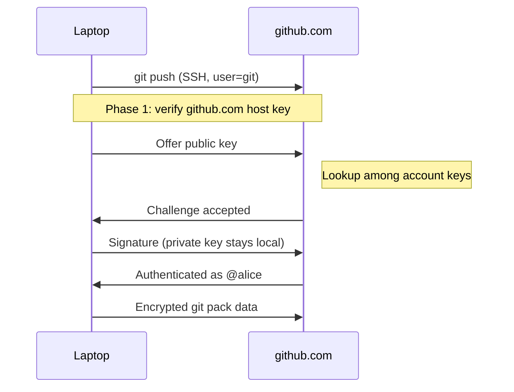

Test with `ssh -T git@github.com`. GitHub publishes its host-key fingerprints in its docs — verify on first use.

### Case study: Restricted backup key

A backup job should run **one command only**:

```text
command="rsync --server --sender -logDtpre.iLsfxCIvu . /data",no-pty,no-agent-forwarding,no-port-forwarding,from="198.51.100.7" ssh-ed25519 AAAAC3... backup-job
```

Even if leaked, attacker is limited to that command from that IP.

---

<a name="12-multiple-implementation-approaches"></a>
## 12. Multiple Implementation Approaches

| Implementation | Best for | Notes |
|---|---|---|
| **OpenSSH** (`ssh`, `sshd`) | Servers, desktops, CI | Reference implementation; all labs use it |
| **Dropbear** | Embedded / IoT, containers | Small footprint; fewer algorithms |
| **Paramiko** (Python) | Scripted SSH in apps | `SSH-2.0-paramiko_x` version string; audit host-key policy (`AutoAddPolicy` is dangerous) |
| **PuTTY / Plink** (Windows) | Windows GUI users | `.ppk` keys; convert with `puttygen` or use OpenSSH format |

| Key approach | When to choose |
|---|---|
| Ed25519 user keys | Default for people and service accounts |
| RSA 3072+ | Only for legacy peers lacking Ed25519 |
| SSH certificates (CA-signed) | Fleets: short-lived, no `authorized_keys` sprawl |
| Password + MFA (`keyboard-interactive`) | Break-glass / human fallback, never for automation |

```python
# Paramiko: CORRECT host-key handling (verify, do not auto-add blindly)
import paramiko
client = paramiko.SSHClient()
client.load_system_host_keys()          # use known_hosts
# client.set_missing_host_key_policy(paramiko.AutoAddPolicy())  # DANGEROUS
client.connect("example.com", username="alice")
stdin, stdout, stderr = client.exec_command("uptime")
print(stdout.read().decode())
client.close()
```

---

<a name="13-best-practices"></a>
## 13. Best Practices

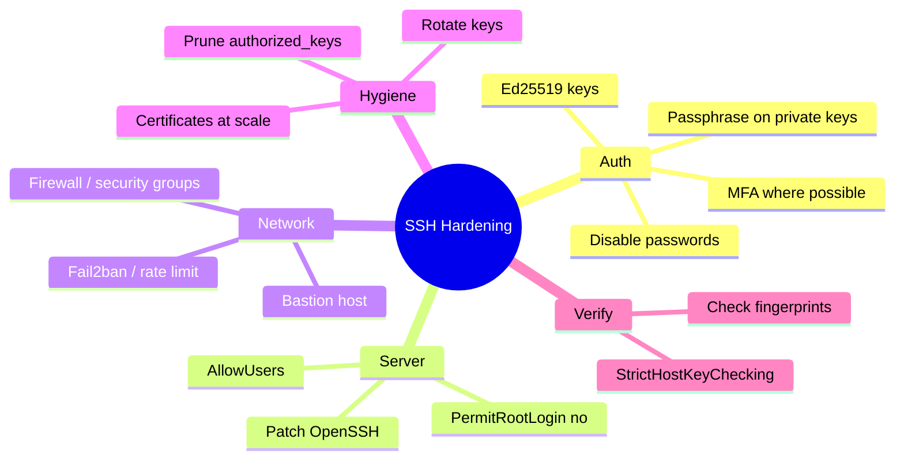

Recommended `/etc/ssh/sshd_config` baseline:

```text
PermitRootLogin no
PasswordAuthentication no
PubkeyAuthentication yes
KbdInteractiveAuthentication no
AllowUsers alice bob
MaxAuthTries 3
LoginGraceTime 30
X11Forwarding no
```

Validate and reload safely (keep current session open, test from a second one):

```bash
sudo sshd -t && sudo systemctl reload sshd
sudo sshd -T | grep -Ei "permitroot|passwordauth|pubkey|allowusers"
```

> 💡 **Pro Tips:** use `IdentitiesOnly yes` with explicit `IdentityFile` to stop offering 20 agent keys; use `ControlMaster auto` multiplexing to reuse one connection; prefer `ProxyJump` over agent forwarding.

---

<a name="14-anti-patterns"></a>
## 14. Anti-Patterns

| Anti-pattern | Why it hurts | Fix |
|---|---|---|
| Blindly typing `yes` to every new host key | Normalizes MITM | Verify fingerprint out-of-band; use `StrictHostKeyChecking ask` |
| Leaving `PasswordAuthentication yes` on internet hosts | Brute force | Keys only + fail2ban |
| `PermitRootLogin yes` + password | Highest-value target | `no`, use sudo user + `AllowUsers` |
| `ForwardAgent yes` to untrusted hosts | Root there can use your agent | `ProxyJump` instead; forward only to trusted hosts |
| Unprotected private key, committed to git | Full impersonation | Passphrase + agent; rotate leaked keys everywhere |
| Wildcard `*` key with no `from=`/`command=` | Blast radius | Per-host, per-purpose keys with restrictions |
| Copying private key to server | Inverts trust model | Only `.pub` ever leaves the client |

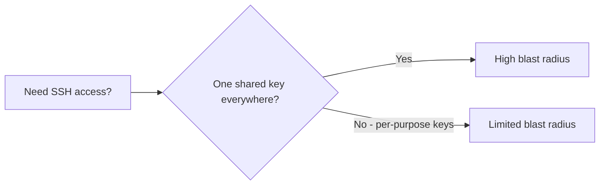

---

<a name="15-performance-considerations"></a>
## 15. Performance Considerations

- **Cipher choice:** on CPUs with AES-NI, `aes256-gcm` is fastest; without it (many ARM/mobile), `chacha20-poly1305` wins. Measure with `openssl speed` and `scp` of a 1 GB file; do not guess.
- **KEX cost:** `curve25519-sha256` handshakes are fast; post-quantum hybrid `sntrup761x25519-sha512` adds bytes/CPU — fine for logins, measure for high-connection-rate automation.
- **Rekeying:** periodic KEX adds brief CPU; defaults are sane — raise, do not disable, on multi-GB transfers.
- **Compression:** `Compression yes` helps text over slow links, hurts fast/binary transfers (wastes CPU).
- **Multiplexing:** reuse one TCP+SSH connection for many sessions:

```text
Host *
    ControlMaster auto
    ControlPath ~/.ssh/sockets/%r@%h-%p
    ControlPersist 10m
```

This skips Steps 1-15 for subsequent sessions — biggest latency win for Ansible/loops.

- **DNS:** slow `UseDNS yes` reverse lookups delay logins; set `UseDNS no` if logins stall pre-auth.

---

<a name="16-security-considerations"></a>
## 16. Security Considerations

| Attack | SSH defense (step) |
|---|---|
| Eavesdropping | Symmetric encryption from Step 8 on |
| Man-in-the-middle | Host-key signature + `known_hosts` (Steps 5-6) |
| Replay of captured auth | Session ID inside signed data (Step 12) |
| Tampering in transit | MAC / AEAD tags + sequence numbers (Step 17) |
| Password brute force | Disable passwords, keys, `MaxAuthTries 3`, fail2ban |
| Stolen server key decrypting old traffic | Ephemeral KEX, PFS (Step 4) |

Residual risks: unverified TOFU on first connect, stolen unprotected private key, `ForwardAgent` to untrusted hosts (root there can use your agent). Prefer `ProxyJump`.

```bash
# Rate-limit with fail2ban (example jail):
# /etc/fail2ban/jail.local: [sshd] enabled=true, maxretry=5, bantime=1h
sudo fail2ban-client status sshd
```

---

<a name="17-testing-strategies"></a>
## 17. Testing Strategies

```bash
# 1. Server config syntax + effective config:
sudo sshd -t && echo OK
sudo sshd -T | grep -Ei "port|permitroot|passwordauth|pubkey|allowusers|maxauthtries"
# 2. Client effective config for a host:
ssh -G prod | grep -Ei "hostname|user |port |identityfile|proxyjump"
# 3. Verbosity ladder: -v (auth), -vv (KEX), -vvv (packet-level):
ssh -vvv -o IdentitiesOnly=yes -i ~/.ssh/id_ed25519 alice@example.com
# 4. Isolated debug server on alt port (does not disturb :22):
sudo /usr/sbin/sshd -d -p 2222
ssh -p 2222 -vvv alice@localhost
# 5. Key + permission self-test:
ssh-keygen -lf ~/.ssh/id_ed25519.pub
ls -l ~/.ssh/; test "$(stat -c %a ~/.ssh)" = 700 && echo ssh-dir-ok
```

Test matrix: correct key (pass), wrong key (fail), bad perms 644 on private key (client refuses), bad `authorized_keys` 644 + `StrictModes yes` (server refuses), unknown host key (prompt), changed host key (refuse), too many agent keys (use `IdentitiesOnly`).

---

<a name="18-common-pitfalls-and-troubleshooting"></a>
## 18. Common Pitfalls and Troubleshooting

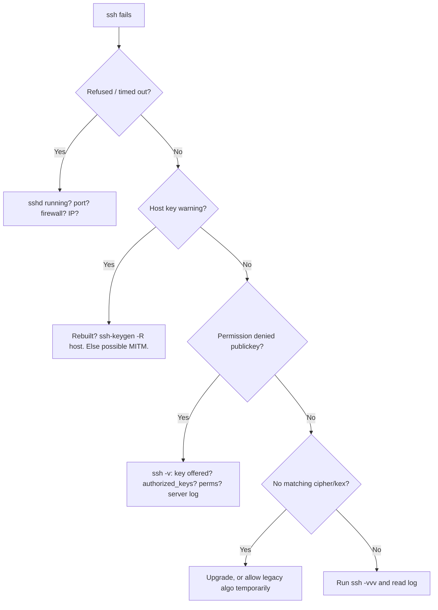

| Error | Likely cause | Fix |
|---|---|---|
| `Connection refused` | sshd down / wrong port | `systemctl status sshd`, check port |
| `Connection timed out` | Firewall / wrong IP | Open 22, check routing |
| `REMOTE HOST IDENTIFICATION HAS CHANGED` | Reinstall or MITM | Verify, then `ssh-keygen -R host` |
| `Permission denied (publickey)` | Key/user/perms | `ssh -v`, check `authorized_keys` + perms below |
| `Too many authentication failures` | Agent offers too many keys | `-o IdentitiesOnly=yes -i key host` |
| `no matching kex/cipher` | Old peer | Upgrade or `-o KexAlgorithms=+...` temporarily |
| `Bad owner or permissions on config` | Config too open | `chmod 600 ~/.ssh/config` |

```bash
chmod 700 ~/.ssh
chmod 600 ~/.ssh/authorized_keys ~/.ssh/id_ed25519 ~/.ssh/config
chmod go-w ~   # home must not be group/world writable
# Logs:
sudo journalctl -u ssh -f        # Debian/Ubuntu ("sshd" on RHEL)
sudo tail -f /var/log/auth.log   # Debian/Ubuntu
sudo tail -f /var/log/secure     # RHEL/CentOS
```

---

<a name="19-migration-guide"></a>
## 19. Migration Guide

| From (legacy) | To (modern) | Steps |
|---|---|---|
| SSH-1 / `SSH-1.99` | SSH-2 only | Upgrade OpenSSH, set `Protocol 2` legacy removal, re-scan host keys |
| RSA-1024 / DSA | Ed25519 (RSA-3072+ fallback) | `ssh-keygen -t ed25519`, deploy `.pub`, keep old key 1 rotation window, then remove |
| Password auth | Keys (+ MFA for humans) | Deploy keys, set `PasswordAuthentication no`, keep break-glass key in vault |
| Static `authorized_keys` sprawl | SSH certificates (CA) | Run CA (`ssh-keygen -s`), set `TrustedUserCAKeys`, issue short-lived certs |
| `ForwardAgent` chains | `ProxyJump` | Replace `-A` hops with `-J` / `ProxyJump` in config |
| Direct exposure of every host | Bastion + private subnets | One hardened ingress, `AllowUsers`, security groups, fail2ban |

> ⚠️ Never commit private keys or rotate by editing `authorized_keys` in place without testing from a second session.

---

<a name="20-practice-exercises-with-solutions"></a>
## 20. Practice Exercises with Solutions

### Exercise 1: Map a verbose log to steps (transport + auth)

Given this redacted log, label each line with its step number and phase.

```text
A: Connecting to 203.0.113.10 port 22.
B: Remote protocol version 2.0, remote software OpenSSH_9.6
C: kex: algorithm: curve25519-sha256
D: Server host key: ssh-ed25519 SHA256:ABC...
E: Host 'db1' is known and matches the ED25519 host key.
F: SSH2_MSG_NEWKEYS sent
G: Authentications that can continue: publickey,password
H: Offering public key: /home/alice/.ssh/id_ed25519
I: Authentication succeeded (publickey).
J: channel 0: new [client-session]
```

<details><summary>Solution</summary>

A=Step 1 Phase 1; B=Step 2 Phase 1; C=Steps 3-4 Phase 1; D=Step 5 Phase 1; E=Step 6 Phase 1; F=Step 8 Phase 1; G=Step 9 Phase 2; H=Step 10 Phase 2; I=Step 15 Phase 2; J=Step 16 Phase 3. Missing visible lines (7, 11-14) happen silently or inside encrypted messages.
</details>

### Exercise 2: Deploy a restricted automation key

Task: create a key for a deploy job that can only run `/usr/local/bin/deploy.sh` as user `deploy`, no PTY, no forwarding, only from `198.51.100.7`.

<details><summary>Solution</summary>

```bash
ssh-keygen -t ed25519 -C "deploy-job" -f ~/.ssh/deploy_job -N ""
cat ~/.ssh/deploy_job.pub   # append to server ~deploy/.ssh/authorized_keys:
# command="/usr/local/bin/deploy.sh",no-pty,no-agent-forwarding,no-port-forwarding,from="198.51.100.7" ssh-ed25519 AAAAC3... deploy-job
chmod 600 ~deploy/.ssh/authorized_keys
ssh -i ~/.ssh/deploy_job deploy@host 'echo hi; env'  # forced command runs instead
```

</details>

### Exercise 3: Reach a private DB through a bastion

Task: DB `db.internal:5432` reachable only from `bastion.example.com`. Expose it on laptop `localhost:5433` and test.

<details><summary>Solution</summary>

```bash
ssh -N -L 5433:db.internal:5432 alice@bastion.example.com
# New terminal:
nc -vz localhost 5433
pg_isready -h localhost -p 5433 || psql -h localhost -p 5433 -U app -c "select 1"
# `-N` = no remote command (forward-only). Add `-f` to background after testing.
```

</details>

### Exercise 4: Debug Permission denied (publickey)

Task: `ssh -v` shows key offered but server rejects. List the ordered checks and fix.

<details><summary>Solution</summary>

1. `ssh -v`: confirm correct key path and username (`Offering public key: ...` then `Authentications that can continue: publickey` loop = server rejected).
2. Client: `ls -l ~/.ssh/id_ed25519` must be `600`; try `-o IdentitiesOnly=yes -i <key>`.
3. Server: key bytes exactly in `~deploy/.ssh/authorized_keys` (no wraps/breaks), `chmod 700 ~/.ssh`, `chmod 600 authorized_keys`, `chmod go-w ~`.
4. Server log: `journalctl -u sshd` / `/var/log/auth.log` shows `Authentication refused: bad ownership or modes`.
5. `sshd_config`: `PubkeyAuthentication yes`, user in `AllowUsers`, then `sshd -t` + reload.

</details>

---

<a name="21-test-your-understanding"></a>
## 21. Test Your Understanding

1. Which steps prove the **server** vs the **user**? Name the files on each side.
2. Does the session key travel over the network? Explain where it comes from.
3. Why is Step 10 (offer) separate from Step 12 (sign)? What efficiency does this give?
4. What stops replay of a captured login signature?
5. What does PFS mean, and which step provides it?
6. TOFU: what is trusted, when, and what is the residual risk?
7. `REMOTE HOST IDENTIFICATION HAS CHANGED`: two possible causes + correct response to each.
8. Why does each direction get its own encryption/integrity keys?
9. `shell` vs `exec` vs `subsystem` channels: give one command for each.
10. `-L` vs `-R` vs `-D`: for each, who listens where and where traffic exits?
11. Why is `ProxyJump` safer than `ForwardAgent` to untrusted hosts?
12. Your `ssh -v` loops on `Authentications that can continue: publickey`. Name 4 distinct causes and how to distinguish them.

<details><summary>Answers</summary>

1. Server: Steps 5-6 (host key in `/etc/ssh/ssh_host_*`, verified vs `known_hosts`). User: Steps 10-14 (private key `~/.ssh/id_*`, verified vs `authorized_keys`).
2. No. Derived locally from `K` + `H` via KDF; only public ephemeral values cross the wire.
3. Offer lets server reject unknown keys before expensive signing; saves CPU and avoids needless agent prompts.
4. Signed data includes the unique per-connection session ID; invalid on any other session.
5. Past sessions stay safe if long-term keys leak later; from ephemeral KEX (Step 4).
6. First-seen host key stored on first connect; risk = unverified first connect (verify fingerprint out-of-band).
7. Legit rebuild (verify, `ssh-keygen -R`) vs MITM (stop, investigate via console/admin).
8. Prevents reflection attacks where attacker bounces your own traffic back at you.
9. `ssh host` (shell), `ssh host uptime` (exec), `sftp host` (subsystem).
10. `-L`: local listen, exits at/through server. `-R`: server listens, exits at/through client. `-D`: local SOCKS, exits at server.
11. Jump forwards opaque bytes end-to-end; agent exposes signing oracle to remote root.
12. Wrong key bytes on server; wrong username; bad perms (`~/.ssh`/`authorized_keys`/`~`); `AllowUsers`/`PubkeyAuthentication` policy — separate via `ssh -v` offered-key line + server log + `sshd -T`.
</details>

---

<a name="22-question-bank-55-questions"></a>
## 22. Question Bank (55 Questions)

### Beginner (1-20)

1. What port does SSH use by default?
2. What did SSH replace, and why?
3. Name the three SSH guarantees.
4. What are the three phases in order?
5. Which phase verifies the server? Which verifies the user?
6. What is in a version string like `SSH-2.0-OpenSSH_9.6`?
7. What is `KEXINIT` for?
8. What is a host key?
9. What file stores trusted server keys on the client?
10. What file stores allowed user keys on the server?
11. Which key never leaves the client?
12. What command generates an Ed25519 key?
13. What command copies your public key to a server?
14. What permissions do `~/.ssh` (700) and `authorized_keys` (600) need?
15. What does `ssh -v` show you?
16. What is an SSH channel?
17. Name three channel types (shell, exec, subsystem example).
18. What does `-L` do? `-R`? `-D`? `-J`?
19. What is `ssh-agent` for?
20. What is `~/.ssh/config` for?

### Intermediate (21-40)

21. Explain KEX negotiation: who offers, who chooses, what wins?
22. DH paint analogy: what is public vs secret, and why can't an observer reconstruct?
23. Work the `p=23, g=5` example: what are the public values and shared secret?
24. What three items does the server send in `KEX_ECDH_REPLY`?
25. What is exchange hash `H`, and what goes into it?
26. Walk the `known_hosts` decision tree (match / mismatch / unknown).
27. What is TOFU and its main weakness?
28. How are session keys derived, and why per-direction keys?
29. What does `NEWKEYS` signal?
30. Why use symmetric crypto for data after asymmetric handshake?
31. Why separate key offer (Step 10) from signing (Step 12)?
32. What exactly is signed in Step 12, and why include the session ID?
33. How do `from=`, `command=`, `no-pty` restrictions limit a key?
34. Read: `kex: algorithm: curve25519-sha256` — which steps does this implicate?
35. Why does `ssh -v` show `Server accepts key` before `Authentication succeeded`?
36. `shell` vs `exec`: which allocates a PTY by default and when does it matter?
37. How do sequence numbers + MAC/AEAD stop replay/reorder/tamper?
38. What is rekeying and why does it exist?
39. `ProxyJump` vs `ForwardAgent`: packet-flow difference and security consequence?
40. Why does `chmod go-w ~` matter for key auth?

### Advanced (41-55)

41. Prove PFS: which values are ephemeral vs long-term, and what must an attacker steal *when* to decrypt a past session?
42. How does the host-key signature bind identity to *this* exchange (not a replay)?
43. AEAD vs separate cipher+MAC (e.g. `chacha20-poly1305` vs `aes256-ctr` + `hmac-sha2-256-etm`): trade-offs?
44. When would you choose `sntrup761x25519-sha512` over `curve25519-sha256`?
45. Design a least-privilege `authorized_keys` line for a CI deploy job; justify each option.
46. At 500 hosts, why do certificates beat `authorized_keys` distribution? Sketch CA setup (`ssh-keygen -s`, `TrustedUserCAKeys`).
47. Diagnose: `no matching key exchange method found` — root causes and safe fixes?
48. Diagnose: `Too many authentication failures` — why does the agent cause it, and what are 3 fixes?
49. How would you multiplex 100 Ansible tasks over few connections (`ControlMaster`)? What are the risks?
50. Why can `UseDNS yes` stall logins, and how do you confirm it?
51. Paramiko `AutoAddPolicy`: what attack does it enable, and what is the correct pattern?
52. How do `LoginGraceTime` + `MaxAuthTries` + fail2ban compose against brute force?
53. If a private key leaks, what is the full rotation procedure (client + all servers + certs)?
54. Why must host fingerprints be verified out-of-band on first use? Give 3 practical channels.
55. Sketch how `scp`/`sftp`/`rsync -e ssh` reuse Step 16 channels instead of new handshakes.

**Answer key (condensed):** 1: 22. 2: Telnet/rlogin/FTP (plain text). 3: Confidentiality, integrity, authentication. 4: Transport, user auth, session. 5: Phase 1 server; Phase 2 user. 6: Protocol 2.0 + software. 7: Algorithm negotiation. 8: Server long-term identity keypair. 9: `known_hosts`. 10: `authorized_keys`. 11: User private key. 12: `ssh-keygen -t ed25519`. 13: `ssh-copy-id`. 14: 700 dir / 600 files, home not group/world-writable. 15: Handshake + auth + channel debug. 16: Multiplexed logical stream. 17: shell/`ssh host`; exec/`ssh host uptime`; subsystem/`sftp`. 18: Local/Remote/Dynamic forward; Jump. 19: Hold decrypted keys, sign on demand. 20: Per-host shortcuts/defaults. 21-40: See Sections 6-8/10/18. 41-55: See Sections 13-17/19.

---

<a name="23-common-interview-questions"></a>
## 23. Common Interview Questions

1. **Walk me from `ssh user@host` to prompt in 60 seconds.** Answer: TCP/22, versions, KEXINIT negotiate, ephemeral ECDH, host-key signature check vs `known_hosts`, derive keys locally, NEWKEYS, offer user key, `authorized_keys` lookup, sign session-ID-bound blob, verify, open channel, shell.
2. **How does key exchange stay secret over an observed wire?** Answer: Only public ephemeral values cross; secret derived via discrete-log-hard math; PFS from ephemerality.
3. **What stops MITM?** Answer: Host-key signature over `H` checked against trusted `known_hosts` entry.
4. **What stops replay of my login?** Answer: Session-ID-bound signature, valid only on that connection.
5. **Where do session keys come from, and who sends them?** Answer: Nobody sends them; both derive from `K`+`H` via KDF, per direction.
6. **Why did `Permission denied (publickey)` happen?** Answer: Offer rejected — wrong key/user, perms (`700`/`600`/`go-w ~`), or `sshd_config` (`PubkeyAuthentication`, `AllowUsers`). Show `ssh -v` + server log triage.
7. **`-L` vs `-R` vs `-D` vs `-J`?** Answer: Local listen/server exit; server listen/client exit; local SOCKS/server exit; tunneled jump preserving end-to-end encryption.
8. **Why disable passwords and root login?** Answer: Brute-force surface + highest-value account; use keys, sudo, `AllowUsers`, fail2ban.
9. **Agent forwarding vs ProxyJump?** Answer: Forwarding exposes signing oracle to remote root; Jump forwards opaque bytes. Prefer Jump.
10. **Keys vs certificates at scale?** Answer: Keys = `authorized_keys` sprawl; certs = CA + `TrustedUserCAKeys`, short-lived, no per-host distribution.
11. **How do you harden `sshd_config` safely?** Answer: Baseline (`PermitRootLogin no`, `PasswordAuthentication no`, `AllowUsers`, `MaxAuthTries 3`), `sshd -t`, reload, test from second session.
12. **What does rekeying do?** Answer: Re-runs KEX periodically to bound data per key.

---

<a name="24-self-assessment-checklist"></a>
## 24. Self-Assessment Checklist

- [ ] I can draw the 3-layer / 3-phase / 20-step map from memory.
- [ ] I can label any `ssh -v` line with its step number.
- [ ] I can explain DH/ECDH with analogy + numbers and define PFS.
- [ ] I can set up Ed25519 login with correct permissions end-to-end.
- [ ] I can explain offer vs sign vs verify and the session-ID anti-replay role.
- [ ] I can open shell/exec/SFTP channels and `-L`/`-R`/`-D`/`-J` on demand.
- [ ] I can harden `sshd_config`, validate with `sshd -t`, and avoid lockout.
- [ ] I can triage the 7 common errors with logs.
- [ ] I avoid blind TOFU, unprotected keys, and `ForwardAgent` to untrusted hosts.
- [ ] I know when to graduate from keys to certificates.

**Quick Recap:** Tunnel first (verify server), login second (prove yourself), work third (channels). Private keys never travel; session keys are derived, not sent.

---

<a name="25-summary-and-key-takeaways"></a>
## 25. Summary and Key Takeaways

1. **SSH = secure tunnel first, login second, work third** (Steps 1-8, 9-15, 16-20).
2. **Asymmetric bootstraps trust; symmetric does the work** (KEX + signatures, then AES/ChaCha20).
3. **Two identity checks:** server proves itself (host key), then you prove yourself (user key).
4. **Private keys never leave; session keys are never sent** — both are the most-misunderstood facts.
5. **Verify first-use fingerprints; treat host-key-changed as hostile until proven otherwise.**
6. **Production = keys + hardened `sshd_config` + bastions + rotation.** Graduate to certificates at scale.

**Next steps:** set up a bastion with `ProxyJump`, convert one automation to a restricted key, enable fail2ban, and try a debug `sshd -d -p 2222` session.

---

<a name="26-further-reading-and-resources"></a>
## 26. Further Reading and Resources

- RFC 4251 (Architecture), RFC 4252 (Authentication), RFC 4253 (Transport), RFC 4254 (Connection)
- Man pages: `ssh(1)`, `sshd(8)`, `sshd_config(5)`, `ssh-keygen(1)`, `ssh-agent(1)`, `ssh_config(5)`
- OpenSSH release notes (9.x: post-quantum hybrid KEX, keystroke-timing countermeasures)
- GitHub Docs: SSH key fingerprints and `ssh -T git@github.com` verification
- NIST SP 800-123 (server hardening background)
- In-repo companions: `A Visual Guide to SSH Tunnels.md`, `Guide to Create SSH Keys and Configure Passwordless Login.md`, `Passwordless SSH Login Using SSH Key Authentication.md`, `Generating and Using SSH Keys for Git Access via Git Bash.md`

---

*Last Updated: 2026-10-03* · *Difficulty: Intermediate* · *Part of the knowledge-base tutorial series, created per `tutorial-preferences.md` requirements.*

*Source: Content provided by the user ("How SSH Works: A Complete Step-by-Step Tutorial", 20 steps in 3 phases), augmented with labs, hardening, troubleshooting, exercises, and a 55-question bank to meet the comprehensive deep-dive standard. Stray `app` / `vol` file-content fragments in the input were paste artifacts and were intentionally excluded.*

