# Networking for Developers - Complete Tutorial

> *"You can build entire applications without understanding networking — until you can't."*

**Difficulty:** ⭐⭐ Intermediate | **Reading Time:** 120 min (+labs 4-5h) | **Updated:** 2026-09-26
**Stack:** Java/Spring Boot, PostgreSQL, Docker, K8s, AWS, Nginx

## Table of Contents
- [1. Introduction](#1-introduction--overview)
- [2. Prerequisites](#2-prerequisites)
- [3. Objectives](#3-learning-objectives)
- [4. Reference Architecture](#4-reference-architecture)
- [5. Mental Model](#5-the-mental-model)
- [6. Concepts 1-20](#6-step-by-step-deep-dive)
- [7-15. Practices](#7-real-world-examples-and-use-cases)
- [16-25. Labs/Questions/Summary](#16-hands-on-labs)

---
## 1. Introduction / Overview
Most developers meet networking like a wall in the dark. A Spring Boot service refuses to connect to Postgres in Docker. A microservice times out in prod but works locally.

This tutorial gives you **20 core concepts** mapped to one running architecture:
`Browser -> LB (203.0.113.50) -> Spring Boot x3 (10.0.1.15-17:8080) -> PG (10.0.2.5:5432)` at `https://api.myapp.com`.

> 💡 Read progressively, run commands, do labs, then self-test.
---
## 2. Prerequisites
- Basic Java/Spring, Docker, Linux CLI, AWS VPC idea.
- Tools: `curl`, `dig`/`nslookup`, `openssl`, `docker`, `java`.
- Windows: use WSL2. `ss`/`ip` are Linux-native.
---
## 3. Learning Objectives
1. Explain IP/ports/MAC/DNS/ARP/DHCP.
2. Contrast TCP vs UDP.
3. Trace 3-way handshake + pooling.
4. Dissect HTTP/URLs/codes/versions.
5. Explain TLS + termination.
6. Use OSI as checklist.
7. Design subnets/NAT/routing/FW/LB/proxy.
8. Debug DNS->IP->Port->TCP->TLS->HTTP.
9. Avoid localhost/bind/TTL bugs.
## 4. Reference Architecture

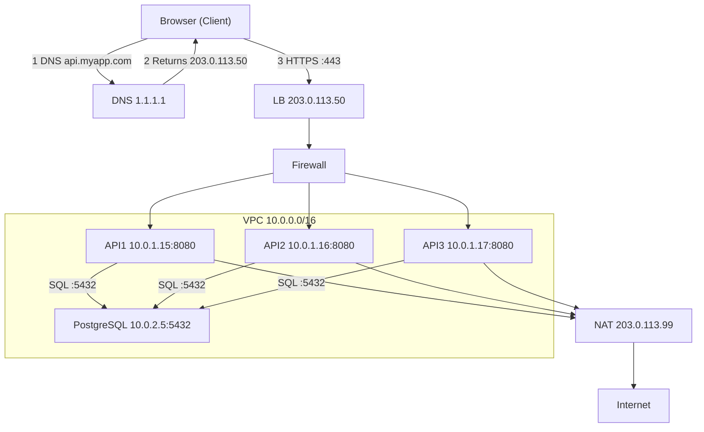

| Component | Address | Reachable From |
|---|---|---|
| LB | 203.0.113.50 public | Internet |
| API x3 | 10.0.1.15-17 private | VPC via LB |
| PG | 10.0.2.5 private | App only |
| NAT | 203.0.113.99 public | Apps outbound |

## 5. The Mental Model

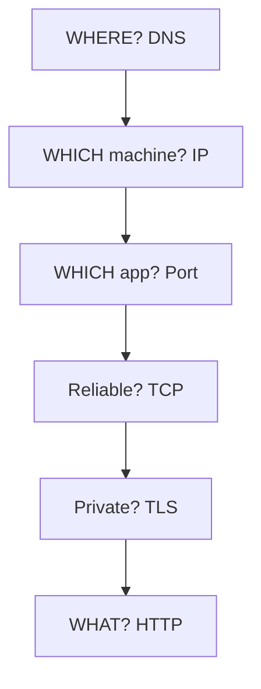

> 💡 Debug top to bottom: DNS -> IP -> Port -> TCP -> TLS -> HTTP.

## 6. Step-by-Step Deep-Dive

### 6.1 Concept 1 - IP Address

**What:** Unique identifier for a machine on a network — postal address for packets.

| Feature | IPv4 | IPv6 |
|---|---|---|
| Format | 192.168.1.1 | 2001:db8::1 |
| Space | ~4.3B | ~340 undecillion |
| Use | Most internal | Cloud/modern ISP |

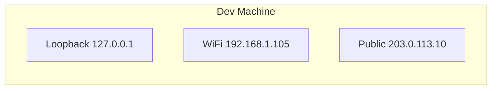

```bash
ip addr show
# or legacy
ifconfig
# Windows
ipconfig
```

**In our app:** Browser resolves `api.myapp.com` -> `203.0.113.50` (LB public). LB routes to `10.0.1.15` (private).

> ⚠️ Insight: IP is a **location**, not identity. Same machine has many IPs per path.

**Quick Recap:** IP = which machine. Check with `ip addr show`.

### 6.2 Concept 2 - Private vs Public IP

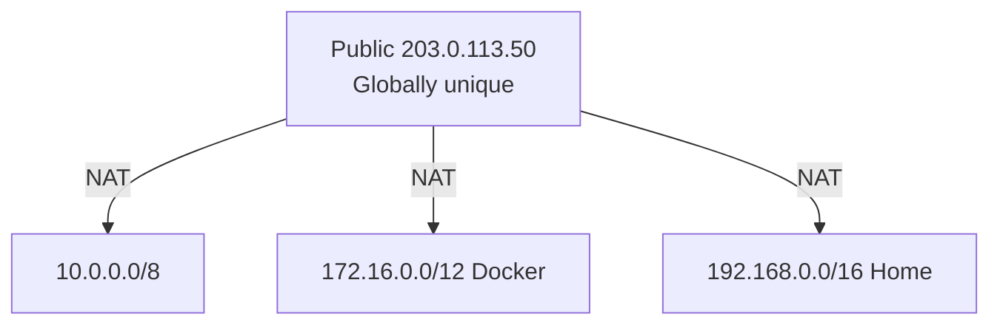

| Range | Common Use |
|---|---|
| 10.x.x.x | Corporate, AWS VPC |
| 172.16-31.x.x | Docker bridge |
| 192.168.x.x | Home routers |

```java
// WRONG - localhost in container = container itself
// spring.datasource.url=jdbc:postgresql://localhost:5432/mydb
// RIGHT - Docker Compose service name
// spring.datasource.url=jdbc:postgresql://postgres:5432/mydb
// RIGHT - prod private IP
// spring.datasource.url=jdbc:postgresql://10.0.2.5:5432/mydb
```

```yaml
# docker-compose.yml (working example)
services:
  api:
    build: .
    environment:
      SPRING_DATASOURCE_URL: jdbc:postgresql://postgres:5432/mydb
    depends_on: [postgres]
  postgres:
    image: postgres:16
    environment:
      POSTGRES_DB: mydb
```

> ❌ Pitfall: `localhost` works locally but fails in container/K8s. Use service name.

### 6.3 Concept 3 - Ports

IP = building, port = apartment. One machine, many apps.

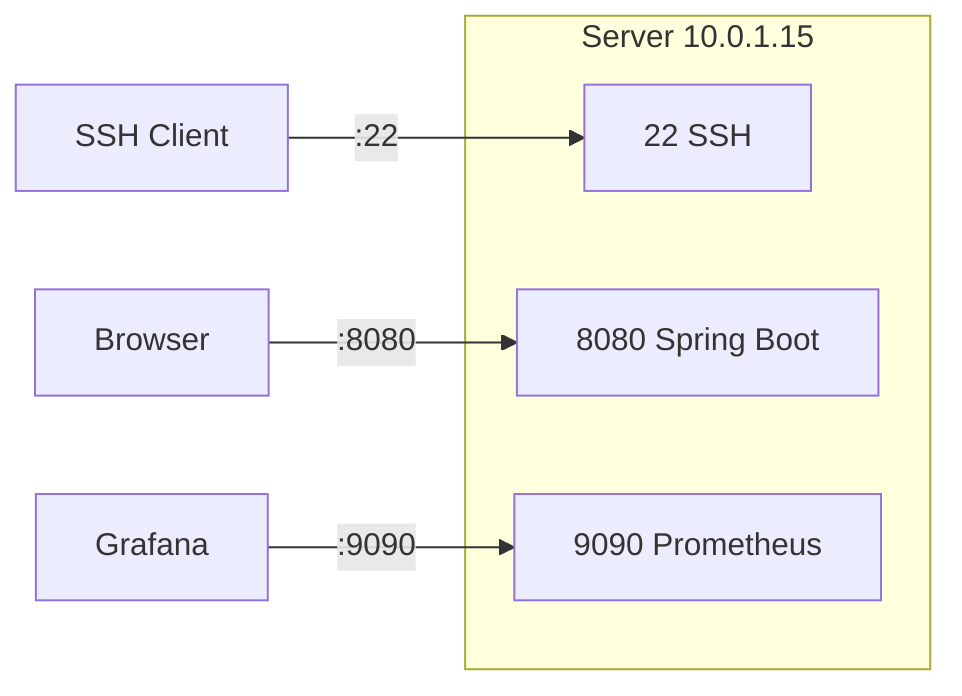

| Port | Service |
|---|---|
| 22 | SSH |
| 80 | HTTP |
| 443 | HTTPS |
| 3306 | MySQL |
| 5432 | PostgreSQL |
| 6379 | Redis |
| 8080 | App server |
| 9092 | Kafka |
| 27017 | MongoDB |

```bash
ss -tlnp
netstat -tlnp
lsof -i :8080
```

> ⚠️ Critical: Binding to `127.0.0.1:8080` in container blocks external traffic. Bind `0.0.0.0:8080`.

```java
// Spring Boot: default binds 0.0.0.0 - GOOD, do not change to 127.0.0.1 in Docker
// server.address=0.0.0.0
// server.port=8080
```

### 6.4 Concept 4 - DNS

**What:** Phone book of internet — hostname to IP.

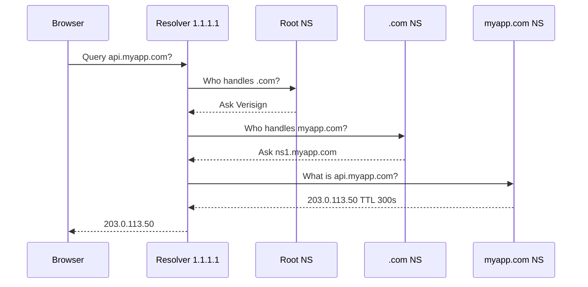

| Record | Purpose | Example |
|---|---|---|
| A | host to IPv4 | api -> 203.0.113.50 |
| AAAA | host to IPv6 | api -> 2001:db8::1 |
| CNAME | alias | www -> myapp.com |
| MX | mail | myapp -> mail server |
| TXT | text/SPF | verification |
| NS | delegation | myapp -> ns1 |

```bash
nslookup api.myapp.com
dig api.myapp.com
dig +trace api.myapp.com
dig @8.8.8.8 api.myapp.com
```

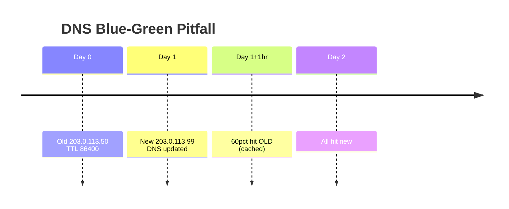

> 💡 Best practice: Lower TTL to 60-300s **before** migration, raise after.

### 6.5 Concept 5 - MAC Address

Hardware ID burned into NIC. Used by switches within LAN. IP routes across networks, MAC delivers locally.

```bash
ip link show
# link/ether 00:1a:2b:3c:4d:5e
```

| Aspect | IP | MAC |
|---|---|---|
| Layer | L3 logical | L2 physical |
| Changes? | Yes (DHCP) | Burned (spoofable) |
| Scope | Global | Local segment |
| Used by | Routers | Switches |

Use cases: switch forwarding, DHCP reservations, NAC filtering (spoofable, so not sole auth).

### 6.6 Concept 6 - ARP

Bridges IP to MAC on local net via broadcast.

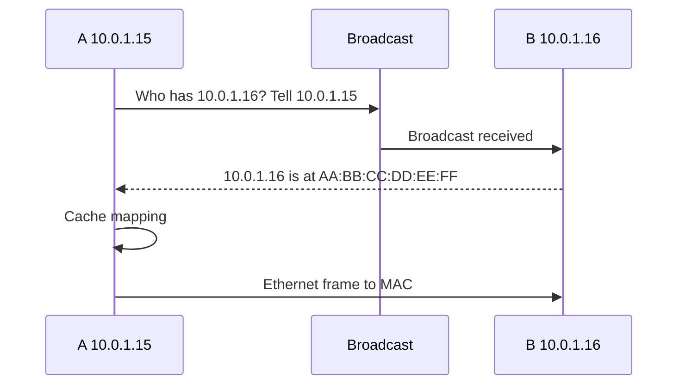

```bash
arp -a
ip neigh show
```

> ⚠️ ARP poisoning: attacker replies with own MAC. Gratuitous ARP used in failover to update neighbors fast.

### 6.7 Concept 7 - TCP

Guarantees: reliability (retransmit), ordering (seq nos), flow control, congestion control, connection-oriented.

```bash
nc -zv api.myapp.com 443
telnet api.myapp.com 443
ss -tn state established
```

| State | Meaning |
|---|---|
| ESTABLISHED | Active data flow |
| TIME_WAIT | Closed, wait late packets |
| CLOSE_WAIT | Remote closed, app not yet |
| SYN_SENT | Wait SYN-ACK |
| LISTEN | Server waiting |

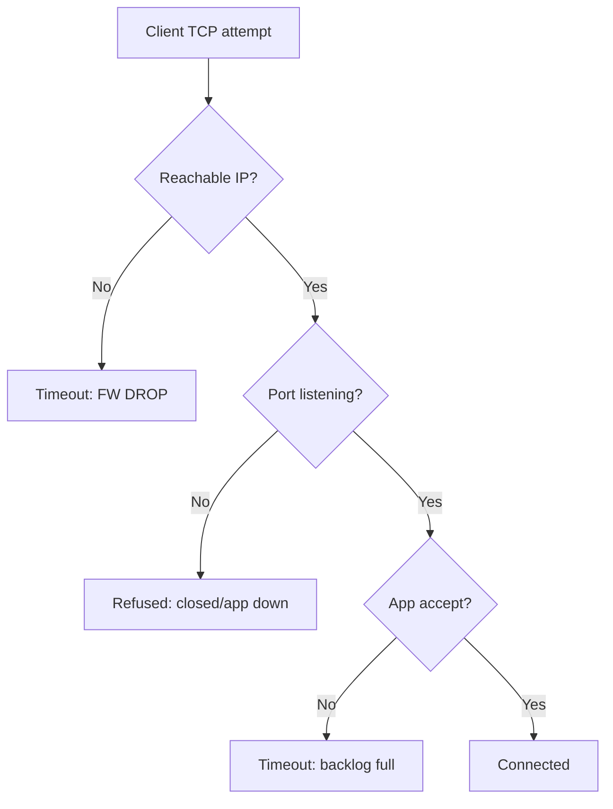

> 💡 Timeout = silently dropped (FW). Refused = reached host, nothing listening.

### 6.8 Concept 8 - UDP

Fast best-effort, no handshake/retry/order.

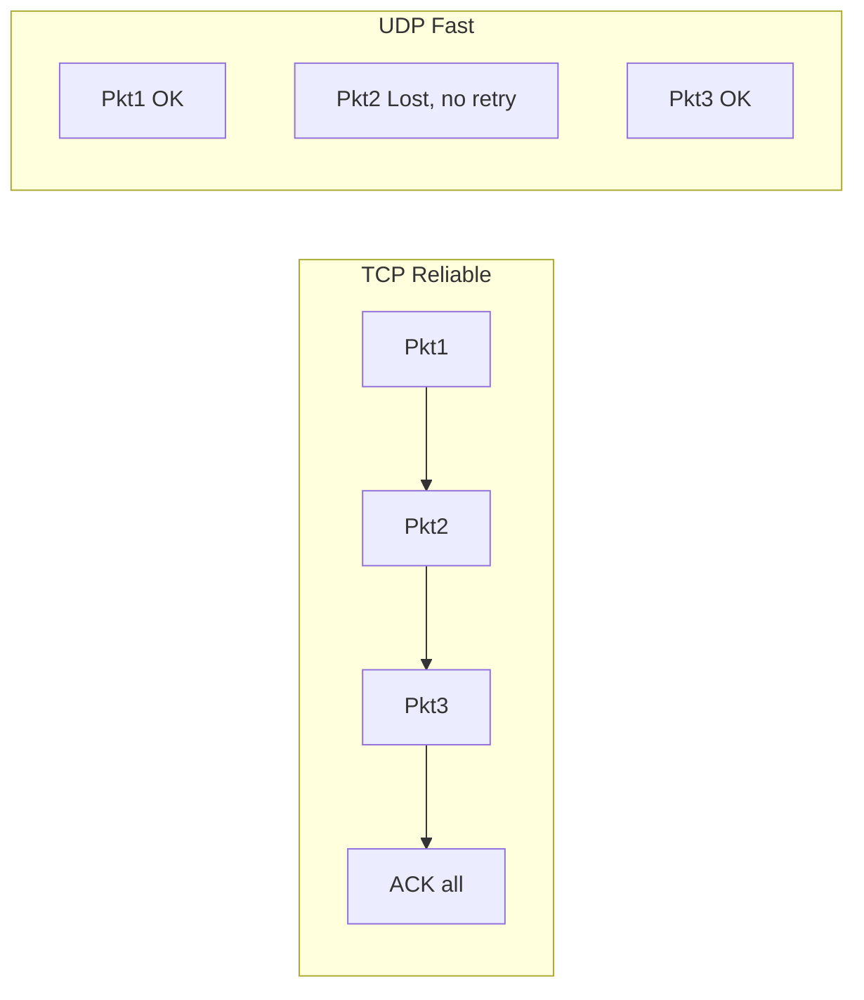

| Use | Proto | Why |
|---|---|---|
| HTTP/HTTPS | TCP | No loss |
| DNS query | UDP | Small, retry |
| Video/VoIP/game | UDP | Latency over loss |
| DB/file | TCP | Integrity |
| QUIC HTTP/3 | UDP+reliability | UDP with guarantees |

### 6.9 Concept 9 - Handshake

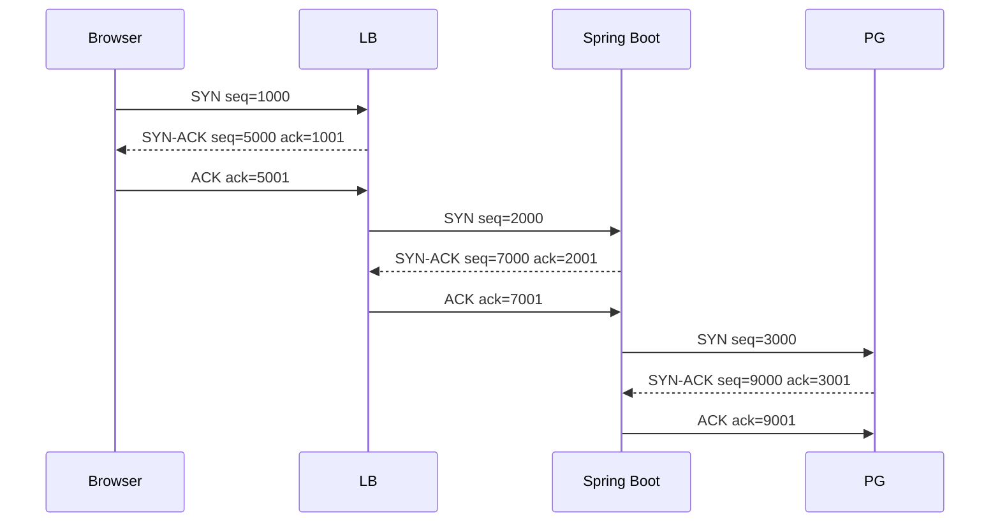

Why pooling? Each handshake costs 1 RTT (100ms if far). Pool reuses connections.

```yaml
spring:
  datasource:
    hikari:
      maximum-pool-size: 10
      minimum-idle: 5
      connection-timeout: 30000
      idle-timeout: 600000
```

### 6.10 Concept 10 - HTTP

```text
https://api.myapp.com:443/users?limit=10&sort=name#results
scheme | host | port | path | query | fragment
```

| Code | Name | Meaning |
|---|---|---|
| 200 | OK | GET success |
| 201 | Created | POST success |
| 204 | No Content | DELETE success |
| 301 | Moved | Permanent redirect |
| 400 | Bad Request | Bad input |
| 401 | Unauthorized | No/invalid auth |
| 403 | Forbidden | No permission |
| 404 | Not Found | Missing |
| 429 | Too Many | Rate limited |
| 500 | Server Error | App crashed |
| 502 | Bad Gateway | LB cannot reach backend |
| 503 | Unavailable | Backend down |
| 504 | Timeout | Backend slow |

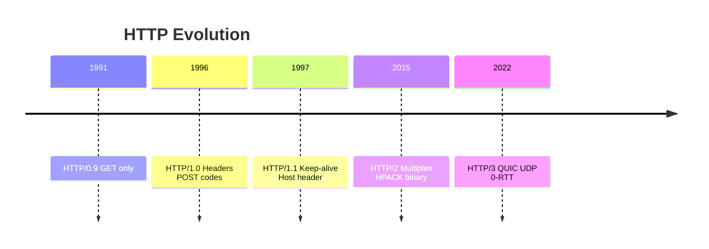

```bash
curl -v https://api.myapp.com/users
curl -I https://api.myapp.com/users
curl -X POST https://api.myapp.com/users -H "Content-Type: application/json" -d '{"name":"Alice"}'
curl -w "DNS:%{time_namelookup} Conn:%{time_connect} TLS:%{time_appconnect} Total:%{time_total}\n" -o /dev/null -s https://api.myapp.com/users
```

```java
// Spring Boot REST - correct vs incorrect status
@RestController
@RequestMapping("/api/users")
public class UserController {
  // GOOD: 201 on create
  @PostMapping
  public ResponseEntity<User> create(@RequestBody User u){
    User saved = repo.save(u);
    return ResponseEntity.status(201).body(saved);
  }
  // BAD: always 200 even on create - loses semantics
  // GOOD: 404 handling
  @GetMapping("/{id}")
  public ResponseEntity<User> get(@PathVariable Long id){
    return repo.findById(id).map(ResponseEntity::ok)
      .orElse(ResponseEntity.notFound().build());
  }
}
```

### 6.11 Concept 11 - HTTPS and TLS

Provides encryption, integrity (HMAC), auth (CA cert), forward secrecy.

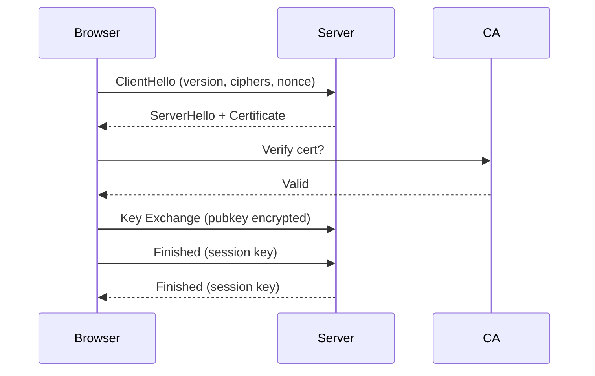

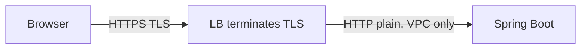

```bash
openssl s_client -connect api.myapp.com:443 -showcerts
echo | openssl s_client -connect api.myapp.com:443 2>/dev/null | openssl x509 -noout -dates
```

> ✅ Pros of LB termination: simpler backend, faster, central certs. ⚠️ Internal plain - OK in trusted VPC, use end-to-end for high security.

### 6.12 Concept 12 - OSI Model

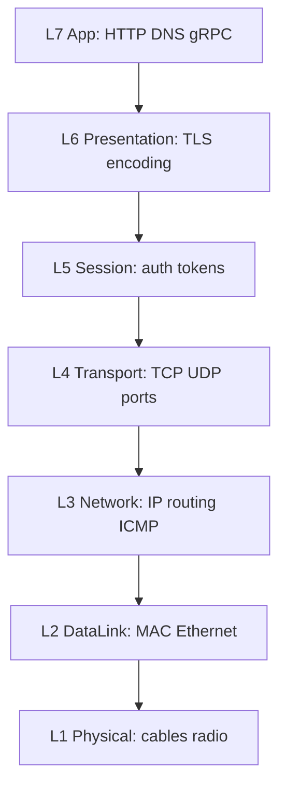

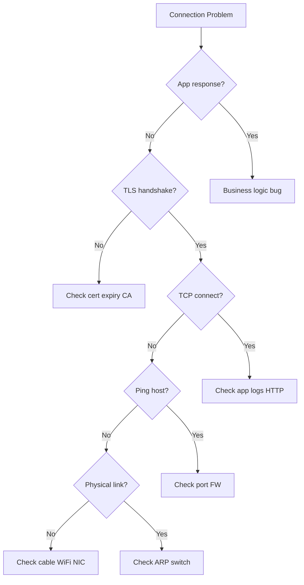

### 6.13 Concept 13 - NAT

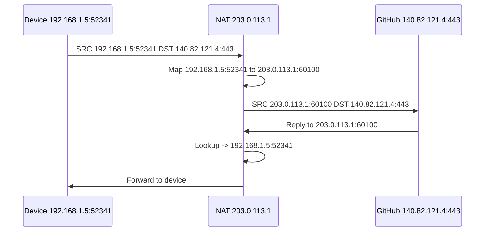

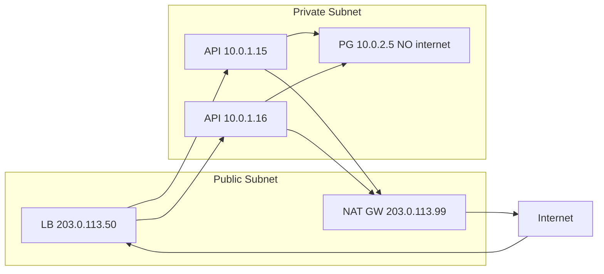

> 💡 DB has NO route to internet. Apps reach Stripe via NAT. NAT table timeout can drop idle DB-ish long conns — use keepalive.

### 6.14 Concept 14 - Routing

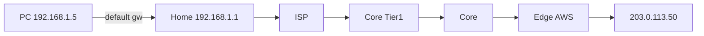

```bash
ip route show
route -n
traceroute api.myapp.com
tracert api.myapp.com
# 1 192.168.1.1 1ms, 2 ISP 5ms, 3 backbone 8ms, 4 *** filtered, 5 dest 12ms
```

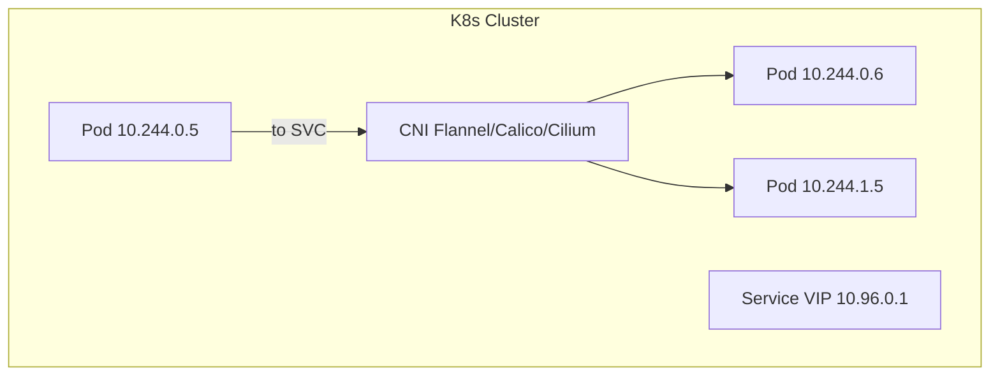

> ⚠️ `* * *` in traceroute = filtered hop (FW drops ICMP), not necessarily failure.

### 6.15 Concept 15 - Subnetting

```text
192.168.1.0/24 = 24 bits network, 8 bits hosts = 256 addrs
```

| CIDR | Mask | Hosts | Use |
|---|---|---|---|
| /32 | 255.255.255.255 | 1 | Single host |
| /30 | 255.255.255.252 | 2 | Point-to-point |
| /29 | 255.255.255.248 | 6 | Small office |
| /24 | 255.255.255.0 | 254 | Small net |
| /16 | 255.255.0.0 | 65k | Large org |
| /8 | 255.0.0.0 | 16M | ISP |

```mermaid
flowchart TD
    VPC["VPC 10.0.0.0/16 65k IPs"] --> IGW["Internet GW"]
    VPC --> PA["Public 10.0.1.0/24 LB"] & PB["Public 10.0.2.0/24 LB HA"]
    PA & PB --> PRA["Private 10.0.10.0/24 App"] & PRB["Private 10.0.11.0/24 App HA"]
    PRA --> DBA["DB 10.0.20.0/24 Primary"]
    PRB --> DBB["DB 10.0.21.0/24 Replica"]
    PRA --> NAT["NAT"] --> IGW
```

> 💡 Rule: Public = LB/bastion/NAT only. Private = apps. Isolated = DB, no internet route.

### 6.16 Concept 16 - DHCP

Auto-assigns IP, subnet, gateway, DNS, lease.

```mermaid
sequenceDiagram
    participant D as New Device 0.0.0.0
    participant S as DHCP Server
    D->>S: Discover Broadcast I need IP!
    S-->>D: Offer 192.168.1.105
    D->>S: Request I take 192.168.1.105
    S-->>D: ACK IP GW DNS Lease 24h
    D->>D: Apply Ready!
```

```mermaid
flowchart LR
    NEW["New EC2"] -- "1 DHCP" --> DHCP["VPC DHCP Options"]
    DHCP -- "2 IP subnet GW DNS" --> NEW
    NEW -- "3 metadata" --> META["169.254.169.254"]
```

> 💡 Cloud: AWS auto-assigns from subnet via DHCP. No manual config. Check `ip addr show`.

### 6.17 Concept 17 - Load Balancer

```mermaid
flowchart TD
    INT["Internet"] --> LB["LB 203.0.113.50:443<br/>RR LeastConn IPHash Weighted"]
    LB -->|"Req1"| A1["Inst1 10.0.1.15 45pct"]
    LB -->|"Req2"| A2["Inst2 10.0.1.16 38pct"]
    LB -->|"Req3"| A3["Inst3 10.0.1.17 42pct"]
    LB -. "Skip unhealthy" .-> DEAD["Inst4 Failed HC"]
    A1 & A2 & A3 --> DB["PG"]
```

```mermaid
flowchart TD
    subgraph L4["L4 TCP Fast"]
        C4["Client"] -- "TCP 443 IP+Port" --> LB4["L4 LB"] --> S4A["SrvA"] & S4B["SrvB"]
    end
    subgraph L7["L7 HTTP Smart"]
        C7["Client"] --> LB7["L7 LB inspects URL headers cookies"]
        LB7 -- "/api/*" --> S7A["API"]
        LB7 -- "/static/*" --> S7B["CDN"]
        LB7 -- "/admin/* admin role" --> S7C["Admin"]
    end
```

```yaml
# AWS ALB health check
health_check:
  path: /actuator/health
  interval: 30
  timeout: 5
  healthy_threshold: 2
  unhealthy_threshold: 3
  matcher: "200"
```

```java
// Spring Boot actuator (needed for LB HC)
 // build.gradle: implementation 'org.springframework.boot:spring-boot-starter-actuator'
 // application.yml:
 // management.endpoints.web.exposure.include: health,info
 // management.endpoint.health.show-details: never
```

```mermaid
sequenceDiagram
    participant LB as LB
    participant V1A as v1 A
    participant V1B as v1 B
    participant V2A as v2 A new
    LB->>V1A: Traffic
    LB->>V1B: Traffic
    LB->>V2A: HC waiting
    V2A-->>LB: Healthy!
    LB->>V1A: Drain 30s no new req
    LB->>V1B: Traffic
    LB->>V2A: Traffic
```

### 6.18 Concept 18 - Reverse Proxy

```mermaid
flowchart TD
    subgraph FP["Forward Proxy Client-side"]
        C1["Client"] --> FPP["Forward Proxy hides client"] --> IN["Internet"]
    end
    subgraph RP["Reverse Proxy Server-side"]
        C2["Client"] --> RPP["Reverse Proxy hides servers"] --> SA["SrvA"] & SB["SrvB"]
    end
```

```mermaid
mindmap
  root((Reverse Proxy<br/>Nginx))
    TLS Termination
    Caching static
    Compression gzip Brotli
    Routing by path subdomain AB
    Security rate-limit WAF
    Load Balancing HC
```

```nginx
# nginx.conf - working reverse proxy + LB
upstream spring_boot_apps {
    least_conn;
    server 10.0.1.15:8080 weight=3;
    server 10.0.1.16:8080 weight=2;
    server 10.0.1.17:8080 weight=1;
    keepalive 32;
}
server {
    listen 443 ssl http2;
    server_name api.myapp.com;
    ssl_certificate /etc/ssl/certs/myapp.com.crt;
    ssl_certificate_key /etc/ssl/private/myapp.com.key;
    location /api/ {
        proxy_pass http://spring_boot_apps;
        proxy_set_header Host $host;
        proxy_set_header X-Real-IP $remote_addr;
        proxy_set_header X-Forwarded-For $proxy_add_x_forwarded_for;
        proxy_set_header X-Forwarded-Proto $scheme;
    }
    location /static/ {
        root /var/www/html;
        expires 7d;
        gzip_static on;
    }
}
```

> 💡 LB vs Reverse Proxy: LB distributes; reverse proxy also caches/compresses/terminates TLS/routes by URL. Nginx does both.

### 6.19 Concept 19 - Firewall

```mermaid
flowchart TD
    INT["Internet Untrusted"] --> FW["Firewall Rules top-bottom"]
    FW --> R1["ALLOW 443 ANY to LB"]
    FW --> R3["ALLOW 8080 LB only to App"]
    FW --> R4["ALLOW 5432 App only to DB"]
    FW --> R5["ALLOW 22 VPN only"]
    FW --> R6["DENY ALL DROP"]
    R1 --> LB["LB"]
    LB --> R3 --> APP["App"]
    APP --> R4 --> DB["PG"]
```

```mermaid
flowchart TD
    REQ["TCP SYN"] --> Q{"FW rule?"}
    Q -- "DENY reject" --> RST["RST Refused instant"]
    Q -- "DROP silent" --> TO["Timeout 30-120s hard debug"]
    Q -- "ALLOW" --> QP{"Listening?"}
    QP -- "No" --> RST2["RST Refused OS"]
    QP -- "Yes" --> OK["SYN-ACK"]
```

```bash
aws ec2 describe-security-groups --group-ids sg-0123456789abcdef0 --query 'SecurityGroups[*].IpPermissions'
# sg-lb: inbound 443 from 0.0.0.0/0, 80 from 0.0.0.0/0
# sg-app: inbound 8080 from sg-lb ONLY, outbound 5432 to sg-db
# sg-db: inbound 5432 from sg-app ONLY, no internet
```

```yaml
# K8s NetworkPolicy: only app to postgres
apiVersion: networking.k8s.io/v1
kind: NetworkPolicy
metadata: {name: allow-app-to-postgres}
spec:
  podSelector: {matchLabels: {app: postgres}}
  ingress:
  - from: [{podSelector: {matchLabels: {app: spring-boot-api}}}]
    ports: [{protocol: TCP, port: 5432}]
  policyTypes: [Ingress]
```

### 6.20 Concept 20 - Putting It All Together

```mermaid
sequenceDiagram
    participant B as Browser
    participant DNS as DNS
    participant FW as FW
    participant LB as LB
    participant API as Spring Boot
    participant POOL as DB Pool
    participant DB as PG
    B->>DNS: 1 DNS api.myapp.com?
    DNS-->>B: 2 203.0.113.50 TTL300
    B->>FW: 3 TCP SYN 203.0.113.50:443
    FW-->>B: 4 Allowed 443
    B->>LB: 5 SYN
    LB-->>B: 6 SYN-ACK
    B->>LB: 7 ACK + 8 ClientHello
    LB-->>B: 9 Cert + keys
    B->>LB: 10 GET /api/users HTTP2 encrypted
    LB->>FW: 11 Plain to 10.0.1.16:8080
    FW-->>LB: 12 Allowed LB to 8080
    LB->>API: 13 Forward
    API->>POOL: 14 Get conn
    POOL-->>API: 15 Ready pre-established
    API->>DB: 16 SELECT * LIMIT 10
    DB-->>API: 17 Rows JSON
    API-->>LB: 18 HTTP 200 JSON
    LB-->>B: 19 Encrypted TLS
    B->>B: 20 Render OK 50-150ms
```

```bash
# Full debug toolkit
nslookup api.myapp.com; dig api.myapp.com A; dig +trace api.myapp.com
ip addr show; ip route show; arp -a
ss -tlnp; lsof -i :8080
ping api.myapp.com; traceroute api.myapp.com; nc -zv api.myapp.com 443
curl -v https://api.myapp.com
openssl s_client -connect api.myapp.com:443
tcpdump -i any -n port 443
curl -w "DNS:%{time_namelookup} Conn:%{time_connect} TLS:%{time_appconnect} Total:%{time_total}\n" -o /dev/null -s https://api.myapp.com
```

```mermaid
mindmap
  root((Networking))
    Addressing
      IP
      Private vs Public
      MAC
      Subnetting
    Discovery
      DNS
      ARP
      DHCP
    Transport
      TCP
      UDP
      Handshake
    Application
      HTTP
      TLS
      OSI
    Infra
      LB
      Proxy
      Firewall
      NAT
      Routing
```

## 7. Real-World Examples and Use Cases

1. **Docker localhost bug:** `jdbc:postgresql://localhost:5432` fails because localhost=container. Fix: service name `postgres` or K8s `postgres.default.svc.cluster.local`.
2. **Blue-green TTL outage:** TTL 86400 keeps 60pct on old IP hours after DNS change. Fix: lower to 60s 48h before, raise after.
3. **ELB 502 vs 504:** 502=LB cannot reach backend (app down/SG). 504=backend slow (DB lock). Check `ss`, actuator, DB pool.
4. **K8s DNS:** `nslookup postgres` uses CoreDNS. `NetworkPolicy` DROP shows as timeout, not refused.

## 8. Multiple Implementation Approaches

| Decision | Option A | Option B | When |
|---|---|---|---|
| TLS | Terminate at LB (simple, fast) | End-to-end to app (secure) | Trusted VPC=A, finance/health=B |
| LB | L4 NLB (fast, TCP only) | L7 ALB (path/host routing) | Raw TCP=A, microservices=B |
| FW | SG (stateful, instance) | NACL/NetworkPolicy (stateless/pod) | AWS=A, K8s micro-seg=B |
| HTTP | 1.1 keepalive (simple) | 2 multiplex / 3 QUIC (fast lossy) | Internal=A, mobile/global=B |

## 9. Best Practices

- Bind `0.0.0.0` in containers, never `127.0.0.1` for ingress.
- Use service names, not hardcoded IPs, in compose/K8s.
- Lower DNS TTL before migrations.
- Expose `/actuator/health` for LB HC (never details).
- Keepalive to backends (`keepalive 32`, Hikari min-idle 5).
- DB in isolated subnet, SG only from app SG.
- Centralize certs at LB, monitor expiry 30/7/1d alerts.
- `X-Forwarded-For/Proto` behind proxy; app respects `ForwardedHeadersFilter`.
- Timeouts everywhere: connect 5s, read 10s, pool wait 30s.
- Log `X-Request-ID` end-to-end.

## 10. Anti-Patterns — What NOT to Do

| Anti-Pattern | Why Bad | Fix |
|---|---|---|
| `localhost` DB in container | Points to self | Service name |
| Bind `127.0.0.1` in Docker | Blocks external | `0.0.0.0` |
| `0.0.0.0/0` to 5432/3306/6379 | Public DB | SG from app only |
| No pool (new conn per req) | +100ms handshake | HikariCP 10/5 |
| TTL 86400 + migrate | Stale half day | 60s pre-migrate |
| Ignore TIME_WAIT/CLOSE_WAIT | Port/leak | Tune, close properly |
| HTTP internal with PII beyond VPC | Sniffable | mTLS or end-to-end TLS |
| No HC / HC on `/` heavy | Flapping/slow | Light `/health` 200 |
| DROP without logging | Mystery timeout | Log + REJECT where apt |

## 11. Performance Considerations

- Handshake 1 RTT + TLS 1-2 RTT: 100ms link = 200-300ms before data. Reuse via keepalive/pool.
- Without pool: Req=Handshake 100ms+Query 50ms=150ms x3=450ms. With pool: 50ms x3=150ms.
- HTTP/1.1: 6 conns/host head-of-line. HTTP/2: multiplex one conn HPACK. HTTP/3 QUIC: no HOL, 0-RTT resume (replay risk for non-idempotent).
- Tune: `keepalive 32`, `keepalive_timeout 65s`, Hikari `max 10-20` per instance (DB max_conns / instances), `minimum-idle 5`.
- Compress: gzip/Brotli at proxy for text, `expires 7d` static.
- Benchmark: `curl -w timing`, k6/JMeter through LB, watch `TIME_WAIT` with `ss -s`.

## 12. Security Considerations

- TLS: min 1.2 (prefer 1.3), valid CA, auto-renew LetsEncrypt, alert 30/7/1d, forward secrecy ciphers.
- Auth: cert proves server; client auth via mTLS where needed. Never trust MAC alone (spoofable).
- ARP spoofing: use Dynamic ARP Inspection, static entries for gateways in sensitive nets.
- FW least privilege: 443 from 0.0.0.0/0 to LB only; 8080 from LB SG; 5432 from app SG; 22 from VPN; DENY rest; log DROPs.
- Headers via proxy: strip spoofed `X-Forwarded-For` at edge, validate `X-Forwarded-Proto` for secure cookies.
- Rate-limit/WAF at L7: 429, OWASP rules, body limits.
- Secrets: DB creds in vault, not compose in git; rotate.

## 13. Testing Strategies

```bash
# Layered test script (run in order)
dig +short api.myapp.com            # DNS layer
ping -c2 api.myapp.com              # L3
nc -zv api.myapp.com 443            # L4 port
echo | openssl s_client -connect api.myapp.com:443 2>/dev/null | openssl x509 -noout -dates  # TLS
curl -s -o /dev/null -w "%{http_code} %{time_total}s\n" https://api.myapp.com/actuator/health  # L7
```

- Contract: assert 201/404/429 codes in Spring MockMvc + Testcontainers Postgres.
- Load: k6 `http_req_duration`, watch LB healthy-host count, DB `pg_stat_activity`.
- Chaos: kill one API, expire staging cert, add bad NetworkPolicy, raise latency 200ms — verify drain + retry.

## 14. Migration Guides

- **HTTP->HTTPS:** Get cert, terminate at LB, redirect 80->443, set HSTS, fix mixed content, update `X-Forwarded-Proto`.
- **IPv4->dual-stack:** Add AAAA, SG IPv6 `::/0` same rules, test `curl -6`.
- **Single->LB pool:** Add `/health`, stateless sessions (sticky off, use Redis), drain 30s rolling deploy.
- **Compose->K8s:** `postgres` -> `Service postgres:5432`, env via ConfigMap/Secret, add NetworkPolicy, CoreDNS search.
- **TTL migration runbook:** 48h before set TTL 60, wait old TTL, switch DNS, monitor both IPs, raise TTL to 300+.

## 15. Common Pitfalls / Troubleshooting

| Symptom | Layer | Command | Fix |
|---|---|---|---|
| NXDOMAIN / wrong IP | DNS | `dig +trace` | Fix record, wait TTL, flush cache |
| `Network unreachable` | IP/Route | `ip route show` | Fix GW, VPC route table |
| Refused 8080 | Port/App | `ss -tlnp` | Start app, bind 0.0.0.0, open SG |
| Timeout 443 | FW DROP | `traceroute`, SG logs | Allow 443, fix NACL |
| TLS expired / untrusted | TLS | `openssl s_client` | Renew, full chain, CA bundle |
| 502 | LB->app | LB target health | Fix app/SG/HC path |
| 504 | App slow | logs, DB pool | Index, pool size, timeout |
| Same-subnet no ping | ARP/L2 | `arp -a` | Fix switch/VLAN, clear cache |
| Works local, not container | Private IP | `docker network inspect` | Service name, 0.0.0.0 |

> 💡 Timeout vs Refused is the #1 differentiator. Timeout=DROP/backlog. Refused=closed port.

## 16. Hands-On Labs

### Lab 1 - Reproduce and Fix Docker localhost Bug (20 min)
**Goal:** See why localhost fails in containers.
1. Create `docker-compose.yml` with `api` + `postgres` (see 6.2).
2. Set `SPRING_DATASOURCE_URL=jdbc:postgresql://localhost:5432/mydb` -> `docker compose up` -> observe `Connection refused`.
3. Run `docker network inspect` + `ss -tlnp` inside api container.
4. Fix to `jdbc:postgresql://postgres:5432/mydb` -> verify connected.
**Success:** API `/actuator/health` UP, logs show Hikari pool 5.

### Lab 2 - DNS + TLS Inspection (15 min)
1. `dig +trace example.com`, note Root->TLD->Auth chain + TTL.
2. `dig @1.1.1.1 vs @8.8.8.8 api.myapp.com` compare latency.
3. `openssl s_client -connect google.com:443 -showcerts`, check `notAfter`.
4. `curl -w timing` breakdown: which phase dominates?
**Success:** Can explain TTL, chain validation, DNS vs connect vs TLS time.

### Lab 3 - Nginx Reverse Proxy Simulation (25 min)
1. Run two backends: `python3 -m http.server 8081` and `8082` (or two Spring profiles).
2. Write minimal `nginx.conf` upstream least_conn + `proxy_set_header` (see 6.18), `nginx -t && nginx -s reload`.
3. `curl -v http://localhost/api/` multiple times, check access logs distribution.
4. Add `/static/` location with `expires`, verify `Cache-Control`.
**Success:** Round-robin/least-conn works, headers forwarded, static cached.

## 17. Practice Exercises with Detailed Solutions

### Exercise 1 - Design VPC Subnets (Intermediate)
**Task:** VPC `10.0.0.0/16`. Need public LB x2 AZ, private app x2 AZ, isolated DB x2 AZ. Pick CIDRs, explain routes.
**Solution:**
- Public: `10.0.1.0/24` (a), `10.0.2.0/24` (b) -> route `0.0.0.0/0` to IGW.
- Private app: `10.0.10.0/24` (a), `10.0.11.0/24` (b) -> `0.0.0.0/0` to NAT in same AZ.
- DB: `10.0.20.0/24` (a), `10.0.21.0/24` (b) -> NO `0.0.0.0/0` route (isolated).
- SG: lb `443 0.0.0.0/0`; app `8080 from sg-lb`; db `5432 from sg-app`. Why: blast radius, no direct DB internet, HA per AZ. Verify: `ip route show` on bastion, `nc -zv` fails from public to DB (timeout=DROP).

### Exercise 2 - Fix Nginx + Diagnose 504 (Intermediate)
**Task:** Given upstream with one dead server + 504s, fix config and triage.
**Solution:**
- Add `max_fails=3 fail_timeout=30s` to dead server, set `proxy_connect_timeout 5s; proxy_read_timeout 10s;`.
- Triage: `curl -w` shows connect fast, TTFB 10s+=backend. Check `ss`, `/actuator/health`, `pg_stat_activity` for locks, Hikari `active==max` means pool starved -> raise max (within DB limit) + add index. Enable `keepalive 32`.

### Exercise 3 - Secure SG Design (Advanced)
**Task:** 3-tier app + admin SSH + Stripe egress. Write least-privilege SGs.
**Solution:**
- sg-lb: in `80,443 0.0.0.0/0`; out `8080 to sg-app`.
- sg-app: in `8080 from sg-lb`; out `5432 to sg-db`, `443 to 0.0.0.0/0` (Stripe) via NAT.
- sg-db: in `5432 from sg-app`; out none.
- SSH: `22 from <VPN-CIDR> only` on all (or SSM, no 22). Test: `nc -zv DB-IP 5432` from laptop=timeout (DROP good); from app=success. Never `0.0.0.0/0` to DB/22.

### Exercise 4 - DNS Migration Plan (Advanced)
**Task:** Move `api.myapp.com` 203.0.113.50->203.0.113.99 with TTL 86400, zero stale.
**Solution:**
1. 48h before: set TTL 60. Wait 24h+ (old TTL expiry).
2. Verify `dig` TTL 60 globally (`@1.1.1.1`, `@8.8.8.8`).
3. Switch A record, keep old servers draining 2x TTL + LB drain 30s.
4. Monitor both IPs access logs, `curl --resolve` test new IP.
5. After 24h stable, raise TTL 300-3600. Rollback: flip A back (60s propagation).

## 18. Test Your Understanding

1. Why does `localhost:5432` fail from Spring container when PG runs in another container?
2. `nc -zv host 443` timeout vs refused — what does each imply?
3. What 3 things does DHCP provide besides IP?
4. A vs CNAME vs MX — when use each?
5. Why lower TTL before migration?
6. TCP vs UDP for payment API vs live video — choose and justify.
7. What does `ss -tlnp` tell you that `ping` cannot?
8. Where should TLS terminate and what is the trade-off?
9. L4 vs L7 LB — which can route `/api/*` vs `/static/*`?
10. Why DB in isolated subnet with no IGW route?
11. What does `X-Forwarded-For` solve behind proxy?
12. 502 vs 503 vs 504 — triage each in one line.

## 19. Common Interview Questions

1. **Timeout vs Connection Refused?** Hint: DROP vs closed port. Refused=RST fast; Timeout=silent DROP/backlog.
2. **What happens when you type https://api.myapp.com/users?** Hint: walk DNS->TCP->TLS->HTTP->LB->app->DB 20 steps.
3. **Why connection pooling?** Hint: 1 RTT handshake cost, Hikari reuse.
4. **Forward vs Reverse Proxy?** Hint: who hides whom; Nginx TLS/cache/routing.
5. **L4 vs L7 LB?** Hint: TCP IP+port vs HTTP URL/headers/cookies + HC.
6. **How does NAT let private IPs reach internet?** Hint: table SRC rewrite + return mapping.
7. **Private vs Public IP ranges?** Hint: RFC1918 10/8, 172.16/12, 192.168/16.
8. **How to debug 502 Bad Gateway on ALB?** Hint: target HC, SG 8080, app logs, actuator.
9. **127.0.0.1 vs 0.0.0.0 bind in Docker?** Hint: loopback only vs all interfaces.
10. **What is ARP and its risk?** Hint: IP->MAC broadcast, poisoning, gratuitous ARP failover.
11. **HTTP/1.1 vs 2 vs 3?** Hint: keepalive vs multiplex HPACK vs QUIC 0-RTT.
12. **How to do zero-downtime deploy?** Hint: HC + drain + rolling, lower TTL if DNS move.

## 20. Question Bank (60 Questions)

### Beginner (1-20)
1. What is an IP address?
2. IPv4 vs IPv6 format difference?
3. What is 127.0.0.1?
4. Name 3 private IP ranges.
5. Public vs private IP?
6. What is a port?
7. Which port: HTTPS? SSH? Postgres? MySQL? Redis?
8. What is DNS?
9. What is an A record?
10. What is CNAME?
11. What tool checks DNS? (`dig`/`nslookup`)
12. What is a MAC address?
13. IP vs MAC?
14. What is ARP?
15. Command to see ARP cache?
16. TCP vs UDP one-line?
17. What is HTTP?
18. What is HTTPS/TLS?
19. What is a firewall?
20. What is NAT in one sentence?

### Intermediate (21-40)
21. Why does localhost fail in Docker?
22. 0.0.0.0 vs 127.0.0.1 bind?
23. What is TTL and why lower before migrate?
24. AAAA vs A?
25. What is MX/TXT/NS?
26. Explain 3-way handshake steps.
27. Why pooling saves latency? Quantify 100ms RTT.
28. ESTABLISHED vs TIME_WAIT vs CLOSE_WAIT?
29. When use UDP over TCP? 3 examples.
30. Dissect URL scheme/host/port/path/query/fragment.
31. 200/201/204/301/400/401/403/404/429/500/502/503/504 meanings?
32. HTTP/1.1 vs 2 vs 3 differences?
33. What does TLS guarantee? (E/I/A/FS)
34. Where terminate TLS? Trade-offs?
35. 7 OSI layers in order?
36. How NAT table maps outbound/inbound?
37. What is default gateway?
38. What is CIDR /24 vs /16?
39. DHCP Discover/Offer/Request/ACK?
40. L4 vs L7 LB with examples?

### Advanced (41-60)
41. Timeout vs Refused at FW vs OS level? (REJECT vs DROP)
42. How gratuitous ARP enables failover?
43. ARP poisoning mitigation?
44. Congestion vs flow control in TCP?
45. Why `traceroute * * *` may still be healthy?
46. Design SGs for 3-tier + VPN SSH.
47. K8s Service VIP vs CNI routing + kube-proxy iptables/eBPF?
48. Reverse proxy caching/compression + cache invalidation risks?
49. TLS 1.3 0-RTT benefit vs replay risk?
50. How to debug CLOSE_WAIT leak in Java? (`ss`, heap dump, missing close)
51. Size Hikari pool: DB max 100, 5 app instances — what max per instance and why?
52. Blue-green with DNS vs LB weighted swap — compare.
53. End-to-end TLS vs LB termination for PCI/HIPAA?
54. QUIC over UDP through FW/NAT — what breaks?
55. How NAT timeout drops idle conns and keepalive fix?
56. NetworkPolicy DROP vs app 403 — distinguish?
57. Diagnose 504 with `curl -w` phases + DB locks.
58. Dual-stack IPv6 SG/route pitfalls?
59. eBPF/Cilium vs iptables for K8s routing?
60. Full 20-step request journey from memory.

## 21. Self-Assessment Checklist

- [ ] I can resolve DNS with `dig +trace` and explain TTL.
- [ ] I can tell timeout vs refused and which layer failed.
- [ ] I can fix localhost/bind bugs in Docker.
- [ ] I can trace SYN/SYN-ACK/ACK and size Hikari pool.
- [ ] I can read HTTP codes and `curl -v/-w` timing.
- [ ] I can inspect certs with `openssl` and explain termination.
- [ ] I can use OSI to isolate L2/L3/L4/L6/L7.
- [ ] I can design CIDR/SG/NAT/LB/Nginx for 3-tier VPC.
- [ ] I can run layered tests + chaos + load via LB.
- [ ] I can plan TTL migration + zero-downtime rolling deploy.

## 22. Summary / Key Takeaways

1. Debug layers: DNS->IP->Port->TCP->TLS->HTTP. Never skip.
2. `localhost` in containers = self. Use service names.
3. Timeout = DROP/backlog; Refused = closed port. Different fixes.
4. Private IPs need NAT; DB stays isolated, no IGW.
5. Pooling kills handshake cost (100ms+ per new conn).
6. TLS at LB is default; end-to-end for high security.
7. Subnets = trust zones: public LB, private app, isolated DB.
8. Lower TTL before DNS moves; HC + drain for zero downtime.

| # | Concept | One-Line | Debug |
|---|---|---|---|
| 1 | IP | Machine location | `ip addr show` |
| 2 | Priv vs Pub | Internal vs internet | Which net? |
| 3 | Ports | Which app | `ss -tlnp`, 0.0.0.0 |
| 4 | DNS | Host->IP | `dig +trace` |
| 5 | MAC | HW local ID | `ip link show` |
| 6 | ARP | IP->MAC | `arp -a` |
| 7 | TCP | Reliable ordered | `nc -zv` |
| 8 | UDP | Fast best-effort | Logs/video/DNS |
| 9 | Handshake | SYN/SYN-ACK/ACK | `tcpdump`, pool |
| 10 | HTTP | Req/resp | `curl -v` |
| 11 | TLS | Encrypt+auth | `openssl s_client` |
| 12 | OSI | 7-layer checklist | Layer isolate |
| 13 | NAT | Priv->Pub | Private subnets |
| 14 | Routing | Path via BGP/gw | `traceroute` |
| 15 | Subnetting | CIDR zones | VPC design |
| 16 | DHCP | Auto IP | `ip addr show` |
| 17 | LB | Distribute | HC/alg |
| 18 | Proxy | Hide/cache/TLS | Nginx conf |
| 19 | FW | Filter rules | Timeout=DROP |
| 20 | Journey | All together | Layer trace |

## 23. Further Reading / Resources

- RFC 791 (IP), 793 (TCP), 768 (UDP), 1034/1035 (DNS), 8446 (TLS 1.3), 1918 (Private IPs).
- MDN: HTTP, Status Codes, CORS. Cloudflare Learning: DNS/TLS/NAT/Routing.
- AWS: VPC/Subnets/NAT/ALB/SG docs. Nginx: reverse proxy, upstream, ssl.
- Tools: Wireshark docs, `man ss`, `man dig`, `man tcpdump`, k6 docs.
- Books: *Computer Networking: Top-Down* (Kurose), *The Phoenix Project* (ops story).

## 24. Next Steps and Learning Path

- Beginner->Next: Docker networking (bridge/host/overlay) + Compose DNS.
- Intermediate->Next: K8s Services/Ingress/CNI + NetworkPolicy labs.
- Advanced->Next: Service mesh (Istio/mTLS), eBPF/Cilium, QUIC/HTTP-3 tuning, observability (OpenTelemetry traces across LB).
- Project: Deploy 3-tier on AWS free tier with Terraform, break each layer on purpose, document fix.

## 25. Pro Tips — Advanced Insights

- `ss -tn state established '( dport = :5432 )'` shows live PG conns per app — pool leak detector.
- `dig +trace` beats `nslookup` for delegation bugs; compare `+short` across 1.1.1.1/8.8.8.8.
- `curl --resolve api.myapp.com:443:NEW_IP https://api.myapp.com` tests new server before DNS flip.
- Gratuitous ARP + Elastic IP remap = 30s failover without DNS wait.
- Always `nginx -t` before reload; `proxy_next_upstream error timeout` for retry healthy host.
- Set `server.forward-headers-strategy=native` in Spring behind proxy so redirects use https.

*Derived from Gaddam Naveen Networking 20 Concepts, expanded with labs, practices, security/perf, migrations, and 60+ questions.*


