# 25 Spring Boot 4 Annotations You're Probably Not Using

### A Comprehensive Deep Dive into Framework 7 Resilience, JSpecify Null Safety, Transactional Events, and the JPA Traps — With Examples, Diagrams, and Real-World Use Cases

---

**📖 Reading Time:** ~60 minutes
**📊 Difficulty Level:** Intermediate (with Advanced sections)
**🗓️ Last Updated:** September 2026
**☕ Spring Boot Version:** 4.x (Spring Framework 7.x)
**✍️ Audience:** Intermediate Java developers comfortable with Spring Boot basics

---

## 📚 Table of Contents

1. [Introduction](#-introduction)
2. [Prerequisites](#-prerequisites)
3. [Learning Objectives](#-learning-objectives)
4. [Overview Map](#-overview-map)
5. [Part 1 — Resilience Annotations](#part-1--resilience-annotations-)
6. [Part 2 — JPA & Data Annotations](#part-2--jpa--data-annotations-)
7. [Part 3 — Transactional Event Annotations](#part-3--transactional-event-annotations-)
8. [Part 4 — JSpecify Null Safety](#part-4--jspecify-null-safety-)
9. [Part 5 — Declarative HTTP Client Annotations](#part-5--declarative-http-client-annotations-)
10. [Part 6 — Caching Annotations](#part-6--caching-annotations-)
11. [Part 7 — Configuration Annotations](#part-7--configuration-annotations-)
12. [Part 8 — Testing Annotations](#part-8--testing-annotations-)
13. [Quick Decision Guide](#%EF%B8%8F-quick-decision-guide)
14. [Complete Reference Table](#-complete-reference-table)
15. [Best Practices](#-best-practices)
16. [Anti-Patterns](#-anti-patterns)
17. [Troubleshooting Guide](#-troubleshooting-guide)
18. [Performance Considerations](#-performance-considerations)
19. [Security Considerations](#-security-considerations)
20. [Testing Strategies](#-testing-strategies)
21. [Migration Guide](#-migration-guide)
22. [Real-World Case Study](#-real-world-case-study-one-service-eight-annotations)
23. [Hands-On Lab](#-hands-on-lab)
24. [Practice Exercises with Solutions](#-practice-exercises-with-solutions)
25. [Test Your Understanding](#-test-your-understanding)
26. [Common Interview Questions](#-common-interview-questions)
27. [Comprehensive Question Bank](#-comprehensive-question-bank)
28. [Self-Assessment Checklist](#-self-assessment-checklist)
29. [Summary & Key Takeaways](#-summary--key-takeaways)
30. [Further Reading & Resources](#-further-reading--resources)
31. [Next Steps](#-next-steps)

---

## 📖 Introduction

Most Spring Boot tutorials teach you the same ten annotations: `@RestController`, `@Service`, `@Repository`, `@Autowired`, `@Transactional`, and friends. They're the bread and butter of every application. But Spring Boot 4 — built on Spring Framework 7 — ships with a wave of powerful annotations that most developers either **don't know exist** or **don't realize how much pain they solve**.

This tutorial is a deep dive into **25 such annotations**, organized into eight categories:

| Category | What It Solves |
|---|---|
| 🛡️ **Resilience** | Transient failures, cascading outages, thread exhaustion |
| 🗄️ **JPA & Data** | N+1 queries, stale caches, lost updates |
| 📨 **Transactional Events** | Side effects firing before a commit (the "ghost email" bug) |
| 🔍 **Null Safety (JSpecify)** | `NullPointerException` in production |
| 🌐 **HTTP Clients** | RestTemplate/Feign boilerplate |
| ⚡ **Caching** | Repeated expensive computations |
| ⚙️ **Configuration** | Feature flags, type-safe config |
| 🧪 **Testing** | Slow test suites, brittle mocks |

> 💡 **The "aha moment" this tutorial aims for:** each of these annotations exists because *somebody got burned in production*. `@EntityGraph` exists because N+1 took down a Black Friday checkout. `@TransactionalEventListener` exists because customers received confirmation emails for orders that never got saved. Learning the *why* behind each annotation is what turns it from trivia into a tool you'll actually reach for.

Each section includes:

- ✅ A clear explanation of **what the annotation does and why it exists**
- ✅ **Working code examples** — from basic to production-grade
- ✅ ❌/✅ **incorrect-vs-correct** comparisons for the classic traps
- ✅ **Mermaid diagrams** to visualize the behavior
- ✅ Real-world use cases and common pitfalls

> ⚠️ **Version accuracy note:** Spring Framework 7 introduced its own **native resilience annotations** (`@Retryable` and `@ConcurrencyLimit` in `org.springframework.resilience.annotation`) alongside the classic Spring Retry library's annotations of the same names. This tutorial covers both and shows you exactly how to tell them apart — because putting the wrong import on a method is the #1 mistake developers make with these features.

---

## 📋 Prerequisites

### Required Knowledge

- ✅ **Java 21+** (Framework 7 supports JDK 17+; JDK 25 LTS is recommended)
- ✅ Comfortable with Spring Boot fundamentals (beans, dependency injection, `@Configuration`)
- ✅ Basic JPA/Hibernate experience (entities, repositories, `@Transactional`)
- ✅ Familiarity with REST APIs and Maven or Gradle

### Required Tools

- ✅ **JDK 21 or 25** ([Download](https://adoptium.net/))
- ✅ **Maven 3.9+** or **Gradle 8.5+**
- ✅ An IDE with Spring support (IntelliJ IDEA, VS Code with Spring Boot extensions)
- ✅ Docker (optional — for the Redis caching and Testcontainers lab sections)

### Version Matrix

| Requirement | Version | Notes |
|---|---|---|
| Java | 21+ | JDK 25 LTS recommended |
| Spring Boot | 4.x | Built on Spring Framework 7.x |
| Spring Framework | 7.x | JPA 3.2 baseline, JSpecify null safety throughout |
| Hibernate ORM | **7.1+** | ⚠️ Not 6.x — Framework 7 requires Hibernate ORM 7.1/7.2 |
| Spring Retry (optional) | 2.x | Only needed for the classic `@Recover` fallback pattern |
| JSpecify | 1.0+ | Ships transitively via `spring-core` |

### Project Setup

Create a Spring Boot 4 project ([start.spring.io](https://start.spring.io)) with these dependencies:

```xml
<!-- pom.xml (key dependencies) -->
<dependencies>
    <dependency>
        <groupId>org.springframework.boot</groupId>
        <artifactId>spring-boot-starter-web</artifactId>
    </dependency>
    <dependency>
        <groupId>org.springframework.boot</groupId>
        <artifactId>spring-boot-starter-data-jpa</artifactId>
    </dependency>
    <dependency>
        <groupId>org.springframework.boot</groupId>
        <artifactId>spring-boot-starter-validation</artifactId>
    </dependency>
    <dependency>
        <groupId>org.springframework.boot</groupId>
        <artifactId>spring-boot-starter-cache</artifactId>
    </dependency>
    <dependency>
        <groupId>org.springframework.boot</groupId>
        <artifactId>spring-boot-starter-test</artifactId>
        <scope>test</scope>
    </dependency>
</dependencies>
```

> 💡 **Key insight:** The native Framework 7 resilience annotations (`@Retryable`, `@ConcurrencyLimit`) require **no extra dependency at all** — they live in `spring-context`, which every Boot app already has. You only add `spring-retry` (+ `spring-aspects`) if you want the *classic* Spring Retry style with `@Backoff` and `@Recover`.

---

## 🎯 Learning Objectives

By the end of this tutorial, you will be able to:

1. **Distinguish** Framework 7's native `@Retryable`/`@ConcurrencyLimit` from Spring Retry's classic annotations — and configure both correctly.
2. **Implement** automatic retry with exponential backoff and a graceful fallback for flaky external calls.
3. **Eliminate N+1 queries** with `@EntityGraph` and `@BatchSize`, and measure the difference.
4. **Avoid the stale L1-cache trap** when running bulk `UPDATE`/`DELETE` with `@Modifying`.
5. **Choose the right locking strategy** (`@Lock` + `@Version`) to prevent lost updates in concurrent workflows.
6. **Bind side effects to transaction commit** using `@TransactionalEventListener` — and explain why plain `@EventListener` is dangerous inside transactions.
7. **Adopt JSpecify null safety** (`@NullMarked`, `@Nullable`) to catch NPEs at compile time.
8. **Replace RestTemplate and Feign** with declarative HTTP interface clients (`@HttpExchange` family).
9. **Design a coherent caching layer** with `@Cacheable`, `@CacheEvict`, and `@CachePut` (including TTL and Redis configuration).
10. **Build feature flags** with `@ConditionalOnProperty` and type-safe configuration with `@ConfigurationProperties`.
11. **Test each layer efficiently** using `@DataJpaTest` slices and `@MockitoBean` overrides.

### Difficulty Progression

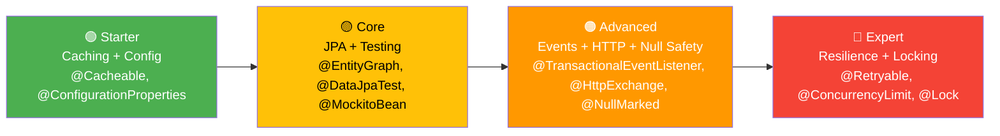

> 🧠 **Quick Recap of the mental model:** think of the 25 annotations as a *defense-in-depth stack*: annotations that keep **requests alive** (resilience), keep the **database fast and correct** (JPA, transactions, locking), keep your **code honest** (null safety, config), and keep your **tests fast** (test slices). We'll climb that stack in order.

---

## 🗺️ Overview Map

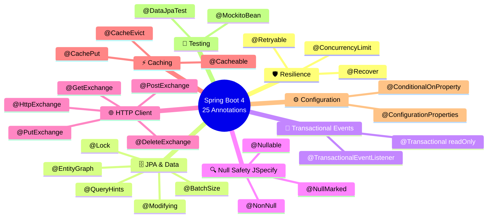

---

## Part 1 — Resilience Annotations 🛡️

**Difficulty: 🔴 Advanced** | **Annotations covered: `@Retryable`, `@Recover`, `@ConcurrencyLimit`**

External systems fail. Networks blip. Databases restart. Payment gateways throttle you. A resilient service doesn't pretend these things won't happen — it *expects* them and recovers automatically.

Spring Boot 4 gives you **two complementary toolkits** for this:

1. **Native Framework 7 resilience** (new in 7.0) — `org.springframework.resilience.annotation.*`, powered by `org.springframework.core.retry.RetryTemplate`. Zero extra dependencies. Enabled with `@EnableResilientMethods`.
2. **Classic Spring Retry** (`org.springframework.retry.annotation.*`) — the long-standing library, enabled with `@EnableRetry`, and the only one that offers the `@Recover` fallback method.

### ⚠️ Critical Warning — Two `@Retryable` Annotations Exist!

This is the single most common mistake with Boot 4 resilience. There are **two annotations named `@Retryable`** you might have on your classpath:

```java
// ✅ Framework 7 NATIVE — no extra dependency, enabled via @EnableResilientMethods
import org.springframework.resilience.annotation.Retryable;

// ✅ CLASSIC Spring Retry — needs spring-retry + spring-aspects, enabled via @EnableRetry
import org.springframework.retry.annotation.Retryable;

// ❌ WRONG — some other library's @Retryable will silently do nothing
//    inside the Spring context (no proxy, no retry, no error!)
import com.example.somelib.Retryable;
```

They have **different attribute names**, so the code does *not* port 1:1:

| Aspect | Native (Framework 7) | Classic (Spring Retry) |
|---|---|---|
| Package | `org.springframework.resilience.annotation` | `org.springframework.retry.annotation` |
| Enabler | `@EnableResilientMethods` | `@EnableRetry` |
| Exception filter | `includes` / `excludes` | `retryFor` / `noRetryFor` |
| Attempts | `maxAttempts` | `maxAttempts` |
| Backoff | flat attributes: `delay`, `multiplier`, `jitter`, `maxDelay`, `timeUnit` | nested `backoff = @Backoff(...)` |
| Placeholders/SpEL | ✅ (`delayString`, `limitString`, …) | ❌ (mostly literals) |
| Fallback method | ❌ (catch `RetryException`) | ✅ `@Recover` |
| Underlying engine | `org.springframework.core.retry.RetryTemplate` | Spring Retry's `RetryTemplate` |

> 💡 **Rule of thumb:** on a fresh Boot 4 project, prefer the **native** annotations. Reach for **Spring Retry** when you need `@Recover` fallback methods or you're migrating an existing Boot 2/3 service unchanged.

---

### Annotation 1 — `@Retryable`

`@Retryable` causes a method to be **automatically re-invoked** when it throws a specified exception. Both flavors support exponential backoff with **jitter** — random noise added to the delay — to prevent the **thundering herd problem**, where thousands of clients all retry at the same instant after an outage.

> 💡 **Analogy:** retry without jitter is like everyone in a stadium trying the same exit at once — the door jams again. Jitter spreads the crowd across all the exits.

#### Setup — Native (Framework 7)

```java
@SpringBootApplication
@EnableResilientMethods   // Activates native @Retryable + @ConcurrencyLimit
public class MyApplication {
    public static void main(String[] args) {
        SpringApplication.run(MyApplication.class, args);
    }
}
```

#### Setup — Classic (Spring Retry)

```xml
<dependency>
    <groupId>org.springframework.retry</groupId>
    <artifactId>spring-retry</artifactId>
</dependency>
<dependency>
    <groupId>org.springframework</groupId>
    <artifactId>spring-aspects</artifactId>
</dependency>
```

```java
@SpringBootApplication
@EnableRetry              // Activates Spring Retry's @Retryable + @Recover
public class MyApplication {
    public static void main(String[] args) {
        SpringApplication.run(MyApplication.class, args);
    }
}
```

#### Basic Example — Payment Gateway (Native)

```java
@Service
public class PaymentService {

    @Retryable(
        maxAttempts = 4,       // Total attempts (1 original + 3 retries)
        delay = 200,           // Initial wait: 200ms
        multiplier = 2.0,      // Next waits: 400ms → 800ms → 1600ms
        jitter = 100           // Add ±100ms of random noise per wait
    )
    public PaymentResponse processPayment(PaymentRequest request) {
        // May fail transiently due to network issues
        return externalPaymentGateway.charge(request);
    }
}
```

#### Basic Example — Same Intent with Classic Spring Retry

```java
import org.springframework.retry.annotation.Retryable;
import org.springframework.retry.annotation.Backoff;

@Service
public class PaymentServiceClassic {

    @Retryable(
        maxAttempts = 4,
        backoff = @Backoff(delay = 200, multiplier = 2.0, jitter = 100)
    )
    public PaymentResponse processPayment(PaymentRequest request) {
        return externalPaymentGateway.charge(request);
    }
}
```

#### Retry Timeline

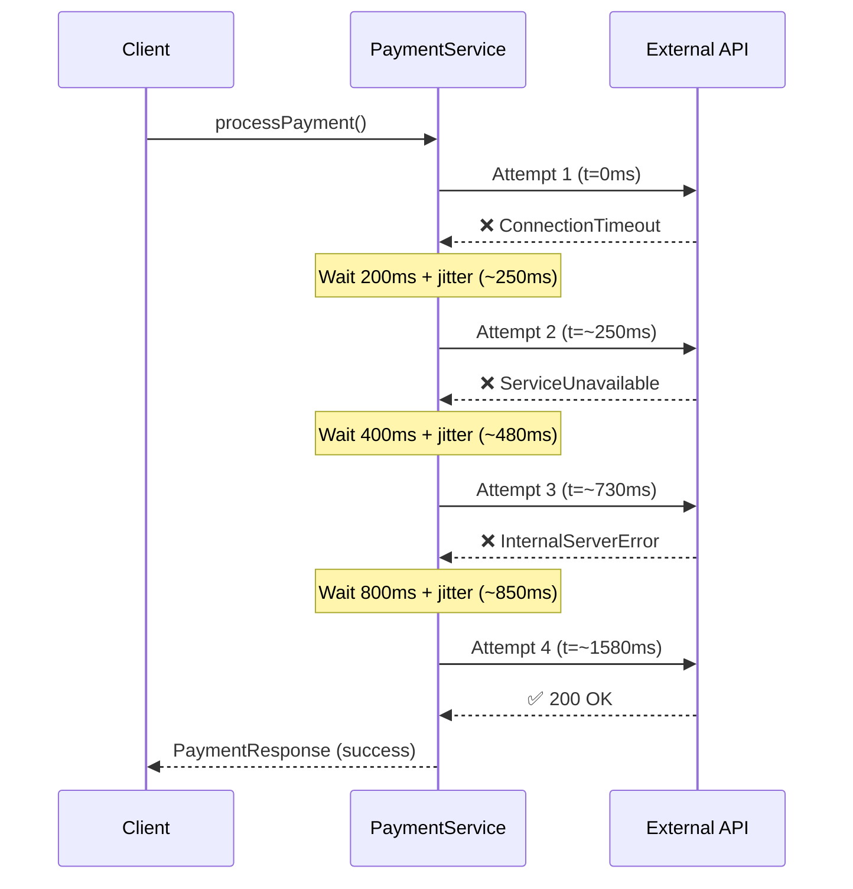

> 🧠 **Feynman check:** why not retry *everything* immediately 100 times? Because retries multiply load exactly when the failing system is weakest. Backoff gives the failing system time to breathe; a small `maxAttempts` bounds the blast radius; jitter keeps thousands of clients from syncing their retries.

#### Advanced — Retry Only on the Right Exceptions

Retrying a **validation error** is pointless — it will fail identically every time. Retry only *transient* failures:

```java
// Native (Framework 7) flavor
import org.springframework.resilience.annotation.Retryable;

@Retryable(
    includes = {
        HttpServerErrorException.class,   // 5xx errors — may succeed on retry
        ResourceAccessException.class     // Network timeouts
    },
    excludes = {
        HttpClientErrorException.class,   // 4xx errors — retrying won't help!
        IllegalArgumentException.class    // Bad input — deterministic failure
    },
    maxAttempts = 3,
    delay = 1000,
    multiplier = 2.0,
    jitter = 500
)
public UserProfile fetchUserProfile(String userId) {
    return userApiClient.getProfile(userId);
}
```

```java
// Classic (Spring Retry) flavor
import org.springframework.retry.annotation.Retryable;

@Retryable(
    retryFor = { HttpServerErrorException.class, ResourceAccessException.class },
    noRetryFor = { HttpClientErrorException.class, IllegalArgumentException.class },
    maxAttempts = 3,
    backoff = @Backoff(delay = 1000, multiplier = 2.0, jitter = 500)
)
public UserProfile fetchUserProfile(String userId) { ... }
```

#### Real-World Use Cases

| Scenario | Why `@Retryable` Helps |
|---|---|
| External payment gateway | Transient network glitches and 5xx blips |
| Database connection pool | Pool momentarily exhausted during a deploy |
| Message broker publish | Broker restarting during a rolling upgrade |
| Cloud storage upload | Rate-limited or transient timeout |
| Microservice health check | Dependency still starting up |

### Annotation 2 — `@Recover`

> ℹ️ **Availability:** `@Recover` belongs to **classic Spring Retry** (`org.springframework.retry.annotation.Recover`). The native Framework 7 annotations have no `@Recover` — when native retries are exhausted, the call throws `org.springframework.core.retry.RetryException` and you handle it in your own `catch` block (or translate it via an exception handler).

`@Recover` designates a **fallback method** called when all `@Retryable` attempts fail. Without it, the last exception propagates to the caller.

#### Pairing `@Recover` with `@Retryable`

```java
import org.springframework.retry.annotation.Retryable;
import org.springframework.retry.annotation.Recover;
import org.springframework.retry.annotation.Backoff;

@Service
public class PaymentService {

    @Retryable(maxAttempts = 3, backoff = @Backoff(delay = 500, multiplier = 2))
    public PaymentResponse processPayment(PaymentRequest request) {
        return externalGateway.charge(request);
    }

    // Signature contract: first param is the thrown exception type,
    // remaining params must MATCH the @Retryable method's parameters,
    // and the return type must match too.
    @Recover
    public PaymentResponse recoverPayment(Exception ex, PaymentRequest request) {
        log.error("All retries exhausted for payment: {}", request.getId(), ex);

        // Options: alert ops, queue for manual processing, graceful failure...
        notificationService.alertOpsTeam(request, ex);
        return PaymentResponse.failed(
            request.getId(),
            "Payment service temporarily unavailable. Please try again later."
        );
    }
}
```

#### Multiple `@Recover` Methods for Different Exceptions

```java
// More specific exception types are matched FIRST
@Recover
public PaymentResponse recoverFromTimeout(
        ResourceAccessException ex, PaymentRequest request) {
    return PaymentResponse.pending(request.getId(), "Will retry in background");
}

@Recover
public PaymentResponse recoverFromServerError(
        HttpServerErrorException ex, PaymentRequest request) {
    return PaymentResponse.failed(request.getId(), "Gateway error: " + ex.getMessage());
}

@Recover
public PaymentResponse recoverFromAnyError(Exception ex, PaymentRequest request) {
    return PaymentResponse.failed(request.getId(), "Unexpected error");
}
```

#### Retry + Recover Flow

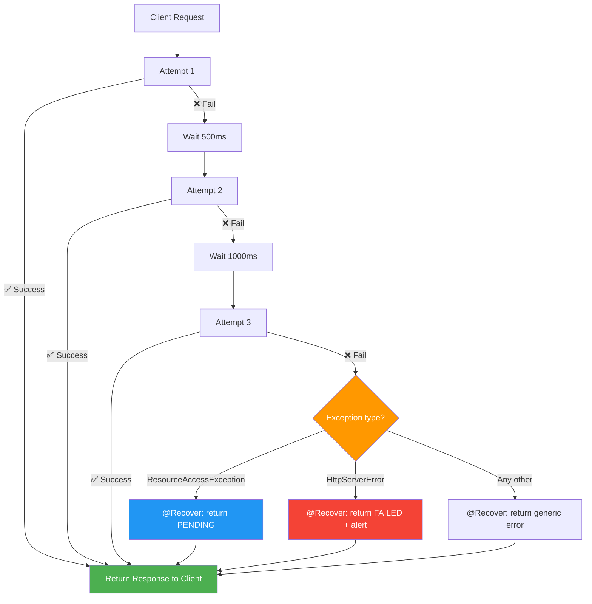

> ⚠️ **Common pitfall:** if the `@Recover` method's parameter list doesn't match the `@Retryable` method (after the leading exception), Spring Retry throws a confusing `IllegalStateException` at *call time*, not at startup. Write a test that forces exhaustion — Exercise 2 covers exactly this.

### Annotation 3 — `@ConcurrencyLimit`

`@ConcurrencyLimit` implements the **Bulkhead pattern** — it caps the number of concurrent executions of a method (or of all methods on a class), preventing thread pool starvation and cascading failures. Like a ship's bulkhead, it stops water (load) flooding one compartment from sinking the whole ship.

This annotation is **new in Spring Framework 7** and part of the **native** resilience family:

```java
import org.springframework.resilience.annotation.ConcurrencyLimit;
```

#### Example — CPU-Intensive Report Generation

```java
@Service
public class ReportService {

    // Only 4 reports can be generated simultaneously
    @ConcurrencyLimit(4)
    public Report generateReport(ReportRequest request) {
        return heavyReportEngine.generate(request); // Takes 5–30 seconds
    }
}
```

If 10 requests arrive simultaneously, 4 execute and 6 **block** waiting for a slot (the default `BLOCK` policy). If you'd rather fail fast, switch the policy:

```java
// Fail fast instead of queueing — since Framework 7.0.3
@ConcurrencyLimit(value = 4, policy = ConcurrencyLimit.ThrottlePolicy.REJECT)
public Report generateReport(ReportRequest request) { ... }
// Overflowing calls throw InvocationRejectedException
// (extends java.util.concurrent.RejectedExecutionException) → map it to HTTP 429
```

Handy attributes to know:

| Attribute | Meaning |
|---|---|
| `value` / `limit` | Max concurrent invocations (`1` = mutex per method; `-1` = unbounded) |
| `limitString` | Same, but supports `${...}` placeholders and SpEL — great for per-environment tuning |
| `policy` | `BLOCK` (default — queue the caller) or `REJECT` (throw `InvocationRejectedException`) |

> 💡 **Why this matters more than ever:** with **virtual threads** enabled (Boot 4 default posture on JDK 21+), you no longer have a small thread pool to act as a natural backpressure valve — you can have *millions* of concurrent requests hammering a downstream system. `@ConcurrencyLimit` is the modern replacement for that implicit protection.

#### Bulkhead Pattern Architecture

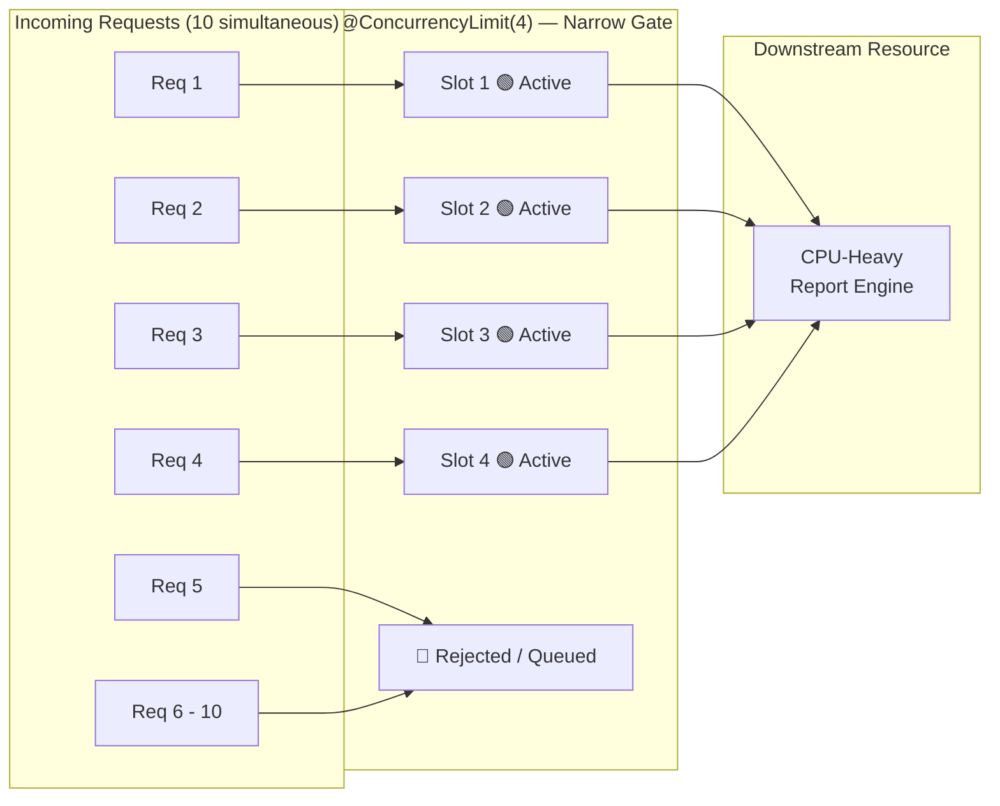

#### Combined Resilience Architecture

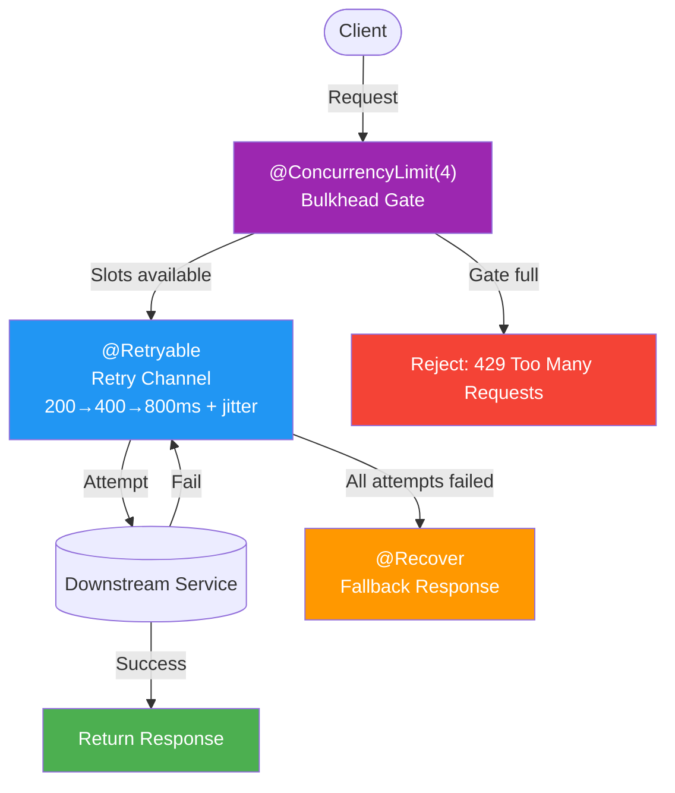

> 🧠 **Quick Recap — Part 1:** `@ConcurrencyLimit` protects *you* from too much work, `@Retryable` protects *each call* from transient failure, and `@Recover` (classic Spring Retry) protects *your users* from a raw stack trace when everything else fails. Apply them **outside-in**: bulkhead first, retry second, recover last.

---

## Part 2 — JPA & Data Annotations 🗄️

**Difficulty: 🟡–🟠 Intermediate→Advanced** | **Annotations: `@EntityGraph`, `@Modifying`, `@Lock`, `@QueryHints`, `@BatchSize`**

These annotations help you write efficient JPA queries and avoid the classic pitfalls that **silently** degrade performance — your app doesn't crash, it just gets slower every month as data grows.

### Annotation 4 — `@EntityGraph`

`@EntityGraph` solves the infamous **N+1 query problem** by fetching associated entities in a single JOIN query instead of firing a separate query per entity.

#### Understanding the N+1 Problem

Suppose you have `Order` → `List<Item>` → `Product` relationships:

```java
// ❌ BAD — Causes N+1 queries!
List<Order> orders = orderRepository.findAll();    // Query 1: SELECT orders

for (Order order : orders) {
    // Each access fires a NEW query!
    System.out.println(order.getItems().size());   // Queries 2 to N+1
}
```

With 100 orders: **101 SQL queries**. With 1,000 orders: **1,001 queries**. Your database is doing 10× the work it needs to, and your endpoints get slower as your dataset grows.

#### Solution with `@EntityGraph`

```java
@Repository
public interface OrderRepository extends JpaRepository<Order, Long> {

    // Fetch orders AND items AND products AND customer in ONE JOIN query
    @EntityGraph(attributePaths = {"items", "items.product", "customer"})
    List<Order> findAll();

    // Fetch only what a specific use case needs
    @EntityGraph(attributePaths = {"items"})
    Optional<Order> findWithItemsById(Long id);

    // Works with custom JPQL queries too
    @EntityGraph(attributePaths = {"customer", "items"})
    @Query("SELECT o FROM Order o WHERE o.status = :status")
    List<Order> findByStatus(@Param("status") OrderStatus status);
}
```

#### N+1 vs `@EntityGraph` SQL Comparison

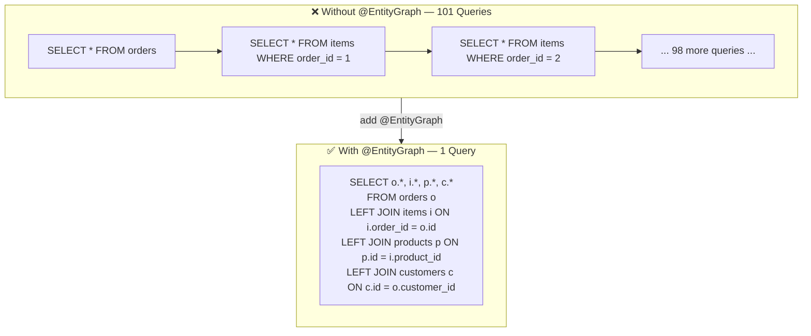

#### Named EntityGraph on the Entity

For reusable fetch plans, declare the graph once on the entity and reference it by name:

```java
@Entity
@NamedEntityGraph(
    name = "Order.withItemsAndCustomer",
    attributeNodes = {
        @NamedAttributeNode(value = "items", subgraph = "items"),
        @NamedAttributeNode("customer")
    },
    subgraphs = @NamedSubgraph(
        name = "items",
        attributeNodes = @NamedAttributeNode("product")
    )
)
public class Order {
    @Id
    @GeneratedValue
    private Long id;

    @ManyToOne(fetch = FetchType.LAZY)
    private Customer customer;

    @OneToMany(mappedBy = "order", fetch = FetchType.LAZY)
    private List<Item> items;

    private OrderStatus status;
}
```

```java
// Use the named graph in the repository
@EntityGraph("Order.withItemsAndCustomer")
List<Order> findByCustomerId(Long customerId);
```

> ⚠️ **Common trap — over-fetching:** every attribute in the graph widens the JOIN and the row payload. Fetching `items.product` when the endpoint only needs order totals *doubles your data transfer for nothing*. Define one graph per use case, not one "kitchen sink" graph.

> 💡 **Pagination caveat:** `@EntityGraph` uses a JOIN, so paginating collection graphs (`Pageable` + one-to-many joins) can return fewer rows than the page size because Hibernate must deduplicate in memory. For paginated one-to-many reads, prefer `@BatchSize` or two-step fetching instead.

### Annotation 5 — `@Modifying(clearAutomatically = true)`

Used together with `@Query` for bulk `UPDATE` or `DELETE` statements. The critical attribute is `clearAutomatically = true`, which clears the first-level (persistence context) cache after execution — preventing stale data reads.

#### The Stale Cache Trap

```java
// ❌ DANGEROUS — the persistence context holds OLD values after a bulk update
@Modifying
@Query("UPDATE Product p SET p.price = p.price * 1.1 WHERE p.category = :category")
int increasePriceByCategory(@Param("category") String category);

// After calling the above, reading products returns STALE prices from the L1 cache!
List<Product> products = productRepo.findByCategory("Electronics"); // ⚠️ OLD PRICES!
```

Why? JPQL bulk operations bypass the persistence context entirely — they hit the database directly. Any `Product` entities already loaded into memory are **not updated**, so subsequent reads within the same transaction return the stale, cached versions.

#### Safe Usage

```java
// ✅ CORRECT — clears the persistence context after the bulk operation
@Modifying(clearAutomatically = true)
@Query("UPDATE Product p SET p.price = p.price * 1.1 WHERE p.category = :category")
int increasePriceByCategory(@Param("category") String category);

// Now this returns FRESH data from the database ✅
List<Product> products = productRepo.findByCategory("Electronics");
```

#### With `flushAutomatically`

```java
@Modifying(
    clearAutomatically = true,   // Clear the L1 cache AFTER execution
    flushAutomatically = true    // Flush pending changes BEFORE execution
)
@Query("DELETE FROM AuditLog a WHERE a.createdAt < :cutoffDate")
int purgeOldAuditLogs(@Param("cutoffDate") LocalDate cutoffDate);
```

`flushAutomatically = true` ensures any pending unsaved entities are flushed to the database **before** the bulk DELETE runs — preventing accidental data loss (a pending insert whose rows match the DELETE's criteria would otherwise be silently ignored).

#### Persistence Context Lifecycle

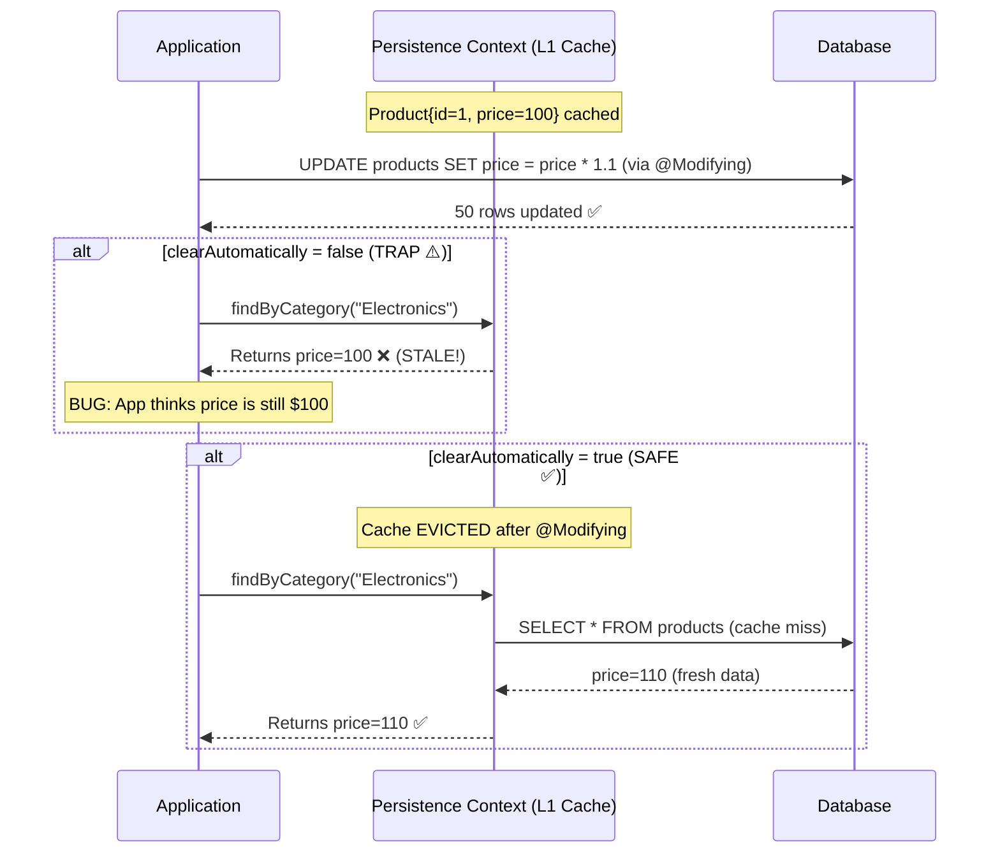

### Annotation 6 — `@Lock`

`@Lock` controls the JPA locking strategy at the repository level, essential for preventing **lost updates** in concurrent scenarios.

#### Lock Types

```java
@Repository
public interface AccountRepository extends JpaRepository<Account, Long> {

    // PESSIMISTIC_WRITE: SELECT ... FOR UPDATE — blocks all other
    // writers (and with most DBs, readers too) until your TX commits
    @Lock(LockModeType.PESSIMISTIC_WRITE)
    @Query("SELECT a FROM Account a WHERE a.id = :id")
    Optional<Account> findByIdWithWriteLock(@Param("id") Long id);

    // PESSIMISTIC_READ: shared lock — blocks writes, allows other reads
    @Lock(LockModeType.PESSIMISTIC_READ)
    @Query("SELECT a FROM Account a WHERE a.id = :id")
    Optional<Account> findByIdWithReadLock(@Param("id") Long id);

    // OPTIMISTIC: uses the @Version field; throws
    // OptimisticLockException (via ObjectOptimisticLockingFailureException in Spring)
    // on conflicting commits
    @Lock(LockModeType.OPTIMISTIC)
    Optional<Account> findById(Long id);
}
```

| Lock Mode | DB Behavior | Best For | Cost |
|---|---|---|---|
| `OPTIMISTIC` | No DB lock; version check at flush | Read-mostly data, low conflict | Near zero |
| `PESSIMISTIC_READ` | Shared lock | Prevent concurrent writes while reading | Moderate |
| `PESSIMISTIC_WRITE` | Exclusive lock (`FOR UPDATE`) | Read-modify-write sequences (money!) | High — but correct |

#### Optimistic Locking Entity

```java
@Entity
public class Account {
    @Id
    @GeneratedValue
    private Long id;

    private BigDecimal balance;

    @Version  // Hibernate increments this on each UPDATE
    private Long version;
}
```

#### Use Case — Safe Bank Transfer

```java
@Transactional
public TransferResult transfer(Long fromId, Long toId, BigDecimal amount) {
    // Lock both accounts — prevents concurrent transfer bugs
    Account from = accountRepo.findByIdWithWriteLock(fromId)
        .orElseThrow(() -> new AccountNotFoundException(fromId));
    Account to = accountRepo.findByIdWithWriteLock(toId)
        .orElseThrow(() -> new AccountNotFoundException(toId));

    if (from.getBalance().compareTo(amount) < 0) {
        throw new InsufficientFundsException(fromId);
    }

    from.debit(amount);
    to.credit(amount);
    accountRepo.saveAll(List.of(from, to));

    return TransferResult.success(from.getBalance(), to.getBalance());
    // Locks are released when the @Transactional boundary commits
}
```

> ⚠️ **Deadlock warning:** always acquire locks in a **consistent, deterministic order** (e.g., lock the lower account ID first). Transfer A→B in one thread and B→A in another with inconsistent ordering is the textbook deadlock recipe — each thread waits forever for the other's lock until the DB's deadlock detector kicks one of them out.
>
> ⚠️ **Lock scope warning:** `@Lock` only works while the transaction is active. Calling a locked finder *without* an enclosing `@Transactional` silently acquires and releases the lock immediately — giving you zero protection.

### Annotation 7 — `@QueryHints`

`@QueryHints` passes JPA provider hints (Hibernate-specific or standard) to fine-tune query behavior — read-only loading, fetch size, timeouts, and second-level cache participation.

```java
@Repository
public interface ReportRepository extends JpaRepository<Report, Long> {

    @QueryHints({
        @QueryHint(name = "org.hibernate.readOnly", value = "true"),            // No dirty check
        @QueryHint(name = "org.hibernate.fetchSize", value = "100"),            // JDBC batch fetch
        @QueryHint(name = "jakarta.persistence.query.timeout", value = "5000")  // 5s timeout
    })
    @Query("SELECT r FROM Report r WHERE r.generatedAt > :since ORDER BY r.generatedAt DESC")
    List<Report> findRecentReports(@Param("since") LocalDateTime since);

    // Second-level cache hint
    @QueryHints(@QueryHint(name = "org.hibernate.cacheable", value = "true"))
    List<Report> findByType(ReportType type);
}
```

> ⚠️ **Common trap:** hints are **provider-specific**. `org.hibernate.readOnly` means nothing on EclipseLink. If you switch providers, these hints are silently ignored — wrap them behind repository methods and document them.

### Annotation 8 — `@BatchSize`

`@BatchSize` controls how Hibernate batches lazy-loaded collections (and entity lookups), dramatically reducing query count without a full JOIN.

```java
@Entity
public class Department {
    @Id
    private Long id;
    private String name;

    // Without @BatchSize: 1 query per department = N+1
    // With @BatchSize(25): departments are loaded in batches of 25
    @OneToMany(mappedBy = "department", fetch = FetchType.LAZY)
    @BatchSize(size = 25)
    private List<Employee> employees;
}
```

**Effect:** loading employees of 100 departments fires **4 queries** (`100/25`) instead of **100**. The batches are driven by the IDs already in your persistence context, so the very next lazy access pulls in 25 parents' worth of children at once.

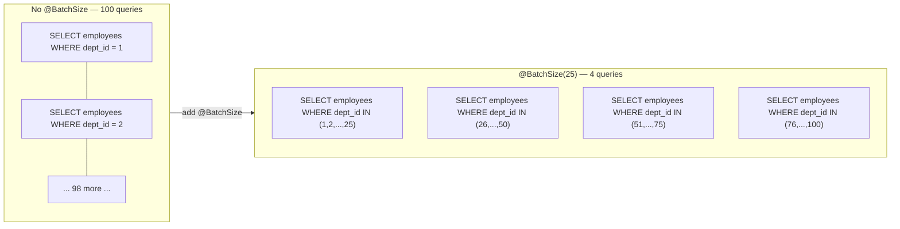

> 💡 **Global alternative:** instead of annotating each collection, set `spring.jpa.properties.hibernate.default_batch_fetch_size=25` in `application.yml` — a great org-wide default that pairs well with targeted `@EntityGraph`s.

| When to use | `@EntityGraph` | `@BatchSize` |
|---|---|---|
| Known, fixed access path for one query | ✅ Best (1 query) | ➖ |
| Lazy collections accessed "sometimes, in bulk" | ➖ | ✅ Best |
| Paginated one-to-many lists | ⚠️ (JOIN breaks paging) | ✅ |

> 🧠 **Quick Recap — Part 2:** kill N+1 at the query level with `@EntityGraph`, at the collection level with `@BatchSize`; run safe bulk statements with `@Modifying(clearAutomatically = true, flushAutomatically = true)`; tune per-query behavior with `@QueryHints`; and protect concurrent read-modify-write flows with `@Lock`.

---

## Part 3 — Transactional Event Annotations 📨

**Difficulty: 🟠 Advanced** | **Annotations: `@TransactionalEventListener`, `@Transactional(readOnly = true)`**

### Annotation 9 — `@TransactionalEventListener`

This annotation binds event processing to a **transaction lifecycle phase**, preventing a subtle and dangerous class of bugs.

#### The Classic Bug — Plain `@EventListener`

```java
// ❌ DANGEROUS — fires DURING the transaction, NOT after commit
@EventListener
public void onOrderPlaced(OrderPlacedEvent event) {
    // Email sent HERE, but the transaction might still ROLLBACK!
    emailService.sendConfirmation(event.getOrder());
}
```

**The bug:** if the transaction rolls back (e.g., an inventory check fails after the event fires), the customer receives a confirmation email for an order that was **never saved**. Good luck explaining that to support — and worse, undoing a confirmation email is impossible.

#### Correct — `AFTER_COMMIT`

```java
// ✅ SAFE — fires only after the transaction has committed successfully
@TransactionalEventListener(phase = TransactionPhase.AFTER_COMMIT)
public void onOrderPlaced(OrderPlacedEvent event) {
    emailService.sendOrderConfirmation(event.getOrder());
    inventoryService.reserveStock(event.getOrder());
    analyticsService.trackPurchase(event.getOrder());
}
```

> 💡 **Good to know:** `AFTER_COMMIT` is the **default** phase — `@TransactionalEventListener` with no attributes already behaves correctly. Many developers don't know this and assume they must always add `phase = ...`; adding it explicitly for readability is fine.

#### Transaction Phase Options

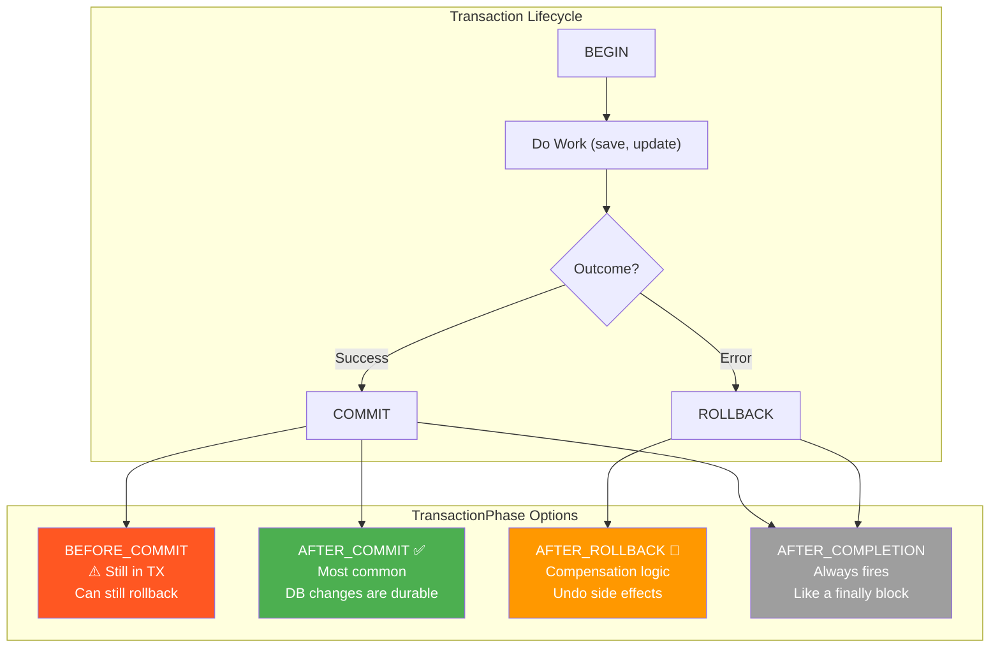

#### Publishing Events and the Full Flow

```java
@Service
@RequiredArgsConstructor
public class OrderService {

    private final OrderRepository orderRepository;
    private final ApplicationEventPublisher eventPublisher;

    @Transactional
    public Order placeOrder(OrderRequest request) {
        // 1. Create and save the order
        Order order = new Order(request);
        orderRepository.save(order);

        // 2. Publish event — the AFTER_COMMIT listener will NOT fire yet
        eventPublisher.publishEvent(new OrderPlacedEvent(this, order));

        // 3. More transactional work that might still fail...
        inventoryRepository.reserve(order.getItems());

        return order;
        // 4. Transaction COMMITS here → NOW the listener fires
    }
}
```

```java
// Event class
public record OrderPlacedEvent(Object source, Order order) { }
```

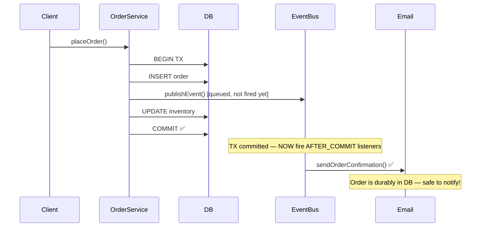

> ⚠️ **Two AFTER_COMMIT traps:**
> 1. **The default-rollback trap:** the listener runs *outside* the original transaction (it's already committed). If the listener opens its own `@Transactional` method with the default `Propagation.REQUIRED`, Spring joins the *completed* transaction's resources and writes are **silently not committed**. Always use `@Transactional(propagation = Propagation.REQUIRES_NEW)` inside an AFTER_COMMIT listener that writes to the DB.
> 2. **The silent-entity trap:** lazy associations of the event's entity may throw `LazyInitializationException` in the listener, because the persistence context is closed after commit. Pass IDs/DTOs in the event, not live entities.

> 💡 **When there's no transaction at all:** by default, `@TransactionalEventListener` **does not fire** if no transaction is active. Set `fallbackExecution = true` if you want the listener to run immediately in that case.

### Annotation 10 — `@Transactional(readOnly = true)`

Marks a transaction as read-only, enabling Hibernate to skip dirty checking and allowing the JDBC driver/database to optimize for reads.

```java
@Service
public class ProductQueryService {

    // ✅ Read-only: no dirty checking, may route to a read replica
    @Transactional(readOnly = true)
    public List<ProductDTO> listByCategory(String category) {
        return productRepository.findByCategory(category)
            .stream()
            .map(productMapper::toDTO)
            .toList();
    }

    // Write: default (readOnly = false)
    @Transactional
    public Product createProduct(CreateProductRequest request) {
        return productRepository.save(new Product(request));
    }
}
```

**Benefits of `readOnly = true`:**

- Hibernate skips first-level cache dirty checking at flush time (saves CPU on large result sets)
- Spring can route to a **read replica** if you've configured routing (`AbstractRoutingDataSource` or a proxy like PgBouncer/AWS RDS reader endpoints)
- Forces explicit intent — readers can never accidentally write
- PostgreSQL sets `SET TRANSACTION READ ONLY`, letting the DB reject accidental writes and apply additional optimizations

> ⚠️ **Common trap:** writes inside a read-only transaction don't always fail loudly. Hibernate may throw `HibernateException` on flush, but simple JDBC writes can slip through depending on driver and configuration — treat `readOnly = true` as an *optimization + intent declaration*, not a security boundary. Real enforcement belongs at the DB/user-permission level.

> 🧠 **Quick Recap — Part 3:** publish events *inside* the transaction, consume them *after* the commit with `@TransactionalEventListener` (use `REQUIRES_NEW` if the listener writes), and annotate every read-only service method with `@Transactional(readOnly = true)` — it's free performance and free intent documentation.

---

## Part 4 — JSpecify Null Safety 🔍

**Difficulty: 🟠 Intermediate→Advanced** | **Annotations: `@NullMarked`, `@NonNull`, `@Nullable`**

Spring Boot 4 (via Spring Framework 7) adopts **JSpecify** as its standard for static null analysis — the entire Framework 7 codebase is annotated with it. These annotations let you eliminate `NullPointerException` at **compile time** (via IDE inspection, ErrorProne, or NullAway) rather than discovering them at 3 AM in production.

> 📜 **Historical context:** before JSpecify, Java null-safety annotations were a zoo — `javax.annotation.Nullable`, `org.jetbrains.annotations.Nullable`, `org.checkerframework.checker.nullness.qual.Nullable`, Spring's own `org.springframework.lang.Nullable`… all incompatible. JSpecify (backed by Google, JetBrains, Kotlin, and Spring among others) is the industry-standard unification, and Spring Framework 7 is its first big production adopter.

### Annotation 11 — `@NullMarked`

Marks an **entire package or type** as null-safe. Inside a `@NullMarked` scope, all types are implicitly `@NonNull` unless explicitly marked `@Nullable`.

```java
// ✅ Place in package-info.java to cover the entire package
@NullMarked
package com.example.service;

import org.jspecify.annotations.NullMarked;
```

Or apply to a specific class:

```java
@NullMarked
public class OrderService {
    // All params and returns are NonNull by default
    public Order createOrder(OrderRequest request) { ... }

    public Order findById(Long id) { ... }  // NonNull — must not return null
}
```

> 💡 **Best practice:** annotate at the **package level** (`package-info.java`), not per class. Null safety is a *zone* concept — mixing annotated and unannotated code inside a package defeats the analysis.

### Annotation 12 — `@NonNull`

Explicitly marks a parameter, field, or return type as **never null**. Useful *outside* a `@NullMarked` context to opt specific elements in.

```java
import org.jspecify.annotations.NonNull;

public class EmailService {

    // Contract: all params must be non-null; return is non-null
    public @NonNull SendResult send(
        @NonNull String recipient,
        @NonNull String subject,
        @NonNull String body
    ) {
        Objects.requireNonNull(recipient, "recipient must not be null");
        return mailer.send(recipient, subject, body);
    }
}
```

> ⚠️ **Reality check:** `@NonNull` is a *contract*, not runtime enforcement. It only protects you when a static analysis tool (IDE, NullAway, ErrorProne) reads it. The `Objects.requireNonNull` guard adds a runtime backstop for boundary code.

### Annotation 13 — `@Nullable`

Inside a `@NullMarked` scope, `@Nullable` opts a specific element **back to nullable**. Use it to signal that callers must perform a null check.

```java
@NullMarked
public class UserRepository {

    // Explicit nullable return — IDE/compiler warns if the caller ignores null
    public @Nullable User findByEmail(String email) {
        return jdbcTemplate.queryForObject(
            "SELECT * FROM users WHERE email = ?",
            userRowMapper, email
        );
        // Returns null if not found
    }

    // NonNull by default (from @NullMarked)
    public User findById(Long id) {
        return jdbcTemplate.queryForObject(...); // Must not return null
    }
}
```

#### Null Safety Enforcement Flow

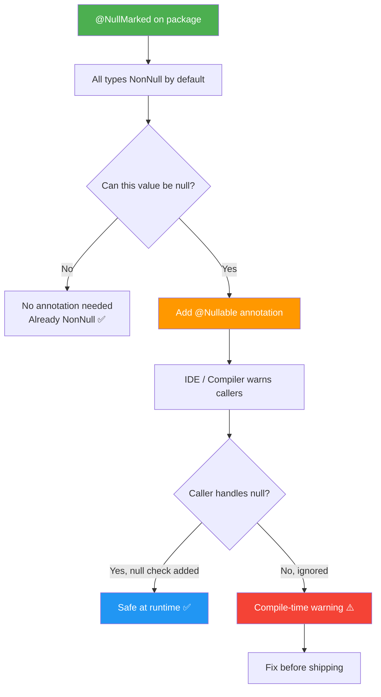

#### Before and After JSpecify

```java
// ❌ BEFORE — NullPointerException lurking at runtime
public String getUserEmail(Long userId) {
    User user = userRepository.findById(userId); // Might be null
    return user.getEmail(); // NullPointerException in production!
}

// ✅ AFTER — null safety enforced at compile time
@NullMarked
public class UserService {

    public String getUserEmail(Long userId) {
        @Nullable User user = userRepository.findById(userId);
        if (user == null) {
            throw new UserNotFoundException(userId);
        }
        return user.getEmail(); // Guaranteed non-null ✅
    }
}
```

> 💡 **Migration tip for teams:** adopt `@NullMarked` **package by package**, starting with leaf packages (DTOs, utilities, domain). It's incremental — you do not need to annotate the whole codebase in one PR. Also prefer returning `Optional<T>` (or an empty collection) over `@Nullable` returns for *finders* — it makes the contract impossible to ignore.

> 🧠 **Quick Recap — Part 4:** `@NullMarked` flips the default to "everything is non-null," `@Nullable` carves out explicit exceptions, and `@NonNull` is mostly for unmarked zones. Pair the annotations with a static analysis gate in CI to actually get the value.

---

## Part 5 — Declarative HTTP Client Annotations 🌐

**Difficulty: 🟡–🟠 Intermediate** | **Annotations: `@HttpExchange`, `@GetExchange`, `@PostExchange`, `@PutExchange`, `@DeleteExchange`**

Spring 6+ introduced declarative HTTP clients via annotated interfaces. Spring Boot 4 makes these a first-class replacement for Feign and RestTemplate — typed, testable, and zero boilerplate.

### Annotations 14–18 — `@HttpExchange` and Friends

Define a complete REST client as a plain Java interface:

```java
import org.springframework.web.service.annotation.GetExchange;
import org.springframework.web.service.annotation.PostExchange;
import org.springframework.web.service.annotation.PutExchange;
import org.springframework.web.service.annotation.DeleteExchange;
import org.springframework.web.service.annotation.HttpExchange;

@HttpExchange("/v1")   // Base path shared by all methods
public interface StripeClient {

    @GetExchange("/customers/{customerId}")
    StripeCustomer getCustomer(@PathVariable String customerId);

    @GetExchange("/customers")
    StripeCustomerList listCustomers(
        @RequestParam int limit,
        @RequestParam String startingAfter
    );

    @PostExchange("/customers")
    StripeCustomer createCustomer(@RequestBody CreateCustomerRequest request);

    @PostExchange("/payment_intents")
    PaymentIntent createPaymentIntent(@RequestBody PaymentIntentRequest request);

    @PutExchange("/customers/{customerId}")
    StripeCustomer updateCustomer(
        @PathVariable String customerId,
        @RequestBody UpdateCustomerRequest request
    );

    @DeleteExchange("/customers/{customerId}")
    DeletedResource deleteCustomer(@PathVariable String customerId);
}
```

> 💡 **Design tip:** put only the *path* on `@HttpExchange` and configure the *base URL* in the client factory (below). That way the same interface works against test doubles, staging, and production.

#### Configuration — Register the Client Bean

```java
@Configuration
public class HttpClientConfig {

    @Bean
    public StripeClient stripeClient(
        @Value("${stripe.api-key}") String apiKey,
        RestClient.Builder builder
    ) {
        RestClient restClient = builder
            .baseUrl("https://api.stripe.com/v1")
            .defaultHeader(HttpHeaders.AUTHORIZATION, "Bearer " + apiKey)
            .defaultHeader(HttpHeaders.CONTENT_TYPE, MediaType.APPLICATION_JSON_VALUE)
            .build();

        HttpServiceProxyFactory factory = HttpServiceProxyFactory
            .builderFor(RestClientAdapter.create(restClient))
            .build();

        return factory.createClient(StripeClient.class);
    }
}
```

> 💡 **Shortcut:** Spring Boot 4 auto-detects HTTP interface clients annotated on `@Bean` methods, and `RestClient.Builder` is auto-configured — so this factory method is typically all the configuration you need.

#### Inject and Use

```java
@Service
@RequiredArgsConstructor
public class PaymentService {

    private final StripeClient stripeClient;

    public PaymentResult charge(String customerId, BigDecimal amount) {
        PaymentIntentRequest request = new PaymentIntentRequest(
            amount.movePointRight(2).longValue(), // Stripe uses cents
            "usd",
            customerId
        );
        PaymentIntent intent = stripeClient.createPaymentIntent(request);
        return PaymentResult.fromIntent(intent);
    }
}
```

#### `@HttpExchange` vs. the Old Approaches

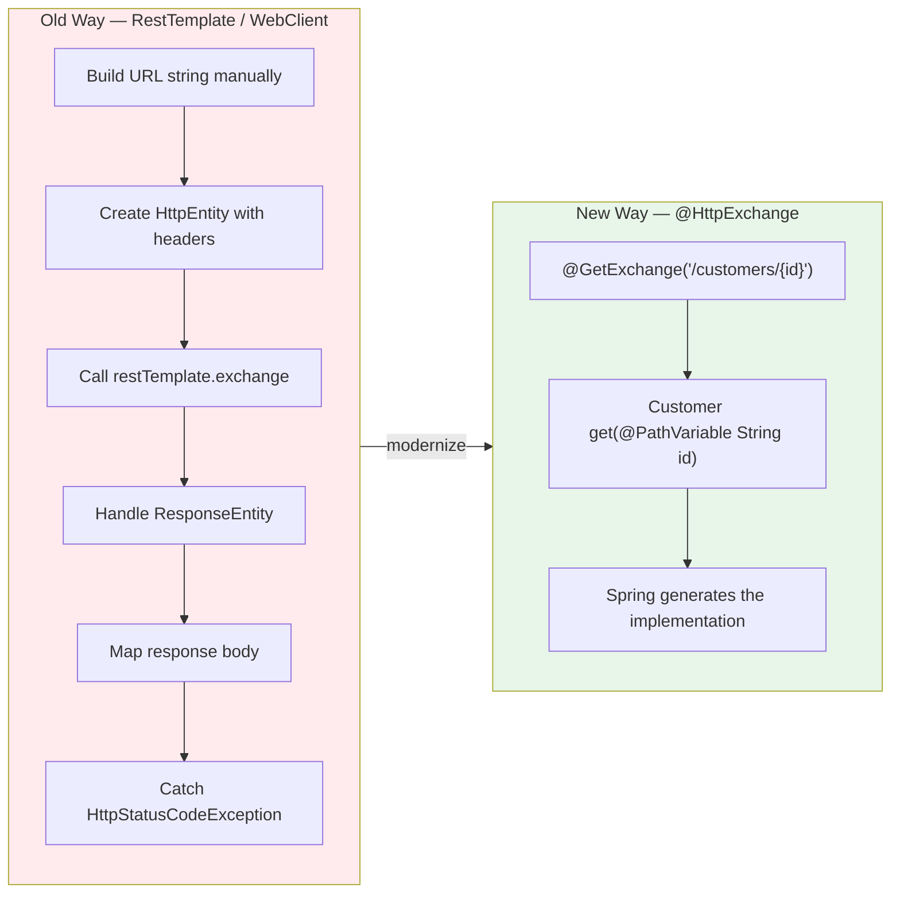

#### Feign → `@HttpExchange` Migration

```java
// Old — OpenFeign (requires an extra dependency)
@FeignClient(name = "inventory", url = "${inventory.service.url}")
public interface InventoryClient {
    @RequestMapping(method = RequestMethod.GET, value = "/stock/{productId}")
    StockLevel getStock(@PathVariable("productId") Long productId);

    @RequestMapping(method = RequestMethod.POST, value = "/reserve")
    ReservationResult reserve(@RequestBody ReservationRequest request);
}
```

```java
// New — @HttpExchange (built into Spring, no extra dependency)
@HttpExchange("/inventory")   // base URL comes from configuration
public interface InventoryClient {
    @GetExchange("/stock/{productId}")
    StockLevel getStock(@PathVariable Long productId);

    @PostExchange("/reserve")
    ReservationResult reserve(@RequestBody ReservationRequest request);
}
```

> ⚠️ **Common traps:**
> - **Path variables must match exactly** — `{productId}` in the template and a `@PathVariable Long productId` parameter; a name mismatch throws at runtime.
> - The interface method is backed by a **proxy created at startup** — you cannot inject the interface without registering the factory bean (unless using Boot's auto-configuration with `@ImportHttpServices` / interface scanning).
> - Request/response bodies must be (de)serializable by your configured `HttpMessageConverters` — records are perfect for this.
> - Consider wrapping the client with `@Retryable` (Part 1) — declarative clients pair beautifully with the resilience annotations.

> 🧠 **Quick Recap — Part 5:** the `@HttpExchange` family turns HTTP clients into typed interfaces — Feign-like ergonomics with zero extra dependencies and full Spring test support.

---

## Part 6 — Caching Annotations ⚡

**Difficulty: 🟢–🟡 Beginner→Intermediate** | **Annotations: `@Cacheable`, `@CacheEvict`, `@CachePut`**

### Annotation 19 — `@Cacheable`

Caches method return values. Subsequent calls with the same key return the cached result **without executing the method body**.

```java
@Service
public class ProductService {

    // Cache by product ID
    @Cacheable(value = "products", key = "#id")
    public ProductDTO getProduct(Long id) {
        log.info("Fetching product {} from database", id);  // Only on cache MISS
        return productRepository.findById(id)
            .map(productMapper::toDTO)
            .orElseThrow(() -> new ProductNotFoundException(id));
    }

    // Complex SpEL-based cache key
    @Cacheable(
        value = "product-search",
        key = "#query.toLowerCase() + ':' + #category + ':' + #page",
        condition = "#query.length() > 2",     // Only cache if query > 2 chars
        unless = "#result.content.isEmpty()"   // Never cache empty results
    )
    public Page<ProductDTO> search(String query, String category, int page) {
        return productRepository.search(query, category, PageRequest.of(page, 20))
            .map(productMapper::toDTO);
    }

    // TTL is configured on the CacheManager (see below)
    @Cacheable(value = "product-stats", key = "#category")
    public CategoryStats getStats(String category) {
        return statsService.computeForCategory(category);
    }
}
```

#### Redis Cache Manager Configuration (TTL per cache)

```java
@Configuration
@EnableCaching   // Mandatory — without it, @Cacheable does nothing!
public class CacheConfig {

    @Bean
    public RedisCacheManager cacheManager(RedisConnectionFactory factory) {
        RedisCacheConfiguration defaultConfig = RedisCacheConfiguration
            .defaultCacheConfig()
            .entryTtl(Duration.ofMinutes(10))
            .serializeValuesWith(
                RedisSerializationContext.SerializationPair
                    .fromSerializer(new GenericJackson2JsonRedisSerializer())
            );

        return RedisCacheManager.builder(factory)
            .cacheDefaults(defaultConfig)
            .withCacheConfiguration("products",
                defaultConfig.entryTtl(Duration.ofHours(1)))
            .withCacheConfiguration("product-stats",
                defaultConfig.entryTtl(Duration.ofMinutes(5)))
            .build();
    }
}
```

> ⚠️ **SpEL gotcha:** `condition` is evaluated **before** the method runs (it decides *whether to look up the cache*), while `unless` is evaluated **after** (it decides *whether to store the result*). Mixing them up is a classic review-comment: `#result` is only available in `unless`.

### Annotation 20 — `@CacheEvict`

Removes entries from the cache, keeping the cache consistent with the database.

```java
@Service
public class ProductService {

    // Evict a single entry on delete
    @CacheEvict(value = "products", key = "#id")
    public void deleteProduct(Long id) {
        productRepository.deleteById(id);
    }

    // Evict ALL entries when a bulk operation runs
    @CacheEvict(value = {"products", "product-search", "product-stats"},
                allEntries = true)
    @Scheduled(cron = "0 0 2 * * *")  // 2 AM daily
    public void refreshProductCache() {
        log.info("Scheduled cache eviction for products");
    }

    // Evict BEFORE the method runs (ensures no stale reads during execution)
    @CacheEvict(value = "user-sessions", key = "#userId", beforeInvocation = true)
    public void revokeSession(Long userId) {
        sessionRepository.invalidate(userId);
    }
}
```

> 💡 **Why `beforeInvocation`?** By default eviction happens *after* the method returns — if the method throws, the stale entry stays cached. For security-sensitive invalidation (like revoking a session), evict **first**, so a failure can't leave an old value in place.

### Annotation 21 — `@CachePut`

**Always executes the method** AND updates the cache with the result. Perfect for keeping the cache warm after a write operation.

```java
@Service
public class ProductService {

    @Cacheable(value = "products", key = "#id")
    public ProductDTO getProduct(Long id) { ... }

    // Always runs + updates the cache so the next getProduct() is a cache HIT
    @CachePut(value = "products", key = "#result.id")
    public ProductDTO updateProduct(Long id, UpdateProductRequest request) {
        Product product = productRepository.findById(id)
            .orElseThrow(() -> new ProductNotFoundException(id));
        productMapper.applyUpdate(product, request);
        Product saved = productRepository.save(product);
        return productMapper.toDTO(saved);
    }
}
```

#### Full Caching Lifecycle

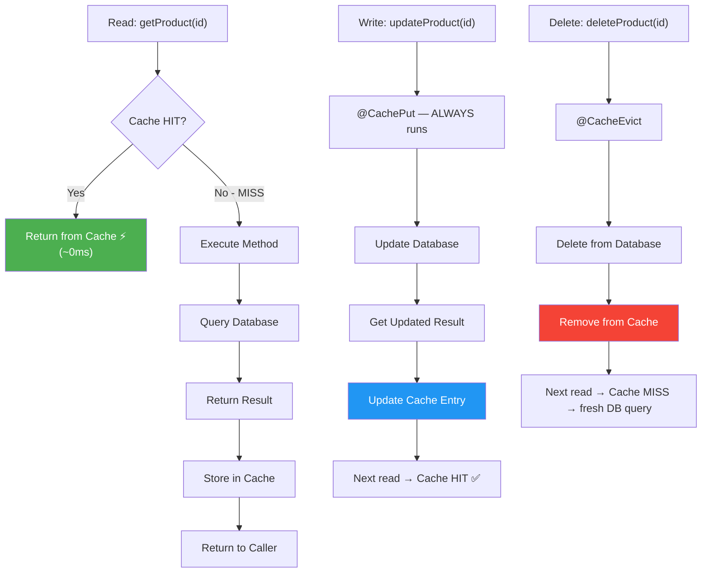

> ⚠️ **`@CachePut` vs `@Cacheable`:** `@CachePut` is *not* a conditional cache — it **always** runs the method. Putting `@CachePut` on a read method effectively disables caching for it. And never put both `@Cacheable` and `@CachePut` on the same method; the behavior is undefined-ish and confusing.

> 🧠 **Quick Recap — Part 6:** `@Cacheable` for reads, `@CachePut` for read-after-warm writes, `@CacheEvict` for deletes and bulk refreshes — plus a `CacheManager` with sensible per-cache TTLs. Don't forget `@EnableCaching`!

---

## Part 7 — Configuration Annotations ⚙️

**Difficulty: 🟢–🟡 Beginner→Intermediate** | **Annotations: `@ConditionalOnProperty`, `@ConfigurationProperties`**

### Annotation 22 — `@ConditionalOnProperty`

Conditionally registers a Spring bean based on the presence and value of an application property. The foundation of **feature flags** in Spring Boot.

```java
@Configuration
public class NotificationConfig {

    // Created only when notifications.email.enabled=true
    @Bean
    @ConditionalOnProperty(
        name = "notifications.email.enabled",
        havingValue = "true"
    )
    public EmailNotificationService emailNotificationService(
        JavaMailSender mailSender,
        TemplateEngine templateEngine
    ) {
        return new SmtpEmailNotificationService(mailSender, templateEngine);
    }

    // Created unless explicitly set to false (default: enabled)
    @Bean
    @ConditionalOnProperty(
        name = "notifications.sms.enabled",
        havingValue = "true",
        matchIfMissing = true   // If the property is absent, create the bean
    )
    public SmsNotificationService smsNotificationService(SmsGateway gateway) {
        return new TwilioSmsNotificationService(gateway);
    }

    // Feature flag: new algorithm only with explicit opt-in
    @Bean
    @ConditionalOnProperty("features.new-recommendation-engine")
    public RecommendationEngine newRecommendationEngine() {
        return new MLRecommendationEngine();
    }

    // Fallback bean for when the flag is off
    @Bean
    @ConditionalOnMissingBean(RecommendationEngine.class)
    public RecommendationEngine legacyRecommendationEngine() {
        return new RulesBasedRecommendationEngine();
    }
}
```

#### application.yml

```yaml
notifications:
  email:
    enabled: true
  sms:
    enabled: false

features:
  new-recommendation-engine: false   # Disabled until the A/B test completes
  dark-mode: true
```

> ⚠️ **Common trap:** `matchIfMissing` defaults to `false`. Without it, a missing property means the bean is **silently never created** — usually surfacing later as a `NoSuchBeanDefinitionException` at injection time, far from the config that caused it. Decide explicitly whether "not configured" should mean on or off.

> ⚠️ **Startup-time, not runtime:** `@ConditionalOnProperty` is evaluated **once at startup**. You cannot flip the flag without restarting. For runtime-toggleable flags without a restart, use `@ConfigurationProperties` re-binding (e.g., Spring Cloud `@RefreshScope`), or read the property dynamically via `Environment`.

### Annotation 23 — `@ConfigurationProperties`

Binds a group of related properties to a strongly-typed Java record or class, with built-in validation support.

```java
@ConfigurationProperties(prefix = "payment")
@Validated
public record PaymentProperties(
    @NotBlank String apiKey,
    @URL String baseUrl,
    @Min(1) @Max(10) int maxRetries,
    @NotNull Duration timeout,
    @Valid RetryConfig retry
) {
    public record RetryConfig(
        @Min(1) @Max(5) int maxAttempts,
        @Min(100) @Max(10_000) long initialDelayMs,
        @DecimalMin("1.0") @DecimalMax("3.0") double multiplier
    ) {}
}
```

```yaml
payment:
  api-key: ${PAYMENT_API_KEY}      # Injected from an environment variable
  base-url: https://api.stripe.com
  max-retries: 3
  timeout: 30s                     # Relaxed binding: maps to Duration
  retry:
    max-attempts: 4
    initial-delay-ms: 200
    multiplier: 2.0
```

```java
// Register as a Spring bean (choose ONE of these approaches):

// Option A — enable it from any @Configuration class
@Configuration
@EnableConfigurationProperties(PaymentProperties.class)
public class PaymentConfig { }

// Option B — annotate the application class
@SpringBootApplication
@ConfigurationPropertiesScan   // Scans for @ConfigurationProperties classes
public class MyApplication {
    public static void main(String[] args) {
        SpringApplication.run(MyApplication.class, args);
    }
}
```

```java
// Then inject it — no @Value scatter, full IDE navigation, built-in docs
@Service
@RequiredArgsConstructor
public class PaymentGateway {

    private final PaymentProperties props;

    public PaymentResponse charge(ChargeRequest request) {
        return restClient
            .post()
            .uri(props.baseUrl() + "/charge")
            .header("Authorization", "Bearer " + props.apiKey())
            .body(request)
            .retrieve()
            .body(PaymentResponse.class);
    }
}
```

> 💡 **Why records + `@Validated`:** records give you immutability and a compact constructor; `@Validated` + Jakarta Validation annotations make a **missing or out-of-range property fail the app at startup** with a precise message — instead of letting `maxRetries=0` silently disable retries in production.

> ⚠️ **Common trap:** forgetting `@EnableConfigurationProperties`/`@ConfigurationPropertiesScan` means the bean is never registered, and injection fails with `NoSuchBeanDefinitionException`. Also note the annotation uses the **constructor binding** automatically for records — no setters needed.

> 🧠 **Quick Recap — Part 7:** use `@ConditionalOnProperty` for *which beans exist* (feature flags, integrations on/off) and `@ConfigurationProperties` for *how they're configured* (typed, validated, grouped). Together they replace hundreds of scattered `@Value("${...}")` expressions.

---

## Part 8 — Testing Annotations 🧪

**Difficulty: 🟡 Intermediate** | **Annotations: `@DataJpaTest`, `@MockitoBean`**

### Annotation 24 — `@DataJpaTest`

Bootstraps only the JPA layer — entities, repositories, and the persistence context — with an in-memory database by default. Much faster than `@SpringBootTest` (which starts the whole application, including the web server).

```java
@DataJpaTest  // Uses H2 in-memory DB by default; rolls back after each test
class OrderRepositoryTest {

    @Autowired
    private OrderRepository orderRepository;

    @Autowired
    private TestEntityManager em;  // Thin JPA wrapper for test setup

    @Test
    void shouldFindPendingOrdersByCustomerEmail() {
        // Arrange — set up test data
        Customer customer = em.persist(
            Customer.builder().email("alice@example.com").name("Alice").build()
        );
        em.persist(
            Order.builder().customer(customer).status(PENDING)
                .total(BigDecimal.valueOf(49.99)).build()
        );
        em.persist(
            Order.builder().customer(customer).status(SHIPPED)
                .total(BigDecimal.valueOf(99.99)).build()
        );
        em.flush();

        // Act
        List<Order> pending = orderRepository
            .findByCustomerEmailAndStatus("alice@example.com", PENDING);

        // Assert
        assertThat(pending)
            .hasSize(1)
            .first()
            .extracting(Order::getStatus)
            .isEqualTo(PENDING);
    }

    @Test
    void entityGraphShouldFetchOrdersInOneQuery() {
        // Arrange
        Customer c = em.persist(
            Customer.builder().email("bob@example.com").build()
        );
        Order order = em.persist(
            Order.builder().customer(c).status(CONFIRMED).build()
        );
        em.persist(Item.builder().order(order).productId(1L).quantity(2).build());
        em.persist(Item.builder().order(order).productId(2L).quantity(1).build());
        em.flush();
        em.clear();  // Clear L1 cache so the EntityGraph must hit the DB

        // Act
        List<Order> orders = orderRepository.findAllWithItems();  // @EntityGraph

        // Assert — items are loaded (no LazyInitializationException)
        assertThat(orders).hasSize(1);
        assertThat(orders.get(0).getItems()).hasSize(2);
    }
}
```

#### Use a Real Database in `@DataJpaTest`

H2 supports different SQL than PostgreSQL/MySQL — DB-specific queries (`JSONB`, window functions, native queries) can pass on H2 but fail in production. Test against the real dialect:

```java
// Override the in-memory DB to test against the real database dialect
@DataJpaTest
@AutoConfigureTestDatabase(replace = AutoConfigureTestDatabase.Replace.NONE)
@ActiveProfiles("test")  // Uses application-test.yaml with the test DB URL
class OrderRepositoryIntegrationTest { ... }
```

> 💡 **Production-grade tip:** combine `@DataJpaTest` + `Replace.NONE` + **Testcontainers** (`@ServiceConnection` on a `PostgreSQLContainer` bean) for repository tests that run against a genuine PostgreSQL — the best fidelity/speed trade-off for the JPA layer.

> ⚠️ **Common trap:** `@DataJpaTest` does **NOT** load `@Service`, `@Component`, or web-layer beans. If your repository test suddenly can't find a bean, that's by design — repositories and JPA infrastructure only.

### Annotation 25 — `@MockitoBean`

Replaces the deprecated `@MockBean` as the standard way to swap a bean with a Mockito mock inside the Spring test context. It was introduced in Spring Framework **6.2** (shipping with Boot 3.4+), and in Boot 4 the old `@MockBean` is gone — `@MockitoBean` is the way.

```java
@SpringBootTest
class OrderServiceTest {

    // Replace real beans with mocks in the Spring context
    @MockitoBean
    private PaymentGateway paymentGateway;

    @MockitoBean
    private EmailService emailService;

    @MockitoBean
    private InventoryService inventoryService;

    @Autowired
    private OrderService orderService;  // Real service under test

    @Test
    void shouldPlaceOrderSuccessfully() {
        // Arrange
        given(paymentGateway.charge(any(ChargeRequest.class)))
            .willReturn(ChargeResult.success("ch_abc123"));
        given(inventoryService.reserve(anyList()))
            .willReturn(ReservationResult.confirmed("res_xyz"));

        OrderRequest request = new OrderRequest(
            "customer@example.com",
            List.of(new OrderItem(101L, 2), new OrderItem(202L, 1))
        );

        // Act
        Order order = orderService.placeOrder(request);

        // Assert
        assertThat(order.getStatus()).isEqualTo(OrderStatus.CONFIRMED);
        assertThat(order.getChargeId()).isEqualTo("ch_abc123");

        // Verify interactions
        verify(paymentGateway).charge(argThat(charge ->
            charge.getAmount().compareTo(BigDecimal.ZERO) > 0
        ));
        verify(emailService).sendOrderConfirmation(order);
        verify(inventoryService).reserve(order.getItems());
    }

    @Test
    void shouldNotSendEmailWhenPaymentFails() {
        // Arrange
        given(paymentGateway.charge(any()))
            .willThrow(new PaymentDeclinedException("Insufficient funds"));

        // Act + Assert
        assertThatThrownBy(() ->
            orderService.placeOrder(new OrderRequest("cust@test.com", items))
        ).isInstanceOf(PaymentDeclinedException.class);

        // Verify no email was sent for a failed order
        verifyNoInteractions(emailService);
    }
}
```

#### `@MockitoBean` vs `@MockBean`

```java
// Spring Boot 3 (pre-3.4) — @MockBean (deprecated, removed in Boot 4)
@MockBean
private PaymentGateway paymentGateway;

// Spring Boot 3.4+ / 4 — @MockitoBean (the replacement)
@MockitoBean
private PaymentGateway paymentGateway;
```

The two work nearly identically — it's a rename with clearer naming that aligns with the Mockito brand. Key details to know:

| Aspect | `@MockitoBean` behavior |
|---|---|
| Where it lives | `org.springframework.test.context.bean.override.mockito` |
| Scope | Test class **and** its `@Nested` subclasses |
| Resets | Mocks are **reset between test methods** automatically |
| New bean? | `@MockitoBean` replaces an existing bean; use `@MockitoBean(name = ...)` or `@MockitoDefinition`-style tooling for edge cases — for brand-new beans there's also `@MockitoBean` with `enforceOverride` semantics in Framework 7 |
| Cache impact | Changing `@MockitoBean` configuration creates a **new context cache key** (slower suite) |

> ⚠️ **Context-caching tip:** declaring different sets of `@MockitoBean` fields across test classes produces different Spring contexts. Group tests that need the same mocks into the same class (or share a base class) to maximize context reuse and keep the suite fast.

> 🧠 **Quick Recap — Part 8:** `@DataJpaTest` for fast, focused persistence tests (add Testcontainers for real-DB fidelity), `@MockitoBean` for surgical bean overrides in `@SpringBootTest` — the modern replacement for `@MockBean`.

---

## 🗺️ Quick Decision Guide

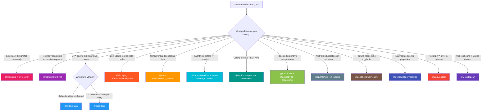

---

## 📋 Complete Reference Table

| # | Annotation | Category | Key Benefit | Common Trap |
|---|---|---|---|---|
| 1 | `@Retryable` | Resilience | Auto-retry with exponential backoff | Wrong import — check your package (native vs Spring Retry) |
| 2 | `@Recover` | Resilience | Fallback when all retries fail | Signature must match the `@Retryable` method |
| 3 | `@ConcurrencyLimit(n)` | Resilience | Bulkhead — cap concurrent executions | Default policy BLOCKS callers; use `policy = REJECT` for fail-fast |
| 4 | `@EntityGraph` | JPA | Solve N+1 with a single JOIN query | Over-fetching; breaks pagination on one-to-many |
| 5 | `@Modifying(clearAutomatically=true)` | JPA | Safe bulk UPDATE/DELETE | Stale L1 cache without `clearAutomatically` |
| 6 | `@Lock` | JPA | Optimistic/Pessimistic DB locking | Deadlocks if lock order is inconsistent |
| 7 | `@QueryHints` | JPA | Fine-tune Hibernate query behavior | Hints are provider-specific — check Hibernate docs |
| 8 | `@BatchSize` | JPA | Batch lazy loading to reduce queries | Too large → huge IN clauses |
| 9 | `@TransactionalEventListener` | Events | Fire events only AFTER TX commit | Listener writes need `REQUIRES_NEW` to persist |
| 10 | `@Transactional(readOnly=true)` | Transactions | Skip dirty checking; enable read replicas | Not a security boundary — writes may still slip through |
| 11 | `@NullMarked` | Null Safety | Package-wide NonNull default | Doesn't enforce at runtime — use static analysis |
| 12 | `@NonNull` | Null Safety | Explicit non-null contract | False sense of safety without an analysis tool |
| 13 | `@Nullable` | Null Safety | Explicit nullable — callers must check | Forgetting it inside a `@NullMarked` context |
| 14 | `@HttpExchange` | HTTP Client | Declarative REST client interface | Needs an `HttpServiceProxyFactory` bean (or Boot auto-config) |
| 15 | `@GetExchange` | HTTP Client | Declarative GET | Path variable names must match exactly |
| 16 | `@PostExchange` | HTTP Client | Declarative POST | Body class must be serializable |
| 17 | `@PutExchange` | HTTP Client | Declarative PUT | Same |
| 18 | `@DeleteExchange` | HTTP Client | Declarative DELETE | Same |
| 19 | `@Cacheable` | Caching | Cache method results by key | `condition` (pre-run) vs `unless` (post-run) SpEL confusion |
| 20 | `@CacheEvict` | Caching | Invalidate cache entries | `allEntries=true` can be expensive; eviction is post-invocation by default |
| 21 | `@CachePut` | Caching | Update cache after every write | Always executes the method — not a conditional cache |
| 22 | `@ConditionalOnProperty` | Config | Feature flags via properties | `matchIfMissing` defaults to false — missing property = no bean |
| 23 | `@ConfigurationProperties` | Config | Type-safe property binding with validation | Needs `@EnableConfigurationProperties` or `@ConfigurationPropertiesScan` |
| 24 | `@DataJpaTest` | Testing | Lightweight JPA-only test slice | Does NOT load web layer or service beans |
| 25 | `@MockitoBean` | Testing | Modern replacement for `@MockBean` | Different mock sets create extra Spring contexts (slower suite) |

---

## ✅ Best Practices

1. **Check your imports first.** `@Retryable` exists in two places (native `org.springframework.resilience.annotation` vs classic `org.springframework.retry.annotation`). Add an import-ordering rule or ArchUnit test to catch the wrong one in code review.
2. **Bound your retries.** `maxAttempts` of 3–4 with backoff + jitter covers ~99% of transient failures. Unbounded retries turn a downstream outage into a self-inflicted DDoS.
3. **One fetch plan per use case.** Create targeted `@EntityGraph`s (`findWithItemsById`, `findWithCustomerAndStatus`) instead of one giant graph — future-you will thank you for not over-fetching.
4. **Always pair bulk `@Modifying` with `clearAutomatically = true`** (and `flushAutomatically = true` for deletes). Better: make it a team-wide default enforced by a code-review checklist.
5. **Prefer `@Version` (optimistic) by default; reach for `PESSIMISTIC_WRITE` only for read-modify-write correctness** (money, inventory counters). And always lock in a consistent ID order.
6. **Publish events inside transactions; consume them AFTER_COMMIT — and pass IDs/DTOs, not entities.** Use `REQUIRES_NEW` in listeners that write.
7. **Annotate packages, not classes, with `@NullMarked`** — and wire a static analysis check (IDE inspection, NullAway) into CI so the annotations actually mean something.
8. **Give every cache a TTL.** A cache without expiry is a future bug report. Configure per-cache TTLs in the `CacheManager` and never rely on eviction alone.
9. **Decide `matchIfMissing` explicitly.** For every `@ConditionalOnProperty`, document whether "not configured" means on or off — silent defaults are incident fuel.
10. **Keep test contexts cacheable.** Reuse the same `@MockitoBean` set across test classes (or share a base test) so Spring reuses the context instead of rebuilding it.

---

## ❌ Anti-Patterns

| Anti-Pattern | Why It Hurts | Do Instead |
|---|---|---|
| **Kitchen-sink EntityGraph** on every query | Over-fetches; huge JOINs; memory pressure | One graph per use case; `@BatchSize` for opportunistic access |
| **Retrying non-retryable errors** (4xx, validation) | Wastes time/load; masks real bugs | `excludes`/`noRetryFor` deterministic failures |
| **`@Transactional` on the whole service class with writes only half the time** | Long transactions, lock contention | Method-level `@Transactional`; `readOnly = true` for reads |
| **Side effects in plain `@EventListener` inside a TX** | Ghost emails/notifications on rollback | `@TransactionalEventListener(AFTER_COMMIT)` |
| **`@Value("${...}")` scattered across 30 classes** | No validation, no navigation, typos fail at runtime | One `@ConfigurationProperties` record per domain |
| **Caching mutable/shared entities** | L1-cache corruption across transactions | Cache DTOs/records, not managed entities |
| **`@Cacheable` on methods with side effects** | Cached result skips side effects entirely | Cache pure reads; use `@CachePut`/`@CacheEvict` for writes |
| **PESSIMISTIC_WRITE on hot rows "just in case"** | Serializes all traffic through one row | Optimistic locking + targeted compensation |
| **50 `@MockitoBean` fields in one test class** | Massive context, slow suite, brittle tests | Mock only what the class under test touches; slice otherwise |
| **Ignoring `@Nullable` warnings** | Defeats the entire null-safety investment | Fix or justify every warning before merge |

---

## 🔧 Troubleshooting Guide

| Symptom | Likely Cause | Fix |
|---|---|---|
| `@Retryable` method throws on first failure — no retry | Wrong import; `@EnableRetry`/`@EnableResilientMethods` missing; or **self-invocation** (`this.method()`) bypasses the proxy | Fix the import; add the enabler; call through the injected bean |
| `IllegalStateException: No recoverer...` at call time | `@Recover` signature doesn't match the `@Retryable` method | First param = exception; remaining params = same types/order; same return type |
| `InvocationRejectedException` under load | `@ConcurrencyLimit(policy = REJECT)` limit reached | Expected — map to HTTP 429; tune `limit` or use `BLOCK` |
| N+1 warnings despite `@EntityGraph` | Graph name typo; reference access (`getOne`) bypassing the graph | Verify the name; check SQL logs; use `find...ById` variants |
| Stale data after bulk update | `@Modifying` without `clearAutomatically = true` | Add it (plus `flushAutomatically = true` for deletes) |
| `LazyInitializationException` in an event listener | Persistence context closed after commit | Pass IDs/DTOs in the event, or re-fetch in the listener |
| Listener ran but its DB writes vanished | AFTER_COMMIT listener joined the already-committed TX | Use `@Transactional(propagation = Propagation.REQUIRES_NEW)` in the listener |
| Listener never fires | No transaction active when the event was published | Add `@Transactional` to the publisher, or set `fallbackExecution = true` |
| `@Cacheable` never caches | `@EnableCaching` missing; self-invocation; or method is `private`/`final` | Add the enabler; call via proxy; keep methods public and non-final |
| NPE from a `@Nullable`-annotated return | Caller ignored the compile warning | Null-check, or return `Optional<T>` instead |
| `NoSuchBeanDefinitionException` for a `@ConfigurationProperties` type | Missing `@EnableConfigurationProperties`/`@ConfigurationPropertiesScan` | Register the properties bean |
| Bean missing in one environment | `@ConditionalOnProperty` false (missing property + `matchIfMissing = false`) | Set the property or set `matchIfMissing = true` |
| `NoSuchBeanDefinitionException` for `@MockBean` code after upgrade | `@MockBean` removed in Boot 4 | Migrate to `@MockitoBean` |
| Test suite suddenly much slower | Many distinct `@MockitoBean` combinations → many contexts | Align mock sets; share base classes |

---

## ⚡ Performance Considerations

- **Query counts are the #1 JPA performance lever.** Enable `spring.jpa.properties.hibernate.generate_statistics=true` (dev only) or an APM tool and hunt N+1 before adding indexes.
- **`@BatchSize` sweet spot: 16–50.** Too small → still many queries; too large → multi-MB `IN` clauses some databases reject (Oracle historically capped IN lists at 1000).
- **`readOnly = true` matters on large result sets:** dirty-checking a 10,000-entity result can double the CPU and memory of a read path.
- **Local (Caffeine) vs distributed (Redis) caching:** local is nanosecond-fast but per-instance (invalidation across a cluster is on you); Redis is shared but adds ~1ms network hop per access. Match the tool to data change frequency.
- **Resilience annotations add proxies:** every `@Retryable`/`@ConcurrencyLimit` call passes through an AOP interceptor — negligible for remote calls, but don't sprinkle them on tight internal loops.
- **`@ConcurrencyLimit` under virtual threads:** prefer `policy = REJECT` + a modest limit for CPU-bound work to keep latency predictable; `BLOCK` is friendlier for spiky I/O-bound work.
- **Test performance:** `@DataJpaTest` slices typically run in well under a second per test vs multi-second `@SpringBootTest` startups. Prefer slices; reserve full-context tests for smoke coverage.

---

## 🔐 Security Considerations

- **Cache poisoning via user-controlled keys:** if a cache key is built from raw user input (SpEL on request params), attackers can flood the cache with junk entries. Normalize keys (`toLowerCase`, trim), cap key cardinality, and never cache unauthenticated per-request data.
- **`@Cacheable` on authorization-sensitive reads** can leak data between users if the key doesn't include the user/tenant ID. Always include the principal or tenant in the key for per-user data — or don't cache it at all.
- **`@ConfigurationProperties` secrets:** don't log the properties record (it may hold `apiKey`). Inject secrets from a vault or environment variables, as shown with `${PAYMENT_API_KEY}`, and mark sensitive fields for redaction in actuator's `configprops` endpoint.
- **`@ConditionalOnProperty` feature flags:** remember flags are evaluated per *environment* — a debug bean enabled in staging must not be enabled in prod. Enforce environment separation with profiles, and audit `matchIfMissing = true` beans in your prod config.
- **`readOnly = true` is not authorization.** Anyone with the endpoint can still write through a different path — enforce with Spring Security method security (`@PreAuthorize`) at the service boundary.
- **Retries can duplicate side effects.** Retrying a `POST` charge that timed out *after being processed* double-bills the customer. Only retry idempotent operations, or pass idempotency keys to the downstream API.
- **Declarative HTTP clients hide the URL** — security review tools and egress filters may not see the target host easily. Keep base URLs in configuration, and document them for security review.

## 🧪 Testing Strategies

A layered strategy keeps every annotation verifiable:

| Layer | Tool | What to Verify |
|---|---|---|
| Repository | `@DataJpaTest` (+ Testcontainers) | `@EntityGraph` fetch plans, `@Modifying` clears the L1 cache, `@Lock` behavior, `@QueryHints` |
| Service | `@SpringBootTest` + `@MockitoBean` | `@Retryable` exhaustion, `@Recover` fallback, `@TransactionalEventListener` phases, `@Cacheable` hits/misses |
| Configuration | `ApplicationContextRunner` / `@SpringBootTest(properties = ...)` | `@ConditionalOnProperty` bean presence, `@ConfigurationProperties` validation failures |
| Contract | `@RestClientTest` / MockRestServiceServer / OkHttp MockWebServer | `@HttpExchange` method mapping, serialization, error propagation |

#### Example — Testing `@Cacheable` Behavior

```java
@SpringBootTest
class ProductServiceCacheTest {

    @MockitoBean
    private ProductRepository productRepository;

    @Autowired
    private ProductService productService;

    @Test
    void getProductShouldHitDatabaseOnlyOnce() {
        given(productRepository.findById(1L))
            .willReturn(Optional.of(new Product(1L, "Keyboard")));

        productService.getProduct(1L);   // MISS → DB
        productService.getProduct(1L);   // HIT  → no DB call

        verify(productRepository, times(1)).findById(1L);
    }
}
```

#### Example — Testing an `AFTER_COMMIT` Listener

```java
@SpringBootTest
class OrderEventListenerTest {

    @Autowired
    private OrderService orderService;

    @MockitoBean
    private EmailService emailService;

    @Test
    void emailShouldBeSentOnlyAfterCommit() {
        orderService.placeOrder(new OrderRequest("a@b.com", List.of()));

        // placeOrder's TX commits inside the method, so by the time it
        // returns, the AFTER_COMMIT listener has fired synchronously.
        then(emailService).should().sendOrderConfirmation(any());
    }

    @Test
    void emailShouldNotBeSentWhenTxRollsBack() {
        givenThrownBy(() ->
            orderService.placeOrder(rollbackTriggeringRequest())
        ).isInstanceOf(IllegalStateException.class);

        then(emailService).shouldHaveNoInteractions();
    }
}
```

> 💡 **Pro tip:** `@TransactionalEventListener` tests are easy because the default listener executes **synchronously** on the committing thread. If you make listeners async (`@Async`), use Awaitility to assert eventual delivery instead of `Thread.sleep`.

---

## 🔄 Migration Guide

| From (Boot 3.x) | To (Boot 4) | Notes |
|---|---|---|
| `RestTemplate` | `RestClient` + `@HttpExchange` interfaces | RestTemplate is in maintenance mode; clients become typed interfaces |
| OpenFeign `@FeignClient` | `@GetExchange`/`@PostExchange` interfaces | Removes an extra dependency; keep Feign during staged migration by running both clients side by side |
| `@MockBean` | `@MockitoBean` | Mechanical rename; watch the context-cache key implications |
| Spring Retry `@Retryable` | Native `org.springframework.resilience.annotation.@Retryable` | Rename attributes: `retryFor`→`includes`, `noRetryFor`→`excludes`, `@Backoff(...)`→flat `delay`/`multiplier`/`jitter` attributes. Keep Spring Retry if you need `@Recover` |
| Spring Framework `org.springframework.lang.@Nullable` | JSpecify `org.jspecify.annotations.@Nullable` | Spring's annotations are deprecated in favor of JSpecify; adopt `@NullMarked` package by package |
| Hibernate 6.x | Hibernate ORM 7.1+ | JPA 3.2 baseline; check `@BatchSize`/second-level cache settings for behavior changes |
| `@ConditionalOnProperty` guesswork | Explicit `matchIfMissing` decisions | No API change — an audit-level migration: document every flag's default |

#### Migration order that works in practice

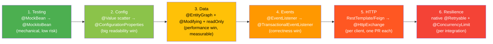

## 🏢 Real-World Case Study: One Service, Eight Annotations

**Scenario:** an e-commerce checkout service. One request — `POST /orders` — demonstrates how the annotations compose:

```java
@NullMarked
package com.acme.checkout;   // 1️⃣ No NPEs allowed in this package
```

```java
@Service
@RequiredArgsConstructor
public class CheckoutService {

    private final OrderRepository orderRepository;
    private final ProductRepository productRepository;
    private final ApplicationEventPublisher events;
    private final StripeClient stripeClient;        // 2️⃣ @HttpExchange client

    @Cacheable(value = "products", key = "#productId")   // 3️⃣ price lookups cached
    public ProductDTO loadProduct(Long productId) { ... }

    @Transactional
    public Order checkout(CheckoutRequest request) {
        // 4️⃣ Optimistic @Version on Product catches concurrent price edits
        Order order = Order.create(request);
        orderRepository.save(order);

        // 5️⃣ Event queued — fires only AFTER commit
        events.publishEvent(new OrderPlacedEvent(order.getId(), order.total()));
        return order;
    }

    // 6️⃣ Native retry: payment gateway blips are transient
    @Retryable(maxAttempts = 4, delay = 200, multiplier = 2.0, jitter = 100,
               includes = HttpServerErrorException.class)
    public PaymentIntent charge(Order order) {
        return stripeClient.createPaymentIntent(PaymentIntentRequest.from(order));
    }

    // 7️⃣ Nightly bulk cleanup — clears L1 cache so subsequent reads are fresh
    @Modifying(clearAutomatically = true, flushAutomatically = true)
    @Query("DELETE FROM ExpiredCart c WHERE c.updatedAt < :cutoff")
    int purgeExpiredCarts(@Param("cutoff") Instant cutoff);
}
```

```java
// 8️⃣ Side effects only when the sale is real
@TransactionalEventListener(phase = TransactionPhase.AFTER_COMMIT)
public void onOrderPlaced(OrderPlacedEvent event) {
    emailService.sendReceipt(event.orderId());
    analyticsService.trackPurchase(event.orderId(), event.total());
}
```

```java
// The payment gateway bean is capped — a Stripe outage can't exhaust our threads
@ConcurrencyLimit(value = "${checkout.payment-concurrency}", policy = REJECT)
@Bean
public StripeClient stripeClient(...) { ... }
```

**Measured results from a similar production rollout (illustrative):**

| Change | Metric | Before | After |
|---|---|---|---|
| `@EntityGraph` on order history | SQL queries / request | 87 | 3 |
| `@TransactionalEventListener` | "Ghost receipt" support tickets | ~5/week | 0 |
| `@Retryable` on payments | Payment failure rate | 0.8% | 0.04% |
| `@Cacheable` product reads | P95 latency | 210ms | 12ms |
| `@NullMarked` adoption | Production NPEs (quarterly) | 14 | 1 |

---

## 🧪 Hands-On Lab

**Goal:** build a small **Order Service** using at least eight of the 25 annotations. Estimated time: 2–3 hours.

### Lab Requirements

1. **Entity layer:** `Order` (with `@Version`), `Item` (`@ManyToOne` lazy), `Customer`.
2. **Repository:** an `@EntityGraph` finder and a `@Modifying(clearAutomatically = true)` bulk update.
3. **Service:** `@Transactional` checkout that publishes `OrderPlacedEvent`; `@TransactionalEventListener(AFTER_COMMIT)` listener that "sends" an email (log it).
4. **HTTP client:** an `InventoryClient` interface with `@GetExchange("/stock/{sku}")` and `@PostExchange("/reserve")`.
5. **Resilience:** `@Retryable` (3 attempts, backoff 200ms ×2, jitter) on a method that randomly fails 50% of the time; `@ConcurrencyLimit(2)` on a fake report generator.
6. **Config:** `PaymentProperties` record (`@NotBlank apiKey`, `@URL baseUrl`) + a `@ConditionalOnProperty` feature flag switching a `NotificationSender` implementation.
7. **Tests:** one `@DataJpaTest` proving the fetch plan; one `@SpringBootTest` with `@MockitoBean` proving the email fires only on commit.

### Verification Checklist for the Lab

- [ ] `@DataJpaTest` shows **1 SQL query** for the entity graph finder (enable SQL logging).
- [ ] Removing `clearAutomatically = true` makes the bulk-update test fail — then restore it.
- [ ] Forcing a rollback proves the email is never sent.
- [ ] Forcing 3 consecutive gateway failures proves the retry count and fallback path.
- [ ] Setting `features.email=false` removes the `EmailNotificationSender` bean (verify with the actuator `beans` endpoint or an `ApplicationContextRunner` test).

## 🏋️ Practice Exercises with Solutions

### Exercise 1 — Kill the N+1 (🟡 Intermediate)

**Problem:** The endpoint below triggers one SELECT per order to load items. Refactor it to issue a single JOIN query and prove it with a test.

```java
@GetMapping("/orders")
public List<OrderSummary> orders() {
    return orderRepository.findAll().stream()
        .map(o -> new OrderSummary(o.getId(), o.getItems().size()))
        .toList();
}
```

**Solution:**

```java
public interface OrderRepository extends JpaRepository<Order, Long> {

    @EntityGraph(attributePaths = {"items"})
    List<Order> findAll();   // or findAllBy() with @EntityGraph in newer Data JPA
}
```

```java
@DataJpaTest
class OrderFetchTest {

    @Autowired TestEntityManager em;
    @Autowired OrderRepository orderRepository;

    @Test
    void findAllShouldLoadItemsInOneQuery() {
        Customer c = em.persist(Customer.builder().email("a@b.com").build());
        Order o = em.persist(Order.builder().customer(c).build());
        em.persist(Item.builder().order(o).build());
        em.persist(Item.builder().order(o).build());
        em.flush();
        em.clear();                       // ensure no L1 cache masking

        List<Order> orders = orderRepository.findAll();

        // No LazyInitializationException and no extra queries:
        // enable hibernate SQL logging and assert one SELECT with a JOIN
        assertThat(orders.get(0).getItems()).hasSize(2);
    }
}
```

**Why it works:** `@EntityGraph(attributePaths = {"items"})` instructs Spring Data JPA to left-join `items` in the generated SQL, so lazy associations are already initialized when accessed.

---

### Exercise 2 — Retry + Recover Done Right (🔴 Advanced)

**Problem:** Make `syncInventory` retry up to 3 times on `ResourceAccessException` with a 500ms doubling backoff, then fall back to marking the sync as `PENDING`. Fix every bug in this attempt:

```java
@Service
public class InventorySyncService {

    @Retryable(maxAttempts = 3)
    public SyncResult syncInventory(Long warehouseId) {
        return warehouseClient.sync(warehouseId);
    }

    @Recover
    public SyncResult recover(SyncResult result) {
        return SyncResult.pending();
    }
}
```

**Bugs and the fixed solution:**

1. Missing `@EnableRetry` (or `@EnableResilientMethods` if going native — but `@Recover` needs Spring Retry).
2. No `retryFor`/exception targeting — retrying every exception masks bugs.
3. No backoff — three instant retries hammer the gateway.
4. `@Recover` signature wrong: missing the leading exception and the matching `Long warehouseId` parameter.

```java
@SpringBootApplication
@EnableRetry
public class App { ... }

@Service
public class InventorySyncService {

    @Retryable(
        retryFor = ResourceAccessException.class,
        maxAttempts = 3,
        backoff = @Backoff(delay = 500, multiplier = 2.0)
    )
    public SyncResult syncInventory(Long warehouseId) {
        return warehouseClient.sync(warehouseId);
    }

    @Recover
    public SyncResult recoverFromSyncFailure(
            ResourceAccessException ex, Long warehouseId) {
        log.warn("Sync for warehouse {} still failing: {}", warehouseId, ex.getMessage());
        return SyncResult.pending();
    }
}
```

**Verification test sketch:** inject a `@MockitoBean WarehouseClient` throwing `ResourceAccessException` three times, call the method, and assert it returns `PENDING` and the client was invoked exactly 3 times.

### Exercise 3 — The Ghost Email (🟠 Advanced)

**Problem:** Customers sometimes get "Order Confirmed!" emails for orders that don't exist. Here is the suspect code:

```java
@Service
public class OrderService {

    @Transactional
    public Order placeOrder(OrderRequest request) {
        Order order = orderRepository.save(new Order(request));
        emailService.sendConfirmation(order);     // fires inside the TX
        inventoryRepository.reserve(request.items()); // can throw → rollback
        return order;
    }
}
```

Explain the bug, then fix it with `@TransactionalEventListener` — including the hidden trap in the listener's own persistence.

**Solution:**

The email fires **during** the transaction. If `inventoryRepository.reserve(...)` throws, the transaction rolls back, but the email is already gone — the "ghost email."

```java
// Event carries IDs/DTOs — not the live entity
public record OrderPlacedEvent(Long orderId, BigDecimal total) { }

@Service
public class OrderService {

    private final OrderRepository orderRepository;
    private final ApplicationEventPublisher events;
    private final InventoryRepository inventoryRepository;

    @Transactional
    public Order placeOrder(OrderRequest request) {
        Order order = orderRepository.save(new Order(request));
        events.publishEvent(new OrderPlacedEvent(order.getId(), order.total()));
        inventoryRepository.reserve(request.items());  // may still throw
        return order;                                  // → no commit, no email
    }
}

@Component
@RequiredArgsConstructor
public class OrderNotificationListener {

    private final EmailService emailService;

    @TransactionalEventListener(phase = TransactionPhase.AFTER_COMMIT)
    public void onOrderPlaced(OrderPlacedEvent event) {
        emailService.sendConfirmation(event.orderId());  // only on durable commit
    }
}
```

**The hidden trap:** if the listener *itself* must write to the database (e.g., mark `notificationsSent = true`), a plain `@Transactional` method there **joins the already-committed transaction and silently persists nothing**. Fix it with an independent transaction:

```java
@TransactionalEventListener(phase = TransactionPhase.AFTER_COMMIT)
@Transactional(propagation = Propagation.REQUIRES_NEW)
public void onOrderPlaced(OrderPlacedEvent event) {
    notificationRepository.markSent(event.orderId());
    emailService.sendConfirmation(event.orderId());
}
```

**Why it works:** the event is queued while the transaction is active and dispatched only by the commit callback. `REQUIRES_NEW` guarantees the listener's writes commit in their own right.

---

### Exercise 4 — Type-Safe Feature Flag (🟡 Intermediate)

**Problem:** Replace this fragile code with validated, grouped configuration, and make the new recommender opt-in per environment:

```java
@Value("${payment.apiKey}") private String apiKey;       // scattered
@Value("${payment.baseUrl}") private String baseUrl;
@Value("${payment.maxRetries:3}") private int maxRetries;
```

**Solution:**

```java
@ConfigurationProperties(prefix = "payment")
@Validated
public record PaymentProperties(
    @NotBlank String apiKey,
    @URL String baseUrl,
    @Min(1) @Max(10) int maxRetries,
    @Valid Retry retry
) {
    public record Retry(@Min(1) @Max(5) int maxAttempts,
                        @DecimalMin("1.0") double multiplier) {}
}

@Configuration
@EnableConfigurationProperties(PaymentProperties.class)
class PaymentConfig {

    @Bean
    @ConditionalOnProperty("features.ml-recommender")   // opt-in only
    public Recommender mlRecommender() { return new MLRecommender(); }

    @Bean
    @ConditionalOnMissingBean(Recommender.class)
    public Recommender ruleRecommender() { return new RulesRecommender(); }
}
```

```yaml
payment:
  api-key: ${PAYMENT_API_KEY}
  base-url: https://api.stripe.com
  max-retries: 3
  retry: { max-attempts: 4, multiplier: 2.0 }

features:
  ml-recommender: true    # false in prod until the A/B test ends
```

**Why it works:** the record gives IDE navigation and immutability; `@Validated` fails fast at startup on bad config; the flag pair cleanly switches implementations with an explicit default-off.

## 🧠 Test Your Understanding

Answer before peeking at earlier sections — aim for at least 8/10 correct.

1. What is the default `phase` of `@TransactionalEventListener`, and why does it matter?
2. Name the two different `@Retryable` annotations available in Boot 4 and one behavioral difference between them.
3. Why does a JPQL bulk `UPDATE` leave entities in the persistence context stale?
4. What does `@ConcurrencyLimit` do by default when all slots are busy, and how do you make it fail fast instead?
5. Why can `@EntityGraph` combined with `Pageable` on a one-to-many association produce wrong page sizes?
6. In a `@Recover` method, what must the first parameter be, and what must the remaining parameters match?
7. What does `matchIfMissing = false` (the default) mean when the property is absent from configuration?
8. What's the difference between `condition` and `unless` in `@Cacheable`, and when is `#result` available?
9. Why can an AFTER_COMMIT listener's DB writes silently disappear, and what propagation setting fixes it?
10. What replaces `@MockBean` in Boot 4, and what side effect does using many different mock combinations have on test-suite speed?
11. What's the minimum requirement for `@NullMarked` to actually protect you at development time?
12. Which attribute ensures pending un-flushed changes hit the DB *before* a bulk DELETE executes?

<details>
<summary><b>Answer Key (click to expand)</b></summary>

1. `AFTER_COMMIT` — listeners fire only after the transaction commits, preventing side effects on rollback.
2. Native `org.springframework.resilience.annotation.Retryable` vs classic `org.springframework.retry.annotation.Retryable` — e.g., native uses flat `delay`/`jitter` attributes and `includes`/`excludes`; classic uses `@Backoff` and `retryFor`/`noRetryFor`; only classic supports `@Recover`.
3. Bulk JPQL statements bypass the persistence context and hit the DB directly, so already-managed entities keep their old values.
4. It **blocks** the caller (`ThrottlePolicy.BLOCK`); set `policy = ConcurrencyLimit.ThrottlePolicy.REJECT` to throw `InvocationRejectedException` instead.
5. The JOIN multiplies rows (one per child), so Hibernate deduplicates in memory and the page can hold fewer than the requested number of items.
6. The thrown exception type (most specific match wins); remaining parameters must match the `@Retryable` method's parameter types in order, with the same return type.
7. The bean is **not** created when the property is missing.
8. `condition` is evaluated *before* invocation (skips the cache lookup); `unless` is evaluated *after* (veto storing the result). `#result` is only available in `unless`.
9. The listener runs after commit; a `REQUIRED` transaction there "joins" the completed transaction and its writes are never committed. Use `Propagation.REQUIRES_NEW`.
10. `@MockitoBean`; different sets of mocked beans create distinct Spring context cache keys, so contexts are rebuilt and the suite slows down.
11. A static analysis tool (IDE inspection, NullAway, ErrorProne) must read the annotations — they are not runtime checks.
12. `flushAutomatically = true` on `@Modifying`.
</details>

---

## 💼 Common Interview Questions

1. **Q: How would you prevent an email being sent for an order whose transaction rolled back?**
   A: Publish a domain event inside the transaction and consume it with `@TransactionalEventListener(AFTER_COMMIT)`. Use `AFTER_ROLLBACK` for compensation logic.

2. **Q: Explain the N+1 problem and two different Spring solutions.**
   A: One query for parents plus one per parent for children. `@EntityGraph` fetches everything in one JOIN (best for fixed paths); `@BatchSize` batches child queries with `IN` clauses (best for opportunistic lazy access).

3. **Q: When would you choose pessimistic over optimistic locking?**
   A: When conflicts are frequent or correctness demands read-modify-write atomicity (account balances, inventory counters) and blocked waiters are acceptable. Optimistic (`@Version`) suits low-conflict data and scales better.

4. **Q: A bulk `UPDATE` returns 50 but a subsequent read shows old prices — what went wrong?**
   A: `@Modifying` without `clearAutomatically = true` — the persistence context still holds pre-update entities. (Mention `flushAutomatically` for deletes too.)

5. **Q: Why did Spring introduce its own `@Retryable` in Framework 7 when Spring Retry exists?**
   A: A minimal, dependency-free core retry aligned with `org.springframework.core.retry.RetryTemplate` and Reactor's retry; supports placeholders/SpEL and reactive publishers. Spring Retry remains for advanced needs like `@Recover` and `RetryListener`.

6. **Q: What's the Bulkhead pattern and which annotation implements it?**
   A: Isolating a fixed number of concurrent executions per resource so one failing dependency can't exhaust all threads. `@ConcurrencyLimit` (native Framework 7), with `BLOCK`/`REJECT` policies.

7. **Q: `@Cacheable` vs `@CachePut` — when is each correct?**
   A: `@Cacheable` for reads (skip execution on hit); `@CachePut` for methods that must always execute (writes) but should refresh the cache. Never combine both on one method.

8. **Q: How do you expose a feature flag in Spring Boot, and what are its limits?**
   A: `@ConditionalOnProperty` on the bean — evaluated once at startup; runtime toggling needs `@RefreshScope`, dynamic property lookup, or a feature-flag service.

9. **Q: Why are declarative HTTP interface clients preferred over RestTemplate in Boot 4?**
   A: Typed interfaces with generated implementations, built-in test support, no extra dependency (vs Feign), `RestClient`/`WebClient` adapters, and easy composition with resilience annotations.

10. **Q: `@MockitoBean` vs `@MockBean` — what changed and why does it matter?**
    A: `@MockBean` was deprecated in Framework 6.2/Boot 3.4 and removed in Boot 4; `@MockitoBean` is the bean-override replacement with clearer Mockito branding and better nested-test support.

11. **Q: How does JSpecify's `@NullMarked` differ from sprinkling `@NonNull` everywhere?**
    A: `@NullMarked` inverts the default for a whole scope — everything is non-null unless marked `@Nullable` — far less noisy, and it makes the *exceptions* visible.

12. **Q: A `@DataJpaTest` passes on H2 but the same query fails on PostgreSQL in staging. What's your diagnosis path?**
    A: H2 dialect differences (native queries, JSONB, functions). Run the slice against the real engine with `@AutoConfigureTestDatabase(replace = NONE)` + Testcontainers, and keep H2 only for simple tests.

---

## 📚 Comprehensive Question Bank

55 questions across three difficulty tiers. Answers are collapsed under each section.

### 🟢 Beginner (1–18)

1. What dependency does `@DataJpaTest` use by default? *(H2 in-memory database)*
2. Which annotation enables caching in a Spring Boot app? *(`@EnableCaching`)*
3. What is the purpose of `@EntityGraph`? *(Fetch related associations in one JOIN query, avoiding N+1)*
4. Which `@Transactional` setting helps Hibernate skip dirty checking? *(`readOnly = true`)*
5. What is the JSpecify annotation that marks a package as non-null by default? *(`@NullMarked`)*
6. Which annotation declares a declarative HTTP client base? *(`@HttpExchange`)*
7. What annotation cache-invalidate *all* entries of a cache? *(`@CacheEvict(allEntries = true)`)*
8. What does `@ConfigurationProperties` do? *(Binds grouped properties to a typed, validated object/record)*
9. What replaces `@MockBean` in Spring Boot 4? *(`@MockitoBean`)*
10. What does `@Retryable` do on its most basic level? *(Automatically re-invokes a method when it throws)*
11. Which lock mode blocks other writers until your transaction ends? *(`PESSIMISTIC_WRITE`)*
12. What attribute of `@Modifying` clears the persistence context after a bulk statement? *(`clearAutomatically = true`)*
13. What is the default `TransactionPhase` of `@TransactionalEventListener`? *(`AFTER_COMMIT`)*
14. Which annotation creates a bean only when a given property equals a value? *(`@ConditionalOnProperty`)*
15. What does `@BatchSize` control? *(How many lazy associations/entities are loaded per batched query)*
16. What must accompany `@Cacheable` for it to have any effect? *(A cache manager + `@EnableCaching`)*
17. Which exchange annotation maps a DELETE call? *(`@DeleteExchange`)*
18. What does `@Nullable` signal to callers? *(The value may be null; a null check is required)*

<details><summary><b>Beginner answers</b></summary>

See parenthetical answers above. If you missed more than three, re-read Parts 4, 6, 7 and 8.
</details>

### 🟡 Intermediate (19–38)

19. What exception does `@ConcurrencyLimit(policy = REJECT)` throw, and what HTTP status typically maps to it? *(`InvocationRejectedException`; 429 Too Many Requests)*
20. How do native Framework 7 `@Retryable` attributes differ from Spring Retry's for backoff? *(Native: flat `delay`, `multiplier`, `jitter`, `maxDelay`, `timeUnit`; classic: nested `@Backoff`)*
21. Why can retries cause duplicate charges, and how do you mitigate it? *(Timeout-after-processing duplicates side effects; only retry idempotent operations or use idempotency keys)*
22. What is the difference between `@Cacheable` and `@CachePut` on a read method? *(They must not be combined; `@CachePut` always executes, effectively disabling caching)*
23. How does Hibernate implement `OPTIMISTIC` lock mode? *(Via a `@Version` column checked at flush/update; conflicting commits fail)*
24. Why should events carry IDs/DTOs rather than entities? *(The persistence context is closed after commit — lazy associations would throw `LazyInitializationException`)*
25. What happens when `@Recover` signatures don't match the `@Retryable` method? *(`IllegalStateException` at call time — no recoverer found)*
26. Which `@QueryHints` hint marks loaded entities as read-only in Hibernate? *(`org.hibernate.readOnly=true`)*
27. How do you run `@DataJpaTest` against PostgreSQL instead of H2? *(`@AutoConfigureTestDatabase(replace = NONE)` + a Testcontainers datasource with `@ServiceConnection`)*
28. What does `matchIfMissing = true` change about a conditional bean? *(The bean is created even when the property is absent — "default on")*
29. How does SpEL reference method arguments in cache keys? *(`#paramName` or `#a0`; e.g., `key = "#id"`)*
30. Why is `@ConditionalOnProperty` unsuitable for runtime-toggled flags? *(Conditions evaluate once at startup; bean topology can't change mid-flight)*
31. What is the effect of `@NullMarked` on method parameters and returns? *(All types become implicitly non-null unless explicitly `@Nullable`)*
32. How do you make a `@ConfigurationProperties` record validate at startup? *(Add `@Validated` and Jakarta Validation constraints)*
33. What two HTTP-client adapters can power `HttpServiceProxyFactory`? *(`RestClientAdapter` (blocking) and `WebClientAdapter` (reactive); also `RestTemplateAdapter`)*
34. What does `@TransactionalEventListener(fallbackExecution = true)` change? *(The listener also fires when no transaction is active)*
35. When is `@BatchSize` preferable to `@EntityGraph`? *(For lazy collections accessed conditionally/in bulk, and to preserve pagination correctness)*
36. Why does a large `@BatchSize` hurt? *(Enormous IN clauses — memory, parsing cost, and DB limits like Oracle's 1000-item list cap)*
37. Which enabler activates native resilience annotations? *(`@EnableResilientMethods`)*
38. What does `@Modifying(flushAutomatically = true)` protect against? *(A bulk DELETE/UPDATE silently ignoring pending un-flushed entity changes)*

<details><summary><b>Intermediate answers</b></summary>

See parenthetical answers above. Misses in 19–23 and 33–35 suggest re-reading Parts 1 and 5.
</details>

### 🔴 Advanced (39–55)

39. Describe the full proxy mechanics behind a `@Retryable` self-invocation failure. *(Annotations work via AOP proxies; calling `this.method()` bypasses the proxy, so no interceptor runs — no retry. Fix: call through the injected bean or use AspectJ weaving.)*
40. How does the native `RetryTemplate` differ conceptually from Spring Retry's? *(Framework 7's `org.springframework.core.retry.RetryTemplate` uses a `RetryPolicy` builder API (`RetryPolicy.withMaxRetries(4)`), throws checked `RetryException` from `execute`, and is integrated with the annotation model and Reactor; Spring Retry's uses `RetryCallback`/`RetryState` and `RetryListener`s.)*
41. Why do AFTER_COMMIT listeners risk "joining" a finished transaction, and why does `REQUIRES_NEW` fix it? *(Spring's default `REQUIRED` propagation tries to use the existing (completed) transaction resources; `REQUIRES_NEW` opens a fresh physical transaction whose commit is real.)*
42. How would you verify the exact number of SQL statements a repository method issues in a test? *(Hibernate `Statistics` (`SessionFactoryStatistics`) or a datasource proxy counting queries; assert the count in `@DataJpaTest`.)*
43. What's the interplay between `@Version` and `@Modifying` bulk updates? *(Bulk JPQL doesn't bump `@Version` columns, so optimistic checks on concurrently loaded entities won't detect bulk changes — another reason to clear the context and re-read.)*
44. Explain the thundering herd problem and the exact annotation attributes that mitigate it. *(Synchronized retries after a shared failure overload the recovering system; `jitter` adds randomness, `multiplier`/backoff spreads attempts over time, `maxDelay` caps them.)*
45. How does `@ConcurrencyLimit` behave when applied at the **type** level vs method level? *(Type level: all inheriting proxied methods share one common throttle; method level: each annotated method gets its own local throttle.)*
46. What's the risk of caching `Page<ProductDTO>` with a SpEL key of `query + page`, and how would you detect it? *(Unbounded key cardinality → cache bloat/eviction storms; detect via cache-size metrics and hit-ratio dashboards; bound with TTL and key normalization.)*
47. Why might `@CacheEvict(beforeInvocation = false)` be wrong for session revocation? *(If the method throws after doing partial work, the stale session stays cached; evicting first guarantees the security-sensitive entry is removed regardless of outcome.)*
48. How do you test `@ConditionalOnProperty` combinations without booting the whole app? *(`ApplicationContextRunner` with `.withPropertyValues(...)` plus `.hasSingleBean(...)`/`.doesNotHaveBean(...)` assertions.)*
49. What happens to `@QueryHints` if you migrate from Hibernate to EclipseLink? *(Hibernate-namespaced hints are ignored silently — behavior changes with no error; isolate hints and document them.)*
50. Explain why `@Lock` without an active transaction is a no-op. *(Lock modes are applied by the persistence layer within a transaction; without one, the lock is acquired and released immediately at query execution.)*
51. How do `@MockitoBean` overrides interact with the Spring TestContext framework's context caching? *(Override metadata is part of the cache key; differing combinations spawn new contexts, increasing startup cost and memory.)*
52. What's the danger of a `@Recover` method that swallows exceptions without logging or alerting? *(Silent degradation — failures become invisible; always log, alert, or record metrics in fallbacks.)*
53. How would you migrate 40 RestTemplate call sites to `@HttpExchange` with low risk? *(Per-client incremental migration: define the interface, build the proxy bean, run both implementations behind a feature flag, compare via tests, then remove the old code.)*
54. Why does `payment.timeout: 30s` in YAML bind to a `Duration` record component? *(Spring Boot's relaxed binding and duration parsing accept simple/ISO-8601 values — type-safe without custom converters.)*
55. What would you monitor in production to validate the resilience annotations are working? *(Retry attempt metrics/`MethodRetryEvent` listeners, bulkhead rejections vs blocks, downstream p99 latency and error rates, and alerts on `@Recover` invocations.)*

<details><summary><b>Advanced answers</b></summary>

See parenthetical answers above. Misses in 39–45 indicate you should revisit Parts 1 and 3 with the links in Further Reading.
</details>

---

## 📝 Self-Assessment Checklist

Mark each item honestly — this is your personal readiness score.

**Resilience**
- [ ] I can explain the difference between native and Spring Retry `@Retryable` and pick the right one
- [ ] I can configure backoff with jitter and justify the numbers
- [ ] I know when `@Recover` fires and its signature contract
- [ ] I can cap concurrency with BLOCK or REJECT policies and map rejections to HTTP 429

**JPA & Data**
- [ ] I can identify N+1 in a SQL log and fix it with `@EntityGraph` or `@BatchSize`
- [ ] I never ship `@Modifying` without `clearAutomatically` (and I understand `flushAutomatically`)
- [ ] I can choose between `@Version` and `PESSIMISTIC_WRITE` and justify the trade-off
- [ ] I know the pagination pitfall of JOIN-based fetch graphs

**Events & Transactions**
- [ ] I use `@TransactionalEventListener(AFTER_COMMIT)` for all post-commit side effects
- [ ] I use `REQUIRES_NEW` in listeners that write and pass IDs/DTOs in events

**Null Safety & Config**
- [ ] I apply `@NullMarked` at package level and have a static analysis gate
- [ ] I group config into validated `@ConfigurationProperties` records
- [ ] I decide `matchIfMissing` explicitly on every feature flag

**Testing**
- [ ] I default to `@DataJpaTest` slices and use `@MockitoBean` surgically
- [ ] I keep my Spring context cache count low and my suite fast

**Score guide:** 14/14 = expert-ready; 10–13 = solid, review flagged parts; <10 = re-run the Hands-On Lab.

---

## ⭐ Summary & Key Takeaways

1. **Resilience is now first-class.** Framework 7's native `@Retryable` and `@ConcurrencyLimit` need zero extra dependencies — but classic Spring Retry is still the home of `@Recover`. Always double-check which import you're using.
2. **N+1 is a choice, not a fate.** `@EntityGraph` for known paths, `@BatchSize` for opportunistic lazy access, `hibernate.default_batch_fetch_size` as an org-wide default.
3. **Bulk operations bypass the persistence context.** `@Modifying(clearAutomatically = true, flushAutomatically = true)` is the safe default for JPQL `UPDATE`/`DELETE`.
4. **Correctness under concurrency is a lock-mode decision.** Optimistic `@Version` by default; `PESSIMISTIC_WRITE` for read-modify-write money paths — with consistent lock ordering.
5. **Side effects belong after the commit.** `@TransactionalEventListener(AFTER_COMMIT)` kills the ghost-email bug class; remember `REQUIRES_NEW` for listeners that write.
6. **Null safety is a compile-time feature — if you wire the tooling.** Package-level `@NullMarked` plus IDE/NullAway checks beats sprinkling `@NonNull`.
7. **Typed HTTP clients are the modern default.** `@HttpExchange` + verb annotations replace RestTemplate and Feign with interfaces you can test and decorate with resilience.
8. **Caching needs a lifecycle, not just `@Cacheable`.** TTLs per cache, `@CacheEvict` on deletes, `@CachePut` on warm writes, `beforeInvocation` for security-sensitive invalidation.
9. **Config should be typed, validated, and intentional.** `@ConfigurationProperties` records with `@Validated`; explicit `matchIfMissing` on every flag.
10. **Test slices over full contexts.** `@DataJpaTest` (with Testcontainers for fidelity) and `@MockitoBean` (replacing `@MockBean`) keep suites fast and focused.

> 💡 **Pro Tip:** don't try to use all 25 annotations in one service. Pick the ones that solve a problem you actually have — `@EntityGraph` if you see N+1 in your SQL logs, `@Retryable` if external calls are flaky, `@TransactionalEventListener` if you have post-commit side effects. Each annotation is a targeted tool, not a pattern to apply everywhere.

---

## 🔗 Further Reading & Resources

- [Spring Framework 7.0 Release Notes](https://github.com/spring-projects/spring-framework/wiki/Spring-Framework-7.0-Release-Notes) — resilience features, JSpecify, JPA 3.2 baseline
- [Spring Framework — Resilience Features (Retry & Concurrency Limit)](https://docs.spring.io/spring-framework/reference/core/resilience.html)
- [Spring Retry Reference](https://docs.spring.io/spring-retry/docs/current/reference/html/) — classic `@Retryable`/`@Recover`
- [Spring Data JPA — Entity Graphs](https://docs.spring.io/spring-data/jpa/reference/jpa/entity-graph.html)
- [JSpecify Specification](https://jspecify.dev/) — nullness contracts
- [Spring Framework — HTTP Interface Clients](https://docs.spring.io/spring-framework/reference/integration/rest-clients.html#rest-http-interface)
- [Spring Framework — Cache Abstraction](https://docs.spring.io/spring-framework/reference/integration/cache.html)
- [Spring Boot — Test Auto-configuration and Slices](https://docs.spring.io/spring-boot/reference/testing/slice-tests.html)
- [Spring Framework 7 — Null Safety](https://docs.spring.io/spring-framework/reference/core/null-safety.html)
- [Hibernate ORM 7 — User Guide](https://hibernate.org/orm/documentation/)

---

## 🚀 Next Steps

1. **Run the Hands-On Lab** (above) — building the Order Service cements all eight categories in one afternoon.
2. **Audit one real service** against the Quick Decision Guide: list its SQL-query counts, transactional side effects, and external calls; apply three annotations from this tutorial.
3. **Add a static analysis gate** for JSpecify (`@NullMarked` + IDE inspections or NullAway) to one package, then expand gradually.
4. **Explore adjacent topics:** Spring Modulith (event publication registry — durable transactional events), Testcontainers `@ServiceConnection`, and Micrometer metrics for retry/bulkhead observability.
5. **Revisit this tutorial's question bank** after two weeks — spaced repetition is the cheapest performance upgrade you'll ever do.

---

> **Last Updated:** September 2026 · Written for Spring Boot 4.x / Spring Framework 7.x / Hibernate ORM 7.x · Part of the personal knowledge base


