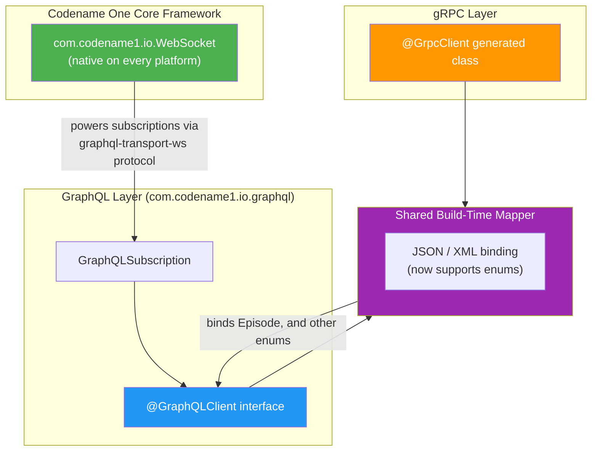
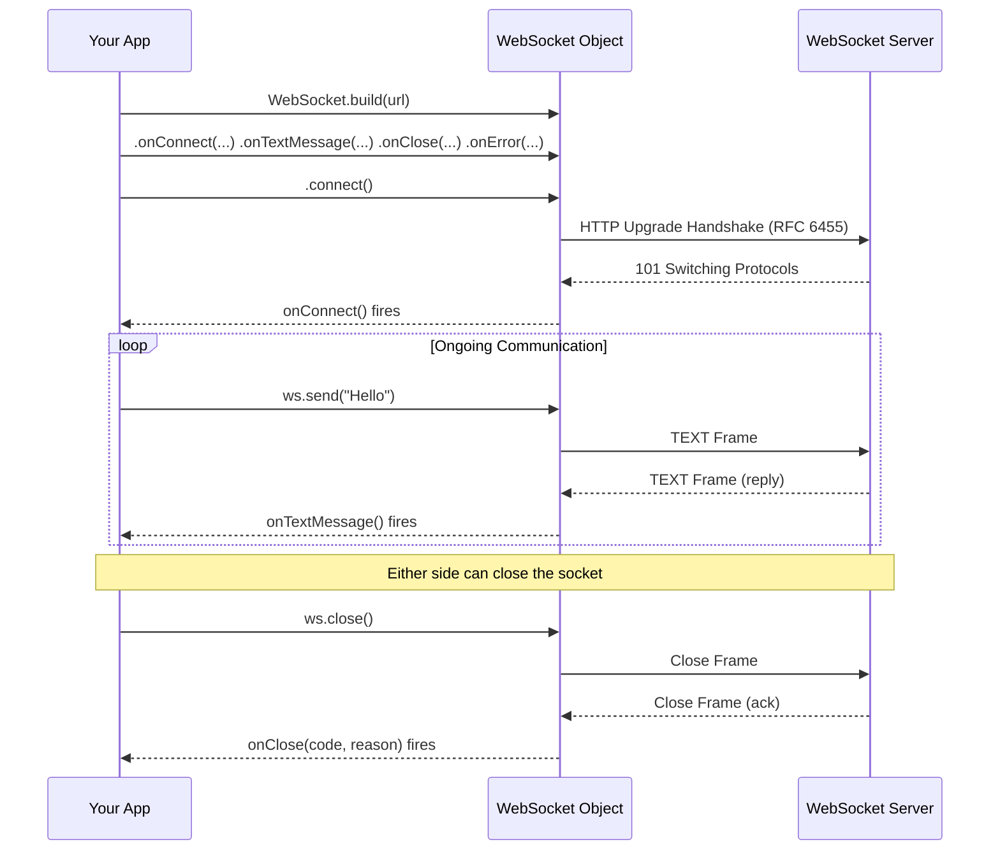
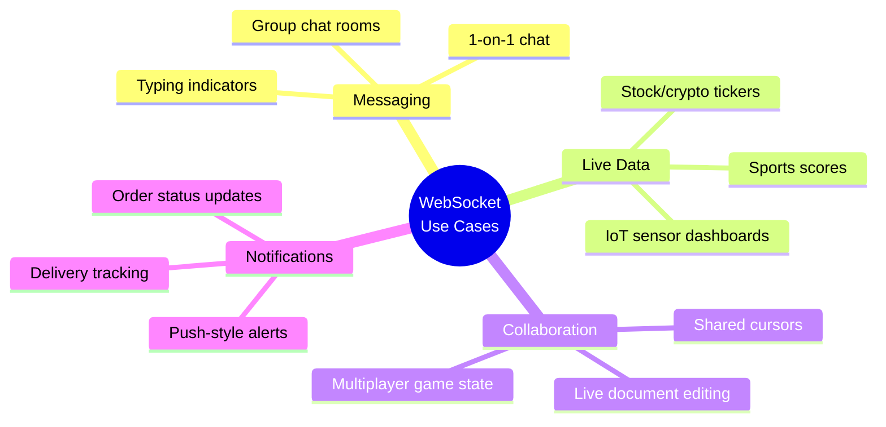
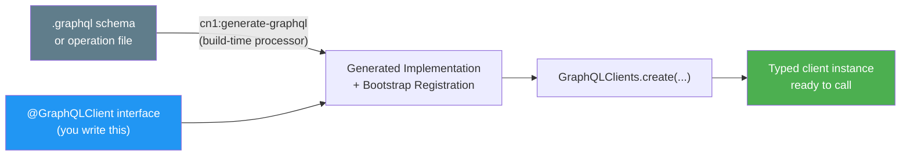
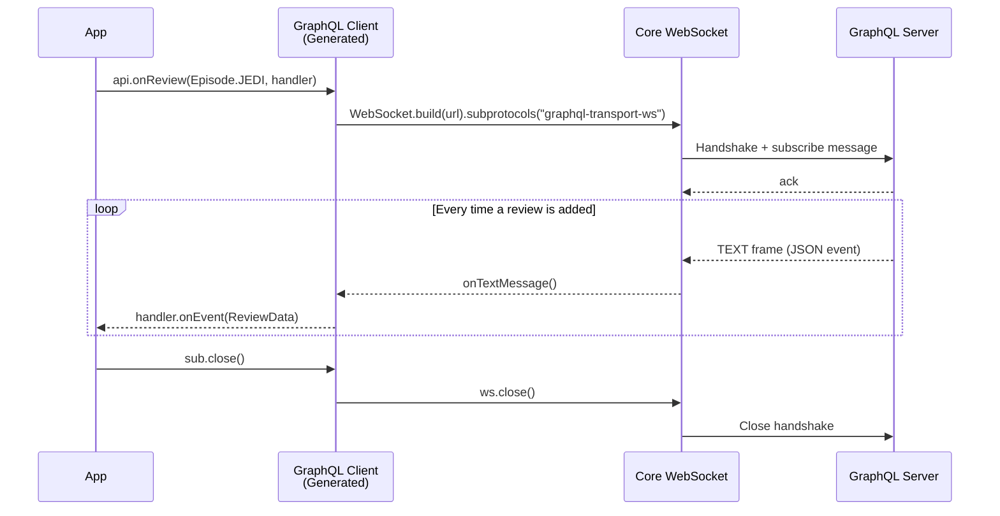
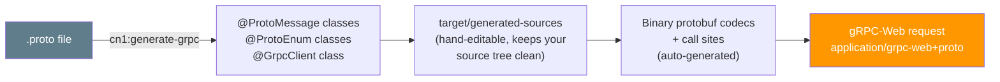
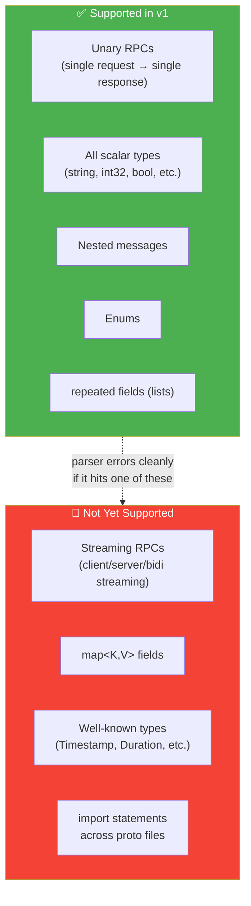
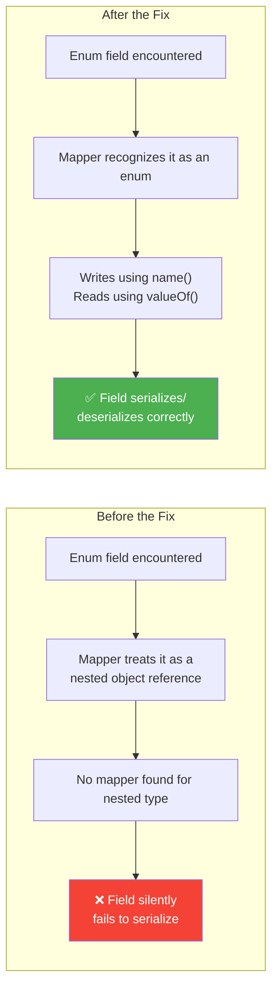
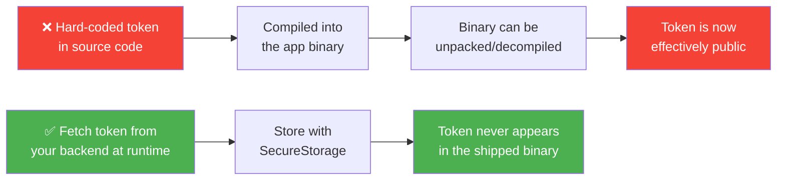
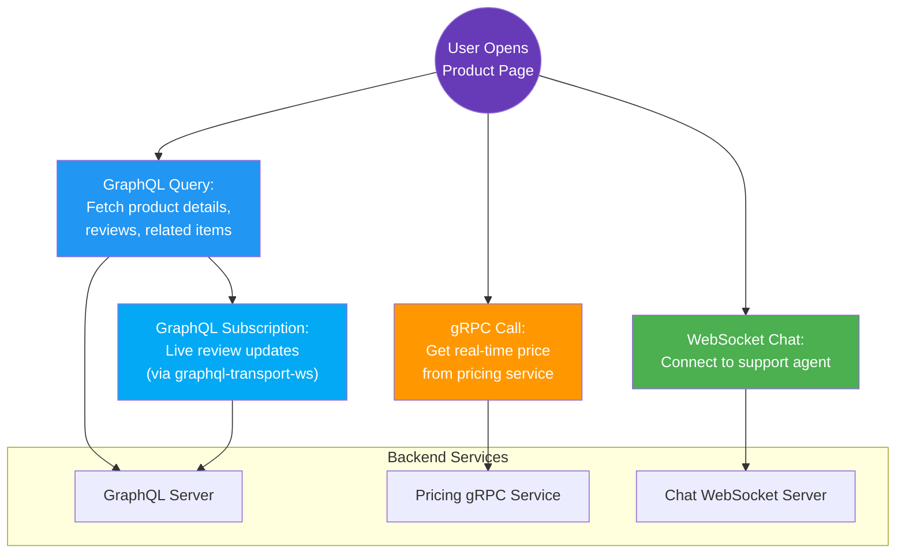

# Real-Time & Typed Connectivity in Codename One: WebSockets, GraphQL, and gRPC — A Complete Tutorial

## Introduction

Modern mobile and cross-platform apps rarely talk to a server with a single, simple HTTP request anymore. They need to:

- **Push and receive data instantly** (chat, live scores, stock tickers, notifications)
- **Query flexible, nested data structures** without over-fetching or under-fetching (GraphQL)
- **Call strongly-typed, high-performance remote procedures** with a contract-first approach (gRPC)

Codename One has just shipped all three of these capabilities in one coordinated release, and — importantly — they are **not three separate, unrelated features**. They are built on top of each other:

- **WebSockets** are now a first-class citizen of the core framework (no external library needed).
- **GraphQL subscriptions** reuse that exact WebSocket implementation under the hood.
- **gRPC code generation** reuses the same generator pattern that GraphQL (and OpenAPI before it) already established.

By the end of this tutorial, you will have built:

1. A working **real-time chat screen** using raw WebSockets
2. A **typed GraphQL client** with both queries and live subscriptions
3. A **typed gRPC client** calling a unary RPC over gRPC-Web

Let's start with the big picture.



**Why this architecture matters:** because WebSockets live in the core, the GraphQL team didn't have to write and maintain their own socket stack. That means fewer bugs, a smaller binary, and — because gRPC and GraphQL share the same codegen pipeline — a consistent developer experience across both. Learn one pattern (`cn1:generate-*` → typed interface → call it), and you know all three.

---

## Part 1: WebSockets — Real-Time Communication, No Extra Library

### 1.1 What Changed and Why It Matters

Previously, if you wanted WebSockets in a Codename One app, you had to pull in the `cn1-websockets` cn1lib — a third-party dependency with its own release cadence, its own bugs, and an extra step in your build configuration.

Now, `com.codename1.io.WebSocket` ships **inside the framework itself**, with native implementations on every target:

| Platform | Underlying Implementation |
|---|---|
| JavaSE (Simulator/Desktop) | Hand-rolled RFC 6455 handshake |
| Android | Hand-rolled RFC 6455 handshake |
| iOS | `NSURLSessionWebSocketTask` (Apple's native API) |
| JavaScript/Web | Browser's built-in `WebSocket` object |

> **Backward compatibility note:** If you already use `cn1-websockets`, nothing breaks. The package was simply moved up one level in the new core version, so there is zero namespace collision and no forced migration.

### 1.2 Understanding the WebSocket Lifecycle

Before writing code, it helps to visualize what actually happens when a WebSocket connects:



### 1.3 Step 1: Opening a Connection

The new API design is deliberately simple: a **final, immutable-feeling, fluent builder class** with lambda-based event handlers. Compare this to the old pattern (subclassing a class and passing the URL to the constructor) — that pattern made it easy to accidentally leak connections or forget handlers. The new design forces you to hold a reference to a concrete object you control.

```java
// Good practice, although in reality all current Codename One platforms support WebSockets
if (!WebSocket.isSupported()) {
    return;
}

WebSocket ws = WebSocket.build("wss://echo.example.com/socket")
    .onConnect(() -> Log.p("connected"))
    .onTextMessage(text -> addIncoming(text))
    .onClose((code, reason) -> Log.p("closed " + code + " " + reason))
    .onError(ex -> Log.e(ex))
    .connect();
```

**Key API details worth memorizing:**

- `send(...)` has both a `String` overload (text frames) and a `byte[]` overload (binary frames)
- `getReadyState()` returns a `WebSocketState` enum so you can check connection status before sending
- `close()` performs a clean, spec-compliant close handshake — it doesn't just drop the TCP socket

### 1.4 Step 2: Building a Real, Working Chat Screen

Let's go beyond "hello world" and build something you'd actually ship: a chat form with a message list and an input bar.

```java
private WebSocket ws;
private Container conversation;

private void showChat(Form parent) {
    Form chat = new Form("Live Chat", BoxLayout.y());
    conversation = chat.getContentPane();

    TextField input = new TextField("", "Message", 20, TextField.ANY);
    Button send = new Button("Send");
    send.addActionListener(e -> {
        String text = input.getText();
        if (text.length() > 0 && ws != null) {
            ws.send(text);
            addBubble(text, true);
            input.clear();
        }
    });
    Container bar = BorderLayout.centerEastWest(input, send, null);
    chat.add(BorderLayout.SOUTH, bar);

    ws = WebSocket.build("wss://chat.example.com/room/general")
        .onTextMessage(text -> Display.getInstance()
            .callSerially(() -> addBubble(text, false)))
        .connect();

    chat.show();
}

private void addBubble(String text, boolean mine) {
    Label bubble = new Label(text);
    bubble.setUIID(mine ? "ChatBubbleMe" : "ChatBubbleThem");
    Container line = FlowLayout.encloseIn(bubble);
    line.getStyle().setAlignment(mine ? Component.RIGHT : Component.LEFT);
    conversation.add(line);
    conversation.animateLayout(150);
}
```

**Two details that beginners often trip on:**

1. **`callSerially(...)` around `addBubble`** — WebSocket message callbacks may fire on a network thread, not the EDT (Event Dispatch Thread). Any code that touches UI components *must* be marshaled back onto the EDT, and `callSerially` is exactly that mechanism. Skipping this step is a common source of intermittent crashes and "it works on Simulator but not on device" bugs.
2. **Outgoing messages render immediately** (`addBubble(text, true)` runs right after `send`), rather than waiting for a server echo. This is the standard "optimistic UI" pattern — it makes the app feel instant even on a slow network.

The resulting screen, rendered in the simulator:


### 1.5 Step 3: Subprotocol Negotiation

Some WebSocket servers speak a *named subprotocol* — a mini-contract layered on top of raw WebSocket frames (think of it as an API version). You declare which subprotocols your client supports, and the server picks one during the handshake:

```java
WebSocket ws = WebSocket.build(url)
    .subprotocols("graphql-transport-ws")
    .onConnect(() -> Log.p("using " + ws.getSelectedSubprotocol()))
    .connect();
```

That specific value, `graphql-transport-ws`, isn't arbitrary — it's the exact subprotocol the GraphQL client in Part 2 uses for subscriptions. Keep that connection in mind; it's the thread tying this whole release together.

> **Trust signal:** Codename One's own screenshot CI pipeline — the system that captures rendered PNGs from every target device and ships them back to the build host — now runs over this exact WebSocket implementation. In other words, the same code path your chat app uses is validating the entire framework on every single commit.

### 1.6 Real-World Use Cases for WebSockets



| Use Case | Why WebSockets Fit |
|---|---|
| **Customer support chat widget** | Sub-second latency; server can push agent replies without polling |
| **Live auction / bidding app** | All bidders must see the current price update instantly and simultaneously |
| **Ride-hailing driver location** | Continuous, low-overhead stream of coordinates, far cheaper than repeated HTTP polling |
| **Multiplayer trivia/game app** | Server broadcasts game state to all connected clients at once |
| **Collaborative form-filling** | Multiple users editing the same record see each other's changes live |

---

## Part 2: A Typed GraphQL Client

### 2.1 The Problem GraphQL Solves

With REST, you often either **over-fetch** (the endpoint returns fields you don't need) or **under-fetch** (you need three separate calls to assemble one screen). GraphQL flips this: the client describes exactly the shape of data it wants, and the server returns exactly that — no more, no less.

Codename One's new `cn1:generate-graphql` build task reads a GraphQL schema and produces a **typed client**, so instead of hand-writing HTTP requests and manually parsing JSON, you write an interface and get a working implementation for free.



There are two generation modes worth knowing about:

- **Precise operations mode** — you supply your own `.graphql` operation documents, and the generator emits exact per-selection types matching those operations. Use this in production for maximum type safety.
- **Schema-only quick-start mode** — point it at just the schema, and it auto-selects fields up to a configurable depth (`cn1.graphql.maxDepth`). Great for prototyping, but you should switch to precise mode before shipping, since the "auto-selected" fields can silently change if the schema evolves.

### 2.2 Step 1: Declaring the Client Interface

```java
@GraphQLClient("https://swapi.example.com/graphql")
public interface StarWarsApi {

    @Query("query HeroName($episode: Episode) { hero(episode: $episode) { name homeworld { name } species { name } filmConnection { totalCount } } }")
    void hero(@Var("episode") Episode episode,
              OnComplete<GraphQLResponse<HeroData>> callback);

    @Subscription("subscription OnReview($ep: Episode!) { reviewAdded(episode: $ep) { stars } }")
    GraphQLSubscription onReview(@Var("ep") Episode ep,
                                 GraphQLSubscription.Handler<ReviewData> handler);

    static StarWarsApi of(String endpoint) {
        return GraphQLClients.create(StarWarsApi.class, endpoint);
    }
}
```

Notice what you *didn't* have to write: no `HttpURLConnection`, no manual JSON serialization of variables, no manual parsing of the response body, no error-branch plumbing. The `@Query` and `@Subscription` annotations carry the actual GraphQL operation text; the processor does the rest at build time.

**`GraphQLResponse<T>` is the key safety feature here.** GraphQL, unlike REST, can return *partial* data alongside errors (imagine a query for 5 fields where 4 succeed and 1 fails due to a permissions issue). By carrying `data` and `errors` together in one object, your app can render what succeeded instead of discarding the whole response because of one failed field.

### 2.3 Step 2: Calling the Client and Rendering Results

```java
StarWarsApi api = StarWarsApi.of("https://swapi.example.com/graphql");

api.hero(Episode.EMPIRE, response -> {
    if (!response.isOk()) {
        return;
    }
    Container list = heroForm.getContentPane();
    for (Hero h : response.getResponseData().heroes) {
        MultiButton row = new MultiButton(h.name);
        row.setTextLine2(h.homeworld + " . " + h.species);
        row.setUIID("HeroRow");
        list.add(row);
    }
    heroForm.revalidate();
});
```

The result, rendered in the simulator:


**Beginner tip:** Always check `response.isOk()` before touching `response.getResponseData()`. Because GraphQL can return partial errors, "the call completed" and "the data I need is present" are two different questions — `isOk()` answers the second one for the common case, but for advanced error handling you can still inspect the `errors` list directly.

### 2.4 Step 3: Subscriptions — Where WebSockets Come Full Circle

This is the payoff of Part 1. A `@Subscription`-annotated method doesn't return a `GraphQLResponse` — it returns a `GraphQLSubscription`, which is a live, ongoing connection backed by the **exact same `WebSocket` class** from Part 1, using the `graphql-transport-ws` subprotocol.



```java
GraphQLSubscription sub = api.onReview(Episode.JEDI, review ->
    Display.getInstance().callSerially(() -> showStars(review.stars)));

// later, e.g. when the user navigates away
sub.close();
```

> **Architectural takeaway:** because WebSockets are now a core primitive, the GraphQL subscriptions team didn't need to write, test, and maintain a *second* socket implementation. That's less code, fewer edge cases, and one battle-tested transport shared by everything above it.

### 2.5 Real-World Use Cases for GraphQL

| Use Case | Why GraphQL Fits |
|---|---|
| **Dashboard with many small widgets** | Each widget can request precisely the fields it needs from a single shared schema, avoiding N separate REST endpoints |
| **Mobile app on slow/metered networks** | No over-fetching means smaller payloads and lower data usage |
| **Live review/rating feed (subscription)** | New reviews push to the client instantly instead of polling every few seconds |
| **Product catalog with nested relations** (category → subcategory → product → reviews) | One GraphQL query replaces several chained REST calls |
| **Rapid frontend iteration** | Frontend engineers can shape queries to UI needs without waiting on backend endpoint changes |

---

## Part 3: A Typed gRPC Client

### 3.1 Why gRPC, and Why It Pairs With the Same Pattern

gRPC is built for **strongly-typed, contract-first, high-performance** service calls — you define your service and messages once in a `.proto` file, and every client/server in any language generates matching code from that single source of truth. Codename One's `cn1:generate-grpc` task follows the exact same philosophy as the GraphQL generator: point it at your contract file, get a typed client, write zero HTTP/serialization boilerplate.



Notably: **there is no `protoc` dependency**. You don't need the separate Google protobuf compiler toolchain installed — Codename One's annotation processor handles the whole pipeline itself.

### 3.2 Step 1: Define the Contract

```proto
syntax = "proto3";

service Greeter {
  rpc SayHello (HelloRequest) returns (HelloReply);
}

message HelloRequest { string name = 1; }
message HelloReply  { string message = 1; }
```

This tiny file is the single source of truth. Both client and server (regardless of what language the server is written in — Go, Java, Node, etc.) generate code from it, which is exactly why gRPC contracts stay in sync across a polyglot backend.

### 3.3 Step 2: Call the Generated Client

```java
GreeterGrpc g = GreeterGrpc.of("https://api.example.com");
HelloRequest req = new HelloRequest();
req.name = "world";

g.sayHello(req, "Bearer " + token, response -> {
    if (response.isOk()) {
        renderGreeting(response.getResponseData().message);
    }
});
```

Notice the shape is deliberately consistent with the GraphQL client from Part 2: build/obtain a typed client, construct a typed request object, pass a callback, check `isOk()`. Once you've learned this pattern for one connector, you already know it for the others.

### 3.4 Understanding the Wire Protocol

The client speaks **gRPC-Web** (`application/grpc-web+proto`), which is the standard variant of gRPC designed for browsers and mobile clients that can't do raw HTTP/2 trailers the way server-to-server gRPC can. This is the same protocol supported by:

- **Envoy** proxy's gRPC-Web filter
- The official **`grpcweb` Go proxy**
- The **gRPC-Web filter built into modern gRPC servers**

That means your Codename One app can talk to an existing gRPC backend infrastructure without your backend team needing to stand up anything Codename-One-specific.

### 3.5 What's Supported Today (Version 1 Scope)



The important detail: if your `.proto` file uses one of the unsupported features, **the parser fails clearly at build time** rather than generating broken or silently-wrong code. That's a deliberate, safety-first design choice — better a build error than a mysterious runtime bug.

### 3.6 Real-World Use Cases for gRPC

| Use Case | Why gRPC Fits |
|---|---|
| **Calling an existing microservices backend** | Many backend teams already define services in `.proto`; the mobile client just reuses that contract |
| **High-throughput, latency-sensitive calls** | Binary protobuf encoding is smaller and faster to parse than JSON |
| **Polyglot systems** (Go backend, Java backend, Codename One frontend) | One `.proto` file generates consistent types across every language |
| **Strict API contracts for regulated data** (banking, health) | Compile-time-checked message shapes reduce the risk of malformed requests |
| **Internal admin/ops tooling** | Fast to wire up against services that already expose gRPC, no REST wrapper needed |

---

## Cross-Cutting Fix: Enums Now Bind Correctly Everywhere

All three connectors — WebSockets (indirectly, via GraphQL/gRPC payloads), GraphQL, and gRPC — share **one build-time JSON/XML mapper**. That mapper now correctly binds enum types.

### The Bug, Explained



**What changed, concretely:**

- Writing an enum now calls `.name()` to get its string representation
- Reading an enum now calls `valueOf(...)` to reconstruct it — and **unknown values decode to `null`** rather than throwing, which protects your app when the server adds a new enum value you don't yet know about
- `List<Enum>` (a list of enum values) is now handled correctly too
- This applies across **both JSON and XML** serialization

This is precisely why `Episode` in the GraphQL example from Part 2 can be a real, type-safe `Episode` enum instead of a fragile raw `String` — and it's a quiet but meaningful win for anyone using the `@Mapped` annotation directly in their own data classes, independent of these three connectors.

---

## Security Reminder: Never Hard-Code Tokens

Both the gRPC and GraphQL examples above pass a bearer token (`"Bearer " + token`). This is a good moment to repeat a rule that's easy to skip when you're focused on getting a demo working:



**The rule in one sentence:** never hard-code a token, never check it into source control, and never embed it directly in the app. Fetch it from your backend at runtime (e.g., after a login flow) and persist it using `SecureStorage`. A shipped binary — mobile, desktop, or web build — can always be unpacked and inspected, so anything baked into it should be treated as public information.

---

## Putting It All Together: End-to-End Architecture

Here's how a real app might combine all three connectors in one screen — say, a live product page with chat support, a GraphQL-powered product catalog, and a gRPC call to a pricing microservice:



## Summary Table: Choosing the Right Tool

| Need | Reach For | Why |
|---|---|---|
| Instant, bidirectional, free-form messages | **WebSocket** | Lowest-level, most flexible; ideal for chat/live feeds |
| Flexible querying of nested/related data | **GraphQL** | Client controls exact shape of response; avoids over/under-fetching |
| Live updates *tied to a GraphQL schema* | **GraphQL Subscription** | Reuses your existing schema and types; built on WebSocket |
| Strongly-typed calls to an existing gRPC backend | **gRPC (unary)** | Contract-first, compact binary protocol, cross-language consistency |
| Simple request/response against a REST-style backend | *(Existing OpenAPI generator, not covered here)* | Still the right choice when your backend is plain REST |

## Key Takeaways

1. **WebSockets are now built into the Codename One core** — no `cn1-websockets` cn1lib required, and existing users of that cn1lib don't need to migrate.
2. **GraphQL subscriptions run on that same WebSocket implementation**, using the `graphql-transport-ws` subprotocol — a direct architectural link between Part 1 and Part 2 of this tutorial.
3. **gRPC code generation follows the same `cn1:generate-*` pattern** as GraphQL, so the developer experience across both is consistent: write an annotated interface/proto, get a typed client, call it.
4. **The enum-binding fix** in the shared JSON/XML mapper benefits all three connectors and any custom `@Mapped` classes.
5. **Security is your responsibility** — always fetch and store tokens at runtime via `SecureStorage`, never bake them into the binary.

## Further Reading

- WebSockets: [PR #5133](https://github.com/codenameone/CodenameOne/pull/5133)
- Typed GraphQL/gRPC clients: [PR #5141](https://github.com/codenameone/CodenameOne/pull/5141) and [PR #5099](https://github.com/codenameone/CodenameOne/pull/5099)
- Previous deep dive: [Native Mac builds and desktop integration](https://www.codenameone.com/blog/mac-native-builds-and-desktop-integration/)
- Full release index: [Mac native, gRPC, GraphQL, and fewer open issues](https://www.codenameone.com/blog/mac-native-grpc-graphql-and-fewer-open-issues/)
- Found a schema or proto file that doesn't generate what you expect? File an issue at [github.com/codenameone/CodenameOne/issues](https://github.com/codenameone/CodenameOne/issues) with the source attached.