# Microsoft Entra Passkeys - Complete Tutorial

> From Concept to Configuration: The Complete Deep Dive into Phishing-Resistant Authentication

| Difficulty | Estimated Reading Time | Last Updated |
|---|---|---|
| **Intermediate** | ~90 minutes | 2026-09-02 |

---

## Table of Contents

1. [Introduction: Why Passkeys Matter Now](#1-introduction-why-passkeys-matter-now)
2. [Prerequisites](#2-prerequisites)
3. [Learning Objectives](#3-learning-objectives)
4. [The Problem with Passwords](#4-the-problem-with-passwords)
5. [What Makes Passkeys Phishing-Resistant?](#5-what-makes-passkeys-phishing-resistant)
6. [How Passkeys Satisfy MFA Requirements](#6-how-passkeys-satisfy-mfa-requirements)
7. [Deep Dive: The WebAuthn Protocol and the Passkey Key Pair](#7-deep-dive-the-webauthn-protocol-and-the-passkey-key-pair)
8. [Cross-Device Authentication: Plug-in vs. Bluetooth Flows](#8-cross-device-authentication-plug-in-vs-bluetooth-flows)
9. [Types of Passkeys: Device-Bound vs. Synced](#9-types-of-passkeys-device-bound-vs-synced)
10. [Choosing an Implementation Approach](#10-choosing-an-implementation-approach)
11. [Real-World Use Cases](#11-real-world-use-cases)
12. [Step-by-Step Configuration in Microsoft Entra](#12-step-by-step-configuration-in-microsoft-entra)
13. [Rolling Out Passkeys to End Users](#13-rolling-out-passkeys-to-end-users)
14. [Authentication Strengths and Conditional Access](#14-authentication-strengths-and-conditional-access)
15. [FIDO2 and Entra Kerberos for On-Prem Resources](#15-fido2-and-entra-kerberos-for-on-prem-resources)
16. [What's Coming: Passkeys on Windows (Windows Hello Container)](#16-whats-coming-passkeys-on-windows-windows-hello-container)
17. [Performance Considerations](#17-performance-considerations)
18. [Security Considerations](#18-security-considerations)
19. [Testing Strategies](#19-testing-strategies)
20. [Migration Guide: From Passwords + MFA to Passkeys](#20-migration-guide-from-passwords--mfa-to-passkeys)
21. [Best Practices](#21-best-practices)
22. [Anti-Patterns](#22-anti-patterns)
23. [Troubleshooting Guide](#23-troubleshooting-guide)
24. [Hands-On Labs](#24-hands-on-labs)
25. [Practice Exercises (with Detailed Solutions)](#25-practice-exercises-with-detailed-solutions)
26. [Test Your Understanding](#26-test-your-understanding)
27. [Question Bank (50 Questions)](#27-question-bank-50-questions)
28. [Common Interview Questions](#28-common-interview-questions)
29. [Self-Assessment Checklist](#29-self-assessment-checklist)
30. [Pro Tips](#30-pro-tips)
31. [Summary & Key Takeaways](#31-summary--key-takeaways)
32. [Further Reading & Resources](#32-further-reading--resources)
33. [Learning Path & Next Steps](#33-learning-path--next-steps)

---

<a name="1-introduction-why-passkeys-matter-now"></a>
## 1. Introduction: Why Passkeys Matter Now

Imagine an authentication method that is **immune to phishing**, **impossible to reuse**, and **doesn't require your users to memorize anything** - while also being *easier* to set up than you'd expect. That's the promise of **passkeys**, and Microsoft Entra ID has brought them to General Availability (GA) for both **Device-Bound** and **Synced** flavors.

This tutorial takes the original walkthrough of Entra Passkeys and expands it into a full learning resource - covering the cryptography behind the scenes, the different deployment models, practical configuration steps, and the operational decisions you'll need to make as an identity administrator.

By the end of this guide, you'll understand:

- **Why** passkeys are considered the successor to passwords
- **How** the WebAuthn protocol actually works under the hood
- **When** to choose Device-Bound vs. Synced passkeys
- **How** to configure passkey policies, authentication strengths, and Conditional Access in Entra
- **What's** coming next for passkeys on Windows

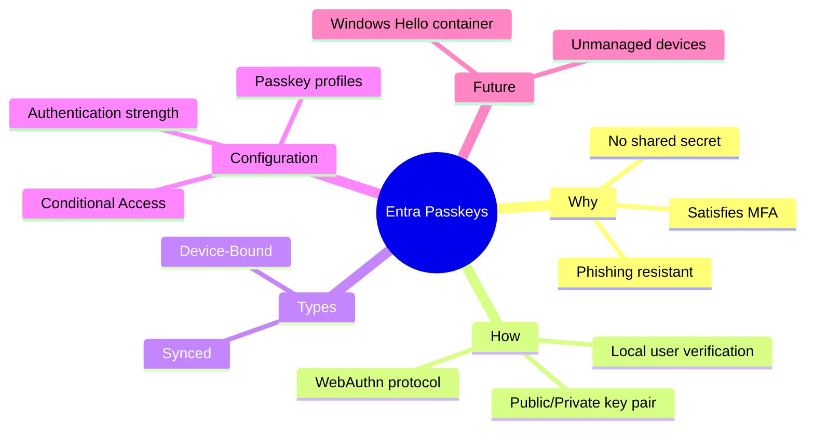

> **Key insight (the "aha moment"):** Passkeys don't just make authentication *harder to attack* - they make it *faster*. Microsoft's own data from hundreds of millions of consumer accounts shows synced passkeys are **14x faster** than password + MFA (3 seconds vs. 69 seconds) and users are **3x more likely to sign in successfully** (95% vs. 30%). Security and usability usually trade off against each other; passkeys break that rule.

---

<a name="2-prerequisites"></a>
## 2. Prerequisites

Before you work through this tutorial (and especially the hands-on labs), make sure you have:

| Requirement | Details | Level |
|---|---|---|
| **Microsoft Entra ID tenant** | Any license tier works for passkeys; Entra ID P1 is needed for Conditional Access | Required |
| **Administrative access** | *Authentication Policy Administrator* (or Global Admin) role to configure authentication methods | Required for Sections 12-16 |
| **Conditional Access access** | *Conditional Access Administrator* or Global Admin role | Required for Section 14 |
| **A test user account** | Non-critical account you can safely use for registration and sign-in testing | Required |
| **Supported devices** | Windows 10/11, macOS, iOS 16+, or Android 9+ device(s); Bluetooth for cross-device flows | Recommended |
| **Microsoft Authenticator app** | Installed on a mobile device if testing app-based passkeys | Optional |
| **FIDO2 security key** | e.g., YubiKey 5 series, Feitian - for device-bound hardware testing | Optional |
| **Basic understanding of identity concepts** | MFA, SSO, Conditional Access (helpful but not mandatory) | Helpful |

> **Safety note:** Do not experiment with authentication method policies on your production tenant's critical admin accounts. Always pilot with a dedicated test group and test accounts first.

---

<a name="3-learning-objectives"></a>
## 3. Learning Objectives

By the end of this tutorial, you will be able to:

1. **Explain** why password-based authentication (even with MFA) is structurally vulnerable to phishing, credential stuffing, and MFA fatigue attacks
2. **Describe** the WebAuthn registration and authentication ceremonies step by step, including the role of nonces, Relying Party IDs, and public/private key pairs
3. **Differentiate** Device-Bound passkeys from Synced passkeys and recommend the right type for a given user population or role
4. **Configure** the Passkeys (FIDO2) authentication method in Entra ID, including passkey profiles, attestation enforcement, and AAGUID restrictions
5. **Design** Authentication Strengths and Conditional Access policies that require passkeys - safely, using pilot groups and Report-only mode
6. **Plan** an end-user rollout, including registration sequencing so users are never locked out
7. **Extend** passkey authentication to on-premises Kerberos resources using Entra Kerberos (Cloud Kerberos Trust)
8. **Troubleshoot** the most common passkey registration and sign-in failures (Apple AutoFill settings, Bluetooth issues, attestation failures, lockouts)
9. **Evaluate** the security, performance, and user-experience trade-offs of each passkey deployment model
10. **Prepare** for upcoming capabilities such as the Windows Hello passkey container on unmanaged devices

### How this tutorial is organized

The content progresses in three phases:

- **Phase 1 - Concepts (Sections 4-9):** Why passkeys exist and how the cryptography works. No configuration required.
- **Phase 2 - Implementation (Sections 10-16):** Hands-on configuration in Microsoft Entra, from method enablement to Conditional Access and on-prem extension.
- **Phase 3 - Operations (Sections 17-33):** Performance, security, testing, migration, troubleshooting, labs, exercises, and the question bank.

> **Quick recap:** You will move from *understanding* (cryptography, phishing math) to *building* (profiles, strengths, CA policies) to *operating* (rollout, testing, troubleshooting).

---

<a name="4-the-problem-with-passwords"></a>
## 4. The Problem with Passwords (Context You Need First)

Before appreciating passkeys, it helps to understand exactly what they're replacing and why traditional password-based authentication - even with MFA bolted on - is fundamentally fragile.

### The core weaknesses of passwords

| Weakness | Description | Real-World Consequence |
|---|---|---|
| **Shared secret** | The same password is typed by the user and stored (hashed) by the server | If either side is compromised, the secret is exposed |
| **Reusability** | Users often reuse passwords across sites | A breach on one site compromises accounts elsewhere |
| **Phishable** | Users can be tricked into typing a password into a fake site | Attackers harvest credentials at scale |
| **MFA fatigue** | Even with push-based MFA, users can be socially engineered to approve fraudulent requests | "MFA bombing" attacks succeed frequently |

Passkeys solve nearly all of these because **there is no shared secret to steal**. Instead of a password traveling over the network, only a *cryptographic signature* is sent - and that signature is worthless to an attacker because it can't be replayed or reused on a different site.

> **Beginner tip:** Think of a passkey like a wax seal on a letter. Anyone can see the seal (the public key) and verify it's authentic, but only the sender's unique signet ring (the private key) can produce that seal. You never hand over the ring itself.

> **Quick recap:** Passwords are *shared*, *reused*, and *phishable* secrets. Passkeys replace the secret with a signature that is unique to each domain and each challenge.

---

<a name="5-what-makes-passkeys-phishing-resistant"></a>
## 5. What Makes Passkeys Phishing-Resistant?

The original article makes an important but easy-to-miss point: passkeys are cryptographically **bound to the legitimate service provider's domain** (called the **Relying Party ID**, e.g., `login.microsoftonline.com`). This property is formally known as **verifier impersonation resistance** - an authenticator only releases credentials to the Relying Party the passkey was registered with, never to an attacker pretending to be that Relying Party.

### Why this matters - a worked example

**Scenario A: Traditional Password Phishing**
1. Attacker sends an email with a link to `login-microsft0nline.com` (a look-alike domain)
2. User doesn't notice the typo and types their username/password
3. Attacker now has valid credentials and can log in as the user

**Scenario B: Passkey Attempted Phishing**
1. Attacker sends the same phishing email with the same fake domain
2. User's browser/authenticator tries to use the passkey
3. **The authenticator checks the Relying Party ID against the domain the passkey was registered to**
4. Since `login-microsft0nline.com` is not equal to `login.microsoftonline.com`, **the authenticator refuses to even offer the passkey**
5. No credential is exposed - the attack fails before it starts

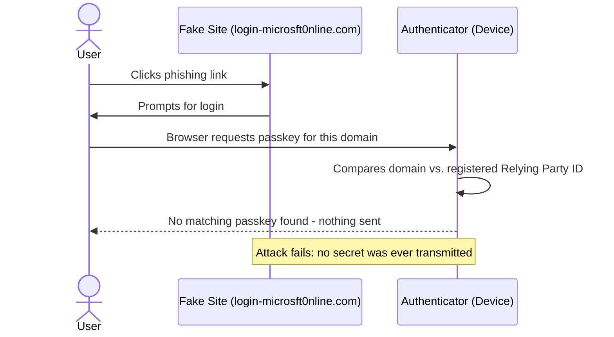

This is the single biggest structural advantage passkeys have over passwords, OTP codes, and even push-notification MFA - all of which *can* be phished because they don't inherently validate the domain requesting them.

> **Note on downgrade attacks:** Passkeys resist *remote phishing*, not every threat. An attacker with physical possession of your unlocked device, or malware on it, is a different threat model - which is exactly why high-privilege roles often pair device-bound passkeys with attestation and hardware-backed storage.

> **Quick recap:** Phishing resistance = the authenticator enforces the domain binding for you. The user can't be socially engineered into "approving" the wrong site, because the wrong site never even sees the option.

---

<a name="6-how-passkeys-satisfy-mfa-requirements"></a>
## 6. How Passkeys Satisfy MFA Requirements

It might feel odd that a *single* action (touching your device or scanning your fingerprint) can count as **multi**-factor authentication. But passkeys bundle two independent factors into one seamless motion:

| Factor Category | What It Is | Passkey Equivalent |
|---|---|---|
| **Something you have** | A physical possession | The device storing the private key (phone, laptop, FIDO2 key) |
| **Something you know / are** | A memorized secret or biometric trait | PIN or biometric (Face ID, fingerprint, Windows Hello) that unlocks the private key |

### Example walkthrough

Let's say Priya, an IT admin, registers a passkey on her Windows laptop:

1. Her laptop's **TPM (Trusted Platform Module)** generates and stores the private key - this satisfies **"something you have"** (the specific laptop)
2. To use that key, Priya must authenticate locally with **Windows Hello facial recognition** - this satisfies **"something you know or are"**
3. Both factors are verified *before* any signature is produced - Entra receives proof that both conditions were met

Because both factors are validated **locally on the device** before the challenge is signed, Entra doesn't need to separately prompt for a second factor - the passkey ceremony *is* the MFA ceremony.

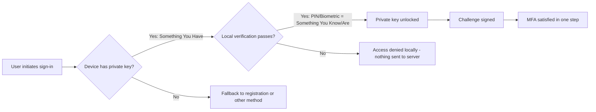

> **Why this matters for Conditional Access:** Because passkeys satisfy MFA in one step, you can target them directly with **Authentication Strengths** (Section 14) instead of layering a second prompt after sign-in - fewer prompts, same assurance.

---

<a name="7-deep-dive-the-webauthn-protocol-and-the-passkey-key-pair"></a>
## 7. Deep Dive: The WebAuthn Protocol and the Passkey Key Pair

This is the heart of understanding passkeys. Passkeys (FIDO2) follow FIDO standards, using **WebAuthn** for browser communication and **CTAP** for authenticator communication.

### 7.1 What happens during registration

When a user first creates a passkey:

1. The device (or authenticator) generates a **public/private key pair** unique to that account + that Relying Party
2. The **private key never leaves the secure hardware** - it's stored in:
   - The device's **TPM** (Windows) or **Secure Enclave** (Mac/iOS) for device-bound passkeys, OR
   - An **encrypted vault** synced by a passkey provider (Apple Keychain, Google Password Manager, 1Password) for synced passkeys. Technically, the key is created by the device's hardware security module (HSM), encrypted locally, and then synced to the provider's cloud
3. The **public key** is sent to Entra ID and stored against the user's account - this is safe to share, since it can only *verify* signatures, not create them

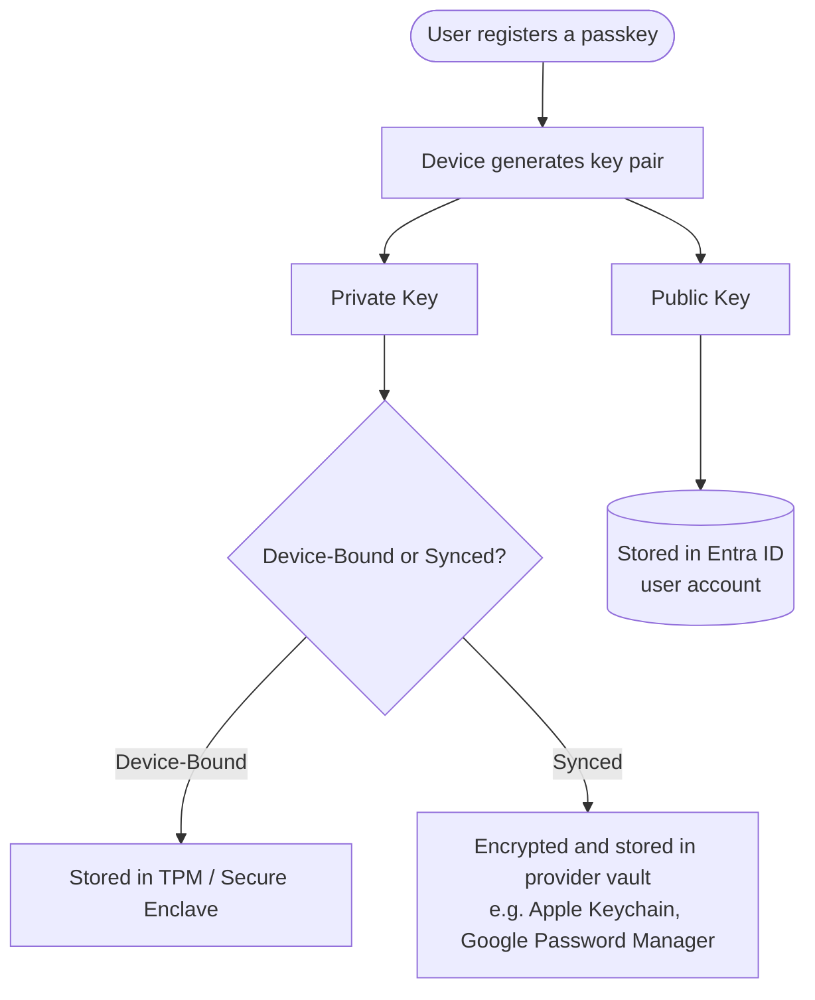

### 7.2 What the browser actually does - registration code example

The following JavaScript shows the WebAuthn API call that underpins passkey registration (simplified from what the Entra sign-in page performs). This is what an application developer would write when adding WebAuthn directly - Entra handles this for you at `login.microsoftonline.com`:

```javascript
// REGISTRATION CEREMONY (conceptual, simplified)
// The server (Entra) first sends a single-use challenge over HTTPS.

async function registerPasskey(challengeFromEntra, userIdBuffer) {
  try {
    const credential = await navigator.credentials.create({
      publicKey: {
        // Single-use nonce from Entra - prevents replay of old registrations
        challenge: challengeFromEntra,

        // The Relying Party ID. MUST match the origin's domain.
        // For Entra this is always login.microsoftonline.com
        rp: { id: "login.microsoftonline.com", name: "Microsoft Entra ID" },

        // The user the credential is bound to
        user: {
          id: userIdBuffer,
          name: "priya@contoso.com",
          displayName: "Priya (Cloud Team)"
        },

        // Algorithms the server can verify: ES256 and RS256
        pubKeyCredParams: [
          { type: "public-key", alg: -7 },    // ES256
          { type: "public-key", alg: -257 }   // RS256
        ],

        authenticatorSelection: {
          // Discoverable credential: the passkey is findable by RP ID,
          // enabling username-less flows
          residentKey: "required",
          // Enforce local biometric/PIN => the "MFA in one step" property
          userVerification: "required",
          // "platform" = built-in (TPM/Secure Enclave);
          // "cross-platform" = roaming FIDO2 key (USB/NFC)
          authenticatorAttachment: "platform"
        },

        // "direct" asks the authenticator for attestation evidence
        // so Entra can verify the device model (AAGUID certification)
        attestation: "direct"
      }
    });

    // credential.response contains attestationObject + clientDataJSON.
    // The PUBLIC key inside is sent to Entra; the private key never leaves
    // the TPM / Secure Enclave / vault.
    return credential;
  } catch (err) {
    // Typical failure modes:
    // - NotAllowedError: user cancelled, or the request was not in a
    //   user gesture / same-origin context
    // - InvalidStateError: this device already holds a credential for
    //   this account (must be excluded or reused)
    // - SecurityError: the RP ID does not match the page origin
    console.error("Passkey registration failed:", err.name, err.message);
    throw err;
  }
}
```

> **Note the error handling:** `SecurityError` is the browser enforcing the domain binding you learned about in Section 5 - it is the code-level expression of phishing resistance. `InvalidStateError` is how the device tells the server "a credential already exists here" - which is why Entra lets you register multiple passkeys per account (one per device).

---

### 7.3 What happens during sign-in (the full WebAuthn ceremony)

This is a step-by-step expansion of the original 6-step flow, with added explanation for each stage:

**Step 1 - Sign-in attempt**
The user tries to access an M365 resource (e.g., Outlook, Teams, or the Azure portal) and is redirected to Entra ID for authentication.

**Step 2 - Challenge issuance**
Entra generates a **cryptographic nonce** (a random, single-use value) and sends it along with the **Relying Party ID** (`login.microsoftonline.com`). The nonce prevents *replay attacks* - even if someone captured a previous signed response, it would be useless because the nonce changes every time.

**Step 3 - Challenge routed to the authenticator**
The browser passes this challenge to the appropriate authenticator via the **WebAuthn API**:
- The device's TPM/Secure Enclave (if device-bound)
- A FIDO2 security key (via USB/NFC)
- An authenticator app (via QR code + Bluetooth)

**Step 4 - Local user verification**
The user proves presence and identity *locally*:
- Biometric scan (fingerprint/Face ID) or PIN entry, or
- Scanning a QR code with a phone that then performs its own local biometric check

Crucially, **this verification never leaves the device** - no biometric data is ever transmitted to Entra.

**Step 5 - Signing the challenge**
Once verification succeeds, the device uses the private key to sign:
- The **authenticator data** (flags proving user presence + verification)
- A **hash of the client data** (which bundles the nonce, the origin/domain, and the Relying Party ID)

The signed package sent back to Entra includes:

| Component | Purpose |
|---|---|
| **Credential ID** | Tells Entra which public key to retrieve for verification |
| **Authenticator data** | Flags confirming the user was present and verified |
| **Signature** | Cryptographic proof produced only by the correct private key |

**Step 6 - Server-side verification**
Entra:
1. Looks up the public key matching the credential ID
2. Verifies the signature mathematically against that public key
3. If valid, issues an **access token**
4. If invalid, authentication fails - no token issued

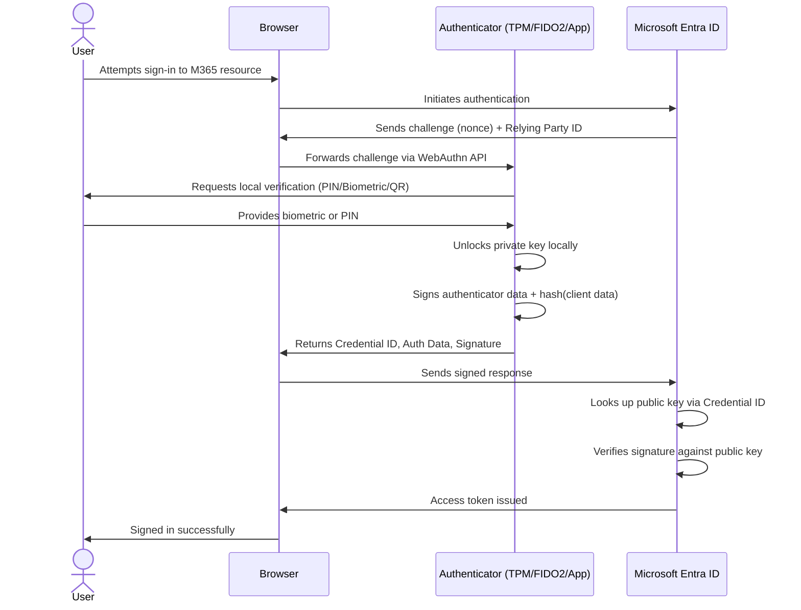

### 7.4 Sign-in code example (authentication/assertion ceremony)

```javascript
// AUTHENTICATION CEREMONY (conceptual, simplified)
async function signInWithPasskey(challengeFromEntra, allowedCredentialIds) {
  try {
    const assertion = await navigator.credentials.get({
      publicKey: {
        // Fresh single-use nonce - a captured response can never be replayed
        challenge: challengeFromEntra,

        // Domain binding again: the browser will only let authenticators
        // respond if they registered against this exact RP ID
        rpId: "login.microsoftonline.com",

        // Optionally scope to specific credential IDs registered by this user
        allowCredentials: allowedCredentialIds.map(id => ({
          type: "public-key",
          id: id
        })),

        // Server requires proof of local biometric/PIN (UV flag)
        userVerification: "required",

        timeout: 60000 // give the user one minute to complete the gesture
      }
    });

    // Send assertion.response (authenticatorData + signature + clientDataJSON)
    // to the server, which verifies the signature against the stored public key.
    return assertion;
  } catch (err) {
    if (err.name === "NotAllowedError") {
      // Common cause in phishing scenarios: no passkey registered for
      // THIS RP ID, or the user/timeout was aborted.
      console.warn("No matching passkey for this domain - phishing blocked?");
    }
    throw err;
  }
}
```

### 7.5 Why this design is elegant

Notice that at no point does a secret travel across the network. The nonce ensures freshness (no replay), the Relying Party ID ensures domain-binding (no phishing), and the signature proves possession of the private key (no impersonation) - all without ever exposing the key itself.

> **Quick recap:** Registration = *create key pair, publish the public key*. Sign-in = *sign a fresh challenge with the private key*. Verification = *check the signature with the public key*. Three different jobs, only one of which involves a secret - and that secret never moves.

---

<a name="8-cross-device-authentication-plug-in-vs-bluetooth-flows"></a>
## 8. Cross-Device Authentication: Plug-in vs. Bluetooth Flows

Not every sign-in happens on the same device where the passkey lives. The original article identifies two cross-device patterns - let's break down exactly when you'd use each.

### 8.1 Plug-in Passkeys (USB / NFC)

**How it works:** A physical FIDO2 security key (e.g., YubiKey) is inserted via USB or tapped via NFC. The user touches the key to confirm presence, which may also trigger a biometric or PIN check on the key itself.

**Best for:**
- Shared kiosks or workstations where no personal device is available
- High-security roles requiring a *specific, dedicated* hardware token
- Environments where Bluetooth is disabled for security reasons

### 8.2 Passkeys via Authenticator Apps (Bluetooth)

**How it works:** The user scans a QR code displayed on the sign-in screen using their phone. This establishes a Bluetooth-based encrypted tunnel between the phone and the machine being signed into (the CTAP *hybrid transport*), over which the WebAuthn challenge/response flows.

**Best for:**
- BYOD (Bring Your Own Device) scenarios
- Users who don't carry a hardware key but always have their phone
- Consumer and hybrid workforce scenarios

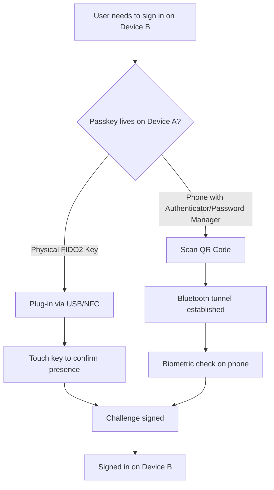

> **Use case:** A consultant working from a client's loaner laptop can scan a QR code with their personal phone to sign in - without ever touching a password field or installing anything on the loaner machine.

> **Gotcha:** The Bluetooth requirement is *radio proximity*, not pairing. Both devices need Bluetooth enabled (and be within ~a few meters), but you do not pair them through Bluetooth settings. This trips up many first-time users - see the Troubleshooting section.

### 8.3 Choosing between the two flows

| Criterion | Plug-in (USB/NFC) | QR + Bluetooth |
|---|---|---|
| Hardware cost | Per-user security key | None (uses existing phone) |
| Works on locked-down/air-gapped machines | Yes | Only if Bluetooth is allowed |
| User friction | Low (carry a key) | Low (phone is usually in pocket) |
| Shared/kiosk devices | Excellent | Good (no credentials left on the kiosk) |
| Highest-assurance roles | Preferred | Acceptable with device-bound app passkeys |

---

<a name="9-types-of-passkeys-device-bound-vs-synced"></a>
## 9. Types of Passkeys: Device-Bound vs. Synced

This is the most important architectural decision you'll make when rolling out passkeys. Let's compare them thoroughly.

### 9.1 Device-Bound Passkeys

Each device creates its **own independent key pair** - there is no syncing between devices. If a user has a passkey on their laptop and later creates one on their phone, these are two entirely separate credentials registered against the same account.

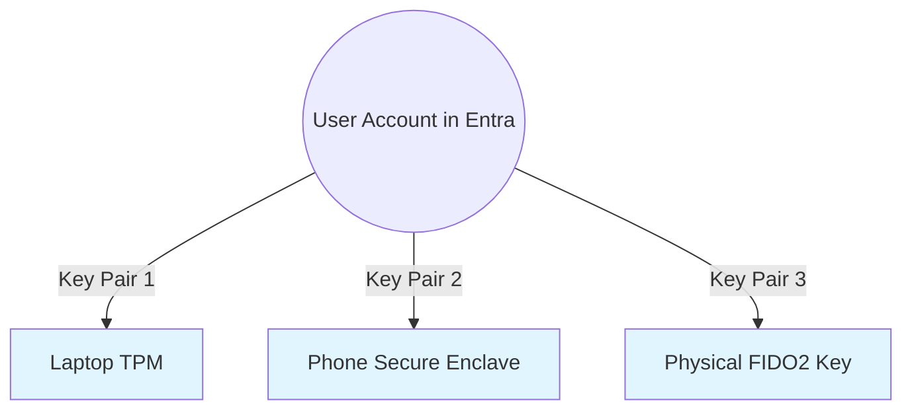

Examples of device-bound passkeys include **Microsoft Authenticator** app passkeys and **FIDO2 security keys**.

**Key characteristic:** If the device is lost, that specific passkey is gone - the user must register a **new** passkey on a replacement device. There is no cloud recovery for the credential itself.

**Pros:**
- Maximum security - a compromised cloud vault elsewhere can't expose this credential
- Supports **attestation** (verifiable device provenance via the FIDO Metadata Service)
- Ideal for controlling *exactly which hardware* can authenticate

**Cons:**
- No automatic recovery if the device is lost
- Requires re-registration on every new device
- Higher cost and helpdesk overhead (lost keys, replacement logistics)

---

#### Real Use Case: Privileged Access Elevation

The original article gives an excellent example worth expanding on:

> Priya is part of the Cloud Team and has an eligible PIM role for **Application Administrator**. The organization sets the **Authentication Strength** for this role elevation to *require a specific FIDO2 key* - not the Authenticator app, not any passkey.

**Why this matters:** This dramatically reduces attack surface. Even if an attacker compromises Priya's phone (where her Authenticator app lives), they **cannot** elevate to Application Administrator, because that role specifically demands the physical FIDO2 key - a device-bound passkey that can't be phished, cloned, or remotely accessed.

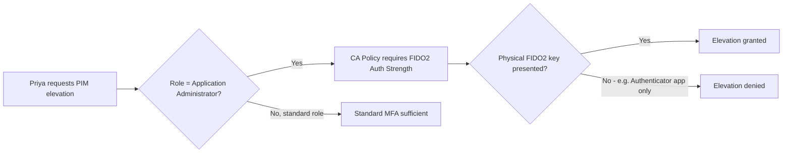

### 9.2 Synced Passkeys

The private key is **created by the device's hardware security module, encrypted locally, and synced** across a user's devices via a passkey provider's cloud service:

| Provider | Platform | Storage Location |
|---|---|---|
| Apple | iOS / macOS | Apple Keychain (iCloud) |
| Google | Android | Google Password Manager |
| 1Password | Cross-platform | 1Password Vault |

**Key characteristic:** If the user gets a new phone signed into the same Apple ID/Google account, the passkey is **automatically available** - no re-registration needed.

**Pros:**
- Seamless recovery - losing a device doesn't mean losing access
- Better user experience for everyday accounts (use the device's native unlock: face, fingerprint, or PIN)
- Low cost - no hardware to buy; Microsoft's data shows 99% successful registration and 3-second sign-ins

**Cons:**
- **Synced passkeys do not support attestation** - you cannot cryptographically verify the device/provider model
- Security now partially depends on the passkey provider's cloud account security
- Less appropriate for the highest-privilege scenarios

> **Important Apple-specific tip from the original article:** If you don't see the **Apple Passwords** option when creating a passkey on iOS, check **Settings > General > AutoFill & Passwords** - this must be enabled for Apple Keychain passkey creation to appear as an option.

### 9.3 Side-by-side comparison

| Attribute | Device-Bound | Synced |
|---|---|---|
| Private key location | Single device (TPM/Secure Enclave/key) | Encrypted in provider cloud vault |
| Recovery on device loss | Re-register manually | Automatic (via provider account) |
| Attestation support | Yes | No |
| AAGUID restriction support | Yes | Not applicable |
| Cost | Hardware cost (for keys) | None |
| Best fit | Admins, privileged roles, regulated industries | Everyday workforce, frontline, BYOD |
| Registration success rate | High (with good comms) | ~99% (Microsoft consumer data) |

### 9.4 Decision Framework: Which Type Should You Use?

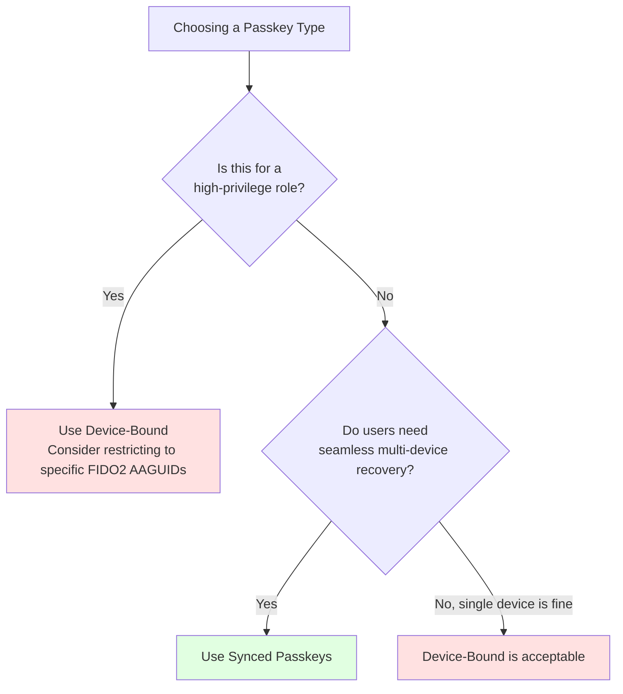

> **Quick recap:** Device-Bound = maximum control, no cloud recovery. Synced = maximum convenience, provider-dependent security. Microsoft's official guidance: FIDO2 keys (or Authenticator passkeys) for highly regulated industries and elevated privileges; synced passkeys for everyone else - and note that *either* type is a major security upgrade over phishable MFA.

---

<a name="10-choosing-an-implementation-approach"></a>
## 10. Choosing an Implementation Approach

There are four viable deployment approaches in Entra ID. Most organizations end up with a **hybrid of approaches**, matched to user risk tiers:

| Approach | What It Is | Security | Cost | Recovery | Best For |
|---|---|---|---|---|---|
| **1. FIDO2 security keys** | Dedicated hardware (USB/NFC), device-bound, attested | Highest | ~$25-60/user | Re-issuance | Privileged admins, regulated industries, no-phone environments |
| **2. Authenticator app passkeys** | Device-bound passkey in Microsoft Authenticator on the user's phone | High | None | Re-register on new phone | Admins without hardware keys, mobile-first workforce |
| **3. Synced passkeys** | Apple Keychain / Google Password Manager vaults | Good | None | Automatic via provider | General workforce, BYOD, frontline |
| **4. Windows Hello container passkeys** | Passkeys stored via plain Windows Hello, including on unmanaged devices | Good (device-bound style) | None | Device-local | Shared/unmanaged Windows PCs (see Section 16) |

### Recommended tiered model

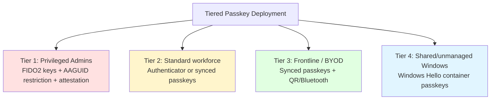

**Trade-off discussion:** Every step up in assurance adds operational cost. Tier 1 hardware keys cost money and generate helpdesk tickets when lost; Tier 3 synced passkeys cost nothing but move part of the security story to Apple/Google account hygiene. The right answer for most enterprises is *all of the above, scoped by role* - which is exactly what passkey profiles plus Authentication Strengths enable.

---

<a name="11-real-world-use-cases"></a>
## 11. Real-World Use Cases

Beyond the PIM elevation scenario above, here are several practical deployment patterns:

### Use Case 1: Frontline / Shared Device Workers
**Scenario:** Retail or healthcare staff share workstations but each has a personal phone.
**Solution:** Synced passkeys via Authenticator app + QR/Bluetooth cross-device flow - no credentials stored on the shared device itself.

### Use Case 2: Executive & Admin Accounts
**Scenario:** C-suite and Global Admins are high-value phishing targets.
**Solution:** Device-bound passkeys on dedicated, managed hardware, combined with a Conditional Access policy requiring a specific Authentication Strength tied to that hardware.

### Use Case 3: Contractor / BYOD Workforce
**Scenario:** External contractors use personal laptops with no MDM enrollment.
**Solution:** Synced passkeys registered through a personal password manager (e.g., 1Password), scoped with a Conditional Access policy limiting access to specific applications.

### Use Case 4: Hybrid On-Prem + Cloud Environments
**Scenario:** Organization needs passkey authentication to extend to on-prem file shares and legacy Kerberos-based apps.
**Solution:** Combine passkeys with **Entra Kerberos** (Cloud Kerberos Trust) - see Section 15.

### Use Case 5: Unmanaged/Personal Devices
**Scenario:** Employees need phishing-resistant sign-in on personal, unmanaged Windows PCs.
**Solution:** The **Windows Hello passkey container** feature (see Section 16).

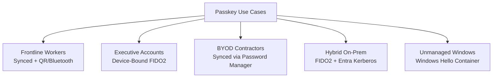

### Use Case 6: Highly Regulated Industries (Finance/Healthcare)
**Scenario:** A bank must demonstrate verifiable device provenance for auditors ("only certified hardware may access core systems").
**Solution:** Device-bound FIDO2 keys with **attestation enforcement on** (validated against the FIDO Metadata Service) plus an allow-list of AAGUIDs. The attestation chain gives the auditor cryptographic proof, not just inventory records.

---

<a name="12-step-by-step-configuration-in-microsoft-entra"></a>
## 12. Step-by-Step Configuration in Microsoft Entra

> **Best practice from the original article:** Always test with a **pilot group** before organization-wide rollout, especially if passkeys are new to your environment.

### High-level rollout flow

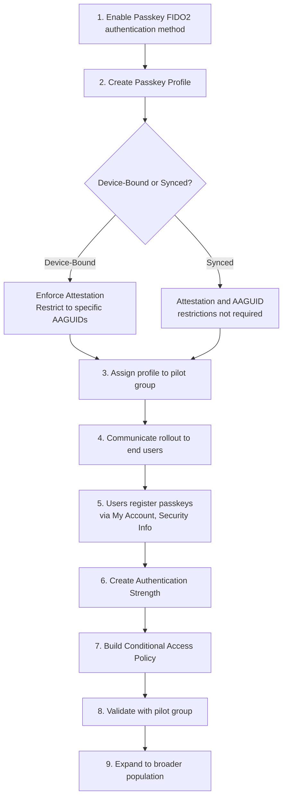

### 12.1 Creating the pilot group first (PowerShell / Microsoft Graph)

Before touching the portal, create the pilot group you'll target everywhere (method policy, profiles, CA):

```powershell
# Requires Microsoft Graph PowerShell SDK
# Install-Module Microsoft.Graph -Scope CurrentUser

Connect-MgGraph -Scopes "Group.ReadWrite.All", "User.Read.All"

# Create a security group for the passkey pilot
$pilot = New-MgGroup -DisplayName "Passkey Pilot Group" `
    -MailNickname "passkey-pilot" `
    -MailEnabled:$false `
    -SecurityEnabled `
    -Description "Pilot group for Entra passkey rollout - do not delete"

# Add your test users
$testUser = Get-MgUser -Filter "userPrincipalName eq 'priya-test@contoso.com'"
New-MgGroupMember -GroupId $pilot.Id -DirectoryObjectId $testUser.Id

Write-Host "Pilot group created: $($pilot.Id)"
```

### 12.2 Enabling the Passkeys (FIDO2) method via Microsoft Graph (optional alternative to the portal)

Portal path: **Entra admin center > Protection > Authentication methods > Policies > Passkey (FIDO2)**. The same configuration can be applied programmatically:

```http
PATCH https://graph.microsoft.com/beta/policies/authenticationMethodsPolicy/authenticationMethodConfigurations/fido2
Content-Type: application/json

{
  "@odata.type": "#microsoft.graph.fido2AuthenticationMethodConfiguration",
  "state": "enabled",
  "isSelfServiceRegistrationAllowed": true,
  "isAttestationEnforced": false,
  "keyRestrictions": {
    "isEnforced": true,
    "enforcedKeyType": "allow",
    "enforcedFido2KeyTypes": [
      {
        "aaGuid": "cb69481e-8ff7-4039-93ec-0a2729a154a8",
        "attestationCertificates": [],
        "attestationLevel": "attestationCaDefined"
      }
    ]
  }
}
```

```text
NOTE: The AAGUID above is an example (YubiKey 5 series). Replace it with the
AAGUID of the specific hardware you have certified. Graph authentication
method policy endpoints are version-sensitive - check the current
documentation for the exact schema before running in production.
```

---

### 12.3 Configuring the Passkey Profile

Entra now provides **Passkey profiles**, letting you configure Device-Bound or Synced passkeys separately and target them to All Users or specific groups. (Previously, only Device-Bound passkeys were supported - this is a significant improvement.)

**Default Device-Bound profile settings typically include:**
- **Enforce attestation** - verifies the FIDO2 key model or passkey provider is genuine, with proper vendor certification (validated against the FIDO Metadata Service). Remember: if attestation is enforced, only device-bound passkeys are allowed; synced passkeys are excluded
- **Restrict to specific providers** - e.g., limiting to Microsoft Authenticator on Android/iOS, or specific FIDO2 key AAGUIDs

> **What is an AAGUID?** An **Authenticator Attestation GUID** uniquely identifies the *make and model* of an authenticator (e.g., "YubiKey 5 NFC"). Restricting by AAGUID lets you say "only this exact hardware model may be used" - useful for high-security roles. Vendor AAGUIDs are published by manufacturers and listed in the FIDO Metadata Service.

### 12.4 Creating a Synced Passkeys Policy

1. Navigate to the **Configure** section in the Passkey authentication method
2. Select **Add profile**
3. Since this is a *synced* profile, you can skip:
   - Enforce attestation (not applicable - synced passkeys can't attest)
   - Target specific AAGUIDs (not applicable)
4. Click **Save**
5. Go to the **Enable and target** tab
6. Select **Add target**, then choose **All users** or **Select targets** for a scoped rollout
7. Optionally delete the default "All users" row and add your specific pilot group instead
8. Click **Save**


### 12.5 Configuration verification checklist

After configuring, verify before moving on:

- [ ] The Passkeys (FIDO2) method shows **Enabled** in Authentication methods
- [ ] Your device-bound profile lists the exact AAGUIDs you intend (if restricting)
- [ ] Your synced profile targets the pilot group only (not All Users, during pilot)
- [ ] A pilot-group user can see **Passkey** as an option under My Account > Security Info > Add sign-in method
- [ ] A non-pilot user does *not* see the Passkey registration option

---

<a name="13-rolling-out-passkeys-to-end-users"></a>
## 13. Rolling Out Passkeys to End Users

**Critical sequencing point from the original article:** Get users registered for a passkey **before** you enable the Conditional Access policy that requires it. Otherwise, users will be locked out at their next sign-in with no registered method.

### 13.1 The registration path

Users register via: **My Account > Security Info > Add sign-in method > Passkey**

### 13.2 If the user's Passkey Profile is Device-Bound

The user has two paths:
1. **Create the passkey in an Authenticator app** - so they're not tied to a single physical device
2. **Create the passkey on the device itself** - e.g., stored in the Windows TPM, or optionally created externally

### 13.3 If the user's Passkey Profile is Synced

1. User selects the **Passkey** option
2. Chooses **Create Passkey using another device**
3. On the **"Choose where to save your passkey"** screen, selects **iPhone, iPad, or Android device**
4. Scans the displayed **QR code** with their mobile device
5. Selects **Passwords** (Apple Keychain) or the equivalent password manager
6. Completes the scan - the key is created and stored in Keychain (or equivalent)
7. **Bluetooth connectivity is required** between the signing-in device (e.g., laptop) and the mobile device during this process

Once complete, the passkey will appear listed under **Security Info** for the user.

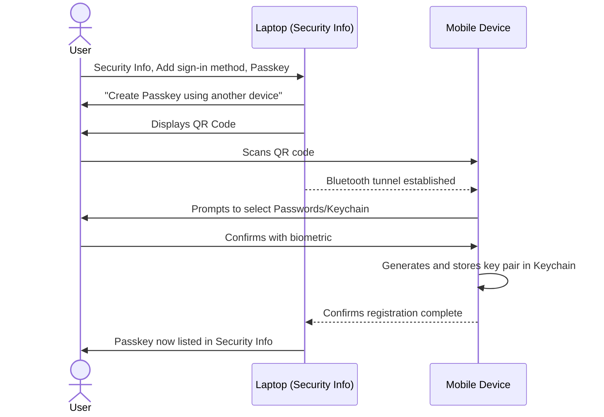

### 13.4 Rollout communication template (copy/paste)

```text
Subject: Passwordless sign-in is coming - 5 minutes to set up your Passkey

Hi {firstName},

On {date}, our team will begin requiring passkey sign-in for {resource}.
A passkey is a fingerprint/face/PIN-protected credential that replaces
passwords and is immune to phishing.

Please do this BEFORE {date}:
  1. Go to https://mysignins.microsoft.com/security-info
  2. Click "Add sign-in method" and choose "Passkey"
  3. Follow the prompts (have your phone nearby; Bluetooth is used)

Need help? Reply to this email or visit the IT self-service portal.
```

---

<a name="14-authentication-strengths-and-conditional-access"></a>
## 14. Authentication Strengths and Conditional Access

### 14.1 Creating an Authentication Strength

Authentication Strengths let you define *which* methods are acceptable for a given Conditional Access policy - rather than just "any MFA method."

**Steps:**
1. Navigate to **Entra admin center > Protection > Conditional Access > Authentication strength**
2. Create a new strength (e.g., named **"Passkeys FTW"**)
3. Select **only Passkeys** as the allowed method (excluding SMS, Voice, etc.)

> **Caution flagged in the original article:** Taking this approach - restricting to *only* passkeys - is aggressive. Apply the Conditional Access policy to a **pilot group first**, not organization-wide, to avoid locking out users who haven't registered yet.

### 14.2 Designing the Conditional Access Policy

1. Define your **users** (start with pilot group), **target resources**, and any other conditions (locations, device compliance, etc.)
2. Under **Grant controls**, select **Require authentication strength**
3. Choose the strength you created (e.g., "Passkeys FTW")

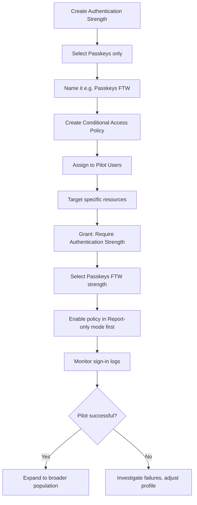

> **Best practice beyond the original article:** Always run a new Conditional Access policy in **Report-only mode** first. This lets you review the sign-in logs to see who *would* have been blocked, without actually blocking anyone - a critical safety net before full enforcement.

### 14.3 Scoped policy patterns

| Goal | Policy Design |
|---|---|
| Require passkeys for one app | CA: Users = pilot group, Target resources = the app, Grant = Passkeys FTW strength |
| Require FIDO2 key for PIM elevation | CA: Users = role-assignable group, Target = PIM/privatized elevation, Grant = strength limited to specific AAGUIDs |
| Passkey-only from untrusted locations | CA: Conditions = all locations except trusted, Grant = Passkeys FTW |
| Graceful onboarding | Two policies: Report-only org-wide + enforced on pilot, migrate users between groups |

### 14.4 Monitoring the rollout (sign-in log queries)

```text
Entra admin center > Monitoring > Sign-in logs

Filter hints during pilot:
- Authentication requirement: "Multi-factor authentication"
- Authentication method detail contains: "Passkey (Device)" or "Passkey (Security Key)"
- Failure reason: "User needs to register first" style errors => onboarding gap

KQL-ish review in Log Analytics (if diagnostics are connected):
SigninLogs
| where TimeGenerated > ago(7d)
| where ResultDescription has "passkey" or AuthenticationMethodDetail has "Passkey"
| summarize attempts=count(), failures=countif(ResultType != 0) by UserPrincipalName
| order by failures desc
```

> **Quick recap:** Authentication Strength = *which methods count*. Conditional Access = *who, what resource, under which conditions, must meet that strength*. Report-only mode is your rehearsal.

---

<a name="15-fido2-and-entra-kerberos-for-on-prem-resources"></a>
## 15. FIDO2 Coverage for Entra Kerberos

One of the more advanced capabilities: **Entra Kerberos** (part of **Cloud Kerberos Trust**) is **FIDO2-aware**.

**What this means in practice:** When a user authenticates from an Entra-joined (or hybrid-joined) Windows 11 device using a passkey, that same authentication can extend to **on-premises resources** that still rely on Kerberos - such as legacy file shares or line-of-business applications - without requiring a separate password-based Kerberos ticket request.

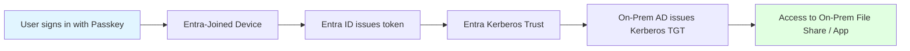

**Use case:** A hybrid organization migrating away from passwords can extend passkey-based phishing resistance to legacy on-prem resources - without waiting for those legacy apps to be modernized to support WebAuthn natively.

> **Prerequisite:** This builds on Cloud Kerberos Trust configuration. If you haven't configured Entra Kerberos yet, that setup needs to happen first before FIDO2-based on-prem access will work.

> **Scope note:** Users sign in to the *Windows device* with WebAuthn-supported credentials; the Cloud Kerberos Trust flow then obtains partial TGTs from Entra so on-prem Kerberos works passwordlessly. Verify your Windows 11 version and hybrid-join state when planning this.

---

<a name="16-whats-coming-passkeys-on-windows-windows-hello-container"></a>
## 16. What's Coming: Passkeys on Windows (Windows Hello Container)

Microsoft announced (via **MC1247893** in the Message Center) that **Entra passkeys on Windows** will support phishing-resistant sign-in in a new way - specifically targeting **unmanaged, personal, and shared devices**.

### 16.1 What's different?

Unlike Windows Hello **for Business** (which typically requires a managed, enrolled device), this new capability uses **plain Windows Hello** to store passkeys - meaning the passkey lives in the **Windows Hello container**, making it usable even on devices that aren't domain-joined or MDM-managed.

### 16.2 How to opt in

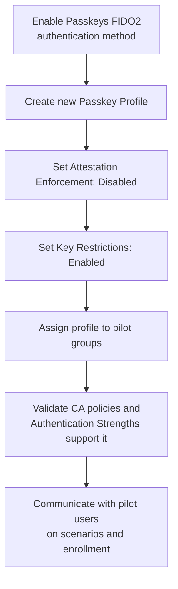

| Setting | Value | Why |
|---|---|---|
| Passkeys (FIDO2) method | **Enabled** | Prerequisite for any passkey usage |
| Attestation enforcement | **Disabled** | Windows Hello container isn't a traditionally attested authenticator |
| Key restrictions | **Enabled** | Still allows scoping which key types are acceptable |

**Use case this unlocks:** A hospital with shared kiosk-style Windows PCs, or a small business with unmanaged personal laptops, can now offer phishing-resistant sign-in **without requiring full device management enrollment** - lowering the barrier to passwordless adoption significantly.

> **Version-specific note:** This capability was announced for rollout around mid-March 2026 via Message Center post MC1247893. Check your tenant's Message Center and the Microsoft 365 roadmap for the current availability status before planning around it.

---

<a name="17-performance-considerations"></a>
## 17. Performance Considerations

Performance for passkeys is mostly about *human latency* rather than server load - and this is where passkeys shine.

### 17.1 Measured sign-in performance (Microsoft data)

| Metric | Password + MFA | Synced Passkey | Improvement |
|---|---|---|---|
| Average sign-in time | ~69 seconds | ~3 seconds | **~14x faster** |
| Sign-in success rate | ~30% | ~95% | **~3x more successful** |
| Registration success rate | varies | ~99% | Near-universal onboarding |

### 17.2 Factors that affect real-world latency

| Factor | Impact | Mitigation |
|---|---|---|
| Bluetooth pairing discovery (QR flows) | Adds 2-5 seconds to first cross-device sign-in | Keep devices in close proximity; second attempts are faster |
| TPM signing operations | Milliseconds (negligible) | None needed |
| CA policy evaluation | Adds policy engine round-trip to every sign-in | Keep CA policy count lean; avoid overlapping policies |
| FIDO2 key PIN fallback | Biometric miss falls back to PIN (slower) | Re-enroll biometrics; keep PIN complexity sane |
| Token lifetime / SSO | Every resource prompt is a ceremony | Use SSO and sensible session lifetimes so the ceremony happens once per session |

### 17.3 Helpdesk load

Rollouts consistently report reduced helpdesk volume after passkey adoption: fewer password resets, fewer MFA re-registration calls, fewer lockouts. Budget a *temporary* support spike during rollout weeks, then a sustained decline.

> **Performance insight:** The single biggest latency win is not faster cryptography - it is *eliminating prompts*. A passkey replaces (a) typing a password, (b) approving a push, and (c) possibly an OTP read-back with one local gesture.

---

<a name="18-security-considerations"></a>
## 18. Security Considerations

### 18.1 Threat coverage matrix

| Threat | Passwords | Push MFA | Passkeys |
|---|---|---|---|
| Credential stuffing | Vulnerable | Partial (depends on 2nd factor) | **Resistant** (no password to stuff) |
| Phishing (fake site) | Vulnerable | Vulnerable (real-time relay) | **Resistant** (RP ID binding) |
| MFA fatigue / push bombing | n/a | Vulnerable | **Resistant** (no push to approve) |
| Replay attacks | Vulnerable | Vulnerable (OTP codes) | **Resistant** (nonce per ceremony) |
| Malware on user device | Vulnerable | Vulnerable | Partially resistant (key material in TPM/Secure Enclave) |
| Physical device theft | Password + MFA may hold | Depends | Passkey unusable without local biometric/PIN |
| Cloud vault compromise | n/a | n/a | Synced passkeys depend on provider security; device-bound unaffected |

### 18.2 Residual risks and mitigations

1. **Synced passkey provider account compromise** - the passkey is only as safe as the Apple ID / Google account. Mitigation: require strong 2FA on provider accounts; use device-bound keys for privileged roles.
2. **Unattested providers** - without attestation you can't verify what hardware registered. Mitigation: attestation + AAGUID allow-lists for sensitive scopes.
3. **Shared PINs / weak device unlock** - userVerification is local; a weak device PIN weakens the factor. Mitigation: policy on device unlock complexity; biometrics preferred.
4. **Recovery path attacks** - attackers target *recovery*, not crypto: helpdesk resets, alternate MFA methods left enabled. Mitigation: require phishing-resistant methods for any recovery/elevation path; audit method mix.
5. **Legacy fallbacks** - if users can still fall back to password+SMS, phishing resistance is moot for that flow. Mitigation: retire SMS/voice; use Authentication Strengths on all sensitive apps.

> **Security principle:** Passkeys move the weakest link from *network-exposed secrets* to *local device unlock*. Invest accordingly: device hygiene, provider account security, and recovery-path hardening are now your control surface.

---

<a name="19-testing-strategies"></a>
## 19. Testing Strategies

A passkey rollout is an *authentication-critical* change - test it like you would test a database migration.

### 19.1 Test matrix

| # | Test | Expected Result |
|---|---|---|
| 1 | Pilot user registers device-bound passkey (TPM) | Registration succeeds; passkey visible in Security Info |
| 2 | Pilot user registers synced passkey via QR + phone | Key stored in Keychain/GPM; Bluetooth flow completes |
| 3 | Pilot user signs in with passkey to target app | Access granted; sign-in log shows passkey method + strength satisfied |
| 4 | Non-pilot user attempts registration | Passkey option not offered (profile targeting works) |
| 5 | Pilot user attempts sign-in on phishing look-alike domain | Authenticator offers no passkey; attempt fails safely |
| 6 | CA policy in Report-only mode | Log shows "would block" outcomes without enforcement |
| 7 | Unregistered user targeted by enforced CA | Blocked with clear remediation message (expected pre-registration) |
| 8 | Cross-device flow with Bluetooth disabled | Fails cleanly with actionable error; no partial credential state |
| 9 | FIDO2 key not in AAGUID allow-list | Registration rejected when attestation/restrictions enforced |
| 10 | Device loss simulation | Device-bound: user re-registers; Synced: passkey available on replacement device via provider |
| 11 | On-prem resource access via Entra Kerberos + passkey | Kerberos TGT issued; file share accessible |
| 12 | Admin break-glass account | **Never** targeted by passkey-only CA; still accessible in emergency |

### 19.2 Testing approach

- **Isolated test tenant first:** Validate profile + strength + CA interactions with a few test users before touching production.
- **Pilot group in production:** Reproduce the exact tenant configuration with a production pilot group.
- **Report-only rehearsal:** Run the intended CA policy org-wide in Report-only for 1-2 weeks; analyze who would be blocked and why.
- **Negative testing:** Deliberately test failure paths (Bluetooth off, wrong AAGUID, unregistered users) - these are your helpdesk tickets.
- **Rollback drill:** Confirm you can disable the CA policy / re-scope the strength in under 5 minutes, and that fallback methods still work.

> **Testing insight:** The most common rollout failure is not technical - it is *sequencing* (enforcement before registration). Test #7 exists to prove your lockout detection and response works.

---

<a name="20-migration-guide-from-passwords--mfa-to-passkeys"></a>
## 20. Migration Guide: From Passwords + MFA to Passkeys

### Phase 0 - Readiness (Weeks 1-2)
- Inventory current authentication methods per user (Graph: `users/authentication/methods`)
- Identify pilot group (tech-friendly, low-risk users) and privileged group
- Verify Bluetooth/USB policies on managed devices
- Brief helpdesk with the Troubleshooting table (Section 23)

### Phase 1 - Enable and register (Weeks 3-6)
- Enable Passkeys (FIDO2) method; create profiles (device-bound for admins, synced for pilot)
- Target profiles at the pilot group only
- Run registration campaign; track registration rate in Security Info reports
- **Do not** enforce anything yet

### Phase 2 - Enforce for pilot (Weeks 7-10)
- Create Authentication Strength (passkeys only)
- CA policy: pilot group + specific resources, Grant = strength, start **Report-only**
- Review Report-only logs for 1-2 weeks; fix surprises
- Flip to enforcement for pilot; monitor sign-in failures daily

### Phase 3 - Wave rollout (Months 3-6)
- Move users into the enforcement group in waves (e.g., 10% per wave)
- Automate registration nudge: users not registered within X days get reminders
- Retire weaker methods for covered resources (remove SMS/Voice from strengths)

### Phase 4 - Steady state (Month 6+)
- Extend to on-prem via Entra Kerberos (Section 15)
- Adopt Windows Hello container passkeys for unmanaged devices (Section 16)
- Deprecate passwords for passwordless-first flows; keep emergency/break-glass paths

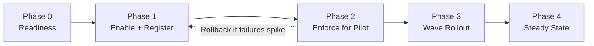

### Rollback plan (keep this documented)

1. Set the CA policy to **Report-only** (or disable it) - restores access for the targeted group instantly
2. Re-scope the Authentication Strength to include legacy methods if users lack alternatives
3. The Passkeys (FIDO2) method can remain *enabled* while enforcement is paused - no data is lost
4. Post-incident: fix registration gaps before re-enforcing

> **Migration principle:** The method being *enabled* is low-risk and reversible; the CA policy being *enforced* is the point of no return for affected users. Gate the latter behind registration data, not dates.

---

<a name="21-best-practices"></a>
## 21. Best Practices

### Rollout and operations
- **Pilot before broad rollout** - every time, even if you've done passkeys in another tenant
- **Register users for passkeys *before* enforcing via Conditional Access** - the #1 lockout preventer
- **Use Report-only mode** to validate new CA policies
- **Roll out in waves** with a defined promotion criterion per wave (e.g., <1% failure rate for a week)
- **Keep break-glass admin accounts** outside passkey-only enforcement
- **Document your Relying Party ID expectations** so support staff understand phishing-resistance behavior

### Configuration
- **Tier your assurance:** device-bound + AAGUID restrictions for privileged roles; synced for everyone else
- **Enforce attestation** where device provenance matters; remember it excludes synced passkeys
- **Prefer biometric unlock** over PINs where the device supports it
- **Delete or scope the default "All users" target** on profiles during pilot phases
- **Pair every enforcement CA policy with a documented rollback step**

### Users and support
- **Communicate early and concretely:** what changes, when, and exactly how to register
- **Train helpdesk on the failure table** (Section 23) before wave 1
- **Provide a hardware-key loaner pool** for users without capable phones

### General best-practices checklist

- [ ] Always pilot before broad rollout
- [ ] Register users for passkeys *before* enforcing via Conditional Access
- [ ] Use Report-only mode to validate new CA policies
- [ ] Reserve Device-Bound + AAGUID-restricted FIDO2 keys for your highest-privilege roles
- [ ] Use Synced passkeys for everyday user convenience and recovery
- [ ] Document your Relying Party ID expectations so support staff understand phishing-resistance behavior
- [ ] Monitor sign-in logs daily during enforcement waves
- [ ] Keep recovery and elevation paths as phishing-resistant as the front door

---

<a name="22-anti-patterns"></a>
## 22. Anti-Patterns

| Anti-Pattern | Why It Hurts | Do This Instead |
|---|---|---|
| Enforcing a passkey-only CA policy org-wide on day one | Locks out unregistered users en masse | Pilot group + Report-only first, then waves |
| Enforcing attestation *and* allowing synced passkeys in the same profile | Contradictory: attestation excludes synced passkeys | Separate profiles per passkey type |
| Requiring a specific FIDO2 key AAGUID for *all* users | Huge cost and helpdesk burden for everyday sign-ins | Reserve hardware requirements for privileged roles |
| Leaving SMS/voice enabled as fallback on sensitive apps | Attackers downgrade to the weakest method | Remove weak methods from Authentication Strengths |
| Using passkeys as the *only* method for break-glass accounts | An expired/lost key becomes a tenant-level outage | Exclude break-glass accounts; secure them another way |
| Assuming Bluetooth "pairing" is needed for QR flows | Users waste time in Bluetooth settings | Instruct: just scan the QR; proximity is enough |
| Treating synced-passkey provider security as Entra's problem | Cloud vault compromise = passkey compromise | Require MFA on Apple/Google accounts; device-bound for sensitive roles |
| Registering passkeys once and never reviewing | Orphaned credentials accumulate after device retirement | Periodic credential review; clean up stale passkeys |
| Ignoring the on-prem story until after cloud enforcement | Users hit password walls on file shares mid-migration | Plan Entra Kerberos as part of Phase 3+ |

> **The meta anti-pattern:** treating passkeys as a checkbox. The technology is the easy part; sequencing, communication, and recovery-path design are where rollouts fail.

---

<a name="23-troubleshooting-guide"></a>
## 23. Troubleshooting Guide

| Issue | Likely Cause | Fix |
|---|---|---|
| Apple Passwords option missing during passkey creation | AutoFill & Passwords setting disabled | Enable **Settings > General > AutoFill & Passwords** on the iOS device |
| Users locked out after enabling CA policy | Users didn't register a passkey before policy enforcement | Register pilot users first; run policy in Report-only mode; set policy to Report-only to restore access now |
| Cross-device QR/Bluetooth flow fails | Bluetooth not enabled on one of the two devices | Confirm Bluetooth is on for both the signing-in device and the mobile device (no pairing needed - proximity only) |
| FIDO2 key rejected during registration | Enforce attestation is on, but the key's AAGUID isn't in the allowed list | Add the specific AAGUID to the passkey profile, or confirm vendor certification |
| High-privilege role elevation not requiring specific FIDO2 key | Authentication Strength not scoped correctly | Recheck the Authentication Strength definition and its CA policy binding |
| "We couldn't create your passkey" during registration | Profile restriction mismatch (attestation/AAGUID) or unsupported authenticator | Verify the authenticator type matches the user's assigned profile |
| Passkey not offered at sign-in on fake site | Working as intended - RP ID mismatch | None; educate users that this is the phishing protection working |
| Passkey not offered at sign-in on the *real* site | User signed in with different account, or credential belongs to another RP ID | Confirm account; check the credential was registered for `login.microsoftonline.com` |
| Synced passkey missing on new device | User signed into a different provider account (Apple ID/Google) | Sign into the same provider account; verify iCloud/Google sync enabled |
| Windows Hello container passkey option not appearing | Feature not yet enabled for tenant / opt-in profile missing | Complete Section 16 opt-in profile; check Message Center for rollout status |
| On-prem file share prompts for password despite passkey sign-in | Entra Kerberos / Cloud Kerberos Trust not configured | Configure Cloud Kerberos Trust first (Section 15 prerequisite) |

---

<a name="24-hands-on-labs"></a>
## 24. Hands-On Labs

### Lab 1: Register and use a synced passkey (30 min)

**Objective:** Experience the end-user registration and sign-in flow.

1. In your test tenant, enable the **Passkey (FIDO2)** authentication method and add a **Synced** profile targeting your test user only
2. On your laptop, go to `https://mysignins.microsoft.com/security-info` as the test user
3. Choose **Add sign-in method > Passkey**, then **Create Passkey using another device**
4. Scan the QR code with your phone; save to Apple Passwords / Google Password Manager
5. Sign out and sign back in to `portal.azure.com` using the passkey
6. **Verify:** sign-in succeeds without a password; check **Sign-in logs** - the authentication method detail should show a passkey entry

### Lab 2: Device-bound profile with AAGUID restriction (45 min)

**Objective:** Configure a restricted device-bound profile and observe enforcement.

1. Create a second profile of type **Device-Bound** with **Enforce attestation = On** and key restrictions **Allow** for your hardware key's AAGUID (find it in the vendor documentation)
2. Target the profile at your test user
3. Attempt to register a synced passkey - observe it is not permitted
4. Register your FIDO2 security key - observe it succeeds
5. Try a *different* FIDO2 key model (not in the allow-list) - observe rejection
6. **Verify:** only the allow-listed hardware registered; Security Info shows one passkey entry

### Lab 3: Authentication Strength + Conditional Access (45 min)

**Objective:** Enforce passkey-only access for one application, safely.

1. Create an Authentication Strength named "Passkeys Only" selecting only Passkeys
2. Create a CA policy: Users = your test user, Target resources = one non-critical app (e.g., Microsoft Forms), Grant = Require authentication strength "Passkeys Only", state = **Report-only**
3. Sign in as the test user with your password+MFA and access the app - then review the Report-only log entry showing what *would* happen
4. Switch the policy to **On** and repeat - sign-in should require the passkey
5. Sign in as a *different* user - observe the policy doesn't affect them
6. **Verify:** enforcement is scoped exactly to your test user + that app, and your rollback step (Report-only toggle) works

---

<a name="25-practice-exercises-with-detailed-solutions"></a>
## 25. Practice Exercises (with Detailed Solutions)

### Exercise 1: Design the passkey strategy for a fictional company (Conceptual)

**Scenario:** Northwind Health has: (a) 5 Global Admins, (b) 2,000 nurses using shared Windows PCs with personal phones, (c) 300 contractors on unmanaged laptops, (d) 20,000 office workers with managed devices. Design the passkey approach per group.

**Solution:**

| Group | Passkey Type | Rationale |
|---|---|---|
| Global Admins | Device-bound FIDO2 keys, attestation on, AAGUID allow-list; CA strength required for all admin interfaces and PIM elevation | Highest phishing-resistance and hardware control; verifiable provenance for audit |
| Nurses | Synced passkeys via personal phone + QR/Bluetooth flow on shared PCs | No credentials left on shared devices; automatic recovery via provider |
| Contractors | Synced passkeys (1Password or native) scoped via CA to specific apps | No MDM enrollment required; app-scoped policies limit blast radius |
| Office workers | Synced passkeys; Windows Hello container passkeys where relevant | Frictionless, low-cost; device management already present |

Implementation: separate passkey profiles per type; tiered Authentication Strengths; phased CA rollout with Report-only first; break-glass accounts excluded.

### Exercise 2: Predict the WebAuthn outcomes (Applied)

**Scenario:** For each case, state whether registration/sign-in succeeds and why:
1. A passkey registered on `login.microsoftonline.com` is used on `login-microsft0nline.com`
2. A user tries to register a synced passkey in a profile with attestation enforced
3. A replayed signed response from yesterday's ceremony is sent to Entra
4. A user signs in with their fingerprint on the device holding the private key

**Solution:**
1. **Fails silently/safely** - the authenticator compares RP IDs, finds no match, and never offers the credential. Phishing blocked.
2. **Fails** - synced passkeys cannot provide attestation evidence; attestation enforcement excludes them.
3. **Fails** - the challenge (nonce) is single-use and fresh each ceremony; yesterday's signature doesn't match today's challenge.
4. **Succeeds** - possession (device with key) + verification (biometric) = MFA in one step; Entra verifies the signature with the stored public key and issues a token.

### Exercise 3: Write the rollout sequencing plan (Practical)

**Scenario:** Your CISO wants a passkey-only CA policy for all 5,000 users *starting Monday*. You discover only 200 users have registered a passkey. Write the plan you present to the CISO.

**Solution:**
1. **Do not enforce Monday** - an org-wide passkey-only strength would lock out ~4,800 users
2. Present registration data (200/5,000 = 4% readiness) and Microsoft's guidance to pilot first
3. Proposed plan: Phase 1 (weeks 1-4): registration campaign targeting departments in waves, profile targeting already in place; Phase 2 (weeks 5-8): CA policy in Report-only org-wide to measure who would be blocked; Phase 3 (weeks 9-16): enforcement waves starting with the pilot group, promoting each wave only when failure rate < 1%
4. Success metric for CISO: phishing-resistant sign-in coverage %, tracked weekly, with enforcement tied to coverage rather than a date
5. Include rollback documentation and break-glass exclusions

---

<a name="26-test-your-understanding"></a>
## 26. Test Your Understanding

Answer from memory first, then check against the referenced section. (Answers in brackets.)

1. What is the Relying Party ID for Microsoft Entra passkey sign-ins, and what does the authenticator do with it? [Section 5 - `login.microsoftonline.com`; the authenticator compares it to the domain requesting the credential and refuses to release passkeys on mismatch]
2. Name the two factors that a single passkey gesture combines. [Section 6 - something you have (device/key) + something you know/are (PIN/biometric)]
3. Why does Entra send a nonce (challenge) at the start of every ceremony? [Section 7 - to prevent replay attacks; the fresh value makes captured signatures useless]
4. Where is the private key stored for a device-bound passkey? [Section 7 - TPM (Windows) or Secure Enclave (Mac/iOS); it never leaves the device]
5. What transport connects the phone and the sign-in device in the cross-device flow? [Section 8 - a Bluetooth-based encrypted tunnel (CTAP hybrid), established after scanning a QR code]
6. Give one reason to choose a device-bound passkey over a synced one. [Section 9 - e.g., maximum security / attestation support / hardware control for privileged roles]
7. What must be enabled on iOS for the Apple Passwords passkey option to appear? [Section 9 - Settings > General > AutoFill & Passwords]
8. What happens to a synced passkey when attestation is enforced on a profile? [Section 9/12 - synced passkeys are excluded; only device-bound passkeys are allowed]
9. Which built-in roles are needed to configure authentication methods and Conditional Access? [Sections 2/12 - Authentication Policy Administrator and Conditional Access Administrator (or Global Admin)]
10. What is the critical sequencing rule for rollout? [Section 13 - register users before enabling the CA policy that requires passkeys]
11. Why run a new CA policy in Report-only mode first? [Section 14 - to see who would be blocked without blocking anyone]
12. What does Entra Kerberos add to passkey deployments? [Section 15 - FIDO2-aware access to on-prem Kerberos resources (file shares, legacy apps) via Cloud Kerberos Trust]

---

<a name="27-question-bank-50-questions"></a>
## 27. Question Bank (50 Questions)

### Beginner (1-15)

1. **What is a passkey?** A phishing-resistant credential based on public-key cryptography that replaces passwords and can satisfy MFA when combined with local biometric/PIN verification.
2. **What replaces the password in passkey authentication?** A cryptographic signature produced with the private key - no shared secret ever travels.
3. **What is stored on the server (Entra) for each passkey?** Only the public key, tied to a credential ID.
4. **Can the private key be derived from the public key?** No - they are mathematically linked but the public key cannot be used to compute or forge the private key.
5. **What does WebAuthn do?** It is the browser API that lets a website (Relying Party) request and verify public-key credentials from authenticators.
6. **What is CTAP used for?** Communication between the client/platform and the authenticator (e.g., browser talking to a USB key, or the cross-device QR+Bluetooth flow).
7. **Name two examples of device-bound passkeys.** Microsoft Authenticator app passkeys and FIDO2 security keys.
8. **Name two examples of synced passkey providers.** Apple iCloud Keychain and Google Password Manager (also 1Password).
9. **What is an AAGUID?** Authenticator Attestation GUID - a GUID identifying the make and model of an authenticator, usable for allow-listing hardware.
10. **What is attestation in the passkey context?** Cryptographic verification of the authenticator's make/model during registration, validated via the FIDO Metadata Service.
11. **What is the Relying Party ID for Entra passkeys?** `login.microsoftonline.com`.
12. **Do passkeys require Bluetooth *pairing* between devices?** No - only Bluetooth proximity/radio enabled on both devices; pairing happens implicitly.
13. **Where do users register a passkey?** My Account > Security Info > Add sign-in method > Passkey.
14. **What is an Authentication Strength?** A Conditional Access control that specifies which authentication methods are acceptable for a sign-in.
15. **True or false: a passkey can be phished by a look-alike website.** False - the authenticator refuses to release the credential when the RP ID doesn't match the requesting domain.

### Intermediate (16-35)

16. **Why does a passkey satisfy MFA in one gesture?** The ceremony locally verifies possession (device holding the key) and knowledge/inherence (PIN/biometric) before signing; Entra receives proof that both conditions were met.
17. **What are the three components returned in a WebAuthn assertion, and their purposes?** Credential ID (locates the public key), authenticator data (presence/user-verification flags), signature (proof of private key possession over challenge+client data).
18. **Why is the nonce bound into the signed data?** So the server can verify the signature covers *this* ceremony's fresh challenge, defeating replay.
19. **What is the difference between device-bound and synced passkeys in key storage?** Device-bound: private key generated and stored in a single device's secure hardware, never leaves. Synced: key created by an HSM, encrypted locally, then synced to a provider's cloud vault.
20. **What happens to a device-bound passkey when the device is lost?** That credential is gone; the user must register a new passkey on a replacement device - there is no cloud recovery.
21. **What happens to a synced passkey when the device is lost?** It is automatically available on a replacement device signed into the same provider account.
22. **Why don't synced passkeys support attestation?** Attestation certifies specific hardware provenance; a synced credential moves across provider-managed storage, so there's no single attested device to certify.
23. **How do you restrict which hardware keys may register?** Key restrictions in the passkey profile: allow/deny specific AAGUIDs (optionally with attestation certificates).
24. **When is Bluetooth required during passkey use?** For cross-device flows (QR-code based sign-in/registration) between the machine being signed into and the phone - during registration and during subsequent cross-device sign-ins.
25. **What is the difference between Windows Hello for Business and the Windows Hello passkey container?** WinHEB targets managed/enrolled devices with enterprise key infrastructure; the passkey container uses plain Windows Hello to hold passkeys on any Windows device, including unmanaged/personal/shared ones.
26. **How does Entra Kerberos extend passkeys on-premises?** With Cloud Kerberos Trust, Entra issues partial Kerberos TGTs (via the KERB key) after phishing-resistant sign-in, so users can access on-prem AD resources without a password.
27. **What CA grant control enforces a specific method set?** Require authentication strength.
28. **What is the risk of enforcing a passkey-only Authentication Strength org-wide too early?** Users without registered passkeys are locked out at next sign-in.
29. **How would you safely measure the impact of a passkey-only policy before enforcement?** Run the CA policy in Report-only mode and analyze sign-in logs for who would be blocked and why.
30. **What is a break-glass account and how should it relate to passkey policies?** An emergency admin account kept outside automated restrictions; exclude it from passkey-only CA so it remains usable in an outage.
31. **Which Graph API endpoint configures the FIDO2 method?** `PATCH /policies/authenticationMethodsPolicy/authenticationMethodConfigurations/fido2` (beta).
32. **What signing algorithms are typically negotiated in WebAuthn?** ES256 (-7) and RS256 (-257) via `pubKeyCredParams`.
33. **What does `userVerification: "required"` enforce?** The authenticator must perform and flag local user verification (biometric/PIN), not just presence (touch).
34. **What does `residentKey: "required"` (discoverable credential) enable?** Server-side credential discovery by RP ID, enabling usernameless/one-tap flows.
35. **What error would a browser throw when the RP ID doesn't match the page origin?** `SecurityError` (and phishing attempts generally surface as no matching credential being offered).

---
### Advanced (36-50)

36. **Design a Conditional Access setup requiring FIDO2 keys only for PIM Application Administrator elevation.** Create an Authentication Strength allowing only passkeys, scoped via passkey profile key restrictions to the approved key AAGUIDs; create a CA policy targeting the privileged group/admin interfaces with Grant = that strength; enforce via PIM role settings; exclude break-glass accounts.
37. **An attacker phishes a user with a real-time reverse-proxy (Evilginx-style) kit. Passwords and push MFA fail. Explain specifically why a passkey stops this.** The proxy serves content from a different origin than `login.microsoftonline.com`; the authenticator checks the requesting RP ID/origin against its registered binding and does not release (or even offer) the credential, so there is nothing to relay.
38. **Your tenant has attestation enforced in one profile, and a user assigned to a synced profile complains registration fails. Diagnose.** They are either assigned the wrong profile, or the synced profile and attested profile conflict for that user - attestation excludes synced passkeys. Fix profile assignment/targeting.
39. **Explain why "the signature is worthless to an attacker" even though it travels over the network.** It is bound to the single-use nonce and the specific origin; replaying it fails the freshness/origin checks, and it reveals nothing about the private key.
40. **What operational changes when your sync provider (e.g., Apple ID) is itself the recovery root?** Security of the passkey now depends on provider account security (password, 2FA, recovery methods); you must require strong MFA on provider accounts and use device-bound keys where provider compromise is unacceptable.
41. **How would you audit which users hold passkeys and clean up stale credentials?** Graph: enumerate `users/{id}/authentication/fido2Methods` (and method registrations overall); join with device lifecycle data; remove passkeys for decommissioned devices; review periodically.
42. **A sign-in log shows a failure with the passkey-only strength for a user who HAS a registered passkey. Give three plausible causes.** (1) The passkey type/AAGUID is excluded by their profile or strength, (2) cross-device Bluetooth flow failed, (3) wrong account selected / credential registered to a different RP ID or another tenant.
43. **Why is `attestation: "direct"` requested during registration, and what does Entra do with the evidence?** It asks the authenticator for its certificate chain proving make/model; Entra validates it against the FIDO Metadata Service to apply AAGUID/attestation policy.
44. **Compare helpdesk/TCO profiles of hardware keys vs synced passkeys.** Keys: procurement, distribution, loss/replacement logistics, PIN resets - higher cost but strongest assurance. Synced: near-zero direct cost, minimal helpdesk, but provider-account support questions and no device provenance.
45. **What is the interaction between attestation enforcement and synced passkeys in Entra, and why does it matter for profile design?** Attestation enforcement allows only device-bound passkeys; so profiles must be split (attested device-bound for admins, non-attested synced for workforce) and targeted by group.
46. **How does the nonce + RP ID + signature trio map to the three classic attacks: replay, phishing, impersonation?** Nonce defeats replay (freshness), RP ID defeats phishing (origin binding), signature defeats impersonation (possession proof without key disclosure).
47. **During a migration wave, failure rates spike from 5% to 20% after enforcement. Outline your response.** Set the CA policy back to Report-only (restore access), analyze sign-in log failure reasons (registration gaps? Bluetooth? profile mismatch?), fix root causes per pattern, re-register affected users, re-enforce gradually.
48. **Explain why passkeys are considered resistant to MFA fatigue attacks.** There is no push/approval prompt to bombard - the local gesture is user-initiated during the ceremony, so an attacker has nothing to spam and no social-engineering surface for approval.
49. **What must be true for passkey sign-in to extend to an on-prem file share?** Entra-joined/hybrid-joined Windows device, Cloud Kerberos Trust (Entra Kerberos) configured, passkey sign-in completed (FIDO2-aware), and AD/DCs prepared for the Kerberos trust flow.
50. **Argue for or against: "Synced passkeys should be disabled until hardware keys are rolled out to everyone."** Against, generally: synced passkeys are already a major upgrade over phishable MFA (no shared secret, origin-bound), cost nothing, and reach everyone; hardware keys should be tiered to privileged roles where attestation and hardware control genuinely change the risk. For, only in strict high-compliance regimes where unattested credentials are unacceptable for all access.

---

<a name="28-common-interview-questions"></a>
## 28. Common Interview Questions

1. **Q: Explain passkeys to a non-technical executive.** A: A passkey is a fingerprint/Face/PIN-protected digital credential that replaces passwords. It can't be phished because it only works on the legitimate website it was created for, and it's faster - Microsoft measured sign-ins dropping from about a minute to about three seconds.
2. **Q: How can one action count as "multi-factor"?** A: The device holding the private key is the possession factor; unlocking it with a PIN or biometric is the knowledge/inherence factor. Both are verified locally before the credential is used.
3. **Q: What exactly makes a passkey phishing-resistant?** A: The credential is cryptographically bound to the Relying Party's domain. The authenticator itself refuses to offer the credential to any other origin, so even a perfect fake site gets nothing.
4. **Q: Device-bound vs synced - how do you choose?** A: Device-bound for privileged/regulated scenarios needing hardware control and attestation; synced for the general workforce where recovery and low friction matter most. Most enterprises deploy both, tiered by role.
5. **Q: Walk me through the WebAuthn authentication ceremony.** A: Server sends a fresh nonce + RP ID; browser routes it to the authenticator; user performs local verification; authenticator signs the nonce and client data with the private key; server verifies the signature with the stored public key and issues a token.
6. **Q: What is an AAGUID and why would you restrict it?** A: A model identifier for authenticators. Restricting it limits registration to approved hardware models - useful for privileged roles and auditable device provenance.
7. **Q: What is the biggest rollout risk and how do you mitigate it?** A: Lockouts from enforcing before registration. Mitigate with registration-first sequencing, pilot groups, Report-only CA mode, and a documented rollback.
8. **Q: How do passkeys work with on-premises resources?** A: With Entra Kerberos (Cloud Kerberos Trust), a passkey-based cloud sign-in results in Entra issuing partial Kerberos tickets, so users reach on-prem file shares and legacy apps passwordlessly.
9. **Q: What are the residual risks of passkeys?** A: Provider account compromise for synced passkeys, weak local device unlock, unattested hardware, and recovery-path attacks - mitigated by provider MFA, device policy, attestation/AAGUID scoping, and hardening elevation paths.
10. **Q: How does a synced passkey differ architecturally from a password vault?** A: A vault stores a reusable shared secret; a synced passkey syncs an encrypted private key whose public half is server-side - the secret never transmits and signatures are origin- and challenge-bound.
11. **Q: How would you prove passkey ROI to leadership?** A: Security (phishing-resistant MFA coverage %, fewer credential-based incidents) plus performance data (3s vs 69s sign-ins, 95% vs 30% success, reduced helpdesk volume) from Microsoft's published measurements and your own pilot metrics.
12. **Q: A user says their passkey "stopped working" after switching phones. Diagnose.** A: Determine passkey type: device-bound passkeys don't migrate - re-register on the new device; synced passkeys should appear automatically if the provider account (Apple ID/Google) is the same and sync is enabled.

---

<a name="29-self-assessment-checklist"></a>
## 29. Self-Assessment Checklist

Mark each item honestly. Aim for 100% before calling yourself passkey-rollout ready.

**Concepts**

- [ ] I can explain why passwords are a shared-secret problem
- [ ] I can walk through the WebAuthn registration and authentication ceremonies from memory
- [ ] I can explain how nonce + RP ID + signature defeat replay, phishing, and impersonation
- [ ] I understand how one local gesture satisfies MFA
- [ ] I can explain the difference between device-bound and synced passkeys to a colleague

**Configuration**

- [ ] I know the roles required to configure authentication methods and Conditional Access
- [ ] I can create passkey profiles for both device-bound and synced passkeys
- [ ] I know when (and when not) to enforce attestation and restrict AAGUIDs
- [ ] I can create an Authentication Strength that allows only passkeys
- [ ] I can build a CA policy that requires that strength, scoped to a pilot group

**Operations**

- [ ] I can sequence a rollout so no user is locked out
- [ ] I know what Report-only mode shows and how to read the logs
- [ ] I can troubleshoot the Apple AutoFill, Bluetooth, and attestation failure modes
- [ ] I have a documented rollback plan for enforcement policies
- [ ] I know how Entra Kerberos extends passkeys on-prem and its prerequisites

---

<a name="30-pro-tips"></a>
## 30. Pro Tips

1. **Register a second passkey per privileged user.** Device-bound credentials don't recover themselves - a backup hardware key in a safe beats a helpdesk ticket at 2 AM.
2. **Name profiles by audience, not type.** "Admins-FIDO2-attested" and "Workforce-synced" communicate intent better than "Profile 1."
3. **Use dynamic groups for wave management.** Membership driven by an attribute (e.g., `passkeyWave`) means moving a wave is a metadata update, not a group-membership firefight.
4. **Check the sign-in logs' *authentication method detail*, not just success/failure.** It tells you whether a passkey (device vs. security key) was actually used - critical for assurance reporting.
5. **Turn off SMS/voice as soon as coverage allows.** Any remaining phishable method becomes the attacker's preferred downgrade path.
6. **Test cross-device flows on the hardware users actually have.** Older laptops with flaky Bluetooth are your real-world failure factory.
7. **Keep attestation ON for admin profiles even though it's simpler to leave off.** Attestation is what gives auditors cryptographic hardware provenance.
8. **Watch the Message Center.** Passkey capabilities (like the Windows Hello container) arrive via posts such as MC1247893 - capabilities can change what's possible between planning and execution.
9. **Write your rollback runbook *before* the first enforcement wave** and rehearse it - recovery speed is the difference between an incident and a headline.
10. **Educate users that "no passkey offered" on a weird site is a feature.** Reframing failure as protection turns users into phishing detectors.

---

<a name="31-summary--key-takeaways"></a>
## 31. Summary & Key Takeaways

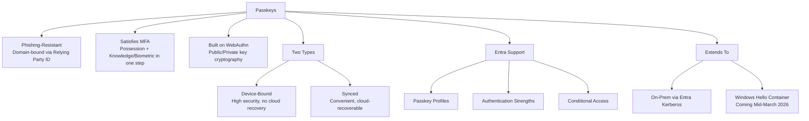

**In one paragraph:** Passkeys replace the shared-secret model of passwords with public-key cryptography, binding every authentication attempt to the legitimate domain and eliminating phishing as a viable attack vector. Microsoft Entra ID supports both **Device-Bound** passkeys (best for high-privilege, hardware-restricted scenarios) and **Synced** passkeys (best for everyday convenience and recovery), configurable through Passkey profiles, Authentication Strengths, and Conditional Access. With FIDO2-aware Entra Kerberos and the upcoming Windows Hello container support, passkeys are rapidly becoming viable across cloud, hybrid, and even unmanaged device scenarios - making now the right time to start a pilot rollout in your own organization.

### Top 5 takeaways

1. **No shared secret beats protecting a shared secret.** Phishing resistance is structural, not behavioral.
2. **One gesture, two factors.** The passkey ceremony *is* the MFA ceremony.
3. **Type follows risk.** Device-bound + AAGUIDs for privileged roles; synced for everyone else.
4. **Sequence saves lockouts.** Register first, enforce second, Report-only always in between.
5. **The scope keeps growing.** On-prem via Entra Kerberos today, unmanaged Windows via the Hello container now - plan for passkeys everywhere.

---

<a name="32-further-reading--resources"></a>
## 32. Further Reading & Resources

**Microsoft official documentation**

- Passkeys (FIDO2) authentication method in Microsoft Entra ID - `https://learn.microsoft.com/entra/identity/authentication/concept-authentication-passkeys-fido2`
- Enable passkeys (FIDO2) in Microsoft Entra ID (authentication methods policy) - Entra admin center path: **Protection > Authentication methods > Policies**
- Enable passkey profiles in Microsoft Entra ID (device-bound and synced profiles)
- Enable synced passkeys in Microsoft Entra ID
- Passkeys in Microsoft Authenticator app
- Attestation requirements for passkeys
- Get started with phishing-resistant MFA deployment in Microsoft Entra ID
- Conditional Access: Authentication strengths - `https://learn.microsoft.com/entra/identity/conditional-access/concept-authentication-strengths`
- Microsoft Entra Kerberos / Cloud Kerberos Trust documentation
- Windows Hello for Business and Cloud Kerberos Trust - `https://learn.microsoft.com/windows/security/identity-protection/hello-for-business/`

**Standards**

- W3C Web Authentication (WebAuthn) specification - `https://www.w3.org/TR/webauthn/`
- FIDO2 / CTAP specifications and FIDO Metadata Service - `https://fidoalliance.org/specs/`

**Practice environments**

- Microsoft 365 Developer Program (free test tenant)
- WebAuthn.io - hands-on WebAuthn registration/authentication playground
- passkeys.dev - implementation guides and demos

---

<a name="33-learning-path--next-steps"></a>
## 33. Learning Path & Next Steps

**Where you are now:** You understand passkey concepts, the WebAuthn ceremony, deployment models, and the full Entra configuration path.

**Recommended next steps:**

1. **This week:** Run Lab 1 in a test tenant and register your own passkey
2. **This month:** Complete Labs 2 and 3; inventory authentication methods in your production tenant; identify your pilot group
3. **This quarter:** Execute Phases 0-2 of the migration guide; establish Report-only monitoring
4. **Related topics to explore next:**
   - Phishing-resistant MFA strategy and Microsoft's Secure Future Initiative guidance
   - PIM (Privileged Identity Management) and role-conditional Authentication Strengths
   - Windows Hello for Business deployment and Cloud Kerberos Trust setup
   - Passwordless Windows sign-in via WebAuthn (Windows sign-in options roadmap)

---

> **Last Updated:** 2026-09-02
