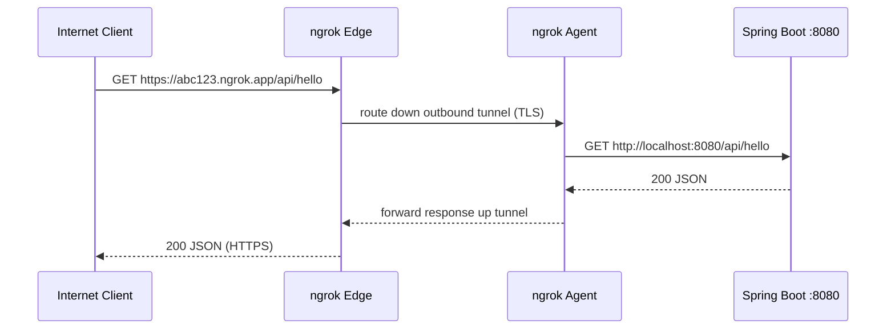
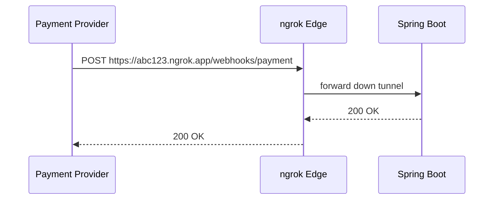
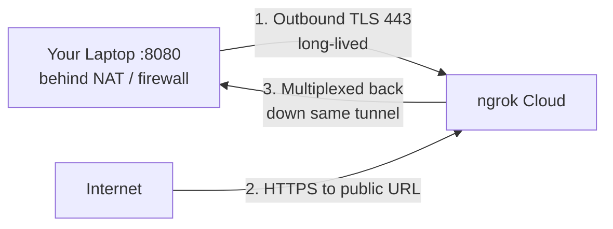
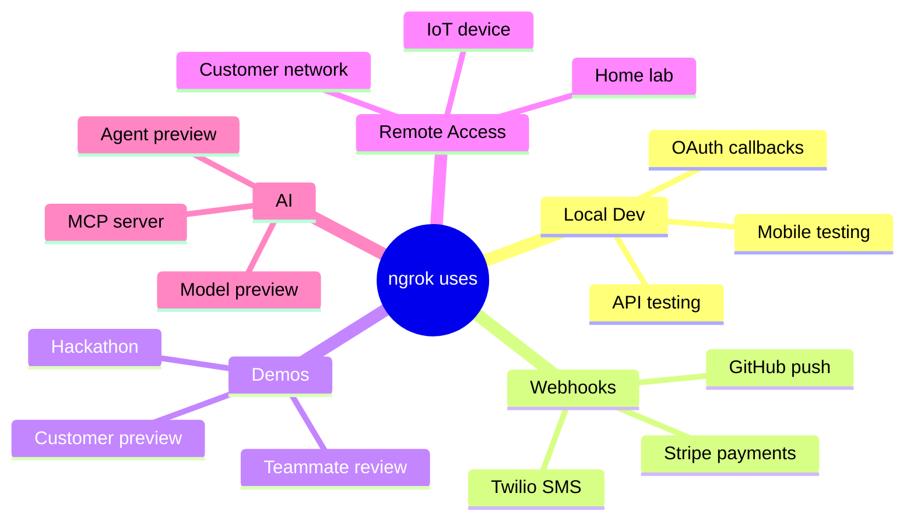
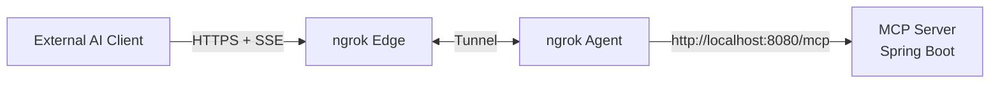
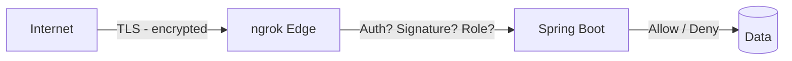
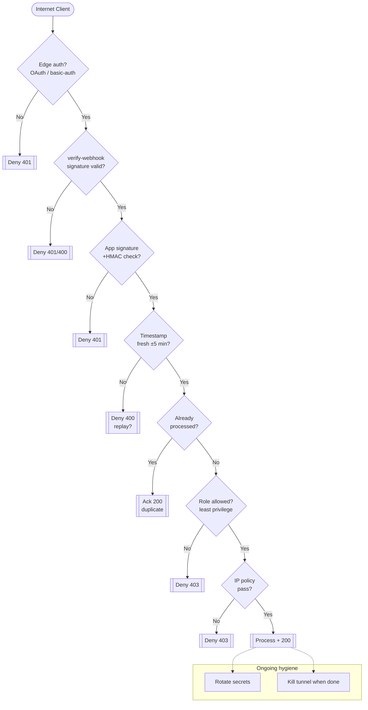
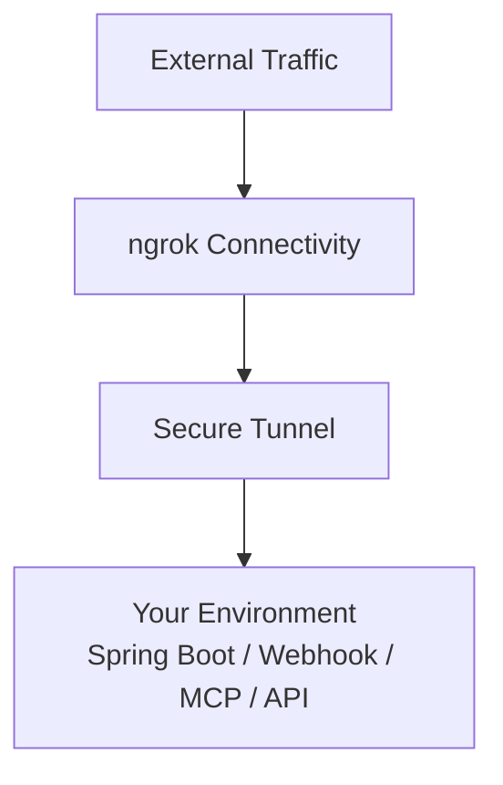

# Make Your Local Spring Boot API Reachable From the Internet with ngrok - Complete Tutorial

> **Last Updated:** 2026-09-26 | **Stack:** Java 21+ / Spring Boot 4.0+ (Framework 7) / Gradle 8.14+ / ngrok Agent v3
> **Difficulty:** 🟡 Intermediate | **Estimated Reading Time:** 65 minutes | **Hands-on Time:** 25-35 minutes
> **Audience:** Java / Spring Boot developers who want public HTTPS URLs, webhooks, mobile testing, demos, and MCP servers without deploying.

---

## Table of Contents

- [1. Introduction / Overview](#1-introduction--overview)
- [2. Prerequisites](#2-prerequisites)
- [3. Learning Objectives](#3-learning-objectives)
- [4. Mental Model - How ngrok Works](#4-mental-model---how-ngrok-works)
- [5. Step-by-Step - Tiny Spring Boot API](#5-step-by-step---tiny-spring-boot-api)
- [6. Step-by-Step - Install and Authenticate ngrok](#6-step-by-step---install-and-authenticate-ngrok)
- [7. Step-by-Step - Create the Tunnel](#7-step-by-step---create-the-tunnel)
- [8. The Webhook Use Case](#8-the-webhook-use-case-deep-dive)
- [9. Inspect Incoming Requests](#9-inspect-incoming-requests)
- [10. Why It Works Behind NAT](#10-why-it-works-behind-nat)
- [11. Where ngrok Fits](#11-where-ngrok-fits---real-world-examples-and-use-cases)
- [12. ngrok and AI/MCP Development](#12-ngrok-and-aimcp-development)
- [13. Spring Boot Behind a Tunnel](#13-spring-boot-production-readiness-behind-a-tunnel)
- [14. Traffic Policy, Auth and Webhook Verification](#14-traffic-policy-auth-and-webhook-verification)
- [15. Alternatives and Migration Guide](#15-alternatives-and-migration-guide)
- [16. Testing Strategies](#16-testing-strategies)
- [17. Best Practices](#17-best-practices)
- [18. Anti-Patterns](#18-anti-patterns)
- [19. Performance Considerations](#19-performance-considerations)
- [20. Security Considerations](#20-security-considerations)
- [21. Common Pitfalls / Troubleshooting](#21-common-pitfalls--troubleshooting)
- [22. Hands-On Lab](#22-hands-on-lab-two-terminals)
- [23. Practice Exercises](#23-practice-exercises-with-detailed-solutions)
- [24. Test Your Understanding](#24-test-your-understanding)
- [25. Common Interview Questions](#25-common-interview-questions)
- [26. Self-Assessment Checklist](#26-self-assessment-checklist)
- [27. Pro Tips](#27-pro-tips)
- [28. Summary / Key Takeaways](#28-summary--key-takeaways)
- [29. Further Reading / Resources](#29-further-reading--resources)
- [30. Question Bank](#30-question-bank-50-questions-for-knowledge-reinforcement)
- [31. Quick Recap and Next Steps](#31-quick-recap-and-next-steps)

---

## 1. Introduction / Overview

Your Spring Boot API runs perfectly on `http://localhost:8080`. Then reality hits:

- A payment provider needs to send a **webhook** to you.
- You want to test your API from your **phone** on cellular data.
- You want to **show a teammate** what you built without deploying to AWS.
- An **AI client** needs to reach your local MCP server at `/mcp`.

Small problem: `localhost` is not on the Internet.

> 💡 **Core idea:** ngrok is a **connectivity layer** that creates a secure tunnel from a public HTTPS endpoint to a service running on your local machine or private network. You keep running code locally; ngrok handles inbound connectivity.

**What you will do:** build a tiny Spring Boot 4 (Framework 7) + Java 21 API with Gradle, expose it with `ngrok http 8080`, test webhooks, inspect traffic, secure it, and understand NAT traversal, Traffic Policy, alternatives, and MCP use cases.

> ⚠️ **What ngrok is NOT:** It is not hosting, not a load-balancer replacement, not a security boundary by itself, and not a substitute for staging/production. Think *temporary connectivity*, not *permanent infrastructure*.

### Story: The 5-Minute Demo That Unblocks Everyone

> Arvind finishes a payment webhook at 6pm. Deploying to a dev environment takes 45 minutes plus approval. Instead he runs two terminals — `./gradlew bootRun` and `ngrok http 8080` — pastes `https://abc123.ngrok.app/webhooks/payment` into the Stripe dashboard, triggers a test event, watches it hit his breakpoint, fixes a JSON bug, replays the request, and demos on his phone. Total: ~12 minutes. That is the ngrok superpower.

### When to Use vs When to Avoid

| Use ngrok when | Avoid ngrok when |
|---|---|
| Local webhook development (Stripe, GitHub, Twilio) | You need permanent production traffic |
| Mobile testing / teammate demos | You need SLA, autoscaling, WAF |
| OAuth callback URLs requiring public HTTPS | You handle PHI/PCI without controls + audit |
| Debugging third-party integrations | Latency-sensitive perf benchmarks |
| Exposing local MCP server to AI client | You can deploy preview envs cheaply (e.g., Render/Fly) |

---

## 2. Prerequisites

| Requirement | Minimum | Notes |
|---|---|---|
| Java | 21+ (17 minimum, 25 OK) | `java -version`; Boot 4 requires Java 17+, Framework 7; Java 21 LTS recommended |
| Build tool | Gradle 8.14+ / 9.x or Maven 3.6.3+ | Tutorial uses Gradle (`./gradlew bootRun`) |
| Spring Boot | 4.0.x (Framework 7.0.x, Jakarta EE 11, Servlet 6.1) | `spring-boot-starter-web`, `spring-boot-starter-validation` |
| ngrok account | Free tier OK | Needed for authtoken + stable domain |
| ngrok agent | v3+ | `ngrok version` |
| Tools | curl, IDE, Git | Postman / HTTPie optional |
| Network | Outbound 443 allowed | No inbound firewall rule needed |
| OS | Windows / macOS / Linux | Commands shown for all three |

**Verify:**

```bash
java -version
./gradlew --version
ngrok version
curl --version
```

> 📌 **Windows note:** Use PowerShell or Git Bash. `curl` exists on Windows 10+. If `./gradlew` fails, use `gradlew.bat bootRun`.

---

## 3. Learning Objectives

By the end you will be able to:

1. ✅ Scaffold and run a Spring Boot REST API on `localhost:8080`.
2. ✅ Install, authenticate, and launch an ngrok HTTP tunnel.
3. ✅ Call your local API through `https://*.ngrok.app`.
4. ✅ Expose and test **webhook** endpoints end-to-end without deploying.
5. ✅ Inspect, replay, and debug HTTP traffic.
6. ✅ Explain **why tunnels work behind NAT** (outbound-only model).
7. ✅ Apply **security**: auth, signature verification, Traffic Policy.
8. ✅ Configure Spring Boot behind a proxy (`X-Forwarded-*`).
9. ✅ Compare ngrok vs alternatives and migrate if needed.
10. ✅ Expose a local **MCP server** to an external AI client.

---

## 4. Mental Model - How ngrok Works

Do not think *A tool that exposes localhost.* Think:

> **External Traffic → ngrok Connectivity → Secure Tunnel → Your Environment (Spring Boot / Webhook / MCP / API)**

```mermaid
---

## 5. Step-by-Step - Tiny Spring Boot API

Create a Spring Boot 4 project with **Java 21+, Spring Web, Gradle**. Use [start.spring.io](https://start.spring.io) (select Boot 4.0.x) or the files below.

> 💡 **Boot 4 baseline:** Java 17+ (21 LTS recommended), Framework 7, Jakarta EE 11 / Servlet 6.1 (embedded Tomcat 11 / Jetty 12), Gradle 8.14+/9.x or Maven 3.6.3+. If you are on Boot 3.x, upgrade to the latest 3.5.x first and clear deprecations before jumping to 4.0.

### 5.1 build.gradle

```gradle
// build.gradle — Spring Boot 4.0 + Java 21
plugins {
    id 'java'
    id 'org.springframework.boot' version '4.0.8'
    id 'io.spring.dependency-management' version '1.1.7'
}
group = 'com.example'
version = '0.0.1-SNAPSHOT'
java { toolchain { languageVersion = JavaLanguageVersion.of(21) } }
repositories { mavenCentral() }
dependencies {
    implementation 'org.springframework.boot:spring-boot-starter-web'
    implementation 'org.springframework.boot:spring-boot-starter-validation'
    testImplementation 'org.springframework.boot:spring-boot-starter-test'
}
tasks.named('test') { useJUnitPlatform() }
```

Maven alternative (`pom.xml` excerpt — Boot 4.0.x):

```xml
<parent>
    <groupId>org.springframework.boot</groupId>
    <artifactId>spring-boot-starter-parent</artifactId>
    <version>4.0.8</version>
</parent>
<properties>
    <java.version>21</java.version>
</properties>
<dependencies>
    <dependency>
        <groupId>org.springframework.boot</groupId>
        <artifactId>spring-boot-starter-web</artifactId>
    </dependency>
    <dependency>
        <groupId>org.springframework.boot</groupId>
        <artifactId>spring-boot-starter-validation</artifactId>
    </dependency>
</dependencies>
```

### 5.2 HelloController.java

```java
package com.example.demo;

import java.util.Map;
import org.springframework.web.bind.annotation.GetMapping;
import org.springframework.web.bind.annotation.RequestMapping;
import org.springframework.web.bind.annotation.RestController;

/** Minimal API to prove local to public connectivity. */
@RestController
@RequestMapping("/api")
public class HelloController {
    @GetMapping("/hello")
    public Map<String, String> hello() {
        return Map.of("message", "Hello from my local Spring Boot application");
    }
}
```

### 5.3 Run and test locally
---

## 6. Step-by-Step - Install and Authenticate ngrok

### 6.1 Install

Download from ngrok Download site, or:

```bash
brew install ngrok
choco install ngrok
winget install ngrok.ngrok
ngrok version
```

Docker alternative:

```bash
docker run -it -e NGROK_AUTHTOKEN=YOUR_TOKEN ngrok/ngrok:latest http 8080
```

### 6.2 Authenticate

```bash
ngrok config add-authtoken YOUR_TOKEN
```

> ⚠️ Keep the token out of source code and Git. It can create endpoints on your behalf.

Incorrect (never do this):

```bash
ngrok config add-authtoken abc123_real_token_here
git add . && git commit -m "add token"  # NEVER
```

Correct (env var + gitignore):

```bash
export NGROK_AUTHTOKEN="YOUR_TOKEN"
```

```powershell
$env:NGROK_AUTHTOKEN="YOUR_TOKEN"
```

```gitignore
.ngrok*
---

## 7. Step-by-Step - Create the Tunnel

```bash
ngrok http 8080
```

You will see:

```text
Forwarding   https://abc123.ngrok.app -> http://localhost:8080
Web Interface http://127.0.0.1:4040
```

Now call:

```bash
curl https://abc123.ngrok.app/api/hello
```



Your app still runs on your laptop. You did not deploy anything.

### 7.1 Stable URL

```bash
ngrok http 8080 --url https://your-name-dev.ngrok.app
```

Config file ngrok.yml:

```yaml
version: "3"
endpoints:
---

## 8. The Webhook Use Case Deep-Dive

This is where ngrok becomes especially useful. A payment service needs to call `POST /webhooks/payment` during local development.

### 8.1 Add the endpoint

```java
package com.example.demo;

import jakarta.validation.Valid;
import jakarta.validation.constraints.NotBlank;
import org.slf4j.Logger;
import org.slf4j.LoggerFactory;
import org.springframework.http.ResponseEntity;
import org.springframework.web.bind.annotation.*;

/** Handles inbound payment webhooks. Idempotent + validates input. */
@RestController
@RequestMapping("/webhooks")
public class PaymentWebhookController {

    private static final Logger log = LoggerFactory.getLogger(PaymentWebhookController.class);

    // Record keeps payload immutable and concise (Java 16+).
    public record PaymentWebhook(
        @NotBlank String paymentId,
        @NotBlank String status,
        long amountCents) {}

    @PostMapping("/payment")
    public ResponseEntity<Void> paymentWebhook(@Valid @RequestBody PaymentWebhook webhook) {
        // In production: verify signature BEFORE trusting body (see Section 20).
        log.info("Payment webhook: id={} status={} amount={}",
            webhook.paymentId(), webhook.status(), webhook.amountCents());
        // TODO: picks up idempotency check (see exercises) so retries are safe.
        return ResponseEntity.ok().build();
    }
}
```

Now give the external service:

```text
https://abc123.ngrok.app/webhooks/payment
```

Flow:



### 8.2 Real-world webhook scenarios

| Provider | Event | Local test with ngrok |
|---|---|---|
| Stripe | `payment_intent.succeeded` | Stripe CLI trigger + ngrok URL in dashboard |
| GitHub | `push` | Repo webhook settings → ngrok URL, redeliver from UI |
| Twilio | Incoming SMS | Messaging webhook → ngrok URL, send test SMS |
| Shopify | `orders/create` | Partner dashboard webhook subscription |
| Slack | Slash command / OAuth redirect | App manifest Request URL → ngrok URL |

> 💡 Stripe tip: use `stripe listen --forward-to localhost:8080/webhooks/payment` for pure local loop, or ngrok URL when the provider must reach you directly.

### 8.3 Incorrect vs correct webhook handler

```java
// Incorrect: trusts body blindly, no idempotency, blocks thread with slow work.
@PostMapping("/webhooks/payment-naive")
public ResponseEntity<Void> naive(@RequestBody Map<String, Object> body) {
    System.out.println(body);          // no structured logging
    chargeUser(body);                  // slow + non-idempotent!
    return ResponseEntity.ok().build();
}
---

## 9. Inspect Incoming Requests

Knowing something failed is not enough. You want to see:

```text
Request
|-- Method
|-- URL
|-- Headers
|-- Query parameters
|-- Body
Response
|-- Status
|-- Headers
|-- Body
```

ngrok provides inspection via the local UI (often `http://localhost:4040`) and the dashboard Traffic Inspector.

```bash
# While tunnel runs, open:
# http://localhost:4040  (agent inspection UI)
```

| What to check | Why |
|---|---|
| Method + path | Provider may send POST to GET route (405) |
| `Content-Type` | Missing JSON header causes 415/400 in Spring |
| Signature headers | `Stripe-Signature`, `X-Hub-Signature-256` missing = auth bug |
| Body | Wrong field names (`payment_id` vs `paymentId`) |
| Response status | 4xx vs 5xx tells you who to fix; retries differ |
| Timing | Timeouts trigger provider retries / duplicates |

> 💡 Debugging loop: trigger webhook → inspect raw request in 4040 → fix mapping → **Replay** the same request (dashboard Replay button or re-`curl`) without re-triggering the provider. Full-capture stores ~10KB of request/response including headers.

Useful when debugging: incorrect payloads, missing headers, auth problems, unexpected status codes, retries.

---

## 10. Why It Works Behind NAT

You might assume ngrok opens an inbound connection to your laptop. It does the opposite: the agent establishes an **outbound** connection to ngrok infrastructure.



This is why you do not expose port 8080 directly. The app remains local; ngrok provides connectivity. Works on home WiFi, office NAT, mobile hotspot, and CGNAT where port-forwarding is impossible.

| ngrok HTTP limits (Agent Endpoints) | Value |
|---|---|
| Client/Server idle timeout | ~5 minutes without data |
| Request/response header size | 1 MB each |
| Request URI | limited by 1 MB header cap |
| Request/response body | No fixed cap (streaming OK) |
| TLS handshake | ~60s / 64KB message / 256KB certs |

---

## 11. Where ngrok Fits - Real-World Examples and Use Cases

Simplest memory aid: **a connectivity layer between external traffic and services not directly reachable.**


---

## 12. ngrok and AI/MCP Development

Suppose you develop an MCP server locally at `localhost:8080/mcp`. An external AI client needs to reach it. Same model:



```bash
ngrok http 8080 --url https://your-name-mcp.ngrok.app
curl https://your-name-mcp.ngrok.app/mcp -H "Accept: text/event-stream"
```

> ⚠️ MCP + streaming: keep responses streaming (do not buffer SSE), watch the 5-min idle timeout (send heartbeats), and require auth tokens — model endpoints get probed fast once public.

This is one reason ngrok shows up in modern AI workflows alongside APIs and webhooks.

---

## 13. Spring Boot Production-Readiness Behind a Tunnel

ngrok terminates TLS at the edge and forwards plain HTTP (or HTTPS) plus `X-Forwarded-*` headers. Tell Spring to trust them:

```properties
# src/main/resources/application.properties
server.forward-headers-strategy=native
server.tomcat.remoteip.internal-proxies=.*
# So request.getScheme() / getRemoteAddr() reflect the Internet client,
# and redirects generate https://*.ngrok.app URLs.
```

```java
// Health check providers/ping tools can use (no auth needed, cheap).
@RestController
class HealthController {
    @GetMapping("/healthz")
    public Map<String, String> health() { return Map.of("status", "UP"); }
}
```

| Concern | Setting |
|---|---|
| Correct scheme/IP behind proxy | `forward-headers-strategy=native` + trust internal proxies |
| CORS for browser/mobile preview | `WebMvcConfigurer` allow only your preview origins, not `*` with credentials |
| Actuator | Expose only `health,info` publicly; keep `env,beans` local |
| Logging | Log `X-Forwarded-For` last value + ngrok request ID for correlation |

Incorrect: reading `request.getRemoteAddr()` directly (you get ngrok IP). Correct: use forwarded headers injected by ngrok (last value, since ngrok appends).

---

## 14. Traffic Policy, Auth and Webhook Verification

Add routing, auth, and verification at the edge without changing code.

```yaml
# Protect preview with Google OAuth (edge-level)
version: "3"
endpoints:
  - name: springboot
    url: https://your-name-dev.ngrok.app
    upstream:
      url: 8080
    traffic_policy:
      on_http_request:
        - actions:
            - type: oauth
              config:
                provider: google
```

Basic auth alternative:

```yaml
    traffic_policy:
      on_http_request:
        - actions:
            - type: basic-auth
              config:
                realm: preview
                credentials:
                  - "demo:$2a$10$...bcrypt..."
```

Verify webhooks at the edge (50+ providers, e.g. github, stripe, zoom). Store secret in an encrypted vault, reference via macro:

```yaml
    traffic_policy:
      on_http_request:
        - actions:
            - type: verify-webhook
              config:
                provider: github
                secret: '${secrets.get("webhooks", "github-secret")}'
```

> Create vault `webhooks` + secret `github-secret` in dashboard under Secrets, paste the provider signing secret. Verification covers signature + timestamp + replay protection. Rejecting bad webhooks at the edge keeps junk out of your app logs.

---

## 15. Alternatives and Migration Guide

| Tool | Stable URL | Inspection | Replay | Filtering | Teams | Free tier | Setup |
|---|---|---|---|---|---|---|---|
| **ngrok** | Paid (1 free static) | ✅ local 4040 + dashboard | ✅ | ✅ Traffic Policy | ✅ | Limited sessions/bandwidth | Binary + account |
| **Hookdeck CLI** | ✅ event URLs | ✅ dashboard | ✅ | ✅ | ✅ shared sources | Generous dev tier | `hookdeck listen 8080` |
| **Cloudflare Tunnel** | ✅ free named tunnel | ❌ | ❌ | ❌ | ✅ | Free, no cap | cloudflared + DNS |
| **localtunnel** | ❌ random | ❌ | ❌ | ❌ | ❌ | Free, throttled | `npx localtunnel --port 8080`, no account |
| **localhost.run** | ❌ random | ❌ | ❌ | ❌ | ❌ | Free | `ssh -R 80:localhost:8080 ssh.localhost.run`, no install |

**When to migrate off ngrok tunnel:** need permanent preview → deploy to Render/Fly/Cloud Run; need team fan-out + queues → Hookdeck Event Gateway; need free persistent infra → Cloudflare Tunnel; need zero-install one-off → localhost.run.


Migration path: replace `--url` ngrok domain with new tunnel URL. Update provider webhook settings. Verify signature still passes. Kill ngrok agent.

---

## 16. Testing Strategies

```java
// 1. Unit/integration: webhook mapping without any tunnel.
@SpringBootTest
@AutoConfigureMockMvc
class PaymentWebhookTest {
    @Autowired MockMvc mvc;

    @Test
    void acceptsValidWebhook() throws Exception {
        mvc.perform(post("/webhooks/payment")
                .contentType(MediaType.APPLICATION_JSON)
                .content("""
                    {"paymentId":"pay_123","status":"succeeded","amountCents":4999}"""))
            .andExpect(status().isOk());
    }

    @Test
    void rejectsBlankPaymentId() throws Exception {
        mvc.perform(post("/webhooks/payment")
                .contentType(MediaType.APPLICATION_JSON)
                .content(""" 
                    {"paymentId":"","status":"succeeded","amountCents":1}"""))
            .andExpect(status().isBadRequest());
    }
}
```

```bash
# 2. Local contract test (no ngrok needed)
curl -s -X POST localhost:8080/webhooks/payment \
  -H "Content-Type: application/json" \
  -d '{"paymentId":"pay_123","status":"succeeded","amountCents":4999}' -w "\n%{http_code}\n"

# 3. Tunnel test (proves edge to app)
curl -s https://your-name-dev.ngrok.app/api/hello
curl -s https://your-name-dev.ngrok.app/healthz

# 4. Replay test: copy raw body from 4040/Inspector and re-POST after fix.
```

| Layer | Tool | What it proves |
|---|---|---|
| Unit | MockMvc / `@WebMvcTest` | JSON mapping + validation |
| Local contract | curl / RestAssured | App behavior on :8080 |
| Tunnel | curl via ngrok URL | Edge routing + Host/headers |
| Provider | Stripe CLI / GitHub redeliver | Real signature + retries |
| Load (light) | k6 10 VUs | No 5-min idle surprises |

---

## 17. Best Practices

1. ✅ Use a **stable domain** (`--url`) so provider configs survive restarts.
2. ✅ **Auth at edge** (OAuth/basic-auth Traffic Policy) + in app (roles).
3. ✅ **Verify webhook signatures** (edge `verify-webhook` and/or app HMAC).
4. ✅ **Ack fast, process async** — return 200 then queue slow work.
5. ✅ **Idempotency keys** (`X-Event-Id` / `paymentId` dedupe) for retries.
6. ✅ Trust `X-Forwarded-*` correctly (last value) in Spring.
7. ✅ Expose minimal surface: only `/api/*`, `/webhooks/*`, `/healthz`.
8. ✅ **Time-box tunnels**: kill when demo/debugging ends.
9. ✅ Log correlation IDs (provider event id + ngrok request id).
10. ✅ Keep authtoken in env/vault, never in git.
11. ✅ Pin `--region` near testers to cut latency.
12. ✅ Document the public URL + expiry in the ticket/PR.

---

## 18. Anti-Patterns

| Anti-pattern | Why it hurts | Do instead |
|---|---|---|
| Exposing `DELETE /admin/users` unauthenticated over tunnel | Bots probe ngrok domains within minutes | Edge OAuth + Spring `@PreAuthorize("hasRole('ADMIN')")` |
| Committing authtoken to git | Account takeover, rogue endpoints | Env var + rotate leaked token |
| Using tunnel as production | No SLA, laptop sleep kills traffic | Deploy to Cloud Run/Fly/Render |
| Disabling TLS verification to make it work | MITM on your own demo | Keep HTTPS; fix cert/host config |
| Returning 500 for bad signatures | Provider retries storms | Return 401/400 fast (no retry) — 2xx only on success |
| Blocking webhook thread with slow work | Timeouts → duplicates | Queue + ack 200 immediately |
| Wildcard CORS `*` with credentials on preview | Token theft via any site | Allowlist exact preview origins |
| Sharing one random URL in Slack forever | Stale URL, no audit | Stable domain + expiry + auth |

---

## 19. Performance Considerations

- **Extra hop:** expect +30-150ms vs localhost (edge PoP + tunnel). Fine for dev, not for perf baselines.
- **Idle timeouts:** ~5 min with no bytes either way kills SSE/websockets — send heartbeats (`: ping` every 30s).
- **Header caps:** 1 MB request/response headers; huge cookies/JWT chains can 431 — trim claims for preview.
- **No round-trip timeout** on HTTP, but upstream must still stream to avoid client timeouts.
- **File serving:** `ngrok http --help` file mode is for quick shares, not large binaries — use object storage for big downloads.
- **Spring tip:** keep webhook handler non-blocking (return 200, `@Async`/queue for heavy work); enable HTTP/2 upstream only if app supports it cleanly.

---

## 20. Security Considerations

Making something reachable does not make it secure. TLS protects the pipe, not the app.



```java
// Example: GitHub HMAC-SHA256 signature check (Spring filter sketch).
// Header: X-Hub-Signature-256: sha256=<hex>
// Secret: your webhook secret (from vault/env, NEVER hardcoded).
public boolean isValid(String payload, String header, String secret) throws Exception {
    if (header == null || !header.startsWith("sha256=")) return false;
    Mac mac = Mac.getInstance("HmacSHA256");
    mac.init(new SecretKeySpec(secret.getBytes(StandardCharsets.UTF_8), "HmacSHA256"));
    String expected = "sha256=" + HexFormat.of().formatHex(mac.doFinal(payload.getBytes(StandardCharsets.UTF_8)));
    return MessageDigest.isEqual(expected.getBytes(), header.getBytes()); // constant-time
}
```



For webhooks, always validate the provider signature/auth mechanism — TLS alone is not enough.
---

## 21. Common Pitfalls / Troubleshooting

| Symptom | Likely cause | Fix |
|---|---|---|
| `curl` hangs locally on :8080 | App not started / wrong port | `./gradlew bootRun`, check `application.properties server.port` |
| `ERR_NGROK_108` / tunnel disconnected | Network drop, sleep, token revoked | Restart agent, `ngrok config check`, re-auth |
| `ERR_NGROK_3200` / endpoint offline | Laptop slept or app stopped | Wake machine, restart both terminals |
| 404 only via ngrok, OK locally | Wrong `--host-header` / context path | Add `--host-header=localhost:8080`, check `/api` prefix |
| 401/403 via tunnel | Edge auth policy blocking you | Test without policy, then fix OAuth/basic creds |
| `invalid authtoken` | Typo or rotated token | Re-copy from dashboard, `ngrok config add-authtoken` |
| `http://localhost:4040` blank | v3 agent uses dashboard Inspector | Use dashboard Traffic Inspector; check agent stdout |
| Webhook 400 `JSON parse error` | Field mismatch (`payment_id` vs `paymentId`) | Inspect raw body, add `@JsonProperty` or fix sender |
| Webhook 415 | Missing `Content-Type: application/json` | Provider must send correct content type |
| Provider retries storm | You return 500/timeout | Ack 200 fast, queue work, dedupe by event id |
| URL changed after restart | Random free domain | Use `--url https://your-name-dev.ngrok.app` |
| Port 8080 in use | Old Java process | Kill it: `netstat -ano | findstr 8080` → `taskkill /PID <pid> /F` (Win) / `lsof -ti:8080 | xargs kill` (Mac/Linux) |

---

## 22. Hands-On Lab Two-Terminals

Once configured, the workflow is surprisingly small.

Terminal 1:

```bash
./gradlew bootRun
```

Terminal 2:

```bash
ngrok http 8080
```

Then:

```bash
curl https://YOUR-NGROK-URL.ngrok.app/api/hello
curl -X POST https://YOUR-NGROK-URL.ngrok.app/webhooks/payment \
  -H "Content-Type: application/json" \
  -d '{"paymentId":"pay_lab1","status":"succeeded","amountCents":1299}'
```

No EC2 instance. No public IP. No DNS. No load balancer. No pipeline. Just a tunnel.

**Lab checklist:** local hello `200` → public hello `200` → phone on cellular hits public URL → webhook `POST` → inspect in `4040`/Inspector → replay → add basic-auth policy → confirm `401` without creds, `200` with → kill tunnel.

---

## 23. Practice Exercises with Detailed Solutions

### Exercise 1 — Hello API + stable tunnel (15 min)

Task: scaffold app, run HelloController, expose via stable domain, prove phone access.

```bash
./gradlew bootRun
ngrok http 8080 --url https://your-name-dev.ngrok.app
curl https://your-name-dev.ngrok.app/api/hello
```

Success: local + public + phone (cellular) all 200 with identical JSON.

### Exercise 2 — Secure webhook with replay (25 min)

Task: add POST /webhooks/payment, trigger via public URL, inspect, fix via replay.

```bash
curl -X POST https://your-name-dev.ngrok.app/webhooks/payment \
 -H "Content-Type: application/json" -d '{"payment_id":"x"}'
curl -X POST https://your-name-dev.ngrok.app/webhooks/payment \
 -H "Content-Type: application/json" \
 -d '{"paymentId":"pay_ex2","status":"succeeded","amountCents":2500}'
```

Success: 400 diagnosed from inspector, replay 200, retry is idempotent.

### Exercise 3 — Lock preview with edge auth (20 min)

Add basic-auth Traffic Policy; prove 401 without creds, 200 with.

```bash
curl -s -o /dev/null -w "%{http_code}\n" https://your-name-dev.ngrok.app/api/hello
curl -s -u demo:demo1234 https://your-name-dev.ngrok.app/api/hello
```

Success: edge blocks anonymous, allows with creds, app code unchanged.

---

## 24. Test Your Understanding

1. Why can `localhost` not receive webhooks directly?
2. What does `ngrok http 8080` create and forward?
3. Where is the inspection UI and what 5 request fields does it show?
4. Why does the tunnel work behind NAT without port-forwarding?
5. Random vs stable (`--url`) domains — when does it matter?
6. What should a webhook return on success vs bad signature?
7. How do you make Spring generate correct `https://*.ngrok.app` redirects?
8. What does the `verify-webhook` Traffic Policy check?
9. Name two reasons to kill the tunnel after the demo.
10. How do you expose `localhost:8080/mcp` to an external AI client?

<details><summary>Answers</summary>

1. No public IP/DNS; NAT/firewall blocks inbound.
2. A public HTTPS endpoint forwarding to `localhost:8080` via an outbound tunnel.
3. `http://localhost:4040` + dashboard; method, URL, headers, query params, body.
4. The agent dials outbound TLS to the cloud; inbound rides back down it.
5. Stable avoids reconfiguring providers on every restart.
6. `200` on success; `401`/`400` on bad signature (never `500` for client errors).
7. `server.forward-headers-strategy=native` + trusted proxies.
8. Signature + timestamp + secret + replay protection, per provider.
9. Reduces attack surface; avoids stale URLs and laptop dependency.
10. `ngrok http 8080 --url https://...ngrok.app`, then give the AI `https://.../mcp` with auth.

</details>
---

## 25. Common Interview Questions

1. How does ngrok traverse NAT without port-forwarding?
2. TLS at the edge vs app auth — what is the difference?
3. How do you verify a Stripe/GitHub webhook?
4. How do you make webhooks idempotent?
5. What breaks when Spring sits behind a proxy?
6. ngrok vs Cloudflare Tunnel vs preview deploy — when to use each?
7. How do you debug a `400` webhook received via the tunnel?
8. How do you secure a public preview URL?
9. Which ngrok limits must you know?
10. What are the concerns with MCP over ngrok?

<details><summary>Answers</summary>

1. Outbound persistent TLS from agent to cloud; the edge routes inbound back down it.
2. TLS encrypts the pipe; auth decides who may act — you need both.
3. HMAC signature + timestamp + constant-time compare; optionally edge `verify-webhook`.
4. Dedupe by event id, ack `200` fast, process async, allow safe retries.
5. Scheme/IP/host are wrong — fix with the forwarded-header strategy + trusted proxies.
6. ngrok for fastest dev + inspection; Cloudflare for free persistent; deploy for real SLA.
7. Inspector raw body → reproduce with `curl` → fix DTO/validation → replay.
8. Edge OAuth/basic-auth + minimal routes + short TTL + kill after use.
9. ~5-min idle timeout, 1 MB headers, PoP latency, free-tier URL churn.
10. SSE heartbeats, auth tokens, schema compat, audit logging.

</details>

---

## 26. Self-Assessment Checklist

- [ ] Run Boot on :8080 and curl /api/hello locally.
- [ ] ngrok http 8080 and call public URL from phone.
- [ ] Give provider /webhooks/payment and see hits.
- [ ] Inspect + replay a request.
- [ ] Explain outbound NAT traversal in one minute.
- [ ] Pin stable --url and set --region.
- [ ] Configure forward-headers-strategy.
- [ ] Add edge auth and verify-webhook.
- [ ] Know 3 alternatives and when to deploy.
- [ ] Never commit tokens; kill tunnels when done.

---

## 27. Pro Tips

- Keep `ngrok.yml` per project and run `ngrok start --all`.
- Name stable domains by purpose (e.g. `acme-pay-dev`) for easy revoke.
- Add `X-Request-Id` + event id to correlate edge + app logs.
- Combine `stripe listen --forward-to localhost:8080/...` with the ngrok URL.
- Screenshot the Inspector request/response pair into the PR.
- Use a phone-hotspot test as definition-of-done.

---

## 28. Summary / Key Takeaways

Do not think merely A tool that exposes localhost. Better model:



- Two terminals (`bootRun` + `ngrok http 8080`) make localhost public in minutes.
- Webhooks, mobile testing, demos, OAuth callbacks, MCP — same tunnel pattern.
- Inspect + replay turns guesswork into evidence.
- Outbound-only tunnel beats NAT/firewalls with zero inbound ports.
- TLS is not auth: verify signatures, require roles, time-box URLs.
- Stable domains, regions, Traffic Policy take you from hack to habit.
- Know when to graduate to preview deploys or Cloudflare/Hookdeck.

For a Java/Spring developer, the easiest first experiment is Boot + `ngrok http 8080` + HTTPS call. Five minutes later, localhost talks to the Internet.

---

## 29. Further Reading / Resources

- ngrok HTTP Endpoints docs (endpoints, TLS, Traffic Policy, limits).
- ngrok Verify Webhooks with Traffic Policy (verify-webhook + vaults).
- Hookdeck ngrok alternatives comparison (tunnel vs webhook platform).
- Spring Boot reference: running behind front-end proxy / forwarded headers.
- Stripe CLI + webhooks docs; GitHub webhook redelivery docs.
- Original article: Arvind Kumar — Make Your Local Spring Boot API Reachable.

---

## 30. Question Bank 50 Questions for Knowledge Reinforcement

### Beginner (1-18)

1. What problem does ngrok solve?
2. What port does Spring Boot use by default?
3. What command starts an HTTP tunnel to port 8080?
4. What URL shape does ngrok give you?
5. Where is the local inspection UI?
6. What is an ngrok authtoken?
7. Why must you keep the token out of Git?
8. What is the difference between local `curl` and public `curl`?
9. What is a webhook?
10. Give an example webhook path.
11. Do webhooks normally use GET or POST?
12. What is NAT?
13. Why is no port-forwarding needed with ngrok?
14. What is HTTPS forwarding (TLS termination at the edge)?
15. Stable vs random URL — what is the difference?
16. How do you test the public URL from your phone?
17. What does HTTP `200` mean?
18. What does HTTP `404` mean?

**Answers — Beginner:**

1. It gives a public HTTPS URL for a service running on `localhost`.
2. `8080` (configurable via `server.port`).
3. `ngrok http 8080`.
4. `https://<subdomain>.ngrok.app` (random unless you pin `--url`).
5. `http://localhost:4040` (agent UI) plus the dashboard Traffic Inspector.
6. The account credential that authorises the agent to create endpoints.
7. It can create endpoints on your behalf — anyone with it controls your tunnels.
8. Local `curl` hits `localhost:8080` directly; public `curl` goes via the edge + tunnel.
9. An HTTP callback a provider sends your app when an event occurs.
10. `/webhooks/payment`.
11. Usually `POST` with a JSON body.
12. Router-level private-to-public address translation that blocks inbound connections.
13. The agent dials an outbound TLS tunnel, so no inbound port is needed.
14. TLS ends at the ngrok edge; plain HTTP is forwarded to `localhost`.
15. Random changes on every restart; stable (`--url`) persists.
16. Phone on cellular data (not Wi-Fi) + the public `https://*.ngrok.app` URL.
17. `200` = OK / success.
18. `404` = not found (wrong path or mapping).

### Intermediate (19-38)

19. How do you pin a stable domain?
20. What is the purpose of `--host-header`?
21. How do you pick a closer ngrok region?
22. How does the Traffic Inspector help debugging?
23. How do you replay a webhook request?
24. What does `server.forward-headers-strategy=native` do?
25. What is the `X-Forwarded-For` gotcha with ngrok?
26. What is the basic-auth Traffic Policy syntax?
27. When would you use the OAuth Traffic Policy?
28. Name three `verify-webhook` provider examples.
29. Where are Traffic Policy secrets stored?
30. Why does webhook idempotency matter?
31. What is the "ack fast, process async" pattern?
32. When do you return `401` vs `403` vs `500` for webhooks?
33. What is the CORS risk on a public preview URL?
34. Which Actuator endpoints are safe to expose publicly?
35. Stripe CLI vs ngrok URL — when to use each?
36. How do you redeliver a GitHub webhook?
37. What is the ngrok HTTP idle timeout value?
38. What is the ngrok HTTP header size limit?

**Answers — Intermediate:**

19. Pin it with `ngrok http 8080 --url https://your-name-dev.ngrok.app` or `ngrok.yml`.
20. It rewrites the `Host` header so apps that validate it accept tunnel traffic.
21. Pass `--region` (e.g. `--region eu`) closest to your testers.
22. It shows the raw method, URL, headers, query params, body, status, and timing.
23. Use the dashboard Replay button or re-`curl` the captured raw request.
24. It makes Spring trust `X-Forwarded-*` headers so scheme/IP/host are correct.
25. ngrok appends values — always use the last value in your code.
26. A `basic-auth` action with a `realm` plus `credentials` list.
27. To gate a preview with Google/GitHub login without changing app code.
28. `github`, `stripe`, and `zoom` (50+ providers are supported).
29. In encrypted vaults, referenced via `${secrets.get("vault", "name")}`.
30. It makes provider retries and redeliveries safe (no double charges).
31. Return `200` immediately, then queue slow work for async processing.
32. `401` for bad auth, `403` for forbidden, never `500` for a bad signature.
33. Wildcard origins with credentials can leak tokens — allowlist exact origins.
34. Only `health` and `info`; keep `env`/`beans`/metrics local.
35. CLI for a fast local loop; ngrok URL when the provider must reach you directly.
36. Repo settings → Webhooks → Recent Deliveries → Redeliver.
37. About 5 minutes of idle time (no bytes either way).
38. 1 MB for request/response headers.

### Advanced (39-55)

39. What does a multiplexed tunnel mean?
40. How does an agent endpoint differ from mTLS / site-to-site?
41. Should you use edge `verify-webhook`, app HMAC, or both?
42. Why use a constant-time comparison for signatures?
43. Why check the webhook timestamp window?
44. What is the SSE/streaming concern over a tunnel?
45. What is the HTTP/2 forwarding caveat?
46. What is endpoint pooling / load balancing in ngrok?
47. How do you export traffic logs for audit?
48. What is an IP policy used for?
49. What is the Cloudflare Tunnel tradeoff vs ngrok?
50. Hookdeck vs ngrok — when to choose each?
51. What is the risk of `localtunnel` for sensitive webhooks?
52. When is `localhost.run` a good fit?
53. What is the MCP-over-tunnel auth best practice?
54. How do you gracefully shut down a tunnel?
55. When should you graduate from a tunnel to production hosting?

**Answers — Advanced:**

39. Many HTTP streams share one persistent TLS connection.
40. An agent endpoint is ephemeral (lives with the process); site-to-site is persistent mesh.
41. Use both — edge verification plus app HMAC (defense in depth).
42. It prevents timing-oracle attacks that guess the signature byte by byte.
43. It blocks replay attacks with stolen but stale payloads.
44. Idle timeout kills streams — send SSE heartbeats (e.g. `: ping` every 30s).
45. The app must support HTTP/2 cleanly or forwarding breaks.
46. Multiple agents share one URL for load balancing/failover.
47. Ship Inspector/log-export events to your SIEM or log store.
48. It allowlists partner IPs before traffic reaches your app.
49. Free and persistent, but no inspection, replay, or filtering.
50. ngrok for a quick expose; Hookdeck for queues, replay, filtering, and teams.
51. Throttled, random URL, no auth or inspection — unsafe for sensitive data.
52. For a zero-install, zero-account SSH quick test.
53. Bearer token with short TTL, validated in app, plus audit logging.
54. Drain traffic, notify the provider, revoke the domain, then stop the agent.
55. When you need SLA, scale, persistence, or compliance controls.

---

## 31. Quick Recap and Next Steps

Recap: Boot API → ngrok auth → `ngrok http 8080` → public HTTPS → webhooks → inspect/replay → NAT mental model → secure + compare + MCP.

Next: (1) do the lab, (2) add verify-webhook for your provider, (3) try Cloudflare/Hookdeck once, (4) deploy one preview to Fly/Render to feel the difference, (5) build a minimal MCP endpoint and reach it via tunnel.


