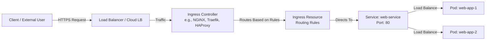
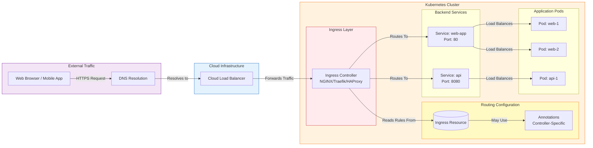
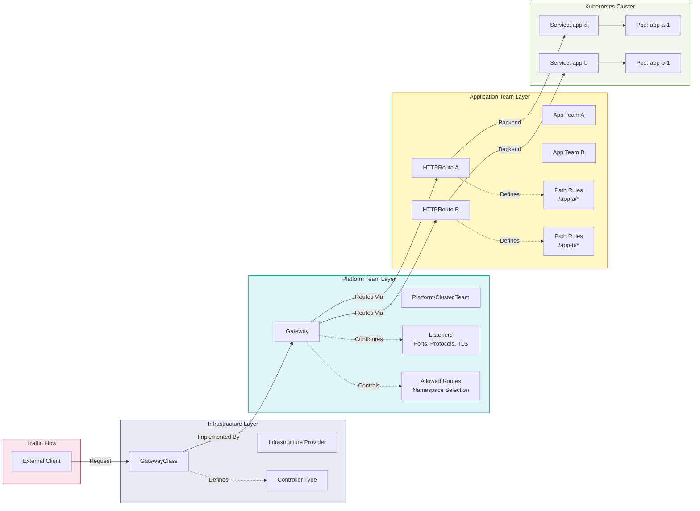
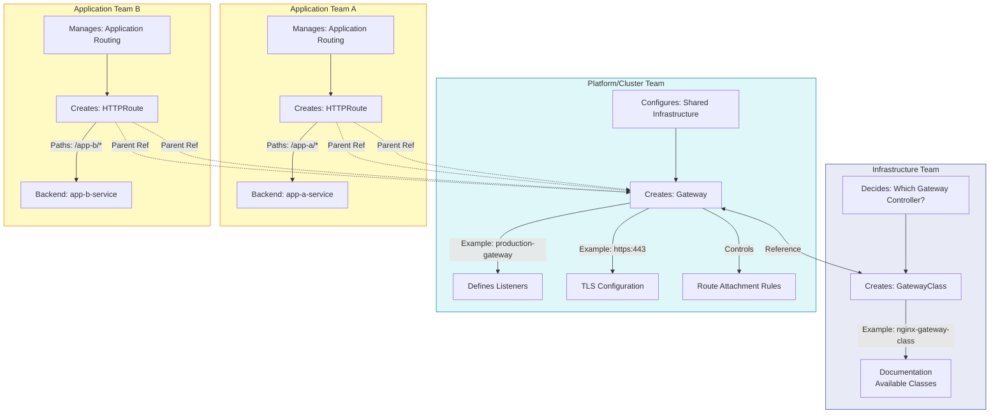
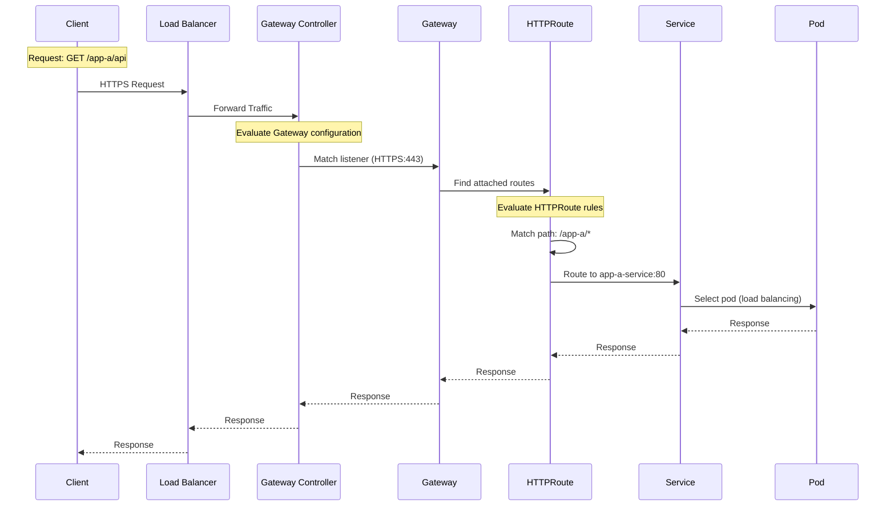
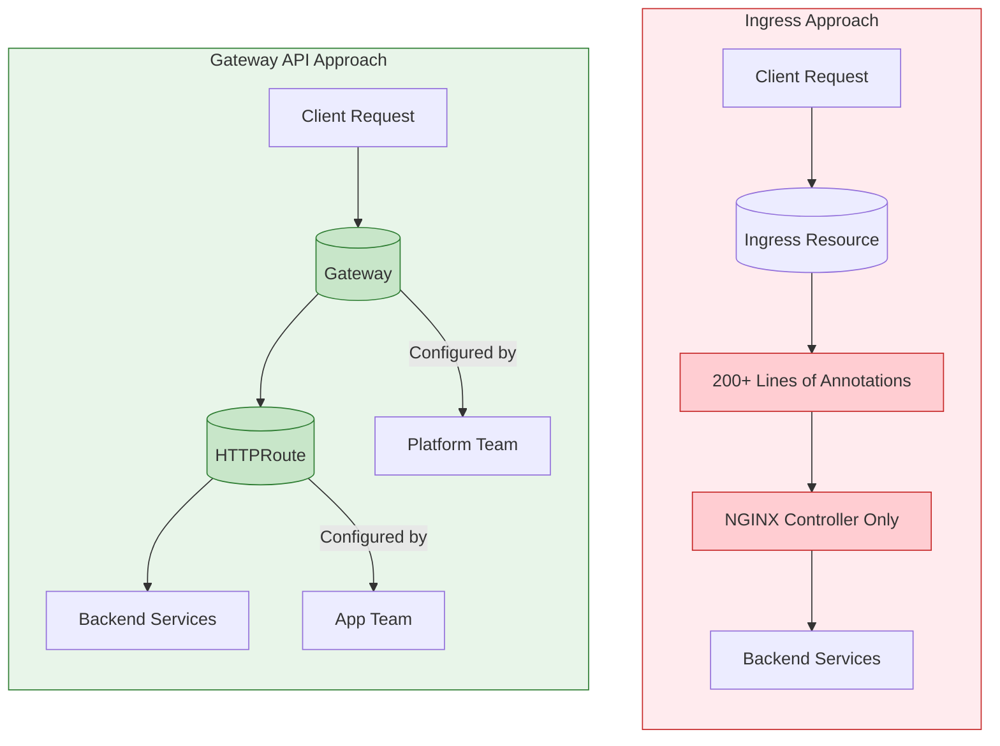
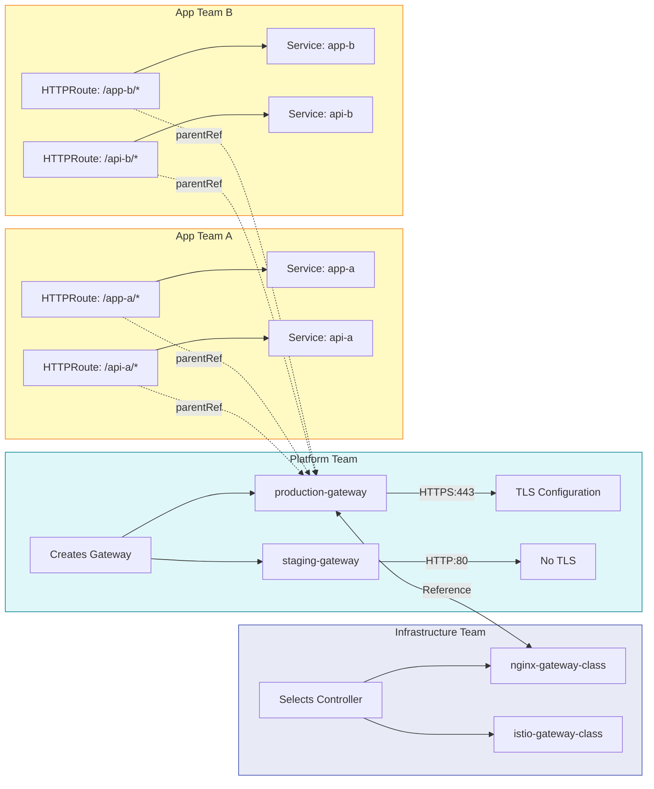
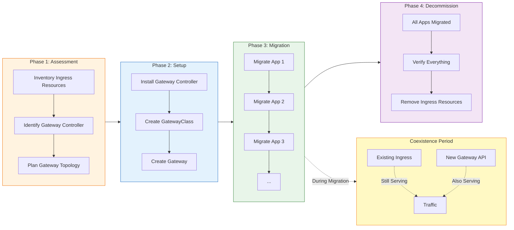

# Gateway API: The Evolution of Kubernetes Traffic Management

> **Difficulty:** Intermediate | **Reading Time:** 35-45 minutes

---

## Table of Contents

1. Introduction
2. Prerequisites
3. Learning Objectives
4. What is Kubernetes Ingress?
5. Where Ingress Becomes Challenging
6. What is Gateway API?
7. Gateway API Role-Oriented Model
8. GatewayClass
## 1. Introduction: Beyond Ingress

If you've worked with Kubernetes, you've probably used **Ingress** to expose applications outside the cluster. It's been the standard way to route external HTTP/HTTPS traffic to services inside Kubernetes for years.

But Kubernetes networking is evolving, and you may have started hearing another term more frequently: **Gateway API**.

> 💡 **The Core Question:** Are Ingress and Gateway API alternatives? Is Gateway API replacing Ingress? And more importantly—when should you use one over the other?

Let's break down this evolution in Kubernetes traffic management.

### The Evolution Story

```
┌─────────────────────────────────────────────────────────────────────────┐
│                    The Evolution of Kubernetes Traffic Management        │
├─────────────────────────────────────────────────────────────────────────┤
│                                                                         │
│   Phase 1: Basic Exposure                                               │
│   ┌─────────────┐    ┌─────────────┐    ┌─────────────┐                │
│   │  Pod        │───▶│  Service    │───▶│ LoadBalancer│                │
│   └─────────────┘    └─────────────┘    └─────────────┘                │
│   (One LB per service - doesn't scale)                                  │
│                                                                         │
│   Phase 2: Ingress (The Standard)                                      │
│   ┌─────────────┐    ┌─────────────┐    ┌─────────────┐                │
│   │   Client    │───▶│  Ingress    │───▶│  Services   │                │
│   └─────────────┘    │  Controller │    └─────────────┘                │
│                      └─────────────┘                                    │
│   (Single resource, simple routing, annotation-dependent features)     │
│                                                                         │
│   Phase 3: Gateway API (The Evolution)                                 │
│   ┌─────────────┐    ┌─────────────┐    ┌─────────────┐    ┌─────────┐│
│   │   Client    │───▶│   Gateway   │───▶│  HTTPRoute  │───▶│Service  ││
│   └─────────────┘    │  (Shared)   │    │ (App Team)  │    └─────────┘│
│                      └─────────────┘    └─────────────┘                │
│   (Role-oriented, expressive, standardized, multi-team ready)          │
│                                                                         │
└─────────────────────────────────────────────────────────────────────────┘
```

**Key Insight:** Gateway API isn't simply "Ingress 2.0." It's a fundamentally different approach to modeling networking responsibilities.

---

## 2. Prerequisites

Before diving into Gateway API, you should have:

### Required Knowledge
- **Basic Kubernetes concepts:** Pods, Deployments, Services
- **Networking fundamentals:** HTTP/HTTPS, DNS, load balancing concepts
- **YAML proficiency:** Comfortable reading and writing Kubernetes manifest files
- **kubectl skills:** Ability to apply resources and check status

### Recommended Background
- Experience with Kubernetes Ingress (helpful for comparison)
- Understanding of TLS/SSL concepts
- Familiarity with role-based access control (RBAC) in Kubernetes

### Environment Setup
```bash
# Check your Kubernetes version (Gateway API requires 1.22+ for core resources)
kubectl version --short

# Verify you have a cluster running
kubectl get nodes

# Install a Gateway API supporting controller (examples below)
# Options include: NGINX Gateway Fabric, Gloo, Istio, Envoy Gateway, etc.
```

---

## 3. Learning Objectives

By the end of this tutorial, you will be able to:

### Core Competencies
- ✅ Explain the fundamental differences between Ingress and Gateway API
- ✅ Describe the role-oriented model (GatewayClass → Gateway → HTTPRoute → Service)
- ✅ Write valid Gateway API resources (GatewayClass, Gateway, HTTPRoute)
- ✅ Configure host-based and path-based routing with Gateway API
- ✅ Set up TLS/HTTPS with Gateway API
- ✅ Understand when to choose Ingress vs Gateway API

### Advanced Competencies
- ✅ Design networking configurations for multi-team environments
- ✅ Implement separation of responsibilities using Gateway API
- ✅ Migrate from Ingress to Gateway API incrementally
- ✅ Troubleshoot common Gateway API configuration issues

### Decision-Making Skills
- ✅ Evaluate whether Gateway API fits your organization's needs
- ✅ Identify scenarios where Ingress is still the better choice
- ✅ Plan a migration strategy based on your specific requirements

9. Gateway
10. HTTPRoute
11. Complete Examples
12. Comparison
13. Diagrams
14. Real-World Examples
15. Troubleshooting
16. Best Practices
17. Anti-Patterns
18. Performance
19. Security
20. Testing
21. Migration Guide
22. Practice Exercises
23. Question Bank
24. Test Your Understanding
25. Interview Questions
26. Summary
27. Resources

---
---

## 4. What is Kubernetes Ingress?

### Definition

**Ingress** is a Kubernetes API object used to define rules for routing external HTTP/HTTPS traffic to services inside a cluster.

### Architecture Overview



### Simple Ingress Example

```yaml
apiVersion: networking.k8s.io/v1
kind: Ingress
metadata:
  name: web-ingress
spec:
  ingressClassName: nginx
  rules:
    - host: example.com
      http:
        paths:
          - path: /
            pathType: Prefix
            backend:
              service:
                name: web-service
                port:
                  number: 80
```

**What this does:** Routes traffic for `https://example.com/` to the `web-service` on port 80.

### Host-Based Routing Example

```yaml
apiVersion: networking.k8s.io/v1
kind: Ingress
metadata:
  name: multi-host-ingress
spec:
  ingressClassName: nginx
  rules:
    - host: app1.example.com
      http:
        paths:
          - path: /
            pathType: Prefix
            backend:
              service:
                name: app1-service
                port:
                  number: 80
    - host: app2.example.com
      http:
        paths:
          - path: /
            pathType: Prefix
            backend:
              service:
                name: app2-service
                port:
                  number: 80
```

### TLS Termination Example

```yaml
apiVersion: networking.k8s.io/v1
kind: Ingress
metadata:
  name: tls-ingress
spec:
  ingressClassName: nginx
  tls:
    - hosts:
        - example.com
      secretName: example-tls-secret
  rules:
    - host: example.com
      http:
        paths:
          - path: /
            pathType: Prefix
            backend:
              service:
                name: web-service
                port:
                  number: 80
```

---

## 5. Where Ingress Becomes Challenging

Ingress intentionally provides a **relatively simple API**. This simplicity is both a strength and a limitation.

### The Annotation Problem

When you need advanced capabilities beyond basic routing, you often end up relying on **controller-specific annotations**:

```yaml
apiVersion: networking.k8s.io/v1
kind: Ingress
metadata:
  name: advanced-ingress
  annotations:
    # NGINX-specific annotation for URL rewriting
    nginx.ingress.kubernetes.io/rewrite-target: /$2
    
    # NGINX-specific rate limiting
    nginx.ingress.kubernetes.io/limit-rps: "100"
    
    # NGINX-specific CORS configuration
    nginx.ingress.kubernetes.io/cors-allow-origin: "https://example.com"
    
    # NGINX-specific authentication
    nginx.ingress.kubernetes.io/auth-url: "http://auth-service/validate"
spec:
  ingressClassName: nginx
  rules:
    - host: example.com
      http:
        paths:
          - path: /service(/|$)(.*)
            pathType: ImplementationSpecific
            backend:
              service:
                name: backend-service
                port:
                  number: 80
```

### The Core Issues

| Issue | Description | Impact |
|-------|-------------|--------|
| **Controller-specific** | Annotations work only with specific controllers | Lock-in to a particular Ingress Controller |
| **Hard to standardize** | No standard way to express advanced features | Configuration varies across environments |
| **Migration difficulty** | Moving between controllers requires rewrites | Increased operational overhead |
| **Unclear ownership** | All configuration in one resource | Hard to separate infrastructure vs application concerns |
| **Limited expressiveness** | Simple API can't express complex routing | Workarounds become complex and fragile |

> ⚠️ **Scenario:** You have 50 application teams. Every time someone needs to add rate limiting, URL rewriting, or custom headers, they add another annotation. Now your Ingress resources are 200+ lines of annotations that only work with NGINX. If you ever want to try a different controller, you have to rewrite everything.

This is one of the key areas where **Gateway API takes a different approach**.

---

## 6. What is Kubernetes Gateway API?

### Definition

**Gateway API** is a Kubernetes project for expressing more advanced and flexible traffic-routing requirements using a **set of specialized resources**.

Instead of putting everything into one Ingress resource, Gateway API **separates responsibilities** across multiple resources.

### Key Design Principles

1. **Role-Oriented:** Different teams own different parts of the configuration
2. **Expressive:** More capabilities built into the API itself
3. **Standardized:** Common behaviors are part of the API, not annotations
4. **Extensible:** Designed to grow with new features and protocols
5. **Portable:** Works across different Gateway controller implementations

### Resource Hierarchy

```
GatewayClass (Infrastructure Provider)
     │
     └── Defines which controller manages the Gateway
     └── Specifies the controller's name/identifier
     └── Can include configuration defaults for the controller

Gateway (Platform/Cluster Team)
     │
     └── Represents an instance of networking infrastructure
     └── Defines listeners, ports, protocols, TLS configuration
     └── Controls which routes can attach

HTTPRoute (Application Team)
     │
     └── Defines HTTP routing rules and backend references
     └── Application teams control their own routing
     └── Attached to Gateway via parentRefs

Service (Kubernetes Service - the actual backend)
```

### Traffic Flow

```
Client Request Flow Through Gateway API:

┌──────────┐    ┌──────────────┐    ┌────────────┐    ┌──────────┐    ┌─────────┐
│  Client  │───▶│  Gateway     │───▶│  HTTPRoute │───▶│ Service  │───▶│  Pod    │
│          │    │  (Infrastructure)│    │  (App Logic)│    │          │    │         │
└──────────┘    └──────────────┘    └────────────┘    └──────────┘    └─────────┘
     │                 │                    │                  │
     │ HTTPS/HTTP     │ Listener           │ Path/Method      │ ClusterIP
     │ Request        │ Configuration      │ Matching         │ Routing
                       │                    │                  │
                       ▼                    ▼                  ▼
                 Gateway Controller    Route Rules       Backend Pods
                 (Implements the       (Evaluated in      (Selected by
                  API)                 order)             Service)
```

---

## 7. Gateway API Role-Oriented Model

This is the **most important conceptual difference** between Ingress and Gateway API.

### The Problem Gateway API Solves

Imagine a company with **50 application teams**. You don't want every developer modifying the shared production load-balancing infrastructure.

Gateway API addresses this through **separation of responsibilities**:

```
Responsibility Separation Across Teams:

Infrastructure/Platform Provider
  └─ Manages: GatewayClass
  └─ Defines: Which controllers are available
  └─ Controls: Infrastructure type, controller selection

Platform/Cluster Team
  └─ Manages: Gateway resources
  └─ Defines: Listeners, ports, protocols, TLS config
  └─ Controls: Shared entry points, which routes can attach

Application Team
  └─ Manages: HTTPRoute resources
  └─ Defines: Path matching, backend references
  └─ Controls: Application-level routing without touching Gateway
```

### Benefits of Role Separation

| Benefit | Description | Real-World Impact |
|---------|-------------|-------------------|
| **Clear ownership** | Each team owns their configuration domain | No more "who changed the production load balancer?" |
| **Reduced blast radius** | App teams can't accidentally modify infrastructure | Less risk of production incidents |
| **Parallel work** | Teams work independently on their layer | Faster development cycles |
| **Standardization** | Platform team ensures consistent gateway config | Uniform security, TLS, and networking policies |
| **Scalability** | 50 teams can manage their routes without touching shared infra | Supports large organizations |

### Real-World Analogy

> Think of it like a building:
> - **GatewayClass** = Building management decides what type of elevators to install
> - **Gateway** = Building management decides which floors the elevators serve
> - **HTTPRoute** = Each tenant decides how to route visitors within their office space

---

## 8. GatewayClass: Infrastructure Provider Responsibility

### What is GatewayClass?

**GatewayClass** defines the type of gateway infrastructure available in the cluster. It is typically associated with a particular Gateway controller.

### Example GatewayClass

```yaml
apiVersion: gateway.networking.k8s.io/v1
kind: GatewayClass
metadata:
  name: nginx-gateway-class
spec:
  controllerName: nginxgateway.io/gateway-controller
```

### Multiple GatewayClasses

You can have multiple GatewayClasses for different purposes:

```yaml
# Public-facing gateway class
apiVersion: gateway.networking.k8s.io/v1
kind: GatewayClass
metadata:
  name: public-gateway-class
spec:
  controllerName: nginxgateway.io/gateway-controller

# Internal/service mesh gateway class  
apiVersion: gateway.networking.k8s.io/v1
kind: GatewayClass
metadata:
  name: internal-gateway-class
spec:
  controllerName: istio.io/gateway-controller
```

### GatewayClass Selection in Gateway

When creating a Gateway, you reference which GatewayClass to use:

```yaml
apiVersion: gateway.networking.k8s.io/v1
kind: Gateway
metadata:
  name: my-gateway
spec:
  gatewayClassName: nginx-gateway-class
  listeners:
    - name: http
      protocol: HTTP
      port: 80
```

> ⚠️ **Important:** The controller referenced in GatewayClass must be installed in your cluster. If it's not running, Gateway resources using that class won't be implemented.

---

## 9. Gateway: Platform Team Responsibility

### What is Gateway?

The **Gateway** represents an instance of the networking infrastructure. It defines:

- **Listeners:** What protocols, ports, and hostname configurations are available
- **TLS configuration:** How TLS is handled at the entry point
- **Route attachment rules:** Which routes can attach to this Gateway

### Example Gateway

```yaml
apiVersion: gateway.networking.k8s.io/v1
kind: Gateway
metadata:
  name: production-gateway
  namespace: production
spec:
  gatewayClassName: nginx-gateway-class
  listeners:
    - name: http
      protocol: HTTP
      port: 80
      allowedRoutes:
        namespaces:
          from: Same
      
    - name: https
      protocol: HTTPS
      port: 443
      tls:
        mode: Terminate
        certificateRefs:
          - name: production-tls-cert
      allowedRoutes:
        namespaces:
          from: Selector
          selector:
            matchLabels:
              gateway-access: "true"
```

### Gateway with Multiple Listeners

```yaml
apiVersion: gateway.networking.k8s.io/v1
kind: Gateway
metadata:
  name: multi-protocol-gateway
spec:
  gatewayClassName: nginx-gateway-class
  listeners:
    - name: http
      protocol: HTTP
      port: 80
      allowedRoutes:
        namespaces:
          from: All
      
    - name: https
      protocol: HTTPS
      port: 443
      tls:
        mode: Terminate
        certificateRefs:
          - name: wildcard-tls
      allowedRoutes:
        namespaces:
          from: Same
```

### Gateway Status

Gateway resources have a status field that reports on their state:

```yaml
apiVersion: gateway.networking.k8s.io/v1
kind: Gateway
metadata:
  name: production-gateway
spec:
  gatewayClassName: nginx-gateway-class
  listeners:
    - name: http
      protocol: HTTP
      port: 80
status:
  addresses:
    - type: IPAddress
      value: "203.0.113.10"
  conditions:
    - type: Ready
      status: "True"
      severity: "Successful"
      reason: "ControllerReconciled"
      message: "Gateway is ready"
```

---

## 10. HTTPRoute: Application Team Responsibility

### What is HTTPRoute?

**HTTPRoute** defines how application traffic should be routed. It's where application teams define their routing rules.

### Simple HTTPRoute Example

```yaml
apiVersion: gateway.networking.k8s.io/v1
kind: HTTPRoute
metadata:
  name: web-route
  namespace: app-team-1
spec:
  parentRefs:
    - name: production-gateway
      namespace: production
      sectionName: http
  rules:
    - matches:
        - path:
            type: PathPrefix
            value: /web
      backendRefs:
        - name: web-service
          port: 80
```

### HTTPRoute with Multiple Path Rules

```yaml
apiVersion: gateway.networking.k8s.io/v1
kind: HTTPRoute
metadata:
  name: api-route
  namespace: app-team-2
spec:
  parentRefs:
    - name: production-gateway
  rules:
    - matches:
        - path:
            type: PathPrefix
            value: /api/v1
      backendRefs:
        - name: api-v1-service
          port: 8080
    - matches:
        - path:
            type: PathPrefix
            value: /api/v2
      backendRefs:
        - name: api-v2-service
          port: 8080
```

### HTTPRoute with Host Matching

```yaml
apiVersion: gateway.networking.k8s.io/v1
kind: HTTPRoute
metadata:
  name: host-based-route
  namespace: marketing-team
spec:
  parentRefs:
    - name: production-gateway
  hostnames:
    - "marketing.example.com"
  rules:
    - matches:
        - path:
            type: PathPrefix
            value: /
      backendRefs:
        - name: marketing-site-service
          port: 80
```

### HTTPRoute with Weighted Routing (Canary Deployment)

```yaml
apiVersion: gateway.networking.k8s.io/v1
kind: HTTPRoute
metadata:
  name: canary-route
  namespace: app-team-1
spec:
  parentRefs:
    - name: production-gateway
  rules:
    - matches:
        - path:
            type: PathPrefix
            value: /
      backendRefs:
        - name: web-service-stable
          port: 80
          weight: 90  # 90% traffic to stable
        - name: web-service-canary
          port: 80
          weight: 10  # 10% traffic to canary
```

---

## 11. Complete Working Examples

### Example 1: Simple Web Application Setup

**Scenario:** A simple web application with a single HTTPRoute attached to a Gateway.

#### Step 1: Create the GatewayClass

```yaml
# gateway-class.yaml
apiVersion: gateway.networking.k8s.io/v1
kind: GatewayClass
metadata:
  name: example-gateway-class
spec:
  controllerName: nginxgateway.io/gateway-controller
```

```bash
kubectl apply -f gateway-class.yaml
```

#### Step 2: Create the Gateway

```yaml
# gateway.yaml
apiVersion: gateway.networking.k8s.io/v1
kind: Gateway
metadata:
  name: example-gateway
  namespace: default
spec:
  gatewayClassName: example-gateway-class
  listeners:
    - name: http
      protocol: HTTP
      port: 80
      allowedRoutes:
        namespaces:
          from: All
```

```bash
kubectl apply -f gateway.yaml
```

#### Step 3: Create a Backend Service

```yaml
# web-service.yaml
apiVersion: v1
kind: Service
metadata:
  name: web-service
  namespace: default
spec:
  selector:
    app: web
  ports:
    - port: 80
      targetPort: 8080
```

```bash
kubectl apply -f web-service.yaml
```

#### Step 4: Create the HTTPRoute

```yaml
# web-route.yaml
apiVersion: gateway.networking.k8s.io/v1
kind: HTTPRoute
metadata:
  name: web-route
  namespace: default
spec:
  parentRefs:
    - name: example-gateway
  rules:
    - matches:
        - path:
            type: PathPrefix
            value: /
      backendRefs:
        - name: web-service
          port: 80
```

```bash
kubectl apply -f web-route.yaml
```

#### Step 5: Verify the Configuration

```bash
# Check Gateway status
kubectl get gateway example-gateway -o yaml

# Check HTTPRoute status
kubectl get httproute web-route -o yaml

# Describe for detailed status
kubectl describe gateway example-gateway
kubectl describe httproute web-route
```

---

## 12. Ingress vs Gateway API: Detailed Comparison

### Side-by-Side Feature Comparison

| Feature | Ingress | Gateway API |
|---------|---------|-------------|
| **API Model** | Single resource (Ingress) | Multiple resources (GatewayClass, Gateway, HTTPRoute, etc.) |
| **Complexity** | Simpler, fewer concepts | More concepts to learn, but clearer separation |
| **Routing Capabilities** | HTTP/HTTPS routing | HTTP, HTTPS, TCP, UDP, TLS, and more |
| **Advanced Configuration** | Often via annotations (controller-specific) | Dedicated API fields and resources |
| **Ownership Model** | Less explicit separation | Role-oriented: Infrastructure → Platform → Application |
| **Multi-Team Support** | Can become difficult to manage | Designed with separation of concerns |
| **Extensibility** | Limited, annotation-dependent | Designed for extensibility with structured API |
| **Learning Curve** | Easier to start | More concepts initially, but more powerful |
| **Adoption Maturity** | Very mature, widely adopted | Newer, increasingly adopted, growing ecosystem |
| **Portability** | Annotations can lock you to a controller | More standardized behavior across controllers |
| **Protocol Support** | Primarily HTTP/HTTPS | HTTP, HTTPS, TCP, UDP, TLS, gRPC (varies by implementation) |
| **Traffic Splitting** | Limited, often annotation-based | Native weighted routing support |
| **Header Matching** | Limited or annotation-based | Native header matching in HTTPRoute |

### When Ingress is Sufficient

Ingress remains a perfectly valid choice when:

- ✅ Your routing requirements are simple (basic HTTP/HTTPS routing)
- ✅ You only have a single team managing all routing
- ✅ Your organization already has a mature Ingress setup
- ✅ Your team is comfortable with the existing Ingress Controller
- ✅ Controller-specific annotations meet your needs

### When Gateway API Provides Value

Gateway API becomes particularly relevant when:

- ✅ Multiple application teams need to manage their own routing
- ✅ You have shared networking infrastructure
- ✅ More complex routing requirements (header matching, traffic splitting)
- ✅ A platform engineering model with separation of responsibilities
- ✅ Clear ownership boundaries are important
- ✅ You want to reduce dependence on controller-specific annotations

---

## 13. Visual Architecture: Mermaid Diagrams

### Diagram 1: Traditional Ingress Architecture



### Diagram 2: Gateway API Role-Oriented Architecture



### Diagram 3: Multi-Team Responsibility Flow



### Diagram 4: Traffic Flow Through Gateway API



---


### Diagram 3: Traffic Flow Through Gateway API


### Diagram 4: Ingress Annotation Problem vs Gateway API Solution



### Diagram 5: Multi-Team Platform Architecture



### Diagram 6: Migration Path from Ingress to Gateway API



---

## 14. Real-World Examples and Use Cases
### Use Case 1: Enterprise Multi-Team Platform

**Scenario:** A large enterprise with 30+ application teams running on Kubernetes.

**Challenge:** Without separation of responsibilities, every team modifies the shared Ingress configuration, leading to:
- Configuration conflicts
- Hard-to-debug routing issues
- Security concerns
- No clear ownership

**Solution with Gateway API:**

```
Organization Structure:

Infrastructure Team (Network Engineering)
├── Manages GatewayClass definitions
├── Selects and maintains Gateway controllers
└── Ensures controller availability and upgrades

Platform Team (Kubernetes Platform)
├── Manages Gateway resources (production, staging, etc.)
├── Configures TLS certificates centrally
├── Defines namespace access policies
└── Enforces networking standards

Application Teams (30+ teams)
├── Each team manages their own HTTPRoute
├── Can deploy routes independently
├── No access to modify shared Gateway
└── Clear ownership of their routing configuration
```

**Implementation - GatewayClass:**

```yaml
apiVersion: gateway.networking.k8s.io/v1
kind: GatewayClass
metadata:
  name: enterprise-gateway-class
spec:
  controllerName: nginxgateway.io/gateway-controller
```

**Implementation - Platform Gateway:**

```yaml
apiVersion: gateway.networking.k8s.io/v1
kind: Gateway
metadata:
  name: production-gateway
  namespace: platform
spec:
  gatewayClassName: enterprise-gateway-class
  listeners:
    - name: https
      protocol: HTTPS
      port: 443
      tls:
        mode: Terminate
        certificateRefs:
          - name: enterprise-wildcard-cert
      allowedRoutes:
        namespaces:
          from: Selector
          selector:
            matchLabels:
              environment: production
```

**Implementation - App Team HTTPRoute:**

```yaml
apiVersion: gateway.networking.k8s.io/v1
kind: HTTPRoute
metadata:
  name: payment-service-route
  namespace: payment-team
  labels:
    environment: production
spec:
  parentRefs:
    - name: production-gateway
      namespace: platform
  rules:
    - matches:
        - path:
            type: PathPrefix
            value: /payment
      backendRefs:
        - name: payment-service
          port: 8080
```

### Use Case 2: SaaS Multi-Tenant Platform

**Scenario:** A SaaS provider hosting multiple customer applications on the same Kubernetes cluster.

**Solution:**

```
SaaS Platform Architecture:

Platform Team
├── Base Gateway with wildcard TLS
├── Standardized listeners for customer traffic
└── Routing policies and rate limiting

Customer A: customer-a.example.com
├── Own HTTPRoute with customer-specific paths
└── Backend: customer-a-services

Customer B: customer-b.example.com
├── Own HTTPRoute with customer-specific paths
└── Backend: customer-b-services

Customer C: customer-c.example.com
├── Own HTTPRoute with customer-specific paths
└── Backend: customer-c-services
```

### Use Case 3: Progressive Delivery / Canary Deployments

**Scenario:** You want to gradually roll out a new version of your application.

**Gateway API Approach (native support):**

```yaml
apiVersion: gateway.networking.k8s.io/v1
kind: HTTPRoute
metadata:
  name: canary-deployment-route
  namespace: production
spec:
  parentRefs:
    - name: production-gateway
  rules:
    - matches:
        - path:
            type: PathPrefix
            value: /
      backendRefs:
        - name: myapp-stable
          port: 80
          weight: 95  # 95% to stable
        - name: myapp-canary
          port: 80
          weight: 5   # 5% to canary
```

**Progressive Rollout Strategy:**

```
Canary Deployment Progression:

Phase 1: Initial Canary (5% traffic)
  ├── weight: stable=95, canary=5
  └── Monitor metrics, error rates, latency

Phase 2: Increase Canary (25% traffic)
  ├── weight: stable=75, canary=25
  └── Continue monitoring, prepare rollback if needed

Phase 3: Further Increase (50% traffic)
  ├── weight: stable=50, canary=50
  └── Validate at scale

Phase 4: Full Rollout (100% canary)
  ├── weight: stable=0, canary=100
  └── Update stable deployment, remove canary
```

### Use Case 4: API Versioning

**Scenario:** You're running multiple versions of your API simultaneously.

```yaml
apiVersion: gateway.networking.k8s.io/v1
kind: HTTPRoute
metadata:
  name: api-versioning-route
  namespace: api-team
spec:
  parentRefs:
    - name: production-gateway
  rules:
    # /api/v1/* goes to v1 service
    - matches:
        - path:
            type: PathPrefix
            value: /api/v1
      backendRefs:
        - name: api-service-v1
          port: 8080
    
    # /api/v2/* goes to v2 service
    - matches:
        - path:
            type: PathPrefix
            value: /api/v2
      backendRefs:
        - name: api-service-v2
          port: 8080
```

---

## 15. Common Pitfalls and Troubleshooting

### Pitfall 1: GatewayClass Not Available

**Symptom:** Gateway shows `NotReady` condition, no traffic flows.

**Cause:** The GatewayClass references a controller that isn't installed.

**Solution:**
```bash
# Check available GatewayClasses
kubectl get gatewayclass

# Install a Gateway controller (example for NGINX Gateway Fabric)
kubectl apply -f https://github.com/nginxinc/nginx-gateway-fabric/releases/latest/download/install.yaml

# Verify controller is running
kubectl get pods -n nginx-gateway-fabric
```

### Pitfall 2: HTTPRoute Can't Attach to Gateway

**Symptom:** HTTPRoute shows a `ResolvedRefs` condition with `False` status.

**Cause:** The HTTPRoute is in a namespace not allowed by the Gateway's `allowedRoutes` configuration.

**Solution:**
```bash
# Check Gateway's allowedRoutes configuration
kubectl get gateway <gateway-name> -o yaml | grep -A 10 allowedRoutes

# Option 1: Add label to namespace (if using selector)
kubectl label namespace <your-namespace> gateway-access=true

# Option 2: Change Gateway to allow all namespaces
# In Gateway spec:
allowedRoutes:
  namespaces:
    from: All
```

### Troubleshooting Commands

```bash
# Check Gateway status
kubectl get gateway <name> -o wide
kubectl describe gateway <name>

# Check HTTPRoute status
kubectl get httproute <name> -o wide
kubectl describe httproute <name>

# Check GatewayClass status
kubectl get gatewayclass

# View all Gateway API resources
kubectl get gatewayclass,gateway,httproute -A

# Check controller logs (namespace varies by controller)
kubectl logs -n <controller-namespace> -l app=<controller-name>

# Debug with verbose output
kubectl get gateway <name> -o yaml
kubectl get httproute <name> -o yaml
```

### Common Error Messages

| Error Message | Meaning | Fix |
|---------------|---------|-----|
| `GatewayClass not found` | Controller not installed | Install a Gateway controller |
| `ResolvedRefs: False` | HTTPRoute can't reference Gateway | Check namespace permissions, parentRef |
| `Listeners: NotReady` | Listener configuration issue | Check port conflicts, TLS config |
| `No matching Gateway` | HTTPRoute parentRef doesn't match | Verify Gateway name and namespace |

---

## 16. Best Practices

### Best Practice 1: Use Appropriate API Versions

Use stable API versions when available (gateway.networking.k8s.io/v1). Avoid alpha/beta versions unless necessary.

### Best Practice 2: Organize Namespaces for Your Team Structure

Organize namespaces by team/application (platform, team-a, team-b, infrastructure). Use labels for access control (gateway-enabled: true).

### Best Practice 3: Use Meaningful Names

Use descriptive names like production-gateway-east or team-a-api-route. Avoid vague names like gateway1 or route1.

### Best Practice 4: Configure TLS at the Gateway Level

Centralize TLS at Gateway level rather than duplicating in every HTTPRoute.

### Best Practice 5: Use Namespace Restrictions for Security

Restrict which namespaces can attach routes using allowedRoutes.namespaces.from with Selector.

### Best Practice 6: Use Descriptive Listener Names

Use clear listener names like https-web, https-api, https-admin instead of generic names like listener1.

### Best Practice 7: Monitor Gateway Status Conditions

Monitor Gateway condition Ready and HTTPRoute condition ResolvedRefs. Set up alerts for failures.

### Best Practice 8: Version Your Routes Alongside Your Applications

Include version information in route metadata labels (app, version, environment).

---

## 17. Anti-Patterns

### Anti-Pattern 1: Using Gateway API for Simple Use Cases

Problem: Adding complexity where it is not needed. For simple single-service apps, Ingress is perfectly fine.

### Anti-Pattern 2: Ignoring Gateway Status Conditions

Problem: Assuming everything is working without verification. Always check status with kubectl get gateway and kubectl describe.

### Anti-Pattern 3: Not Planning for Multi-Tenancy

Problem: Creating Gateways without considering namespace isolation. Plan your access model with allowedRoutes.namespaces.from.

---

## 18. Performance Considerations

### Gateway Controller Overhead

Gateway API adds a layer of abstraction with a Gateway controller that watches resources and programs the data plane.

**Considerations:**
- Controller resource usage: Size controller appropriately, use resource limits
- Reconciliation frequency: Batch changes when possible
- Number of HTTPRoutes: Consider multiple Gateways for isolation
- Complex matching rules: Use simpler path matching when possible

### Performance Comparison

For most workloads, the difference between Ingress and Gateway API is negligible. At scale (1000s of routes), benchmarking is worthwhile. Controller maturity matters more than API model.

### Scaling Considerations

For large-scale deployments: 1) Multiple Gateways for isolation (production, staging), 2) Namespace-based sharding, 3) Resource limits for controllers (requests: 100m CPU/128Mi memory, limits: 500m CPU/512Mi memory).

---

## 19. Security Considerations

### TLS/HTTPS Configuration

Configure TLS at Gateway listener level with mode: Terminate and certificateRefs.

### Namespace Isolation

Restrict route attachment to controlled namespaces using allowedRoutes.namespaces.from: Selector with appropriate labels.

### Authentication and Authorization

Gateway API handles routing, not authentication. Authentication should be handled by backend applications, API gateway layer, or external auth services (OAuth, OIDC).

### Network Policies

Combine Gateway API with Kubernetes NetworkPolicies for defense in depth.

### Secrets Management

TLS certificates should be managed securely. Options: manual secret creation, cert-manager for automated management, or external secret management (Vault, AWS Secrets Manager).

---

## 20. Testing Strategies

### Testing Gateway API Configuration

1. Dry Run Validation: kubectl apply -f gateway.yaml --dry-run=client or --dry-run=server
2. Status Condition Checks: Check Gateway Ready and HTTPRoute ResolvedRefs conditions
3. Traffic Testing: Test HTTP/HTTPS routing from within cluster using curl

### Testing Maturity Model

Level 1: Basic Syntax Validation (dry-run, YAML validation)
Level 2: Status Verification (check conditions, verify references)
Level 3: Functional Testing (actual HTTP requests, verify routing)
Level 4: Integration Testing (automated tests in CI/CD)
Level 5: Chaos/Failure Testing (controller failure recovery, HTTPRoute deletion)

### Common Test Scenarios

- Test 1: Basic routing - send request to /test, verify backend
- Test 2: Host-based routing - send with Host header
- Test 3: Path-based routing - test different path prefixes
- Test 4: TLS termination - verify HTTPS and certificate
- Test 5: Header-based routing - test with specific headers
- Test 6: Traffic splitting - verify weight distribution

---

## 21. Migration Guide: From Ingress to Gateway API

### When to Consider Migration

**Migrate when:** You need role-based separation, hitting Ingress annotation limitations, want standardized configs, need expressive routing, building a platform.

**Stay with Ingress when:** Needs are simple, single-team, current setup works well, migrating adds unnecessary complexity.

### Migration Assessment Checklist

- Do you have multiple teams? (Need role separation?)
- Do you use many annotations? (Could be standardized API?)
- Do you need header matching? (Ingress limited here?)
- Do you need traffic splitting? (Ingress annotation-based?)
- Are you building a platform? (Gateway API fits model?)
- Is controller lock-in a concern? (Gateway API more portable?)

### Step-by-Step Migration Process

**Phase 1: Assessment and Planning**
1. Inventory current Ingress resources (kubectl get ingress -A -o yaml)
2. Identify controllers that support Gateway API (NGINX Gateway Fabric, Gloo, Istio, Envoy Gateway, Contour)
3. Plan Gateway API topology (how many Gateways, namespace access, TLS strategy)

**Phase 2: Install Gateway Controller**
Example: kubectl apply -f https://github.com/nginxinc/nginx-gateway-fabric/releases/latest/download/install.yaml

**Phase 3: Create GatewayClass and Gateway**
Create GatewayClass with controllerName and Gateway with appropriate listeners.

**Phase 4: Migrate HTTPRoutes (Incremental)**
Strategy: Side-by-Side Coexistence
- Step 1: Deploy Gateway API alongside Ingress, keep existing Ingress
- Step 2: Migrate one application at a time (low-risk first)
- Step 3: Repeat for remaining applications
- Step 4: Decommission Ingress when all migrated

**Migration Example:**
Ingress with host: example.com, path: /, backend: web-service:80
Equivalent HTTPRoute with parentRefs: production-gateway, hostnames: example.com, path: /, backend: web-service:80

**Annotation Migration:**
1. Check if there is an API field for the feature
2. Use controller-specific extensions if available
3. Move functionality to application layer if appropriate
4. Use different controller if needed

### Coexistence: Ingress and Gateway API Together

Options:
- Separate Traffic: Ingress for one domain, Gateway API for another
- Same Traffic, Different Paths: Ingress handles /legacy/*, Gateway API handles /modern/*
- Different Environments: Ingress for dev/staging, Gateway API for production

---

## 22. Practice Exercises

### Exercise 1: Basic Gateway and HTTPRoute Setup

Task: Create GatewayClass, Gateway (HTTP:80), HTTPRoute routing / to web-service.

Solution:
- GatewayClass: name: exercise-gateway-class, controllerName: nginxgateway.io/gateway-controller
- Gateway: name: exercise-gateway, gatewayClassName: exercise-gateway-class, listener http:80, allowedRoutes from All
- HTTPRoute: name: exercise-route, parentRefs: exercise-gateway, path / -> web-service:80

### Exercise 2: Multi-Path Routing

Task: Route /app1/* to app1-service:8080, /app2/* to app2-service:8080, /api/* to api-service:3000

Solution: HTTPRoute with three rules, each with PathPrefix matching and different backendRefs.

### Exercise 3: Host-Based Routing with TLS

Task: HTTPS Gateway with cert, two HTTPRoutes for app1.example.com and app2.example.com

Solution: Gateway with HTTPS:443 listener, TLS Terminate, two HTTPRoutes each with hostnames field.

### Exercise 4: Weighted Traffic Splitting (Canary)

Task: Send 80% to stable, 20% to canary

Solution: HTTPRoute with two backendRefs, weights 80 and 20.

---

## 23. Question Bank

### Beginner Questions (1-15)

1. What is Kubernetes Ingress? - API object for routing external HTTP/HTTPS traffic to services
2. What implements Ingress rules? - Ingress Controller (NGINX, Traefik, HAProxy)
3. What is Gateway API? - Kubernetes API family for advanced traffic routing with specialized resources
4. Name three main Gateway API resources. - GatewayClass, Gateway, HTTPRoute
5. What does GatewayClass define? - Type of gateway infrastructure, associated with controller
6. Purpose of Gateway resource? - Instance of networking infrastructure with listeners, TLS, route attachment
7. What does HTTPRoute define? - HTTP routing rules with path/header matching and backends
8. What is role-oriented model? - Different teams own different configuration layers
9. Why were annotations problematic? - Controller-specific, non-portable, hard to standardize
10. What is pathType? - Defines path matching (Prefix, Exact, ImplementationSpecific)
11. Name two Ingress Controllers. - NGINX, Traefik
12. What is TLS termination? - Gateway decrypts HTTPS before forwarding to backends
13. Can Gateway API handle non-HTTP protocols? - Yes, TCP, UDP, TLS (controller-dependent)
14. Minimum Kubernetes version? - 1.22+ for core resources
15. What if GatewayClass controller not installed? - Gateways show NotReady

### Intermediate Questions (16-35)

16. PathPrefix vs Exact? - Prefix matches start, Exact matches only exact path
17. Allow specific namespaces? - allowedRoutes.namespaces.from: Selector with labels
18. Purpose of parentRefs? - References which Gateways HTTPRoute attaches to
19. Canary deployments? - Weighted backendRefs in HTTPRoute rules
20. Benefits of separation? - Role separation, clearer ownership, parallel work
21. Host-based routing? - Gateway listener hostname or HTTPRoute hostnames field
22. Status conditions to monitor? - Gateway Ready, HTTPRoute ResolvedRefs
23. HTTPRoute reference Gateway in different namespace? - Yes, with namespace in parentRefs
24. GatewayClass vs Gateway? - Class defines type, Gateway is instance
25. TLS in Gateway API vs Ingress? - Gateway listeners vs Ingress tls section
26. What is allowedRoutes? - Controls which namespaces/routes can attach
27. Multiple HTTPRoutes to same Gateway? - Yes
28. Multiple HTTPRoutes match same request? - Controller-dependent, more specific typically wins
29. Validate before applying? - kubectl apply --dry-run=client or server
30. Common Gateway API controllers? - NGINX Gateway Fabric, Gloo, Istio, Envoy Gateway, Contour
31. Header-based routing? - HTTPRoute matches can include headers
32. Service and backendRef relationship? - backendRefs reference Services that receive traffic
33. Use Gateway API with Ingress? - Yes, they can coexist
34. Issue with allowing all namespaces? - Any namespace can create routes, potential conflicts/security issues
35. Troubleshoot NotReady Gateway? - Check controller running, listener config, controller logs

### Advanced Questions (36-50)

36. Multi-tenant SaaS architecture? - Multiple Gateways/listeners, hostname isolation, namespace-per-customer, centralized TLS
37. One large vs multiple Gateways? - One: simpler, shared. Multiple: isolation, independent config, resource duplication
38. Gradual rollout strategy? - Canary HTTPRoute with small weight, monitor, increase gradually, switch fully
39. Extensibility mechanism? - Extension points for controllers, structured for growth without breaking changes
40. Security considerations? - TLS, namespace isolation, certificate management, auth (app layer), network policies, audit
41. Ingress vs Gateway API operational complexity at scale? - Ingress: simple initially, complex with annotations. Gateway API: more concepts, scales better with separation
42. Annotation feature no Gateway API equivalent? - Check controller extension API, move to app layer, different controller, keep Ingress
43. Migration strategy for large org? - Phase 1: Assess/inventory. Phase 2: Install controller. Phase 3: Parallel Gateway infra. Phase 4: Incremental migration. Phase 5: Decommission Ingress
44. Metrics to monitor? - Gateway/HTTPRoute readiness, request rates, latency, errors, controller resources, cert expiration
45. Cross-namespace service references? - backendRefs with namespace field
46. Service mesh integration impact? - Gateway API can be mesh ingress, some meshes (Istio) support natively
47. Rate limiting? - Controller-dependent, some have extensions, otherwise app layer or separate solution
48. TLS termination vs passthrough? - Termination: Gateway decrypts, can inspect. Passthrough: forwards encrypted to backend
49. CI/CD testing? - Dry-run validation, staging deploy, integration tests, verify conditions, automated rollback
50. Future developments? - Continued Gateway API maturity, more protocols, more controllers, potential Ingress deprecation (not planned), evolving standards

---

## 24. Test Your Understanding

### Section 1: Basic Concepts

1. True/False: Gateway API is simply the next version of Ingress. - False
2. Which resource defines gateway infrastructure type? - b) GatewayClass
3. Which team manages Gateway resources? - c) Platform/Cluster Team
4. Which resource for application routing rules? - c) HTTPRoute

### Section 2: Configuration

5. What does parentRefs specify? - Gateways HTTPRoute attaches to
6. Allow only specific namespaces? - allowedRoutes.namespaces.from: Selector
7. Where is TLS configured? - Gateway listener TLS section
8. Path type matching prefix? - PathPrefix

### Section 3: Scenarios

9. Single team, simple needs? - Ingress
10. Platform for 50 teams? - Gateway API
11. Header-based routing with Ingress? - Not natively, needs annotations. Gateway API has native support
12. Run Ingress and Gateway API together? - True, they can coexist

### Section 4: Troubleshooting

13. HTTPRoute ResolvedRefs: False? - Cannot attach to Gateway, check namespace permissions
14. Gateway NotReady? - Check controller installed/running, listener config, logs
15. Traffic not flowing? - Check status conditions, path matching, test with curl, check logs

---

## 25. Common Interview Questions

### Q1: Difference between Ingress and Gateway API?

Strong answer: Ingress is simpler single-resource API for HTTP/HTTPS. Gateway API is more expressive role-oriented model with multiple resources (GatewayClass, Gateway, HTTPRoute). Key difference: Gateway API provides clearer separation between infrastructure and application routing, better for multi-team environments.

### Q2: When choose Gateway API over Ingress?

Strong answer: When needing expressive routing (header matching, traffic splitting), clear role separation for multi-teams, shared infra with controlled access, standardized configs less dependent on annotations, or platform engineering model. For simple single-team setups, Ingress remains valid and simpler.

### Q3: What is GatewayClass and its purpose?

Strong answer: GatewayClass defines type of gateway infrastructure available, associated with specific controller (NGINX Gateway Fabric, Gloo, Istio). Allows infra teams to define available gateway types without app teams configuring underlying infra.

### Q4: Explain role-oriented model?

Strong answer: Different teams own different layers: Infrastructure/Platform Provider owns GatewayClass (available controller types), Platform/Cluster Team owns Gateway (shared entry points, listeners, TLS), Application Team owns HTTPRoute (app-specific routing). Each team manages their portion without affecting others, reducing conflicts, enabling parallel work.

### Q5: Main problem with Ingress annotations?

Strong answer: Annotations were controller-specific, so NGINX config might not work with Traefik. Created: controller lock-in, difficulty standardizing, challenges migrating, hard-to-understand configs. Gateway API addresses by moving functionality into standardized API.

### Q6: Configure TLS with Gateway API?

Strong answer: At Gateway listener level. Specify protocol HTTPS, set TLS mode (typically Terminate), reference cert via certificateRefs. Different from Ingress where TLS in separate section. Platform team can centrally manage TLS for all routes.

### Q7: Can Gateway API do everything Ingress can?

Strong answer: Yes and more. Supports HTTP/HTTPS like Ingress, plus TCP, UDP, TLS Passthrough (controller-dependent). Native support for features needing annotations in Ingress (header matching, traffic splitting). But for very simple cases, Gateway API complexity may not be necessary.

### Q8: Multiple HTTPRoutes match same request?

Strong answer: Controller-dependent, but generally more specific matches take precedence. Important to design routes carefully with hostnames and specific path prefixes to avoid conflicts. Spec provides guidance, controllers have flexibility.

### Q9: How migrate from Ingress to Gateway API?

Strong answer: Incremental approach. Assess current Ingress, identify supporting controller, install controller, create GatewayClass and Gateway. Migrate apps one at a time starting low-risk. Create equivalent HTTPRoutes, test thoroughly, remove old Ingress only when confident. Both can coexist during migration.

### Q10: Will Gateway API replace Ingress?

Strong answer: Not necessarily. Ingress remains valid widely-used API for HTTP/HTTPS, especially simpler cases. Gateway API provides additional capabilities for certain scenarios (multi-team). Community views them as complementary. Ingress not deprecated, but Gateway API is direction for advanced networking. Important: understand when each appropriate.

### Q11: Allow routes from specific namespaces?

Strong answer: In Gateway spec, under listener, set allowedRoutes.namespaces.from to Same (same ns only), All (any ns), or Selector (ns matching labels). Example: allow ns labeled gateway-access: true using from: Selector with matching selector.

### Q12: Benefits of role separation?

Strong answer: Clearer ownership (each team knows responsibility), reduced risk (app teams cannot accidentally modify shared infra), parallel work (teams work independently), standardization (platform team enforces consistent config), scalability (works well with many teams, each manages only their routes).

---

## 26. Summary and Key Takeaways

### Essential Points

| Topic | Key Point |
|-------|-----------|
| Ingress | Simple mature API for HTTP/HTTPS. Single resource, annotation-dependent for advanced features. |
| Gateway API | More expressive role-oriented model. Multiple resources with clear separation. |
| GatewayClass | Defines gateway infrastructure type. Owned by infrastructure providers. |
| Gateway | Network entry point. Owned by platform teams. Configures listeners, TLS, allowed routes. |
| HTTPRoute | HTTP routing rules. Owned by app teams. Configures path matching, backends, weights. |
| Main Difference | Ingress = simple HTTP routing. Gateway API = networking responsibilities and relationships. |
| Annotations | Ingress relies on controller-specific annotations. Gateway API provides standardized API fields. |
| Role Separation | Key innovation: different teams own different layers (infrastructure to platform to application). |
| Coexistence | Ingress and Gateway API can run side by side. Migration can be incremental. |

### Decision Framework

Single team, simple routing? -> Ingress
Multiple teams, need ownership? -> Gateway API
Only HTTP/HTTPS, basic paths? -> Ingress (sufficient)
Need header matching, weights? -> Gateway API
Controller lock-in acceptable? -> Ingress OK
Want portability? -> Gateway API
Small/simple setup? -> Ingress
Building a platform? -> Gateway API
Already have mature Ingress? -> Ingress (if works well)
Starting fresh with complex needs? -> Consider Gateway API

### Key Insight

Gateway API is not "Ingress v2." It is a different approach emphasizing role separation and expressiveness. Both have their place. Choice depends on specific requirements, team structure, organizational model.

---

## 27. Further Reading and Resources

### Official Documentation

- Gateway API Official Docs: https://gateway-api.sigs.k8s.io/
- Gateway API Specification: https://gateway-api.sigs.k8s.io/concepts/api-overview/
- Kubernetes Ingress Docs: https://kubernetes.io/docs/concepts/services-networking/ingress/
- Kubernetes Gateway API Reference: https://gateway-api.sigs.k8s.io/api-types/

### Gateway Controllers

- NGINX Gateway Fabric: https://docs.nginx.com/nginx-gateway-fabric/
- Gloo Gateway: https://docs.solo.io/gloo/
- Istio Gateway: https://istio.io/latest/docs/tasks/traffic-management/ingress/ingress-gateway/
- Envoy Gateway: https://gateway.envoyproxy.io/
- Contour: https://projectcontour.io/

### Learning Resources

- CNCF Gateway API Introduction: https://www.cncf.io/blog/
- Kubernetes Networking Deep Dives: Various CNCF and community resources
- Gateway API GitHub Repository: https://github.com/kubernetes-sigs/gateway-api

### Related Topics

- Kubernetes Services and Networking
- Service Mesh (Istio, Linkerd)
- API Gateways
- TLS/SSL Certificate Management (cert-manager)
- Kubernetes RBAC

---

*This tutorial is part of the Knowledge Base collection. For questions or contributions, please refer to the repository guidelines.*


