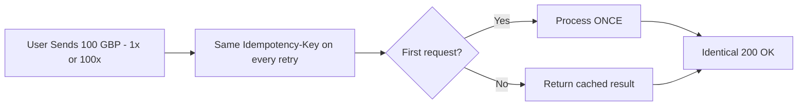
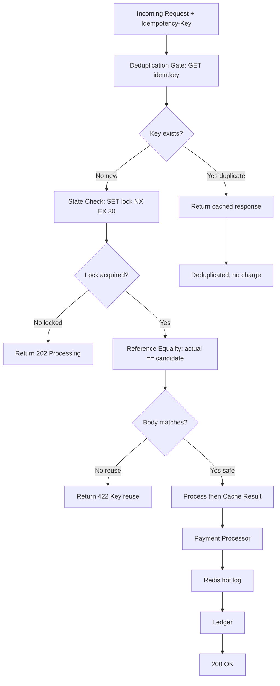
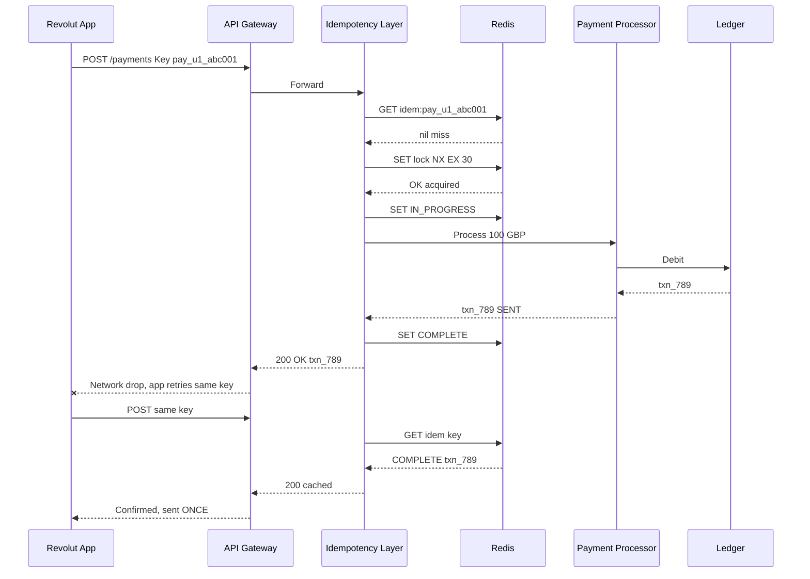
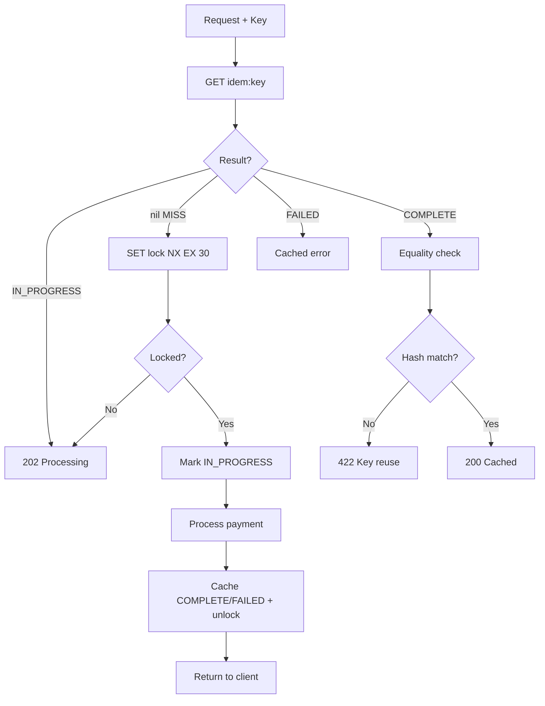
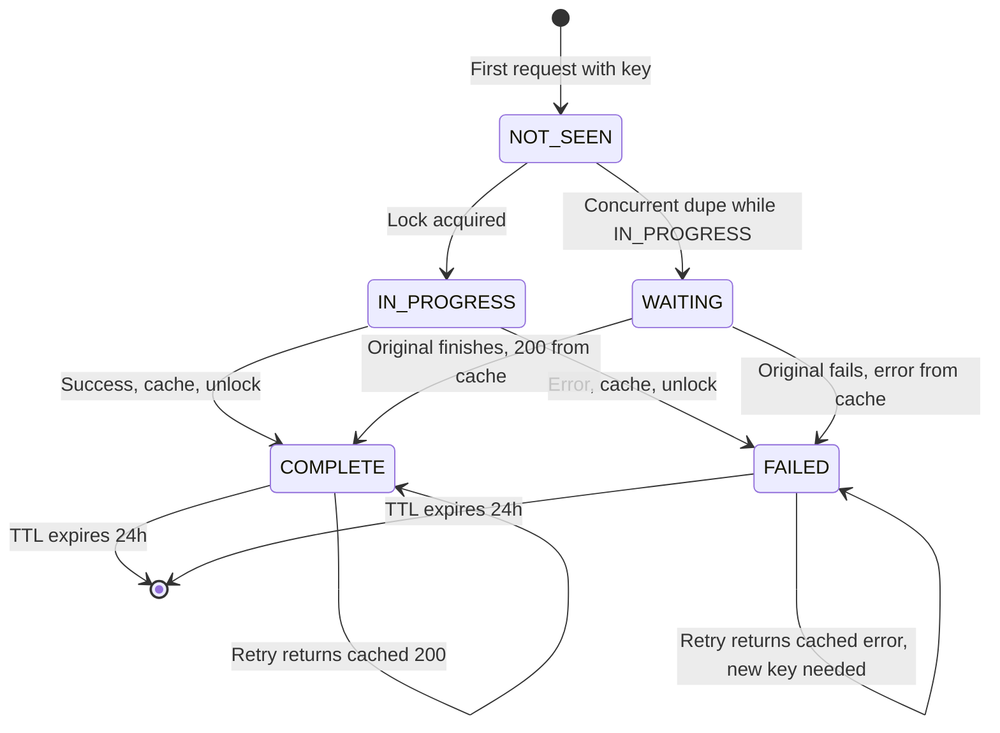
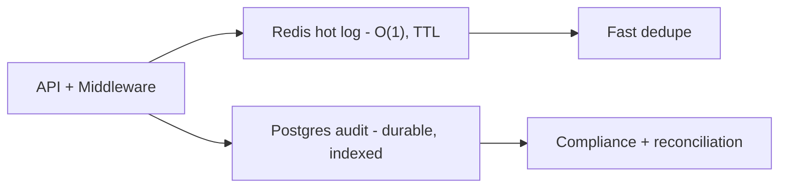
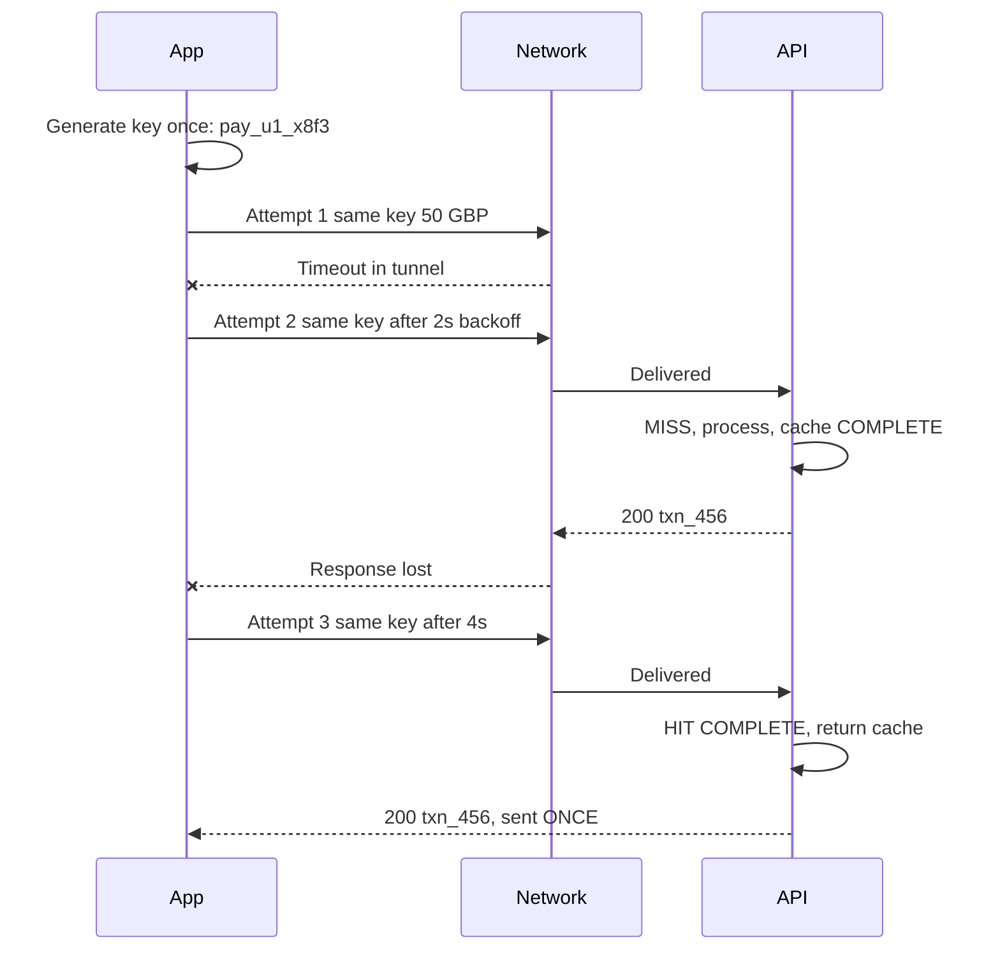
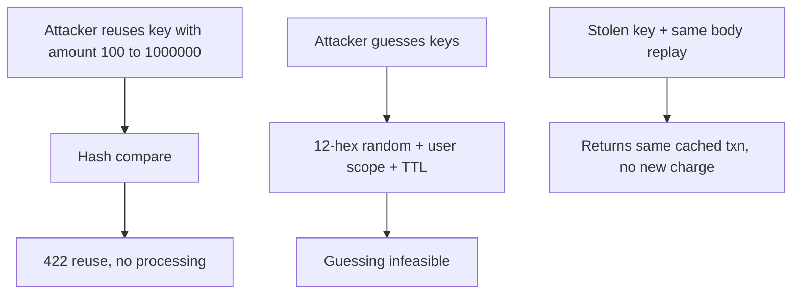

# Idempotency in Payment Systems - Complete Tutorial
> How Revolut Prevents Double Charges: From First Principles to Production-Ready Code

> **Last Updated:** 2026-09-26
> **Estimated Reading Time:** 70 minutes | **Difficulty:** Intermediate | **Versions:** Python 3.11+, FastAPI, Node.js 20+, Redis 7+, PostgreSQL 15+

## Table of Contents

- [1. Introduction / Overview](#1-introduction--overview)
- [2. Prerequisites](#2-prerequisites)
- [3. Learning Objectives](#3-learning-objectives)
- [4. What Is Idempotency?](#4-what-is-idempotency)
- [5. The Problem: Network Unreliability at Scale](#5-the-problem-network-unreliability-at-scale)
- [6. Idempotency Keys](#6-idempotency-keys--design--generation)
- [7. The Idempotency Layer](#7-the-idempotency-layer--four-core-components)
- [8. Complete Request Lifecycle](#8-complete-request-lifecycle)
- [9. Payment State Machine](#9-payment-state-machine)
- [10. Implementation](#10-implementation--python-nodejs--sql)
- [11. Real-World Use Cases](#11-real-world-use-cases)
- [12. Best Practices](#12-best-practices)
- [13. Anti-Patterns](#13-anti-patterns)
- [14. Performance Considerations](#14-performance-considerations)
- [15. Security Considerations](#15-security-considerations)
- [16. Testing Strategies](#16-testing-strategies)
- [17. Migration Guide](#17-migration-guide-adding-idempotency-to-a-legacy-api)
- [18. Troubleshooting](#18-troubleshooting--common-pitfalls)
- [19. Pro Tips + Recap](#19-pro-tips--quick-recap)
- [20. Summary](#20-summary--key-takeaways)
- [21. Practice Exercises](#21-practice-exercises-with-detailed-solutions)
- [22. Test Your Understanding](#22-test-your-understanding-minimum-10-questions)
- [23. Interview Questions](#23-common-interview-questions-minimum-10)
- [24. Question Bank (50+)](#24-question-bank-50-questions)
- [25. Self-Assessment](#25-self-assessment-checklist)
- [26. Further Reading](#26-further-reading--resources--next-steps)

---

## 1. Introduction / Overview

Tap **Send 100 GBP** in the Revolut app while riding the London Underground. The train enters a tunnel. The spinner spins. You tap again. Did you just send 200 GBP?

At 45 million users and roughly 450M transactions per day, even a 0.001 percent duplicate rate is 4,500 double-charges per day — about 450,000 GBP per day of harm at a 100 GBP average. Idempotency is not a feature. It is **critical infrastructure**.

> Core guarantee: no matter how many times the client sends the same Idempotency-Key, the user is charged **exactly once** and receives the **identical response** every time.



> When to use vs avoid: use for every mutating POST — payments, refunds, webhooks, batch jobs, async dispatch. Never needed for GET, PUT (already idempotent), or pure reads.

## 2. Prerequisites

| Requirement | Detail | Verify |
|-------------|--------|--------|
| Python | 3.11+ | `python --version` |
| Node.js | 20+ | `node --version` |
| Redis | 7+ | `redis-cli ping` |
| PostgreSQL | 15+ | `psql --version` |
| Basics | HTTP, JSON, Docker, async/await | — |

Run locally with Docker: `docker run -d -p 6379:6379 redis:7` and `docker run -d -p 5432:5432 -e POSTGRES_PASSWORD=postgres postgres:15`.

## 3. Learning Objectives

By the end you will be able to: (1) define idempotency `f(f(x)) = f(x)` and classify HTTP methods; (2) explain why retries are inevitable and quantify risk; (3) generate UUID, structured, and HMAC-signed keys with correct TTLs; (4) implement the four pillars; (5) trace the full lifecycle including concurrent storms; (6) model the payment state machine; (7) ship Python and Node.js code backed by Redis + Postgres; (8) apply best practices and avoid anti-patterns; (9) test with unit, integration, load, and chaos tests; (10) migrate a legacy POST API without downtime.

<!--PART3-->

## 4. What Is Idempotency?

**Idempotency** means performing an operation once or a hundred times produces the exact same result. Mathematically `f(f(x)) = f(x)`.

| Domain | Non-Idempotent | Idempotent |
|--------|---------------|------------|
| HTTP | `POST /payments` new charge each call | `PUT /payments/{id}` fixed state |
| Database | `INSERT INTO payments VALUES (...)` | `INSERT ... ON CONFLICT DO NOTHING` |
| Math | `x + 1` | `abs(x)` |
| File System | `echo data >> file` (appends) | `echo data > file` (overwrites) |
| Payments | Charge on every retry | Charge once, ignore duplicates |

```
GET    -> Idempotent     Reading never mutates state
PUT    -> Idempotent     Setting a fixed value
DELETE -> Idempotent     Deleting what is gone is a no-op
POST   -> NOT idempotent Brand-new resource each call
PATCH  -> NOT idempotent Incremental changes accumulate
```

> Payment creation uses POST, inherently non-idempotent. The idempotency layer makes it safe.

## 5. The Problem: Network Unreliability at Scale

```
Request #1 --> Server --> 100 GBP debited OK
Request #2 (retry, same intent) --> Server --> 100 GBP debited OK = DOUBLE CHARGE
```

Client triggers: app timeout, Wi-Fi to 4G switch, double-tap Confirm, crash + restart, LB retry on 5xx. Server triggers: K8s pod restart mid-request, circuit-breaker re-route, DB write succeeds but response lost.

> Feynman analogy: mailing a cheque twice because you never got a receipt. Idempotency is the receipt ledger — the bank cashes the first cheque and returns a photocopy for duplicates.

Scale: 45M users x 10 txns/day = 450M/day; 0.001 percent dupes = 4,500/day; x 100 GBP = 450,000 GBP/day at risk.

## 6. Idempotency Keys — Design & Generation

Client attaches a unique string to every mutating request:

```http
POST /v1/payments HTTP/1.1
Host: api.revolut.com
Idempotency-Key: pay_usr123_1704067200_a3b4c5d6e7f8
Content-Type: application/json

{"amount": 10000, "currency": "GBP", "recipient_id": "usr_456"}
```

Golden rule: generate the key ONCE per user intent, reuse on every retry.

Step-by-step: (1) tap Send generates key client-side; (2) attach header on EVERY attempt; (3) server uses key as cache + lock identity; (4) new intent = new key.

Option A — UUID v4 (simple):

```python
import uuid
key = str(uuid.uuid4())
# "550e8400-e29b-41d4-a716-446655440000"
```

Option B — Structured key (recommended, traceable):

```python
import uuid, time

def generate_idempotency_key(user_id: str, operation: str) -> str:
    """Format: {op}_{user}_{ts}_{rand12}. operation=log classification, user=scoping, ts=TTL reasoning, rand=entropy."""
    timestamp = int(time.time())
    suffix = uuid.uuid4().hex[:12]
    return f"{operation}_{user_id}_{timestamp}_{suffix}"
```

Option C — HMAC-signed key (tamper-proof):

```python
import hmac, hashlib, time, uuid

def generate_signed_key(user_id: str, amount: int, secret: str) -> str:
    """Binds key to amount; early tamper signal before server equality check."""
    payload = f"{user_id}:{amount}:{int(time.time())}:{uuid.uuid4().hex[:8]}"
    sig = hmac.new(secret.encode(), payload.encode(), hashlib.sha256).hexdigest()[:16]
    return f"pay_{payload.replace(':', '_')}_{sig}"
```

| Use Case | TTL | Rationale |
|----------|-----|-----------|
| Real-time P2P | 1 hour | Retries cluster in seconds |
| E-commerce checkout | 24 hours | Pending cart returns |
| Async batch | 7 days | Jobs retry over days |
| Permanent | Never | Storage leak + collision risk |

## 7. The Idempotency Layer — Four Core Components

Middleware between API gateway and payment processor with four jobs:



Component 1 — Deduplication Gate (cheapest check, single Redis GET):

```python
from enum import Enum
import json, redis

class CacheStatus(Enum):
    MISS = "miss"
    HIT_COMPLETE = "hit_complete"
    HIT_FAILED = "hit_failed"
    HIT_PENDING = "hit_pending"

class DeduplicationGate:
    def __init__(self, redis_client: redis.Redis):
        self.redis = redis_client

    def check(self, idempotency_key: str):
        """Returns (CacheStatus, cached_response_or_None)."""
        raw = self.redis.get(f"idem:{idempotency_key}")
        if raw is None:
            return CacheStatus.MISS, None
        data = json.loads(raw)
        status = data.get("status")
        if status == "COMPLETE":
            return CacheStatus.HIT_COMPLETE, data.get("response")
        if status == "FAILED":
            return CacheStatus.HIT_FAILED, data.get("response")
        if status == "IN_PROGRESS":
            return CacheStatus.HIT_PENDING, None
        return CacheStatus.MISS, None
```

Component 2 — State Check / Distributed Lock (handles simultaneous duplicates):

```python
class StateCheck:
    def __init__(self, redis_client: redis.Redis, lock_ttl_seconds: int = 30):
        self.redis = redis_client
        self.lock_ttl = lock_ttl_seconds

    def acquire_lock(self, idempotency_key: str) -> bool:
        """Atomic SET NX EX. True = process; False = another pod owns it, return 202."""
        lock_key = f"lock:idem:{idempotency_key}"
        return self.redis.set(lock_key, "LOCKED", nx=True, ex=self.lock_ttl) is True

    def release_lock(self, idempotency_key: str) -> None:
        self.redis.delete(f"lock:idem:{idempotency_key}")
```

Why SET NX EX not GET+SET: two threads can both GET None then both SET. NX is a single atomic instruction — only one winner.

Component 3 — Reference Equality Check (actual == candidate):

```python
import hashlib, json

class IdempotencyKeyReuseError(Exception):
    pass

class ReferenceEqualityCheck:
    VOLATILE_FIELDS = {"timestamp", "request_id", "trace_id", "device_fingerprint", "retry_count"}

    def hash_request(self, body: dict) -> str:
        """Canonical hash: sort keys, exclude volatile metadata, SHA-256."""
        canonical = {k: v for k, v in sorted(body.items()) if k not in self.VOLATILE_FIELDS}
        return hashlib.sha256(json.dumps(canonical, sort_keys=True).encode("utf-8")).hexdigest()

    def validate(self, stored_hash: str, incoming_body: dict, idempotency_key: str) -> None:
        """Raises on reuse with different params; silent None on safe retry."""
        if stored_hash != self.hash_request(incoming_body):
            raise IdempotencyKeyReuseError(
                f"Key '{idempotency_key}' already used with different parameters. Use a new key."
            )
```

Example: original `{"amount":10000,...}` stored; retry same body passes; `{"amount":1000000,...}` with same key raises 422.

Component 4 — Cache Result (store outcome incl. failures, release lock atomically):

```python
import json, time
from datetime import timedelta

class CacheResult:
    def __init__(self, redis_client: redis.Redis, ttl_hours: int = 24):
        self.redis = redis_client
        self.ttl = int(timedelta(hours=ttl_hours).total_seconds())

    def store(self, idempotency_key: str, request_hash: str, response: dict, http_status: int, success: bool) -> None:
        """Atomic pipeline: SETEX result + DEL lock. Caches failures too."""
        pipe = self.redis.pipeline()
        pipe.setex(f"idem:{idempotency_key}", self.ttl, json.dumps({
            "status": "COMPLETE" if success else "FAILED",
            "http_status": http_status, "response": response,
            "request_hash": request_hash, "cached_at": time.time()
        }))
        pipe.delete(f"lock:idem:{idempotency_key}")
        pipe.execute()
```

| Component | What it does | Tech |
|-----------|--------------|------|
| Deduplication Gate | O(1) lookup, cheapest first | Redis GET |
| State Check | Prevents concurrent double-process | Redis SET NX EX |
| Reference Equality | Blocks key reuse, SHA-256 compare | Hash compare |
| Cache Result | Stores response for duplicates | Redis SETEX + pipeline |

<!--PART4-->

## 8. Complete Request Lifecycle

Sequence — network-drop scenario (first attempt response lost, retry deduplicated):



Decision tree for every request:



Step-by-step instructions: (1) GET cache — HIT COMPLETE + hash match returns cached 200; HIT IN_PROGRESS returns 202; HIT FAILED returns cached error; (2) MISS tries lock — loser returns 202; (3) winner marks IN_PROGRESS with request hash; (4) process; (5) pipeline SETEX + DEL lock; (6) return.

## 9. Payment State Machine



WAITING handles the double-tap at the same millisecond: the loser never touches the processor.

<!--PART5-->

## 10. Implementation — Python, Node.js & SQL

### 10.1 Full Python / FastAPI Service

```python
import hashlib, json, time, uuid
from datetime import timedelta
from typing import Optional
from fastapi import FastAPI, Header, HTTPException
from pydantic import BaseModel
import redis as redis_lib

class IdempotencyKeyReuseError(Exception):
    pass

class RequestInProgressError(Exception):
    pass

class IdempotencyService:
    """Combines all four pillars. Prefix v1 allows safe schema evolution."""
    VOLATILE_FIELDS = {"timestamp", "request_id", "trace_id", "retry_count"}

    def __init__(self, redis_client: redis_lib.Redis, ttl_hours: int = 24):
        self.redis = redis_client
        self.ttl = int(timedelta(hours=ttl_hours).total_seconds())
        self.lock_ttl = 30

    def _cache_key(self, k: str) -> str:
        return f"idem:v1:{k}"

    def _lock_key(self, k: str) -> str:
        return f"lock:idem:v1:{k}"

    def hash_body(self, body: dict) -> str:
        canonical = {k: v for k, v in sorted(body.items()) if k not in self.VOLATILE_FIELDS}
        return hashlib.sha256(json.dumps(canonical, sort_keys=True).encode()).hexdigest()

    def check(self, key: str, body: dict) -> Optional[dict]:
        """Cached response if safe duplicate; None if new; raises on reuse/in-progress."""
        raw = self.redis.get(self._cache_key(key))
        if raw is None:
            return None
        data = json.loads(raw)
        incoming_hash = self.hash_body(body)
        if data.get("request_hash") and data["request_hash"] != incoming_hash:
            raise IdempotencyKeyReuseError(f"Key '{key}' used with different parameters.")
        if data["status"] == "COMPLETE":
            return data["response"]
        if data["status"] == "IN_PROGRESS":
            raise RequestInProgressError(f"Key '{key}' is processing.")
        if data["status"] == "FAILED":
            return data["response"]
        return None

    def start(self, key: str, request_hash: str) -> bool:
        """True = proceed; False = another pod owns it."""
        if not self.redis.set(self._lock_key(key), "1", nx=True, ex=self.lock_ttl):
            return False
        self.redis.setex(self._cache_key(key), self.ttl, json.dumps({
            "status": "IN_PROGRESS", "request_hash": request_hash, "started_at": time.time()
        }))
        return True

    def finish(self, key: str, response: dict, request_hash: str, success: bool) -> None:
        pipe = self.redis.pipeline()
        pipe.setex(self._cache_key(key), self.ttl, json.dumps({
            "status": "COMPLETE" if success else "FAILED",
            "response": response, "request_hash": request_hash, "finished_at": time.time()
        }))
        pipe.delete(self._lock_key(key))
        pipe.execute()


app = FastAPI()
redis_client = redis_lib.Redis(host="localhost", port=6379, decode_responses=True)
idem_service = IdempotencyService(redis_client)

class PaymentRequest(BaseModel):
    amount: int  # pence
    currency: str = "GBP"
    recipient_id: str

@app.post("/v1/payments")
async def create_payment(payment: PaymentRequest, idempotency_key: Optional[str] = Header(None, alias="Idempotency-Key")):
    if not idempotency_key:
        raise HTTPException(400, "Idempotency-Key header is required")
    if not (1 <= len(idempotency_key) <= 255):
        raise HTTPException(400, "Idempotency-Key must be 1-255 characters")
    body = payment.model_dump()
    request_hash = idem_service.hash_body(body)
    try:
        cached = idem_service.check(idempotency_key, body)
        if cached is not None:
            return cached
    except IdempotencyKeyReuseError as e:
        raise HTTPException(422, {"error": "IDEMPOTENCY_KEY_REUSE", "detail": str(e)})
    except RequestInProgressError:
        raise HTTPException(202, {"status": "processing"})
    if not idem_service.start(idempotency_key, request_hash):
        raise HTTPException(202, {"status": "processing"})
    try:
        txn_id = f"txn_{uuid.uuid4().hex[:8]}"
        response = {"transaction_id": txn_id, "status": "SENT", "amount": payment.amount,
                    "currency": payment.currency, "idempotency_key": idempotency_key}
        idem_service.finish(idempotency_key, response, request_hash, success=True)
        return response
    except Exception as e:
        error = {"error": str(e), "code": "PAYMENT_FAILED"}
        idem_service.finish(idempotency_key, error, request_hash, success=False)
        raise HTTPException(422, error)
```

> Performance-optimized variant: extend `lock_ttl` for slow processors, or use a Lua script to make check+lock one round-trip (see Section 15).

<!--PART6-->

### 10.2 Express.js / Node.js Middleware

```javascript
const crypto = require('crypto');

class IdempotencyMiddleware {
  constructor(redisClient, options = {}) {
    this.redis = redisClient;
    this.ttl = options.ttl || 86400;      // 24h in seconds
    this.lockTTL = options.lockTTL || 30; // 30s
    this.VOLATILE_FIELDS = new Set(['timestamp', 'requestId', 'traceId', 'retryCount']);
  }

  hashBody(body) {
    // Canonical hash: filter volatile, sort keys, SHA-256
    const canonical = Object.keys(body || {})
      .filter((k) => !this.VOLATILE_FIELDS.has(k))
      .sort()
      .reduce((acc, k) => { acc[k] = body[k]; return acc; }, {});
    return crypto.createHash('sha256').update(JSON.stringify(canonical)).digest('hex');
  }

  middleware() {
    return async (req, res, next) => {
      const key = req.headers['idempotency-key'];
      if (!key || req.method !== 'POST') return next();
      const cacheKey = `idem:${key}`;
      const lockKey = `lock:idem:${key}`;
      const bodyHash = this.hashBody(req.body);
      try {
        const cached = await this.redis.get(cacheKey);
        if (cached) {
          const data = JSON.parse(cached);
          if (data.requestHash && data.requestHash !== bodyHash) {
            return res.status(422).json({ error: 'IDEMPOTENCY_KEY_REUSE',
              message: 'Key was previously used with different parameters' });
          }
          if (data.status === 'COMPLETE') return res.status(data.httpStatus).json(data.response);
          // IN_PROGRESS or FAILED: tell client to wait/poll; cached FAILED avoids hammering processor
          return res.status(202).json({ status: 'processing' });
        }
        const locked = await this.redis.set(lockKey, '1', { NX: true, EX: this.lockTTL });
        if (!locked) return res.status(202).json({ status: 'processing' });
        await this.redis.setEx(cacheKey, this.ttl, JSON.stringify({
          status: 'IN_PROGRESS', requestHash: bodyHash, startedAt: Date.now()
        }));
        // Intercept res.json to cache outcome + release lock
        const originalJson = res.json.bind(res);
        res.json = async (body) => {
          const httpStatus = res.statusCode;
          await this.redis.setEx(cacheKey, this.ttl, JSON.stringify({
            status: httpStatus < 400 ? 'COMPLETE' : 'FAILED',
            httpStatus, response: body, requestHash: bodyHash, finishedAt: Date.now()
          }));
          await this.redis.del(lockKey);
          return originalJson(body);
        };
        next();
      } catch (err) {
        await this.redis.del(lockKey).catch(() => {});
        next(err);
      }
    };
  }
}

// Usage:
// const express = require('express');
// const app = express();
// app.use('/api/payments', new IdempotencyMiddleware(redisClient).middleware());
```

<!--PART7-->

### 10.3 Database Schema (PostgreSQL) — Persistent Audit Trail

Redis is the hot window; this table is the long-term trail:

```sql
CREATE TABLE idempotency_records (
    id              UUID         PRIMARY KEY DEFAULT gen_random_uuid(),
    idempotency_key VARCHAR(255) NOT NULL UNIQUE,
    request_hash    CHAR(64)     NOT NULL,
    status          VARCHAR(20)  NOT NULL DEFAULT 'IN_PROGRESS'
                    CHECK (status IN ('IN_PROGRESS','COMPLETE','FAILED')),
    response_body   JSONB,
    http_status     SMALLINT,
    user_id         UUID         NOT NULL,
    amount          BIGINT,
    currency        CHAR(3),
    created_at      TIMESTAMPTZ  NOT NULL DEFAULT now(),
    updated_at      TIMESTAMPTZ  NOT NULL DEFAULT now(),
    expires_at      TIMESTAMPTZ  NOT NULL DEFAULT now() + INTERVAL '24 hours'
);
CREATE UNIQUE INDEX idx_idem_key ON idempotency_records (idempotency_key);
CREATE INDEX idx_idem_user ON idempotency_records (user_id, created_at DESC);
CREATE INDEX idx_idem_expires ON idempotency_records (expires_at)
    WHERE status IN ('COMPLETE', 'FAILED');

CREATE OR REPLACE FUNCTION set_updated_at() RETURNS TRIGGER AS $$
BEGIN NEW.updated_at = now(); RETURN NEW; END; $$ LANGUAGE plpgsql;
CREATE TRIGGER trg_idem_updated_at BEFORE UPDATE ON idempotency_records
    FOR EACH ROW EXECUTE FUNCTION set_updated_at();

CREATE OR REPLACE FUNCTION cleanup_expired_idempotency_records() RETURNS INTEGER AS $$
DECLARE deleted_count INTEGER;
BEGIN
    DELETE FROM idempotency_records WHERE expires_at < now() AND status IN ('COMPLETE','FAILED');
    GET DIAGNOSTICS deleted_count = ROW_COUNT;
    RETURN deleted_count;
END; $$ LANGUAGE plpgsql;
```



<!--PART8-->

## 11. Real-World Use Cases

### Use Case 1: Mobile Payment — Underground Tube

User sends 50 GBP, tunnel drops packets:



### Use Case 2: Double-Tap Prevention (iOS Swift)

```swift
class PaymentViewModel: ObservableObject {
    @Published var isLoading = false
    private var sessionIdempotencyKey: String?

    func beginPaymentSession() {
        // Called once per screen; all taps reuse one key
        let ts = Int(Date().timeIntervalSince1970)
        sessionIdempotencyKey = "payment_\(currentUser.id)_\(ts)_\(UUID().uuidString.prefix(8))"
    }
    func confirmPayment(amount: Decimal, recipientId: String) {
        guard !isLoading, let key = sessionIdempotencyKey else { return }
        isLoading = true
        PaymentService.shared.send(amount: amount, recipientId: recipientId, idempotencyKey: key) { [weak self] _ in
            self?.isLoading = false // concurrent taps resolve to same cached response
        }
    }
    func endPaymentSession() { sessionIdempotencyKey = nil } // only for a NEW intent
}
```

### Use Case 3: Webhook Consumer Deduplication

Providers (Visa, Stripe) retry until 200 (at-least-once). Use their event ID as your key:

```python
@app.post("/webhooks/payment-provider")
async def receive_webhook(event: dict, x_event_id: str = Header(...)):
    cached = idem_service.check(x_event_id, event)
    if cached:
        return {"status": "already_processed", "event_id": x_event_id}
    if not idem_service.start(x_event_id, idem_service.hash_body(event)):
        return {"status": "processing"}
    try:
        if event["type"] == "payment.completed":
            await fulfill_order(event["payment_id"])
            await notify_user(event["user_id"])
        elif event["type"] == "payment.failed":
            await cancel_order(event["payment_id"])
        result = {"status": "processed", "event_id": x_event_id}
        idem_service.finish(x_event_id, result, idem_service.hash_body(event), success=True)
        return result
    except Exception as e:
        idem_service.finish(x_event_id, {"error": str(e)}, idem_service.hash_body(event), success=False)
        raise
    # 200 stops provider retries; duplicates return 200 without re-running logic
```

### Use Case 4: Safe Batch Salary Processing

```python
async def run_payroll(payroll_run_id: str, employees: list[dict]) -> list[dict]:
    """Crash-safe: re-running pays only unpaid employees; paid return cache."""
    results = []
    for employee in employees:
        idem_key = f"payroll_{payroll_run_id}_{employee['id']}"
        body = {"amount": employee["salary"], "account": employee["bank_account"]}
        try:
            cached = idem_service.check(idem_key, body)
            if cached:
                results.append({"employee_id": employee["id"], "status": "already_paid",
                                "txn_id": cached.get("transaction_id")})
                continue
            if not idem_service.start(idem_key, idem_service.hash_body(body)):
                results.append({"employee_id": employee["id"], "status": "processing"})
                continue
            txn = await payment_engine.send(**body)
            response = {"transaction_id": txn.id, "amount": employee["salary"]}
            idem_service.finish(idem_key, response, idem_service.hash_body(body), success=True)
            results.append({"employee_id": employee["id"], "status": "paid", **response})
        except Exception as e:
            results.append({"employee_id": employee["id"], "status": "error", "detail": str(e)})
    return results
```

<!--PART9-->

## 12. Best Practices

1. One key per intent, reuse on retries. Generate BEFORE the loop:

```python
key = generate_idempotency_key(user_id, "payment")
for attempt in range(1, 5):
    try:
        return api.post("/payments", json=body, headers={"Idempotency-Key": key})
    except (NetworkError, TimeoutError):
        time.sleep(backoff(attempt))
```

2. Exponential backoff with jitter (prevents thundering herd):

```python
import random
def backoff(attempt: int, base: float = 1.0, cap: float = 30.0) -> float:
    return min(base * (2 ** (attempt - 1)), cap) + random.uniform(0, 0.5)
# 1 -> 1.0-1.5s, 2 -> 2.0-2.5s, 3 -> 4.0-4.5s
```

3. Cache failures, not just successes — a closed recipient account fails identically; do not hammer the processor.
4. Use provider event IDs for webhooks (Stripe-Event-Id, Visa transactionId).
5. Validate header (required, 1-255 chars), version cache keys (`idem:v1:`), always SETEX with TTL, release locks in pipeline/finally.

<!--PART10-->

## 13. Anti-Patterns

1. New key on every retry (most dangerous):

```python
# WRONG: 3 charges
for attempt in range(3):
    api.post("/payments", key=str(uuid.uuid4()), json={"amount": amount})
# CORRECT: generate ONCE before loop, reuse
key = str(uuid.uuid4())
for attempt in range(3):
    api.post("/payments", key=key, json={"amount": amount})
```

2. Low-entropy keys: `payment_{user}_{date}` (one payment/day!) or sequential ints (brute-forceable). Use user + timestamp + 12-hex random.
3. No TTL: `redis.set(...)` forever = leak. Always `SETEX` with window-matched TTL.
4. No lock: two concurrent GET None both process. Always atomic `SET NX EX`, loser returns 202.
5. Hashing volatile fields: including `timestamp`/`retry_count` makes every retry look like reuse. Exclude them.
6. Ignoring 422 reuse: client must generate a NEW key for a new intent; never silently process mismatched bodies.

<!--PART11-->

## 14. Performance Considerations

- Cheapest check first: GET is O(1), sub-millisecond; only lock + hash on miss path.
- Pipeline `SETEX + DEL` in one round-trip; consider Lua for atomic check-and-lock under extreme contention.
- TTL sizing: short P2P window keeps Redis memory bounded; ~450M keys/day x 500 bytes needs sharding — use Redis Cluster and hash-tag keys if needed.
- Postgres: `UNIQUE(idempotency_key)` is the correctness backstop; partial index on `expires_at` keeps cleanup cheap; run `cleanup_expired_idempotency_records()` via pg_cron.
- Backoff + jitter avoids retry storms after deploys; cap at 30s.

```lua
-- Optional atomic dedupe+lock (one RTT):
-- KEYS[1]=cache, KEYS[2]=lock, ARGV[1]=in-progress JSON, ARGV[2]=lock TTL
local v = redis.call('GET', KEYS[1])
if v then return v end
if redis.call('SET', KEYS[2], '1', 'NX', 'EX', ARGV[2]) then
  redis.call('SETEX', KEYS[1], 86400, ARGV[1])
  return nil
end
return 'LOCKED'
```

## 15. Security Considerations



- 12-hex random suffix (48 bits) + user scope + short TTL defeats enumeration.
- HMAC binding gives early tamper signal; server hash compare is authoritative — never trust client amount.
- Return generic 422 without revealing original params; log hashes, never full PANs.
- Rate-limit POST /payments per user + per key; lock TTL 30s prevents deadlock if pod dies.
- Validate key length 1-255; reject control characters; use TLS; redact keys in non-debug logs.

<!--PART12-->

## 16. Testing Strategies

Unit tests (pytest):

```python
import pytest, json

class TestIdempotencyService:
    def test_new_request_returns_none(self, svc, redis_mock):
        redis_mock.get.return_value = None
        assert svc.check("key_001", {"amount": 100}) is None

    def test_duplicate_returns_cached(self, svc, redis_mock):
        body = {"amount": 100, "currency": "GBP"}
        redis_mock.get.return_value = json.dumps({"status": "COMPLETE",
            "response": {"txn_id": "txn_789"}, "request_hash": svc.hash_body(body)})
        assert svc.check("key_001", body) == {"txn_id": "txn_789"}

    def test_reuse_different_amount_raises(self, svc, redis_mock):
        orig, tampered = {"amount": 100, "currency": "GBP"}, {"amount": 100000, "currency": "GBP"}
        redis_mock.get.return_value = json.dumps({"status": "COMPLETE",
            "response": {"txn_id": "txn_789"}, "request_hash": svc.hash_body(orig)})
        with pytest.raises(IdempotencyKeyReuseError):
            svc.check("key_001", tampered)

    def test_in_progress_raises(self, svc, redis_mock):
        redis_mock.get.return_value = json.dumps({"status": "IN_PROGRESS", "request_hash": "abc"})
        with pytest.raises(RequestInProgressError):
            svc.check("key_001", {"amount": 100})

    def test_volatile_fields_ignored(self, svc):
        a = {"amount": 100, "timestamp": 1, "retry_count": 0}
        b = {"amount": 100, "timestamp": 2, "retry_count": 1}
        assert svc.hash_body(a) == svc.hash_body(b)
```

Integration — 10 identical POSTs, one DB row:

```python
async def test_exactly_once(client, db, redis):
    key, body = "int_key_001", {"amount": 5000, "currency": "GBP", "recipient_id": "usr_test"}
    responses = [await client.post("/v1/payments", json=body, headers={"Idempotency-Key": key}) for _ in range(10)]
    assert all(r.json() == responses[0].json() for r in responses)
    count = await db.fetchval("SELECT COUNT(*) FROM payments WHERE idempotency_key = $1", key)
    assert count == 1
```

Load — 50 concurrent same-key storm, one txn:

```python
import asyncio, httpx
async def concurrent_duplicate_test():
    key, body = "load_key_001", {"amount": 10000, "currency": "GBP", "recipient_id": "usr_456"}
    async with httpx.AsyncClient(base_url="http://localhost:8000") as client:
        responses = await asyncio.gather(*[client.post("/v1/payments", json=body,
            headers={"Idempotency-Key": key}) for _ in range(50)])
    txn_ids = {r.json().get("transaction_id") for r in responses if r.status_code == 200}
    assert len(txn_ids) == 1, f"Duplicate charges: {txn_ids}"
```

Chaos: kill pod mid-IN_PROGRESS, assert lock expires in 30s and retry succeeds; assert FAILED cached and processor not re-hit.

## 17. Migration Guide: Adding Idempotency to a Legacy API

1. Add nullable `idempotency_key UNIQUE` + `request_hash` columns; backfill existing rows.
2. Deploy middleware in shadow mode (log dedupe decisions, do not enforce).
3. Require header for new clients; legacy clients get server-generated key from `(user, amount, recipient, minute-bucket)` with deprecation warning.
4. Dual-write Redis hot + Postgres; enforce 422 on reuse.
5. Cron cleanup expired rows; monitor `dedupe_hit_rate`, `202_rate`, `422_reuse_rate`, `lock_contention`.

## 18. Troubleshooting / Common Pitfalls

| Symptom | Cause | Fix |
|---------|-------|-----|
| 10 retries, 10 charges | New key per retry | Generate once before loop |
| 422 on legit retry | Volatile field hashed | Exclude timestamp/retry_count |
| Stuck 202 forever | Lock never released (crash) | 30s EX + finally/pipeline DEL |
| Responses diverged | Processor non-deterministic (new txn id per call) | Return cached response verbatim |
| 2 txn_ids under concurrency | Missing lock | SET NX EX, loser 202 |
| Redis OOM | No TTL | SETEX 1h/24h/7d by use case |
| FAILED retried forever, same key | Cached FAILED by design | New key for new intent |
| Slow p99 | Separate GET+SET+SETEX trips | Pipeline + optional Lua |

## 19. Pro Tips + Quick Recap

Pro tips: version keys (`idem:v1:`); include `http_status` in cache so duplicates replay exact code; idempotency + DB unique constraint = belt and suspenders; for webhooks prefer provider ID; jitter saves you at 3am deploys.

Quick recap: key per intent; GET cheapest first; lock concurrent winners; hash-compare bodies; cache success AND failure; TTL everything; test with 50-way storm.

<!--PART13-->

## 20. Summary / Key Takeaways


Four pillars: Deduplication Gate (GET), State Check (SET NX EX), Reference Equality (SHA-256), Cache Result (SETEX + pipeline). Mandatory for POST /payments, POST /refunds, webhooks, batch workers, async dispatch. Retry with same key + backoff + jitter: 1s, 2s, 4s, success — always one transaction.

## 21. Practice Exercises with Detailed Solutions

Hands-on lab: `docker run -d -p 6379:6379 redis:7`, `pip install fastapi redis pydantic httpx pytest`, run Section 10.1, then do these.

Exercise 1 (Beginner) — Reproduce the double-charge, then fix it. Without middleware, POST twice with different keys and count 2 rows; then POST 5x with one key through middleware and assert 1 row + identical bodies. Solution: the second run hits HIT_COMPLETE and returns cache; DB count query proves exactly-once.

Exercise 2 (Intermediate) — Concurrent storm. Fire 20 same-key POSTs concurrently (asyncio.gather), collect txn_ids, assert single id; assert losers got 202 or same 200. Solution: only lock winner processes; others return 202/cached, proving the State Check.

Exercise 3 (Advanced) — Key-reuse attack + TTL. (a) POST key K body amount=100, then POST K amount=100000, assert 422 IDEMPOTENCY_KEY_REUSE; (b) set TTL=2s, POST K, sleep 3s, POST K again, assert new txn (expired). Solution: hash mismatch triggers 422; expiry returns to NOT_SEEN, showing why TTL must exceed retry windows.

## 22. Test Your Understanding (Minimum 10 Questions)

1. Define idempotency and give the mathematical formula. 2. Which HTTP methods are idempotent and why is POST not? 3. Why must the client generate the key, not the server? 4. What breaks if you generate a new key per retry? 5. Why SET NX EX instead of GET+SET? 6. What does the reference-equality check compare, and what status does mismatch return? 7. Why cache FAILED responses? 8. What should a client do on 202? On 422 reuse? 9. Why exclude volatile fields from the hash? 10. Why must cached responses be replayed verbatim? 11. What happens when TTL expires? 12. How do webhooks use idempotency keys?

Answers: 1. Same result any repetitions, f(f(x))=f(x). 2. GET/PUT/DELETE yes; POST creates new resource. 3. Only client knows intent boundaries across retries. 4. Each retry becomes a new charge. 5. NX is atomic; GET+SET races. 6. Stored vs incoming canonical SHA-256; 422. 7. Avoids hammering processor with doomed retries. 8. 202: poll/backoff with same key; 422: new key for new intent. 9. Else legit retries look like reuse. 10. Else txn_ids diverge and callers cannot dedupe. 11. Key returns to NOT_SEEN; same key may process anew. 12. Provider event ID as key; 200 stops retries, duplicates return cached 200.

<!--PART14-->

## 23. Common Interview Questions (Minimum 10)

1. Design an idempotent POST /payments end-to-end. (Key header, GET cache, NX lock, hash compare, SETEX result, Postgres UNIQUE backstop.)
2. Two requests arrive same millisecond — how do you avoid double charge? (Atomic SET NX EX; loser 202.)
3. Client reuses a key with a different amount — what happens? (422 IDEMPOTENCY_KEY_REUSE, no processing.)
4. Why return 202 instead of blocking? (Avoids holding connections; client polls/retries same key; scales under storms.)
5. Should failures be cached? (Yes — same error fast, protects processor; new intent needs new key.)
6. How do you pick TTL? (1h P2P, 24h checkout, 7d batch; never forever; must exceed max retry window.)
7. How do webhooks achieve exactly-once effects? (Provider event ID as key + 200 semantics.)
8. Redis vs Postgres for idempotency store? (Redis hot O(1) + TTL; Postgres durable audit + UNIQUE; use both.)
9. How do you test idempotency? (Unit hash/lock, 10x integration one-row, 50-way concurrency one txn, chaos pod-kill.)
10. What is wrong with `key = user + date`? (One payment/day collision + predictable; needs high-entropy suffix.)
11. How does HMAC-signed key help? (Tamper-evident binding; server hash still authoritative.)
12. How do you migrate a legacy API? (Shadow mode, dual-write, header required for new clients, cron cleanup, monitor hit/202/422 rates.)

## 24. Question Bank: 50 Questions

Beginner (1-17): 1. Define idempotency. 2. Formula f(f(x))? 3. Idempotent HTTP methods? 4. Why is POST non-idempotent? 5. What is an idempotency key? 6. Which header carries it? 7. Who generates it? 8. When do you generate a new one? 9. What is a retry? Name 3 triggers. 10. What is a double-charge? 11. What does TTL mean? 12. Recommended P2P TTL? 13. Why never cache forever? 14. What is Redis GET used for? 15. What does 200/202/400/422 mean here? 16. What is a webhook retry? 17. Why is PUT already safe?

Intermediate (18-37): 18. Four pillars? 19. Deduplication gate inputs/outputs? 20. Why cheapest check first? 21. Distributed lock purpose? 22. Why NX EX? 23. Lock TTL and deadlock? 24. Reference equality: what compared? 25. Why SHA-256 canonical hash? 26. Volatile fields? Why excluded? 27. Key-reuse attack example? 28. Why cache failures? 29. Pipeline SETEX+DEL why? 30. Why version keys v1? 31. Backoff + jitter formula? 32. Thundering herd? 33. WAITING state purpose? 34. FAILED retry semantics? 35. Redis vs Postgres roles? 36. Which indexes and why? 37. Cleanup strategy?

Advanced (38-50): 38. Prove GET+SET races but NX does not. 39. Design Lua atomic check+lock; trade-offs? 40. Size Redis for 450M/day; sharding? 41. Clock skew vs timestamp in keys? 42. HMAC vs plain random: threat model? 43. Information leakage in 422? How to avoid? 44. Exactly-once vs effectively-once? 45. Saga/choreography interplay? 46. GDPR/PII in idempotency store? 47. Multi-region active-active dedupe? 48. Chaos test for IN_PROGRESS crash? 49. Migrate zero-downtime with legacy clients? 50. Which metrics/SLOs prove exactly-once in prod?

## 25. Self-Assessment Checklist

- [ ] I can define idempotency and classify HTTP methods.
- [ ] I generate one key per intent and reuse it with backoff + jitter.
- [ ] I can implement gate, lock, hash compare, and cached result in Python or Node.js.
- [ ] I handle 202 (poll) and 422 (new key) correctly on the client.
- [ ] I exclude volatile fields and replay cached responses verbatim.
- [ ] I set TTLs by use case and clean up Postgres via cron.
- [ ] I can prove exactly-once with unit + integration + 50-way load + chaos tests.
- [ ] I can explain performance (O(1), pipeline/Lua) and security (entropy, HMAC, rate-limit) trade-offs.
- [ ] I can migrate a legacy POST API in shadow mode without downtime.

## 26. Further Reading / Resources + Next Steps

- Stripe API Idempotency (stripe.com/docs/api/idempotent_requests) — header + 24h semantics.
- IETF Draft: Idempotency-Key HTTP Header — standardization.
- Redis SET NX EX docs (redis.io/commands/set) — atomic lock primitive.
- Designing Data-Intensive Applications (Kleppmann) Ch. 8-9 — exactly-once, retries, dedupe.
- Release It! (Nygard) — timeouts, circuit breakers, backoff.
- Revolut engineering blog + Visa Direct / Mastercard webhook docs — provider retry semantics.
- Postgres `ON CONFLICT`, pg_cron docs — durable backstop + cleanup.

Next steps: add Lua atomic path + k6 storm test; extend to refunds/payouts; dual-region Redis with Postgres as tiebreaker; instrument dedupe_hit_rate dashboard and alert on 422 spikes.

> Core guarantee revisited: same key, same body, any number of attempts — charged exactly once, identical response every time.

<!--DONE-->
