# Quarkus vs. Spring Boot: Building Cloud-Native Java - Complete Tutorial

> **Difficulty:** 🟡 Intermediate | **Reading Time:** ~110 minutes | **Hands-on Time:** ~90 minutes | **Last Updated:** 2026-10-18
> **Quarkus Version:** 3.38.0 (check [code.quarkus.io](https://code.quarkus.io) for latest) | **Java:** 17+ (21 for Virtual Threads) | **Code Language:** Java

> 💡 **Who is this for?** Java developers (beginner to advanced, focused Intermediate) who want to understand *why* Quarkus is gaining traction, *how* it works internally, *how to build* a REST API with it, and *when* to choose it over Spring Boot.

## Table of Contents

- [1. Introduction / Overview](#1-introduction--overview)
- [2. Prerequisites](#2-prerequisites)
- [3. Learning Objectives](#3-learning-objectives)
- [4. The Big Picture: Java Isn't Slow, Deployment Can Be Expensive](#4-the-big-picture-java-isnt-slow-deployment-can-be-expensive)
- [5. The Real Problem: Java on Kubernetes](#5-the-real-problem-java-on-kubernetes)
- [6. Three Challenges for Traditional Java Runtimes](#6-three-challenges-for-traditional-java-runtimes)
- [7. What Makes Quarkus Different: Build-Time Processing](#7-what-makes-quarkus-different-build-time-processing)
- [8. Dependency Injection: Spring IoC vs. Quarkus ArC](#8-dependency-injection-spring-ioc-vs-quarkus-arc)
- [9. Native Compilation with GraalVM](#9-native-compilation-with-graalvm)
- [10. Virtual Threads: Concurrency Without Reactive Rewrites](#10-virtual-threads-concurrency-without-reactive-rewrites)
- [11. Reading the Benchmarks Honestly](#11-reading-the-benchmarks-honestly)
- [12. Hands-On: Build a REST API with Quarkus](#12-hands-on-build-a-rest-api-with-quarkus)
- [13. Side-by-Side: Same Feature in Spring Boot and Quarkus](#13-side-by-side-same-feature-in-spring-boot-and-quarkus)
- [14. Real-World Examples and Use Cases](#14-real-world-examples-and-use-cases)
- [15. Where Spring Boot Still Makes More Sense](#15-where-spring-boot-still-makes-more-sense)
- [16. Should You Migrate? Decision Framework + Migration Guide](#16-should-you-migrate-decision-framework--migration-guide)
- [17. Multiple Implementation Approaches](#17-multiple-implementation-approaches)
- [18. Best Practices](#18-best-practices)
- [19. Anti-Patterns](#19-anti-patterns)
- [20. Performance Considerations](#20-performance-considerations)
- [21. Security Considerations](#21-security-considerations)
- [22. Testing Strategies](#22-testing-strategies)
- [23. Common Pitfalls / Troubleshooting](#23-common-pitfalls--troubleshooting)
- [24. Summary / Key Takeaways](#24-summary--key-takeaways)
- [25. Practice Exercises (With Detailed Solutions)](#25-practice-exercises-with-detailed-solutions)
- [26. Hands-On Lab: End-to-End Checklist](#26-hands-on-lab-end-to-end-checklist)
- [27. Test Your Understanding](#27-test-your-understanding)
- [28. Common Interview Questions](#28-common-interview-questions)
- [29. Question Bank for Knowledge Reinforcement (55 Questions)](#29-question-bank-for-knowledge-reinforcement-55-questions)
- [30. Self-Assessment Checklist](#30-self-assessment-checklist)
- [31. Pro Tips](#31-pro-tips)
- [32. Further Reading / Resources](#32-further-reading--resources)
- [33. Cheat Sheet](#33-cheat-sheet)
- [34. Conclusion](#34-conclusion)

---

## 1. Introduction / Overview

**Java isn't slow. But the way we build and deploy Java applications can make them expensive.**

For years, Spring Boot has been the default choice for Java backends. It powers monoliths to microservices. But cloud-native changed the rules:

| Then (traditional servers) | Now (cloud-native) |
|---|---|
| App starts once, runs for months | Pods start, stop, replaced constantly |
| Fixed instances | Autoscaling, sometimes to zero |
| Startup time: "who cares?" | Startup affects scaling speed |
| Memory cheap on big servers | Memory limits per container; pay per GB |

**Quarkus** is designed around this new reality. Core ideas:

- **Build-time processing**: do framework work before app runs
- **Fast startup and low memory**
- **First-class native compilation** (GraalVM Native Image)
- **Developer joy**: live reload, Dev Services, unified config

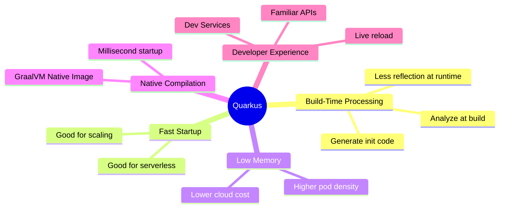

> ⚠️ **Important:** Quarkus does **not** make Spring Boot obsolete. This tutorial helps you decide *when* each makes sense. You'll measure, prototype, and adopt incrementally.

**How to use this tutorial:** Read sections 4-11 for concepts, do section 12 hands-on, use 13-16 for decisions, keep 18-23 as reference while building.

## 2. Prerequisites

**Required:**

- JDK 17+ (21 for Virtual Threads) — check with `java -version`
- Maven 3.9+ (or use generated `./mvnw` wrapper)
- Docker Desktop (for PostgreSQL + native container builds + Dev Services)
- IDE: IntelliJ IDEA / VS Code with Java + Maven support
- Basic Java, REST, and SQL familiarity

**Nice to have:**

- Kubernetes basics (pods, readiness probes, HPA)
- Spring Boot familiarity (to appreciate comparisons)
- GraalVM / Mandrel basics (only for native builds)

```bash
java -version        # expect 17+ or 21+
mvn -version         # expect 3.9+
docker ps            # should list containers (Docker running)
```

> 💡 **Tip:** If Docker isn't running, Dev Services can't auto-start PostgreSQL. You'll need to configure a datasource URL manually (see Section 12).

## 3. Learning Objectives

By the end of this tutorial, you will be able to:

1. Explain why startup time and memory matter on Kubernetes vs. traditional servers.
2. Describe the three challenges (startup, memory, JIT warm-up) with diagrams.
3. Explain build-time processing and what still happens at runtime.
4. Compare Spring IoC vs. Quarkus ArC (scopes, validation timing, native-friendliness).
5. Decide JVM vs. Native using trade-offs and the closed-world assumption.
6. Use Virtual Threads (`@RunOnVirtualThread`) correctly and know when they don't help.
7. Interpret benchmarks honestly (ready vs. process start, p95 vs. average).
8. Build a Product REST API with RESTEasy + Jackson + Panache + PostgreSQL.
9. Configure profiles (`%dev`, `%prod`), secrets via env vars, and health checks.
10. Apply migration decision framework (baseline → prototype → ROI → pilot).
11. Avoid top anti-patterns (schema `update` in prod, hard-coded secrets).
12. Test with `@QuarkusTest` + RestAssured and run native smoke tests.

## 4. The Big Picture: Java Isn't Slow, Deployment Can Be Expensive

Quarkus core ideas map directly to cloud bills and scaling behavior. Review the mindmap in Section 1 — every branch will be unpacked below.

> 💡 **Aha moment:** The JVM's JIT gives superb long-run throughput. The cost is *time-to-ready* and *footprint*. Quarkus shifts work earlier (build time) so runtime does less.

## 5. The Real Problem: Java on Kubernetes

### Scenario: 200 Spring Boot Microservices

Imagine 200+ microservices × ~512 MB each. During rolling deployments, hundreds of pods restart and must initialize before receiving traffic.

- Resources stay allocated even when idle.
- New replicas take time to become *ready*.
- Fresh instances may need warm-up before steady-state performance.
- Spikes cause latency while new pods boot.
- Frequent deploys make predictable startup important.

> The problem isn't Spring Boot itself. Apps designed around **runtime initialization** may not be most efficient for every cloud-native workload.

### What Happens During a Traffic Spike?

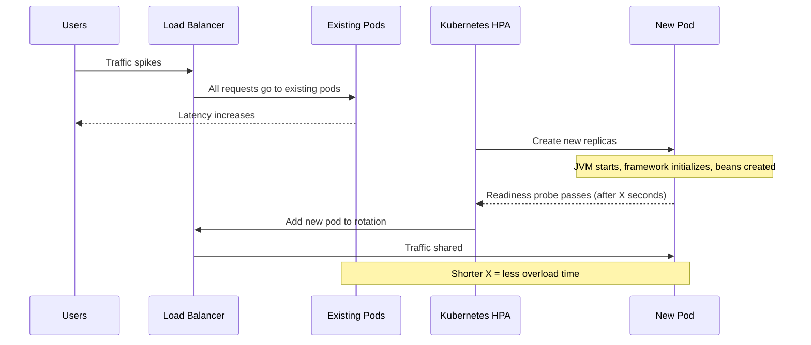

**Key insight:** 6s startup is irrelevant statically; elastically, it delays capacity.

| Situation | Why startup/memory matters |
|---|---|
| Flash sale | New pods must absorb traffic quickly |
| Scale-to-zero internal tool | Every first request pays startup |
| Rolling deploy of 200 services | Total time + extra capacity depend on startup |

## 6. Three Challenges for Traditional Java Runtimes

### Challenge 1: Application Startup Time

Typical Spring Boot startup:

1. Loads classes 2. Discovers config/components 3. Processes annotations + auto-config 4. Creates beans 5. Wires DI 6. Starts embedded server. Until done, pod can't serve traffic.


### Challenge 2: Memory Consumption

JVM uses more than heap:

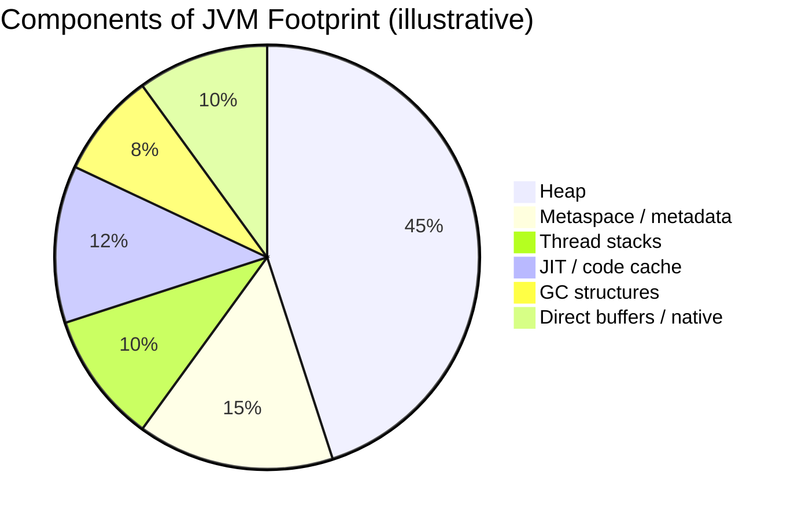

> ⚠️ 512 MB container can OOM even if `-Xmx` < 512 MB — non-heap counts!

**Worked example:**

```text
Saving/replica: 100 MB × 200 replicas = 20,000 MB ≈ 20 GB
Valid ONLY if measured under comparable load + cluster can use freed capacity.
```

### Challenge 3: JVM Warm-Up (JIT)


JIT excels long-run, but fresh replica may be *ready* before *optimized*.

> 💡 Quarkus on JVM still uses JIT. Native uses different model (Section 9).

## 7. What Makes Quarkus Different: Build-Time Processing

**Core idea: Do framework work at build time, not startup.**

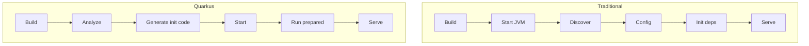

**Analogy — Cooking:** Traditional = customer arrives, then chef reads recipe + chops. Quarkus = *mise en place* done early; only assembly on order.

**What Quarkus does NOT eliminate:** DB connections, port binding, Kafka/Redis connects — still runtime.

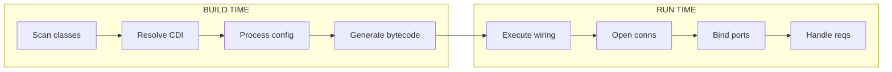

Benefits: faster startup, lower overhead (where applicable), better native compatibility.

## 8. Dependency Injection: Spring IoC vs. Quarkus ArC

| Aspect | Spring | Quarkus (ArC) |
|---|---|---|
| Model | Spring IoC container | CDI-based **ArC** |
| Processing | Context built at startup (reflection etc.) | Heavy analysis **at build time** |
| Annotations | `@Component`, `@Service`, `@Autowired` | `@ApplicationScoped`, `@Inject` |
| Native | Supported, effort on dynamics | Designed native-first |

> Spring has AOT too. Difference: build-time analysis is **central** to Quarkus.

**Example 1 — Field injection (simple, less testable):**

```java
import jakarta.enterprise.context.ApplicationScoped;

@ApplicationScoped // One instance for whole app; proxy handles scope
public class GreetingBean {
    public String message() {
        return "Hello from Quarkus!";
    }
}
```

```java
import jakarta.enterprise.context.ApplicationScoped;
import jakarta.inject.Inject;

@ApplicationScoped
public class GreetingService {
    @Inject // Field injection: quick but hard to unit-test without container
    GreetingBean greetingBean;

    public String greet() {
        return greetingBean.message();
    }
}
```

**Example 2 — Constructor injection (✅ recommended):**

```java
import jakarta.enterprise.context.ApplicationScoped;

@ApplicationScoped
public class GreetingService {
    private final GreetingBean greetingBean;

    // Single constructor: @Inject optional in Quarkus
    public GreetingService(GreetingBean greetingBean) {
        this.greetingBean = greetingBean; // final = immutable, easy to mock in tests
    }

    public String greet() {
        return greetingBean.message();
    }
}
```

**Example 3 — Qualifiers for multiple impls:**

```java
public interface Notifier { void send(String message); }

@ApplicationScoped
@Named("email") // Qualifier distinguishes beans of same type
public class EmailNotifier implements Notifier {
    public void send(String message) { /* send email */ }
}

@ApplicationScoped
@Named("sms")
public class SmsNotifier implements Notifier {
    public void send(String message) { /* send SMS */ }
}

@ApplicationScoped
public class AlertService {
    @Inject @Named("sms") // Picks SmsNotifier; ambiguous without qualifier
    Notifier notifier;
    public void alert() { notifier.send("Server is down!"); }
}
```

| Scope | Lifetime | Use |
|---|---|---|
| `@ApplicationScoped` | One/app | Services, repos |
| `@Singleton` | One, no proxy | Stateless beans |
| `@RequestScoped` | One/HTTP req | Request data |
| `@Dependent` | New/injection | Light helpers |

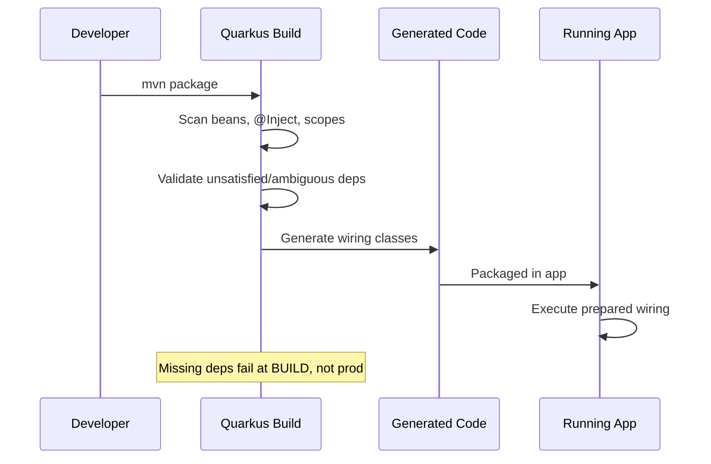

## 9. Native Compilation with GraalVM

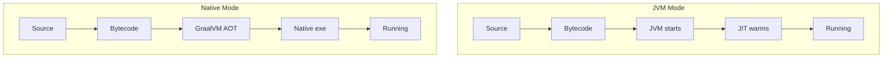

**Gains:** faster startup, lower memory, smaller images (many workloads).
**Costs:**

| Trade-off | Detail |
|---|---|
| Longer builds | Much slower than JVM builds |
| Debugging | Harder than JVM |
| Reflection/dynamics | Needs config |
| Peak throughput | Can differ from warmed JVM |
| Closed-world | All reachable code known at build |

```bash
./mvnw package -Dnative  # needs GraalVM/Mandrel
# No local GraalVM? container build:
./mvnw package -Dnative -Dquarkus.native.container-build=true
```

```java
import io.quarkus.runtime.annotations.RegisterForReflection;

// Needed when class only accessed via reflection (e.g., serialization)
@RegisterForReflection
public class PaymentEvent {
    public String id;
    public long amountInCents;
}
```

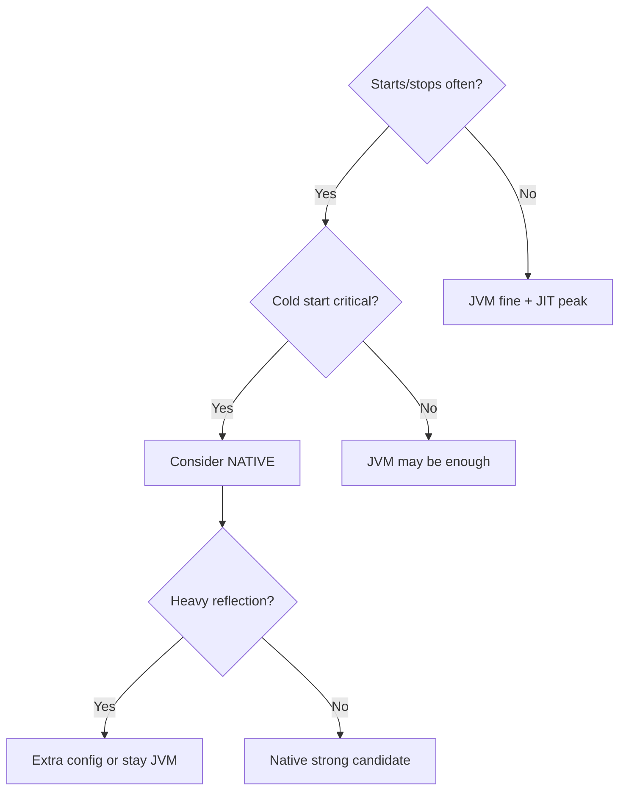

Best fit: serverless, scale-to-zero, short batch workers, event microservices, churning K8s.

## 10. Virtual Threads: Concurrency Without Reactive Rewrites

Platform threads = OS-heavy. Virtual threads (final Java 21) = lightweight, many.

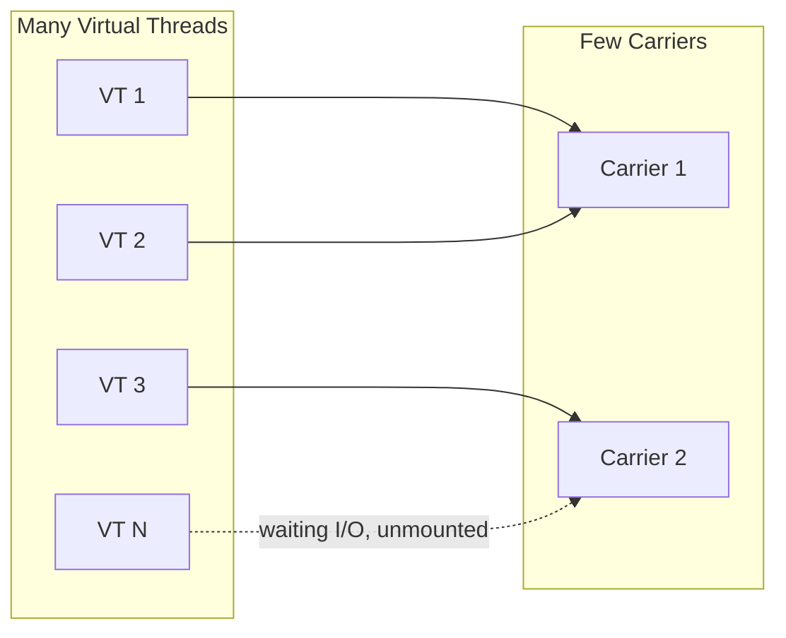

When virtual thread blocks on I/O (unmountable), carrier freed for others.

```java
import jakarta.inject.Inject;
import jakarta.ws.rs.GET;
import jakarta.ws.rs.Path;
import io.smallrye.common.annotation.RunOnVirtualThread;

@Path("/products")
public class ProductResource {
    @Inject ProductRepository repository; // supplied by app

    @GET
    @Path("/blocking-operation")
    @RunOnVirtualThread // blocking JDBC/HTTP OK here; cheap concurrency
    public String getProducts() {
        return repository.findInStock().toString();
    }
}
```

Spring Boot 3.2+ on Java 21 can too (runtime feature, not Quarkus-exclusive):

```properties
spring.threads.virtual.enabled=true
```

| Workload | Helps? | Why |
|---|---|---|
| Waiting DB | ✅ | Unmounts while waiting |
| Slow HTTP fan-out | ✅ | Many cheap waits |
| CPU image processing | ❌ | CPU-bound, no gain |
| 20-conn pool | ⚠️ | Pool is bottleneck; need limits |

```mermaid
sequenceDiagram
    participant C as Client
    participant Q as Quarkus
    participant VT as Virtual Thread
    participant DB as Database
    C->>Q: GET /products/blocking-operation
    Q->>VT: Run on virtual thread
    VT->>DB: Blocking query
    Note over VT: Unmounts; carrier serves others
    DB-->>VT: Result
    VT-->>Q: Data
    Q-->>C: 200 OK
```

## 11. Reading the Benchmarks Honestly

**Reported figures (source article, NOT guarantees):**

| Metric | Quarkus | Spring Boot |
|---|---|---|
| Throughput | 19,255 req/s | 7,238 req/s |
| JVM startup | 2.9 s | 6.6 s |
| Memory | 269 MB | 583 MB |

**Independent (BMW Romania CTO, as reported):**

| Metric | Quarkus | Spring Boot |
|---|---|---|
| JVM startup | 1.3 s | 5.6 s |
| Native startup | ~200 ms | ~2 s |
| Free memory | 88 MB | 204 MB |
| Image size | Smaller | Larger |

> ⚠️ Results depend on workload, versions, JVM flags, GC, hardware, limits, methodology. Free vs. total memory aren't interchangeable.

```text
Diff: 5.6-1.3=4.3s × 400 starts/day = 1720s ≈ 28.7 min
NOT downtime (parallel starts, old pods serve). But adds up when scaling often.
```

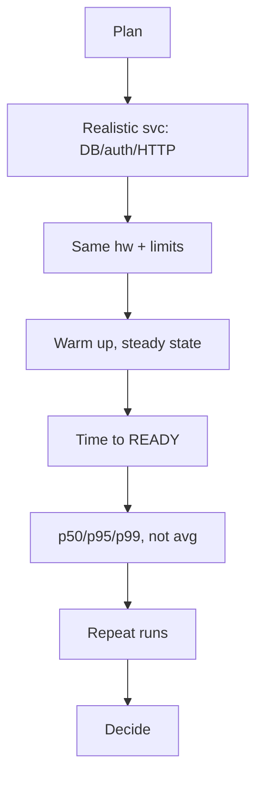

## 12. Hands-On: Build a REST API with Quarkus

Product API: REST + JSON + Panache + PostgreSQL.

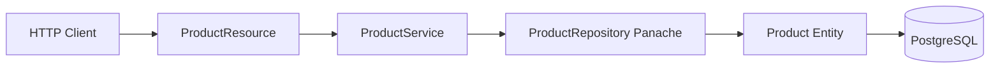

### Step 1: Create Project

```bash
mvn io.quarkus.platform:quarkus-maven-plugin:3.38.0:create \
  -DprojectGroupId=com.example \
  -DprojectArtifactId=quarkus-demo \
  -Dextensions="rest-jackson,hibernate-orm-panache,jdbc-postgresql"
```

> Check latest at code.quarkus.io — version 3.38.0 from source.

| Extension | Purpose |
|---|---|
| `rest-jackson` | REST + JSON |
| `hibernate-orm-panache` | Simplified JPA |
| `jdbc-postgresql` | Postgres driver |

### Step 2: Hello Endpoint

```java
package com.example.resource; // adjust to your groupId

import jakarta.ws.rs.GET;
import jakarta.ws.rs.Path;
import jakarta.ws.rs.Produces;
import jakarta.ws.rs.core.MediaType;

@Path("/hello") // Base path; method handles GET
public class GreetingResource {
    @GET
    @Produces(MediaType.TEXT_PLAIN) // returns plain text, not JSON
    public String hello() {
        return "Hello from Quarkus!";
    }
}
```

Run `./mvnw quarkus:dev`, open `http://localhost:8080/hello`.

### Step 3: Entity

```java
import io.quarkus.hibernate.orm.panache.PanacheEntity;
import jakarta.persistence.Entity;
import jakarta.persistence.Table;
import java.math.BigDecimal;

@Entity
@Table(name = "products")
public class Product extends PanacheEntity {
    // PanacheEntity gives auto Long id; simple for tutorial
    public String name;
    public BigDecimal price; // BigDecimal avoids float rounding for money
    public Integer stock;
}
```

> Production: prefer explicit `@Id` strategy + `@NotBlank`, `@PositiveOrZero` validation.

### Step 4: Repository

```java
import io.quarkus.hibernate.orm.panache.PanacheRepository;
import jakarta.enterprise.context.ApplicationScoped;
import java.util.List;

@ApplicationScoped // Makes it a CDI bean; injectable everywhere
public class ProductRepository implements PanacheRepository<Product> {
    public List<Product> findInStock() {
        return find("stock > 0").list(); // Panache shorthand for query
    }
    public List<Product> findByName(String name) {
        return find("name", name).list(); // field = ? binding (safe from injection)
    }
}
```

Free methods: `listAll()`, `findById()`, `persist()`, `deleteById()`, `count()`.

### Step 5: Service Layer

```java
import jakarta.enterprise.context.ApplicationScoped;
import jakarta.inject.Inject;
import jakarta.transaction.Transactional;
import java.util.List;

@ApplicationScoped
public class ProductService {
    @Inject ProductRepository productRepository;

    public List<Product> getInStockProducts() {
        return productRepository.findInStock();
    }

    @Transactional // Jakarta tx; commits on success, rolls back on RuntimeException
    public Product createProduct(Product product) {
        // Edge: validate nulls — production should check name/price != null
        if (product.price == null) throw new IllegalArgumentException("price required");
        productRepository.persist(product);
        return product;
    }
}
```

### Step 5b: Resource (Missing Piece — Wire Together)

```java
import jakarta.inject.Inject;
import jakarta.ws.rs.*;
import jakarta.ws.rs.core.MediaType;
import jakarta.ws.rs.core.Response;
import java.util.List;

@Path("/products")
@Produces(MediaType.APPLICATION_JSON) // All methods return JSON
@Consumes(MediaType.APPLICATION_JSON) // All methods accept JSON
public class ProductResource {
    @Inject ProductService productService;

    @GET
    @Path("/in-stock")
    public List<Product> inStock() {
        return productService.getInStockProducts();
    }

    @POST
    public Response create(Product product) {
        try {
            Product saved = productService.createProduct(product);
            return Response.status(Response.Status.CREATED).entity(saved).build();
        } catch (IllegalArgumentException e) {
            return Response.status(Response.Status.BAD_REQUEST)
                .entity("{\"error\":\"" + e.getMessage() + "\"}").build();
        }
    }
}
```

### Step 6: Configure PostgreSQL

`src/main/resources/application.properties`:

```properties
quarkus.datasource.db-kind=postgresql
quarkus.datasource.username=postgres
quarkus.datasource.password=${DB_PASSWORD} # env var, never hard-code!
quarkus.datasource.jdbc.url=jdbc:postgresql://localhost:5432/mydb
quarkus.hibernate-orm.schema-management.strategy=update
```

> ⚠️ `update` is dev/controlled only. Prod: Flyway/Liquibase.

```properties
# Dev-only: recreate schema each start
%dev.quarkus.hibernate-orm.schema-management.strategy=drop-and-create
# Prod-only: cluster DNS
%prod.quarkus.datasource.jdbc.url=jdbc:postgresql://db-service:5432/mydb
```

> 💡 **Dev Services:** No URL configured + Docker running → Quarkus auto-starts Postgres container in dev/test. Huge productivity win.

### Step 7: Run

```bash
./mvnw quarkus:dev   # live reload
./mvnw package       # JVM jar
./mvnw package -Dnative  # native exe
```

```bash
curl -X POST http://localhost:8080/products \
 -H "Content-Type: application/json" \
 -d '{"name":"Keyboard","price":49.99,"stock":10}'
curl http://localhost:8080/products/in-stock
```

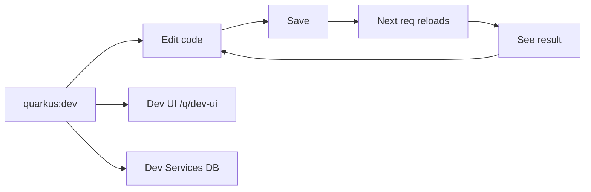

### Step 8 (Bonus): Health for K8s

```bash
./mvnw quarkus:add-extension -Dextensions="smallrye-health"
```

```yaml
readinessProbe: # /q/health/ready
  httpGet: {path: /q/health/ready, port: 8080}
livenessProbe: # /q/health/live
  httpGet: {path: /q/health/live, port: 8080}
```

### Step 9 (Bonus): Test

```java
import io.quarkus.test.junit.QuarkusTest;
import org.junit.jupiter.api.Test;
import static io.restassured.RestAssured.given;
import static org.hamcrest.CoreMatchers.is;

@QuarkusTest // Boots app for test; Dev Services provides DB
class GreetingResourceTest {
    @Test void helloEndpointWorks() {
        given().when().get("/hello").then()
          .statusCode(200).body(is("Hello from Quarkus!"));
    }
}
```

## 13. Side-by-Side: Same Feature in Spring Boot and Quarkus

**REST endpoint:**

```java
// Spring Boot
@RestController
@RequestMapping("/hello")
public class GreetingController {
    @GetMapping(produces = MediaType.TEXT_PLAIN_VALUE)
    public String hello() { return "Hello from Spring Boot!"; }
}
```

```java
// Quarkus (JAX-RS)
@Path("/hello")
public class GreetingResource {
    @GET @Produces(MediaType.TEXT_PLAIN)
    public String hello() { return "Hello from Quarkus!"; }
}
```

**Injection:**

```java
// Spring — constructor injection
@Service
public class ProductService {
    private final ProductRepository repo;
    public ProductService(ProductRepository repo) { this.repo = repo; }
}
```

```java
// Quarkus — same shape, different annotation
@ApplicationScoped
public class ProductService {
    private final ProductRepository repo;
    public ProductService(ProductRepository repo) { this.repo = repo; }
}
```

**Config:**

```java
// Spring
@Value("${app.greeting}") String greeting;
// Quarkus
@ConfigProperty(name = "app.greeting") String greeting;
```

| Concept | Spring Boot | Quarkus |
|---|---|---|
| REST | `@RestController` | `@Path` (JAX-RS) |
| GET | `@GetMapping` | `@GET` |
| Bean | `@Service` | `@ApplicationScoped` |
| Inject | `@Autowired` | `@Inject` |
| Config | `@Value` | `@ConfigProperty` |
| Data | Spring Data JPA | Panache |
| Reload | DevTools | Built-in live reload |
| Tx | Spring `@Transactional` | Jakarta `@Transactional` |

> 💡 Quarkus has Spring-compat extensions (DI/Web/Data annotations) to ease migration — check coverage in guides before relying on them.

## 14. Real-World Examples and Use Cases

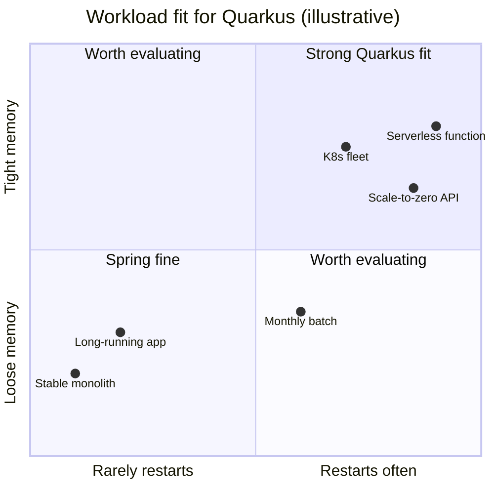

1. **K8s microservices:** cart-service 5→40 pods in sale. Faster ready + denser nodes.
2. **Serverless webhook:** unpredictable invocations. Cold-start + memory win (platform/network still matter).
3. **AI supporting services:** gateway/orchestrator/retrieval scale cheaply. ⚠️ Doesn't speed model inference (GPU/batching separate).

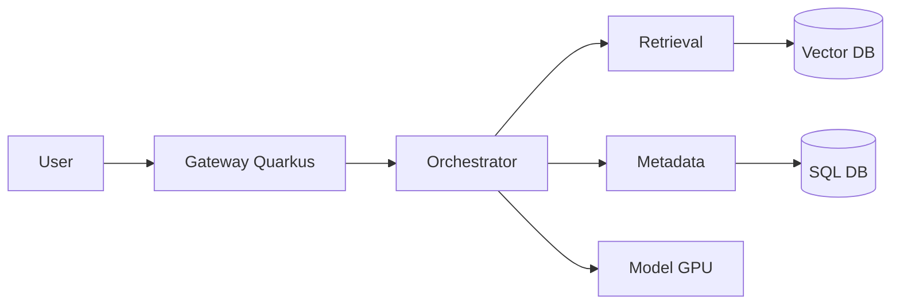

4. **High-density:** 1000 svcs × 100MB saved ≈ 100GB (if measured!).
5. **Short workers:** Kafka batch/file job living seconds — startup dominates.

| Use case | Driver | Native? |
|---|---|---|
| K8s micro | Scaling, density | Sometimes |
| Serverless | Cold start | Often |
| AI support | Light scaling | Sometimes |
| Dense fleet | Memory/instance | Sometimes |
| Short workers | Startup share | Often |

## 15. Where Spring Boot Still Makes More Sense

> Choosing only on startup benchmarks is a mistake. Spring's ecosystem, docs, community, integrations (Security/Data/Batch/Cloud/AI, starters) matter.

1. **Stable enterprise apps:** Runs months, meets SLOs — few seconds startup irrelevant.
2. **Spring-coupled libs:** Proprietary middleware tightly Spring-bound → migration risky.
3. **Dynamic runtime:** Heavy reflection/dynamic loading needs extra native config.
4. **Team expertise:** Memory saving that slows delivery = negative ROI. Same for Kotlin-heavy or Spring-mature integrations.

| Question | Leans Spring | Leans Quarkus |
|---|---|---|
| Restarts/scales often? | No | Yes |
| Memory tight? | No | Yes |
| Spring-specific libs? | Yes | No |
| Fluent in Spring? | Yes | Open to learn |
| Native/serverless? | No | Yes |
| Meets SLOs? | Yes | No |

## 16. Should You Migrate? Decision Framework + Migration Guide

**Principle: Measure, don't assume.**

**Step 1 — Baseline:** time-to-ready, memory under load, CPU/GC, p50/p95/p99, image size, build/deploy freq, scaling, deps.
**Step 2 — Prototype:** Realistic svc (DB+auth+HTTP), not hello-world.
**Step 3 — Compare:** Same hw/limits/load.
**Step 4 — ROI:**

```text
Benefit = infra savings + scaling value
Cost = migration + testing + retraining + maintenance
Decision = Benefit - Cost (validated by measurements)
```

| Item | Example |
|---|---|
| Theoretical saving | 100MB × 200 = 20GB |
| Confirmed? | Must verify |
| Usable capacity? | Must verify |
| Migration cost | Estimate honestly |

**Step 5 — Failure tests:** rolling deploys, probes, DB pool limits, peak traffic.
**Step 6 — Incremental:**

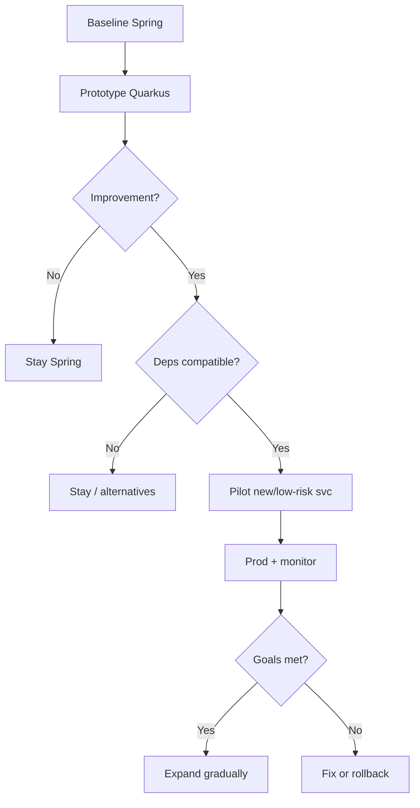

**Migration guide (if applicable):**

1. Assess: list Spring-only deps (Security rules, Batch jobs, Cloud Config). Check Quarkus compat extensions.
2. Strangler: keep monolith, extract one new edge service in Quarkus first.
3. Translate: `@Service`→`@ApplicationScoped`, `@Autowired`→`@Inject`, `@Value`→`@ConfigProperty`, Spring Data repo → Panache repo. Use compat extensions temporarily, then migrate to idiomatic Quarkus.
4. Data: switch `spring.datasource.*` → `quarkus.datasource.*`; add Flyway (`quarkus-flyway`) instead of `update`.
5. Verify: contract tests + load tests + probe checks before cutover. Keep rollback (old deployment + DB backward-compatible migrations).

## 17. Multiple Implementation Approaches

**A. Persistence — Panache (concise) vs. plain JPA (explicit):**

```java
// Panache: active-record style
public class Product extends PanacheEntity { public String name; }
// usage: Product.listAll(), Product.findById(id)

// Plain JPA: explicit EntityManager (more control, more boilerplate)
@Entity public class ProductPlain {
  @Id @GeneratedValue public Long id; public String name;
}
// usage via @Inject EntityManager em; em.persist(p);
```

Use Panache for CRUD speed; plain JPA when you need composite keys, complex mappings.

**B. REST — RESTEasy Reactive (default, non-blocking I/O) vs. classic blocking:**

```java
// Reactive-friendly: same JAX-RS API, runs on event loop unless @RunOnVirtualThread/@Blocking
@GET public Uni<List<Product>> reactive() { return Uni.createFrom().item(repo::listAll); }
// Blocking with virtual threads: simpler mental model for JDBC
@GET @RunOnVirtualThread public List<Product> blocking() { return repo.listAll(); }
```

**C. Packaging — JVM jar (fast build, JIT peak) vs. native (fast start, slow build):**

```bash
./mvnw package                          # JVM: iterate fast
./mvnw package -Dnative -Dquarkus.native.container-build=true  # native: scale fast
```

## 18. Best Practices

1. Prefer constructor injection (`final` fields) for testability.
2. Use `@ConfigProperty` + env vars for secrets; never commit passwords.
3. Profile configs (`%dev`, `%prod`) — keep prod strict.
4. Prod schema via Flyway/Liquibase, never `update`/`drop-and-create`.
5. Expose `/q/health/*` and wire K8s probes correctly (ready ≠ live).
6. Panache parameter binding (`find("name", n)`) — avoids JPQL injection.
7. Validate inputs (`@NotBlank`, `@PositiveOrZero`) at resource boundary.
8. `@Transactional` at service, not resource; keep tx short.
9. Size DB pools to DB capacity, not thread count (virtual threads ≠ more connections).
10. Benchmark to-ready + p95 under identical limits; repeat runs.
11. Native: register reflection early (`@RegisterForReflection`), test serialization.
12. Container: set memory limits + `-Xmx` coherently; watch non-heap.
13. Log structured JSON in prod; avoid sensitive data.
14. Pilot new/low-risk services first; strangler over big-bang.
15. Pin versions + record `Last Updated`; re-check guides for latest extensions.

## 19. Anti-Patterns

| ❌ Incorrect | ✅ Correct | Why |
|---|---|---|
| `quarkus.datasource.password=secret123` | `${DB_PASSWORD}` | Secrets leak in git |
| `strategy=update` in prod | Flyway migration `V1__create_products.sql` | Data loss / drift |
| Field `@Inject` everywhere, no tests | Constructor injection + unit tests | Untestable wiring |
| Measuring hello-world only | Realistic DB+auth+HTTP load | False wins |
| Native as default for all | JVM default, native where starts matter | Slow builds, debug pain |
| Unbounded virtual-thread fan-out to 20-conn DB | Semaphore / pool-sized concurrency | Pool exhaustion |
| Same probe for live+ready | Live=`/q/health/live`, Ready=`/q/health/ready` | Cascading restarts |
| `double price` for money | `BigDecimal price` | Rounding errors |

```java
// ❌ Incorrect: string-concatenated query (injection risk) + double money
public List<Product> risky(String name) { return list("name = '" + name + "'"); }
// ✅ Correct: binding + BigDecimal
public List<Product> safe(String name) { return find("name", name).list(); }
```

## 20. Performance Considerations

- **Measure to-ready**, not process start (probe timestamp). Record cold vs. warm.
- **Memory:** heap + metaspace + threads + code cache + direct buffers. Set container limit, then tune `-Xmx` ~60-70% of limit as starting point; verify under load.
- **Pools:** DB pool = bottleneck for virtual threads. Start e.g. 20, load-test, adjust. Add timeouts + retries with backoff for downstream HTTP.
- **JVM:** G1 default good; test parallel GC for short workers. Native: trade peak throughput for start/memory — verify p95, not just start.
- **Payloads:** Jackson serialization cost matters; paginate `listAll()` (e.g., `findAll().page(0,20)`) — never return unbounded lists in prod.

```java
// Performance-optimized: paginated, indexed query
public List<Product> inStockPaged(int page, int size) {
    return find("stock > 0").page(page, size).list(); // add DB index on stock
}
```

## 21. Security Considerations

- Secrets via env / vault (`${DB_PASSWORD}`), rotate regularly; never log them.
- Validate + sanitize: Bean Validation on `Product` (`@NotBlank name`, `@PositiveOrZero price/stock`); reject oversized JSON (`quarkus.http.limits`).
- Use bound parameters (Section 19) to prevent JPQL injection.
- Health: expose `/q/health` internally; don't leak Dev UI (`/q/dev-ui`) in prod (`%prod.quarkus.dev-ui.enabled=false` if needed per guide).
- Native images: generate SBOM, scan image; minimal base (distroless/ubi-micro) reduces surface.
- Auth: add OIDC (`quarkus-oidc`) for prod APIs; enforce HTTPS + CORS allowlist.

```java
import jakarta.validation.constraints.*;
public class ProductSecure extends PanacheEntity {
    @NotBlank public String name;
    @PositiveOrZero public java.math.BigDecimal price;
    @PositiveOrZero public Integer stock;
}
```

## 22. Testing Strategies

1. **Unit:** constructor-injected service + mocked repo (Mockito) — fast, no container.
2. **Integration (`@QuarkusTest` + RestAssured):** boots app, Dev Services DB — test status codes + JSON.
3. **Repository:** `@QuarkusTest` + `@TestTransaction` (rollback) for Panache queries.
4. **Contract:** Pact/RestAssured schema checks for `/products` POST/GET.
5. **Load:** k6/Gatling against container with prod limits; assert p95 + ready time.
6. **Native smoke:** `@QuarkusIntegrationTest` after `package -Dnative` — verifies reflection config.

```java
@QuarkusTest
class ProductResourceIT {
    @Test void createAndList() {
        given().contentType("application/json")
          .body("{\"name\":\"Mouse\",\"price\":25.0,\"stock\":5}")
          .when().post("/products").then().statusCode(201);
        given().when().get("/products/in-stock").then().statusCode(200);
    }
}
```

## 23. Common Pitfalls / Troubleshooting

| Problem | Likely cause | What to do |
|---|---|---|
| Native fails: missing class/reflection | Reflection-only class not registered | `@RegisterForReflection` or `reflection-config.json` |
| Native slow/OOM | Native Image heavy | More CPU/RAM, build in CI, use container-build |
| Unsatisfied dependency at build | Missing scope / not discovered | Add `@ApplicationScoped`, check package (Jandex index) |
| Works dev, fails prod | Profile/config drift | Check `%dev`/`%prod`, env vars, `DB_PASSWORD` set |
| No gain in benchmark | Unrealistic test / DB bottleneck | Realistic workload, find real bottleneck (DB/pool) |
| Virtual threads no gain | CPU-bound or small pool | Tune pools, add concurrency limits |
| Schema lost in prod | `update`/`drop-and-create` | Flyway/Liquibase migrations |
| 404 on `/hello` | Wrong `@Path` / package not scanned | Verify path, rebuild, check logs |
| Jackson fails on `BigDecimal` | Bad JSON (`"price":"abc"`) | Validate input, return 400 with message |
| Health probes failing | Wrong port/path | `/q/health/ready` + `/q/health/live` on 8080 |
| Dev Services not starting DB | Docker off | Start Docker or set explicit JDBC URL |
| Port 8080 in use | Old dev mode running | Kill process or `-Dquarkus.http.port=8081` |

> 💡 **Quick recap:** Build-time errors = wiring/config; runtime errors = connections/profiles/pools. Check build log first, then `application.properties` profiles.

## 24. Summary / Key Takeaways

1. Startup/memory dominate elastic costs; JIT shines long-run.
2. Quarkus shifts work to build → faster ready, leaner runtime, native-ready.
3. ArC validates DI at build; constructor injection + qualifiers.
4. Native = fast start, slow build, reflection care. JVM default unless starts matter.
5. Virtual threads help I/O waits, not CPU or tiny pools.
6. Benchmark your workload to-ready + p95; don't trust hello-world.
7. Spring stays for stable, Spring-coupled, expert teams.
8. Migrate incrementally: baseline → prototype → ROI → pilot.
9. Prod hygiene: env secrets, Flyway, health probes, pagination.
10. Golden rules: **Measure before migrate. Benchmark yours. Count migration cost. Adopt incrementally. Native is tool, not default.**

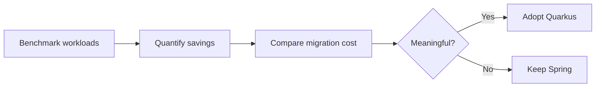

## 25. Practice Exercises (With Detailed Solutions)

**Exercise 1 — Beginner 🟢: `/hello` + live reload**

*Task:* Generate project with `rest-jackson`, create `/hello`, run dev mode, change text, observe reload.
*Solution:*

```bash
mvn io.quarkus.platform:quarkus-maven-plugin:3.38.0:create \
 -DprojectGroupId=com.example -DprojectArtifactId=quarkus-demo \
 -Dextensions="rest-jackson"
./mvnw quarkus:dev
# Edit GreetingResource.hello() return to "Hello v2!" -> save -> curl again, no restart
curl http://localhost:8080/hello
```

*Expected:* Second curl returns new text instantly. *Learn:* live reload loop.

**Exercise 2 — Beginner 🟢: In-memory `/products` CRUD**

*Task:* `GET` + `POST` with `List<Product>` (no DB).
*Solution:*

```java
@Path("/products") @Produces(MediaType.APPLICATION_JSON) @Consumes(MediaType.APPLICATION_JSON)
public class InMemoryProductResource {
    private final List<Map<String,Object>> store = new CopyOnWriteArrayList<>();
    @GET public List<Map<String,Object>> all() { return store; }
    @POST public Response add(Map<String,Object> p) {
        if (p.get("name") == null) return Response.status(400).entity("{\"error\":\"name required\"}").build();
        store.add(p); return Response.status(201).entity(p).build();
    }
}
```

*Verify:* POST then GET returns item; missing name → 400.

**Exercise 3 — Intermediate 🟡: Panache + Dev Services + findByName**

*Task:* Connect Postgres via Dev Services (no URL), add `GET /products/search?name=X`.
*Solution:* Remove `quarkus.datasource.jdbc.url` (keep `db-kind=postgresql`), ensure Docker on, run `quarkus:dev` (watch log: Dev Services starting Postgres). Add:

```java
@GET @Path("/search") public List<Product> search(@QueryParam("name") String name) {
    return productService.searchByName(name); // -> repository.findByName(name)
}
```

*Verify:* POST Keyboard, `GET /products/search?name=Keyboard` returns it.

**Exercise 4 — Intermediate 🟡: Health + K8s probes**

*Task:* Add `smallrye-health`, wire probes.
*Solution:*

```bash
./mvnw quarkus:add-extension -Dextensions="smallrye-health"
curl http://localhost:8080/q/health/ready  # expect {"status":"UP",...}
curl http://localhost:8080/q/health/live
```

```yaml
readinessProbe: {httpGet: {path: /q/health/ready, port: 8080}, periodSeconds: 10}
livenessProbe: {httpGet: {path: /q/health/live, port: 8080}, periodSeconds: 10}
```

*Learn:* ready gates traffic; live gates restarts.

**Exercise 5 — Advanced 🔴: Dual-build benchmark (1-page summary)**

*Task:* Same service in Spring Boot + Quarkus, identical container limits, measure ready time, memory, p95.
*Solution sketch:*

```bash
# Both: time from `docker run` to first 200 on /q/health/ready (or /actuator/health)
docker stats --no-stream  # memory under k6 load
k6 run --vus 50 --duration 2m script.js  # record p50/p95/p99
```

*Write:* table + 3 bullets (workload, limits, verdict). *Learn:* methodology > hype.

**Exercise 6 — Advanced 🔴: Native build compare**

*Task:* `./mvnw package -Dnative`, compare start/memory/image vs. JVM, note config.
*Solution:*

```bash
./mvnw package -Dnative -Dquarkus.native.container-build=true
ls -lh target/*-runner*  # native exe vs. quarkus-run.jar
time ./target/quarkus-demo-1.0-runner &  # wall start; curl /q/health/ready until 200
# Fix reflection errors with @RegisterForReflection as needed; record each fix
```

*Deliverable:* start delta, RSS delta, image size delta, list of fixes.

## 26. Hands-On Lab: End-to-End Checklist

- [ ] Project created with 3 extensions; `./mvnw quarkus:dev` serves `/hello`
- [ ] `Product` entity + repo + service + resource POST/GET work via curl
- [ ] `%dev` vs `%prod` URLs correct; `DB_PASSWORD` from env
- [ ] Health `UP` on both endpoints; K8s YAML probes added
- [ ] `@QuarkusTest` passes; Dev Services log shows auto Postgres
- [ ] JVM package runs; (optional) native build + smoke test
- [ ] 1-page benchmark summary written (Ex 5 or 6)

## 27. Test Your Understanding

**Q1:** Why does 6s startup matter on Kubernetes but not on static servers?

**A1:** On static servers the app starts once and runs for months, so startup is irrelevant. On Kubernetes a pod contributes capacity only after its readiness probe passes, so slow startup delays scaling, prolongs overload on existing pods and stretches rolling deployments.

**Q2:** Name 3 non-heap JVM memory components.

**A2:** Any three of: Metaspace and class metadata, thread stacks, JIT compiler and code cache, GC structures, direct buffers and native memory. These count toward the container limit, so a pod can OOM even when `-Xmx` is below the limit.

**Q3:** What does build-time processing generate?

**A3:** It scans classes, annotations, CDI beans, injection points and configuration during `mvn package`, validates unsatisfied or ambiguous dependencies, and generates wiring bytecode. At runtime the app executes that prepared code instead of discovering everything from scratch.

**Q4:** What still happens at runtime in Quarkus?

**A4:** Opening database connections, binding network ports and connecting to external services such as Kafka or Redis. Quarkus reduces framework initialization but cannot eliminate I/O setup.

**Q5:** What is the difference between ArC and Spring IoC?

**A5:** ArC is Quarkus's CDI-based container with heavy build-time analysis and early validation, designed native-first. Spring builds its IoC context mainly at startup using reflection and related mechanisms, though Spring AOT support also exists. Build-time analysis is central to Quarkus, not an add-on.

**Q6:** When should you prefer constructor injection?

**A6:** Always for services and repositories. A single constructor with final fields is immutable, makes dependencies explicit and is easy to unit-test with mocks, unlike field injection which needs a container.

**Q7:** What does the closed-world assumption mean?

**A7:** GraalVM Native Image must know all reachable code at build time. Anything only loaded dynamically or via reflection must be registered explicitly, otherwise the native executable will fail or misbehave.

**Q8:** What is the fix for a native reflection error?

**A8:** Annotate the class with `@RegisterForReflection` or add a `reflection-config.json` entry, then rebuild and smoke-test the native executable. Jackson DTOs and polymorphic types are common culprits.

**Q9:** When do virtual threads NOT help?

**A9:** For CPU-bound work such as image processing, where threads never unmount, and when a small downstream bottleneck dominates, for example a 20-connection database pool. They help I/O waits like slow DB or HTTP calls.

**Q10:** What are the ready vs. live probe paths?

**A10:** Readiness is `/q/health/ready` and gates traffic to the pod. Liveness is `/q/health/live` and decides restarts. Wiring them backwards can cause cascading restarts or traffic to unready pods.

**Q11:** Why does the `%prod` datasource URL differ from localhost?

**A11:** Localhost points to a developer machine, while production runs inside Kubernetes where the database is reached via cluster DNS such as `db-service:5432`. The `%prod.` profile keeps environment-specific URLs separate from `%dev.`.

**Q12:** Why must you not use `update` schema strategy in production?

**A12:** `update` and `drop-and-create` can drift, lose or corrupt data on schema changes. Production needs versioned Flyway or Liquibase migrations that are reviewable, testable and rollback-safe.


## 28. Common Interview Questions

1. **Why Quarkus for K8s?** Faster ready + lower memory → quicker scaling, denser nodes. Measure to-ready + RSS under load.
2. **Build-time processing?** Scan beans/config at `mvn package`, generate wiring; runtime executes prepared code. Still opens conns/binds ports at runtime.
3. **ArC vs Spring DI?** CDI-based ArC validates at build; Spring builds context at startup (has AOT too, but not central).
4. **JVM vs Native?** JVM: fast build, JIT peak. Native: fast start, slow build, reflection config, closed-world. Choose by restart frequency + cold-start SLO.
5. **Virtual threads value?** Cheap blocking I/O concurrency via `@RunOnVirtualThread`; no help for CPU-bound or pool-limited work.
6. **`@ApplicationScoped` vs `@Singleton`?** Former proxied scope, latter single instance no proxy; use former for services.
7. **Dev Services?** Auto-starts Postgres/Kafka containers in dev/test when no URL + Docker on.
8. **Prod schema strategy?** Flyway/Liquibase; never `update`/`drop-and-create`.
9. **Probes?** Ready `/q/health/ready` (traffic), Live `/q/health/live` (restart).
10. **Migration approach?** Baseline → realistic prototype → same-env compare → ROI → pilot new service → expand; keep rollback.
11. **Panache vs Spring Data?** Similar CRUD brevity; Panache active-record or repository pattern on Hibernate ORM.
12. **Interpret 1.3s vs 5.6s startup?** Reported, not guaranteed; verify with your workload, p95, limits, repeats.

## 29. Question Bank for Knowledge Reinforcement (55 Questions)

### Beginner (Questions 1-20)

**Q1:** What is Quarkus?

**A1:** A cloud-native Java framework designed for fast startup, low memory, build-time processing, native compilation, live reload and Dev Services.

**Q2:** What is build-time processing?

**A2:** Doing framework work at build time — scanning beans and config and generating wiring bytecode — instead of at startup.

**Q3:** Name 2 Quarkus developer-experience features.

**A3:** Live reload with `./mvnw quarkus:dev` and Dev Services that auto-start databases plus Dev UI at `/q/dev-ui`.

**Q4:** What is ArC?

**A4:** Quarkus's CDI-based dependency-injection container that does heavy bean analysis at build time.

**Q5:** What is the purpose of `@Inject`?

**A5:** It injects a CDI bean dependency into another bean, for example a repository into a service.

**Q6:** What is the lifetime of `@ApplicationScoped`?

**A6:** One shared instance for the whole application, accessed via a client proxy.

**Q7:** How does `@Path` differ from `@RestController`?

**A7:** `@Path` marks a Quarkus JAX-RS resource class, while `@RestController` marks a Spring MVC controller class.

**Q8:** What is Panache?

**A8:** A simplified Hibernate ORM persistence layer offering active-record or repository patterns with built-in CRUD methods.

**Q9:** What does the `rest-jackson` extension do?

**A9:** It provides RESTEasy Reactive plus Jackson for building REST endpoints with JSON serialization.

**Q10:** What command runs Quarkus in dev mode with live reload?

**A10:** `./mvnw quarkus:dev`.

**Q11:** What is the Dev UI URL?

**A11:** `http://localhost:8080/q/dev-ui` while dev mode is running.

**Q12:** What is Dev Services?

**A12:** Automatic provisioning of Postgres, Kafka and other containers in dev and test when no URL is configured and Docker is running.

**Q13:** What is the health extension name?

**A13:** `smallrye-health`, added with `./mvnw quarkus:add-extension -Dextensions="smallrye-health"`.

**Q14:** How does readiness differ from liveness?

**A14:** Readiness at `/q/health/ready` gates traffic to the pod, while liveness at `/q/health/live` decides restarts.

**Q15:** What is GraalVM Native Image?

**A15:** Ahead-of-time compilation that turns Java bytecode into a native machine-code executable with fast startup.

**Q16:** What flag builds a native executable?

**A16:** `-Dnative`, as in `./mvnw package -Dnative`.

**Q17:** What is container-build for?

**A17:** It builds the native executable inside a container when GraalVM or Mandrel is not installed locally.

**Q18:** Which Java version is needed for virtual threads?

**A18:** Java 21, where virtual threads are final and stable.

**Q19:** Which annotation runs an endpoint on a virtual thread?

**A19:** `@RunOnVirtualThread` from `io.smallrye.common.annotation`.

**Q20:** What is the main config file name?

**A20:** `src/main/resources/application.properties`, supporting `%dev.` and `%prod.` profiles.


### Intermediate (Questions 21-40)

**Q21:** Why does non-heap memory matter for a 512MB container limit?

**A21:** Metaspace, thread stacks, JIT code cache, GC structures and direct buffers count toward the container limit, so the JVM can OOM even when heap is below 512MB.

**Q22:** What is the effect of JIT warm-up on a new replica?

**A22:** A fresh pod may be ready before hot methods are optimized, so early latency is higher until steady-state compilation finishes.

**Q23:** What still happens at runtime in Quarkus?

**A23:** Opening database connections, binding ports and connecting to Kafka, Redis and other external services.

**Q24:** Give an example of a CDI qualifier.

**A24:** `@Named("sms")` on `SmsNotifier` plus `@Inject @Named("sms") Notifier` to select that implementation.

**Q25:** How does constructor injection compare with field injection?

**A25:** Constructor injection uses final fields that are easy to mock and test, while field injection is quicker to write but harder to unit-test.

**Q26:** How does `@ConfigProperty` compare with `@Value`?

**A26:** Both inject config values, but Quarkus uses `@ConfigProperty(name = "app.greeting")` while Spring uses `@Value("${app.greeting}")`.

**Q27:** What is the profile syntax with `%dev`?

**A27:** Prefixing a key like `%dev.quarkus.datasource.jdbc.url` applies it only in dev mode, with `%prod.` for production.

**Q28:** Why use an environment variable for the database password?

**A28:** It keeps secrets out of git and config files so they can be rotated per environment via `${DB_PASSWORD}`.

**Q29:** What is the benefit of Panache `find("name", name)`?

**A29:** It binds the parameter safely instead of concatenating strings, which prevents JPQL injection.

**Q30:** How does `@Transactional` behave?

**A30:** It commits the Jakarta transaction on success and rolls back on RuntimeException, so keep it at the service layer and short.

**Q31:** When do you need `@RegisterForReflection`?

**A31:** When a class is only accessed via reflection such as Jackson serialization and would otherwise be removed from a native image.

**Q32:** What does the closed-world assumption mean?

**A32:** GraalVM Native Image must know all reachable code at build time, so dynamic loading needs explicit configuration.

**Q33:** Name 3 best-fit native use cases.

**A33:** Serverless functions, scale-to-zero services and short-lived batch or event workers that restart often.

**Q34:** When does a virtual thread unmount from its carrier?

**A34:** When it blocks on I/O such as a database or HTTP wait, freeing the carrier thread to run other virtual threads.

**Q35:** What flag enables virtual threads in Spring Boot?

**A35:** `spring.threads.virtual.enabled=true` on Spring Boot 3.2 plus Java 21.

**Q36:** Why record p95 instead of only averages?

**A36:** Averages hide tail latency, while p50, p95 and p99 show what slow users actually experience under load.

**Q37:** How does time-to-ready differ from process start?

**A37:** Process start is when the JVM launches, while time-to-ready is when the readiness probe passes and traffic can arrive.

**Q38:** What is strangler migration?

**A38:** Keeping the old system and gradually extracting one new or low-risk service in Quarkus instead of a big-bang rewrite.

**Q39:** What is the role of Quarkus Spring compatibility extensions?

**A39:** They temporarily support Spring DI, Web and Data annotations to ease migration before moving to idiomatic Quarkus.

**Q40:** Give 2 reasons Spring Boot still wins.

**A40:** Stable apps that already meet SLOs gain little from faster startup, and heavy Spring-specific libraries or team expertise make migration costly.


 


### Advanced (Questions 41-55)

**Q41:** How do you size `-Xmx` against the container limit?

**A41:** Start `-Xmx` around 60 to 70 percent of the container limit to leave room for non-heap, then verify under representative load.

**Q42:** How do you size pools when using virtual threads?

**A42:** Size the database pool to database capacity, not thread count, and add concurrency limits because virtual threads do not create more connections.

**Q43:** How do you paginate a Panache query?

**A43:** Chain `.page(pageIndex, pageSize)` before `.list()`, for example `find("stock > 0").page(0, 20).list()`, and index the filtered column.

**Q44:** How does `@QuarkusTest` differ from `@QuarkusIntegrationTest`?

**A44:** `@QuarkusTest` boots the JVM app for integration tests, while `@QuarkusIntegrationTest` tests the packaged jar or native executable including reflection config.

**Q45:** How does Testcontainers compare with Dev Services?

**A45:** Dev Services auto-starts dependencies with zero config in dev and test, while Testcontainers gives explicit control for custom images and complex setups.

**Q46:** What makes native debugging challenging?

**A46:** Longer resource-heavy builds, less direct debugging than the JVM and extra configuration for reflection and dynamic behavior.

**Q47:** Why use an SBOM and minimal base image?

**A47:** They reduce attack surface, make vulnerabilities traceable and keep native container images smaller and safer.

**Q48:** Which extension adds OIDC authentication?

**A48:** `quarkus-oidc`, which integrates OpenID Connect login and token validation for production APIs.

**Q49:** What CORS and HTTPS needs apply in production?

**A49:** Enforce HTTPS, allowlist CORS origins and avoid exposing Dev UI and verbose errors publicly.

**Q50:** Why prefer BigDecimal over double for money?

**A50:** BigDecimal avoids binary floating-point rounding errors, while double can produce incorrect cents.

**Q51:** Name useful Bean Validation annotations for Product.

**A51:** `@NotBlank` for name plus `@PositiveOrZero` for price and stock, validated at the resource boundary.

**Q52:** How do you choose native for short versus long workers?

**A52:** Choose native for short-lived workers where startup dominates, and JVM for long-running services that benefit from JIT peak throughput.

**Q53:** What is the migration ROI formula?

**A53:** Benefit equals infrastructure savings plus scaling value, cost equals migration plus testing plus retraining plus maintenance, and decision equals benefit minus cost validated by measurements.

**Q54:** Which failure scenarios should you test?

**A54:** Rolling deployments, health probes, database pool limits and peak traffic with concurrent replica starts.

**Q55:** What belongs in a rollback plan?

**A55:** Keep the old deployment runnable, use backward-compatible database migrations and verify contract, load and probe checks before cutover.


## 30. Self-Assessment Checklist

- [ ] I can diagram startup path to ready and explain HPA impact.
- [ ] I can list JVM footprint parts beyond heap.
- [ ] I can explain build-time vs. runtime split with example.
- [ ] I can write constructor-injected beans with qualifiers.
- [ ] I can choose JVM vs. native with trade-offs.
- [ ] I can use `@RunOnVirtualThread` and state limits.
- [ ] I built Product API end-to-end (POST/GET + Postgres).
- [ ] I configured `%dev`/`%prod` + env secrets correctly.
- [ ] I wired health probes and pass `@QuarkusTest`.
- [ ] I can argue stay-vs-migrate with ROI + measurements.

## 31. Pro Tips

1. Watch Dev Services logs — it tells you the auto-started DB URL/creds.
2. Use `/q/dev-ui` to inspect beans, config, health while in dev mode.
3. Fail fast: `mvn package` surfaces wiring errors before K8s does.
4. Index `stock`/`name` columns before benchmarking `findInStock`/`findByName`.
5. Keep resources thin, services transactional — easier native + tests.
6. For Kafka: Dev Services Redpanda saves local setup time.
7. Native + Jackson: test all DTOs; add reflection for polymorphic types.
8. Record build time too — native CI cost is part of ROI.

## 32. Further Reading / Resources

- [code.quarkus.io](https://code.quarkus.io) — project generator + latest extensions
- Quarkus Guides: Getting Started, Hibernate ORM with Panache, Datasources, SmallRye Health, Native Image, Virtual Threads
- Jakarta EE: CDI, JAX-RS (REST), JPA, Bean Validation specs
- GraalVM Native Image docs (closed-world, reflection config)
- Kubernetes docs: readiness/liveness probes, HPA
- Spring Boot docs: AOT, virtual threads (`spring.threads.virtual.enabled`)

## 33. Cheat Sheet

```bash
./mvnw quarkus:dev                              # live reload
./mvnw package                                  # JVM
./mvnw package -Dnative                         # native
./mvnw package -Dnative -Dquarkus.native.container-build=true
./mvnw quarkus:add-extension -Dextensions="x"   # add ext
curl http://localhost:8080/q/health/ready       # probe check
```

| Concept | One-liner |
|---|---|
| Build-time processing | Framework work before run |
| ArC | CDI DI with build analysis |
| Panache | Simple Hibernate ORM |
| Native Image | AOT Java → exe |
| Virtual threads | Light Java 21 threads |
| Dev Services | Auto DB/Kafka in dev/test |

**Golden Rules:** 1. Measure before migrate. 2. Benchmark yours. 3. Count migration cost. 4. Adopt incrementally. 5. Native = tool, not default.

## 34. Conclusion

**Why Quarkus?** Startup, memory, elastic scaling became cost constraints. Quarkus answers via build-time processing, ArC, native support, virtual threads.

But Spring Boot isn't obsolete — ecosystem + existing investment matter. If apps meet SLOs, stay. If you run scaling K8s/serverless/frequent replicas, evaluate Quarkus seriously.

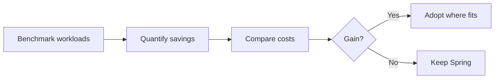

> **Don't switch on one benchmark. Switch when measurements show meaningful gain for YOUR workload.** That's architecture, not trend-following.

*Last Updated: 2026-10-18. Verify versions/links against official docs; Quarkus evolves fast.*
