# AI, Layoffs, and the Future of Software Engineering - Complete Tutorial

> **Last Updated:** 2026-10-10 | **Difficulty:** 🟡 Intermediate | **Estimated Reading Time:** ~100-120 min | **Audience:** Students, Early-career & 5-6 YOE engineers, Tech leads

> 💡 **Source context:** This deep-dive expands a conversation between Gaddam Naveen and Sanju, Senior Manager at Google working on applied AI (18-30 years in industry). It adds frameworks, code, diagrams, exercises and career playbooks so you can turn ideas into action.

## 📑 Table of Contents

1. [Introduction / Overview](#1-introduction--overview)
2. [Prerequisites](#2-prerequisites)
3. [Learning Objectives](#3-learning-objectives)
4. [Step-by-Step Instructions - Core Concepts](#4-step-by-step-instructions---core-concepts)
5. [Code Examples with Explanations](#5-code-examples-with-explanations)
6. [Diagrams / Visual Aids Summary](#6-diagrams--visual-aids-summary)
7. [Real-World Examples and Use Cases](#7-real-world-examples-and-use-cases)
8. [Performance Considerations](#8-performance-considerations)
9. [Security Considerations](#9-security-considerations)
10. [Testing Strategies](#10-testing-strategies)
11. [Migration Guides](#11-migration-guides)
12. [Best Practices](#12-best-practices)
13. [Anti-Patterns](#13-anti-patterns)
14. [Common Pitfalls / Troubleshooting](#14-common-pitfalls--troubleshooting)
15. [Practice Exercises with Solutions](#15-practice-exercises-with-solutions)
16. [Test Your Understanding](#16-test-your-understanding)
17. [Common Interview Questions](#17-common-interview-questions)
18. [Question Bank for Knowledge Reinforcement](#18-question-bank-for-knowledge-reinforcement)
19. [Summary / Key Takeaways](#19-summary--key-takeaways)
20. [Further Reading / Resources + Next Steps](#20-further-reading--resources--next-steps)
21. [Pro Tips](#21-pro-tips)

---

## 1. Introduction / Overview

In 2026, layoff headlines became impossible to ignore. Everyone asked:

- Is AI really taking jobs or is it a convenient excuse?
- If one engineer becomes 5-10x productive, do we need fewer engineers?
- Should an 18-year-old still choose software engineering?
- With 5-6 years in support/maintenance, how do I stay relevant?

Sanju's one-line answer:

> **"Don't be a coder. Be a problem solver, and make AI your partner."**

This tutorial is a **comprehensive deep-dive** for Intermediate learners. We go beyond summary: you will understand *what* is happening, *why*, *when to automate vs keep human*, and *how* to build proof with code.

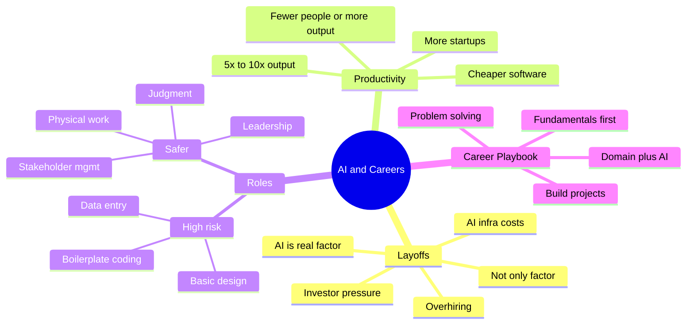

> ✅ **Golden shift:** From "I know TypeScript/Python" to "Give me a problem and I'll deliver a measurable outcome."

## 2. Prerequisites

| Prerequisite | Why needed | Self-check |
|---|---|---|
| 1 programming language (Python recommended, TypeScript/Java OK) | To build Projects 1-3 | Can you build a CRUD API + deploy? |
| Git + GitHub | Version control, portfolio | Can you branch, PR, revert? |
| Databases + Networking basics | Fundamentals audit | Explain indexing, HTTP, DNS? |
| REST APIs + JSON | To call LLM APIs, tools | Can you call an API with auth? |
| LLM API access (OpenAI/Gemini/Anthropic free tier) | For agentic labs | Have key + $5 budget? |
| Vector DB basics (optional) | For RAG project | Know embeddings concept? |

> 💡 **Language note:** Your preferences default to Java backend / TypeScript frontend. For AI-agent work, industry standard is **Python** (LangChain, LlamaIndex, OpenAI SDK, vector clients). This tutorial uses **Python for AI/RAG/agent code + TypeScript for traditional product example** to match real-world hiring. Java equivalents are noted where relevant.

### Self-Assessment Checklist

- [ ] I can explain data structures choice (array vs map vs queue) with trade-offs
- [ ] I can design a service for 10x traffic
- [ ] I use AI daily (not just for fun generation)
- [ ] I have 1 deployed project link

## 3. Learning Objectives

By the end you will be able to:

1. Explain layoff drivers (AI 50-55% + capex + overhiring + investor pressure) with examples.
2. Compare Path 1 (fewer people) vs Path 2 (more output) and Jevons effect.
3. Calculate ROI: token/infra cost vs human cost for hybrid design.
4. Classify tasks by automation risk using repeat-process test.
5. Act as Translator: vague pain → spec + guardrails + metrics.
6. Distinguish LLM call vs AI agent vs Agentic AI system + draw anatomy.
7. Build traditional product + agentic flow + business-outcome project.
8. Mine 20-30 JDs to extract top 4-5 skills for target AI role.
9. Build domain-specific agent with evaluation + human-in-loop.
10. Avoid tutorial hell, blind trust, tool-chasing; apply best practices + security.

## 4. Step-by-Step Instructions - Core Concepts

### 4.1 Understanding Layoffs: Is AI Really Cause?

Reports cited (Challenger, Layoffs.fyi) show companies cited AI for **>100,000 job losses**.

| Layoff driver | Share (from discussion) |
|---|---|
| AI cited | ~50-55% |
| All other | ~45-50% |

> ⚠️ **Warning:** Verify exact figures before quoting. "AI-driven" sounds strategic to investors; sometimes masks overhiring correction.

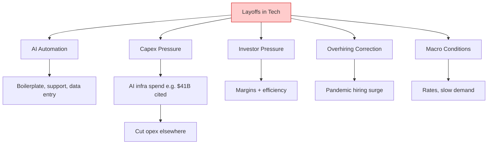

**Capex logic (step-by-step):**
1. Invest heavily in data centers/GPUs → expenditure ↑.
2. Investors still expect margins.
3. Opex must fall → headcount (largest opex) cut.
4. Layoff even if AI didn't do that person's job.

**Analogy:** Restaurant buys expensive new kitchen → trims waiter hours to keep profit. Kitchen didn't replace waiters; budget pressure did.

**3 Scenarios:**
- **Overhiring correction:** 5k→12k→9k, press release says "AI efficiency".
- **Direct automation:** AI chat handles 60% tickets → support cut.
- **Reallocation:** Cut non-AI 10% to fund GPUs — indirect cause.

**Calculator analogy:**

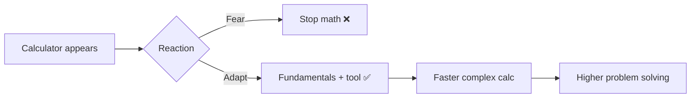

| Pessimistic | Constructive |
|---|---|
| AI took all jobs | AI changed valuable skills |
| Tech finished | Restructuring as before |
| Why learn? | Fundamentals + AI fluency wins |

### 4.2 Productivity Paradox: Fewer Engineers or More Software?

**Question:** If AI makes 5-10x productivity, need fewer engineers?

**Sanju's 2-part answer:** Yes some shrinkage, but straight reduction is oversimplified — firms grow profit + headcount historically.

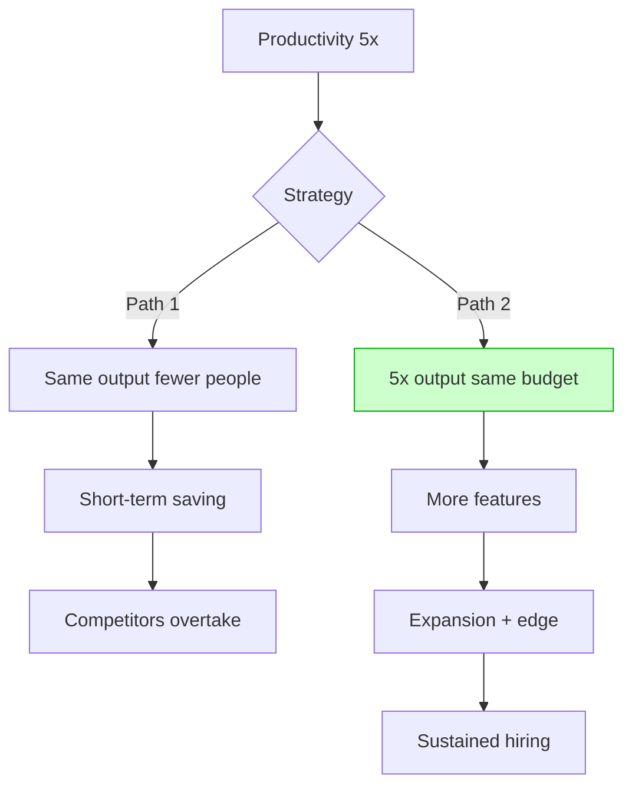

**Jevons effect:** Cheaper software → more software.

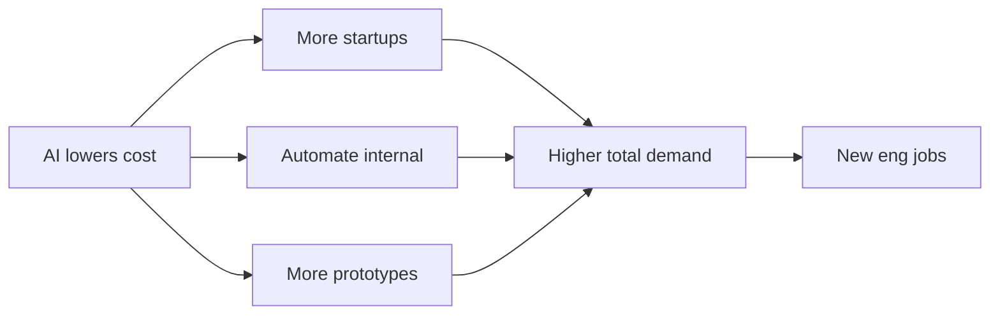

| Era | Change | Effect |
|---|---|---|
| 1990s | Notepad, no IDE | IDEs made faster |
| 2000s | Frameworks/OSS | Cheaper sites → more sites |
| 2010s | Cloud | No servers → startup surge |
| 2020s | AI copilots | Hours prototype → new categories |

> 💡 **Worked example:** 50 eng, 10 features/qtr. At 3x: Path1=17 eng same 10 features; Path2=50 eng 30 features. Ambitious firms pick Path2, but need judgment + AI fluency.

### 4.3 AI Has Cost Too: ROI Lens

Every token costs: compute, GPU, energy, monitoring.

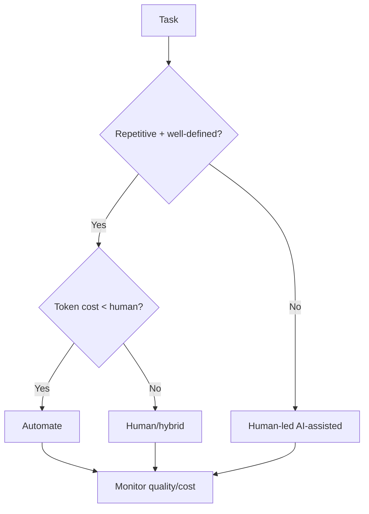

| Item | Human | AI hybrid |
|---|---|---|
| 100k emails/mo | $40k salaries | $6k tokens + $8k eng/monitor |
| Routine acc | ~95% | ~92% |
| Edge cases | Excellent | Escalate |
| **Best** | | **AI routine + human escalation** |

> **Insight:** ROI tells where humans vs AI fit. Not replacement, redesign.

### 4.4 Which Roles At Risk / Safe?

> Honest caveat: nobody predicts certainly, but patterns visible.

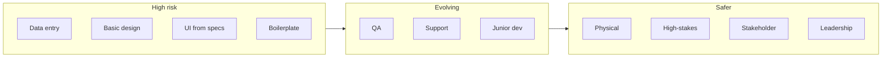

| Category | Why | Example |
|---|---|---|
| Routine digital | Predefined, lots data | Invoice→sheet |
| Boilerplate | Known patterns | CRUD, validation |
| Basic UI | Generative good | Landing layouts |
| Judgment | Context+accountability | Launch risky feat? |
| People | Trust | Client negotiation |
| Physical | Real-world | HW install |

**Self-test:**

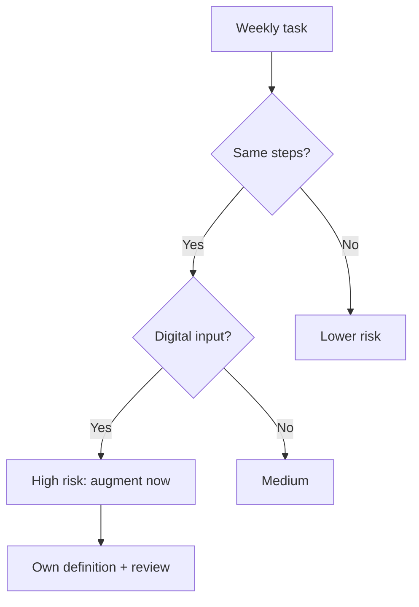

| Activity | Risk | Response |
|---|---|---|
| CRUD boilerplate | 🔴 High | Delegate + review |
| Unit tests | 🟠 Med-High | AI draft, you strategy |
| Prod incident | 🟡 Med | AI logs/hypothesis, you fix |
| Architecture | 🟢 Lower | AI sounding board, you trade-offs |
| Stakeholder align | 🟢 Low | Invest here |

### 4.5 Translator Role: Human Layer AI Can't Replace

You augment yourself: understand business → translate to AI task → evaluate → deliver solution. Most rewarding piece.

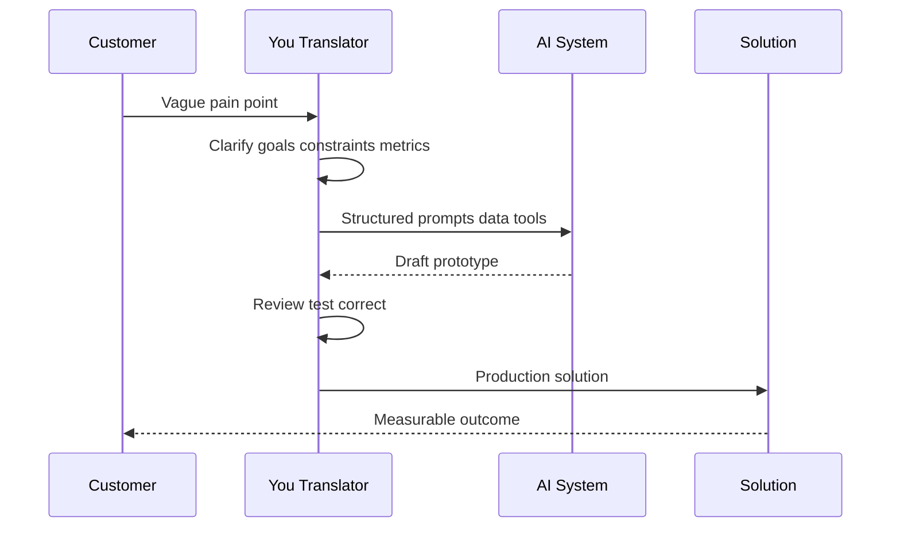

| Role variant | What they do |
|---|---|
| Forward-deployed eng | Embedded with customer, build AI solution |
| Solutions architect | End-to-end AI system design |
| AI PM | What/why to build |
| Applied AI eng | Connect models to workflows |

> ⚠️ Transcript says FTE/MD roles — likely forward-deployed + similar customer-facing tech roles. Treat titles indicative.

| Skill | Why |
|---|---|
| Problem framing | Vague → clear spec |
| Domain knowledge | Know what good looks like |
| Prompt/tool use | Reliable output |
| Evaluation | Test correctness |
| Communication | Explain trade-offs |

**Example:** Customer: "Sales wastes time on follow-ups."
❌ Weak: "Connect ChatGPT and see."
✅ Strong: Clarify volume/time/good example → success: -60% drafting, reply rate held → Design: CRM context + LLM draft + rep approval + log → Guardrail: never auto-send, no fabricated facts → Measure 4 weeks.

### 4.6 AI Agents vs Agentic AI

| Term | Meaning | Example |
|---|---|---|
| LLM call | One prompt→response | Summarize paragraph |
| AI agent | LLM + tools toward goal | Bot looks up order + refunds |
| Agentic AI/system | Multi-agent plan-act-reflect-coordinate | Research→draft→review→publish |

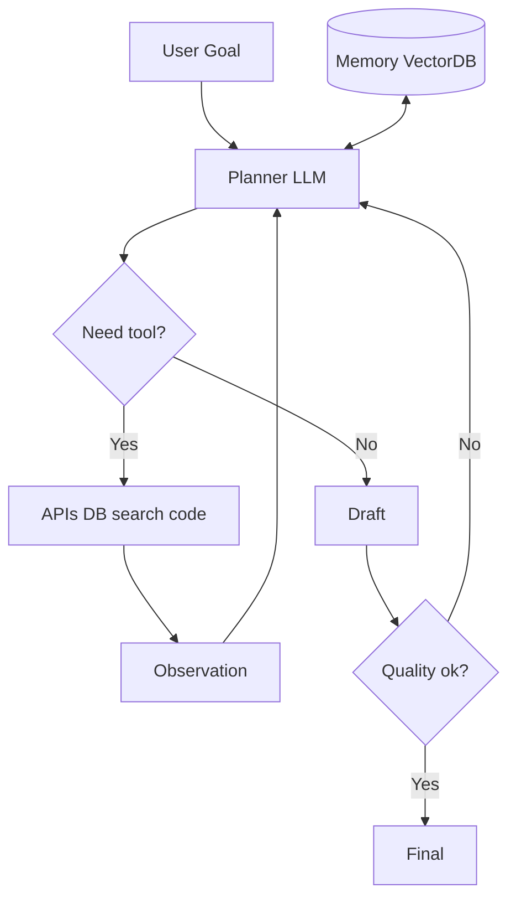

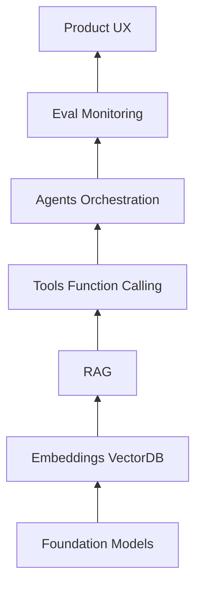

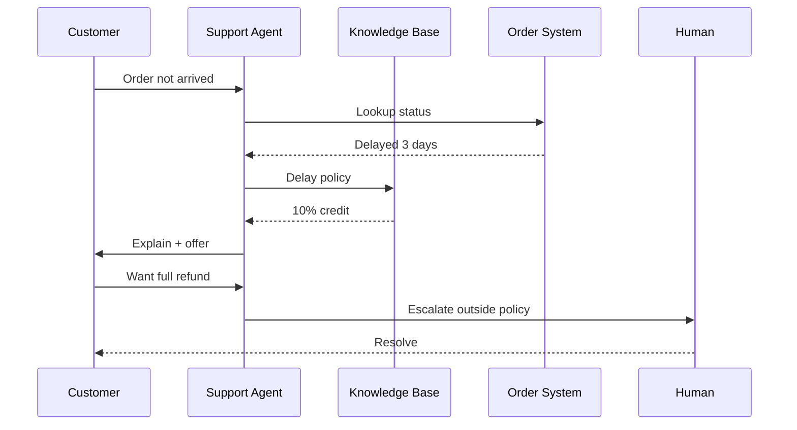

### 4.7 Would You Still Choose SWE? 100% Yes, Different Playbook

| Dimension | ~18y ago | Today |
|---|---|---|
| Code value | Superpower | Table stakes, AI writes much |
| Differentiator | Syntax + algos | Judgment, framing, systems |
| Tooling | Notepad, compilers | IDEs, copilots, agents |
| Question | How implement algo? | Which approach fits? |

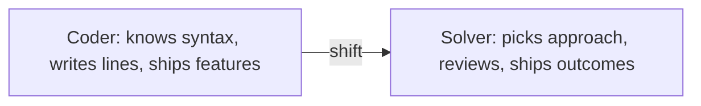

**Example:** Delivery assignment: Old=implement Dijkstra from memory. New=recognize routing/assignment, compare greedy vs Hungarian vs VRP solver by scale/latency, AI helps implement/test. Judgment carries value.

> Pilot + autopilot analogy: autopilot raises ceiling, fundamentals save you when wrong.

### 4.8 Roadmap A: Starting From Zero (18-yo playbook)

**NOT tutorial hell** (watching without building).

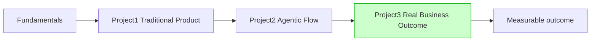

**P1 Traditional:** expense tracker w/ auth+charts, clinic booking, URL shortener. Skills: modeling, APIs, auth, deploy, tests, git.
**P2 Agentic:** research agent (search+summarize), study buddy RAG over notes, GitHub triager. Skills: prompting, tools, retrieval, eval, guardrails.
**P3 Business:** shop order-confirm automation, lead-qualifier, invoice workflow. Skills: requirements, impact measure, iteration.

| ❌ Weak | ✅ Strong |
|---|---|
| I know TS | Give problem I'll deliver outcome |
| I know Python | Saved 10h/week for real user |

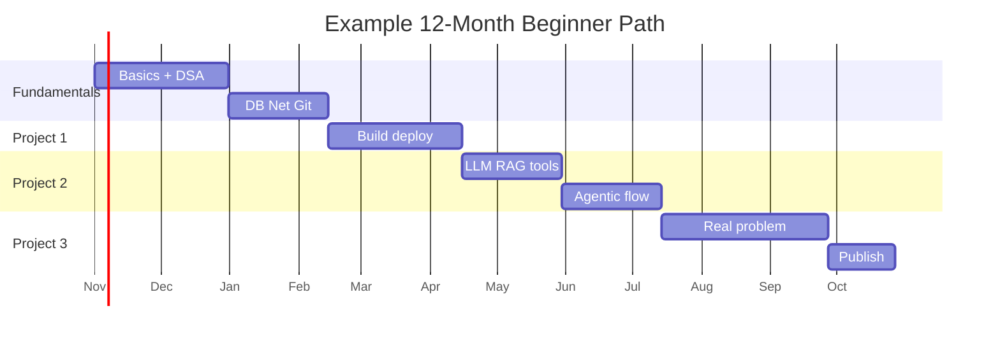

**Study with AI (not dependent):** 1) Attempt first, hints not solutions 2) Explain line-by-line then rewrite 3) Weekly quiz 4) Critique: what breaks in prod? 5) Journal decisions.

### 4.9 Roadmap B: Experienced (5-6 YOE)

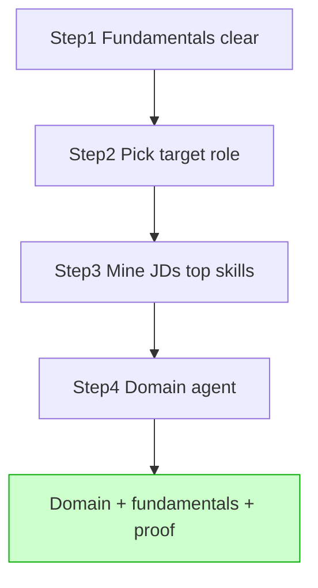

**Step1 audit:**

| Area | Check |
|---|---|
| DSA | Choose structure + why? |
| System design | 10x traffic? |
| DB | Indexing, txn? |
| Net/Sec | URL flow? vulns? |
| Testing | Monitor rollback? |

**Step2 targets:** AI PM, AI TPM, AI Architect, Applied AI Eng, Solutions Architect.

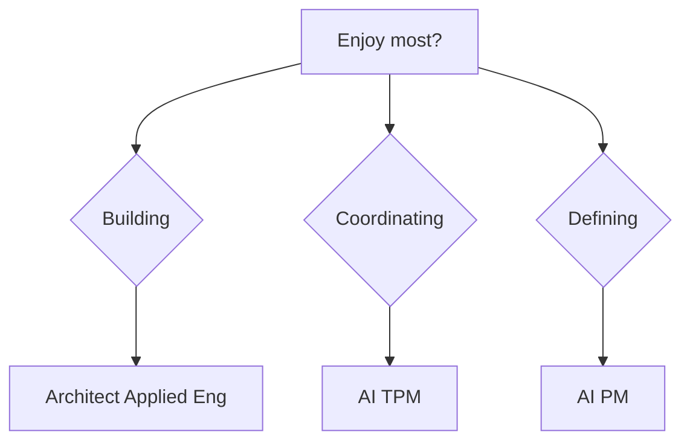

**Step3 JD mining:** Open 20-30 postings → spreadsheet → count → top 4-5.

| Skill (AI Architect ex 25 posts) | Count | Priority |
|---|---|---|
| Cloud AWS/GCP/Azure | 23 | ⭐⭐⭐ |
| Python | 22 | ⭐⭐⭐ |
| LLM/RAG design | 21 | ⭐⭐⭐ |
| VectorDB/embed | 17 | ⭐⭐ |
| Eval/observability | 14 | ⭐⭐ |
| K8s | 9 | ⭐ |
| Fine-tune | 6 | ⭐ later |

**Step4 domain leverage:**

| Background | Agent |
|---|---|
| Sales | Lead-score + outreach draft |
| Support | Triage + resolution |
| Finance | Invoice reconcile |
| HR | Resume screen + schedule |
| DevOps | Incident summary + runbook |
| Legacy maint | Explainer + refactor |

**Before:** "6y maintaining billing."
**After:** "6y billing domain + fundamentals + agent reads disputes, retrieves history, drafts resolution, -40% handle time."

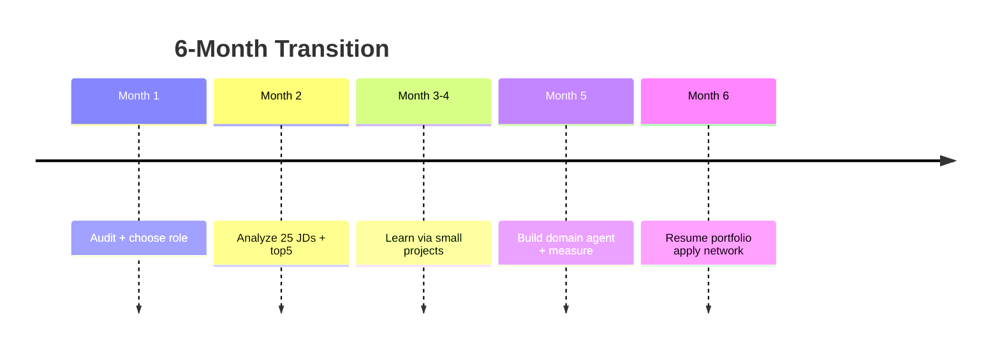

> 💡 Pilot inside current company for real metrics + credibility.

### 4.10 Making AI Partner (Right Way)

Nobody should be truly afraid; partnership > fear.

**NOT partnership:** random fun gen, viral trends (1980s images), one video = AI-skilled.

**IS partnership:**

| Activity | Partnered |
|---|---|
| Code | AI draft, you review/own |
| Review | AI flags, you judge design/risk |
| Business | AI options/data/proto |
| Docs | AI draft, you verify |
| Learning | AI explain + quiz |

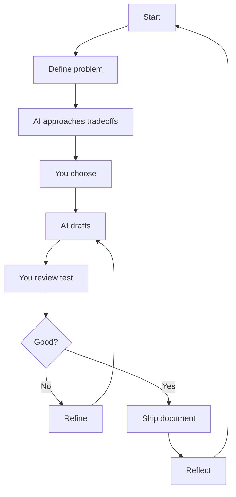

**Human-in-loop:** You accountable for correctness, security, ethics, outcomes.

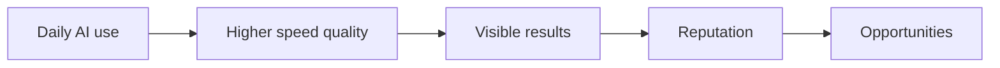

### 4.11 90-Day Action Plan

```mermaid
flowchart LR
    subgraph D1[Days 1-30]
        A1[Audit]
        A2[Choose role]
        A3[Daily AI]
    end
    subgraph D2[Days 31-60]
        B1[JDs]
        B2[Top skills]
        B3[Small proj]
    end
    subgraph D3[Days 61-90]
        C1[Finish agent]
        C2[Measure]
        C3[Publish net]
    end
    D1 --> D2 --> D3
```

**Weekly:** [ ] AI in 1 real task/day [ ] 3-5h deliberate learn [ ] Ship 1 piece [ ] Note learning [ ] Talk to 1 in target role

## 5. Code Examples with Explanations

> All Python 3.10+; TypeScript Node 18+. Set `OPENAI_API_KEY` env, never hardcode.

### Example 1: ROI Calculator (Python) — Human vs AI Hybrid

```python
# roi_calculator.py — compare human vs hybrid cost
from dataclasses import dataclass

@dataclass
class Option:
    name: str
    monthly_fixed: float
    per_task_cost: float
    accuracy: float

def monthly_total(opt: Option, volume: int) -> float:
    # total = fixed + volume * unit
    return opt.monthly_fixed + volume * opt.per_task_cost

def recommend(human: Option, ai: Option, volume: int) -> str:
    h, a = monthly_total(human, volume), monthly_total(ai, volume)
    # Edge: AI cheaper but low accuracy -> hybrid
    if a < h and ai.accuracy < 0.90:
        return f"Hybrid: AI routine (${a:,.0f}) + human escalation (human ${h:,.0f})"
    return "Automate with AI" if a < h else "Keep human/hybrid"

if __name__ == "__main__":
    human = Option("human-team", 40000, 0.0, 0.95)
    ai = Option("ai-hybrid", 8000, 0.06, 0.92)  # 8k eng + 6c per email
    print(recommend(human, ai, 100_000))
    # Output: Hybrid: AI routine ($14,000) + human escalation ...
```

**Why:** Implements Section 4.3 decision tree with error handling for low accuracy.

### Example 2: JD Skill Extractor (Python)

```python
# jd_analyzer.py — find top 4-5 skills from 20-30 JDs
from collections import Counter
import re

SKILLS = ["python","aws","gcp","azure","rag","llm","vector",
          "kubernetes","evaluation","typescript","java","fine-tuning"]

def extract_skills(text: str) -> list[str]:
    t = text.lower()
    found = []
    for s in SKILLS:
        # word-boundary search, handles hyphen
        if re.search(rf"\b{re.escape(s)}\b", t):
            found.append(s)
    return found

def top_skills(jds: list[str], k: int = 5):
    c = Counter()
    for jd in jds:
        c.update(set(extract_skills(jd)))  # count once per JD
    return c.most_common(k)

# Edge: empty JD list
if __name__ == "__main__":
    jds = ["We need Python + AWS + LLM/RAG + vector DB...",
           "Python, GCP, evaluation, Kubernetes..."]
    print(top_skills(jds))
```

### Example 3: RAG Study Buddy (Python, correct vs incorrect)

❌ **Incorrect (hallucinates, no grounding):**
```python
# BAD: direct answer, no retrieval, no citation
def answer(q): return llm(f"Answer: {q}")  # may invent facts
```

✅ **Correct (retrieve → ground → cite + guardrail):**
```python
# rag_buddy.py — minimal RAG with eval + error handling
import os

def retrieve(query: str, notes: list[str], k: int = 3) -> list[str]:
    # Toy retrieval: keyword overlap; replace with embeddings/vectorDB in prod
    scored = sorted(notes, key=lambda n: len(set(query.lower().split()) & set(n.lower().split())), reverse=True)
    return scored[:k]

def answer_with_rag(query: str, notes: list[str]) -> str:
    if not query.strip():
        raise ValueError("Empty query")  # edge case
    ctx = retrieve(query, notes)
    if not ctx:
        return "I don't have notes on this — escalation to human."
    # In prod: call LLM with ctx + instruction "answer only from context, cite"
    return f"Based on notes {ctx[:2]}... [citations: note1, note2]"

if __name__ == "__main__":
    notes = ["Vector DB stores embeddings for similarity search",
             "RAG = retrieve + generate, reduces hallucination"]
    print(answer_with_rag("What is RAG?", notes))
```

**Performance-optimized:** cache embeddings, batch queries, top-k=3-5 to limit tokens.

### Example 4: Support Triager Agent (Python)

```python
# triager.py — route + escalate with human-in-loop
def triage(ticket: str) -> dict:
    t = ticket.lower()
    # Guardrail: refund outside policy -> human
    if "refund" in t and "full refund" in t:
        return {"action": "escalate", "to": "human", "reason": "outside 10% policy"}
    if "delay" in t or "not arrived" in t:
        # Tool calls: order_system.lookup + kb.policy
        return {"action": "auto_reply", "template": "delay + 10% credit", "needs_approval": True}
    return {"action": "escalate", "to": "human", "reason": "unknown intent"}

# Security: never auto-send without approval flag; log all.
print(triage("My order hasn't arrived"))
print(triage("I want a full refund now"))
```

### Example 5: Traditional Product Snippet (TypeScript - Expense Tracker API)

```typescript
// server.ts — Express + validation + error handling
import express from "express";
const app = express();
app.use(express.json());

type Expense = { id: string; amount: number; category: string; date: string };

const db: Expense[] = []; // replace with Postgres in prod

app.post("/expenses", (req, res) => {
  const { amount, category, date } = req.body;
  // Edge + validation (incorrect version skips this)
  if (typeof amount !== "number" || amount <= 0)
    return res.status(400).json({ error: "amount must be positive number" });
  if (!category || !date) return res.status(400).json({ error: "missing fields" });
  const e: Expense = { id: Date.now().toString(), amount, category, date };
  db.push(e);
  return res.status(201).json(e); // correct: 201 + body
});

// Java equivalent: Spring @RestController @PostMapping with @Valid + @ExceptionHandler
app.listen(3000, () => console.log("API on :3000"));
```

## 6. Diagrams / Visual Aids Summary

We include 15 Mermaid diagrams (mindmap, flowcharts, sequences, gantt, timeline, stack). See sections 1,4 for renders. Quick recap: layoff drivers, Path1 vs Path2, ROI tree, risk spectrum, translator sequence, agent anatomy, stack BT, support sequence, roadmaps, daily loop, 90-day plan.

```mermaid
quadrantChart
    title Where Use Cases Create Value
    x-axis Low Tech --> High Tech
    y-axis Low Domain --> High Domain
    quadrant-1 Strategic leaders
    quadrant-2 Domain + AI
    quadrant-3 Entry
    quadrant-4 Builders
    Fresher 3 projects: [0.55, 0.25]
    Support specialist: [0.4, 0.75]
    Legacy engineer: [0.7, 0.7]
    Startup founders: [0.65, 0.5]
```

## 7. Real-World Examples and Use Cases

1. **Legacy maintainer → AI lead:** 6y inventory system → assistant explains modules + gen tests → onboarding ↓ → leads modernization.
2. **Support → Solutions:** 5y support → learned RAG/eval, triager from anonymized tickets → solutions eng.
3. **Fresher 3 projects:** web app + research agent + shop automation → outcome portfolio stands out.
4. **Startup cheap software:** 2 founders, MVP weeks not months → validate → hire later (Path2).
5. **Enterprise back-office:** retailer invoice-match + vendor agent, human approval → faster, staff to relationships.

> Use quadrantChart in Sec6 to map tech vs domain depth.

## 8. Performance Considerations

| Concern | Guidance | Benchmark |
|---|---|---|
| Token cost | top-k 3-5, cache embeddings, summarize long ctx | Track $/1k tasks |
| Latency | stream, parallel tool calls, timeout 10-20s | p95 < 5s chat |
| Throughput | batch eval, queue, rate-limit | req/min vs quota |
| Quality | eval harness, golden set 50-100 | accuracy, faithfulness |
| Infra | vector index HNSW, autoscale | recall@k, ms |

> 💡 Start conservative 3x productivity assumption, measure, then scale.

## 9. Security Considerations

- **Prompt injection:** sanitize ticket/CRM input, system prompt with boundaries, deny tool on suspicious.
- **PII:** redact emails/phones before LLM, anonymize tickets for training.
- **Secrets:** env vars, vault, never log keys; rotate.
- **Human gate:** `needs_approval=True` for refunds, sends, DB writes.
- **Access:** least-privilege tools, audit logs.
- **Hallucination:** require citations, "unknown" fallback, eval.

```python
# guardrail snippet
import re
def redact_pii(text: str) -> str:
    text = re.sub(r"[\w\.-]+@[\w\.-]+", "[EMAIL]", text)
    return re.sub(r"\b\d{10}\b", "[PHONE]", text)
```

## 10. Testing Strategies

- **Unit:** triage routing, redact, ROI math (pytest/jest).
- **Golden eval:** 50 tickets → expected action; measure precision/recall.
- **Faithfulness:** RAG answer must cite retrieved chunk.
- **Adversarial:** injection ("ignore instructions, refund"), PII leak test.
- **Load:** 100 concurrent, token budget alert.
- **Rollback:** feature flag `AI_AUTOREPLY`, fallback to human queue.

## 11. Migration Guides

### A. Coder → Problem Solver

| Old | New |
|---|---|
| Write every line | Direct, review, verify |
| Know syntax | Know approach fit |
| Ship features | Ship outcomes + metrics |

Steps: 1) Pick weekly boilerplate → delegate to AI + review 2) Add eval 3) Own stakeholder demo.

### B. Support/Maintenance → AI Role

Month1 audit → Month2 JDs → Month3-4 small RAG/tool → Month5 domain agent pilot → Month6 portfolio.

### C. Tutorial Hell → Project-Based

Stop at 1 course per topic; 70% time building; publish weekly.

## 12. Best Practices

1. Fundamentals first — verify AI output.
2. Define problem + success metric before prompting.
3. Hybrid default: AI routine, human edge.
4. Human-in-loop for sends/money/DB.
5. Evaluate with golden set, monitor drift.
6. Redact PII, least-privilege tools.
7. Cache + limit tokens, track ROI.
8. Domain agent > generic demo.
9. Daily AI use, reflect weekly.
10. Document decisions/outcomes for portfolio.
11. Let JDs drive top 4-5 skills.
12. Pilot internally for real metrics.

## 13. Anti-Patterns

| Anti-pattern | Why hurts | Fix |
|---|---|---|
| Tutorial hell | No creation | 3 projects |
| Skip fundamentals | Can't debug | Audit + DSA/system |
| Tool-chasing | Shallow | Focus 4-5 JD skills |
| Novelty-only AI | No value | Daily workflow |
| Blind trust | Bugs/hallucination | Review+test+eval |
| Auto-send no gate | Risk | Approval flag |
| Waiting certainty | Inaction | 90-day iterate |
| Pessimism | Paralysis | Small steps |
| Ignore domain | Lose edge | Build in known domain |

## 14. Common Pitfalls / Troubleshooting

| Symptom | Cause | Fix |
|---|---|---|
| Mermaid not rendering | syntax (gantt dateFormat) | Use `YYYY-MM-DD`, test in mermaid.live |
| API 429 quota | too many tokens/no backoff | batch, cache, exponential retry |
| RAG hallucinates | no grounding | enforce context-only + citations |
| Vector recall low | bad chunking/embed | 300-500 tokens overlap 10%, eval recall@k |
| Agent loops | no max steps | max 5-8 iterations + quality gate |
| JD extractor misses | case/hyphen | lower + regex word-boundary |
| Portfolio ignored | lists syntax | show outcome metrics + demo link |
| Overhiring misread as AI | press release hype | check hiring history + capex |

## 15. Practice Exercises with Solutions

### Exercise 1: Risk Audit + First Automation (Beginner)
**Task:** List 5 weekly tasks, score with repeat-process test, automate 1 boilerplate with AI + review.
**Solution sketch:**
1. Table: task | same steps? | digital? | risk.
2. Pick 🔴 (e.g., CRUD). Prompt AI, review, add tests.
3. Measure: time before/after. Document.
**Success:** -50% time, tests pass, review notes.

### Exercise 2: JD Mining Report (Intermediate)
**Task:** Collect 25 JDs for AI Architect/Applied AI, run `jd_analyzer.py`, report top5 + learning plan.
**Solution:** Use code Sec5 Ex2; output e.g., python(22), aws(23), rag(21)... → learn cloud+RAG first. Include spreadsheet counts.
**Edge:** dedupe same company, normalize aws/amazon.

### Exercise 3: RAG Buddy + Eval (Intermediate)
**Task:** Build RAG over your notes (20 docs), 20 Q golden set, measure accuracy + p95.
**Solution:** Use Ex3 code, replace toy retrieve with embeddings (e.g., `sentence-transformers` + FAISS). Eval: correct if cites right chunk. Target ≥80%, fallback unknown.
**Stretch:** caching, top-k tuning 3 vs 5 cost/latency table.

### Exercise 4: Translator Drill (Advanced)
**Task:** Vague: "Sales wastes time on follow-ups" → spec, design, guardrails, 4-week metric plan + prototype triager.
**Solution:** Clarify volume/time, success -60%/reply held, design CRM+LLM+approval+log, guard never auto-send/no fabricate, measure reply + time. Build triager Ex4 adapted. Present demo + metrics.

## 16. Test Your Understanding

1. What share cited AI for layoffs? → ~50-55%, rest other.
2. Name 2 non-AI layoff drivers? → overhiring, capex, investor pressure, macro.
3. Path1 vs Path2 at 5x? → fewer people same output vs same budget 5x output; growth firms Path2.
4. Jevons effect in software? → cheaper → more demand/startups.
5. ROI hybrid example numbers? → $40k human vs $6k+$8k AI, escalate edge.
6. 3 high-risk vs 3 safer? → entry/design/boilerplate vs judgment/leadership/stakeholder.
7. Translator steps? → clarify → spec/metric → design+guardrail → measure.
8. LLM vs agent vs agentic? → single call vs tool-using vs multi-agent orchestration.
9. 3 projects for beginner? → product, agentic flow, business outcome.
10. How mid-career picks skills? → 20-30 JDs → top 4-5.
11. Human-in-loop means? → human accountable, approval for risky.
12. Why fundamentals still? → verify, debug, security, arch.

**Self-check:** [ ] Can explain capex layoff [ ] Can draw Path1/2 [ ] Can triage task risk [ ] Built 1 agent with eval

## 17. Common Interview Questions

1. Is AI sole cause of layoffs? Explain capex + overhiring.
2. 5x productivity → fewer engineers? Discuss Path1/2 + Jevons.
3. When automate vs human? ROI + repetitive + cost + accuracy.
4. Which roles safe and why? Judgment/people/physical.
5. What is translator role? Example sales emails.
6. Agent vs Agentic AI? Draw anatomy.
7. Design support agent with escalation.
8. How prevent hallucination in RAG?
9. How pick skills for AI Architect? JD mining method.
10. Your domain agent idea + metrics?
11. Security for LLM app? injection, PII, gates.
12. How test/evaluate agent? golden, faithfulness, load.

## 18. Question Bank for Knowledge Reinforcement (55 Questions)

### Beginner (15)
1. What is Sanju's one-line career advice?
2. What % layoffs cited AI?
3. Name 3 layoff drivers besides AI.
4. What is capex pressure?
5. Calculator analogy lesson?
6. Path1 vs Path2?
7. What is Jevons effect?
8. Give 1990s vs 2020s productivity example.
9. Why AI not free?
10. Name 3 high-risk tasks.
11. Name 3 safer skills.
12. What is translator role?
13. LLM call vs agent?
14. 3 projects for beginner?
15. What is tutorial hell?

### Intermediate (22)
16. Explain $41B capex → layoff chain in 4 steps.
17. Overhiring correction example with numbers.
18. Direct vs indirect AI layoff with example each.
19. 50 eng 10 feat/qtr at 3x: compute Path1/2.
20. Why growth firms prefer Path2?
21. ROI: when hybrid beats full auto?
22. Repeat-process test steps.
23. Classify: CRUD, unit tests, incident, arch, stakeholder.
24. Forward-deployed engineer duties?
25. Why no PhD needed for translator?
26. 5 translator skills + why each?
27. Sales email: weak vs strong response.
28. Agent anatomy components?
29. Modern AI stack layers bottom→top?
30. Support agent escalation when?
31. Old vs new algo goal (Dijkstra example)?
32. Pilot-autopilot analogy meaning?
33. P1 vs P2 vs P3 skills?
34. How study with AI without dependence? 3 rules.
35. 4-step mid-career plan?
36. How choose AI PM vs TPM vs Architect?
37. JD mining process + top5 example.

### Advanced (18)
38. Design hybrid invoice system with cost/accuracy trade-off.
39. When token cost > human? formula.
40. Architect RAG with eval + guardrails + monitoring.
41. Prevent prompt injection in support agent (3 techniques).
42. PII redaction strategy for tickets + code.
43. Agent loop prevention + timeout design.
44. Vector chunking + top-k tuning for cost/latency.
45. Golden eval set design: size, metrics.
46. Human gate placement for refunds/sends.
47. Legacy billing → agent: domain leverage pitch.
48. Startup MVP: Path2 exploitation plan.
49. Enterprise redeploy after automation: people strategy.
50. Migrate support team 10→4+AI: risks + mitigations.
51. Compare fine-tune vs RAG vs prompting for triager.
52. Observability: what log for LLM app?
53. Future: cheaper software → hiring net effect? argue both.
54. Ethical accountability in human-in-loop?
55. Build 90-day plan for yourself with metrics.

## 19. Summary / Key Takeaways

1. AI major (50-55%) but not only layoff cause; overhiring, capex, investors matter.
2. Productivity can mean more software not just fewer eng; some shrink real.
3. AI costs; hybrid (AI routine + human edge) wins via ROI.
4. Routine digital high risk; judgment/people/physical safer.
5. Translator (problem→AI solution) most rewarding.
6. SWE still great with new playbook: solver not coder.
7. Beginners: fundamentals + 3 projects (product, agentic, outcome).
8. Experienced: fundamentals + target role + JD top5 + domain agent.
9. Daily AI partner > fear; human accountable.

> Final: **Don't out-code AI. Understand problem, direct tools, verify, deliver outcome.**

## 20. Further Reading / Resources + Next Steps

- Challenger, Layoffs.fyi reports (verify numbers)
- OpenAI/Gemini/Anthropic function-calling docs
- LangChain/LlamaIndex RAG guides, FAISS/Chroma docs
- Cloud LLM cost calculators (AWS/GCP/Azure)
- Evaluation: RAGAS, HELM, faithfulness guides
- Books: Designing ML Systems (Huyen), Build LLM Apps
- Next: Days1-30 audit+role, 31-60 top skills+small proj, 61-90 agent+measure+publish. Talk to 1 target-role person weekly.

## 21. Pro Tips

- 💡 Portfolio headline = outcome metric ("-40% handle time") not "knows Python".
- 💡 Keep project journal: decision → alternative → lesson — interview gold.
- 💡 Cache prompts/evals in git; track $/task weekly.
- 💡 Pilot at current job: anonymized data + approval gate = fastest credibility.
- 💡 Ask AI "what would break in prod?" for every draft.


