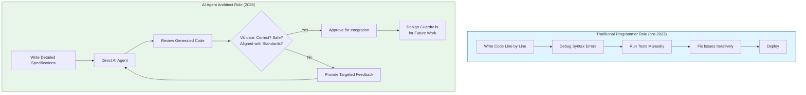
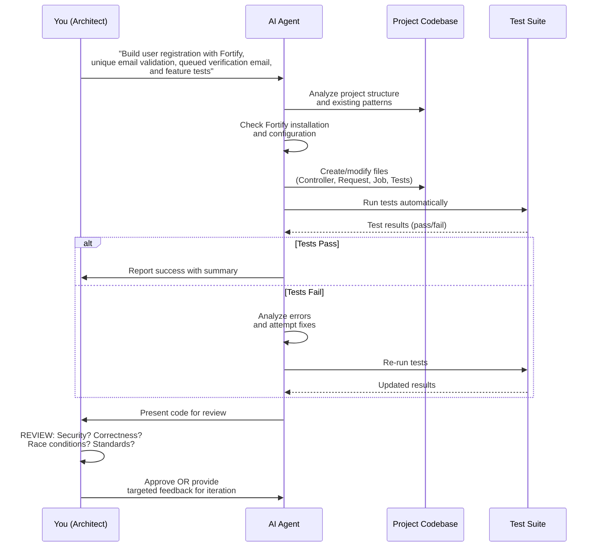
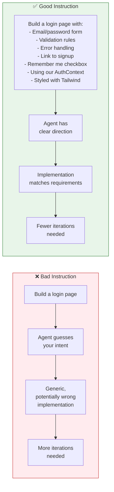

## Introduction / Overview

### The Paradigm Shift in Software Development

Picture this: You open your laptop, ready to write a new API endpoint for the application you're building. But instead of typing `Route::post(...)` right away, you write an instruction to an AI agent: **"Build a user registration endpoint, validate unique email, send a verification email, and write the tests."** A few minutes later, the agent has opened several files, written the code, run the tests, fixed the errors that came up, and reported the results back to you.

If that scenario sounds unfamiliar, you might not realize it's already a daily routine for many programmers around the world. And if it sounds familiar, then we're going through the same shift together.

The question isn't "will AI change how we code" anymore—because it already has. The more relevant question now is: **what's left for programmers to do when most of "writing code" can be delegated to an agent?**

This tutorial provides a comprehensive, data-driven exploration of the evolving role of programmers in the age of AI agents. We'll examine industry data, analyze real-world case studies, identify the skills that now matter more than ever, and provide practical guidance for repositioning yourself as an AI Agent Architect.

### What This Tutorial Covers

- **The current state of AI agent adoption** in software development (backed by 2025-2026 data)
- **How the programmer's role is transforming** from code writer to system architect
- **A detailed case study** of building features with AI agents in Laravel
- **The skills that have increased in value** and how to develop them
- **Practical strategies** for working effectively with AI agents
- **Multi-agent system design** patterns and coordination techniques
- **Best practices, anti-patterns, and troubleshooting guides**
- **Security, performance, and testing considerations** for AI-assisted development

---

## Prerequisites

Before diving into this tutorial, you should have:

| Prerequisite | Required Level | Notes |
|-------------|----------------|-------|
| Programming fundamentals | Intermediate | Understanding of variables, control flow, data structures, OOP |
| Web development basics | Intermediate | Familiarity with HTTP, APIs, MVC patterns |
| Command-line proficiency | Basic | Comfort with terminal commands and running scripts |
| Version control (Git) | Basic | Understanding commits, branches, pull requests |
| Software architecture concepts | Intermediate | Knowledge of design patterns, system design principles |
| Testing concepts | Intermediate | Familiarity with unit tests, integration tests, TDD |

### Helpful but Not Required

- Experience with AI coding tools (GitHub Copilot, Cursor, Claude, etc.)
- Familiarity with Laravel or another MVC framework
- Understanding of CI/CD pipelines
- Experience with code review processes

> **Note:** If you're new to programming, this tutorial may be challenging. Consider starting with foundational programming courses before exploring AI agent workflows.

---

## From Code Writer to System Architect

### The Changing Role Definition

For decades, being a "good programmer" had a relatively simple definition:
- Someone who could translate a problem into code that runs correctly
- Code that is efficient and maintainable
- Fluency in programming language syntax was the core asset

That definition is changing fast.

### The New Role: AI Agent Architect

<div align="center">



</div>

---

## Case Study: Building a User Registration Feature

Let's examine a concrete example to understand the practical implications of this shift.

### Scenario: User Registration in Laravel

We'll compare how this feature was built traditionally versus how it's built with an AI agent today.

### The Old Way (circa 2020)

```
Step 1: Open routes/api.php and write a new route
        ↓
Step 2: Build a RegisterController
        ↓
Step 3: Write validation logic by hand
        ↓
Step 4: Create migration for email_verified_at column
        ↓
Step 5: Write a job to send verification email
        ↓
Step 6: Write tests one by one, debugging errors as they come up
        ↓
Step 7: Iterate until everything works

Total time: Several hours (depending on complexity)
```

**What you needed to know:**
- Laravel routing syntax
- Controller structure and conventions
- Validation rules and implementation
- Database migration syntax
- Queue job creation and dispatching
- Email sending with Laravel's mail system
- Test writing with PHPUnit or Laravel Dusk

### What YOU Need to Know in Step 7 (Review)

Even though the agent wrote the code, you must be able to evaluate:

| Area | Questions to Ask |
|------|------------------|
| **Validation** | Does the validation match our security policy? Are there edge cases missed? |
| **Email Job** | Is the job idempotent? What happens if it runs twice? |
| **Race Conditions** | What happens if two registration requests hit simultaneously with the same email? |
| **Security** | Is there any mass assignment vulnerability? Are passwords handled securely? |
| **Architecture** | Does this follow our team's patterns? Is it testable? |
| **Error Handling** | What happens when the email service is down? Are errors logged appropriately? |

### Diagram: The Agent-Assisted Workflow

<div align="center">



</div>

---

## Skills That Matter More Than Ever

Based on the data and case studies, here are the skills that have clearly increased in value:

### 1. Writing Precise Specifications and Requirements

An AI agent is only as good as the instruction it receives. Writing clear, detailed specifications is now a core programming skill.

**What this looks like in practice:**

```
❌ Vague instruction:
"Build a login feature"

✅ Precise instruction:
"Build a user login endpoint using Laravel Sanctum with the following requirements:
- Accept email and password in JSON body
- Validate email format and password presence
- Return 401 for invalid credentials with generic error message
- Return 200 with user data and auth token on success
- Rate limit to 5 attempts per minute per IP
- Log all failed attempts for security monitoring
- Write feature tests for: valid login, invalid credentials, rate limiting"
```

### 2. System Architecture Understanding

You need to understand how pieces of a system connect to judge whether an agent's solution is actually correct, not just "looks like it works."

**Key architectural concepts to master:**

- Database design and relationships
- API design principles (REST, GraphQL)
- Authentication and authorization patterns
- Caching strategies
- Queue and background job processing
- Microservices vs. monolith tradeoffs
- Event-driven architectures

### 3. Sharp Code Review Skills

Since AI-generated code carries more issues (1.7x according to CodeRabbit), the ability to spot hidden problems is worth more than ever.

**What to look for during review:**

- Logic errors that pass tests but are incorrect
- Security vulnerabilities (SQL injection, XSS, CSRF)
- Race conditions and concurrency issues
- Edge cases not covered by tests
- Performance problems (N+1 queries, unnecessary loops)
- Code that works but violates team conventions
- Missing error handling
- Hardcoded values that should be configurable

### 4. Application Security Knowledge

An agent can write code that runs fine but is vulnerable if not guided properly.

**Critical security areas:**

- Input validation and sanitization
- Authentication and session management
- Authorization and access control
- SQL injection prevention
- XSS prevention
- CSRF protection
- Secure password handling
- Rate limiting and DDoS protection
- Dependency vulnerabilities

### 5. Multi-Agent System Design

Some teams are already combining agents—one for coding, one for testing, one for security review—and someone needs to coordinate how they work together.

**Multi-agent coordination patterns:**

```
┌─────────────────────────────────────────────────────────────┐
│                    MULTI-AGENT WORKFLOW                      │
├─────────────────────────────────────────────────────────────┤
│                                                              │
│  ┌─────────────┐    ┌─────────────┐    ┌─────────────┐     │
│  │   PLANNING  │───>│    CODING   │───>│    TESTING  │     │
│  │    AGENT    │    │    AGENT    │    │    AGENT    │     │
│  └─────────────┘    └─────────────┘    └─────────────┘     │
│         │                │                   │              │
│         ▼                ▼                   ▼              │
│  ┌─────────────────────────────────────────────────────┐   │
│  │              REVIEW & VALIDATION                     │   │
│  │         (Human Architect - YOU)                     │   │
│  └─────────────────────────────────────────────────────┘   │
│                                                              │
│  ┌─────────────┐    ┌─────────────┐                        │
│  │ SECURITY    │◄───│  REFINEMENT │<─── Feedback Loop      │
│  │   AGENT     │    │   AGENT     │                        │
│  └─────────────┘    └─────────────┘                        │
│                                                              │
└─────────────────────────────────────────────────────────────┘
```

### 6. Higher-Level Debugging Skills

Not just spotting a typo, but tracing why an architectural decision an agent made is causing problems in production.

**Debugging at the architect level:**

- Understanding why a chosen pattern doesn't scale
- Identifying integration issues between components
- Tracing performance bottlenecks to root causes
- Diagnosing subtle bugs that only appear under specific conditions

### 7. Understanding AI Agent Capabilities and Limitations

Knowing what agents can and can't do helps you delegate appropriately.

**AI Agent Strengths:**

- ✅ Generating boilerplate and repetitive code
- ✅ Writing tests based on clear requirements
- ✅ Refactoring existing code
- ✅ Explaining code and suggesting improvements
- ✅ Generating documentation
- ✅ Translating between languages/frameworks

**AI Agent Weaknesses:**

- ❌ Understanding business context and priorities
- ❌ Making architectural tradeoff decisions
- ❌ Identifying subtle security issues without guidance
- ❌ Understanding team conventions without explicit instruction
- ❌ Debugging complex integration issues
- ❌ Making judgment calls about what's "good enough"

---

## Practical Guide: Working with AI Agents

### Writing Effective Instructions

The quality of AI-generated code is directly proportional to the quality of your instructions. Here's a framework for writing effective prompts:

### Instruction Template

```markdown
# Task: [Brief description of what to build]

## Context
- Project type: [e.g., Laravel API, React frontend]
- Existing patterns: [link to examples or describe conventions]
- Related components: [what this interacts with]

## Requirements
1. [Requirement 1 - be specific]
2. [Requirement 2]
3. [Requirement 3]

## Constraints
- [Technical constraint 1]
- [Security constraint]
- [Performance constraint]

## Expected Behavior
- [Scenario 1]: [expected outcome]
- [Scenario 2]: [expected outcome]
- [Error case]: [expected handling]

## Testing
- Write tests for: [list scenarios]
- Test framework: [if specific]

## Deliverables
- [List files/components to create or modify]
```

### Example: Good vs. Bad Instructions

<div align="center">



</div>

---

## Multi-Agent Systems Architecture

### Why Use Multiple Agents?

As AI-assisted development matures, teams are discovering that using specialized agents for different tasks can produce better results than a single general-purpose agent.

### Benefits of Multi-Agent Systems

1. **Specialization**: Each agent can be optimized for a specific task
2. **Validation**: One agent's output can be reviewed by another
3. **Complexity management**: Breaking work into agent-handled chunks
4. **Consistency**: Different agents can enforce different standards

### Example Multi-Agent Setup

```
┌─────────────────────────────────────────────────────────────────┐
│                    DEVELOPMENT PIPELINE                         │
├─────────────────────────────────────────────────────────────────┤
│                                                                 │
│  ┌─────────────────────────────────────────────────────────┐   │
│  │                 SPECIFICATION AGENT                      │   │
│  │  - Clarifies requirements                               │   │
│  │  - Identifies edge cases                                │   │
│  │  - Produces detailed spec document                      │   │
│  └─────────────────────────────────────────────────────────┘   │
│                              │                                   │
│                              ▼                                   │
│  ┌─────────────────────────────────────────────────────────┐   │
│  │                   IMPLEMENTATION AGENT                   │   │
│  │  - Writes code based on spec                            │   │
│  │  - Creates necessary files                              │   │
│  │  - Implements business logic                            │   │
│  └─────────────────────────────────────────────────────────┘   │
│                              │                                   │
│                              ▼                                   │
│  ┌───────────────┐    ┌───────────────┐    ┌───────────────┐  │
│  │    TESTING    │    │   SECURITY    │    │  CODE QUALITY │  │
│  │    AGENT      │    │    AGENT      │    │    AGENT      │  │
│  │               │    │               │    │               │  │
│  │ - Feature     │    │ - Vulnerability│    │ - Style       │  │
│  │   tests       │    │   scanning     │    │   checking    │  │
│  │ - Unit tests  │    │ - Security     │    │ - Complexity  │  │
│  │ - Integration │    │   review       │    │   analysis    │  │
│  └───────────────┘    └───────────────┘    └───────────────┘  │
│                              │                                   │
│                              ▼                                   │
│  ┌─────────────────────────────────────────────────────────┐   │
│  │                  HUMAN ARCHITECT (YOU)                  │   │
│  │  - Final review and approval                           │   │
│  │  - Architecture validation                              │   │
│  │  - Business logic verification                          │   │
│  │  - Go/no-go decision                                    │   │
│  └─────────────────────────────────────────────────────────┘   │
│                                                                 │
└─────────────────────────────────────────────────────────────────┘
```
---

## Best Practices

### For Writing Agent Instructions

1. **Be specific and detailed**: Vague instructions produce vague results
2. **Provide context**: Include relevant project information and constraints
3. **Specify expected behavior**: Describe what should happen in different scenarios
4. **Include edge cases**: List the edge cases you want handled
5. **Reference existing patterns**: Point to similar code in your project
6. **Define success criteria**: How will you know the task is complete?
7. **Iterate on instructions**: If the first attempt isn't right, refine your instructions

### For Code Review

1. **Review every line**: Don't just check if it runs—read the code
2. **Use checklists**: Standardize what you look for
3. **Test independently**: Run the code yourself, don't just trust the agent's report
4. **Check security first**: Security issues are the most critical to catch
5. **Question architectural decisions**: Even if the code works, is it the right approach?
6. **Verify error handling**: Make sure errors are handled gracefully
7. **Look for hidden assumptions**: What does the code assume that might not be true?

### For System Design with AI Agents

1. **Identify delegation boundaries**: What can be delegated vs. what needs human control?
2. **Design for verification**: Make it easy to check if the agent's work is correct
3. **Build guardrails**: Tests, linting, static analysis that catch mistakes early
4. **Document agent instructions**: Keep a library of effective prompts for reuse
5. **Track agent performance**: Note which instructions work well and which need improvement

### For Multi-Agent Workflows

1. **Define clear handoffs**: Each agent should know exactly what to do with its input
2. **Maintain consistency**: Use shared conventions across all agents
3. **Plan for iteration**: Agents may need to revise based on feedback from other agents
4. **Have a final integrator**: Someone (usually you) should verify the whole system works together
5. **Document the pipeline**: Keep track of how agents are coordinated

### For Personal Development

1. **Practice writing instructions**: The more you do it, the better you'll get
2. **Deepen your architecture knowledge**: This is increasingly valuable
3. **Sharpen code review skills**: Practice identifying issues quickly
4. **Learn security deeply**: Security review is a critical skill
5. **Experiment with multi-agent setups**: Get comfortable coordinating agents
6. **Stay current**: The tooling evolves rapidly—keep learning

---

## Anti-Patterns

### Anti-Pattern 1: The "Set and Forget" Approach

**What it looks like:**
- You tell an agent to build something
- You don't review the output carefully
- You merge code that the agent produced without understanding it

**Why it's bad:**
- AI-generated code has ~1.7x more bugs and security issues
- You're responsible for what goes into production
- Subtle bugs can cause serious problems

**What to do instead:**
- Always review agent output carefully
- Use checklists to ensure thorough review
- Test independently before merging

### Anti-Pattern 2: Over-Delegation

**What it looks like:**
- Delegating architectural decisions to an agent
- Letting an agent choose the technology or pattern
- Not providing enough context for important decisions

**Why it's bad:**
- Agents don't understand your specific business context
- Agents may choose patterns that don't scale or fit your team
- You lose control of important architectural decisions

**What to do instead:**
- Make architectural decisions yourself
- Use agents for implementation, not design decisions
- Provide clear constraints and preferences

### Anti-Pattern 3: Under-Contextualizing

**What it looks like:**
- Giving an agent minimal context about your project
- Not explaining team conventions or preferences
- Assuming the agent knows your codebase

**Why it's bad:**
- Agents produce generic code that doesn't fit your project
- More iteration is needed to get acceptable results
- The code may violate team standards

**What to do instead:**
- Provide relevant context with each instruction
- Reference existing code patterns
- Explain team conventions when relevant

### Anti-Pattern 4: Trusting Agent Tests Blindly

**What it looks like:**
- Accepting that agent-written tests pass
- Not verifying tests actually test what they should
- Not adding additional tests for important scenarios

**Why it's bad:**
- Agent-written tests may have gaps
- Tests might pass but not catch real bugs
- False sense of security

**What to do instead:**
- Review the tests the agent wrote
- Add your own tests for critical scenarios
- Verify test coverage is adequate

### Anti-Pattern 5: Reinventing the Instruction Wheel

**What it looks like:**
- Writing new instructions from scratch every time
- Not learning from what works and what doesn't
---

## Common Pitfalls and Troubleshooting

### Pitfall 1: Vague Instructions Leading to Misunderstandings

**Symptom:** The agent produces code that doesn't match what you wanted.

**Solution:**
- Review your instruction for specificity
- Add more details about expected behavior
- Provide examples of similar existing functionality
- Break complex requests into smaller, clearer tasks

### Pitfall 4: Agent Introduces Inconsistencies

**Symptom:** New code doesn't match existing code patterns.

**Solution:**
- Reference existing patterns in your instructions
- Point to specific files as examples
- Include style guide requirements
- Review for consistency as part of code review

### Pitfall 5: Agent Gets Stuck in a Loop

**Symptom:** Agent keeps trying to fix the same issue without success.

**Solution:**
- Provide more specific guidance about the issue
- Break the problem into smaller pieces
- Consider if the approach is fundamentally wrong
---

## Performance Considerations

### When AI Agents Impact Performance

#### Agent-Generated Code Performance

AI agents may not optimize for performance because:
- They prioritize correctness and completeness
- They may not know your performance requirements
- They may generate conventional but suboptimal patterns

**What to check:**
- Database query efficiency (N+1 problems, missing indexes)
- Algorithmic complexity for hot paths
- Memory usage patterns
- Caching opportunities

#### Agent Session Performance

Long agent sessions can sometimes lead to:
- Accumulation of suboptimal decisions
- Drift from best practices
- Inconsistent patterns

**Best practice:** For large features, consider breaking into multiple shorter agent sessions with clear handoffs.
---

## Security Considerations

### The Security Challenge with AI-Generated Code

CodeRabbit's research found that AI-coauthored code carries approximately **1.7x more bugs and security findings** than human-written code. This makes security review particularly critical.

### Common Security Issues in AI-Generated Code

| Category | Typical Issues | Why Agents Miss Them |
|----------|---------------|---------------------|
| Input Validation | Insufficient validation, missing sanitization | Agents focus on functionality over security |
| Authentication | Weak token handling, missed auth checks | Security context may not be in instructions |
| Authorization | Missing permission checks | Easy to forget without explicit reminder |
| SQL Injection | String concatenation in queries | Agents may use familiar but unsafe patterns |
| XSS | Missing output encoding | Context may not make XSS risk obvious |
### Security Review Checklist for AI-Generated Code

#### Authentication & Authorization

- [ ] Are authentication checks in place for all protected endpoints?
- [ ] Is authorization properly implemented (not just authentication)?
- [ ] Are tokens handled securely (not logged, transmitted securely)?
- [ ] Is session management secure?
- [ ] Are password requirements enforced?

#### Input Handling

- [ ] Is all user input validated?
- [ ] Are validation rules appropriate for each input type?
- [ ] Is output properly encoded/escaped?
- [ ] Are file uploads handled securely?
- [ ] Is there rate limiting on sensitive operations?

#### Data Protection

- [ ] Are sensitive data encrypted at rest and in transit?
- [ ] Are secrets (API keys, passwords) stored securely?
- [ ] Is PII handled according to requirements?
- [ ] Are logs free of sensitive information?
- [ ] Is data retained only as long as necessary?

#### Common Vulnerabilities

- [ ] **SQL Injection**: Are queries parameterized?
- [ ] **XSS**: Is output encoded for the appropriate context?
- [ ] **CSRF**: Are CSRF tokens used where needed?
- [ ] **SSRF**: Are outbound requests validated?
- [ ] **Path Traversal**: Are file paths validated?
---

## Testing Strategies

### The Testing Challenge with AI Agents

AI agents can write tests, but those tests need review too. The same 1.7x issue rate applies to AI-generated tests as to AI-generated code.

### Effective Testing Strategies for AI-Assisted Development

#### Strategy 1: Specify Testing Requirements Clearly

Don't just say "write tests"—be specific:

```
"Write the following tests:

1. Unit tests for:
   - Validation logic (valid input, invalid input, edge cases)
   - Business logic (all code paths)

2. Feature/integration tests for:
   - Successful registration flow
   - Failed registration (duplicate email)
   - Failed registration (invalid data)
   - Email sending (queued, not sent synchronously)

3. Edge case tests for:
   - Empty email
   - Malformed email
   - Very long input
   - Special characters

Use [testing framework] and follow our project's test patterns.
"
```

#### Strategy 2: Define Test Quality Criteria
### Test Pyramid for AI-Assisted Development

<div align="center">

```mermaid
graph TD
    subgraph Test_Pyramid["Test Pyramid for AI-Assisted Development"]
        E2E["End-to-End Tests<br/>Few, critical paths<br/>Human-written"] --> Integration["Integration Tests<br/>Component interactions<br/>Agent + Human review"]
        Integration --> Unit["Unit Tests<br/>Most tests<br/>Agent-written + review"]
        Unit --> Component["Component/Contract Tests<br/>API contracts<br/>Agent-written"]
    end

    style E2E fill:#ffcdd2,stroke:#b71c1c
    style Integration fill:#ffe0b2,stroke:#e65100
    style Unit fill:#fff9c4,stroke:#f9a825
    style Component fill:#c8e6c9,stroke:#2e7d32
---

## Real-World Examples and Use Cases

### Example 1: API Endpoint Development

**Scenario:** Building a REST API for a new resource.

**Traditional approach:**
- Design endpoint structure
- Write controller, service, repository layer by hand
- Write validation, error handling, tests

**AI agent approach:**
```
Instruction: "Create a REST API for managing [resource] with:
- CRUD endpoints following RESTful conventions
- Request validation using our validation library
- Appropriate authorization checks
- Pagination for list endpoints
- Proper error responses
- Tests for all endpoints

Use our existing patterns from [reference endpoint].
"
```

**What the architect does:**
- Define the API contract
- Review generated endpoints for correctness
- Verify authorization is properly implemented
- Ensure tests cover important scenarios

### Example 2: Database Schema Design

**Scenario:** Adding tables for a new feature.

**Traditional approach:**
- Design tables and relationships
- Write migrations
- Consider indexes, constraints

**AI agent approach:**
```
Instruction: "Design database schema for [feature] with:
- Tables: [list required tables]
- Relationships: [describe relationships]
- Indexes needed for: [query patterns]
- Constraints: [business rules that should be enforced at DB level]
### Example 4: Test Suite Enhancement

**Scenario:** Improving test coverage.

**Traditional approach:**
- Identify gaps in coverage
- Write tests manually

**AI agent approach:**
```
Instruction: "Analyze [file/class] and write additional tests:
- Current coverage: [if known]
- Focus areas: [what's important to test]
- Test types needed: [unit, integration, etc.]

Write tests for:
- All public methods
- Error conditions
- Edge cases
- [Specific scenarios of concern]

Follow our existing test patterns and naming conventions.
"
```

**What the architect does:**
- Identify what should be tested
- Review tests for quality and coverage
- Add tests for critical scenarios the agent might miss

### Example 5: Documentation Generation

**Scenario:** Creating or updating documentation.

**Traditional approach:**
- Write documentation manually

**AI agent approach:**
```
Instruction: "Generate documentation for:
- [file/module]
- [API endpoint]
- [feature]

Include:
- Purpose and overview
- Usage examples
- Parameters and return values
- Error cases
- [Specific topics to cover]

Style: [documentation style/format used in project]

Based on the actual code, not assumptions.
"
```

**What the architect does:**
- Specify what documentation is needed
- Review for accuracy (AI can hallucinate)
- Ensure documentation matches actual behavior

---

---

## Summary / Key Takeaways

### The Core Message

The role of programmers is shifting from **code writers** to **AI agent architects**. This doesn't mean programmers are becoming obsolete—it means the nature of the work is evolving.

### Key Points to Remember

1. **AI agents are already mainstream**
   - ~90% of professional developers use AI agents weekly (JetBrains 2026)
   - 68% use them daily
   - Session lengths have grown from 4 minutes to 23 minutes, indicating increasingly complex tasks

2. **The programmer's value is shifting**
   - From writing code line by line to directing systems that write code
   - From syntax fluency to specification writing, architecture, and review
   - Time allocation has flipped: less time writing, more time designing and reviewing

3. **AI agents don't remove the need for technical depth**
   - If anything, deep technical understanding matters more
   - You're responsible for validating output from a system you can't fully trust
   - AI-generated code has ~1.7x more bugs and security issues (CodeRabbit)

4. **The critical skills now are:**
   - Writing precise specifications
   - System architecture understanding
   - Sharp code review skills
   - Application security knowledge
   - Multi-agent coordination
   - Higher-level debugging

5. **The agent-assisted workflow has two critical human moments:**
   - Writing the initial instruction (quality of instruction = quality of output)
   - Reviewing the final output (your expertise determines if it's safe to use)

6. **Practical steps to evolve:**
   - Practice writing thorough instructions
   - Train yourself to thoroughly review agent output
   - Deepen knowledge in areas hard to delegate
   - Experiment with multi-agent workflows
   - Stay current with tooling

### The Bigger Picture

> "The question isn't 'will we be replaced,' but 'how ready are we to take on this new role.'"

Data from GitHub, JetBrains, Gartner, and other industry research all point in the same direction: agents will keep writing more code, but humans still decide whether that code is correct, safe, and aligned with the goal. We're no longer just code writers. We're becoming architects of the systems that write the code.

---

## Further Reading / Resources

### Industry Reports and Data

| Resource | Description | Year |
|----------|-------------|------|
| JetBrains Developer Ecosystem Survey | Survey of 15,000+ developers on AI agent usage | 2026 |
| GitHub Octoverse Report | Annual report on GitHub ecosystem, including AI adoption | 2025 |
| Gartner Enterprise AI Predictions | Projections for AI agent adoption in enterprise | 2026 |
| CodeRabbit AI Code Review Analysis | Analysis of bug rates in AI-coauthored code | 2025 |

### AI Coding Tools

---

## Practice Exercises

### Exercise 1: Instruction Writing Practice

**Objective:** Improve your ability to write effective instructions for AI agents.

**Scenario:** You need to add a password reset feature to a web application.

**Task:**
1. Write a detailed instruction for an AI agent to implement password reset functionality
2. Include:
   - Specific requirements (endpoints, email flow, token handling)
   - Security requirements
   - Edge cases to handle
   - Testing requirements
   - References to existing patterns in your project

3. Review your instruction using this checklist:
   - Is it specific enough that someone could implement it without clarification?
   - Are security requirements explicit?
   - Are edge cases covered?
   - Would the resulting code match your expectations?

**Deliverable:** Your instruction document (300-500 words recommended)

---

### Exercise 2: Code Review Simulation

**Objective:** Practice reviewing AI-generated code for issues.

**Scenario:** An AI agent has generated the following code for a user profile update endpoint:

```php
// UserController.php
public function updateProfile(Request $request, User $user)
{
    $user->name = $request->input('name');
    $user->email = $request->input('email');
    $user->bio = $request->input('bio');
    $user->save();
    
    return response()->json($user);
}
```

**Task:**
1. Review this code using the security and correctness checklists from this tutorial
2. Identify at least 5 issues or concerns
3. For each issue, explain:
   - What the problem is
   - Why it matters
   - How to fix it

4. Write a revised version that addresses the issues

**Deliverable:**
- List of identified issues with explanations
- Revised code implementing fixes

---

### Exercise 3: Multi-Agent Workflow Design

**Objective:** Design a multi-agent workflow for a realistic development task.

**Scenario:** Your team needs to add a reporting feature that generates monthly sales summaries.

**Task:**
1. Design a multi-agent workflow with at least 3 different agents
2. For each agent, specify:
   - Agent's role and responsibility
   - Input it receives
   - Output it produces
   - How it hands off to the next agent

3. Define:
   - The handoff protocol between agents
   - How consistency will be maintained
   - Where human review fits in the workflow
   - How issues will be escalated

4. Identify potential failure points in your workflow and how to address them

**Deliverable:** A workflow diagram (can be described in text or drawn) plus written specification

---

---

#### Solution 2: Code Review (Sample Issues)

**Issue 1: Missing Authorization Check**

- **Problem:** The code updates any user's profile without verifying the requesting user has permission. Any authenticated user could update any other user's profile by guessing the ID.
- **Why it matters:** This is a serious authorization vulnerability (IDOR - Insecure Direct Object Reference). Users could modify other users' data.
- **Fix:** Add authorization check, e.g., `$this->authorize('update', $user);` or verify `$request->user()->id === $user->id`

**Issue 2: No Input Validation**

- **Problem:** All input is accepted without any validation. Invalid or malicious data could be saved.
- **Why it matters:** Could lead to data integrity issues, XSS if bio contains scripts, emails with invalid formats, etc.
- **Fix:** Add validation using Laravel's validation methods.

**Issue 3: Mass Assignment Vulnerability**

- **Problem:** Directly assigning from request input could allow updating fields that shouldn't be user-changeable (e.g., is_admin, role).
- **Why it matters:** Security issue—if the User model has sensitive fields, they could be modified.
- **Fix:** Use `$request->only()` to whitelist allowed fields, or use a Form Request with explicit properties.

**Issue 4: No Error Handling**

**Revised Code:**

```php
public function updateProfile(UpdateProfileRequest $request, User $user)
{
    // Authorization check
    $this->authorize('update', $user);
    
    // Validate input (handled by Form Request)
    $validated = $request->validated();
    
    // Update only allowed fields
    $user->name = $validated['name'];
---

#### Solution 3: Multi-Agent Workflow (Sample Design)

**Workflow: Monthly Sales Report Generation**

```
┌─────────────────────────────────────────────────────────────────┐
│                    SALES REPORT WORKFLOW                        │
├─────────────────────────────────────────────────────────────────┤
│                                                                 │
│  AGENT 1: REQUIREMENTS & PLANNING                               │
│  ───────────────────────────────                                │
│  Input: "Generate monthly sales report" request                │
│  Output: Detailed requirements document                        │
│  Responsibility:                                                │
│  - Clarify what "sales" means (orders, revenue, etc.)         │
│  - Identify date range logic                                   │
│  - List metrics to include                                     │
│  - Identify data sources                                       │
│  - Note any filtering/grouping requirements                    │
│                                                                 │
│  Handoff: Requirements document → AGENT 2                      │
│                                                                 │
│  ─────────────────────────────────────────────────────────────  │
│                                                                 │
│  AGENT 2: DATA LAYER                                           │
│  ───────────────────────────────                                │
│  Input: Requirements document + existing schema                │
│  Output: Database queries, data access methods                 │
│  Responsibility:                                                │
│  - Design efficient queries for required data                 │
│  - Add necessary indexes                                       │
│  - Create repository/service methods                           │
│  - Handle edge cases (no data, partial data)                  │
│                                                                 │
│  Handoff: Data access code → AGENT 3                          │
│                                                                 │
│  ─────────────────────────────────────────────────────────────  │
│                                                                 │
│  AGENT 3: API LAYER                                            │
│  ───────────────────────────────                                │
```
│                                                                 │
│  AGENT 4: TESTING                                              │
│  ───────────────────────────────                                │
│  Input: Complete implementation                                │
│  Output: Test suite                                            │
│  Responsibility:                                                │
│  - Write unit tests for data layer                             │
│  - Write integration tests for API                             │
---

## Test Your Understanding

Answer the following questions to check your comprehension of this tutorial:

1. **According to JetBrains' 2026 survey, what percentage of professional developers use AI coding agents daily?**

2. **What did CodeRabbit's research find about AI-coauthored code compared to human-written code?**

3. **Name three skills that have increased in value for programmers working with AI agents.**

4. **In the agent-assisted workflow, what are the two critical human moments that determine outcome quality?**

5. **What does the S.P.E.C. framework stand for when writing agent instructions?**

6. **Why is the "set and forget" approach considered an anti-pattern?**

7. **What is one key difference between traditional autocomplete and AI coding agents?**

8. **When reviewing AI-generated code, why should you check for race conditions even if the code "looks correct"?**

9. **In a multi-agent workflow, what should be included in an agent handoff?**

10. **Why might AI-generated tests need review just like AI-generated code?**

---

## Common Interview Questions

### Questions About AI-Assisted Development

1. **How has your approach to software development changed with the advent of AI coding agents?**
   - *Look for:* Understanding of the shift from coding to directing, awareness of increased importance of review and architecture skills

2. **What do you consider the most important skill for a programmer working with AI agents?**
   - *Look for:* Answers that emphasize specification writing, code review, architecture understanding, or security knowledge—not just "prompt engineering"

3. **How do you ensure the code an AI agent produces is secure?**
   - *Look for:* Security checklist usage, dedicated security review, understanding of common vulnerabilities, not blind trust in agent output

4. **Describe a situation where you would NOT delegate a task to an AI agent.**
   - *Look for:* Understanding of agent limitations, recognition that some tasks need human judgment, architectural decisions, security-critical code

5. **What's your process for reviewing code generated by an AI agent?**
   - *Look for:* Systematic approach, use of checklists, understanding of what to look for (security, correctness, architecture, performance)

### Questions About Architecture and System Design

6. **How do you decide which parts of a system should be delegated to AI agents and which need human control?**
### Scenario-Based Questions

11. **You ask an AI agent to implement a feature. It produces code that passes all the tests it wrote, but you notice a potential security issue during review. What do you do?**
    - *Look for:* Prioritize security over test passing; fix the issue; don't merge insecure code

12. **An AI agent keeps producing code that doesn't match your project's conventions, even after you've mentioned them. How do you address this?**
    - *Look for:* More explicit references to conventions; provide concrete examples; consider breaking task into smaller pieces

13. **Your team wants to start using AI agents more extensively. What advice would you give them?**
    - *Look for:* Balanced perspective; emphasize review and guardrails; suggest starting with lower-risk tasks

---

## Question Bank for Knowledge Reinforcement

### Section 1: AI Agent Fundamentals (Questions 1-10)

1. What distinguishes an AI coding agent from traditional autocomplete tools?

2. Name three capabilities that modern AI coding agents have that go beyond simple code completion.

3. According to the JetBrains Developer Ecosystem Survey 2026, approximately what percentage of professional developers use AI coding agents at least weekly?

4. What percentage of developers reported using AI agents daily in the same survey?

5. How did the average length of a coding agent session change from early 2025 to early 2026, according to Anthropic's data?

6. What does the increase in session length suggest about how AI agents are being used?

7. According to GitHub's Octoverse 2025 report, what was the year-over-year change in public repositories using LLM SDKs?

### Section 2: The Role Shift (Questions 11-20)

11. How was being a "good programmer" traditionally defined, and how is that definition changing?

12. What is the analogy used in this tutorial to describe the new role of a programmer working with AI agents?

13. In the traditional development approach, approximately what percentage of time was spent writing logic line by line?

14. In AI-assisted development, what activities now consume more time than writing code line by line?

15. What are the five main areas where programmers now spend more time in the AI-assisted workflow?

16. Why does the tutorial compare the new programmer role to an architect rather than a builder?

17. What are the key responsibilities of an "AI Agent Architect"?

18. How does the time allocation for code review change from traditional to AI-assisted development?

19. What is "multi-agent coordination" and why is it an emerging skill?

20. Why might a programmer's value increase rather than decrease in the age of AI agents?

### Section 3: Writing Effective Instructions (Questions 21-30)

21. What does the S.P.E.C. framework stand for?

22. Why is writing precise specifications considered a core programming skill in the AI agent era?

23. What are the consequences of giving a vague instruction to an AI agent?

### Section 4: Code Review and Validation (Questions 31-40)

31. According to CodeRabbit's research, how much more likely is AI-coauthored code to contain bugs and security findings compared to human-written code?

32. Why does the increased bug rate in AI-generated code make code review skills more valuable?

33. List at least six categories of issues to check for during AI-generated code review.

34. What is an IDOR vulnerability, and why might an AI agent not catch it?

35. Why should you check for mass assignment vulnerabilities in AI-generated code?

36. What should you verify about AI-generated tests before accepting them?

37. Why is it important to run tests yourself rather than trusting the agent's report that tests passed?

38. What are some signs that an AI agent may have misunderstood your requirements?

39. How can tests serve double duty in AI-assisted development?

40. What is the risk of "overconfidence in agent output" and how can it be mitigated?

### Section 5: Security Considerations (Questions 41-50)

41. Why is security review particularly critical when working with AI-generated code?

42. Name five common security issues that may appear in AI-generated code.

43. Why might AI agents not catch SQL injection vulnerabilities?

### Section 6: Multi-Agent Systems (Questions 51-60)

51. What are three benefits of using multiple specialized agents instead of a single general-purpose agent?

52. In a multi-agent development workflow, what is an "agent handoff"?

53. What information should be included in a well-structured agent handoff?

54. Why is consistency important when multiple agents work on the same project?

55. Name three consistency areas that should be maintained across multiple agents.

56. What role does the human architect play in a multi-agent workflow?

57. Describe a potential failure mode in a multi-agent workflow and how to mitigate it.

58. Why might you want to break a large feature into multiple shorter agent sessions rather than one long session?

59. What is the purpose of having parallel agents (e.g., testing and security agents running simultaneously)?

60. How would you design a workflow for a feature that requires database changes, API endpoints, and a user interface?

### Section 7: Professional Development (Questions 61-70)

61. What are some practical steps a programmer can take to develop the "architect" mindset?

62. Why is it recommended to practice writing thorough instructions to AI agents?

63. What areas of development are described as "hard to fully delegate to AI"?

### Section 9: Advanced Concepts (Questions 81-90)

81. Explain how the test pyramid concept applies to AI-assisted development.

82. What performance considerations should be reviewed when evaluating AI-generated code?

83. How can you use AI agents to improve an existing codebase through refactoring?

84. What is the difference between authentication and authorization, and why does it matter for AI-assisted development?

85. How would you design a workflow where one agent writes code and another reviews it for security?

86. What factors should influence how much you delegate to an AI agent in a single instruction?

87. How can AI agents be used effectively for documentation generation, and what cautions apply?

88. What is the relationship between guardrail design and effective AI-assisted development?

89. How might the skills valued in programming continue to evolve beyond 2026?

90. What role does human judgment play in determining whether AI-generated code is "good enough" to ship?

### Section 10: Application and Synthesis (Questions 91-100)

91. You're tasked with adding a new feature to a legacy codebase. How would you approach this using AI agents while ensuring quality and safety?

92. Design a code review checklist specifically for AI-generated API endpoints.

93. Your team lead asks you to recommend how the team should start using AI agents. What advice do you give?

---

## Migration Guide: Transitioning to AI-Assisted Development

### For Teams New to AI Agents

If your team is just starting with AI agent-assisted development, consider this migration path:

#### Phase 1: Exploration (Weeks 1-2)
- **Goal:** Understand what agents can and can't do
- **Activities:**
  - Each team member tries AI agents on small, low-risk tasks
  - Document what works well and what doesn't
  - Identify initial patterns and preferences
- **Output:** Team observations and initial best practices

#### Phase 2: Structured Adoption (Weeks 3-6)
- **Goal:** Establish consistent practices
- **Activities:**
  - Create instruction templates for common tasks
  - Develop code review checklists for AI-generated code
  - Set up any needed automated guardrails
  - Establish when to use agents vs. when to code manually

#### Phase 3: Integration (Weeks 7-12)
- **Goal:** Make AI assistance a normal part of development
- **Activities:**
  - Incorporate agents into regular development workflow
  - Refine practices based on experience
  - Consider multi-agent setups for complex features

#### Phase 4: Optimization (Ongoing)
- **Goal:** Continuously improve
- **Activities:**
  - Review what's working and what isn't
  - Experiment with new tools and approaches
  - Deepen skills in architecture, security, and review

### Common Migration Challenges

| Challenge | Mitigation |
|-----------|------------|
| Team members have different comfort levels | Start with low-risk tasks; pair experienced users with newcomers |
| Inconsistent results | Develop shared templates and guidelines |
| Over-reliance on agents | Establish clear expectations about review requirements |
| Quality variance | Implement appropriate guardrails and review processes |

---

*Note: This tutorial is based on industry data and observations from 2025-2026. The AI agent ecosystem is evolving rapidly. Continue learning and adapting as new capabilities and best practices emerge.*

---

**End of Tutorial**
94. An AI agent has generated code that works correctly but uses a pattern that doesn't scale well. How do you handle this?

95. Compare and contrast the traditional development workflow with the AI agent-assisted workflow for a specific feature of your choice.

96. How would you explain to a junior developer why their role needs to evolve from "writing code" to "directing systems that write code"?

97. You notice that AI-generated code in your project has led to inconsistencies in coding style. What process changes would you recommend?

98. Design an instruction template that could be reused for common feature implementations in your project.

99. How would you evaluate whether a new AI coding tool is worth adopting for your team?

100. Reflect on your current skills: which ones do you use most, which ones do you use least, and which ones does this tutorial suggest you should develop further?
64. Why is it important to stay current with AI agentic tooling?

65. What is an "instruction library" and why might it be valuable?

66. How can building a small multi-agent project help you develop new skills?

67. What should you reflect on regularly to understand how your role is evolving?

68. Why might database performance knowledge be particularly valuable in the AI agent era?

69. How does the tutorial suggest repositioning yourself if you feel limited to "the person who writes code"?

70. What is the ultimate question posed at the end of the tutorial regarding the programming profession?

### Section 8: Anti-Patterns and Pitfalls (Questions 71-80)

71. What is the "set and forget" anti-pattern and why is it dangerous?

72. What are the risks of over-delegation to AI agents?

73. What happens when you under-contextualize instructions to an agent?

74. Why is trusting agent-written tests blindly considered an anti-pattern?

75. What is the "reinventing the instruction wheel" anti-pattern?

76. Why might using agents for everything be counterproductive?

77. What is a common symptom of vague instructions, and how can it be addressed?

78. What should you do if an agent gets stuck in a loop trying to fix an issue?

79. What are three troubleshooting steps when AI-generated code doesn't fit your project's patterns?

80. How can you avoid the pitfall of missing edge cases in AI-generated code?
44. What security requirements should be included when asking an agent to build an authentication feature?

45. What is the purpose of a dedicated security agent in a multi-agent workflow?

46. Why should rate limiting be considered when designing features with AI agents?

47. What are some red flags to look for regarding secret handling in AI-generated code?

48. How can you integrate security review into your AI-assisted development workflow?

49. Why is understanding the OWASP Top 10 relevant for reviewing AI-generated code?

50. What should you do if you discover a security vulnerability in AI-generated code that's already been merged?
24. List at least five elements that should be included in a well-written agent instruction.

25. Why should you provide context about existing project patterns when instructing an agent?

26. What is the purpose of including expected behavior scenarios in an instruction?

27. How does referencing existing code help an AI agent produce better results?

28. What are "guardrails" in the context of AI-assisted development?

29. Why is it important to specify testing requirements in your instructions?

30. Give an example of a vague instruction and rewrite it to be more precise.
8. What does Gartner project about enterprise applications and AI agents by the end of 2026?

9. What was the baseline percentage of enterprise applications with task-specific AI agents in 2025, according to Gartner?

10. What are the two consistent patterns that emerge from the industry data on AI agent adoption?
   - *Look for:* Thoughtful analysis of risk, complexity, business context; understanding that delegation is a spectrum

7. **What architectural considerations are most important when AI agents are writing significant portions of your code?**
   - *Look for:* Guardrails, testing, consistency, review processes; understanding that architecture enables effective AI assistance

8. **How would you design a development workflow that incorporates multiple AI agents?**
   - *Look for:* Understanding of specialization, handoffs, consistency, human oversight; practical multi-agent coordination

### Questions About Code Quality and Review

9. **AI-generated code has been found to have more bugs than human-written code. How does this affect your development practices?**
   - *Look for:* Increased emphasis on review, testing, not assuming correctness; practical responses to the 1.7x statistic

10. **What do you look for when reviewing AI-generated code that might be different from reviewing human-written code?**
    - *Look for:* Awareness that AI may produce code that "looks right" but has subtle issues; checking for understanding of requirements, not just syntax
│  - Test edge cases                                             │
│                                                                 │
│  ─────────────────────────────────────────────────────────────  │
│                                                                 │
│  AGENT 5: SECURITY REVIEW                                      │
│  ───────────────────────────────                                │
│  Input: Complete implementation                                │
│  Output: Security assessment                                   │
│  Responsibility:                                                │
│  - Check authorization on endpoints                            │
│  - Verify data access controls                                 │
│  - Check for injection vulnerabilities                          │
│  - Review logging of sensitive data                            │
│                                                                 │
│  ─────────────────────────────────────────────────────────────  │
│                                                                 │
│  HUMAN ARCHITECT REVIEW                                        │
│  ───────────────────────────────                                │
│  Input: All agent outputs                                       │
│  Output: Approval or revision requests                         │
│  Responsibility:                                                │
│  - Verify business logic is correct                            │
│  - Check architecture alignment                                │
│  - Verify security findings addressed                           │
│  - Ensure tests are adequate                                   │
│  - Make final go/no-go decision                                │
│                                                                 │
└─────────────────────────────────────────────────────────────────┘
```

**Handoff Protocol:**

Each agent handoff includes:
1. Summary of what was produced
2. List of files changed/created
3. Any assumptions made
4. Known limitations or concerns
5. Specific items for next agent to verify

**Consistency Measures:**
- Shared coding standards document referenced by all agents
- Consistent naming conventions enforced
- Common error handling patterns specified
- Shared test structure and naming

**Human Review Points:**
- After AGENT 1: Approve requirements before implementation
- After AGENT 3: Review API design before testing
- Final: Comprehensive review before merge

**Potential Failure Points and Mitigations:**

| Failure Point | Mitigation |
|---------------|------------|
| Requirements misunderstood | AGENT 1 produces detailed doc for human review before implementation |
| Data queries inefficient | Include performance requirements; human reviews query approach |
| Security gap missed | AGENT 5 is specifically focused on security; human does final check |
| Tests inadequate | Specify test requirements clearly; human verifies coverage |
| Integration issues | Human reviews complete system, not just individual pieces |
│  Input: Data access methods + API requirements                 │
│  Output: API endpoints                                         │
│  Responsibility:                                                │
│  - Create endpoints for report data                            │
│  - Add request validation                                      │
│  - Format responses                                            │
│  - Add pagination if needed                                    │
│                                                                 │
│  Handoff: API code → AGENTS 4 & 5 (parallel)                  │
│                                                                 │
└─────────────────────────────────────────────────────────────────┘
```
    $user->email = $validated['email'];
    $user->bio = $validated['bio'] ?? $user->bio;
    $user->save();
    
    // Return safe response
    return response()->json([
        'id' => $user->id,
        'name' => $user->name,
        'email' => $user->email,
        'bio' => $user->bio,
    ]);
}
```
- **Problem:** If save fails, the error propagates up without graceful handling.
- **Why it matters:** Users see generic errors, debugging is harder, potentially exposes internal details.
- **Fix:** Add try-catch or let exceptions be handled by global handler with appropriate logging.

**Issue 5: No Response Standardization**

- **Problem:** Returns raw user model which may include sensitive fields.
- **Why it matters:** Could expose data that shouldn't be returned (password hash, internal fields).
- **Fix:** Return a formatted response or use a resource/transform to control output.
### Exercise Solutions

#### Solution 1: Instruction Writing (Sample)

> **Note:** Your instruction may differ—this is one example of a thorough instruction.

```
Task: Implement password reset functionality

Context:
- Laravel application with existing user authentication
- Using Laravel's built-in mail system
- Following our team's API conventions (see AuthController for reference)

Requirements:

1. Endpoints needed:
   - POST /api/password-reset/request - Initiate reset
     * Accept: email
     * Validate email format and that user exists
     * Generate secure random token (64 chars)
     * Store token with 1-hour expiration in password_reset_tokens table
     * Send reset email with link containing token
     * Return 200 with generic success message (don't reveal if email exists)
   
   - POST /api/password-reset/reset - Complete reset
     * Accept: token, email, new_password, confirm_password
     * Validate token exists and not expired
     * Validate email matches token's email
     * Validate new_password meets requirements (min 8 chars, 1 uppercase, 1 number)
     * Validate passwords match
     * Hash password with bcrypt (cost 12)
     * Update user's password
     * Delete used token (single-use)
     * Return 200 on success

2. Security requirements:
   - Tokens must be cryptographically secure random
   - Tokens expire after 1 hour
   - Tokens are single-use (deleted after use)
   - Rate limit: 3 reset requests per email per hour
   - Rate limit: 5 reset attempts per token per hour
   - Don't reveal in responses whether email exists in system
   - Log all reset requests and attempts

3. Edge cases:
   - Email doesn't exist: Return same response as success (security)
   - Token expired: Return clear error, user must request new reset
   - Token already used: Return error, suspicious activity may be logged
   - Password validation fails: Return specific validation errors
   - Email doesn't match token: Return error

4. Database:
   - Create password_reset_tokens table with: id, email, token, created_at, used_at
   - Add index on token for lookup
   - Add index on email for rate limiting queries
   - Add unique constraint or handle duplicates in application

5. Testing requirements:
   Write tests for:
   - Successful password reset flow (end-to-end)
   - Reset with invalid email
   - Reset with expired token
   - Reset with already-used token
   - Reset with wrong email for token
   - Password validation (too short, no uppercase, no number)
   - Password confirmation mismatch
   - Rate limiting (exceed reset request limit)
   - Rate limiting (exceed reset attempt limit)
   - Token is deleted after successful reset
   - New password is actually set correctly

Follow our existing controller patterns and use Laravel's built-in features where appropriate.
```
| Tool | Type | Notes |
|------|------|-------|
| GitHub Copilot | Code completion + chat | Widely adopted, good for IDE integration |
| Cursor | AI-first code editor | Built around AI agent workflows |
| Claude (Anthropic) | Conversational AI with coding capabilities | Strong at understanding context |
| Devin (Cognition) | Autonomous coding agent | Can plan and execute multi-step tasks |
| CodeRabbit | AI-powered code review | Focuses on PR review and feedback |

### Learning Resources

**AI-Assisted Development:**
- Official documentation for your AI coding tools
- Community guides and best practices
- Case studies from teams using AI agents

**System Architecture:**
- "Designing Data-Intensive Applications" by Martin Kleppmann
- "Clean Architecture" by Robert C. Martin
- "System Design Interview" resources

**Security:**
- OWASP Top 10 documentation
- "Secure by Design" by Dan Bergh Johnsson et al.
- Security guidelines for your tech stack

**Code Review:**
- "The Art of Code Review" resources
- Team code review guidelines
- Static analysis tool documentation

### Communities and Discussion

- Developer communities discussing AI-assisted development
- Tech stack-specific communities (Laravel, React, etc.)
- AI tool-specific communities and forums
- Internal team discussions about AI workflows
## How to Reposition Yourself

If you still feel like your role is limited to "the person who writes code," here are practical steps to develop the architect mindset:

### Step 1: Practice Writing Thorough Instructions

Make it a habit to write detailed instructions to AI agents, as if you're briefing a new junior developer joining the team.

**Exercise:**
- Take a task you recently did manually
- Write a detailed instruction that would allow an agent to do it
- Compare the results
- Refine your instruction writing

### Step 2: Train Yourself to Read Agent Output

Always read through an agent's output, not just check whether it errored out.

**Practice:**
- After an agent completes a task, spend time reviewing the code
- Use checklists to guide your review
- Look for issues even if tests pass
- Ask yourself: "Would I have written it this way? Why or why not?"

### Step 3: Go Deeper in Hard-to-Delegate Areas

Focus on areas that are hard to fully delegate to AI:

| Area | Why It's Hard to Delegate | How to Deepen Your Knowledge |
|------|---------------------------|------------------------------|
| System Design | Requires understanding business context, tradeoffs | Study architecture patterns, practice design exercises |
| Database Performance | Requires deep understanding of queries, indexes, data patterns | Learn query optimization, practice with explain plans |
| Security | Requires understanding of attack vectors, defense strategies | Study OWASP, practice security review |
| Architecture | Requires judgment about tradeoffs and future needs | Study architectural patterns, analyze system designs |

### Step 4: Try Multi-Agent Projects

Build a small project that involves more than one agent with different roles.

**Project idea:**
- Use one agent to plan a feature
- Use another to implement it
- Use another to write tests
- You act as the coordinator and final reviewer

This helps you get used to thinking like someone coordinating a workflow, not just a single executor.

### Step 5: Keep Up with Agentic Tooling

The ecosystem moves fast—what counts as best practice this year might be outdated next year.

**Stay current by:**
- Following AI development tool releases and updates
- Reading about new capabilities and patterns
- Experimenting with new tools
- Sharing knowledge with your team
- Participating in communities discussing AI-assisted development

### Step 6: Build Your Instruction Library

Keep a growing library of effective instructions for common tasks.

**Categories to include:**
- Common feature patterns
- Refactoring approaches
- Testing patterns
- Code review requests
- Security review requests

### Step 7: Reflect on Your Evolving Role

Regularly ask yourself:

- What am I spending my time on now vs. six months ago?
- What tasks am I delegating more?
- What skills am I using more?
- What skills do I need to develop further?
- How can I add more value as an architect?

Consider: [specific requirements, e.g., soft deletes, audit trails]

Generate migrations following our project conventions.
"
```

**What the architect does:**
- Design the schema (or provide detailed requirements)
- Review for normalization, performance
- Verify constraints enforce business rules
- Consider future query patterns

### Example 3: Refactoring Legacy Code

**Scenario:** Improving an existing codebase.

**Traditional approach:**
- Analyze code manually
- Plan refactoring
- Make changes incrementally

**AI agent approach:**
```
Instruction: "Refactor [file/class] to:
- Improve [readability/performance/modularity]
- Reduce [complexity/code duplication]

Current issues:
- [List specific issues]

Constraints:
- Must preserve: [functionality that can't change]
- Must maintain: [external interfaces]

Show me what you plan to change before making changes.
"
```

**What the architect does:**
- Identify what needs refactoring and why
- Define constraints and goals
- Review changes for correctness
- Verify behavior is preserved
```

</div>

### Common Testing Anti-Patterns with AI Agents

| Anti-Pattern | Problem | Solution |
|--------------|---------|----------|
| Assuming agent tests are complete | Missing coverage | Review and supplement tests |
| Only testing happy path | Missed edge cases | Explicitly request edge case tests |
| Accepting weak assertions | Tests don't catch bugs | Review assertion quality |
| Not running tests yourself | Relying on agent's report | Run tests independently |
| Tests too coupled to implementation | Brittle tests | Request tests that focus on behavior |

Tell the agent what makes a good test:

```
"Tests should:
- Have clear, descriptive names
- Test one thing per test
- Include assertions that verify expected behavior
- Cover error cases, not just happy path
- Be independent (no test depends on another)
- Clean up after themselves
"
```

#### Strategy 3: Review Agent-Written Tests

When reviewing tests, check:

- [ ] Do the tests actually test what they claim to test?
- [ ] Are there tests for important edge cases?
- [ ] Are assertions meaningful (not just "no error")?
- [ ] Are there tests for security-relevant scenarios?
- [ ] Is coverage adequate for the risk level?

#### Strategy 4: Add Your Own Critical Tests

Don't rely solely on agent-written tests for:

- Security-critical functionality
- Complex business logic
- Edge cases specific to your domain
- Integration points between components

#### Strategy 5: Use Testing to Validate Agent Work

Tests serve double duty in AI-assisted development:

1. **They verify the code works** (standard testing purpose)
2. **They verify the agent understood the requirements** (did it build what you asked?)

If tests fail, it might mean:
- The code has a bug (fix the code)
- The agent misunderstood the requirement (clarify and re-request)

#### Dependency Security

- [ ] Are dependencies up to date?
- [ ] Are there known vulnerabilities in used packages?
- [ ] Are only necessary dependencies included?
| Insecure Dependencies | Outdated or vulnerable packages | Agents may not check vulnerability databases |
| Secret Handling | Hardcoded secrets, logging sensitive data | Convenience often prioritized over security |
| Race Conditions | Missing locks, non-atomic operations | Concurrency issues are subtle and hard to spot |

### Optimizing Agent-Assisted Development Performance

| Area | Consideration | Recommendation |
|------|--------------|----------------|
| Instruction writing | Time spent writing good instructions | Invest time upfront—it pays off in fewer iterations |
| Code review | Review thoroughness vs. speed | Use checklists to be thorough efficiently |
| Agent selection | Different agents for different tasks | Use specialized agents where beneficial |
| Batch size | How much to delegate at once | Break large tasks into manageable chunks |
| Iteration | How many rounds of revision | Set expectations; know when to take over directly |

### System Performance with AI-Generated Code

When evaluating agent-generated code for performance:

1. **Profile before and after**: Measure actual performance impact
2. **Check hot paths**: Pay special attention to frequently executed code
3. **Review database interactions**: Queries are a common performance bottleneck
4. **Consider scalability**: Will this work well at scale?
5. **Think about resource usage**: Memory, CPU, network, disk
- Sometimes it's better to rewrite from scratch with clearer instructions

### Pitfall 6: Overconfidence in Agent Output

**Symptom:** You assume the agent got it right without thorough review.

**Solution:**
- Remember the 1.7x bug rate statistic
- Always do thorough review
- Test independently
- Use this as a reminder: AI output requires human verification

### Troubleshooting Quick Reference

| Problem | Likely Cause | Solution |
|---------|-------------|----------|
| Code doesn't match requirements | Vague instructions | Make instructions more specific and detailed |
| Security issues found | Security not addressed in instructions | Add security requirements; add security review step |
| Code doesn't fit project | Insufficient context provided | Reference existing patterns and conventions |
| Tests are inadequate | No test requirements given | Specify testing requirements explicitly |
| Agent can't complete task | Task too complex for one instruction | Break into smaller tasks |
| Results are inconsistent | No reference to existing patterns | Reference specific files/patterns |
| Performance issues | No performance requirements | Include performance constraints in instructions |
### Pitfall 2: Missing Edge Cases

**Symptom:** Code works for happy path but breaks on edge cases.

**Solution:**
- Explicitly list edge cases in your instructions
- Review the code specifically for edge case handling
- Add tests for edge cases
- Ask the agent to identify potential edge cases

### Pitfall 3: Security Vulnerabilities in Generated Code

**Symptom:** Security review finds vulnerabilities.

**Solution:**
- Include security requirements in your instructions
- Always run a security-focused review
- Use security scanning tools
- Consider having a dedicated security agent review
- No library of effective prompts

**Why it's bad:**
- Inconsistent results
- Wasted effort
- Missing opportunities to improve

**What to do instead:**
- Keep a library of effective instructions
- Refine instructions based on results
- Share good prompts with your team

### Anti-Pattern 6: Using Agents for Everything

**What it looks like:**
- Trying to delegate every task to an agent
- Using agents for tasks they're not suited for
- Not recognizing when human judgment is essential

**Why it's bad:**
- Some tasks genuinely need human judgment
- Agents can make things worse for certain types of work
- You lose skills by over-delegating

**What to do instead:**
- Use agents for appropriate tasks (boilerplate, testing, refactoring)
- Reserve human effort for architecture, security, complex logic
- Maintain your core programming skills