# 12 Python Libraries That Replace Your Messy Helper Code: A Complete Tutorial

> Every Python project eventually grows a `utils.py` full of small, fragile helpers: a streaming JSON reader, a rate limiter, a string cleaner, a decorator that breaks `help()`. This tutorial walks through twelve libraries that replace those helpers with better-tested, better-designed alternatives. Each section includes installation, multiple examples, a diagram, real-world use cases, and the pitfalls to watch for.

---

## Table of Contents

1. [How to Use This Tutorial](#how-to-use-this-tutorial)
2. [The Big Picture: Which Library for Which Problem?](#the-big-picture)
3. [ijson: Stream Huge JSON Files](#1-ijson--stream-huge-json-files)
4. [parse: The Opposite of `str.format()`](#2-parse--the-opposite-of-strformat)
5. [ftfy: Repair Broken Text](#3-ftfy--repair-broken-text)
6. [python-ulid: Sortable Unique IDs](#4-python-ulid--sortable-unique-ids)
7. [aiolimiter: Async Rate Limiting](#5-aiolimiter--async-rate-limiting)
8. [wrapt: Bulletproof Decorators](#6-wrapt--bulletproof-decorators)
9. [pyrsistent: Immutable Data Structures](#7-pyrsistent--immutable-data-structures)
10. [cloudpickle: Pickle Anything](#8-cloudpickle--pickle-anything)
11. [markdown-it-py: Markdown Parsing](#9-markdown-it-py--markdown-parsing)
12. [pydantic-settings: Typed Configuration](#10-pydantic-settings--typed-configuration)
13. [textdistance: String Similarity](#11-textdistance--string-similarity)
14. [line_profiler: Line-by-Line Profiling](#12-line_profiler--line-by-line-profiling)
15. [Putting It All Together](#putting-it-all-together)
16. [Cheat Sheet and Final Advice](#cheat-sheet-and-final-advice)

---

## How to Use This Tutorial

Each library section follows the same structure:

| Part | Purpose |
|------|---------|
| **The Problem** | The hand-rolled helper you probably have today |
| **Install** | The `pip` command |
| **Core Concept** | A diagram plus a plain-language explanation |
| **Examples** | Several runnable examples, from basic to advanced |
| **Use Cases** | Where this is useful in real projects |
| **Tradeoffs and Gotchas** | What can bite you |

> **Note:** Timings and memory numbers quoted here come from running the examples on Python 3.11. They vary between machines and runs, so treat them as ballpark figures.

---

## The Big Picture

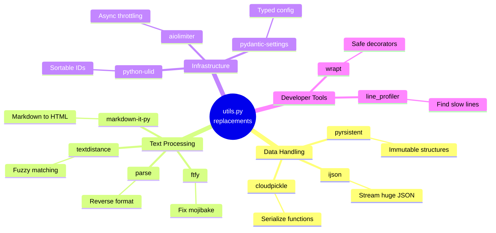

### Decision Flowchart: "Which library do I need?"

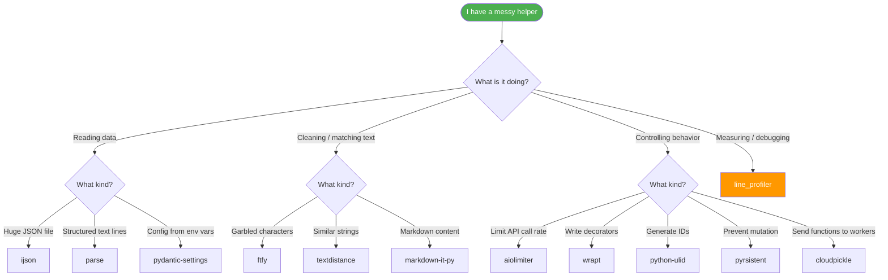

---

## 1. ijson: Stream Huge JSON Files

### The Problem

You have a 2 GB JSON export. You write:

```python
import json
with open("export.json") as f:
    data = json.load(f)   # 💥 MemoryError or the OOM killer
```

`json.load` parses the **entire file** into Python objects before giving you anything. Python objects are much larger than the raw text, so a small file can balloon in memory.

### Install

```bash
pip install ijson
```

### Core Concept

`ijson` is a **streaming (incremental) parser**. It reads the file in chunks and yields items as soon as they are complete, so memory use stays flat regardless of file size.

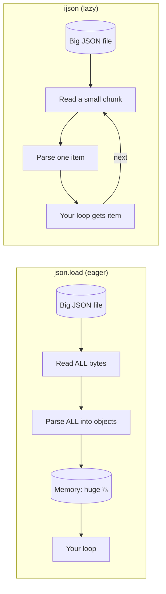

### Understanding the Path Syntax

`ijson.items(file, prefix)` takes a **prefix** that describes where in the JSON tree to look:

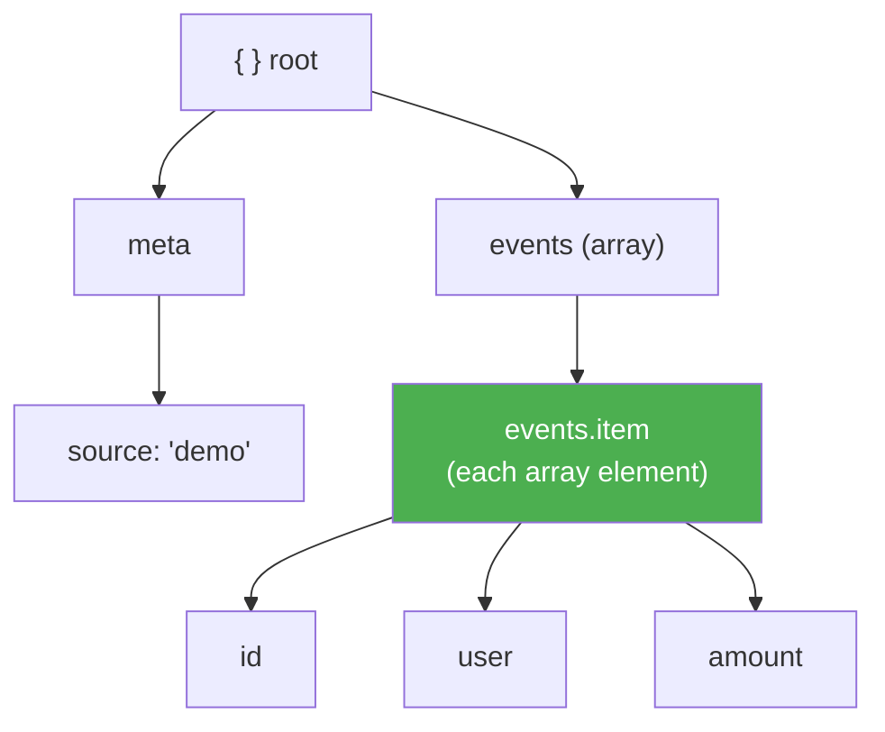

| Prefix | Meaning |
|--------|---------|
| `"meta"` | The object under the `meta` key |
| `"events.item"` | Each element of the `events` array |
| `"events.item.user"` | The `user` value of each event |
| `"item"` | Each element of a top-level array |

### Example 1: Memory comparison (the headline demo)

```python
import json, os, tempfile, tracemalloc
import ijson

# Build a test file
path = os.path.join(tempfile.mkdtemp(), "events.json")
with open(path, "w") as f:
    f.write('{"meta": {"source": "demo"}, "events": [')
    for i in range(150_000):
        f.write(("," if i else "") + json.dumps(
            {"id": i, "user": f"user{i % 500}", "amount": i % 97}))
    f.write("]}")
print("file size MB:", round(os.path.getsize(path) / 1e6, 1))

# Standard library: load everything
tracemalloc.start()
with open(path) as f:
    data = json.load(f)
total_a = sum(e["amount"] for e in data["events"])
peak_json = tracemalloc.get_traced_memory()[1]
del data
tracemalloc.stop()

# ijson: stream
tracemalloc.start()
with open(path, "rb") as f:               # note: binary mode
    total_b = sum(e["amount"] for e in ijson.items(f, "events.item"))
peak_ijson = tracemalloc.get_traced_memory()[1]
tracemalloc.stop()

print("backend:", ijson.backend)
print("same total:", total_a == total_b)
print(f"json.load peak:  {peak_json / 1e6:7.1f} MB")
print(f"ijson peak:      {peak_ijson / 1e6:7.2f} MB")
```

**Output:**
```
file size MB: 7.0
backend: yajl2_c
same total: True
json.load peak:     48.5 MB
ijson peak:         0.70 MB
```

A 7 MB file needed 48.5 MB with `json.load`, roughly 7x the file size. `ijson` stayed under 1 MB. Scale that to 2 GB and the difference decides whether your script runs or gets killed.

### Example 2: Stop early

Because items arrive lazily, you can quit whenever you have enough.

```python
with open(path, "rb") as f:
    first3 = []
    for e in ijson.items(f, "events.item"):
        first3.append(e["id"])
        if len(first3) == 3:
            break
print("stopped early after reading ids:", first3)
```

**Output:** `stopped early after reading ids: [0, 1, 2]`

The parser never touches the remaining 149,997 events.

### Example 3: Read only the metadata

```python
with open(path, "rb") as f:
    print("meta read without loading events:", next(ijson.items(f, "meta")))
```

**Output:** `meta read without loading events: {'source': 'demo'}`

### Example 4: Filter while streaming (beginner-friendly walkthrough)

Suppose you want the sum of `amount` for one user only.

```python
import ijson

def total_for_user(path, user):
    total = 0
    with open(path, "rb") as f:
        for event in ijson.items(f, "events.item"):   # 1. get one event at a time
            if event["user"] == user:                 # 2. filter it
                total += event["amount"]              # 3. aggregate
    return total                                      # 4. event is garbage collected each loop

print(total_for_user(path, "user42"))
```

### Example 5: Parse a remote or compressed stream

`ijson` accepts any file-like object, so you can pipe in network or gzip streams.

```python
import gzip, ijson

with gzip.open("events.json.gz", "rb") as f:
    for event in ijson.items(f, "events.item"):
        process(event)
```

### Use Cases

| Scenario | Why ijson helps |
|----------|-----------------|
| Processing API data dumps (GitHub archive, Wikipedia data) | Files are bigger than RAM |
| ETL pipelines loading JSON into a database | Insert row by row with flat memory |
| Log analysis on JSON-lines or array exports | Early exit once you find the record |
| Reading only a header or `meta` block | Skip millions of records |

### Tradeoffs and Gotchas

- **No random access.** You get items in order, once.
- **Backend matters.** `yajl2_c` is fastest. `ijson` picks the fastest installed backend automatically. Check `ijson.backend`.
- **Open files in binary mode** (`"rb"`) for best performance and correctness.

---

## 2. parse: The Opposite of `str.format()`

### The Problem

You have log lines or filenames and you reach for a regex:

```python
import re
m = re.match(r"(\S+) (\w+) (\w+): (.*)", line)
date = datetime.strptime(m.group(1), "%Y-%m-%d")
```

Regexes are hard to read, hard to review, and need manual type conversion.

### Install

```bash
pip install parse
```

### Core Concept

`str.format()` goes **template + values → string**. `parse` goes **template + string → values**, with type conversion built in.

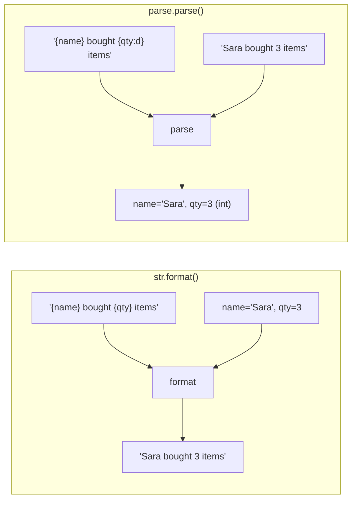

### Format Specifiers Cheat Sheet

| Spec | Meaning | Example |
|------|---------|---------|
| `{x}` | Any text (lazy) | `{name}` |
| `{x:d}` | Integer, converted to `int` | `{qty:d}` |
| `{x:f}` | Float, converted to `float` | `{price:f}` |
| `{x:w}` | Word characters | `{level:w}` |
| `{x:ti}` | ISO-style datetime, converted to `datetime` | `{date:ti}` |
| `{}` | Positional (unnamed) | `{:d}-{:d}` |

### Example 1: Basic extraction with types

```python
from parse import parse

r = parse("{name} bought {qty:d} items for ${price:f}", "Sara bought 3 items for $19.5")
print(r.named, type(r["qty"]).__name__, type(r["price"]).__name__)
```

**Output:** `{'name': 'Sara', 'qty': 3, 'price': 19.5} int float`

### Example 2: Positional results

```python
print(parse("{:d}-{:d}", "10-20").fixed)
```

**Output:** `(10, 20)`

### Example 3: Failed matches return `None`

```python
print(parse("Order {id:d}", "Order abc"))
```

**Output:** `None`

### Example 4: Parsing a log line (the one to remember)

```python
from parse import compile

log = "2026-10-10 ERROR db: timeout after 30s"
p = compile("{date:ti} {level:w} {svc}: {msg}")   # compile once, reuse many times
m = p.parse(log)
print(m["level"], "|", m["svc"], "|", m["msg"], "|", type(m["date"]).__name__)
```

**Output:** `ERROR | db | timeout after 30s | datetime`

One readable template replaced a regex with four named groups plus a manual date conversion.

### Example 5: Find all matches in a larger text

```python
from parse import findall, search

print([r.named for r in findall("id={id:d}", "id=4 x id=17 y id=203")])
print(search("v{major:d}.{minor:d}", "released v3.12 today").named)
```

**Output:**
```
[{'id': 4}, {'id': 17}, {'id': 203}]
{'major': 3, 'minor': 12}
```

### Example 6: Custom type converters

```python
from parse import parse, with_pattern

@with_pattern(r"yes|no")
def yesno(text):
    return text == "yes"

print(parse("ok? {a:YN}", "ok? yes", dict(YN=yesno)).named)
```

**Output:** `{'a': True}`

### Example 7: Parse filenames

```python
from parse import parse

r = parse("report_{year:d}-{month:d}_{dept}.csv", "report_2026-10_sales.csv")
print(r.named)   # {'year': 2026, 'month': 10, 'dept': 'sales'}
```

### Use Cases

| Scenario | Template |
|----------|----------|
| Web server logs | `"{ip} - - [{ts}] \"{method} {path}\" {status:d}"` |
| Version strings | `"v{major:d}.{minor:d}.{patch:d}"` |
| Batch file naming conventions | `"{project}_{date:ti}_{seq:d}.dat"` |
| Chatbot command parsing | `"/remind {who} in {n:d} minutes"` |

### Tradeoffs and Gotchas

- A failed match returns **`None`**, not an exception. Always check before indexing: `if r: ...`
- Matching is **case insensitive by default**:

```python
print("case insensitive by default:", parse("Hello {x}", "hello world").named)
print("case_sensitive=True:", parse("Hello {x}", "hello world", case_sensitive=True))
```

**Output:**
```
case insensitive by default: {'x': 'world'}
case_sensitive=True: None
```

---

## 3. ftfy: Repair Broken Text

### The Problem

You scrape a page or open an old CSV and see `schön` instead of `schön`. This is **mojibake**: UTF-8 bytes that were decoded using the wrong encoding.

### Install

```bash
pip install ftfy
```

### Core Concept

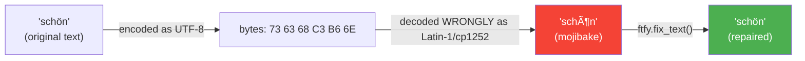

`ftfy` detects the pattern, reverses the wrong decoding (**encode** back to bytes using the wrong codec, then **decode** with the right one), and also unescapes HTML and normalizes odd characters.

### Example 1: A gallery of fixes

```python
from ftfy import fix_text

broken = [
    "sch\xc3\xb6n",                                         # mojibake
    "caf\xc3\xa9 \xe2\u20ac\u201c menu",                    # mojibake with a dash
    "\xe2\u20ac\u0153quoted\xe2\u20ac\u009d text",          # broken curly quotes
    "<p>Fish & Chips</p>",                  # HTML entities
    "\uff2c\uff2f\uff35\uff24\u3000\uff54\uff45\uff58\uff54",  # full-width characters
    "\xe2\u0153\u201d done",                                # broken check mark
]
for s in broken:
    print(ascii(s), "->", ascii(fix_text(s)))
```

**Output:**
```
'sch\xc3\xb6n' -> 'sch\xf6n'
'caf\xc3\xa9 \xe2\u20ac\u201c menu' -> 'caf\xe9 \u2013 menu'
'\xe2\u20ac\u0153quoted\xe2\u20ac\x9d text' -> '"quoted" text'
'&lt;p&gt;Fish &amp; Chips&lt;/p&gt;' -> '<p>Fish & Chips</p>'
'\uff2c\uff2f\uff35\uff24\u3000\uff54\uff45\uff58\uff54' -> 'LOUD text'
'\xe2\u0153\u201d done' -> '\u2714 done'
```

> `ascii()` prints the exact code points so you can see what changed. In a normal terminal the fixed strings display as readable text.

### Example 2: Debug with `fix_and_explain`

```python
from ftfy import fix_and_explain

r = fix_and_explain("sch\xc3\xb6n")
print("explain:", ascii(r.text), [(s.name if hasattr(s,'name') else s[0]) for s in r.explanation])
```

**Output:** `explain: 'sch\xf6n' ['encode', 'decode']`

This tells you **which steps** were taken: an encode followed by a decode.

### Example 3: Clean text is left alone

```python
from ftfy import fix_text
clean = "Already fine: caf\xe9 and \xfcber"
print("clean text untouched:", fix_text(clean) == clean)   # True
```

### Example 4: A cleaning pipeline for scraped data

```python
import csv
from ftfy import fix_text

with open("scraped.csv", encoding="utf-8", newline="") as f:
    rows = [{k: fix_text(v) for k, v in row.items()} for row in csv.DictReader(f)]
```

### Use Cases

| Scenario | Benefit |
|----------|---------|
| Web scraping | Repair pages served with wrong charset headers |
| Legacy database migration | Repair text stored through double-encoding |
| User-submitted content | Normalize full-width characters and HTML entities |
| NLP preprocessing | Consistent text before tokenization |

### Tradeoffs and Gotchas

`ftfy` **guesses**. Ambiguous text that was actually correct can be changed:

```python
legit = "\xc3\xa9"                       # the two characters "é"
print("ambiguous legit text:", ascii(fix_text(legit)))   # '\xe9' -> "é"
```

**Rule of thumb:** run it on data you *know* is damaged, not blindly on everything.

---

## 4. python-ulid: Sortable Unique IDs

### The Problem

Random UUIDs (`uuid4`) are unique but unordered. Used as database primary keys, they scatter inserts across the index, which can slow writes. You also need a separate `created_at` column to sort by time.

### Install

```bash
pip install python-ulid
```

### Core Concept

A **ULID** is a 26-character, Crockford-Base32 id: a 48-bit millisecond timestamp followed by 80 bits of randomness.

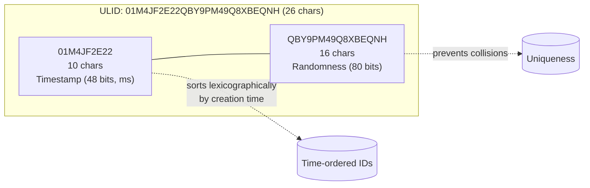

### Example 1: Generate and sort

```python
import time, uuid
from ulid import ULID

ids = []
for _ in range(5):
    ids.append(ULID())
    time.sleep(0.002)

for u in ids[:3]:
    print(u, u.datetime.strftime("%H:%M:%S.%f")[:-3])
print("sorted == creation order:", [str(u) for u in ids] == sorted(str(u) for u in ids))

u4 = [str(uuid.uuid4()) for _ in range(5)]
print("uuid4 sorted == creation order:", u4 == sorted(u4))
```

**Output:**
```
01M4JF2E22QBY9PM49Q8XBEQNH 08:32:30.786
01M4JF2E241XRTAW3EXHFSJ8KM 08:32:30.788
01M4JF2E26PB0F7293T087NGXF 08:32:30.790
sorted == creation order: True
uuid4 sorted == creation order: False
```

### Example 2: Conversions and round trips

```python
u = ULID()
print("length:", len(str(u)), "| bytes:", len(u.bytes), "| as uuid:", u.to_uuid() is not None)
back = ULID.from_str(str(u))
print("roundtrip:", back == u)
```

**Output:**
```
length: 26 | bytes: 16 | as uuid: True
roundtrip: True
```

You can convert to a standard UUID when another system requires one.

### Example 3: The timestamp trap

```python
as_float = ULID.from_timestamp(1_700_000_000.0)
as_int = ULID.from_timestamp(1_700_000_000)
print("float seconds ->", as_float.datetime.date())      # 2023-11-14
print("int is milliseconds ->", as_int.datetime.date())  # 1970-01-20  ⚠️
```

### Example 4: Validating input

```python
try:
    ULID.from_str("not-a-ulid")
except Exception as e:
    print("bad input:", type(e).__name__)   # ValueError
```

### Example 5: Using ULIDs as primary keys (SQLAlchemy sketch)

```python
from sqlalchemy import String
from sqlalchemy.orm import Mapped, mapped_column, DeclarativeBase
from ulid import ULID

class Base(DeclarativeBase): pass

class Order(Base):
    __tablename__ = "orders"
    id: Mapped[str] = mapped_column(String(26), primary_key=True, default=lambda: str(ULID()))
```

### UUID4 vs ULID

| Feature | `uuid4` | `ULID` |
|---------|---------|--------|
| Length (text) | 36 chars | 26 chars |
| Sortable by time | ❌ | ✅ |
| Embeds creation time | ❌ | ✅ (`u.datetime`) |
| Convertible to UUID | n/a | ✅ |
| Index-friendly inserts | Poor | Good |

### Use Cases

- Primary keys for write-heavy tables
- "Newest first" feeds with cursor pagination
- Event and log ids where creation time is useful for free
- Distributed systems generating ids without coordination

### Tradeoffs and Gotchas

- **Pass floats to `from_timestamp`.** A float is seconds, an int is milliseconds, so the integer example landed in 1970.
- Timestamp precision is **one millisecond**. Do not rely on ordering of ids created within the same millisecond.

---

## 5. aiolimiter: Async Rate Limiting

### The Problem

You fire 1,000 async requests at an API and get `429 Too Many Requests`. A hand-rolled `asyncio.sleep` loop is easy to get subtly wrong.

### Install

```bash
pip install aiolimiter
```

### Core Concept

`AsyncLimiter(max_rate, time_period)` is a **leaky bucket**. It allows `max_rate` acquisitions per `time_period`. It starts with a full bucket, so you get an initial burst and then a steady rate.

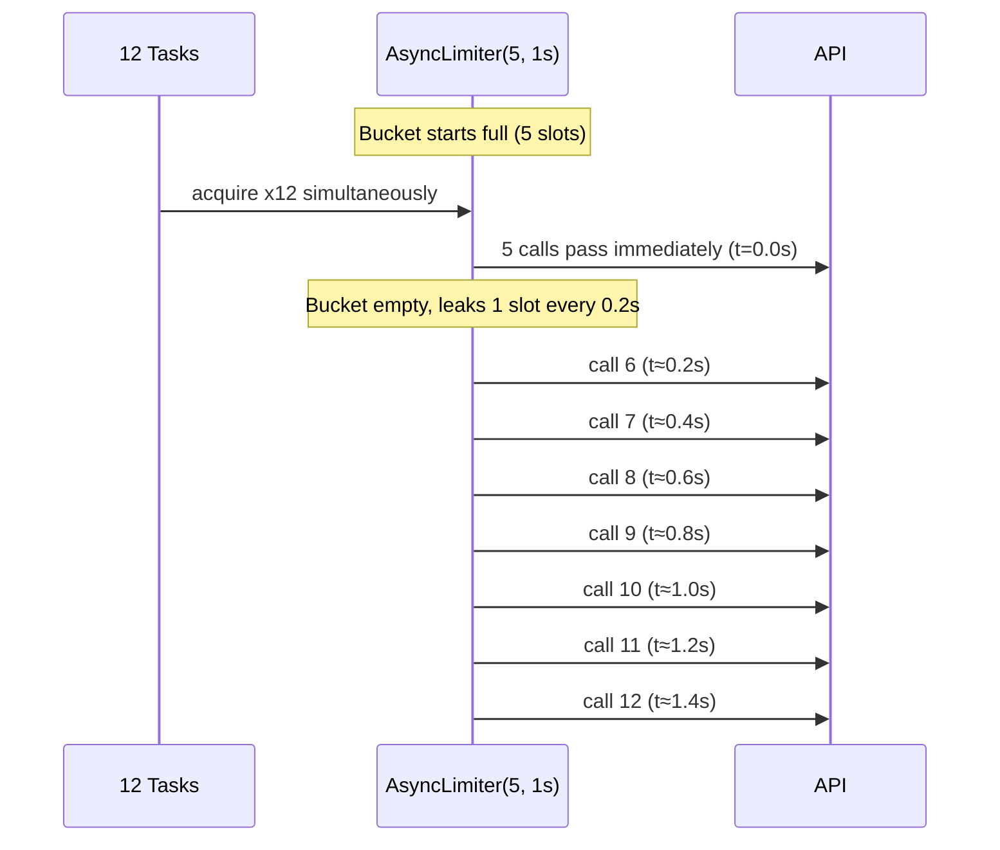

### Example 1: Observe the burst-then-steady shape

```python
import asyncio, time
from aiolimiter import AsyncLimiter

limiter = AsyncLimiter(max_rate=5, time_period=1)
stamps = []
start = None

async def call(i):
    async with limiter:                       # waits here if over the rate
        stamps.append(round(time.perf_counter() - start, 1))

async def main():
    global start
    start = time.perf_counter()
    await asyncio.gather(*(call(i) for i in range(12)))

asyncio.run(main())
print("finish times:", sorted(stamps))
print(f"12 calls took {max(stamps):.1f}s")
```

**Output:**
```
finish times: [0.0, 0.0, 0.0, 0.0, 0.0, 0.2, 0.4, 0.6, 0.8, 1.0, 1.2, 1.4]
12 calls took 1.4s
```

### Example 2: Check capacity without waiting

```python
async def capacity():
    lim = AsyncLimiter(3, 1)
    print("has_capacity(3) at start:", lim.has_capacity(3))      # True
    async with lim:
        pass
    print("has_capacity(3) after 1 call:", lim.has_capacity(3))  # False

asyncio.run(capacity())
```

### Example 3: Real-world pattern with `aiohttp`

```python
import asyncio, aiohttp
from aiolimiter import AsyncLimiter

limiter = AsyncLimiter(10, 1)    # 10 requests per second

async def fetch(session, url):
    async with limiter:
        async with session.get(url) as resp:
            return await resp.json()

async def main(urls):
    async with aiohttp.ClientSession() as session:
        return await asyncio.gather(*(fetch(session, u) for u in urls))
```

### Example 4: Combine with a concurrency cap

A rate limit controls *starts per second*. A semaphore controls *simultaneous in-flight requests*. They solve different problems and work well together.

```python
sem = asyncio.Semaphore(20)

async def fetch(session, url):
    async with sem, limiter:
        async with session.get(url) as resp:
            return await resp.text()
```

### Use Cases

| Scenario | Config |
|----------|--------|
| Public API with 60 req/min | `AsyncLimiter(60, 60)` |
| OpenAI/LLM API calls | Limit requests per minute |
| Web crawler being polite to a site | `AsyncLimiter(2, 1)` |
| Bulk database writes to a throttled service | Match the vendor's quota |

### Tradeoffs and Gotchas

- Works **inside one process only**. Ten workers means ten limiters, so the API sees ten times your rate. Shared limits need something like Redis.
- Expect a **burst at the start** because the bucket begins full.

---

## 6. wrapt: Bulletproof Decorators

### The Problem

A hand-written decorator quietly destroys metadata:

```python
def naive(fn):
    def inner(*a, **k):
        return fn(*a, **k)
    return inner
```

Now `fn.__name__` is `inner`, `help(fn)` is useless, and `inspect.signature(fn)` shows `(*a, **k)`.

### Install

```bash
pip install wrapt
```

### Core Concept

`@wrapt.decorator` gives your wrapper function **four arguments** and correctly handles plain functions, instance methods, class methods, and static methods.

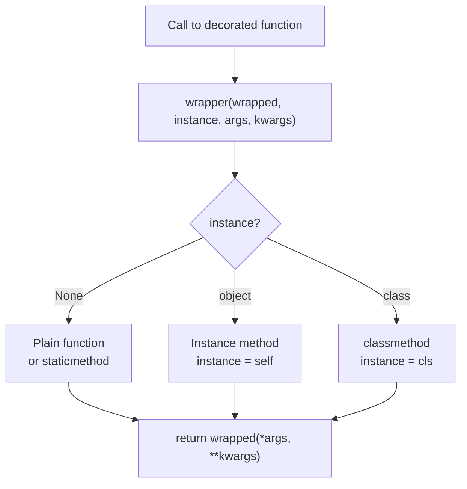

| Argument | What it is |
|----------|-----------|
| `wrapped` | The original function (already bound if it is a method) |
| `instance` | `self`, `cls`, or `None` |
| `args` | Positional arguments |
| `kwargs` | Keyword arguments |

### Example 1: The three-way comparison

```python
import functools, inspect, wrapt

def naive(fn):
    def inner(*a, **k):
        return fn(*a, **k)
    return inner

def with_functools(fn):
    @functools.wraps(fn)
    def inner(*a, **k):
        return fn(*a, **k)
    return inner

@wrapt.decorator
def logged(wrapped, instance, args, kwargs):
    kind = type(instance).__name__ if instance is not None else "plain call"
    print(f"  calling {wrapped.__name__} (bound to: {kind})")
    return wrapped(*args, **kwargs)

def area(width, height=2):
    return width * height

for label, deco in [("naive", naive), ("functools.wraps", with_functools), ("wrapt", logged)]:
    f = deco(area)
    print(f"{label:16} name={f.__name__:6} signature={inspect.signature(f)}")
```

**Output:**
```
naive            name=inner  signature=(*a, **k)
functools.wraps  name=area   signature=(width, height=2)
wrapt            name=area   signature=(width, height=2)
```

### Example 2: Works on every kind of callable

```python
class Shape:
    @logged
    def double(self, x):
        return x * 2

    @logged
    @classmethod
    def make(cls):
        return cls()

    @logged
    @staticmethod
    def helper(x):
        return x + 1

print("method:", Shape().double(4))
print("classmethod:", type(Shape.make()).__name__)
print("staticmethod:", Shape.helper(1))

@logged
def plain(x):
    return x
print("function:", plain(9))
```

**Output:**
```
  calling double (bound to: Shape)
method: 8
  calling make (bound to: type)
classmethod: Shape
  calling helper (bound to: plain call)
staticmethod: 2
  calling plain (bound to: plain call)
function: 9
```

Notice that the decorator **knows what it was bound to**. `functools.wraps` cannot tell you that.

### Example 3: A practical retry decorator

```python
import wrapt, time

def retry(times=3, delay=0.5):
    @wrapt.decorator
    def wrapper(wrapped, instance, args, kwargs):
        for attempt in range(1, times + 1):
            try:
                return wrapped(*args, **kwargs)
            except Exception as exc:
                if attempt == times:
                    raise
                print(f"attempt {attempt} failed: {exc!r}, retrying...")
                time.sleep(delay)
    return wrapper

@retry(times=3)
def flaky():
    ...
```

### Example 4: A timing decorator that also works on methods

```python
import wrapt, time

@wrapt.decorator
def timed(wrapped, instance, args, kwargs):
    t = time.perf_counter()
    try:
        return wrapped(*args, **kwargs)
    finally:
        owner = type(instance).__name__ + "." if instance is not None else ""
        print(f"{owner}{wrapped.__name__}: {time.perf_counter() - t:.4f}s")
```

### Example 5: Type checks pass through

```python
print("isinstance check passes through:", isinstance(logged(area), type(area)))  # True
```

### Overhead

Measured at about **1.1 microseconds per call**, and that figure includes the `print`.

### Use Cases

- Logging, tracing, and metrics decorators applied to class methods
- Retry and timeout decorators in library code
- Decorators that must preserve signatures for tools like Sphinx, FastAPI, or IDEs
- Monkey patching with proper binding

### Tradeoffs and Gotchas

- You must learn what the four arguments mean.
- For a **simple function-only decorator**, `functools.wraps` is enough.

---

## 7. pyrsistent: Immutable Data Structures

### The Problem

Mutable shared state causes bugs: a config dict modified in one place surprises another, undo history needs deep copies, and threads corrupt shared structures.

### Install

```bash
pip install pyrsistent
```

### Core Concept

A **persistent data structure** never changes in place. An "update" returns a *new version* that **shares most of its internals** with the old one (structural sharing), so updates are cheap.

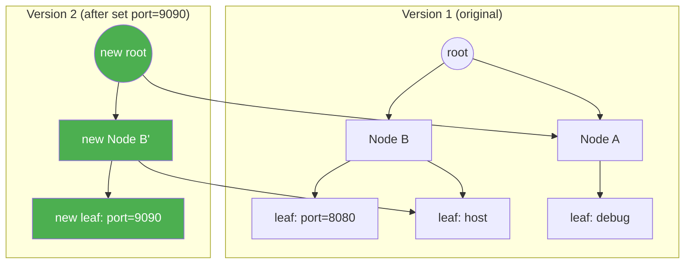

Only the green path was copied. Everything else is shared.

### Main Types

| Type | Like | Created with |
|------|------|--------------|
| `PMap` | `dict` | `pmap({...})` |
| `PVector` | `list` | `pvector([...])` |
| `PSet` | `set` | `pset([...])` |
| `PRecord` | typed record | subclass `PRecord` |

### Example 1: Immutable map

```python
from pyrsistent import pmap

cfg = pmap({"host": "localhost", "port": 8080, "debug": False})
cfg2 = cfg.set("port", 9090)
print("old:", dict(cfg), "| new port:", cfg2["port"])
try:
    cfg["port"] = 1
except TypeError as e:
    print("mutation blocked:", e)
```

**Output:**
```
old: {'host': 'localhost', 'port': 8080, 'debug': False} | new port: 9090
mutation blocked: 'PMap' object does not support item assignment
```

### Example 2: Cheap updates on huge vectors

```python
import time
from pyrsistent import pvector

v = pvector(range(1_000_000))
v2 = v.set(500_000, -1)
print("original untouched:", v[500_000], "| copy changed:", v2[500_000])

big = list(range(1_000_000))
t = time.perf_counter(); c = big.copy(); c[5] = -1; t_list = time.perf_counter() - t
t = time.perf_counter(); v3 = v.set(5, -1); t_vec = time.perf_counter() - t
print(f"update 1M list via copy: {t_list * 1000:.2f} ms | pvector.set: {t_vec * 1000:.3f} ms")
```

**Output:**
```
original untouched: 500000 | copy changed: -1
update 1M list via copy: 7.50 ms | pvector.set: 0.020 ms
```

### Example 3: Batch edits with an evolver

When making many changes, an **evolver** gives you a temporary mutable view, then freezes it again.

```python
e = v.evolver()
for i in range(5):
    e[i] = i * 100
print("evolver batch:", e.persistent()[:6])
```

**Output:** `evolver batch: pvector([0, 100, 200, 300, 400, 5])`

### Example 4: Nested structures with `freeze`, `thaw`, `transform`

```python
from pyrsistent import freeze, thaw

nested = freeze({"user": {"tags": ["a", "b"], "meta": {"n": 1}}})
nested2 = nested.transform(["user", "meta", "n"], 2)
print("nested update:", thaw(nested2)["user"]["meta"], "| old:", nested["user"]["meta"]["n"])
```

**Output:** `nested update: {'n': 2} | old: 1`

### Example 5: Typed records with `PRecord`

```python
from pyrsistent import PRecord, field

class Point(PRecord):
    x = field(type=int, mandatory=True)
    y = field(type=int, initial=0)

p = Point(x=1)
print(p, "->", p.set(y=5))
try:
    Point(x="no")
except Exception as e:
    print("type check:", type(e).__name__)
```

**Output:**
```
Point(x=1, y=0) -> Point(x=1, y=5)
type check: PTypeError
```

### Example 6: Hashable sets

```python
from pyrsistent import pset
print("hashable (usable as dict key):", hash(pset([1, 2, 3])) == hash(pset([3, 2, 1])))  # True
```

### Use Cases

| Scenario | Why immutability helps |
|----------|------------------------|
| Shared configuration | Nobody can change it underneath you |
| Undo/redo history | Keep every old version cheaply |
| State passed between threads | No locks needed for reads |
| Redux-style state management | Predictable state transitions |
| Cache keys and memoization | Hashable structures |

### Tradeoffs and Gotchas

A `pvector` is a **tree, not a flat array**, so plain reads and loops cost more than with a list. Use it where immutability is the point, not everywhere.

---

## 8. cloudpickle: Pickle Anything

### The Problem

The standard `pickle` cannot serialize lambdas, closures, or functions and classes defined in `__main__`. That breaks multiprocessing and distributed computing.

### Install

```bash
pip install cloudpickle
```

### Core Concept

Standard pickle stores functions **by reference** (module + name). `cloudpickle` stores them **by value** (the actual code), so another process can rebuild them even if it never saw your source.

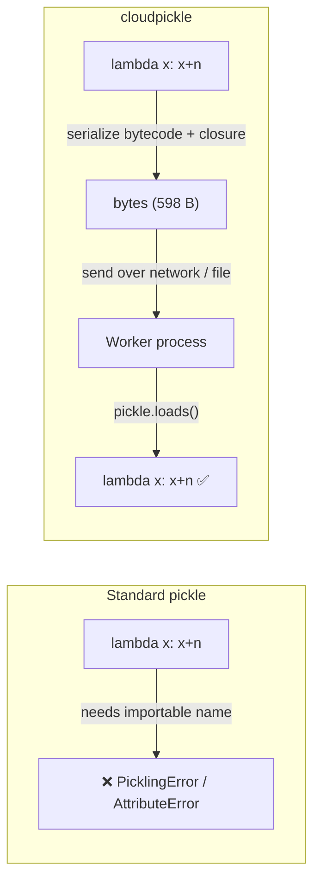

### Example 1: Closures

```python
import pickle, cloudpickle

def make_adder(n):
    return lambda x: x + n
add5 = make_adder(5)

try:
    pickle.dumps(add5)
except Exception as e:
    print("pickle failed:", type(e).__name__, "-", str(e)[:60])

blob = cloudpickle.dumps(add5)
print("cloudpickle size:", len(blob), "bytes")
print("same process:", pickle.loads(blob)(10))
```

**Output:**
```
pickle failed: AttributeError - Can't pickle local object 'make_adder.<locals>.<lambda>'
cloudpickle size: 598 bytes
same process: 15
```

### Example 2: Cross-process proof

```python
import subprocess, sys, tempfile, os

path = os.path.join(tempfile.mkdtemp(), "fn.pkl")
open(path, "wb").write(blob)
code = f"import pickle; f = pickle.load(open({path!r}, 'rb')); print('fresh interpreter:', f(100))"
print(subprocess.run([sys.executable, "-c", code], capture_output=True, text=True).stdout.strip())
```

**Output:** `fresh interpreter: 105`

Note that **loading** uses plain `pickle.loads`. Only the *dumping* side needs `cloudpickle`.

### Example 3: Classes defined in your script

```python
class Cart:
    def __init__(self): self.items = []
    def add(self, x): self.items.append(x); return self

cart = Cart().add("book").add("pen")
clone = pickle.loads(cloudpickle.dumps(cart))
print("class defined in __main__ travels by value:", clone.items)
```

**Output:** `class defined in __main__ travels by value: ['book', 'pen']`

### Example 4: Closure state is copied, not shared

```python
counter = {"n": 0}
def bump():
    counter["n"] += 1
    return counter["n"]

b2 = pickle.loads(cloudpickle.dumps(bump))
print("closure state is copied, not shared:", b2(), b2(), "| original:", counter["n"])
```

**Output:** `closure state is copied, not shared: 1 2 | original: 0`

### Example 5: The real use case, process pools

```python
from concurrent.futures import ProcessPoolExecutor

with ProcessPoolExecutor(2) as ex:
    try:
        list(ex.map(lambda x: x * 2, [1, 2]))
    except Exception as e:
        print("stdlib pool with lambda:", type(e).__name__)   # PicklingError
```

Libraries such as `joblib`, `dask`, `ray`, and `pyspark` rely on this approach internally to ship functions to workers.

### Use Cases

- Sending functions to worker processes or cluster nodes
- Task queues that accept arbitrary callables
- Saving a trained model together with custom preprocessing lambdas
- Interactive environments (Jupyter) where everything lives in `__main__`

### Tradeoffs and Gotchas

- Closure state is **copied**, so changes in the copy do not affect the original.
- The receiving side needs the **same Python version and libraries**.
- ⚠️ **Never unpickle data you do not trust.** Pickle can execute arbitrary code.

---

## 9. markdown-it-py: Markdown Parsing

### The Problem

Regex-based Markdown handling is brittle, and extracting headings or links from rendered HTML is worse.

### Install

```bash
pip install markdown-it-py
```

### Core Concept

`markdown-it-py` follows the **CommonMark** spec. It parses text into a **token stream**, and a renderer turns tokens into HTML. Features are toggled on through presets and `.enable()`.

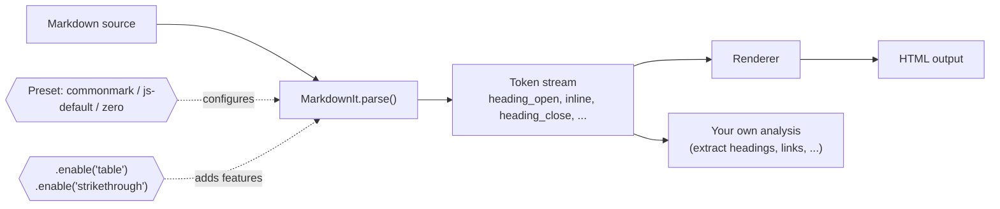

### Example 1: Presets and optional features

```python
from markdown_it import MarkdownIt

md_src = """# Title
Some **bold** text, a [link](https://example.com) and `code`.
| name | qty |
|------|-----|
| pen  | 3   |
<script>alert(1)</script>
~~old~~ text
"""
default = MarkdownIt("commonmark")
print(default.render(md_src))
```

**Output:**
```
<h1>Title</h1>
<p>Some <strong>bold</strong> text, a <a href="https://example.com">link</a> and <code>code</code>.</p>
<p>| name | qty |
|------|-----|
| pen  | 3   |</p>
<script>alert(1)</script>
<p>~~old~~ text</p>
```

The strict CommonMark preset left the table and strikethrough as plain text.

```python
gfm = MarkdownIt("commonmark").enable("table").enable("strikethrough")
html = gfm.render(md_src)
print("table rendered:", "<table>" in html, "| strikethrough:", "<s>old</s>" in html)
```

**Output:** `table rendered: True | strikethrough: True`

### Example 2: The security trap

```python
print("raw html allowed by commonmark preset:", "<script>" in default.render("<script>x</script>"))
safe = MarkdownIt("js-default")
print("js-default escapes it:", safe.render("<script>x</script>").strip())
```

**Output:**
```
raw html allowed by commonmark preset: True
js-default escapes it: <p>&lt;script&gt;x&lt;/script&gt;</p>
```

⚠️ **Rendering user-supplied Markdown with the `commonmark` preset is an XSS hole.** Use `js-default` or sanitize the output.

### Example 3: Extract headings from the token stream

```python
tokens = MarkdownIt().parse("# A\n\ntext with *em*")
print([t.type for t in tokens])
heads = [t.content for i, t in enumerate(tokens)
         if t.type == "inline" and tokens[i-1].type == "heading_open"]
print("headings found:", heads)
```

**Output:**
```
['heading_open', 'inline', 'heading_close', 'paragraph_open', 'inline', 'paragraph_close']
headings found: ['A']
```

### Example 4: Build a table of contents

```python
from markdown_it import MarkdownIt

def toc(markdown_text):
    tokens = MarkdownIt().parse(markdown_text)
    out = []
    for i, t in enumerate(tokens):
        if t.type == "heading_open":
            level = int(t.tag[1])             # 'h2' -> 2
            title = tokens[i + 1].content
            out.append("  " * (level - 1) + f"- {title}")
    return "\n".join(out)

print(toc("# Intro\n## Setup\n## Usage\n# FAQ"))
```

### Example 5: Dangerous links are blocked

```python
print(MarkdownIt("commonmark").render("[x](javascript:alert(1))").strip())
# <p>[x](javascript:alert(1))</p>   <- not turned into a link
```

### Use Cases

| Scenario | Benefit |
|----------|---------|
| Rendering user comments | Safe preset plus a real parser |
| Static site generators and docs tools | Extensible via plugins |
| Linting Markdown (heading order, link checks) | Walk the token stream |
| Converting Markdown to other formats | Custom renderers |

### Tradeoffs and Gotchas

- **The security default is the trap.** The `commonmark` preset passes raw HTML through.
- Tables and strikethrough are **not** on in strict CommonMark. Enable them explicitly.

---

## 10. pydantic-settings: Typed Configuration

### The Problem

Config handling usually looks like this:

```python
DEBUG = os.environ.get("DEBUG", "false").lower() in ("1", "true", "yes")
WORKERS = int(os.environ.get("WORKERS", 2))   # crashes with a confusing error if "abc"
```

It is repetitive, has no validation, and a missing secret surfaces an hour into runtime.

### Install

```bash
pip install pydantic-settings
```

### Core Concept

Declare a class with typed fields. `pydantic-settings` reads environment variables, **coerces** them to the right types, **validates** them, and fails fast at startup with a clear message.

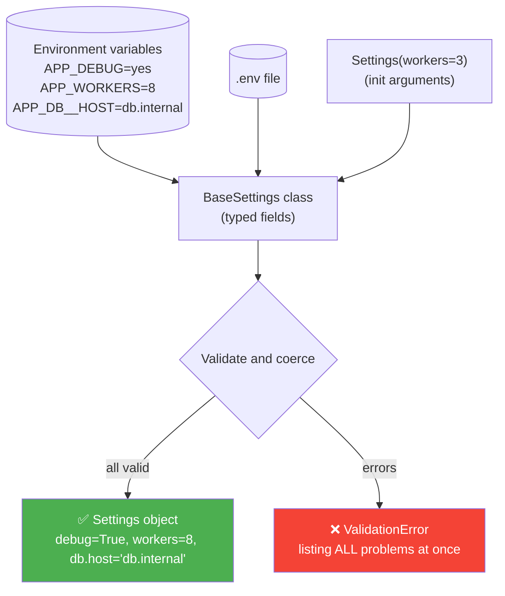

**Priority order** (highest first): init arguments → environment variables → `.env` file → field defaults.

### Example 1: Full configuration class

```python
import os
from pydantic import BaseModel, SecretStr, Field, ValidationError
from pydantic_settings import BaseSettings, SettingsConfigDict

class Db(BaseModel):
    host: str = "localhost"
    port: int = 5432

class Settings(BaseSettings):
    model_config = SettingsConfigDict(env_prefix="APP_", env_nested_delimiter="__")
    debug: bool = False
    api_key: SecretStr
    workers: int = Field(default=2, ge=1, le=16)
    allowed: list[str] = []
    db: Db = Db()

os.environ.update({
    "APP_DEBUG": "yes",
    "APP_API_KEY": "sk-live-123456",
    "APP_WORKERS": "8",
    "APP_ALLOWED": '["a.com", "b.com"]',
    "APP_DB__HOST": "db.internal",
})
s = Settings()
print(s.debug, s.workers, s.allowed, s.db)
```

**Output:** `True 8 ['a.com', 'b.com'] host='db.internal' port=5432`

What happened:

| Env var | Result |
|---------|--------|
| `APP_DEBUG="yes"` | `True` (bool) |
| `APP_WORKERS="8"` | `8` (int) |
| `APP_ALLOWED='["a.com", "b.com"]'` | `['a.com', 'b.com']` (JSON parsed) |
| `APP_DB__HOST` | `s.db.host` (nested via `__`) |

### Example 2: Secrets stay hidden

```python
print("repr hides secret:", repr(s.api_key), "| real:", s.api_key.get_secret_value()[:7] + "...")
print("dump hides it too:", s.model_dump()["api_key"])
```

**Output:**
```
repr hides secret: SecretStr('**********') | real: sk-live...
dump hides it too: **********
```

### Example 3: All errors reported together

```python
os.environ["APP_WORKERS"] = "99"
del os.environ["APP_API_KEY"]
try:
    Settings()
except ValidationError as e:
    for err in e.errors():
        print("error:", err["loc"], "->", err["msg"])
```

**Output:**
```
error: ('api_key',) -> Field required
error: ('workers',) -> Input should be less than or equal to 16
```

### Example 4: Init arguments beat the environment

```python
print("init args beat env:", Settings(api_key="direct", workers=3).workers)   # 3
```

### Example 5: Load from a `.env` file

```python
class Settings(BaseSettings):
    model_config = SettingsConfigDict(env_file=".env", env_prefix="APP_")
    api_key: SecretStr
```

### Use Cases

- Twelve-factor apps and containers configured by environment
- FastAPI or Django projects needing validated settings
- Separating secrets from code
- Different config per environment (dev, staging, production)

### Tradeoffs and Gotchas

- **List and dict values must be JSON** inside the env var.
- **Names match case insensitively by default**, so a lowercase `app_debug` still works, which can surprise you:

```python
os.environ.pop("APP_DEBUG")
os.environ["APP_WORKERS"] = "4"
os.environ["app_debug"] = "true"
print("lowercase env name still matches:", Settings(api_key="k").debug)   # True
```

---

## 11. textdistance: String Similarity

### The Problem

You need fuzzy matching for duplicate detection, typo-tolerant search, or record linkage, and you are not sure which algorithm fits.

### Install

```bash
pip install textdistance
# Optional speed-ups (backends):
pip install "textdistance[extras]"
```

### Core Concept

`textdistance` exposes dozens of algorithms behind one uniform interface. Swapping algorithms is a one-word change.

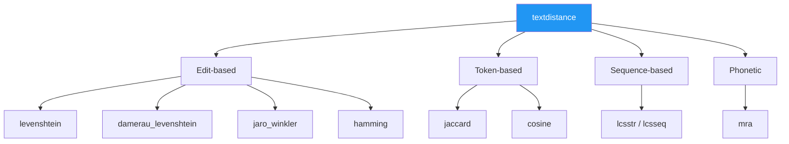

Each algorithm offers: `distance`, `similarity`, `normalized_distance`, and `normalized_similarity`.

### Example 1: Compare algorithms side by side

```python
import textdistance as td

pairs = [("kitten", "sitting"), ("martha", "marhta"), ("night", "nacht"), ("python", "pythons")]
print(f"{'pair':20} {'lev':>4} {'jaro_w':>7} {'jacc':>6} {'cosine':>7}")
for a, b in pairs:
    print(f"{a + '/' + b:20} {td.levenshtein(a, b):>4} {td.jaro_winkler(a, b):7.3f} "
          f"{td.jaccard(a, b):6.3f} {td.cosine(a, b):7.3f}")
```

**Output:**
```
pair                  lev  jaro_w   jacc  cosine
kitten/sitting          3   0.746  0.444   0.617
martha/marhta           2   0.961  1.000   1.000
night/nacht             2   0.760  0.429   0.600
python/pythons          1   0.971  0.857   0.926
```

Why the choice matters: `martha`/`marhta` scores 2 on Levenshtein but **0.961 on Jaro-Winkler**, which rewards a shared prefix.

### Example 2: Normalized similarity (0 to 1)

```python
print(round(td.levenshtein.normalized_similarity("kitten", "sitting"), 3))   # 0.571
```

### Example 3: Transpositions

```python
print("damerau (swap counts as 1):", td.damerau_levenshtein("ab", "ba"),
      "| plain levenshtein:", td.levenshtein("ab", "ba"))
# damerau: 1 | levenshtein: 2
```

Typists often swap adjacent letters, so Damerau-Levenshtein is often a better fit for typo detection.

### Example 4: Hamming and longest common substring

```python
print("hamming:", td.hamming("karolin", "kathrin"))                         # 3
print("lcsstr:", repr(td.lcsstr("the quick brown fox", "a quick brown dog")))  # ' quick brown '
```

### Example 5: Token-based comparison

```python
print(round(td.jaccard("the red fox".split(), "the fox red".split()), 3))   # 1.0
```

### Example 6: Pick the best match from a list

```python
import textdistance as td

candidates = ["Jonathan Smith", "Jon Smyth", "Joan Smith", "John Smith"]
query = "John Smith"
best = max(candidates, key=lambda c: td.jaro_winkler.normalized_similarity(query, c))
print(best)   # John Smith
```

### Example 7: Speed matters

```python
import time
a, b = "abcdefghij" * 20, "abcdefhgij" * 20
pure = td.Levenshtein(external=False)
t = time.perf_counter()
for _ in range(20): pure(a, b)
t_pure = (time.perf_counter() - t) / 20
t = time.perf_counter()
for _ in range(20): td.levenshtein(a, b)
t_ext = (time.perf_counter() - t) / 20
print(f"pure python: {t_pure * 1000:.1f} ms | with backend: {t_ext * 1000:.3f} ms")
```

**Output:** `200 char strings, pure python: 22.5 ms | with an installed backend: 0.009 ms`

### Which algorithm should I pick?

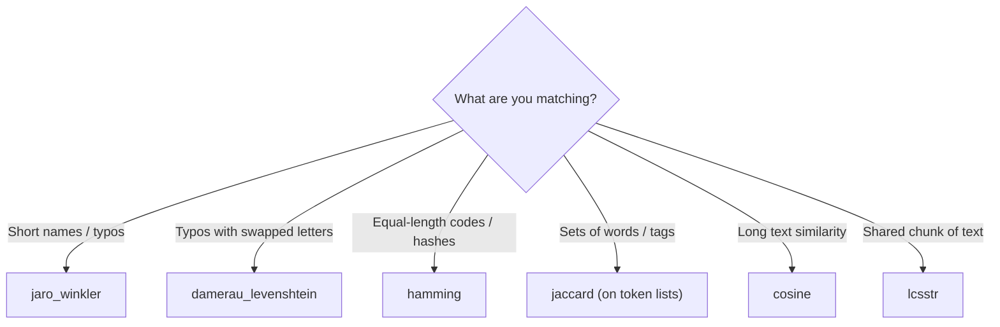

### Use Cases

| Scenario | Algorithm |
|----------|-----------|
| Deduplicating customer records | `jaro_winkler` |
| "Did you mean...?" suggestions | `damerau_levenshtein` |
| Comparing tag sets | `jaccard` on token lists |
| Plagiarism or near-duplicate text | `cosine` |

### Tradeoffs and Gotchas

- **Speed:** the pure-Python version took 22.5 ms for 200-char strings. It is fast only when a backend library is installed (0.009 ms here).
- **Jaccard on plain strings compares character sets**, so `martha` and `marhta` scored a perfect 1.0. Pass **token lists** when you mean words.

---

## 12. line_profiler: Line-by-Line Profiling

### The Problem

`cProfile` tells you which *function* is slow. But inside a 30-line function, which *line* is the culprit? Guessing wastes days.

### Install

```bash
pip install line_profiler
```

### Core Concept

`line_profiler` times **each line** of the functions you choose.

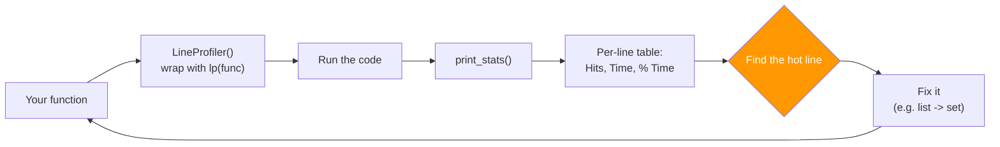

### Example 1: Finding a hidden O(n²)

```python
import io
from line_profiler import LineProfiler

def process(rows):
    cleaned = []
    for r in rows:
        cleaned.append(r.strip().lower())
    unique = []
    for c in cleaned:
        if c not in unique:          # list membership is O(n)!
            unique.append(c)
    return sorted(unique)

rows = [f"  User{i % 3000}  " for i in range(12000)]
lp = LineProfiler()
wrapped = lp(process)
wrapped(rows)
lp.print_stats(output_unit=1e-3)    # times in milliseconds
```

**Output (trimmed, times in milliseconds):**
```
Total time: 0.147962 s
Function: process at line 4
Line #      Hits         Time  Per Hit   % Time  Line Contents
==============================================================
     5         1          0.0      0.0      0.0      cleaned = []
     6     12001          1.5      0.0      1.0      for r in rows:
     7     12000          5.0      0.0      3.4          cleaned.append(r.strip().lower())
     8         1          0.0      0.0      0.0      unique = []
     9     12001          1.6      0.0      1.1      for c in cleaned:
    10     12000        138.9      0.0     93.9          if c not in unique:
    11      3000          0.9      0.0      0.6              unique.append(c)
    12         1          0.1      0.1      0.0      return sorted(unique)
```

**Line 10 consumed 93.9 percent of the time.** It is the `if c not in unique` check on a list.

### Reading the Table

| Column | Meaning |
|--------|---------|
| **Hits** | How many times the line ran |
| **Time** | Total time on that line |
| **Per Hit** | Average time per execution |
| **% Time** | Share of the function's total time (**the column to trust**) |

### Example 2: The fix

```python
def process_fast(rows):
    seen = set()
    unique = []
    for r in rows:
        c = r.strip().lower()
        if c not in seen:            # set membership is O(1)
            seen.add(c)
            unique.append(c)
    return sorted(unique)
```

Or even simpler: `sorted({r.strip().lower() for r in rows})`.

### Example 3: Command-line workflow with `@profile`

```python
# script.py
@profile                         # injected by kernprof, no import needed
def work():
    ...
work()
```

```bash
kernprof -l -v script.py
```

### Example 4: In Jupyter

```python
%load_ext line_profiler
%lprun -f process process(rows)
```

### Use Cases

- Hunting down accidental O(n²) behavior
- Optimizing data-processing loops
- Verifying that an optimization actually helped
- Investigating a function that is "slow but cProfile says it's just one function"

### Tradeoffs and Gotchas

- Profiling adds overhead, so absolute times are inflated. **Trust percentages, not seconds.**
- You must **name the functions** you want measured.

---

## Putting It All Together

Here is an imaginary service that ingests a large JSON export of orders, cleans text, throttles enrichment calls, and stores records with sortable ids. Several libraries cooperate in one pipeline.

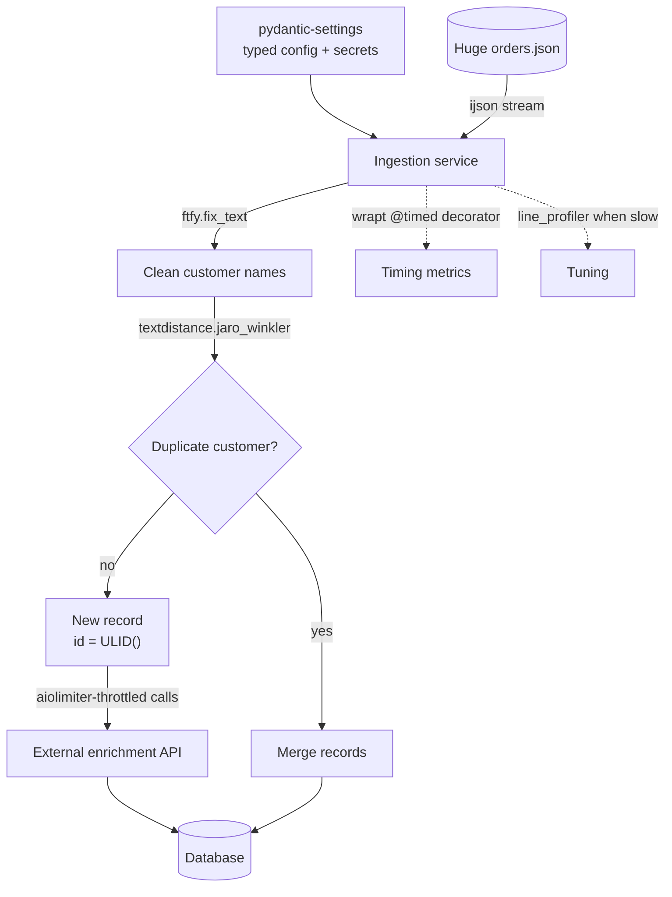

### A condensed code sketch

```python
import asyncio, ijson, wrapt, time
from ftfy import fix_text
from ulid import ULID
from aiolimiter import AsyncLimiter
import textdistance as td
from pydantic import SecretStr
from pydantic_settings import BaseSettings, SettingsConfigDict

class Settings(BaseSettings):
    model_config = SettingsConfigDict(env_prefix="APP_")
    api_key: SecretStr
    rate: int = 10

cfg = Settings()
limiter = AsyncLimiter(cfg.rate, 1)

@wrapt.decorator
def timed(wrapped, instance, args, kwargs):
    t = time.perf_counter()
    try:
        return wrapped(*args, **kwargs)
    finally:
        print(f"{wrapped.__name__}: {time.perf_counter() - t:.3f}s")

def is_duplicate(a, b):
    return td.jaro_winkler.normalized_similarity(a.lower(), b.lower()) > 0.92

async def enrich(order):
    async with limiter:
        ...   # call external API

@timed
def stream_orders(path):
    with open(path, "rb") as f:
        for order in ijson.items(f, "orders.item"):
            order["customer"] = fix_text(order["customer"])
            order["id"] = str(ULID())
            yield order
```

---

## Cheat Sheet and Final Advice

### Quick Reference

| # | Library | Replaces | One-line summary | Biggest gotcha |
|---|---------|----------|------------------|----------------|
| 1 | **ijson** | `json.load` on big files | Stream items one at a time | No random access |
| 2 | **parse** | Regexes for simple formats | Reverse of `format()`, typed results | Returns `None` on failure; case-insensitive by default |
| 3 | **ftfy** | Manual encoding fixes | Repairs mojibake | It guesses; can alter good text |
| 4 | **python-ulid** | `uuid4` for keys | Time-sortable 26-char ids | Int timestamps are milliseconds |
| 5 | **aiolimiter** | `asyncio.sleep` throttling | Leaky-bucket limiter for asyncio | Per-process only |
| 6 | **wrapt** | Hand-written decorators | Correct binding and introspection | Four-argument signature to learn |
| 7 | **pyrsistent** | Defensive `deepcopy` | Immutable, cheap-to-update structures | Slower plain reads than lists |
| 8 | **cloudpickle** | `pickle` for lambdas | Serializes code by value | Closure state copied; never unpickle untrusted data |
| 9 | **markdown-it-py** | Regex Markdown handling | CommonMark parser with tokens | `commonmark` preset passes raw HTML (XSS) |
| 10 | **pydantic-settings** | `os.environ.get` + casting | Typed, validated config | Lists and dicts must be JSON strings |
| 11 | **textdistance** | Custom similarity code | Many algorithms, one interface | Slow without a backend; Jaccard on strings uses characters |
| 12 | **line_profiler** | `time.time()` guesswork | Per-line timing | Overhead inflates absolute times |

### Common Themes

Look at what these twelve have in common:

1. **None is flashy.** Each deletes a chunk of code you were about to write.
2. **Each handles edge cases you have not thought of yet**: binding rules for decorators, 429 bursts, ambiguous encodings.
3. **Every tradeoff above came from running the code**, not from the README: a timestamp that silently lands in 1970, a Markdown preset that passes raw HTML, and a text fixer that can change text that was fine.

### Your Action Plan


> **Pick the library that matches the ugliest helper in your `utils.py` and replace it this week.**

### Practice Exercises

1. **ijson:** Generate a 100 MB JSON array and write a script that computes an average without exceeding 10 MB of memory. Verify with `tracemalloc`.
2. **parse:** Write a single template that parses Apache access-log lines, then compare its readability with an equivalent regex.
3. **ftfy:** Take a text file, deliberately re-encode it wrongly, and use `fix_and_explain` to recover it.
4. **python-ulid:** Create 1,000 ULIDs in a loop and test whether they are sorted. Explain any out-of-order results (hint: same-millisecond ordering).
5. **aiolimiter:** Simulate 50 concurrent tasks with `AsyncLimiter(10, 1)` and plot completion times.
6. **wrapt:** Write a `@retry` decorator that works on functions, methods, and class methods, and test all three.
7. **pyrsistent:** Implement an undo stack using `pmap` versions of an application state.
8. **cloudpickle:** Pickle a closure, load it in a separate script, and confirm the counter-copy behavior.
9. **markdown-it-py:** Build a link checker that extracts all URLs from a Markdown file using tokens.
10. **pydantic-settings:** Create a settings class with a nested model and test what happens with invalid values.
11. **textdistance:** Deduplicate a list of 20 names using three algorithms and compare the results.
12. **line_profiler:** Profile one of your own slow functions and report which line dominates.

---

*All timings and outputs were produced on Python 3.11 and will vary between machines.*