# 9 Python Libraries You've Probably Never Heard Of (But Will Use Every Week)

> **A hands-on tutorial.** Each library solves one narrow, annoying problem very well. For each one you'll get a mental model, a diagram, several runnable examples, real-world use cases, and the honest limitations.

---

## Table of Contents

1. [How to Use This Tutorial](#how-to-use-this-tutorial)
2. [Setup](#setup)
3. [Which Library Do I Need? (Decision Map)](#which-library-do-i-need-decision-map)
4. [sqlglot: Parse, Translate, and Edit SQL](#1-sqlglot-parse-translate-and-edit-sql)
5. [narwhals: One Dataframe API for pandas, Polars, and More](#2-narwhals-one-dataframe-api-for-pandas-polars-and-more)
6. [pandera: Schemas for Your Dataframes](#3-pandera-schemas-for-your-dataframes)
7. [inline-snapshot: Tests That Write Their Own Expected Values](#4-inline-snapshot-tests-that-write-their-own-expected-values)
8. [time-machine: Fast Time Travel for Tests](#5-time-machine-fast-time-travel-for-tests)
9. [memray: Find the Line That Ate Your Memory](#6-memray-find-the-line-that-ate-your-memory)
10. [rank-bm25: Search Ranking Without a Search Server](#7-rank-bm25-search-ranking-without-a-search-server)
11. [trafilatura: Clean Article Text from Messy HTML](#8-trafilatura-clean-article-text-from-messy-html)
12. [lark: Build Your Own Mini Language](#9-lark-build-your-own-mini-language)
13. [Capstone: Combining Libraries](#capstone-combining-libraries)
14. [Cheat Sheet](#cheat-sheet)
15. [Practice Exercises](#practice-exercises)
16. [Final Thoughts](#final-thoughts)

---

## How to Use This Tutorial

Some Python libraries are famous because they solve a famous problem (`requests`, `pandas`, `numpy`). Others stay quiet because they solve one **specific and painful** problem. When you hit that problem, they save you days of fragile code.

These nine are the quiet kind. Each section follows the same structure:

| Part | Purpose |
|------|---------|
| **The problem** | What pain this library removes |
| **Mental model** | A diagram of how it works |
| **Hands-on examples** | Runnable code, from basic to practical |
| **Use cases** | Where it earns its place in real projects |
| **Tradeoffs** | Honest limits, so you know when *not* to use it |

> **Tip:** Don't read everything in one sitting. Skim the decision map, pick the one or two that match a problem you have now, and try them on real data.

---

## Setup

The examples were written for **Python 3.11**. Use a virtual environment so nothing pollutes your global Python.

```bash
python -m venv .venv
source .venv/bin/activate          # Windows: .venv\Scripts\activate

pip install sqlglot narwhals pandera inline-snapshot time-machine \
            memray rank-bm25 trafilatura lark pandas polars pytest freezegun
```

> **Platform note:** `memray` supports **Linux and macOS** only. On Windows, use WSL.

Verify the install:

```python
import sqlglot, narwhals, pandera, inline_snapshot, time_machine
import rank_bm25, trafilatura, lark
print("All libraries imported successfully")
```

---

## Which Library Do I Need? (Decision Map)

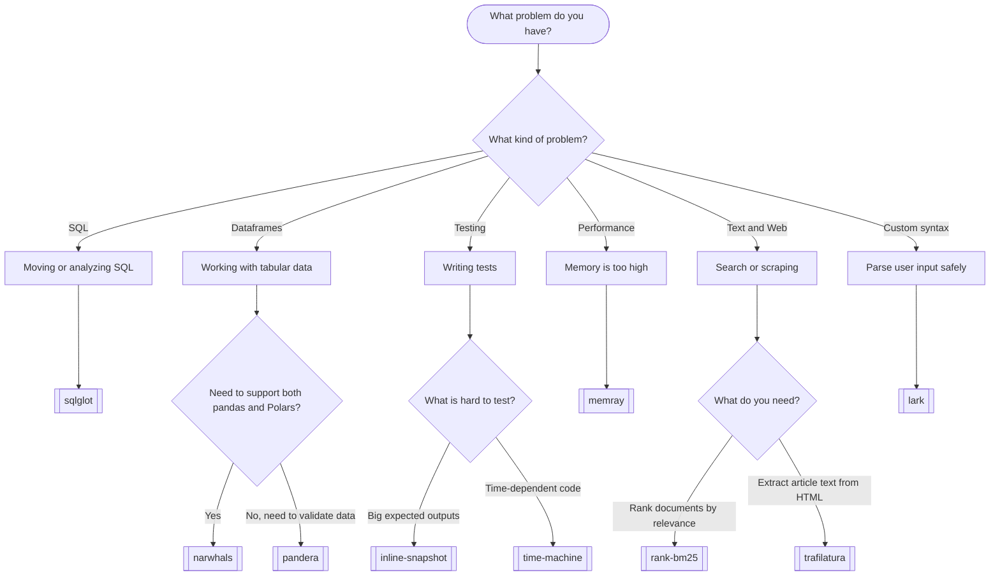

---

## 1. sqlglot: Parse, Translate, and Edit SQL

### The problem

SQL is not one language. T-SQL, PostgreSQL, MySQL, Snowflake, BigQuery, and DuckDB each differ in function names, quoting, `LIMIT` vs `TOP`, and null ordering. Regular expressions can't reliably understand SQL, because SQL is nested and context-dependent.

**sqlglot** turns SQL text into a **tree** (an AST) that you can inspect, edit, and write back out in any supported dialect.

### Mental model

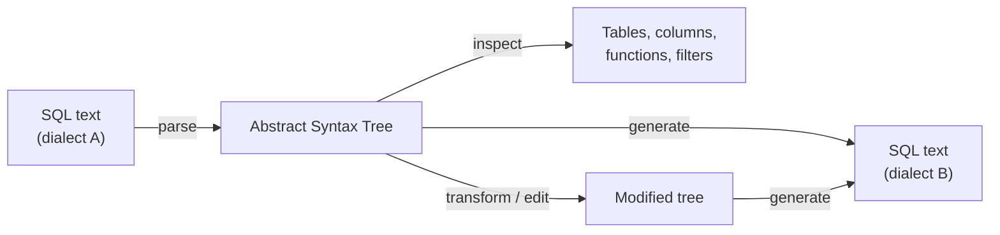

### Example 1: Translate between dialects

```python
from sqlglot import transpile

tsql = ("SELECT TOP 5 name, ISNULL(nickname, 'none') AS nick, "
        "GETDATE() AS now FROM users ORDER BY name")

print("T-SQL:     ", tsql)
for target in ["postgres", "mysql", "snowflake", "bigquery"]:
    print(f"{target:<10} ", transpile(tsql, read="tsql", write=target)[0])
```

**Output:**

```
T-SQL:      SELECT TOP 5 name, ISNULL(nickname, 'none') AS nick, GETDATE() AS now FROM users ORDER BY name
postgres    SELECT name, COALESCE(nickname, 'none') AS nick, CURRENT_TIMESTAMP AS now FROM users ORDER BY name NULLS FIRST LIMIT 5
mysql       SELECT name, COALESCE(nickname, 'none') AS nick, CURRENT_TIMESTAMP() AS now FROM users ORDER BY name LIMIT 5
snowflake   SELECT name, COALESCE(nickname, 'none') AS nick, CURRENT_TIMESTAMP() AS now FROM users ORDER BY name NULLS FIRST LIMIT 5
bigquery    SELECT name, COALESCE(nickname, 'none') AS nick, CURRENT_TIMESTAMP() AS now FROM users ORDER BY name LIMIT 5
```

**What to notice:**

- `TOP 5` became `LIMIT 5`.
- `ISNULL` became `COALESCE`.
- `GETDATE()` became `CURRENT_TIMESTAMP`.
- PostgreSQL and Snowflake got `NULLS FIRST`. SQL Server sorts nulls first by default and those databases don't, so sqlglot preserved the **meaning**, not just the words.

### Example 2: Pretty-print messy SQL

```python
from sqlglot import transpile

messy = ("select o.id,sum(i.qty*i.price) as total from orders o join items i "
         "on i.order_id=o.id where o.status in ('paid','shipped') group by o.id "
         "having sum(i.qty*i.price)>100 order by total desc")

print(transpile(messy, pretty=True)[0])
```

**Output:**

```sql
SELECT
  o.id,
  SUM(i.qty * i.price) AS total
FROM orders AS o
JOIN items AS i
  ON i.order_id = o.id
WHERE
  o.status IN ('paid', 'shipped')
GROUP BY
  o.id
HAVING
  SUM(i.qty * i.price) > 100
ORDER BY
  total DESC
```

### Example 3: Ask a query what it touches

```python
from sqlglot import exp, parse_one

tree = parse_one(messy)
print("Tables:   ", sorted({t.name for t in tree.find_all(exp.Table)}))
print("Columns:  ", sorted({c.sql() for c in tree.find_all(exp.Column)}))
print("Functions:", sorted({type(f).__name__ for f in tree.find_all(exp.Func)}))
```

```
Tables:    ['items', 'orders']
Columns:   ['i.order_id', 'i.price', 'i.qty', 'o.id', 'o.status', 'total']
Functions: ['Sum']
```

### Example 4: Build and edit queries with code (not string concatenation)

```python
from sqlglot import exp, parse_one

query = parse_one("SELECT id, email FROM customers")
query = query.where("country = 'PK'").where("created_at >= '2026-01-01'").limit(50)
print("Built up:     ", query.sql())

built = (exp.select("region", exp.func("SUM", "amount").as_("revenue"))
            .from_("sales")
            .group_by("region"))
print("From scratch: ", built.sql(dialect="postgres"))
```

```
Built up:      SELECT id, email FROM customers WHERE country = 'PK' AND created_at >= '2026-01-01' LIMIT 50
From scratch:  SELECT region, SUM(amount) AS revenue FROM sales GROUP BY region
```

### Example 5: Rename a table everywhere

```python
def rename(node):
    if isinstance(node, exp.Table) and node.name == "customers":
        return exp.to_table("clients")
    return node

print(query.transform(rename).sql())
# SELECT id, email FROM clients WHERE country = 'PK' AND created_at >= '2026-01-01' LIMIT 50
```

### Example 6: A tiny SQL linter (extra)

Block `SELECT *` and flag queries that have no `WHERE` clause:

```python
from sqlglot import exp, parse_one

def lint(sql: str) -> list[str]:
    tree = parse_one(sql)
    problems = []
    if tree.find(exp.Star):
        problems.append("Avoid SELECT *; list the columns you need.")
    if isinstance(tree, exp.Select) and not tree.args.get("where"):
        problems.append("No WHERE clause; this scans the whole table.")
    return problems

print(lint("SELECT * FROM orders"))
print(lint("SELECT id FROM orders WHERE id = 1"))
```

### Example 7: Handle bad SQL gracefully

```python
from sqlglot import parse_one
from sqlglot.errors import ParseError

try:
    parse_one("SELECT FROM WHERE")
except ParseError as error:
    e = error.errors[0]
    print("Parse error at line", e["line"], "col", e["col"])
```

### Use cases

| Scenario | How sqlglot helps |
|----------|-------------------|
| **Database migration** (SQL Server to PostgreSQL) | Bulk-transpile stored queries |
| **Data-lineage tools** | Extract the tables and columns each query touches |
| **Access control** | Verify a query only reads allowed tables before running it |
| **Query builders and BI tools** | Compose filters safely, with no injection-prone string gluing |
| **CI linting** | Reject `SELECT *` or missing filters in pull requests |

### Tradeoffs

- Translation is **best effort**. Unusual vendor-specific features can come out wrong, so **test every translated query against the real database**.
- Parse errors can be long. Trim them for end users.

---

## 2. narwhals: One Dataframe API for pandas, Polars, and More

### The problem

You maintain a library or a shared helper. Some users have pandas, others have Polars. Do you force everyone to convert, or maintain two copies of the same logic?

**narwhals** is a thin compatibility layer. You write against one small API, and the caller's own library does the work. The output type matches the input type.

### Mental model

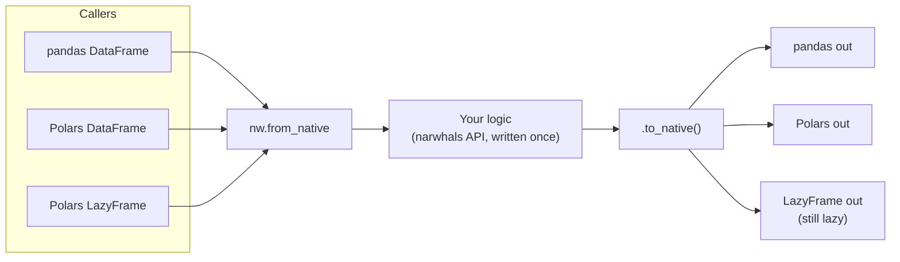

### Example 1: The `@narwhalify` decorator

```python
import narwhals as nw
import pandas as pd
import polars as pl

data = {
    "region": ["EU", "US", "EU", "APAC", "US", "EU"],
    "amount": [120.0, 80.5, 45.0, 210.0, -15.0, 60.0],
    "paid":   [True, True, False, True, True, True],
}

@nw.narwhalify
def revenue_by_region(df):
    return (
        df.filter(nw.col("paid"), nw.col("amount") > 0)
          .group_by("region")
          .agg(
              nw.col("amount").sum().alias("total"),
              nw.col("amount").mean().alias("average"),
              nw.col("amount").count().alias("orders"),
          )
          .sort("total", descending=True)
    )

pandas_result = revenue_by_region(pd.DataFrame(data))
polars_result = revenue_by_region(pl.DataFrame(data))
lazy_result   = revenue_by_region(pl.LazyFrame(data))

print(pandas_result.to_string(index=False))
print(polars_result.to_dicts())
print(type(lazy_result).__name__)         # LazyFrame, nothing computed yet
print(lazy_result.collect().to_dicts())
```

**Output (abridged):**

```
region  total  average  orders
  APAC  210.0    210.0       1
    EU  180.0     90.0       2
    US   80.5     80.5       1
```

The same function ran on three kinds of input, and each got back its **own** type. The lazy frame stayed lazy until `.collect()`.

### Example 2: Manual control with `from_native` / `to_native`

Use this when you need more control than a decorator gives you:

```python
def add_tax(native_df, rate=0.2):
    df = nw.from_native(native_df)
    return (df.with_columns((nw.col("amount") * (1 + rate)).round(2).alias("with_tax"))
              .to_native())

print(add_tax(pd.DataFrame(data)).head(3).to_string(index=False))
print(add_tax(pl.DataFrame(data)).head(3).to_dicts())
```

### Example 3: Inspect what you were given

```python
df = nw.from_native(pd.DataFrame(data))
print("Backend:", df.implementation)       # pandas
print("Schema: ", dict(df.schema))         # {'region': String, 'amount': Float64, 'paid': Boolean}
```

### Example 4: A reusable cleaning helper (extra)

```python
@nw.narwhalify
def clean_orders(df):
    return (
        df.with_columns(nw.col("region").str.to_uppercase())
          .filter(nw.col("amount").is_between(0, 10_000))
    )

clean_orders(pd.DataFrame(data))
clean_orders(pl.DataFrame(data))
```

### Use cases

| Scenario | Benefit |
|----------|---------|
| **Open-source library authors** | Support pandas and Polars users without duplicating code |
| **Shared team utilities** | Different teams use different tools; one helper serves all |
| **Gradual migration pandas → Polars** | Write helpers that work in both worlds during the transition |
| **Plotting and ML libraries** | Accept any dataframe without making `pandas` a hard dependency |

### Tradeoffs

- It supports a **subset** of each library. Exotic features, such as pandas index tricks, aren't in the shared API.
- If your project uses only one dataframe library, narwhals adds a layer you don't need.

---

## 3. pandera: Schemas for Your Dataframes

### The problem

Most pipeline bugs are **data bugs**: a negative price, a duplicated ID, a typo in a status column. Without validation, bad data silently produces wrong charts that nobody questions.

**pandera** lets you declare what valid data looks like (types, ranges, regex patterns, uniqueness) and then validates every dataframe against it.

### Mental model

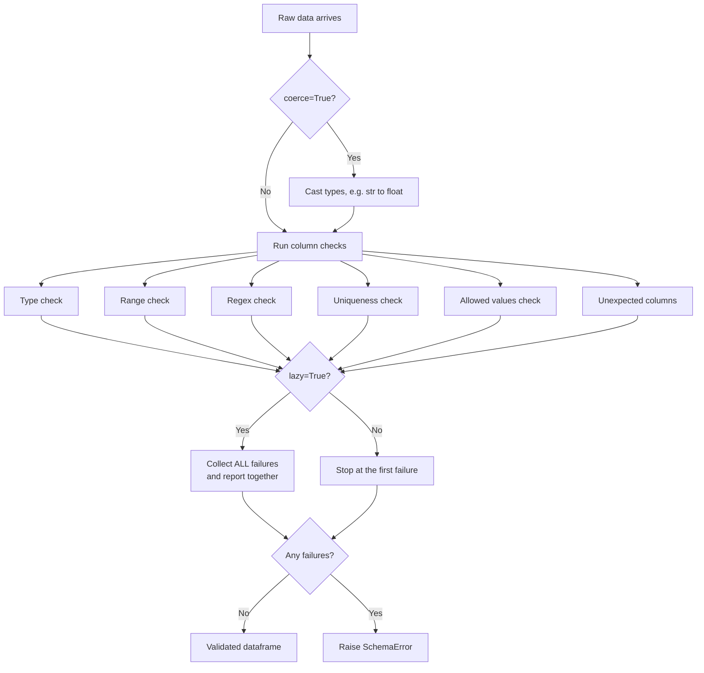

### Example 1: Define a schema

> **Import note:** use `import pandera.pandas as pa`. Importing pandas classes from top-level `pandera` now warns that it will be removed in a future version.

```python
import pandas as pd
import pandera.pandas as pa

schema = pa.DataFrameSchema(
    {
        "order_id": pa.Column(int,   pa.Check.gt(0), unique=True),
        "email":    pa.Column(str,   pa.Check.str_matches(r"^[^@\s]+@[^@\s]+\.[a-z]{2,}$")),
        "amount":   pa.Column(float, pa.Check.in_range(0.01, 10_000)),
        "status":   pa.Column(str,   pa.Check.isin(["new", "paid", "shipped", "refunded"])),
        "coupon":   pa.Column(str,   nullable=True),
    },
    strict=True,   # reject unexpected columns
    coerce=True,   # convert types where possible
)
```

### Example 2: Valid data passes (and gets coerced)

```python
good = pd.DataFrame({
    "order_id": [1, 2, 3],
    "email":    ["sana@example.com", "bilal@example.org", "zoya@example.com"],
    "amount":   ["19.99", "250", "42.5"],      # strings!
    "status":   ["new", "paid", "shipped"],
    "coupon":   [None, "SAVE10", None],
})

validated = schema.validate(good)
print(validated.dtypes.to_string())
```

`amount` was converted from strings to `float64` by `coerce=True`.

### Example 3: Collect every problem at once

```python
bad = pd.DataFrame({
    "order_id": [1, 2, 2, -4],
    "email":    ["sana@example.com", "not-an-email", "zoya@example.com", "x@y.z"],
    "amount":   [19.99, 0.0, 99999.0, 5.0],
    "status":   ["new", "paid", "lost", "shipped"],
    "coupon":   [None, None, None, None],
    "surprise": [1, 2, 3, 4],
})

try:
    schema.validate(bad, lazy=True)
except pa.errors.SchemaErrors as errors:
    report = errors.failure_cases[["column", "check", "failure_case", "index"]]
    print(f"{len(report)} problems found at once")
    print(report.to_string(index=False))
```

Result: **9 problems in a single pass** (a duplicate ID, a negative ID, two bad emails, two out-of-range amounts, an unknown status, and an unexpected column). You fix everything in one round instead of nine.

### Example 4: Class-based models with a function guard

```python
class Orders(pa.DataFrameModel):
    order_id: int   = pa.Field(gt=0, unique=True)
    amount:   float = pa.Field(ge=0)
    status:   str   = pa.Field(isin=["new", "paid"])

@pa.check_types
def total_paid(df: pa.typing.DataFrame[Orders]) -> float:
    return float(df.loc[df["status"] == "paid", "amount"].sum())

print(total_paid(pd.DataFrame({
    "order_id": [1, 2], "amount": [10.0, 5.5], "status": ["paid", "new"]
})))                                         # 10.0

try:
    total_paid(pd.DataFrame({
        "order_id": [1, 1], "amount": [10.0, -5.0], "status": ["paid", "gone"]
    }))
except pa.errors.SchemaError as e:
    print("Refused:", str(e).splitlines()[0])
```

The decorator refuses bad input **before** your function body runs.

### Example 5: A custom business rule (extra)

```python
schema = pa.DataFrameSchema({
    "start": pa.Column("datetime64[ns]"),
    "end":   pa.Column("datetime64[ns]"),
}, checks=pa.Check(lambda df: df["end"] >= df["start"],
                   error="end must not be before start"))
```

### Use cases

| Scenario | Example check |
|----------|---------------|
| **ETL pipelines** | Validate at the entry point before loading to a warehouse |
| **ML training data** | Ensure no nulls in the label column, features within expected ranges |
| **Partner data feeds** | Reject CSVs with new or missing columns |
| **Financial reports** | `amount >= 0`, valid currency codes, unique transaction IDs |

### Tradeoffs

- Validation adds a step to every run. **Validate where data enters your pipeline**, not after every transformation.
- Older tutorials use the old import path, so watch for that.

---

## 4. inline-snapshot: Tests That Write Their Own Expected Values

### The problem

Large expected outputs, such as a nested dict or a long string, are boring to type and easy to get wrong. With **inline-snapshot**, you write `snapshot()` (empty), run pytest, and the plugin **fills in the expected value inside your test file**.

### Mental model

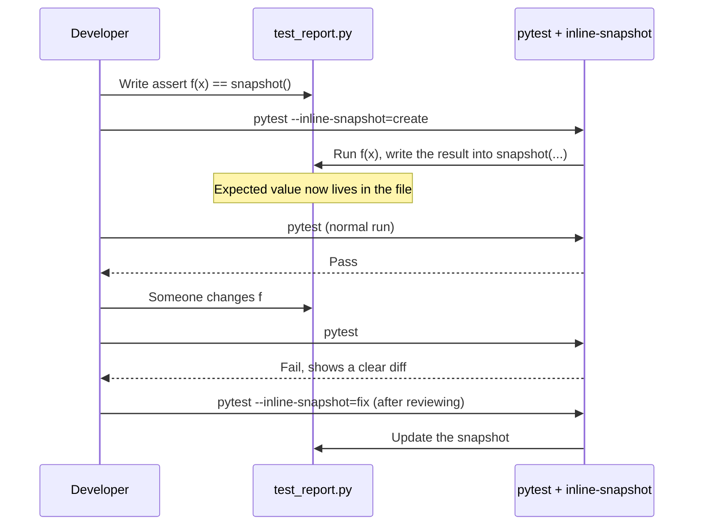

### Example 1: Create a snapshot

**`report.py`**

```python
def build_summary(orders):
    paid = [o for o in orders if o["paid"]]
    return {
        "count": len(paid),
        "revenue": round(sum(o["amount"] for o in paid), 2),
        "customers": sorted({o["customer"] for o in paid}),
        "largest": max(paid, key=lambda o: o["amount"])["id"],
    }
```

**`test_report.py`** (before the first run)

```python
from inline_snapshot import snapshot
from report import build_summary

ORDERS = [
    {"id": 1, "customer": "sana",  "amount": 120.0,  "paid": True},
    {"id": 2, "customer": "bilal", "amount": 80.5,   "paid": True},
    {"id": 3, "customer": "sana",  "amount": 45.0,   "paid": False},
    {"id": 4, "customer": "zoya",  "amount": 210.25, "paid": True},
]

def test_summary():
    assert build_summary(ORDERS) == snapshot()

def test_empty_store_message():
    assert "no orders yet".upper() == snapshot()
```

Run:

```bash
pytest -q --inline-snapshot=create
```

**`test_report.py`** (after the run, edited automatically)

```python
def test_summary():
    assert build_summary(ORDERS) == snapshot(
        {
            "count": 3,
            "revenue": 410.75,
            "customers": ["bilal", "sana", "zoya"],
            "largest": 4,
        }
    )

def test_empty_store_message():
    assert "no orders yet".upper() == snapshot("NO ORDERS YET")
```

> **Heads-up:** the first run prints `2 passed, 2 errors`. The errors say "your snapshot is missing one value." That message is expected right after `create`, because the values are now written. Run pytest again and you'll see a clean `2 passed`.

### Example 2: A change shows up as a reviewable diff

If someone changes `report.py` to round revenue to whole numbers, pytest fails with a focused diff:

```
-            "revenue": 410.75,
+            "revenue": 411,
These changes are not applied.
Use --inline-snapshot=fix to apply them, or --inline-snapshot=review
```

You decide whether the change is intentional:

| Command | What it does |
|---------|--------------|
| `pytest --inline-snapshot=create` | Fill in empty `snapshot()` calls |
| `pytest --inline-snapshot=fix` | Update snapshots that now differ |
| `pytest --inline-snapshot=review` | Approve changes interactively |

### Example 3: Snapshot a more complex structure (extra)

```python
def test_api_response_shape():
    response = {"user": {"id": 7, "roles": ["admin", "dev"]}, "ok": True}
    assert response == snapshot()
```

### Use cases

| Scenario | Why snapshots help |
|----------|--------------------|
| **API response testing** | Assert the whole JSON shape without typing it |
| **Refactoring legacy code** | Lock in current behavior, then refactor safely |
| **Report and CSV generators** | Large outputs are reviewed as diffs |
| **CLI output tests** | Capture help text or formatted tables |

### Tradeoffs

- A snapshot proves the output **didn't change**, not that it's **correct**. The first run records bugs too, so **read the generated values before committing them**.

---

## 5. time-machine: Fast Time Travel for Tests

### The problem

Code that depends on "now" (expiry, billing, overdue invoices, scheduled jobs) is hard to test. You can't wait until December 31 to see if the year-end logic works.

**time-machine** changes what the clock reports, and it's far faster than the older `freezegun`.

### Mental model

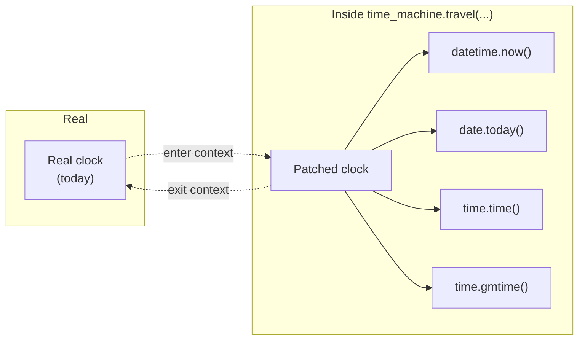

### Example 1: Decorator and context manager

```python
import datetime as dt
import time_machine

def invoice_status(due: dt.date) -> str:
    today = dt.date.today()
    if today > due:
        return f"OVERDUE by {(today - due).days} days"
    return f"due in {(due - today).days} days"

due = dt.date(2026, 12, 31)

@time_machine.travel(dt.datetime(2026, 12, 25, 9, 0, tzinfo=dt.timezone.utc))
def christmas_check():
    return invoice_status(due)

print("On Dec 25:", christmas_check())             # due in 6 days

with time_machine.travel("2027-01-10 12:00 +0000"):
    print("On Jan 10:", invoice_status(due))       # OVERDUE by 10 days
```

### Example 2: Freeze, shift, and move

```python
import time

start = dt.datetime(2026, 6, 1, 8, 0, tzinfo=dt.timezone.utc)
with time_machine.travel(start, tick=False) as traveller:
    first = dt.datetime.now(dt.timezone.utc)
    time.sleep(0.2)
    second = dt.datetime.now(dt.timezone.utc)
    print("Frozen:", first == second)                      # True

    traveller.shift(dt.timedelta(hours=36))                # relative jump
    print(dt.datetime.now(dt.timezone.utc).isoformat())    # 2026-06-02T20:00:00+00:00

    traveller.move_to(dt.datetime(2030, 1, 1, tzinfo=dt.timezone.utc))  # absolute jump
    print(dt.datetime.now(dt.timezone.utc).year)           # 2030
```

| Option | Meaning |
|--------|---------|
| `tick=False` | The clock is frozen. Two reads return the same instant. |
| `tick=True` (default) | The clock keeps moving from the new start time. |
| `.shift(delta)` | Jump relative to the current fake time |
| `.move_to(when)` | Jump to an absolute time |

### Example 3: It patches every way Python asks for time

```python
with time_machine.travel(1_800_000_000, tick=False):
    print(time.time())                               # 1800000000.0
    print(dt.datetime.now(dt.timezone.utc))          # 2027-01-15 08:00:00+00:00
    print(time.gmtime().tm_year)                     # 2027
    print(dt.date.today())                           # 2027-01-15
```

### Example 4: Timezones

```python
import zoneinfo
karachi = zoneinfo.ZoneInfo("Asia/Karachi")

with time_machine.travel(dt.datetime(2026, 3, 1, 23, 30, tzinfo=dt.timezone.utc), tick=False):
    print("UTC:    ", dt.datetime.now(dt.timezone.utc).isoformat())
    print("Karachi:", dt.datetime.now(karachi).isoformat())
# UTC:     2026-03-01T23:30:00+00:00
# Karachi: 2026-03-02T04:30:00+05:00   <- already the next day!
```

### Example 5: Test a countdown instantly

```python
def seconds_until(deadline: dt.datetime) -> float:
    return (deadline - dt.datetime.now(dt.timezone.utc)).total_seconds()

launch = dt.datetime(2026, 11, 1, tzinfo=dt.timezone.utc)
with time_machine.travel(launch - dt.timedelta(minutes=5), tick=False) as t:
    print(seconds_until(launch))                      # 300.0
    t.shift(dt.timedelta(minutes=4, seconds=30))
    print(seconds_until(launch))                      # 30.0
```

A test that "needs five minutes" finishes instantly.

### Example 6: The pytest fixture (extra)

```python
import datetime as dt

def test_subscription_expires(time_machine):
    time_machine.move_to(dt.datetime(2026, 1, 1, tzinfo=dt.timezone.utc))
    # ... create subscription valid for 30 days ...
    time_machine.shift(dt.timedelta(days=31))
    # ... assert subscription is now expired ...
```

### Benchmark vs freezegun (from the original run)

```
freezegun      3.091 ms per frozen block (300 blocks)
time-machine   0.023 ms per frozen block (300 blocks)
time-machine was 132x faster in this run
```

Treat the ratio as a guide. Your suite will give a different number.

### Use cases

| Scenario | Test you can now write |
|----------|------------------------|
| **Subscription billing** | Renewal on the 31st, leap days, year-end |
| **Token or session expiry** | Jump past the TTL instead of sleeping |
| **Cron-like schedulers** | Verify "runs every Monday 09:00" |
| **Overdue and reminder emails** | Simulate 1, 7, and 30 days late |

### Tradeoffs

- `freezegun` is still fine for small suites and has more online examples.

---

## 6. memray: Find the Line That Ate Your Memory

### The problem

Your process uses too much memory, and guessing wastes days. **memray** (from Bloomberg) records every allocation and tells you **which file and line** caused it.

### Mental model

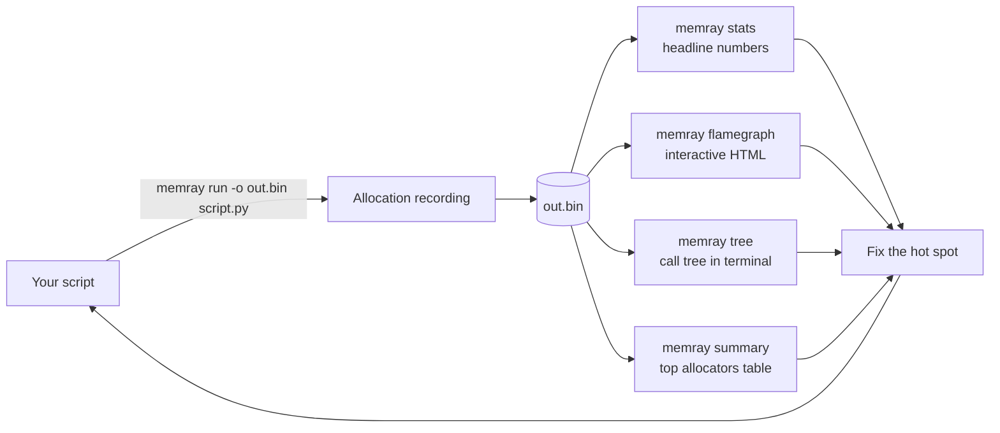

### Example 1: A deliberately wasteful script

**`leaky.py`**

```python
import json

CACHE = {}

def load_rows(n):
    return [{"id": i, "name": f"customer_{i}", "tags": ["a", "b", "c"] * 5}
            for i in range(n)]

def build_report(rows):
    # Wasteful: builds a full JSON string for every row, then joins them
    pieces = [json.dumps(row) for row in rows]
    return "\n".join(pieces)

def remember(key, value):
    # Never evicts anything, so memory grows forever
    CACHE[key] = value

def main():
    for batch in range(5):
        rows = load_rows(40_000)
        report = build_report(rows)
        remember(f"batch_{batch}", report)
    print("cache holds", len(CACHE), "reports")

if __name__ == "__main__":
    main()
```

Profile it:

```bash
memray run -o leaky.bin leaky.py
memray stats leaky.bin
memray flamegraph leaky.bin       # creates an HTML flame graph
```

**Findings:**

```
Peak memory:     59.5 MB
Total allocated: 173.0 MB in 781 allocations
Biggest allocators:
   104.8 MB  <listcomp>:leaky.py:7
    27.3 MB  iterencode:/usr/lib/python3.11/json/encoder.py:258
    24.9 MB  build_report:leaky.py:13
```

Memray points straight at line 7, the list comprehension that builds a dict for every row.

### Example 2: The fix

**`leaky_fixed.py`**

```python
import json
from functools import lru_cache

def load_rows(n):
    # Generator: yields one row at a time
    return ({"id": i, "name": f"customer_{i}", "tags": ["a", "b", "c"] * 5}
            for i in range(n))

@lru_cache(maxsize=1)                      # bounded cache: one report max
def build_report(batch):
    return "\n".join(json.dumps(row) for row in load_rows(40_000))

def main():
    for batch in range(5):
        report = build_report(batch)
    print("cache holds", build_report.cache_info().currsize, "report")

if __name__ == "__main__":
    main()
```

| Metric | Before | After |
|--------|-------:|------:|
| Peak memory | 59.5 MB | **17.7 MB** |
| Total allocated | 173.0 MB | **73.4 MB** |
| Allocations | 781 | **437** |

### Example 3: Print headline numbers from the JSON stats

```python
import json, sys

stats = json.load(open(sys.argv[1]))
mb = lambda n: f"{n / 1_000_000:.1f} MB"
print(f"Peak memory:     {mb(stats['metadata']['peak_memory'])}")
print(f"Total allocated: {mb(stats['total_bytes_allocated'])} "
      f"in {stats['total_num_allocations']:,} allocations")
for item in stats["top_allocations_by_size"][:3]:
    print(f"  {mb(item['size']):>9}  {item['location']}")
```

### Example 4: Enforce a memory budget in CI (extra)

With the `pytest-memray` plugin:

```bash
pip install pytest-memray
```

```python
import pytest

@pytest.mark.limit_memory("25 MB")
def test_report_stays_small():
    build_report(0)
```

Run with `pytest --memray`. The test fails if it exceeds the limit.

### Common memory culprits and their fixes

| Culprit | Typical fix |
|---------|-------------|
| Big list comprehension | Generator expression |
| Unbounded dict used as cache | `lru_cache(maxsize=...)` or TTL cache |
| Loading a whole file | Read in chunks / stream |
| Many small objects | `__slots__`, tuples, NumPy arrays |

### Use cases

| Scenario | Memray command |
|----------|----------------|
| Data pipeline crashing with OOM | `memray run` then `memray flamegraph` |
| Web worker slowly growing | Profile a representative request loop |
| Verifying a fix | Compare `memray stats` before and after |
| Live inspection | `memray run --live script.py` |

### Tradeoffs

- It **slows your program** while recording (about 1.8x in the original test: 0.88s to 1.62s). Profile a representative run, not production traffic.
- **Linux and macOS only.**

---

## 7. rank-bm25: Search Ranking Without a Search Server

### The problem

You have a few thousand documents and want "best match first" search. Running Elasticsearch is overkill. **rank-bm25** implements **BM25**, the classic ranking formula behind a huge share of search engines, in a few lines of pure Python.

### Why BM25 beats simple counting

BM25 scores a document higher when:

1. The query term appears **often** in it (with diminishing returns).
2. The term is **rare** across the whole collection (rare words matter more than "python" in a Python library).
3. The document is **not unusually long**.

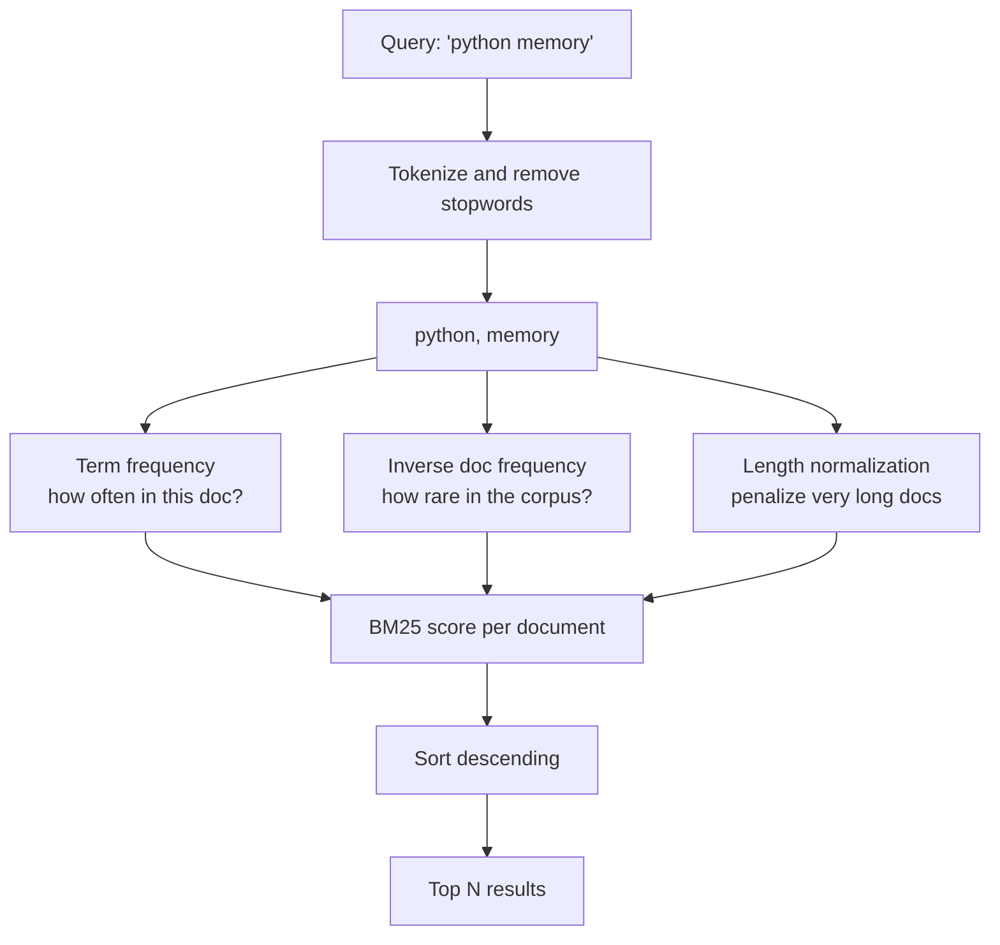

### Example 1: Build a search function

```python
import re
from rank_bm25 import BM25Okapi

docs = [
    "How to read and write CSV files in Python with the csv module",
    "Async programming in Python with asyncio and await",
    "Reading large CSV files in chunks to save memory",
    "A guide to Python decorators and closures",
    "Parsing JSON files and API responses in Python",
    "Connection pooling and async database access with asyncio",
    "Memory profiling tips for large Python data pipelines",
    "Writing unit tests in Python with pytest fixtures",
]
STOP = {"a", "to", "in", "and", "with", "the", "of", "how", "for", "on"}

def tokenize(text):
    return [w for w in re.findall(r"[a-z0-9]+", text.lower()) if w not in STOP]

corpus = [tokenize(d) for d in docs]
bm25 = BM25Okapi(corpus)

def search(query, top=3):
    scores = bm25.get_scores(tokenize(query))
    ranked = sorted(range(len(docs)), key=lambda i: scores[i], reverse=True)[:top]
    return [(round(float(scores[i]), 2), docs[i]) for i in ranked if scores[i] > 0]

for q in ["read csv file", "async database", "memory large data", "pytest", "kubernetes"]:
    print(f"\nQuery: {q!r}")
    results = search(q)
    if not results:
        print("  (no matches)")
    for score, doc in results:
        print(f"  {score:5.2f}  {doc}")
```

**Output:**

```
Query: 'async database'
   2.56  Connection pooling and async database access with asyncio
   1.03  Async programming in Python with asyncio and await

Query: 'kubernetes'
  (no matches)
```

The document with **both** query words ranks first. A query with no matches honestly returns nothing.

### Example 2: Ranking vs naive overlap

```python
query = tokenize("python memory")
overlap = sorted(range(len(docs)), key=lambda i: -len(set(query) & set(corpus[i])))[:3]

print("Naive overlap:")
for i in overlap:
    print("  ", len(set(query) & set(corpus[i])), docs[i])

print("BM25:")
for score, doc in search("python memory"):
    print(f"  {score:5.2f}  {doc}")
```

Naive overlap produces a flat tie after the first result. BM25 pushes "Reading large CSV files... save memory" above documents that match only the very common word *python*.

### Example 3: `get_top_n` shortcut

```python
print(bm25.get_top_n(tokenize("async await"), docs, n=2))
```

### Example 4: Add simple stemming (fixes the "Reading ≠ read" gap)

```python
def stem(word):
    for suffix in ("ing", "ed", "es", "s"):
        if word.endswith(suffix) and len(word) - len(suffix) >= 3:
            return word[: -len(suffix)]
    return word

def tokenize(text):
    return [stem(w) for w in re.findall(r"[a-z0-9]+", text.lower()) if w not in STOP]

corpus = [tokenize(d) for d in docs]
bm25 = BM25Okapi(corpus)          # rebuild the index with the new tokenizer
```

For serious stemming, use NLTK's `PorterStemmer` or a snowball stemmer.

### Example 5: Retrieval for question answering (RAG)

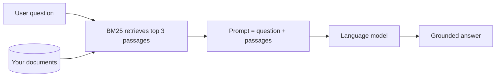

```python
def build_prompt(question, k=3):
    passages = [doc for _, doc in search(question, top=k)]
    context = "\n".join(f"- {p}" for p in passages)
    return f"Answer using only this context:\n{context}\n\nQuestion: {question}"
```

### Use cases

| Scenario | Why BM25 fits |
|----------|---------------|
| **Docs / help-center search** | A few thousand pages, no infrastructure |
| **Retrieval step in RAG** | Fast, explainable first-stage retrieval |
| **Searching your own notes or tickets** | Runs entirely in memory |
| **Duplicate or related-article suggestions** | Use a title as the query |

### Tradeoffs

- **No stemming** by default; you write the tokenizer.
- Adding documents means **rebuilding the index**.
- Past a few hundred thousand documents, use a real search engine.

---

## 8. trafilatura: Clean Article Text from Messy HTML

### The problem

A web page contains navigation, cookie banners, ads, comments, footers, and tracking scripts. The article is a small part of it. Raw HTML is a poor input for search, summarization, or language models.

**trafilatura** finds the main content, drops the clutter, and extracts metadata (title, author, date).

### Mental model

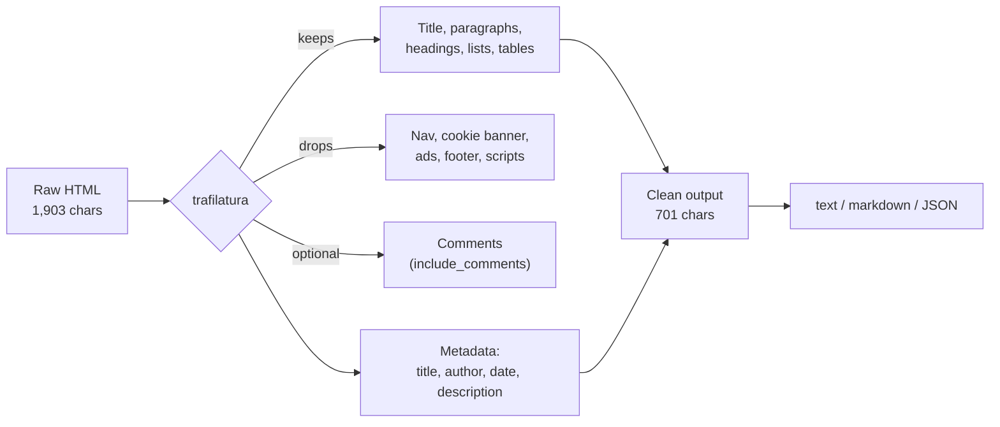

### Example 1: Extract text from a messy page

```python
import json
import trafilatura
from trafilatura import extract, extract_metadata

html = """<!DOCTYPE html>
<html lang="en"><head>
  <title>Why Caching Matters | Dev Weekly</title>
  <meta name="author" content="Sana Malik">
  <meta name="description" content="A short guide to caching.">
  <meta property="article:published_time" content="2026-09-14">
  <script>window.tracking = {id: 4412};</script>
</head>
<body>
  <header><nav><a href="/">Home</a> <a href="/login">Log in</a></nav></header>
  <div class="cookie-banner">We use cookies. <button>Accept all</button></div>
  <main>
    <article>
      <h1>Why Caching Matters</h1>
      <p>Every request that reaches your database costs time and money. A cache stores the answer to a question you have already asked, so the second request is nearly free.</p>
      <h2>Where to cache first</h2>
      <p>Start with data that is expensive to compute and rarely changes, such as configuration, permission lists, and report totals. Measure before and after, because a cache that nobody hits is just extra memory.</p>
      <ul><li>Cache reads, not writes</li><li>Set a time to live</li><li>Log your hit rate</li></ul>
      <table><tr><th>Layer</th><th>Typical delay</th></tr><tr><td>Memory</td><td>microseconds</td></tr><tr><td>Network cache</td><td>milliseconds</td></tr></table>
      <p>The hardest part is invalidation. When the source changes, the cached copy must change too, or users will see stale numbers.</p>
    </article>
    <aside class="ad">Buy our premium plan today! Limited offer, 50% off!</aside>
    <section class="comments"><h3>Comments</h3><p>Great post, thanks for sharing! - Alex</p></section>
  </main>
  <footer>Copyright 2026 Dev Weekly. Privacy Policy | Terms</footer>
</body></html>"""

text = extract(html, include_comments=False, include_tables=True)
print(f"Raw: {len(html):,} chars -> Extracted: {len(text):,} chars")
print(text)
```

The cookie banner, ad, navigation, footer, and tracking script are gone. The list and table survive.

### Example 2: Keep structure as Markdown

```python
markdown = extract(html, output_format="markdown",
                   include_tables=True, include_formatting=True)
print(markdown)
```

> **Gotcha from the original run:** comments are **included** unless you pass `include_comments=False`. Defaults matter.

### Example 3: Metadata only

```python
meta = extract_metadata(html)
print(meta.title)        # Why Caching Matters
print(meta.author)       # Sana Malik
print(meta.date)         # 2026-09-14
print(meta.description)  # A short guide to caching.
```

### Example 4: JSON for pipelines

```python
as_json = json.loads(extract(html, output_format="json", with_metadata=True))
print({k: as_json[k] for k in ("title", "author", "date") if k in as_json})
```

### Example 5: Verify the junk is gone

```python
for junk in ["Accept all", "Buy our premium", "Great post", "Privacy Policy", "tracking"]:
    print(f"{junk!r:<20} still in text: {junk in text}")   # all False
```

### Example 6: Fetch a real URL and extract (extra)

```python
downloaded = trafilatura.fetch_url("https://example.com/some-article")
if downloaded:
    print(extract(downloaded, output_format="markdown"))
```

### Use cases

| Scenario | Why it helps |
|----------|--------------|
| **Feeding an LLM or RAG system** | Clean text, no boilerplate tokens wasted |
| **News or blog aggregators** | Consistent title, author, date |
| **Archiving or "read later" tools** | Strip clutter, keep structure |
| **Training data collection** | Quality text from messy crawls |

### Tradeoffs

- It uses **heuristics**; odd layouts can lose real content, so **spot-check a sample**.
- In the original run, `language` came back `None` even though the page declared `lang="en"`. Don't rely on that field.

---

## 9. lark: Build Your Own Mini Language

### The problem

Users want to type conditions such as `price > 30 and category = "books"`. The tempting solution is `eval()`, which is dangerous. A hand-written parser becomes a bug farm.

**lark** lets you describe the language in a **grammar** and get a fast parser back. A **transformer** then converts the parse tree into whatever you need, such as a real Python function, with no `eval` anywhere.

### Mental model

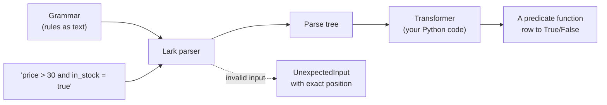

### Step 0: A warm-up grammar (a calculator)

Start small to learn the pattern:

```python
from lark import Lark, Transformer, v_args

CALC = r"""
    ?start: sum
    ?sum: product
        | sum "+" product -> add
        | sum "-" product -> sub
    ?product: atom
        | product "*" atom -> mul
        | product "/" atom -> div
    ?atom: NUMBER          -> number
         | "-" atom        -> neg
         | "(" sum ")"
    %import common.NUMBER
    %import common.WS
    %ignore WS
"""

@v_args(inline=True)
class Calc(Transformer):
    number = float
    def add(self, a, b): return a + b
    def sub(self, a, b): return a - b
    def mul(self, a, b): return a * b
    def div(self, a, b): return a / b
    def neg(self, a):    return -a

calc = Lark(CALC, parser="lalr")
print(Calc().transform(calc.parse("2 + 3 * (4 - 1)")))   # 11.0
```

Rule order encodes **precedence**: `*` and `/` are deeper in the grammar than `+` and `-`, so they bind tighter.

### The main project: a product filter language

```python
from lark import Lark, Transformer, UnexpectedInput, v_args

GRAMMAR = r"""
    ?start: or_expr
    ?or_expr: and_expr ("or"i and_expr)*
    ?and_expr: not_expr ("and"i not_expr)*
    ?not_expr: "not"i not_expr -> negate
             | comparison
             | "(" or_expr ")"
    comparison: FIELD OP value
              | FIELD "in"i "[" value ("," value)* "]" -> membership
    ?value: NUMBER -> number
          | ESCAPED_STRING -> string
          | "true"i -> true
          | "false"i -> false
    FIELD: /[a-z_][a-z0-9_]*/i
    OP: ">=" | "<=" | "!=" | "=" | ">" | "<" | "~"
    %import common.NUMBER
    %import common.ESCAPED_STRING
    %import common.WS
    %ignore WS
"""

parser = Lark(GRAMMAR, parser="lalr", start="start")
```

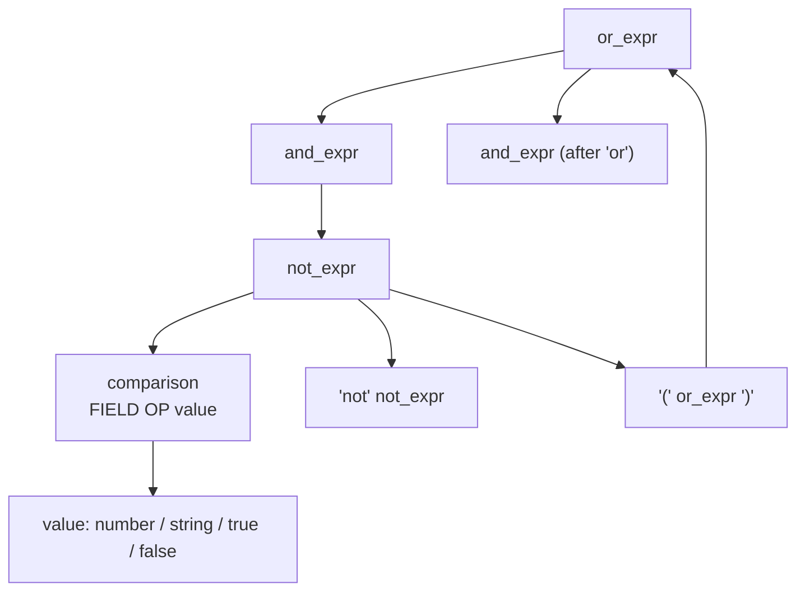

### Turn the tree into a function

```python
@v_args(inline=True)
class ToPredicate(Transformer):
    def number(self, n):  return float(n)
    def string(self, s):  return s[1:-1]
    def true(self):       return True
    def false(self):      return False

    def comparison(self, field, op, value):
        field, op = str(field), str(op)
        ops = {
            ">":  lambda a, b: a > b,   "<":  lambda a, b: a < b,
            ">=": lambda a, b: a >= b,  "<=": lambda a, b: a <= b,
            "=":  lambda a, b: a == b,  "!=": lambda a, b: a != b,
            "~":  lambda a, b: str(b).lower() in str(a).lower(),
        }
        return lambda row: field in row and ops[op](row[field], value)

    def membership(self, field, *values):
        field = str(field)
        return lambda row: row.get(field) in values

    def negate(self, inner):     return lambda row: not inner(row)
    def and_expr(self, *parts):  return lambda row: all(p(row) for p in parts)
    def or_expr(self, *parts):   return lambda row: any(p(row) for p in parts)

def compile_filter(text):
    return ToPredicate().transform(parser.parse(text))
```

### Run it

```python
products = [
    {"name": "Python Cookbook",      "category": "books",   "price": 45.0, "rating": 4.7, "in_stock": True},
    {"name": "USB Hub",              "category": "gadgets", "price": 29.0, "rating": 4.1, "in_stock": True},
    {"name": "Mechanical Keyboard",  "category": "gadgets", "price": 89.0, "rating": 4.8, "in_stock": False},
    {"name": "Clean Code",           "category": "books",   "price": 38.0, "rating": 4.4, "in_stock": True},
    {"name": "Desk Lamp",            "category": "home",    "price": 24.0, "rating": 3.9, "in_stock": True},
]

queries = [
    'price > 30 and category = "books"',
    'category in ["gadgets", "home"] and in_stock = true',
    '(price < 30 or rating >= 4.7) and not category = "home"',
    'name ~ "key" or name ~ "lamp"',
]
for q in queries:
    print(q, "->", [p["name"] for p in products if compile_filter(q)(p)])
```

**Output:**

```
price > 30 and category = "books"                       -> ['Python Cookbook', 'Clean Code']
category in ["gadgets", "home"] and in_stock = true     -> ['USB Hub', 'Desk Lamp']
(price < 30 or rating >= 4.7) and not category = "home" -> ['Python Cookbook', 'USB Hub', 'Mechanical Keyboard']
name ~ "key" or name ~ "lamp"                           -> ['Mechanical Keyboard', 'Desk Lamp']
```

### Inspect the parse tree

```python
print(parser.parse("price > 30 and in_stock = true").pretty())
```

```
and_expr
  comparison
    price
    >
    number 30
  comparison
    in_stock
    =
    true
```

### Errors with a caret at the exact spot

```python
for bad in ['price >> 30', 'category = ', 'price > 30 and (rating < 5']:
    try:
        compile_filter(bad)
    except UnexpectedInput as error:
        print(f"Bad query {bad!r}:")
        print(error.get_context(bad, span=12).rstrip())
```

```
Bad query 'price >> 30':
price >> 30
       ^
```

### Use cases

| Scenario | Example |
|----------|---------|
| **Admin-tool search boxes** | `status = "open" and priority >= 3` |
| **Rule engines** | `amount > 1000 and country in ["PK","IN"]` |
| **Config or DSL formats** | Custom workflow or pipeline definitions |
| **Safe formula fields** | User-defined calculations in a spreadsheet-like UI |

### Why avoiding `eval` matters

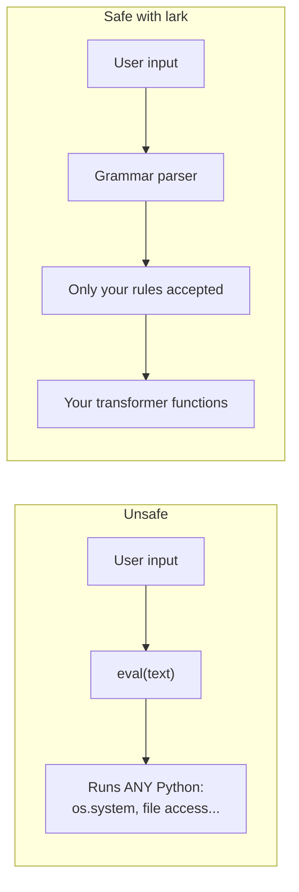

A user-typed query never reaches Python's interpreter, so there is nothing to inject.

### Tradeoffs

- Writing grammars takes practice. **Build one rule at a time and test as you go.**
- Ambiguous rules can fail in confusing ways.
- For a tiny format, `json` or `tomllib` is simpler.

---

## Capstone: Combining Libraries

These tools compose well. Here is a mini pipeline that **scrapes articles → validates them → makes them searchable → tests the whole thing**.

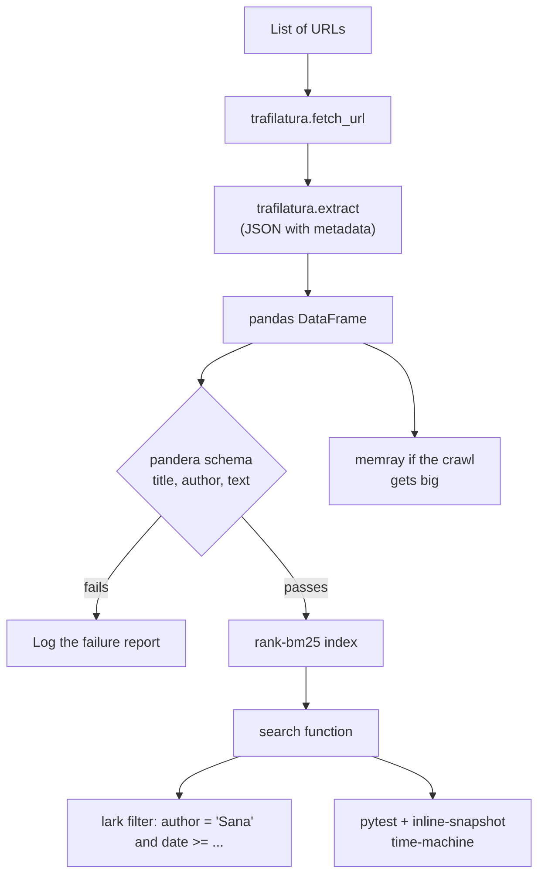

A skeleton you can extend:

```python
import json
import pandas as pd
import pandera.pandas as pa
import trafilatura
from rank_bm25 import BM25Okapi

schema = pa.DataFrameSchema({
    "title": pa.Column(str, pa.Check.str_length(min_value=3)),
    "author": pa.Column(str, nullable=True),
    "text": pa.Column(str, pa.Check.str_length(min_value=200)),
}, coerce=True)

def collect(urls):
    rows = []
    for url in urls:
        html = trafilatura.fetch_url(url)
        if not html:
            continue
        data = trafilatura.extract(html, output_format="json",
                                   with_metadata=True, include_comments=False)
        if data:
            rows.append(json.loads(data))
    return pd.DataFrame(rows)

def build_index(df):
    df = schema.validate(df, lazy=True)
    corpus = [t.lower().split() for t in df["text"]]
    return BM25Okapi(corpus), df
```

---

## Cheat Sheet

| Library | One-liner | Key call | Watch out for |
|---------|-----------|----------|---------------|
| **sqlglot** | Parse, translate, edit SQL | `transpile(sql, read=, write=)` | Test translated queries on the real DB |
| **narwhals** | One API for many dataframe libs | `@nw.narwhalify` | Only a subset of features |
| **pandera** | Validate dataframes | `schema.validate(df, lazy=True)` | Use `pandera.pandas` import |
| **inline-snapshot** | Self-filling expected values | `== snapshot()` + `--inline-snapshot=create` | Snapshots can lock in bugs |
| **time-machine** | Fast fake clock | `time_machine.travel(when, tick=False)` | Benchmark ratios vary |
| **memray** | Line-level memory profiler | `memray run -o out.bin script.py` | Slows the run; Linux/macOS only |
| **rank-bm25** | In-memory ranked search | `BM25Okapi(corpus).get_scores(q)` | No stemming; rebuild on new docs |
| **trafilatura** | Clean text from HTML | `extract(html, output_format="markdown")` | Comments included by default |
| **lark** | Grammar-based parsers | `Lark(GRAMMAR, parser="lalr")` | Grammars take practice |

---

## Practice Exercises

1. **sqlglot:** Write a function that takes any SQL string and returns every table it reads from. Test it with a query containing a `JOIN` and a subquery.
2. **narwhals:** Write one function `top_n(df, col, n)` that works on both pandas and Polars, and prove it with both.
3. **pandera:** Build a schema for a CSV you own. Run it with `lazy=True` and count how many problems appear.
4. **inline-snapshot:** Snapshot the output of a function that returns a nested dict, then change the function and review the diff.
5. **time-machine:** Test a "free trial expires after 14 days" function without waiting, including the exact boundary day.
6. **memray:** Profile one of your own scripts, find the top allocator, and try to cut peak memory by 30%.
7. **rank-bm25:** Index 20 of your own notes, add a stemmer, and compare results before and after.
8. **trafilatura:** Extract three real articles, then check which of them still contain comment text.
9. **lark:** Extend the filter grammar with a `between` operator (`price between 10 and 50`).

---

## Final Thoughts

None of these nine is famous, but each one removes a job that would otherwise cost you a week of fragile code:

- A **SQL tree** instead of regular expressions
- A **schema** instead of silent bad data
- A **grammar** instead of `eval`
- A **line-level profile** instead of guessing

Equally important is knowing each tool's limits: sqlglot translations need checking, snapshots can lock in a bug, and trafilatura keeps comments unless you turn them off. Knowing the limits is what lets you trust a tool.

**Your next step:** pick the one that matches a problem you have *right now* and try it on real data this week.