# Designing REST APIs with Spring Boot: 8 Lessons for APIs Developers Love - Complete Tutorial

> **An API is a promise.** Every inconsistency costs time, every breaking change costs trust.

| Meta | Details |
|------|---------|
| Difficulty | Intermediate |
| Reading Time | ~90-120 min + 3-4h labs |
| Last Updated | 2026-10-16 |
| Stack | Spring Boot 3.2+, Java 17/21, Bucket4j 8.x, springdoc 2.x |

## Table of Contents
- [1. Introduction](#1-introduction--overview)
- [2. Prerequisites](#2-prerequisites)
- [3. Learning Objectives](#3-learning-objectives)
- [4. Big Idea](#5-setup-and-the-big-idea-reduce-surprise)
- [5. Lesson 1 Nouns+Verbs](#6-lesson-1)
- [6. Lesson 2 Status Codes](#7-lesson-2)
- [7. Lesson 3 ProblemDetail](#8-lesson-3)
- [8. Lesson 4 Versioning](#9-lesson-4)
- [9. Lesson 5 Pagination](#10-lesson-5)
- [10. Lesson 6 Idempotency](#11-lesson-6)
- [11. Lesson 7 Rate Limiting](#12-lesson-7)
- [12. Lesson 8 Docs](#13-lesson-8)
- [13. Putting Together](#14-putting-it-all-together)
- [14. Best Practices](#15-best-practices)
- [15. Anti-Patterns](#16-anti-patterns)
- [16. Performance](#17-performance)
- [17. Security](#18-security)
- [18. Testing](#19-testing-strategies)
- [19. Migration](#20-migration-guide)
- [20. Troubleshooting](#21-troubleshooting)
- [21. Labs](#22-hands-on-labs)
- [22. Test Understanding](#23-test-your-understanding)
- [23. Question Bank](#24-question-bank)
- [24. Interview Q&A](#25-common-interview-questions)
- [25. Checklist](#26-api-design-checklist)
- [26. Summary](#27-summary)
- [27. Further Reading](#28-further-reading)

## 1. Introduction / Overview
Getting an endpoint to return data is easy. Making an API usable **without messaging you for help** is hard. This deep-dive covers 8 lessons with Spring Boot code, diagrams, and real-world cases.

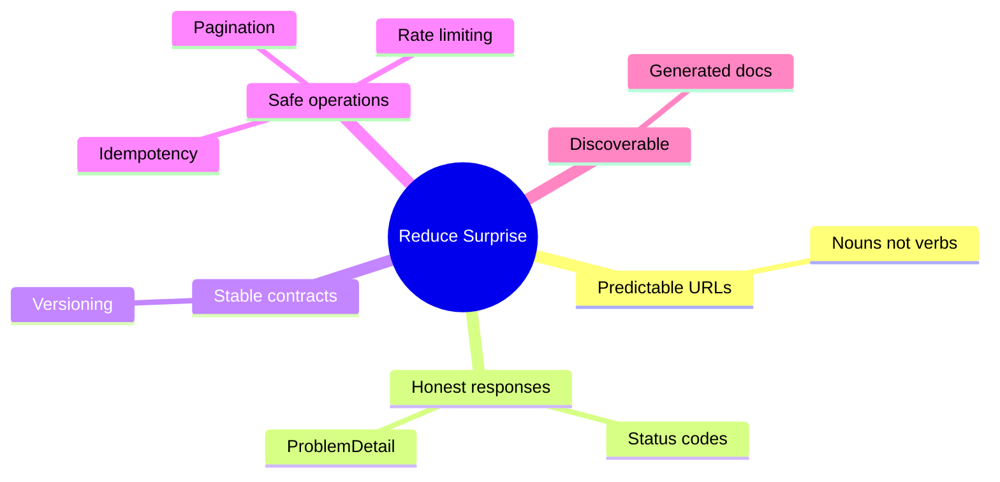

| # | Lesson | Answers | Tool |
|---|--------|---------|------|
| 1 | Nouns+verbs | What is it called? | RequestMapping |
| 2 | Status codes | Did it work? | ResponseEntity |
| 3 | ProblemDetail | What did I send wrong? | RestControllerAdvice |
| 4 | Versioning | Why did it break? | /v1/, /v2/ |
| 5 | Pagination | Why timeout? | Pageable, keyset |
| 6 | Idempotency | Why charged twice? | Idempotency-Key |
| 7 | Rate limiting | Why slow for all? | Bucket4j |
| 8 | Docs | How do I call it? | springdoc-openapi |

## 2. Prerequisites
- Basic Java (records, lambdas, streams), Basic Spring Boot, HTTP basics.
- Java 17+ (21 rec), Spring Boot 3.2+, Spring Data JPA 3.2+, Bucket4j 8.x, springdoc 2.x.

```xml
<dependencies>
    <dependency><groupId>org.springframework.boot</groupId><artifactId>spring-boot-starter-web</artifactId></dependency>
    <dependency><groupId>org.springframework.boot</groupId><artifactId>spring-boot-starter-validation</artifactId></dependency>
    <dependency><groupId>org.springframework.boot</groupId><artifactId>spring-boot-starter-data-jpa</artifactId></dependency>
</dependencies>
```

## 3. Learning Objectives
1. Design noun URLs + correct methods. 2. Return honest codes. 3. Build RFC9457 errors. 4. Version via URL. 5. Offset+keyset pagination. 6. Idempotency-Key safely. 7. Bucket4j limits. 8. OpenAPI docs. 9. Evaluate trade-offs.

## 5. Setup and The Big Idea: Reduce Surprise

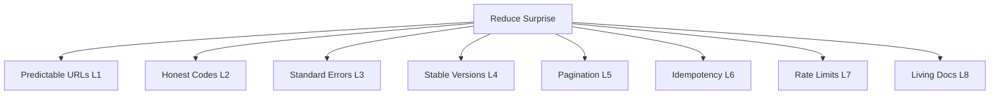

## 6. Lesson 1: Nouns for Resources, Verbs for Actions

```java
// WRONG: verbs in URLs
@PostMapping("/createUser")
@GetMapping("/getUserById")
@PostMapping("/deleteUser")
```

```java
// CORRECT
@RestController
@RequestMapping("/api/v1/users")
public class UserController {
    private final UserService userService;
    public UserController(UserService s) { this.userService = s; }

    @PostMapping
    public ResponseEntity<UserResponse> create(@Valid @RequestBody CreateUserRequest r) {
        UserResponse c = userService.create(r);
        return ResponseEntity.created(URI.create("/api/v1/users/" + c.id())).body(c);
    }
    @GetMapping("/{id}")
    public UserResponse getById(@PathVariable Long id) { return userService.findById(id); }
    @PatchMapping("/{id}")
    public UserResponse update(@PathVariable Long id, @Valid @RequestBody UpdateUserRequest r) {
        return userService.update(id, r);
    }
    @DeleteMapping("/{id}")
    public ResponseEntity<Void> delete(@PathVariable Long id) {
        userService.delete(id); return ResponseEntity.noContent().build();
    }
}
```

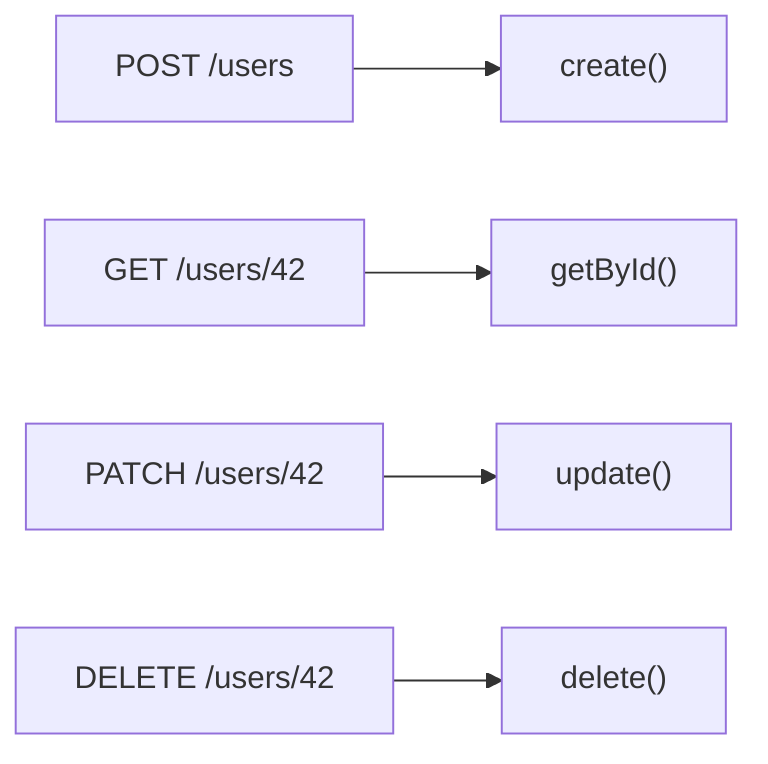

| Method | Safe | Idempotent | Use |
|--------|------|------------|-----|
| GET | Yes | Yes | Read |
| POST | No | No | Create |
| PUT | No | Yes | Replace |
| PATCH | No | Usually | Partial |
| DELETE | No | Yes | Remove |

Nested: `GET /api/v1/users/42/orders`, `GET /api/v1/users/42/orders/7`. Actions: `PATCH /orders/7 {"status":"CANCELLED"}` or `POST /orders/7/cancellation`. Filters: `GET /users?role=ADMIN&sort=createdAt,desc`.

Rules: plural nouns, kebab-case `/order-items`, lowercase, max 2-3 nesting.

## 7. Lesson 2: Status Codes

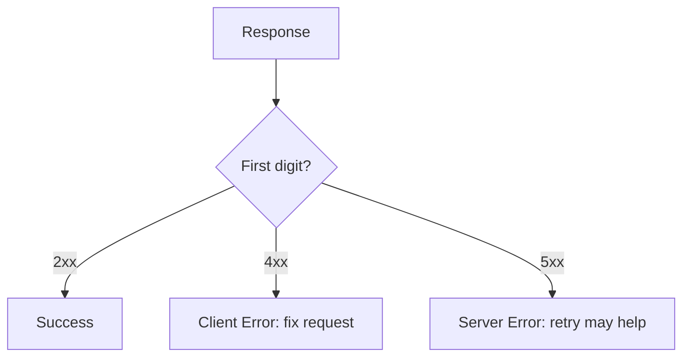

| Code | When |
|------|------|
| 200 | Read/update OK |
| 201 | Created + Location |
| 204 | Deleted, no body |
| 400 | Bad input |
| 401 | Who are you? |
| 403 | I know you, no |
| 404 | Missing |
| 409 | Duplicate/conflict |
| 422 | Valid syntax, bad semantics |
| 429 | Rate limited |
| 500/503 | Our fault / temp down |

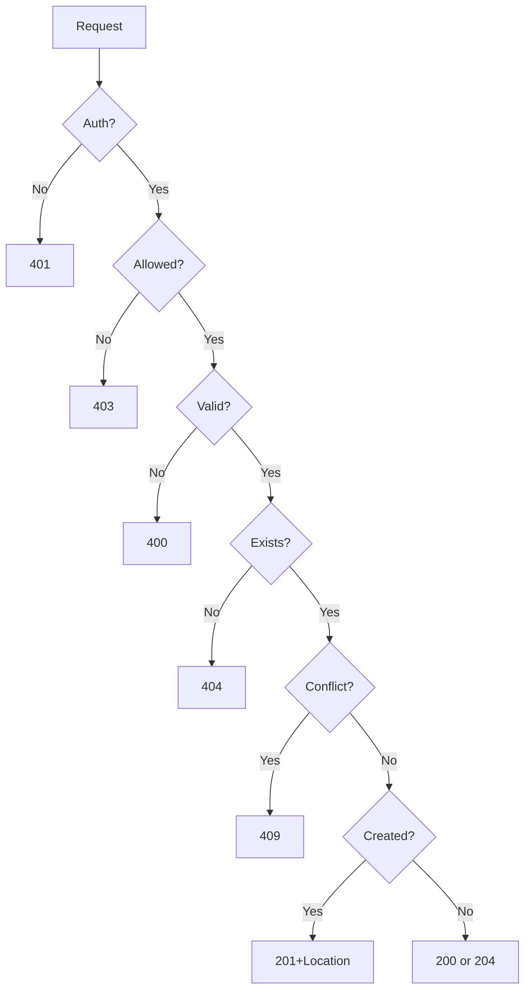

```java
@PostMapping
public ResponseEntity<UserResponse> create(@Valid @RequestBody CreateUserRequest r) {
    UserResponse c = userService.create(r);
    URI loc = ServletUriComponentsBuilder.fromCurrentRequest().path("/{id}").buildAndExpand(c.id()).toUri();
    return ResponseEntity.created(loc).body(c);
}
@DeleteMapping("/{id}")
public ResponseEntity<Void> delete(@PathVariable Long id) {
    userService.delete(id); return ResponseEntity.noContent().build();
}
@ResponseStatus(HttpStatus.NOT_FOUND)
public class UserNotFoundException extends RuntimeException {
    public UserNotFoundException(Long id) { super("No user exists with id " + id); }
}
```

## 8. Lesson 3: ProblemDetail RFC9457

Good error: type/title/status/detail/instance + errors/traceId.

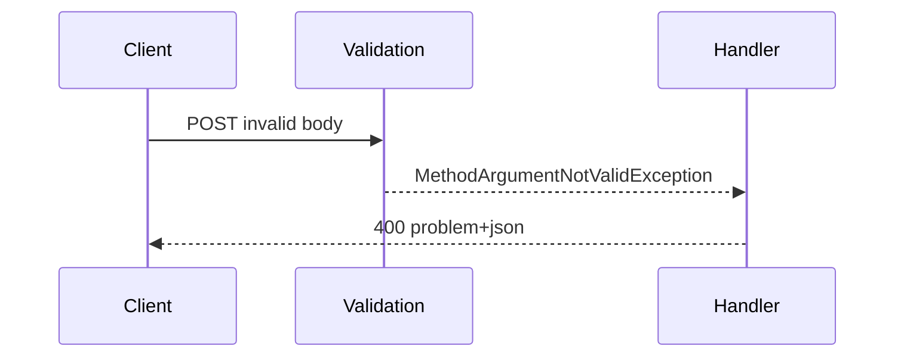

```java
public record CreateUserRequest(
  @NotBlank(message="name is required") String name,
  @Email(message="must be well-formed") @NotBlank(message="email is required") String email,
  @Positive(message="must be greater than 0") int age) {}

@RestControllerAdvice
public class GlobalExceptionHandler {
    private static final String BASE = "https://api.example.com/errors/";
    @ExceptionHandler(MethodArgumentNotValidException.class)
    public ProblemDetail handleValidation(MethodArgumentNotValidException ex) {
        ProblemDetail p = ProblemDetail.forStatusAndDetail(HttpStatus.BAD_REQUEST, "The request body contains invalid fields.");
        p.setTitle("Validation failed");
        p.setType(URI.create(BASE + "validation-failed"));
        Map<String,String> errors = new LinkedHashMap<>();
        ex.getBindingResult().getFieldErrors().forEach(e -> errors.put(e.getField(), e.getDefaultMessage()));
        p.setProperty("errors", errors);
        return p;
    }
    @ExceptionHandler(UserNotFoundException.class)
    public ProblemDetail handleNotFound(UserNotFoundException ex) {
        ProblemDetail p = ProblemDetail.forStatusAndDetail(HttpStatus.NOT_FOUND, ex.getMessage());
        p.setTitle("User not found"); p.setType(URI.create(BASE + "user-not-found")); return p;
    }
    @ExceptionHandler(DuplicateEmailException.class)
    public ProblemDetail handleDup(DuplicateEmailException ex) {
        ProblemDetail p = ProblemDetail.forStatusAndDetail(HttpStatus.CONFLICT, ex.getMessage());
        p.setTitle("Duplicate email"); p.setType(URI.create(BASE + "duplicate-email")); return p;
    }
    @ExceptionHandler(Exception.class)
    public ProblemDetail handleUnexpected(Exception ex) {
        String traceId = UUID.randomUUID().toString();
        ProblemDetail p = ProblemDetail.forStatusAndDetail(HttpStatus.INTERNAL_SERVER_ERROR, "Unexpected error. Quote traceId for support.");
        p.setTitle("Internal server error"); p.setProperty("traceId", traceId); return p;
    }
}
```

```properties
spring.mvc.problemdetails.enabled=true
```

## 9. Lesson 4: Version From Day One
Golden rule: never break within a version. Safe: add optional field/endpoint. Breaking: remove/rename/type-change/required/status-semantics.

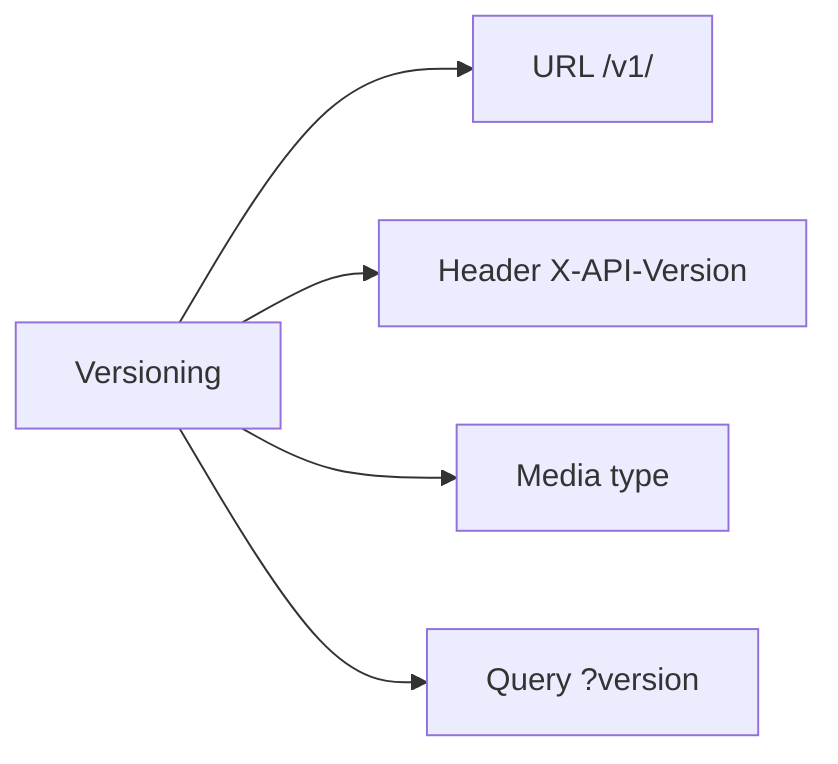

URL path recommended: visible, testable, routable.

```java
@RestController @RequestMapping("/api/v1/orders")
public class OrderControllerV1 {
    private final OrderService svc; public OrderControllerV1(OrderService s){this.svc=s;}
    @GetMapping("/{id}") public OrderResponseV1 get(@PathVariable Long id){return OrderResponseV1.from(svc.findById(id));}
}
@RestController @RequestMapping("/api/v2/orders")
public class OrderControllerV2 {
    private final OrderService svc; public OrderControllerV2(OrderService s){this.svc=s;}
    @GetMapping("/{id}") public OrderResponseV2 get(@PathVariable Long id){return OrderResponseV2.from(svc.findById(id));}
}
public record OrderResponseV1(Long id, String address, double total) {}
public record OrderResponseV2(Long id, AddressDto shippingAddress, MoneyDto total) {}
```

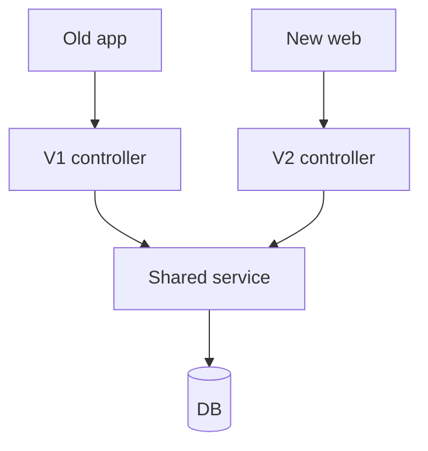

Deprecate: `Deprecation:true`, `Sunset:<date>`, `Link:</api/v2/orders>; rel=successor-version`.

## 10. Lesson 5: Paginate Every List

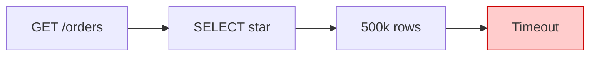

```java
@GetMapping
public Page<OrderResponse> list(@PageableDefault(size=20, sort="createdAt", direction=Sort.Direction.DESC) Pageable p){
    return orderService.findAll(p);
}
```

```properties
spring.data.web.pageable.max-page-size=100
spring.data.web.pageable.default-page-size=20
```

Offset: simple + jump, but slow deep + dups on insert + COUNT cost.

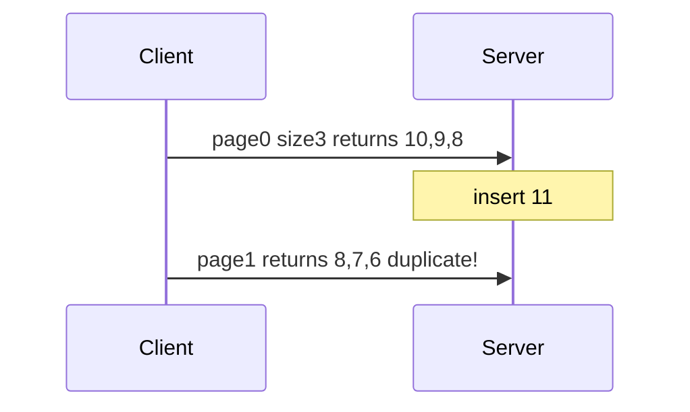

Keyset:

```java
public interface OrderRepository extends JpaRepository<Order,Long>{
    List<Order> findByIdGreaterThanOrderByIdAsc(Long lastId, Limit limit);
}
public record CursorPage<T>(List<T> items, Long nextCursor, boolean hasMore) {}
@GetMapping("/scroll")
public CursorPage<OrderResponse> scroll(@RequestParam(defaultValue="0") Long after, @RequestParam(defaultValue="20") @Max(100) int size){
    List<Order> o = orderRepository.findByIdGreaterThanOrderByIdAsc(after, Limit.of(size+1));
    boolean more = o.size() > size;
    List<Order> page = more ? o.subList(0,size) : o;
    Long next = page.isEmpty()? null : page.get(page.size()-1).getId();
    return new CursorPage<>(page.stream().map(OrderResponse::from).toList(), next, more);
}
```

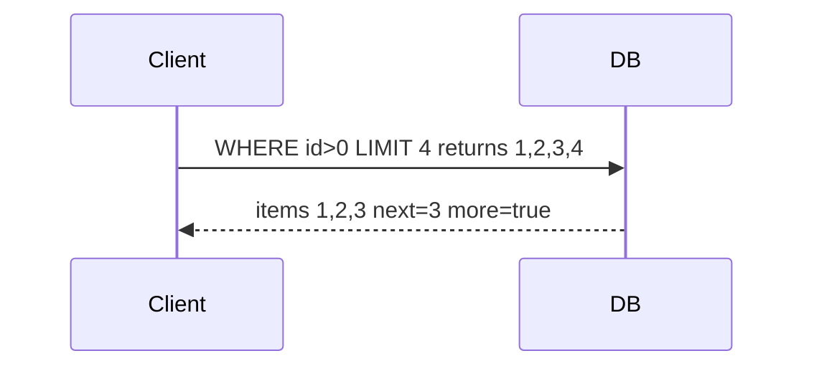

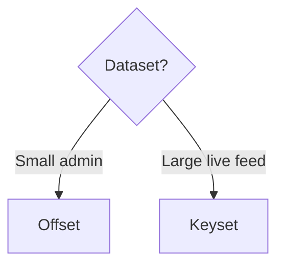

Composite cursor for createdAt ties: WHERE createdAt less OR equal-plus-id.

## 11. Lesson 6: Idempotency

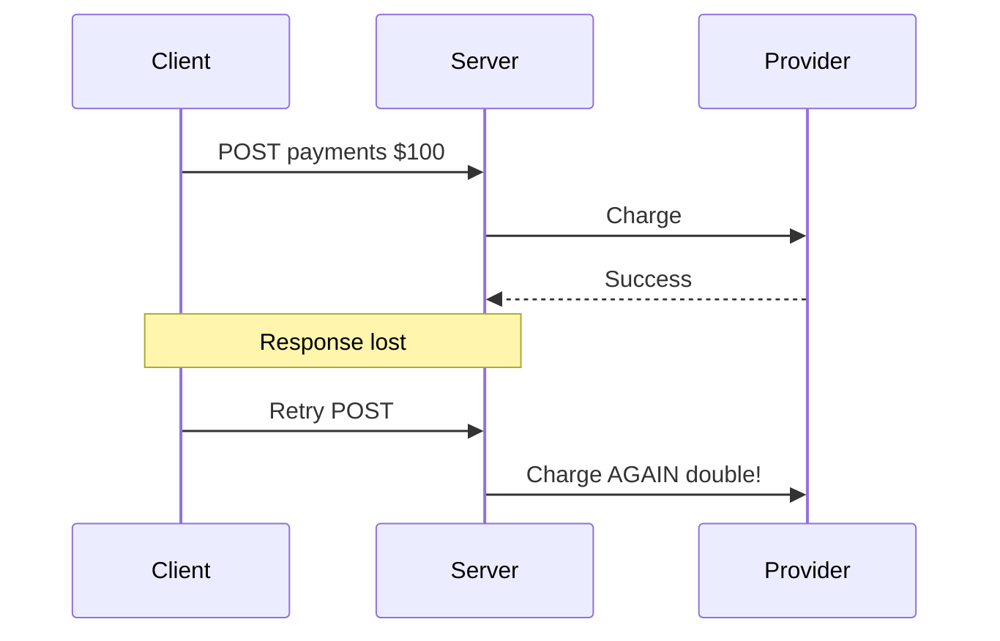

Fix: client UUID `Idempotency-Key`, server stores response, replays.

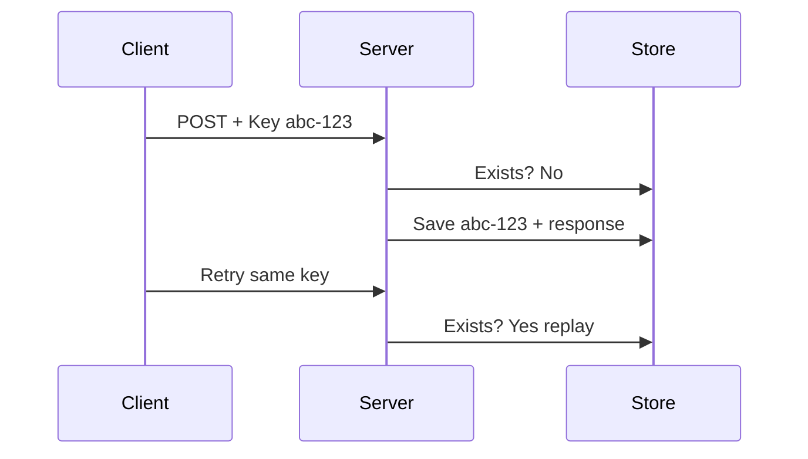

```java
@PostMapping("/api/v1/payments")
public ResponseEntity<PaymentResponse> create(@RequestHeader("Idempotency-Key") String key, @Valid @RequestBody PaymentRequest r){
    return repo.findById(key).map(rec -> ResponseEntity.ok(rec.getResponse()))
      .orElseGet(() -> {
        PaymentResponse resp = paymentService.process(r);
        repo.save(new IdempotencyRecord(key, resp));
        return ResponseEntity.status(HttpStatus.CREATED).body(resp);
      });
}
@Entity @Table(name="idempotency_records")
public class IdempotencyRecord {
    @Id private String key;
    @Column(nullable=false) private String requestHash;
    @Lob private String responseJson;
    private int responseStatus;
}
// Race: catch DataIntegrityViolationException then replay.
// Reuse-diff-body: if hash mismatch throw 409/422.
// TTL: Redis setIfAbsent idem:key 24h.
```

Client: generate UUID once per logical op, reuse across retries with backoff.

## 12. Lesson 7: Rate Limiting

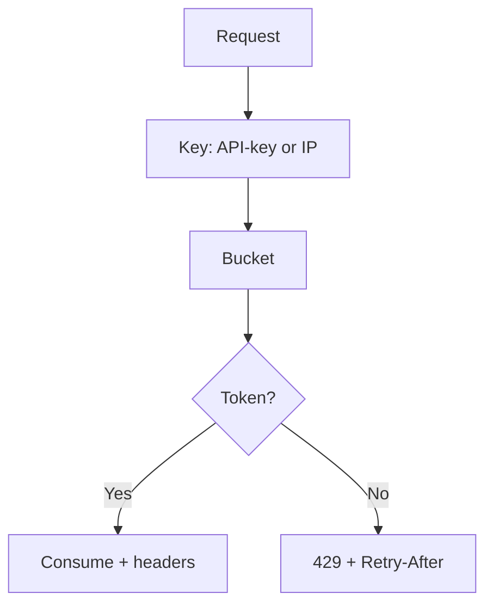

```xml
<dependency><groupId>com.bucket4j</groupId><artifactId>bucket4j_jdk17-core</artifactId><version>8.x</version></dependency>
```

```java
@Component
public class RateLimitInterceptor implements HandlerInterceptor {
    private final Map<String,Bucket> buckets = new ConcurrentHashMap<>();
    private Bucket newBucket(){return Bucket.builder().addLimit(l->l.capacity(100).refillGreedy(100,Duration.ofMinutes(1))).build();}
    @Override
    public boolean preHandle(HttpServletRequest req, HttpServletResponse res, Object h){
        String k = req.getHeader("X-API-Key"); if(k==null) k=req.getRemoteAddr();
        Bucket b = buckets.computeIfAbsent(k, x->newBucket());
        ConsumptionProbe p = b.tryConsumeAndReturnRemaining(1);
        res.setHeader("X-RateLimit-Limit","100");
        res.setHeader("X-RateLimit-Remaining", String.valueOf(p.getRemainingTokens()));
        if(p.isConsumed()) return true;
        res.setHeader("Retry-After", String.valueOf(TimeUnit.NANOSECONDS.toSeconds(p.getNanosToWaitForRefill())+1));
        res.setStatus(429); return false;
    }
}
```

Tiers: FREE 60, PRO 600, ENTERPRISE 6000 per min. Multi-node: Redis shared bucket.

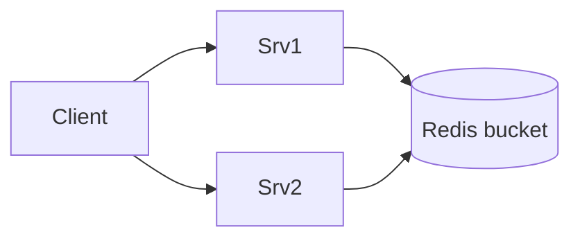

## 13. Lesson 8: Docs as Product

```xml
<dependency><groupId>org.springdoc</groupId><artifactId>springdoc-openapi-starter-webmvc-ui</artifactId><version>2.x</version></dependency>
```

Swagger: `/swagger-ui.html`, spec: `/v3/api-docs`.

```java
@Tag(name="Users") @RestController @RequestMapping("/api/v1/users")
public class UserController {
    @Operation(summary="Get user by ID")
    @ApiResponses({@ApiResponse(responseCode="200",description="Found"),@ApiResponse(responseCode="404",description="Not found",content=@Content(mediaType="application/problem+json"))})
    @GetMapping("/{id}")
    public UserResponse getById(@Parameter(description="ID",example="42") @PathVariable Long id){return svc.findById(id);}
}
public record CreateUserRequest(
  @Schema(description="Full name",example="Asha Banerjee") @NotBlank String name,
  @Schema(description="Email",example="asha@example.com") @Email @NotBlank String email,
  @Schema(description="Age",example="29") @Positive int age){}
@Bean public OpenAPI apiInfo(){return new OpenAPI().info(new Info().title("Example API").version("v1"));}
```

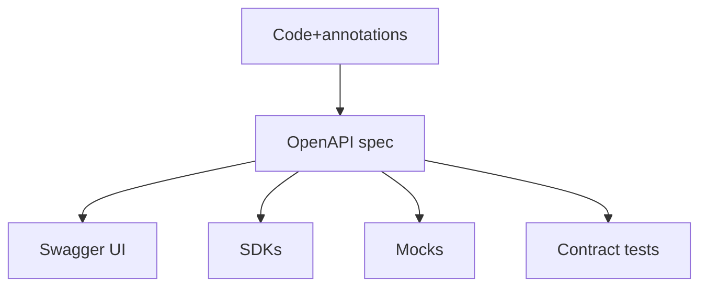

## 14. Putting It All Together

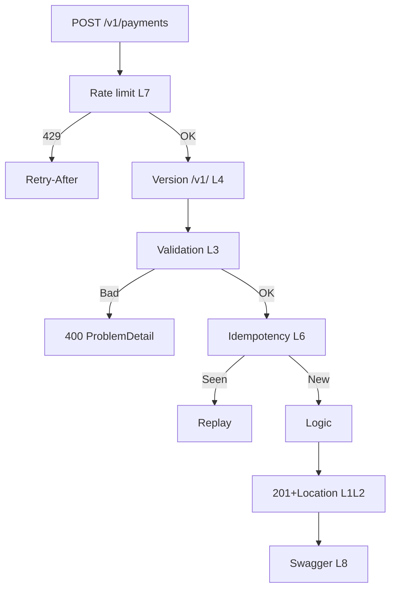

| # | Prevents |
|---|----------|
| 1 | What is it called? |
| 2 | Did it work? |
| 3 | What did I send wrong? |
| 4 | Why did it break? |
| 5 | Why timeout? |
| 6 | Why charged twice? |
| 7 | Why slow for all? |
| 8 | How do I call it? |

## 15. Best Practices
1. DTO records, never entities. 2. Thin controllers. 3. Plural/kebab/lowercase, camelCase JSON. 4. Empty list `[]`, ISO-8601 UTC. 5. No break in-version + Deprecation/Sunset. 6. Paginate+cap, keyset for large. 7. Idempotency-Key on POST side-effects. 8. 429+Retry-After+X-RateLimit. 9. One problem+json format. 10. Docs from code with examples.

## 16. Anti-Patterns
| Wrong | Right |
|-------|-------|
| /getUser, POST delete | Nouns+methods |
| 200 for errors | Honest codes |
| Custom error each endpoint | Single ProblemDetail |
| Entity in controller | DTO |
| Unpaginated list | Pageable+cap |
| GET with body | Query params |
| Local timestamps | ISO UTC |
| Sequential IDs sensitive | UUIDs |
| Silent rename | New version |

## 17. Performance Considerations
- Cap sizes; keyset index seeks beat OFFSET scans; size+1 avoids COUNT; avoid N+1 via EntityGraph; projections for wide tables; cache GET 200 with ETag; gateway limits first. Target: p95 list size20 under 200ms.

## 18. Security Considerations
- No stack/SQL leaks, traceId on 5xx; 401 vs 403 correct; stricter limits on login/payments; auth before idempotency replay + hash check; DTO allow-list + Valid; authorize nested ownership; keys in headers not URLs; TLS+CORS.

## 19. Testing Strategies

```java
@Test void create201() throws Exception {
    mockMvc.perform(post("/api/v1/users").contentType(APPLICATION_JSON)
      .content("{\"name\":\"Asha\",\"email\":\"asha@example.com\",\"age\":29}"))
      .andExpect(status().isCreated()).andExpect(header().exists("Location"));
}
@Test void invalid400Problem() throws Exception {
    mockMvc.perform(post("/api/v1/users").contentType(APPLICATION_JSON)
      .content("{\"name\":\"\",\"email\":\"bad\",\"age\":-1}"))
      .andExpect(status().isBadRequest())
      .andExpect(content().contentType("application/problem+json"));
}
@Test void idempotentReplay() {
    String k = UUID.randomUUID().toString();
    var r1 = client.post("/payments", body, k); var r2 = client.post("/payments", body, k);
    assertThat(r1.body()).isEqualTo(r2.body()); verify(provider, times(1)).charge(any());
}
```

Layers: unit Mockito, WebMvcTest MockMvc, DataJpaTest keyset+unique, Testcontainers E2E versions/429/retry, contract openapi-diff/Schemathesis.

## 20. Migration Guide
1. /getUser to /users keep old + Deprecation then 410. 2. 200-all to honest codes. 3. Custom errors to ProblemDetail + enabled=true. 4. Unversioned to /v1/. 5. Unpaginated to Pageable+cap+/scroll. 6. Retry to Idempotency-Key. 7. No limits to Bucket4j+Redis. 8. Wiki to OpenAPI.

## 21. Troubleshooting
| Symptom | Fix |
|---------|-----|
| Swagger 404 | starter webmvc-ui 2.x, check /v3/api-docs |
| HTML whitelabel validation | problemdetails.enabled=true |
| Max ignored | Validated on class |
| size huge OOM | max-page-size=100 |
| Cursor dups createdAt | composite createdAt,id |
| Double charge | Idempotency-Key+unique+race |
| Same key diff body | hash check 409 |
| 3x quota 3 nodes | Redis bucket |
| Missing Retry-After | set in interceptor |
| 401/403 mix | authn vs authz |
| V2 breaks V1 | separate DTOs |
| Location wrong gateway | fromCurrentRequest + X-Forwarded |

## 22. Hands-On Labs

### Exercise 1 Bookstore Skeleton (L1+L2+L3+L5+L8)
Task: GET/POST/PATCH/DELETE /api/v1/books + GET /authors/id/books, 201+Location, 204, 404 problem, Pageable cap, Swagger examples.
Solution: controller per L1/L2, CreateBookRequest with ISBN Pattern + Positive price, GlobalExceptionHandler per L3, max-page-size 100. Verify codes + capped size + Swagger.

### Exercise 2 V2 Price Object (L4)
Task: /api/v2/books price number to amount/currency, shared service, Deprecation/Sunset/Link on V1.
Solution: BookResponseV1 vs V2 records, V2 controller maps same entity. Verify V1 flat, V2 object, headers present.

### Exercise 3 Scroll + Idempotent Orders + Limits (L5+L6+L7)
Tasks: (a) /books/scroll size+1 CursorPage. (b) POST /orders Idempotency-Key unique+race+hash. (c) 60/min X-API-Key 429+Retry-After.
Verify: hasMore/next correct, no dups, replay single charge, 61st is 429.

## 23. Test Your Understanding (12 Questions + Answers)

1. Why do verbs in URLs (e.g. `/getUser`, `/deleteUser`) hurt caches, proxies, and tools?

**Answer:** Verbs-in-URLs hide safety/idempotency — everything looks like an opaque POST, so HTTP caches (which only cache GET), proxies, gateways, and retry logic cannot tell whether caching or repeating the call is safe.

2. When should you use PUT vs PATCH? Give one concrete example of each.

**Answer:** Use PUT to replace an entire resource — e.g. `PUT /api/v1/users/42` with the complete user JSON. Use PATCH for a partial update — e.g. `PATCH /api/v1/orders/7` with `{ "status": "CANCELLED" }`.

3. For `POST /api/v1/payments`, what should the first call, a same-key retry, and a same-key-different-body call return?

**Answer:** First call returns `201 Created` with the payment body. Retry with the same key and same body returns `200 OK` replaying the stored response with no new charge. Same key with a different body returns `409 Conflict`.

4. A user with a valid token calls an admin-only endpoint. Do you return 401 or 403, and why?

**Answer:** Return `403 Forbidden` — the request is authenticated but not authorized. `401` means "Who are you?" (bad/missing credentials); `403` means "I know you, and no."

5. List the ProblemDetail fields for a failed `POST /api/v1/users` validation (bad email, negative age).

**Answer:** `type: https://api.example.com/errors/validation-failed`, `title: Validation failed`, `status: 400`, `detail: The request body contains invalid fields.`, `instance: /api/v1/users`, plus `errors: { email: must be a well-formed email address, age: must be greater than 0 }` as `application/problem+json`.

6. Is adding an optional response field breaking? Is renaming `total` to `grandTotal`?

**Answer:** Adding an optional field is safe — ship in the same version. Renaming is breaking — every client parsing the old name fails, so ship it as a new version (V2) and keep V1 unchanged.

7. Offset returned `[10,9,8]` on page 0, then order 11 was inserted, and page 1 returned `[8,7,6]` with 8 duplicated. Why, and what is the fix?

**Answer:** OFFSET is positional — after inserting 11 the sorted list shifted, so `OFFSET 3` lands on 8 again. Fix with keyset pagination (`WHERE id > lastSeenId ORDER BY id LIMIT n`), which anchors on values not positions.

8. How does the `size + 1` trick in keyset pagination avoid a `COUNT(*)` query?

**Answer:** Fetch one row more than requested. If you get the extra row, another page exists (`hasMore=true`) and you return only the first `size` rows with `nextCursor` set. Otherwise `hasMore=false`. No table-wide count needed.

9. Two concurrent `POST /payments` with the same Idempotency-Key both charged. Root cause and two fixes?

**Answer:** Root cause is a race: both threads saw `findById` empty before either saved. Fix 1: unique constraint on the key + catch `DataIntegrityViolationException` and replay the winner. Fix 2: reserve the key as `IN_PROGRESS` before calling the provider.

10. In-memory Bucket4j at 100/min with 3 instances effectively allows 300/min. Why, how to fix, and what headers?

**Answer:** Each node has its own bucket map, so quotas sum. Fix with a shared Redis-backed Bucket4j bucket. Clients must see `X-RateLimit-Limit`, `X-RateLimit-Remaining`, and on rejection `429` + `Retry-After`.

11. `GET /api/v1/users/9999` returns `200 OK` with `{ "error": "User not found" }`. What is wrong and what should it return?

**Answer:** `200` for failure lies to monitors and gateways and forces body parsing. Return `404 Not Found` with `application/problem+json` (`type: .../user-not-found`, `title: User not found`, `status: 404`, `detail: No user exists with id 9999`).

12. How do you change `total: 499.0` (number) to `total: { amount, currency }` without breaking V1?

**Answer:** Freeze V1, add `/api/v2/...` with a separate `OrderResponseV2` mapping `total` to `{ amount, currency }` on the same shared service, and sunset V1 with `Deprecation`, `Sunset`, and `Link: </api/v2/orders>; rel="successor-version"` headers plus a changelog.


## 24. Question Bank (55 Questions with Answers)

### Beginner (1–18)

1. What does REST stand for and what is a "resource"? Give two examples.

**Answer:** REST is Representational State Transfer. A resource is a thing with a URL, e.g. `/api/v1/users/42` and `/api/v1/orders`.

2. In REST, what role does the URL play versus the HTTP method?

**Answer:** URL identifies WHAT (noun). Method says WHAT TO DO (verb: GET/POST/PATCH/DELETE).

3. Why plural nouns (`/users`) instead of singular or verbs?

**Answer:** Plurals are the universal collection convention, so clients can guess endpoints instead of learning `getUser` vs `fetchUser` variants.

4. What is the difference between `GET /users/42` and `POST /users`?

**Answer:** GET reads existing user 42 (safe/idempotent). POST creates a new user from the body (returns 201 + Location).

5. Define "safe" and "idempotent" with one method example each.

**Answer:** Safe means no server-state change (GET). Idempotent means repeat has same effect (PUT/DELETE). POST is neither.

6. When do you return `201 Created` and what header must accompany it?

**Answer:** On every successful creation via POST, with a `Location` header pointing at the new resource URL.

7. When do you return `204 No Content`? Give one example.

**Answer:** On success with nothing to return, e.g. after `DELETE /api/v1/users/42` the body must be empty.

8. What is the difference between `400` and `422`?

**Answer:** 400 is malformed/invalid data (bad JSON, failed validation). 422 is valid syntax but wrong semantics (business-rule violation).

9. What is the one-line difference between `401` and `403`?

**Answer:** 401 means "Who are you?" (bad/missing credentials). 403 means "I know you, and no." (valid identity, insufficient permission).

10. What is RFC 9457 ProblemDetail and why use it?

**Answer:** The standard problem-details format. Spring natively supports it, giving one consistent error shape instead of custom JSON per endpoint.

11. Name four standard ProblemDetail fields and their purpose.

**Answer:** type (stable category URI), title (short summary), status (HTTP code), detail (this occurrence). Plus instance and errors/traceId.

12. Why include a field-level `errors` map instead of one string?

**Answer:** It pinpoints each bad field so developers know what to fix and frontends can render messages next to each input.

13. Why version from day one?

**Answer:** The API will change, and versioning lets you ship V2 without breaking mobile apps, partners, and services pinned to V1.

14. Which versioning strategy is recommended and why?

**Answer:** URL path (`/api/v1/`). Visible, easy to test in a browser, and easy to route at gateways.

15. What is pagination and why mandate it on every list?

**Answer:** Capping each response to a page (e.g. 20 rows). Without it, 500k rows load into memory and the endpoint times out.

16. What do `page`, `size`, and `sort` do?

**Answer:** page selects the zero-based page, size sets rows per page, sort orders results (e.g. `sort=createdAt,desc`).

17. What is an idempotency key in one sentence?

**Answer:** A client-generated UUID in the `Idempotency-Key` header letting the server replay the stored response instead of re-executing the side effect.

18. What does `429` + `Retry-After` tell a client?

**Answer:** You exceeded quota — wait the given seconds before retrying instead of hammering in a hot loop.

### Intermediate (19–40)

19. What are PUT vs PATCH idempotency nuances? When is PATCH not idempotent?

**Answer:** PUT full-replace converges so it is idempotent. PATCH with absolute sets is usually idempotent, but relative ops (increment/append) are not — repeats apply twice.

20. How do you model "orders of user 42" and how deep should nesting go?

**Answer:** `GET /api/v1/users/42/orders` and `GET /api/v1/users/42/orders/7`. Keep nesting to 2-3 levels, then flatten to `GET /orders?userId=42`.

21. How do you model "cancel order" without RPC verb URLs?

**Answer:** Prefer `PATCH /orders/7` with `{ "status": "CANCELLED" }`. Sparingly, `POST /orders/7/cancellation` as a sub-resource creation.

22. Why use query params for filter/sort/search instead of new endpoints?

**Answer:** They keep the URL space small and combinable (`?role=ADMIN&sort=createdAt,desc`) instead of exploding into one endpoint per combination, and compose with pagination.

23. Walk the decision flow for creating a user with a duplicate email.

**Answer:** Authenticated yes, allowed yes, valid yes, then conflicts with existing data yes — return `409 Conflict` with a `duplicate-email` ProblemDetail.

24. How do you build `Location` robustly behind a gateway?

**Answer:** Use `ServletUriComponentsBuilder.fromCurrentRequest().path("/{id}").buildAndExpand(id).toUri()` so forwarded host/proto are honored instead of hardcoding.

25. How do you centralize errors with `@RestControllerAdvice`?

**Answer:** One advice class with handlers per case: validation to 400 with field map, not-found to 404, duplicate to 409, catch-all Exception to 500 with traceId — each returning ProblemDetail.

26. How do you make Spring built-in errors also render as problem+json?

**Answer:** Set `spring.mvc.problemdetails.enabled=true`, or extend `ResponseEntityExceptionHandler`. Verify malformed JSON returns problem+json not HTML.

27. What must never leak in errors, and what do 5xx carry instead?

**Answer:** Never leak stack traces, SQL, or paths. Return a generic message plus a generated `traceId` logged server-side for correlation.

28. Give three breaking and three safe changes.

**Answer:** Breaking (new version): remove field, rename field, change type. Safe (same version): add optional response field, add optional request field, add new endpoint.

29. How do you share the service across V1 and V2?

**Answer:** One shared `OrderService` for logic, plus separate thin controllers and DTOs (`OrderResponseV1/V2`) mapping from the same result.

30. What three headers announce deprecation?

**Answer:** `Deprecation: true`, `Sunset: <date>`, and `Link: </api/v2/orders>; rel="successor-version"`, plus a changelog entry.

31. Compare offset vs keyset: two pros and two cons of each.

**Answer:** Offset pros: simple, jump-to-page, totals. Cons: slow deep, unstable on mutation, COUNT cost. Keyset pros: fast via index, stable under inserts. Cons: no page jumps, no totals.

32. Why does offset skip or duplicate rows on mutation?

**Answer:** OFFSET counts from the start, so inserts/deletes shift the window. Keyset anchors on the last value (`WHERE id > ?`) so it is immune.

33. Explain the `size + 1` trick precisely.

**Answer:** Fetch one extra row. Extra present means `hasMore=true`, return first `size`. Absent means `hasMore=false`. No COUNT needed.

34. Write a Spring Data keyset repo method for an `id` cursor.

**Answer:** `List<Order> findByIdGreaterThanOrderByIdAsc(Long lastId, Limit limit);` called with `Limit.of(size + 1)`.

35. How do you paginate on non-unique `createdAt`?

**Answer:** Composite cursor `(createdAt, id)` with `WHERE (createdAt < :ts) OR (createdAt = :ts AND id < :id) ORDER BY createdAt DESC, id DESC`.

36. Describe the basic idempotency flow step by step.

**Answer:** Read key, findById, if present validate hash and replay, else process, save key+hash+response, return 201. Retries hit replay.

37. How do you detect same-key-different-body and what code?

**Answer:** Store `requestHash` with the key. On hit compare hashes. Mismatch means reuse, reject with `409` (or 422) ProblemDetail.

38. How do you handle the duplicate-key race?

**Answer:** Unique constraint on key plus catch `DataIntegrityViolationException` and replay the winner. Strongest: reserve `IN_PROGRESS` before the provider call.

39. What do token-bucket capacity and refill mean?

**Answer:** Capacity is burst size (e.g. 100 tokens). Refill is restore rate (e.g. 100/min). Each request consumes one. Empty means 429.

40. How do you implement per-client buckets in Spring?

**Answer:** `HandlerInterceptor.preHandle` keyed by `X-API-Key` (fallback IP) with `ConcurrentHashMap<String, Bucket>`, `tryConsumeAndReturnRemaining(1)`, set `X-RateLimit-Limit/Remaining`, return true or 429 + Retry-After, registered for `/api/**`.

### Advanced (41–55)

41. What rules keep PATCH idempotent, and when demand an Idempotency-Key anyway?

**Answer:** Use absolute set-semantics on named fields with validation. Demand a key when PATCH triggers side effects (emails, charges, transitions) or relative ops.

42. When choose header/media-type versioning over URL?

**Answer:** When URLs must stay frozen (HATEOAS purity, CDN cache stability, gateway contracts) and clients are sophisticated SDKs that can handle hidden versions.

43. How do you evolve `total` number to `{ amount, currency }` without breaking V1?

**Answer:** Freeze V1, add `/api/v2/` with `MoneyDto total` on a shared service, sunset V1 with Deprecation/Sunset/Link plus changelog.

44. Write JPQL for composite `(createdAt, id)` keyset descending.

**Answer:** `SELECT o FROM Order o WHERE (o.createdAt < :ts) OR (o.createdAt = :ts AND o.id < :id) ORDER BY o.createdAt DESC, o.id DESC` with a `Limit`.

45. What is reserve-before-process and why stronger? States?

**Answer:** Insert key as `IN_PROGRESS` before the provider call, then update to `COMPLETED` with the response. States: absent, IN_PROGRESS, COMPLETED/FAILED. Never double-calls the provider.

46. How do you design idempotency TTL? Short vs long trade-offs?

**Answer:** Redis TTL e.g. 24h. Short saves memory but risks post-expiry duplicates. Long is safer for money but costs storage. Use 24h for payments, shorter for notifications.

47. Sketch distributed Bucket4j + Redis config.

**Answer:** Replace the map with a Redis-backed Bucket4j proxy (shared bucket per `ratelimit:{apiKey}` with TTL), same capacity/refill per plan, same 429 + Retry-After + X-RateLimit headers.

48. Where enforce per-plan tiers — edge vs app — and why?

**Answer:** Coarse abuse caps at edge/gateway (stop floods early). Per-plan business quotas in app (needs plan lookup and endpoint-specific strictness for login/payments).

49. Describe an OpenAPI contract-testing pipeline failing CI on breaks.

**Answer:** Generate `/v3/api-docs` per build, diff against baseline with openapi-diff (fail on removed/renamed/required/type changes), run Schemathesis/Dredd against staging, publish spec only on green.

50. How do you document 429, validation, and pagination in OpenAPI?

**Answer:** `@ApiResponse(429 with Retry-After header)`, `@ApiResponse(400 with problem+json content)`, `@Schema(example=...)` on fields, `@Parameter` docs for page/size/after and quota headers.

51. How do you detect and fix N+1 when mapping `Page<Entity>` to DTOs?

**Answer:** Detect via SQL logs showing 1 + N selects per lazy association. Fix with `@EntityGraph`/fetch joins, DTO projections, or batch fetching, asserted in a `@DataJpaTest`.

52. Which codes and headers matter for caching `GET 200` at a gateway?

**Answer:** Cache only `GET`/`HEAD 200` with `Cache-Control`/`ETag`/`Last-Modified`. Never cache 201/204/4xx/5xx by default. Use `Vary` on auth/accept and short TTLs for personalized data.

53. Design the support flow using the 5xx `traceId`.

**Answer:** Server logs the full exception with `traceId`. Client gets a generic 500 with only the `traceId`. Support pastes it into the log aggregator to find the exact stack, request, and user.

54. In what order do you migrate a messy API to maturity? Top risks?

**Answer:** Order: honest codes + ProblemDetail, then `/v1/` freeze, paginate + cap, idempotency on money POSTs, rate limits, OpenAPI + contract CI. Risks: breaking silent dependents, double charges during cutover, cache poisoning.

55. Critique `POST /getOrdersForUser?id=42` against all 8 lessons. Corrected design?

**Answer:** L1 verb-in-URL + POST-for-read becomes `GET /api/v1/users/42/orders`. L2 honest codes. L3 ProblemDetail. L4 add `/v1/`. L5 add Pageable. L6 keys on order creation. L7 add quotas + headers. L8 document params with examples.


## 25. Common Interview Questions (12 Questions with Answers)

1. Why use nouns + HTTP verbs instead of RPC-style URLs like `/getUser`?

**Answer:** Nouns + verbs are guessable and uniform across services, so new developers integrate without meetings. Caches, proxies, and gateways understand GET safety and idempotency, and support load drops because behavior is predictable.

2. When do you use PUT vs PATCH?

**Answer:** PUT replaces the entire resource — the client must send the full representation and repeats converge. PATCH changes a few fields — e.g. `{ "status": "CANCELLED" }`. PATCH with absolute sets is usually idempotent; relative increments are not.

3. How do you choose the right HTTP status code for each outcome?

**Answer:** Follow the decision flow: 401 if unauthenticated, 403 if forbidden, 400 if invalid, 404 if missing, 409 on conflict, then 201 + Location for creates, 200 with a body, or 204 without. Never return 200 for a failure.

4. What is ProblemDetail (RFC 9457) and why use it?

**Answer:** It is the standard problem-details error format with `type`, `title`, `status`, `detail`, `instance`, plus extensions like `errors` and `traceId`. One format means clients write one error handler, support correlates via traceId, and nothing custom needs inventing.

5. How do you handle bean-validation failures so the client knows exactly what to fix?

**Answer:** Annotate DTO records with `@NotBlank`/`@Email`/`@Positive` and friendly messages, add `@Valid` on the controller body, and collect all field errors in a `@RestControllerAdvice` handler that returns `400` + `problem+json` with an `errors` map.

6. What is the difference between 401 and 403?

**Answer:** 401 is authentication — missing, expired, or invalid credentials ("Who are you?"). 403 is authorization — a valid identity lacking permission ("I know you, and no.").

7. How do you version an API without breaking existing clients?

**Answer:** Use URL path versioning (`/api/v1/`, `/api/v2/`), share the service layer, version only controllers and DTOs, never break within a version, and sunset with `Deprecation`, `Sunset`, and `Link: <successor>; rel="successor-version"` headers plus a changelog.

8. Offset vs keyset (cursor) pagination — when do you use each?

**Answer:** Offset for small, stable, admin UIs where page jumps and totals matter. Keyset for large, fast-changing, or feed-style data where stability and index-seek speed matter — no dups, no deep-page slowdown, no COUNT cost.

9. How does an Idempotency-Key prevent double charges on retry?

**Answer:** The client sends one UUID per logical operation. The server stores the response under that key and replays it on retry instead of reprocessing — hardened with a unique constraint, duplicate-key race catch, payload-hash mismatch rejection (409), and a TTL.

10. How does token-bucket rate limiting work and how do you scale it?

**Answer:** Each client gets a bucket with capacity (burst) that refills over time; each request costs one token and an empty bucket yields `429` + `Retry-After` + `X-RateLimit-*` headers. Per-plan tiers in the app, coarse caps at the gateway, and a shared Redis bucket across instances.

11. How do you keep API documentation fresh instead of letting wiki docs go stale?

**Answer:** Generate OpenAPI from code with springdoc (`@Operation`, `@ApiResponse`, `@Schema` examples), serve Swagger UI plus `/v3/api-docs`, and gate CI with openapi-diff/Schemathesis contract tests so drift fails the build.

12. How do you scale a list endpoint from 200 rows to 500,000 rows?

**Answer:** Paginate everything with a max page size, use keyset cursors on indexed columns (composite for non-unique sorts), avoid `COUNT(*)`, use DTO projections and fetch joins to kill N+1, cache GETs, and enforce gateway + app rate limits.


## 26. API Design Checklist
- URLs plural/kebab/lower, methods match, query filters, nest max 3
- Honest codes, 201+Location, 204 no-body
- One problem+json, field errors, no leaks, traceId 5xx, stable type
- /v1/, no in-version break, Deprecation/Sunset/Link
- Paginate+cap, keyset large, Idempotency-Key POST, limits+headers, Redis multi-node
- OpenAPI+examples+auth/errors/limits/changelog

## 27. Summary / Key Takeaways

This tutorial boils down to one principle: **a good API never surprises its consumer.** Every lesson is a different way of removing a surprise:

**Lesson 1 — Predictable URLs (nouns + verbs).** The URL names the *thing* (`/api/v1/users/42`) and the HTTP method names the *action* (GET read, POST create, PATCH partial update, DELETE remove). Once a developer learns the pattern on one endpoint, they can guess every other endpoint without reading docs. Use plural nouns, lowercase kebab-case, nest only for true ownership, and put filters/sorts in query params.

**Lesson 2 — Honest status codes.** The code is the first thing clients, dashboards, gateways, and retry logic read. `201 + Location` for creates, `204` for deletes with no body, `400` for bad input, `401` for "who are you?", `403` for "I know you, and no", `404` for missing, `409` for conflicts, `429` for quota, `5xx` for our faults. Follow the decision flow every time, and never return `200` for a failure.

**Lesson 3 — One useful error format (ProblemDetail, RFC 9457).** A good error says what went wrong, where, and how to fix it: `type` (stable URI clients switch on), `title`, `status`, `detail`, `instance`, plus `errors` per field for validation and `traceId` for 5xx. Centralize it in one `@RestControllerAdvice`, enable it for Spring's own errors too, and never leak stack traces or SQL.

**Lesson 4 — Version from day one.** Your API will change, so freeze each version's contract: additive optional changes stay in-version, while renames, removals, and type changes ship as V2 with a shared service layer underneath. Announce sunsets explicitly with `Deprecation`, `Sunset`, and `Link: <successor>` headers plus a changelog.

**Lesson 5 — Paginate every list.** Offset (`page/size/sort`) is simple and gives page jumps plus totals — ideal for small admin UIs. Keyset cursors (`WHERE id > ?`, the `size + 1` trick, composite cursors for non-unique sorts) are index-fast and stable under inserts — ideal for large tables, feeds, and sync jobs. Always cap `max-page-size`.

**Lesson 6 — Idempotency makes retries safe.** Networks fail mid-response, so side-effect POSTs (payments, orders, notifications) must accept an `Idempotency-Key`: the client generates one UUID per logical operation, the server stores the response and replays it on retry. Harden it with a unique constraint, duplicate-key race handling, same-key-different-body rejection (`409`), and a TTL.

**Lesson 7 — Rate limits protect everyone.** One buggy retry loop shouldn't slow the API for all. Token-bucket limiting (Bucket4j) with per-client buckets, tiered quotas, and honest `429 + Retry-After + X-RateLimit-*` headers turns abuse into polite backoff. Use gateway caps at the edge and shared Redis buckets across instances.

**Lesson 8 — Docs are the product.** Wiki docs go stale; generated docs don't. Annotate controllers and models (`@Operation`, `@ApiResponse`, `@Schema` examples), serve Swagger UI plus the raw OpenAPI spec, and gate CI with contract tests so breaking drift fails the build. Document auth, every error, pagination, and rate limits — developers copy-paste examples first and read prose later.

> **The one-line version to remember:** predictable URLs, honest codes, standard errors, stable versions, safe pages, idempotent retries, communicated limits, living docs — **design every API as if the person using it can't message you for help.**

## 28. Further Reading
RFC9457; Spring Error Responses; Spring Data Paging/Limit; Bucket4j; springdoc-openapi; OpenAPI + openapi-diff/Schemathesis; MDN Methods/Status/Retry-After/Deprecation-Sunset. Last Updated 2026-10-16.


