# EF Core Performance Optimization - Complete Tutorial: From Slow Queries to Production-Ready Data Access

> **"EF Core is slow, don't use it."** In most cases the real problem is different: EF Core makes it easy to load far more data than you need, and then the tool gets blamed.

- **Last Updated:** 2026-10-14
- **Level:** Intermediate

<!-- APPEND-HERE -->

- **Reading Time:** ~75 min + labs
- **Applies to:** EF Core 8/9, Npgsql + PG 15+ (notes for SQL Server/MySQL/Oracle)

## Table of Contents

- [1. Introduction](#1-introduction--overview) | [2. Prerequisites](#2-prerequisites) | [3. Objectives](#3-learning-objectives) | [4. Domain](#4-sample-domain-and-lab-setup) | [5. Measure](#5-step-0-measure-before-you-optimize) | [6-8. Fetch Less](#6-technique-1-add-the-right-indexes) | [9-11. Load Correctly](#9-technique-4-turn-off-change-tracking-for-reads) | [12-13. Scale](#12-technique-7-paginate-with-cursor-instead-of-offset) | [14-15. Repetition](#14-technique-9-compiled-queries) | [16-18. Writes](#16-technique-11-never-call-savechanges-in-a-loop) | [19-35. Reference](#19-real-world-use-cases)

---

## 1. Introduction / Overview

In dev your DB has 500 rows and every query takes 4ms. In prod it has 2,000,000 rows and the same code takes 30s. The code did not change. The data did.

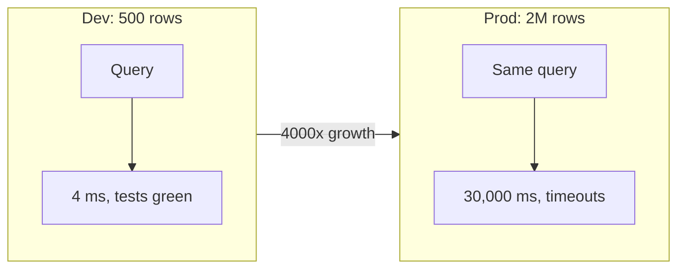

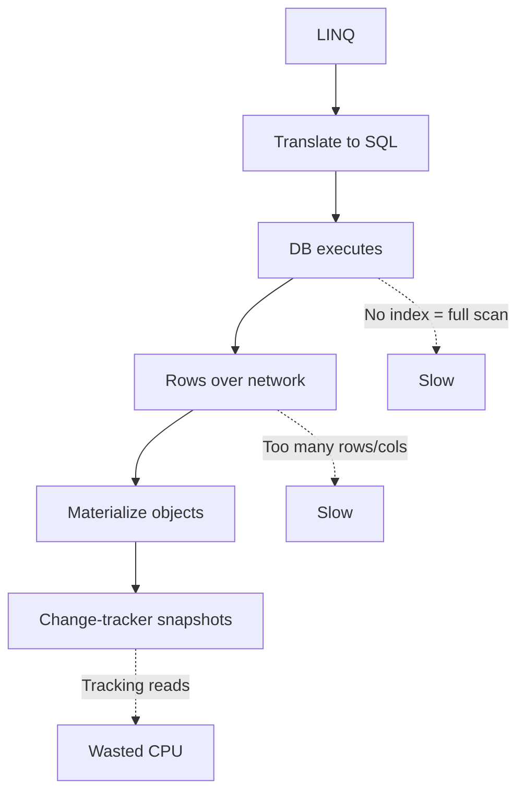

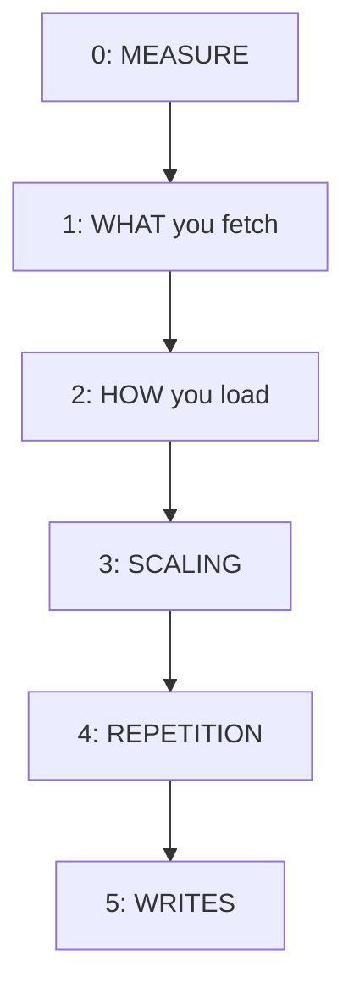

> 💡 **Feynman:** EF Core is translator + delivery service. Slow apps order too many boxes, too often. ⚠️ **Golden rule:** caching a slow query only bills you less often.


## 2. Prerequisites

| Requirement | Details |
|---|---|
| .NET SDK | 8+ (`dotnet --info`) |
| EF Core | 8/9 + Npgsql provider |
| Database | PostgreSQL 15+ via Docker |
| Tools | dotnet-ef CLI, BenchmarkDotNet |
| Knowledge | LINQ, async/await, indexes |

```bash
dotnet tool install --global dotnet-ef
docker run -d --name pg-ship -e POSTGRES_PASSWORD=postgres -p 5432:5432 postgres:16

## 3. Learning Objectives

1. Log SQL and read EXPLAIN ANALYZE plans.
2. Design composite and filtered indexes.
3. Keep filters in IQueryable; project to DTOs.
4. Use AsNoTracking, Include, AsSplitQuery.
5. Keyset pagination; batch IN lists.
6. Compiled queries + HybridCache; batch writes; DbContext lifetime.

```
## 4. Sample Domain and Lab Setup

Shipment tracking: Shipment 1-N ShipmentItem, 1-N StatusEvent. Number is unique business key.

```csharp
public enum ShipmentStatus { Created=0, Processing=1, Dispatched=2, Delayed=3, Delivered=4, Cancelled=5 }
public class Shipment {
  public Guid Id { get; set; }
  public string Number { get; set; } = default!;
  public string OrderId { get; set; } = default!;
  public string Carrier { get; set; } = default!;
  public ShipmentStatus Status { get; set; }
  public DateTime CreatedAt { get; set; }
  public DateTime? UpdatedAt { get; set; }
  public List<ShipmentItem> Items { get; set; } = new();
}
```

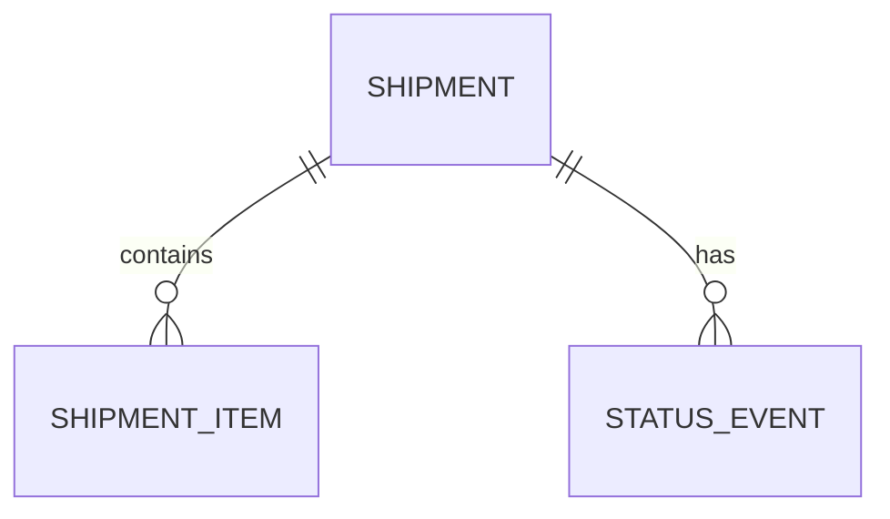
## 5. Step 0: Measure Before You Optimize

Classic mistake: cache a slow query instead of fixing it. It helps until the cache misses.

```csharp
if (builder.Environment.IsDevelopment())
{
  options.LogTo(Console.WriteLine, LogLevel.Information)
    .EnableSensitiveDataLogging()
    .EnableDetailedErrors();
}
```

> Warning: never EnableSensitiveDataLogging in production.

Good plan vs bad plan:

```text
Index Scan using IX_Shipments_Number (cost=0.43..8.45 rows=1) -- GOOD
Seq Scan on Shipments, Rows Removed by Filter: 1999999      -- BAD
```

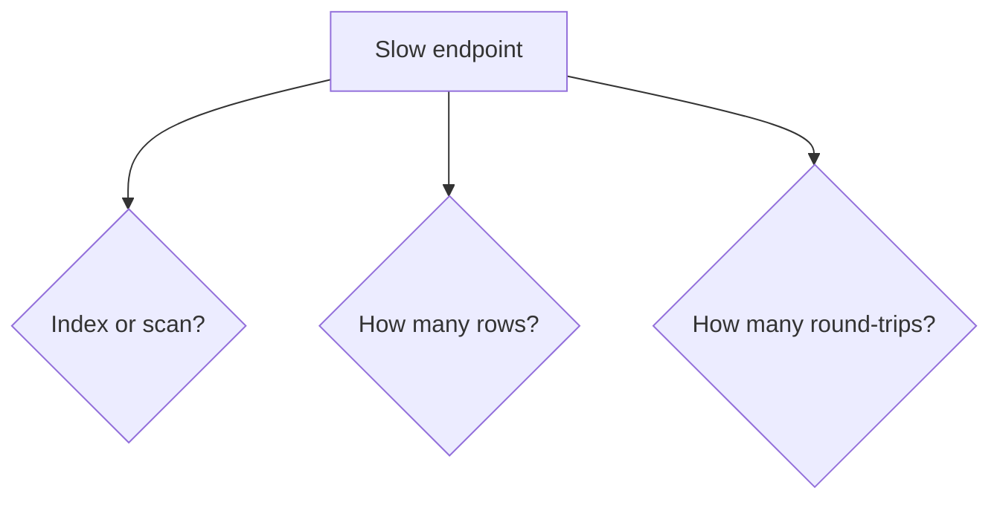

| Symptom | Fix |
|---|---|
| Full scan | Technique 1 index |
| Thousands of rows, few used | Techniques 2,3,7 |
| Hundreds of queries | Techniques 5,11 |
## 6. Technique 1: Add the Right Indexes

EF migrations index PKs and FKs only. You must index filter/sort columns.

```csharp
builder.HasIndex(x => x.Number).IsUnique();
builder.HasIndex(x => new { x.Status, x.CreatedAt });
```

```bash
dotnet ef migrations add AddShipmentIndexes
dotnet ef database update
```

Rule: equality column first, then range/sort column. Index (Status, CreatedAt) serves WHERE Status and WHERE Status ORDER BY CreatedAt, but not ORDER BY CreatedAt alone.

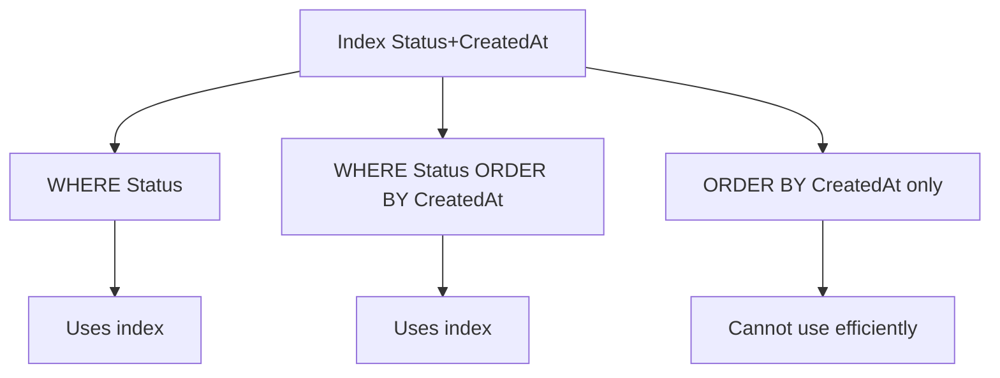

Filtered index for in-flight rows only:

```csharp
builder.HasIndex(x => x.CreatedAt).HasFilter("Status NOT IN (4, 5)");
```

| Scenario | Index |
|---|---|
| Admin grid by status newest first | (Status, CreatedAt) |
| Track by number | Unique Number |
| Open shipments | Filtered on in-flight |
| Order lookup | OrderId |
## 7. Technique 2: Filter Early, in the Database

BAD: ToListAsync then Where runs in memory; DB sends 2M rows, app keeps 5k.

```csharp
var bad = await dbContext.Shipments.ToListAsync(ct);
var pending = bad.Where(s => s.Status == ShipmentStatus.Processing).ToList();
```

GOOD: filter inside IQueryable becomes WHERE.

```csharp
var pending = await dbContext.Shipments
  .Where(s => s.Status == ShipmentStatus.Processing && s.CreatedAt >= since)
  .ToListAsync(ct);
```

| | IQueryable | IEnumerable |
|---|---|---|
| Runs | In DB as SQL | In app memory |
| Executes | On enumeration | Already executed |

Aggregates translate too: CountAsync, AnyAsync become SELECT COUNT / EXISTS. Never ToList then Count.

Hidden variant: repository GetAllAsync returning List then caller filters. Fix: return IQueryable or add GetByStatusAsync.

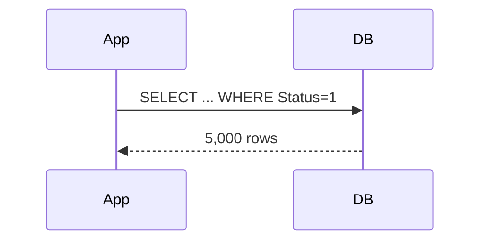

## 8. Technique 3: Project Only the Columns You Need

Full entity loads all columns. List screens showing 4 of 10 columns move 2x data.

```csharp
public record ShipmentResponse(Guid Id, string Number, string Carrier, ShipmentStatus Status, DateTime CreatedAt);
var rows = await dbContext.Shipments
  .Where(s => s.Status == ShipmentStatus.Processing)
  .OrderByDescending(s => s.CreatedAt)
  .Select(s => new ShipmentResponse(s.Id, s.Number, s.Carrier, s.Status, s.CreatedAt))
  .ToListAsync(ct);
```

Benefits: fewer columns read, smaller network payload, no change tracking. Often 10s to 40ms on 10k+ rows.

Aggregation in SQL, zero item objects:

```csharp
var sums = await dbContext.Shipments.Where(s => s.CreatedAt >= since)
  .Select(s => new { s.Number, s.Status, Count = s.Items.Count, Qty = s.Items.Sum(i => i.Quantity) })
  .ToListAsync(ct);
```

Do NOT project when you plan to modify + SaveChanges; projections are for reads.
## 9. Technique 4: Turn Off Change Tracking for Reads

Default tracking snapshots every row for SaveChanges. For reads that work is thrown away.

```csharp
var rows = await dbContext.Shipments.AsNoTracking()
  .Where(s => s.Status == ShipmentStatus.Delivered).ToListAsync(ct);
```

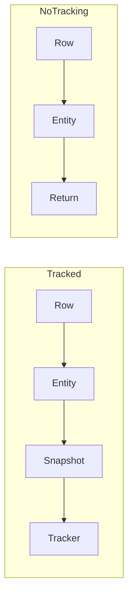

| Method | Tracks | One instance per row | Speed |
|---|---|---|---|
| Default | Yes | Yes | Slowest |
| AsNoTracking | No | No, duplicates possible | Fastest |
| AsNoTrackingWithIdentityResolution | No | Yes | Middle |

Global default for read-heavy contexts: UseQueryTrackingBehavior(NoTracking), then AsTracking where edits needed. Select projections need no AsNoTracking.

## 10. Technique 5: Use Eager Loading Deliberately

Include loads relations in one trip but can over-fetch every column of every child.

Prefer projection when you need some fields:

```csharp
var rows = await dbContext.Shipments.Where(s => s.Status == ShipmentStatus.Processing)
  .Select(s => new { s.Number, Names = s.Items.Select(i => i.Name).ToList() })
  .ToListAsync(ct);
```

Filtered Include when entities needed:

```csharp
var rows2 = await dbContext.Shipments
  .Include(s => s.Items.Where(i => i.Quantity > 0)).ToListAsync(ct);
```

Lazy loading N+1: 1 query + 500 per-row queries = 501 trips. Not recommended for new work; load explicitly.

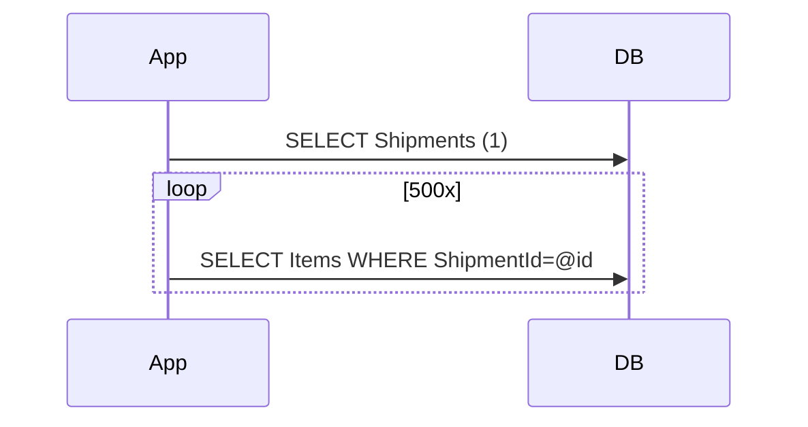

Decision: No relation = no Include. Some fields = Select. Full entities + subset = filtered Include. Else Include.

## 11. Technique 6: Split Large Includes with AsSplitQuery

Two collection Includes join into one set: 10 items x 10 events = 100 rows with shipment repeated. 100x100 = 10,000 rows.

```csharp
var rows = await dbContext.Shipments.Include(s => s.Items).Include(s => s.StatusEvents)
  .AsSplitQuery().Where(s => s.CreatedAt >= since).ToListAsync(ct);
```

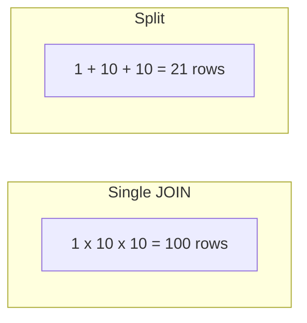

Not always faster: one case went 40ms to 51ms. Small collections + selective filter = single query wins. Measure. Split runs multiple statements; wrap in transaction if consistency matters.
## 12. Technique 7: Paginate with Cursor Instead of Offset

Skip/Take becomes OFFSET. To return rows 100000-100020 the DB walks 100000 rows and discards them. Page 5000 is slow; bots and Last page hit it.

```csharp
var page = await dbContext.Shipments.OrderByDescending(s => s.CreatedAt)
  .Skip(n * size).Take(size).ToListAsync(ct); // degrades with depth
```

Keyset: ask for rows after a known position. Page 5000 costs same as page 1.

```csharp
var page2 = await dbContext.Shipments
  .Where(s => s.CreatedAt < lastCreatedAt || (s.CreatedAt == lastCreatedAt && s.Id.CompareTo(lastId) < 0))
  .OrderByDescending(s => s.CreatedAt).ThenByDescending(s => s.Id)
  .Take(size).ToListAsync(ct);
```

Id tie-breaker makes order total; without it duplicate timestamps skip/repeat rows. Pair with index (CreatedAt, Id).

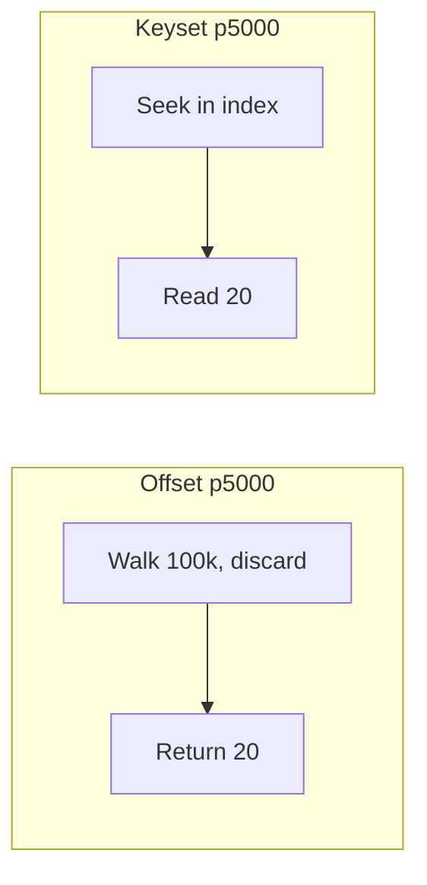

| | Offset | Keyset |
|---|---|---|
| Arbitrary page | Yes | No |
| Deep speed | Degrades | Constant |
| Stable under inserts | No | Yes |
| Best for | Small grids | Feeds, load-more, exports |

## 13. Technique 8: Watch the IN and Contains Limit

Contains becomes IN with one parameter per element. Fine at 50 ids; fails at 50000.

| Database | Limit |
|---|---|
| Oracle | 1000 expressions |
| SQL Server | 2100 parameters |
| PostgreSQL/MySQL | ~64K but planner slows earlier |

Batch fix:

```csharp
foreach (var batch in orderIds.Chunk(500)) {
  var chunk = await dbContext.Shipments.AsNoTracking()
    .Where(s => batch.Contains(s.OrderId)).ToListAsync(ct);
  results.AddRange(chunk);
}
```


Tens of thousands+: temp table or TVP + JOIN scales where IN never will.
## 14. Technique 9: Compiled Queries

LINQ translates each call; internal cache makes it cheap after first. On hot paths thousands/sec even lookup shows. Compiled query translates once.

```csharp
private static readonly Func<ShipmentsDbContext, string, Task<Shipment?>> GetByNumber =
  EF.CompileAsyncQuery((ShipmentsDbContext ctx, string number) =>
    ctx.Shipments.AsNoTracking().FirstOrDefault(s => s.Number == number));
```

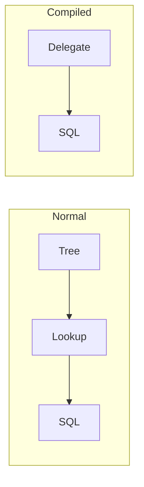

Only for very hot fixed-shape queries. Cannot compose dynamically. Hot lookup yes; dynamic search screen no.

## 15. Technique 10: Cache the Result

Cache LAST, after query is optimal and runs more often than data changes.

```csharp
builder.Services.AddHybridCache();
return await hybridCache.GetOrCreateAsync("shipment:" + number,
  async t => await dbContext.Shipments.AsNoTracking()
    .Where(s => s.Number == number)
    .Select(s => new ShipmentResponse(s.Id, s.Number, s.Carrier, s.Status, s.CreatedAt))
    .FirstOrDefaultAsync(t), cancellationToken: ct);
```

HybridCache: L1 memory + L2 Redis, stampede protection: 100 concurrent misses = 1 DB hit, rest wait.

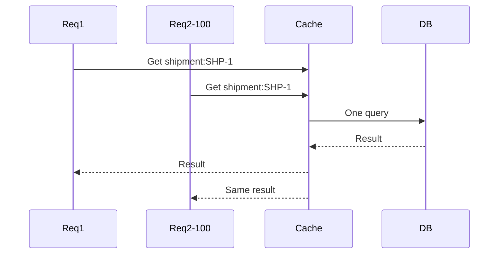

Invalidate on write: await hybridCache.RemoveAsync("shipment:"+number, ct). Cache carriers/hours, catalog/minutes, status/seconds; balances/stock usually not cached.
## 16. Technique 11: Never Call SaveChanges in a Loop

BAD: 1000 SaveChanges = 1000 transactions + round-trips; latency dominates.

```csharp
foreach (var s in shipments) { s.Status = ShipmentStatus.Dispatched; await dbContext.SaveChangesAsync(ct); }
```

GOOD: one SaveChanges batches into few statements in one transaction; all-or-none.

```csharp
foreach (var s in shipments) s.Status = ShipmentStatus.Dispatched;
await dbContext.SaveChangesAsync(ct);
```

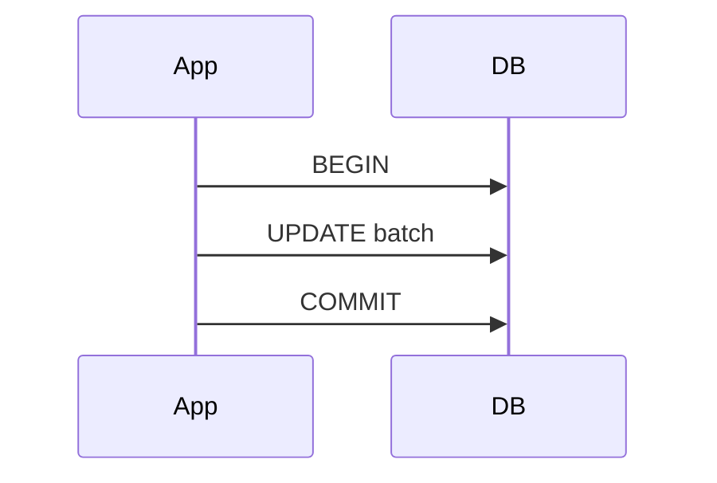

| Rows | Approach |
|---|---|
| <1000 | Single SaveChanges |
| Thousands same change | ExecuteUpdate |
| 10k+ inserts | Bulk library (EFC Extensions BulkInsert) |

## 17. Technique 12: ExecuteUpdate and ExecuteDelete

Same change to many rows needs no load/materialize/track.

```csharp
await dbContext.Shipments.Where(s => s.Status == ShipmentStatus.Processing && s.CreatedAt < cutoff)
  .ExecuteUpdateAsync(x => x.SetProperty(s => s.Status, ShipmentStatus.Cancelled)
    .SetProperty(s => s.UpdatedAt, DateTime.UtcNow), ct);
await dbContext.Shipments.Where(s => s.Status == ShipmentStatus.Cancelled && s.UpdatedAt < retention)
  .ExecuteDeleteAsync(ct);
```

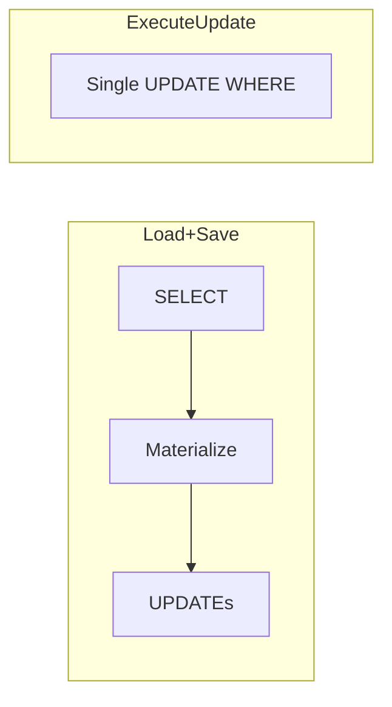

Caveats: bypasses tracker (loaded entities stale); skips SaveChanges interceptors (audit/domain events wont fire). Use for jobs/bulk transitions; keep business writes on SaveChanges.

## 18. Technique 13: Manage DbContext Lifetime

DbContext is cheap, not thread-safe, holds tracked entities until disposed. Scoped per request is right. Long-lived reuse looks like a memory leak.

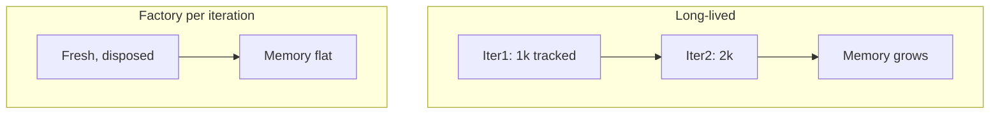

```csharp
builder.Services.AddDbContextFactory<ShipmentsDbContext>(o => o.UseNpgsql(cs));
await using var context = await factory.CreateDbContextAsync(ct);
```

Parallel: one context per task via factory. Pooling: AddDbContextPool reuses instances; no per-request state in ctor.
## 19. Real-World Use Cases

| Scenario | Technique |
|---|---|
| Admin grid filter status newest first | 1 composite index + 7 offset ok small, keyset large |
| Track by number | 1 unique + 9 compiled + 10 cache |
| My open shipments | 1 filtered index + 3 projection |
| Feed infinite scroll | 7 keyset |
| Nightly cancel stale | 12 ExecuteUpdate |
| GDPR purge | 12 ExecuteDelete |
| Dispatcher worker | 13 factory |
| Bulk reconciliation | 8 chunk/TVP + 11 batch |

Case: grid went 612ms Seq Scan to 0.4ms Index Scan after (Status, CreatedAt). Case: projection cut 10s to 40ms on 10k rows. Case: split regressed 40 to 51ms on small sets - reverted.

## 20. Multiple Implementation Approaches

Pagination: Offset simple + random page, degrades. Keyset constant + stable, no random page. RowNumber niche. Large IN: Contains under 1k; Chunk thousands; TVP/temp tens of thousands+ JOIN. Cache: Memory single-node; Distributed multi-node; HybridCache L1+L2+stampede. Bulk: SaveChanges <1k; ExecuteUpdate same-change; BulkExtensions 10k+ inserts.

## 21. Best Practices

- Measure first: SQL + plan + rows + trips + BenchmarkDotNet.
- Index what you filter/sort; equality first.
- Filter/project in DB; AsNoTracking for entity reads.
- Include deliberately; split only if measured faster.
- Keyset for depth; chunk IN lists; compile hot paths; cache last with invalidation.
- Batch SaveChanges; ExecuteUpdate for set writes; factory per unit of work.

## 22. Anti-Patterns

| Anti-pattern | Why it hurts | Fix |
|---|---|---|
| GetAll + in-memory Where | Ships 2M rows | IQueryable Where |
| Select * entity for 4 cols | 2x payload + tracking | DTO projection |
| Lazy proxies in loop | 501 trips | Include/Select |
| Double collection Include single query | 10k rows explosion | Split or project |
| Deep Skip | Walks+discards 100k | Keyset |
| Unbounded Contains | 2100/1000 param error | Chunk/TVP |
| SaveChanges in loop | 1000 trips | One SaveChanges |
| Load+edit for bulk set | Load+track waste | ExecuteUpdate |
| Singleton DbContext | Leak + threads | Scoped/factory |
| Generic repo returning List | Kills composition | IQueryable/spec methods |

## 23. Performance Considerations

| # | Impact | Effort |
|---|---|---|
| 1 indexes | Very high | Low |
| 2 filter early | Very high | Low |
| 3 projection | Very high | Low |
| 4 NoTracking | Medium | Very low |
| 5 Include | High | Medium |
| 6 split | Varies | Very low |
| 7 keyset | High at depth | Medium |
| 8 IN batch | Prevents failure | Medium |
| 9 compiled | Low | Medium |
| 10 cache | Very high | High |
| 11 batch Save | Very high | Very low |
| 12 ExecuteUpdate | High | Low |
| 13 lifetime | Prevents leaks | Low |

Always benchmark: MemoryDiagnoser for allocations; Little law for pools; test at 100x data.
## 24. Security Considerations

- EnableSensitiveDataLogging dev only; never log emails/addresses in prod. Use config category Microsoft.EntityFrameworkCore.Database.Command=Information with Serilog/NLog sink.
- Parameterize raw SQL: FromSqlInterpolated or params; never concat user input.
- Return DTOs from APIs to avoid leaking internal fields + over-posting; map explicitly on input.
- Tag queries (TagWith) for audit without values.
- Redis L2 holds PII: TLS, auth, short TTL for status, key prefix per tenant.

## 25. Testing Strategies

```csharp
// Assert SQL shape via ToQueryString
var sql = dbContext.Shipments.Where(s => s.Status == ShipmentStatus.Processing).ToQueryString();
Assert.Contains("WHERE", sql);
// N+1 detector interceptor counts commands per test
```

- Integration: Testcontainers Postgres + real migrations; seed 10k rows; assert plan uses index (EXPLAIN) on critical paths.
- Benchmark: BenchmarkDotNet baseline full-entity vs projection vs NoTracking; fail PR if 20 percent slower.
- Cache: test miss/hit/invalidate; stampede single-flight with parallel tasks.
- Writes: ExecuteUpdate affects N; SaveChanges batch all-or-none rollback test.

## 26. Migration Guide

1. Enable LogTo dev; capture ToQueryString for top 20 endpoints.
2. EXPLAIN ANALYZE; add missing composite/filtered indexes via migrations.
3. Replace ToList+Where with IQueryable Where; Count/Any in DB.
4. Project list/GET to DTOs; drop unneeded Includes.
5. Add AsNoTracking to entity reads; global NoTracking if read-heavy.
6. Fix N+1: Include/project; split only if faster.
7. Deep pages to keyset; chunk Contains; compile hot lookups; HybridCache last.
8. Move SaveChanges out of loops; jobs to ExecuteUpdate/Delete; workers to factory.
9. EF6 to Core: remove lazy proxies; review RLS/filters; re-test plans.

## 27. Troubleshooting Guide

| Observe | Cause | Fix |
|---|---|---|
| Seq Scan + Rows Removed huge | Missing index | Add composite/filtered |
| Large payload | Entity not DTO | Project |
| High memory reads | Tracking | NoTracking/projection |
| 100s tiny queries | N+1 / Save in loop | Include/project; batch Save |
| Multi-Include huge | Cartesian | Split/project |
| Later pages slower | OFFSET | Keyset |
| Too many parameters | IN list | Chunk/TVP |
| Hot lookup CPU | Retranslate | Compiled + cache |
| Worker memory grows | Long-lived ctx | Factory per iteration |
| Stale after ExecuteUpdate | Bypassed tracker | Reload or new ctx |
| Audit missing | Skipped interceptor | Keep SaveChanges path |
## 28. Hands-On Labs

Lab 1 - Prove client evaluation (20 min): Seed 20k shipments. Run ToList+Where vs Where+ToList with LogTo. Compare rows logged, ms, allocations. Expected: in-memory ships all rows.

Lab 2 - Fix N+1 + explosion (30 min): Enable lazy proxies; loop Items.Count; count 501 commands via interceptor. Replace with Select names projection. Then double-Include Items+Events single vs AsSplitQuery; compare row counts and ms; keep faster.

Lab 3 - Keyset + worker (30 min): Implement cursor API Take(size+1) + NextCursor with (CreatedAt,Id) index; walk 10 pages; verify no dupes on insert. Worker: factory per iteration + ExecuteUpdate Created to Processing; prove flat memory.

## 29. Practice Exercises with Detailed Solutions

Ex1 Index design: grid WHERE Status ORDER BY CreatedAt DESC + lookup Number + dashboard in-flight. Solution: (Status,CreatedAt) composite; unique Number; filtered CreatedAt WHERE Status NOT IN (4,5); OrderId index.

Ex2 Projection rewrite: convert Include Items full load showing only Name to Select Number + Names; push Count/Sum to SQL. Solution: Select with Items.Select(Name).ToList + Items.Count/Sum inside Select; no entities.

Ex3 Cursor completion: fill Where clause with (CreatedAt < c.CreatedAt OR = AND Id < c.Id), OrderBy Desc + ThenBy Desc, Take n+1, NextCursor from last if hasMore. Solution as in Technique 7.

Ex4 Bulk with audit: nightly cancel stale Processing needs audit event per row but 50k rows. Solution: hybrid - ExecuteUpdate for state + outbox insert via SQL, or batch SaveChanges 500 with domain events; document tracker/interceptor tradeoff; never SaveChanges per row.
## 30. Test Your Understanding

Answer each question, then check the answer directly below it.

**Q1.** Why does `ToListAsync()` followed by `Where()` ship 2 million rows instead of 5,000?

**A1.** `ToListAsync()` executes immediately. The later `Where()` runs in memory, so the DB already sent every row and EF materialized objects you throw away.

**Q2.** When is `AsNoTracking()` redundant?

**A2.** When you project with `Select()` into a DTO. There is no entity to track, so nothing to snapshot.

**Q3.** What shape makes index `(Status, CreatedAt)` unusable?

**A3.** `ORDER BY CreatedAt` alone, with no `WHERE Status = ...`. Like a phone book sorted by last then first name.

**Q4.** 10 items x 10 events: rows single vs split?

**A4.** Single: 100 rows with shipment repeated. Split: 1 + 10 + 10 = 21 rows.

**Q5.** Why tie-break keyset with `Id`?

**A5.** Duplicate timestamps make timestamp-only order non-deterministic; rows skip or repeat. `Id` makes order total.

**Q6.** Oracle and SQL Server `IN` limits?

**A6.** Oracle 1,000 expressions; SQL Server 2,100 parameters. PG/MySQL higher but planner slows earlier.

**Q7.** When is a compiled query worth it?

**A7.** Only for very hot fixed-shape queries, thousands/sec. Never for dynamic search screens.

**Q8.** HybridCache, 100 concurrent misses, same key?

**A8.** Stampede protection: one caller queries DB, 99 wait. Result stored in L1 + L2.

**Q9.** Two caveats of `ExecuteUpdate/Delete`?

**A9.** (1) Bypass tracker, loaded entities go stale. (2) Skip `SaveChanges` interceptors, audit/events lost.

**Q10.** Why factory in background workers?

**A10.** Long-lived context hoards tracked entities = memory leak. Factory gives fresh disposed context per iteration. Also not thread-safe.

**Q11.** `Seq Scan` + `Rows Removed: 1999999` means?

**A11.** Full table read to find one row. Missing index. Add one matching filter/sort.

**Q12.** Cache before or after tuning?

**A12.** After. Caching a slow query only bills you less often.

## 31. Question Bank (55 Questions)

### Beginner (Questions 1-18)

**Q1.** What is change tracking and why does it cost memory and CPU?

**A1.** EF keeps a snapshot of every entity's original values for `SaveChanges`. Snapshots cost memory per row plus compare CPU, wasted on reads.

**Q2.** `IQueryable<T>` vs `IEnumerable<T>`?

**A2.** `IQueryable` translates to SQL in the DB on enumeration. `IEnumerable` runs in memory on loaded data.

**Q3.** What does `Include()` do?

**A3.** Eager-loads a navigation in the same round-trip (JOIN, or extra queries with split).

**Q4.** What is the N+1 problem?

**A4.** 1 query loads N parents, then 1 extra query per parent: 1 + 500 = 501 trips.

**Q5.** Why does `OFFSET` slow at depth?

**A5.** DB walks and discards preceding rows. Page 5000 walks 100k entries.

**Q6.** What SQL does `Contains` generate?

**A6.** `IN` with one parameter per element. Fails past the DB cap.

**Q7.** Why is one `SaveChanges` outside the loop faster?

**A7.** Batches into few statements, one transaction. Per-iteration pays BEGIN/COMMIT 1000 times.

**Q8.** What is a projection?

**A8.** `Select` of only needed columns into a DTO. Smaller SELECT, payload, memory, no tracking.

**Q9.** Unique vs composite index?

**A9.** Unique enforces key + speeds lookup. Composite serves multi-column filter+sort; order matters.
**Q10.** What is a filtered (partial) index?

**A10.** Index over a subset, e.g. in-flight `WHERE Status NOT IN (4,5)`. Smaller, cheaper when queries care about a slice.

**Q11.** `AsNoTracking` vs `AsNoTrackingWithIdentityResolution`?

**A11.** Plain is fastest but may duplicate same row. IdentityResolution still untracked but one instance per row.

**Q12.** What is a split query?

**A12.** One query per collection (`AsSplitQuery`), avoiding Cartesian explosion.

**Q13.** What is a compiled query?

**A13.** LINQ pre-translated once into a reusable static delegate for hot paths.

**Q14.** HybridCache L1 vs L2?

**A14.** L1 in-memory per node; L2 distributed Redis shared. Miss checks L1, L2, then DB.

**Q15.** What does `ExecuteDeleteAsync` do?

**A15.** Single `DELETE ... WHERE` with no load, materialize, or track.

**Q16.** Is `DbContext` thread-safe?

**A16.** No. One context per parallel task via factory.

**Q17.** Why never `EnableSensitiveDataLogging` in prod?

**A17.** Writes real parameter values (emails, addresses) into logs. PII leak.

**Q18.** Why return DTOs not entities from APIs?

**A18.** Exact contract, no internal leaks, smaller payload, no tracking, no over-posting.

### Intermediate (Questions 19-40)

**Q19.** Phone-book rule for composite order?

**A19.** Equality column first, then range/sort. `(A,B)` serves A and A+B, not B alone.

**Q20.** How can projection enable index-only scan?

**A20.** SELECT list only indexed columns, DB answers from index without touching rows.

**Q21.** `CountAsync` / `AnyAsync` SQL?

**A21.** `SELECT COUNT(*) ... WHERE` and `SELECT EXISTS(...)`. In DB, never ToList first.
**Q22.** Hidden-repository `GetAllAsync` trap?

**A22.** Returns `List` so query already executed; callers filter in memory. Return `IQueryable` or filtered methods.

**Q23.** Filtered `Include` operators?

**A23.** `Where`, `OrderBy`, `ThenBy`, `Skip`, `Take` inside `Include`.

**Q24.** 100 items x 100 events, single query rows?

**A24.** 10,000 rows per shipment, parent repeated. Cartesian explosion.

**Q25.** Measured split-query regression?

**A25.** Small selective sets: 40ms single to 51ms split. Extra trips cost more. Measure.

**Q26.** `Take(pageSize + 1)` cursor pattern?

**A26.** Fetch one extra. If present, next page exists: drop extra, build NextCursor from last.

**Q27.** Why `Chunk(500)`?

**A27.** Under Oracle 1000 and SQL 2100 caps, fewer trips: 50k ids = 100 queries.

**Q28.** Chunking vs temp table / TVP?

**A28.** Thousands: chunk. Tens of thousands+: stage ids once, JOIN. Join scales, IN never will.

**Q29.** Staleness: carriers vs status vs stock?

**A29.** Carriers hours/days; catalog minutes/hours; status seconds/minute; balances usually never.

**Q30.** HybridCache invalidation?

**A30.** `RemoveAsync(key)` on every write affecting the entry.

**Q31.** SaveChanges vs bulk library threshold?

**A31.** Under ~1k SaveChanges; same-change thousands ExecuteUpdate; 10k+ inserts BulkExtensions.

**Q32.** Why no per-request ctor state with pooling?

**A32.** Pooled instances reuse across requests; ctor state leaks or goes stale.

**Q33.** Safe parallel EF work?

**A33.** One context per task via factory inside `Parallel.ForEachAsync`. Never share.

**Q34.** What is `TagWith` for?

**A34.** Labels SQL with comment so logs trace back to LINQ without logging values.

**Q35.** What is `ToQueryString` for?

**A35.** Returns exact SQL without executing. Tests assert SELECT/WHERE/JOIN.
**Q36.** Config file SQL logging without console?

**A36.** Set `Microsoft.EntityFrameworkCore.Database.Command` to Information; sink writes to file. Sensitive logging dev-only.

**Q37.** Index for `(CreatedAt, Id)` keyset?

**A37.** Composite `(CreatedAt, Id)` same direction: seek + short range read.

**Q38.** Keyset stable under inserts, offset not. Why?

**A38.** Keyset anchors to values; inserts do not shift window. Offset anchors to count; inserts shift pages.

**Q39.** Split-query consistency risk?

**A39.** Multiple statements can race writes. Wrap in repeatable-read tx for snapshot, else accept display staleness.

**Q40.** When do interceptors force `SaveChanges` path?

**A40.** Audit, soft-delete stamps, outbox, domain events wired to SaveChanges. ExecuteUpdate skips them.

### Advanced (Questions 41-55)

**Q41.** Read cost/rows/actual in EXPLAIN?

**A41.** cost = planner estimate units; rows = estimate; Actual = measured. Seq + huge Removed = missing index.

**Q42.** Planner slows on huge IN below cap. Why?

**A42.** Plan cost grows per expression; defeats plan-cache reuse. Planning dominates.

**Q43.** Keyset O(1) vs offset O(N). Prove?

**A43.** Keyset B-tree seeks to cursor, reads pageSize. Offset traverses and discards all prior entries.

**Q44.** Isolation for consistent split reads? Cost?

**A44.** REPEATABLE READ snapshot across statements. Holds snapshots longer; retry risk under contention.

**Q45.** Why can't compiled queries compose?

**A45.** Tree frozen at compile into fixed SQL. Extra Where/OrderBy needs another delegate.

**Q46.** EF8 auto-cache vs manual compile?

**A46.** EF caches translations already. Manual removes residual lookup; only hottest complex trees win.

**Q47.** MemoryDiagnoser proof of projection?

**A47.** Lower Gen0, bytes, retained objects + mean time. Fewer entities = less GC.

**Q48.** Little's Law for N+1 pools?

**A48.** Demand = rate x hold time. N+1 multiplies hold time; fixing trips beats raising Max Pool Size.

**Q49.** Cross-tenant ExecuteUpdate 0 rows under RLS?

**A49.** RLS USING hides other rows server-side; UPDATE matches nothing. Correct 0.

**Q50.** What breaks skipping SaveChanges interceptors?

**A50.** Audit columns, outbox, domain events never run. Silent compliance loss.

**Q51.** Entities enable over-posting. How?

**A51.** Binder sets any settable prop including internal flags. Bind input DTO + whitelist map.

**Q52.** HybridCache Native AOT config?

**A52.** Source-gen JSON serializers, trim roots for cached types. No reflection.

**Q53.** TVP vs temp table choice?

**A53.** TVP: SQL Server proc boundary, moderate sets. Temp: cross-statement, huge sets, PG/MySQL.

**Q54.** Design 100x data test?

**A54.** Seed 100x; EXPLAIN + BenchmarkDotNet mean/p95/alloc; assert seeks, bounded rows/trips, no N+1 counter; fail on regression.

**Q55.** Split shows items/events disagree. Why? Fix?

**A55.** Concurrent write raced statements. REPEATABLE READ tx for snapshot, or document eventual consistency.

## 32. Common Interview Questions

**Q1.** Is EF Core really the bottleneck?

**A1.** Rarely. Too much data too often: indexes, client filter, entities vs DTOs, N+1. Measure SQL/plan/rows/trips first.

**Q2.** Fix a slow list endpoint?

**A2.** Log SQL + EXPLAIN; add composite/filtered index; push Where/Count to IQueryable; project DTO; keyset; NoTracking; benchmark.

**Q3.** Tracking cost? When off?

**A3.** Snapshots + compare CPU. Off via AsNoTracking for all entity reads; keep only load-modify-save. Projections need nothing.

**Q4.** Detect + fix N+1 in review?

**A4.** Query then navigation in loop, or lazy proxies. Logs show 1+N. Fix Include/filtered Include/Select; verify trip count.

**Q5.** Cartesian explosion proof?

**A5.** Double collection Include multiplies rows (10x10=100). Prove rows + payload; fix split (21) or projection.

**Q6.** Offset vs keyset: each right when?

**A6.** Offset: small numbered grids. Keyset: feeds, load-more, exports. Constant deep pages, stable inserts, no random jump.
**Q7.** 50k-id lookup fails. Why? Fix?

**A7.** IN exceeds caps (Oracle 1000, SQL 2100) or planner limits. Chunk 500 or stage temp/TVP + JOIN.

**Q8.** When compiled query?

**A8.** Handful of hottest fixed-shape lookups, thousands/sec. Not dynamic screens or rare reports.

**Q9.** Caching order + invalidation?

**A9.** Last, after optimal. Read-much-change-little via HybridCache L1+L2; RemoveAsync on writes.

**Q10.** SaveChanges in loop slow? Replace?

**A10.** 1000 rows = 1000 tx + trips. One batch outside loop; ExecuteUpdate set-based; bulk lib for 10k+ inserts.

**Q11.** ExecuteUpdate vs SaveChanges gain/lose?

**A11.** Gain single set UPDATE, no load/track. Lose freshness + interceptors. Jobs/bulk vs business writes.

**Q12.** Worker memory grows forever. Fix?

**A12.** Long-lived context hoards entities. Factory fresh disposed ctx per iteration/task, NoTracking reads, pool hot paths.
## 33. Summary and Cheat Sheet

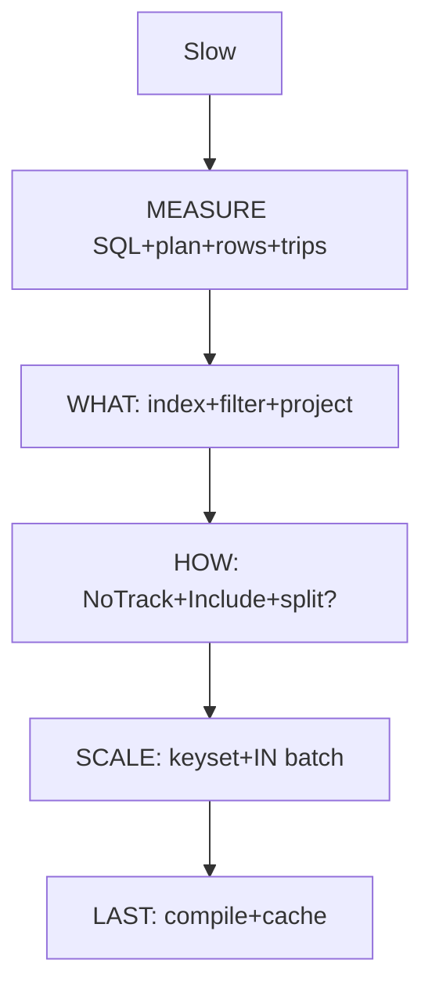

Checklist: SQL seen? Plan scanned? Filters in DB? Only cols? Tracking off/project? Index matches? No lazy? 100x ok? Contains bounded? Save outside loop? Fresh ctx? Benchmarked?

Final: EF rarely bottleneck; too much data too often. Measure, fetch less, load right, scale, then compile/cache.

## 34. Self-Assessment, Pro Tips, Next Steps

Assess: Can you read plan? Design (Status,CreatedAt)? Rewrite ToList+Where? Project Count/Sum? Pick split by measure? Write cursor API? Chunk Contains? Invalidate cache? Batch Save? Factory worker? If 8/10 yes, ship.

Pro tips: TagWith endpoint names; assert ToQueryString in tests; count commands to catch N+1 in CI; keep hot SQL in benchmarks; prefer DTOs at API boundary; short TTL for status.

Next: RLS tutorial, concurrency tutorial, BulkExtensions deep-dive, OpenTelemetry DB spans.

## 35. Further Reading / Resources

- MS Learn: EF performance intro, efficient querying, advanced topics, diagnosis.
- Npgsql EF provider docs; Postgres EXPLAIN.
- HybridCache docs; BenchmarkDotNet docs.
- Repo notes: Using EF Core Like a Pro; HybridCache 18x; Bulk Retrieval; No-Repository; DbContext thread-safe.
### 31b. Full Question Bank Answers (key points)

B1 Tracking snapshots for SaveChanges. B2 IQueryable SQL in DB; IEnumerable memory. B3 Include joins relations. B4 N+1 = 1 + N per-row queries. B5 OFFSET walks+discards. B6 Contains to IN params. B7 One SaveChanges batches. B8 Select only cols to DTO. B9 Unique enforces+lookups; composite multi-col order matters. B10 Filtered indexes subset smaller. B11 Plain fastest dupes possible; IdentityResolution one instance. B12 Split = N queries no dupes. B13 Pre-translated delegate for hot. B14 L1 memory + L2 Redis. B15 Single DELETE WHERE. B16 No, per-task ctx. B17 Leaks emails to logs. B18 DTOs hide internals.

I19 Equality first then range/sort. I20 Projection enables index-only. I21 Count/Exists SQL. I22 GetAll List kills composition. I23 Where/Order/Skip/Take. I24 10000 rows. I25 Small selective regressed 40 to 51. I26 Cursor + Take n+1. I27 500 under limits, fewer trips. I28 Temp/TVP JOIN scales. I29 Carriers hours, status seconds. I30 RemoveAsync on write. I31 BulkExtensions 10k+. I32 No per-request ctor state. I33 Factory per task. I34 TagWith labels SQL. I35 Preview SQL without running.

A41 Cost + rows + actual time; Seq+Removed = scan. A42 Parse/plan grows; params cap. A43 Position seek stable vs offset shift. A44 Multi-statement needs tx snapshot. A45 Fixed tree cached; dynamic varies. A46 EF8 caches auto; manual for hottest. A47 Time + Gen0/bytes. A48 Concurrency = throughput x latency. A49 Predicate hides rows 0 affected. A50 Audit/events missed. A51 Mass-assignment; bind DTO. A52 Source-gen JSON, trim roots. A53 TVP app-defined; temp session staging. A54 Seed 100x, compare p95 + plan.

