# Handling Uncertainty in Remote Calls: The Fourth Outcome - Complete Tutorial

> **Success. Failure. Unknown. Reconcile.**
>
> *A timeout is not proof of failure. Remote state ≠ client knowledge.*

| Attribute | Detail |
|-----------|--------|
| **Difficulty** | Intermediate 🟡 |
| **Estimated Reading Time** | ~70 minutes + 3 hands-on labs (~90 min) |
| **Language** | Java 17+ (sealed interfaces, pattern-matching switch) |
| **Last Updated** | 2026-10-10 |
| **Prerequisites** | Java basics, HTTP clients, SQL transactions |

## Table of Contents

1. [Introduction / Overview](#1-introduction--overview)
2. [Prerequisites](#2-prerequisites)
3. [Learning Objectives](#3-learning-objectives)
4. [Step 1: The Misleading Binary](#4-step-1-the-misleading-binary)
5. [Step 2: Why Remote Calls Are Different](#5-step-2-why-remote-calls-are-different)
6. [Step 3: Modeling the Real Outcomes](#6-step-3-modeling-the-real-outcomes)
7. [Step 4: Idempotency Keys](#7-step-4-idempotency-keys)
8. [Step 5: The Outbox Pattern](#8-step-5-the-outbox-pattern)
9. [Step 6: Reconciliation](#9-step-6-reconciliation)
10. [Step 7: The Complete Safe Workflow](#10-step-7-the-complete-safe-workflow)
11. [Real-World Examples and Use Cases](#11-real-world-examples-and-use-cases)
12. [Multiple Implementation Approaches](#12-multiple-implementation-approaches)
13. [Best Practices](#13-best-practices)
14. [Anti-Patterns](#14-anti-patterns)
15. [Performance Considerations](#15-performance-considerations)
16. [Security Considerations](#16-security-considerations)
17. [Testing Strategies](#17-testing-strategies)
18. [Troubleshooting Guide](#18-troubleshooting-guide)
19. [Migration Guide](#19-migration-guide)
20. [Summary / Key Takeaways](#20-summary--key-takeaways)
21. [Practice Exercises with Solutions](#21-practice-exercises-with-solutions)
22. [Test Your Understanding](#22-test-your-understanding)
23. [Common Interview Questions](#23-common-interview-questions)
24. [Question Bank](#24-question-bank-50-questions)
25. [Further Reading / Resources](#25-further-reading--resources)
26. [Pro Tips and Next Steps](#26-pro-tips-and-next-steps)

## 1. Introduction / Overview

Most developers learn error handling with a simple mental model:

> A call either **works** or it **fails**.

That model is perfectly fine for local, in-process calls. A method on an object in your own JVM either returns a value or throws an exception, and you always know which one happened.

**Remote calls break this model.** When your code calls another system across a network (a payment gateway, an order service, a bank API, a shipping provider), there is a **fourth outcome** that the success/failure binary cannot represent:

| # | Outcome | What the caller knows |
|---|---------|-----------------------|
| 1 | **Success** | The remote operation completed; the caller has proof. |
| 2 | **Failure** | The remote operation did *not* happen; the caller has proof. |
| 3 | **Unknown** | The caller does **not know** whether the operation happened. |
| 4 | **Pending** | The operation was accepted and is still in progress. |

> 💡 **Key Insight:** A timeout is not the same as a failed remote operation. It means the caller lacks definitive evidence.

**Story:** Imagine you text a friend "Transfer $100?" The message shows one tick (sent) but never two ticks (delivered/read). Did they act on it? You cannot tell. Calling again risks sending it twice. That is exactly what happens with `SocketTimeoutException` after a `POST /charges`.

By the end you will be able to explain why `try/catch → FAILURE` is dangerous, model uncertainty explicitly in Java's type system, use idempotency keys, use an outbox, and build reconciliation.

> 🎯 **Aha moment:** Distributed systems do not give you certainty for free. Design for uncertainty, don't wish it away.

## 2. Prerequisites

- **Java 17+**: sealed interfaces, records, pattern-matching `switch`.
- **HTTP basics**: status codes (2xx/4xx/5xx), timeouts, retries.
- **SQL transactions**: `BEGIN/COMMIT`, atomic writes.
- **Spring basics** (optional): `@Transactional`, `@Scheduled`.
- **Mindset**: comfortable reading sequence/state diagrams.

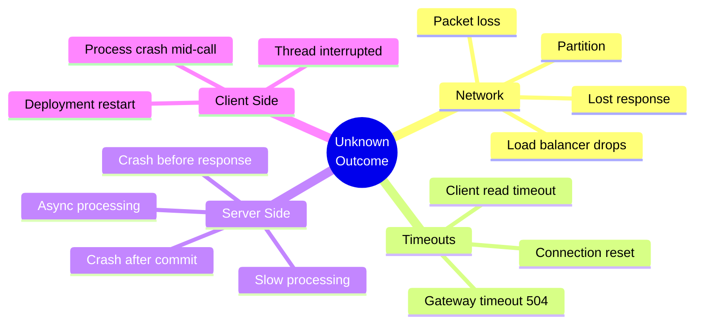

## 3. Learning Objectives

After completing this tutorial you will be able to:

1. Explain why binary success/failure handling causes duplicate charges.
2. Classify exceptions into `Success / Failure / Unknown / Pending` honestly.
3. Implement a sealed `RemoteOutcome<T>` type with exhaustive handling.
4. Generate, persist, and reuse idempotency keys safely.
5. Implement the transactional outbox pattern with a poller worker.
6. Build a reconciler with backoff and human-review escalation.
7. Choose retry policy based on operation semantics using the policy matrix.

## 4. Step 1: The Misleading Binary

### 4.1 The Classic (Flawed) Code

```java
try {
    callRemote(); // assume SUCCESS
} catch (Exception e) {
    // assume FAILURE — 🚨 logical error!
}
```

This treats *every* exception as proof the remote did nothing. The exception only proves **your local call did not complete normally**.

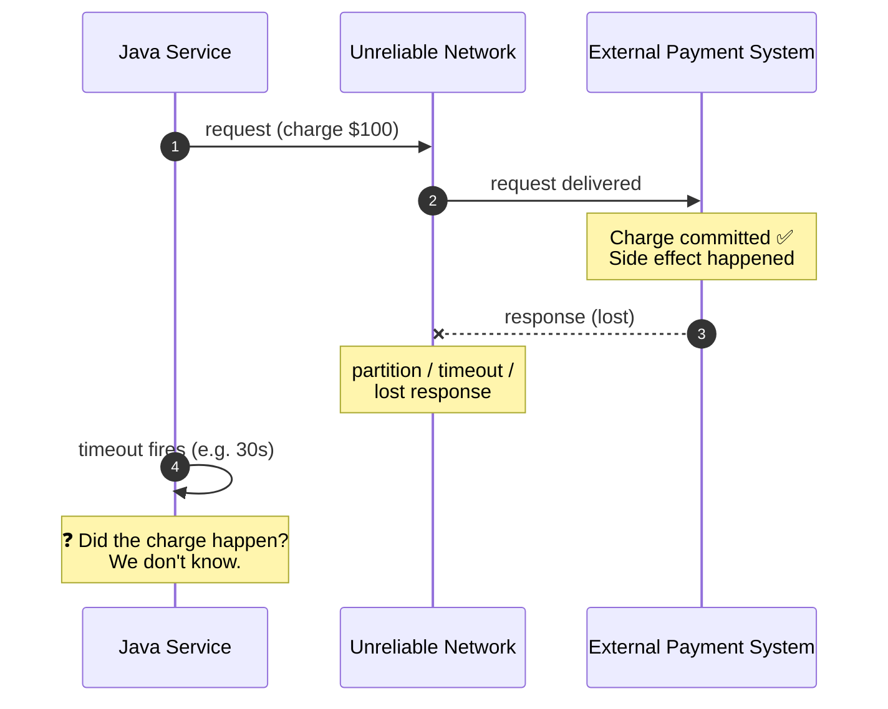

### 4.2 Three Ways a Timeout Happens

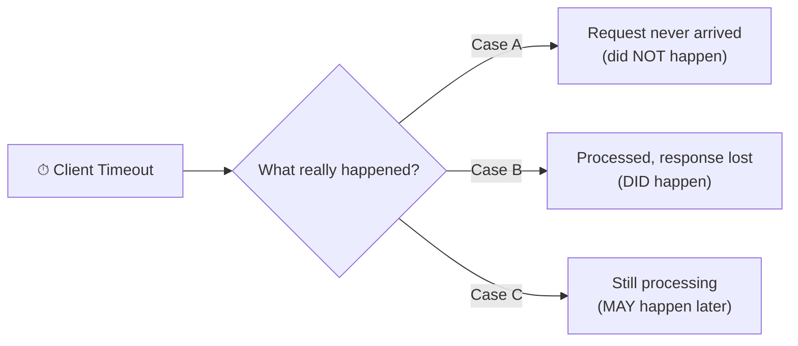

From the caller all three look identical.

| If you assume... | Reality... | Result |
|------------------|------------|--------|
| FAILURE → retry | Already committed | 💥 Duplicate payment |
| FAILURE → "it failed" | Committed | 😡 Charged but sees error |
| SUCCESS → ship | Never arrived | 💸 Shipped without pay |
| FAILURE → release stock | Reservation happened | 📦 Overselling |

### 4.3 Naive Payment Service (Incorrect)

```java
public class NaivePaymentService {
    private final PaymentGatewayClient gateway;
    private final OrderRepository orders;

    public void payForOrder(Order order) {
        try {
            gateway.charge(order.getCustomerId(), order.getTotal());
            orders.markPaid(order.getId());
        } catch (Exception e) {
            // 🚨 BUG: assumes charge did not happen
            orders.markPaymentFailed(order.getId());
        }
    }
}
```

**Failure scenario:** timeout after commit → mark FAILED → user clicks Try Again → second charge.

## 5. Step 2: Why Remote Calls Are Different

| Property | Local call | Remote call |
|----------|-----------|-------------|
| Failure detection | Exact (exception) | Ambiguous (timeout) |
| Partial failure | Rare | **Normal** |
| Latency | Nanoseconds | ms to seconds, unbounded |
| Atomicity | Shared fate | Two independent systems |
| Knowledge | Complete | **Always stale/absent** |

> ⚠️ **Two Generals Intuition:** Two parties over an unreliable channel can never be 100% certain the last message arrived. No amount of ACKs removes final uncertainty. Design for it.

## 6. Step 3: Modeling the Real Outcomes

> Make uncertainty explicit in your type system and state machine.

### 6.1 Sealed RemoteOutcome in Java (Correct)

```java
// RemoteOutcome.java — Java 17+ sealed interface
public sealed interface RemoteOutcome<T> {
    record Success<T>(T value) implements RemoteOutcome<T> {}
    record Failure<T>(Throwable error) implements RemoteOutcome<T> {}
    record Unknown<T>(String reason) implements RemoteOutcome<T> {}
    record Pending<T>(String reference) implements RemoteOutcome<T> {}
}
```

```java
// Exhaustive handling — compiler enforces all 4 branches
String describe(RemoteOutcome<PaymentReceipt> outcome) {
    return switch (outcome) {
        case RemoteOutcome.Success<PaymentReceipt> s -> "Paid: " + s.value().id();
        case RemoteOutcome.Failure<PaymentReceipt> f -> "Declined: " + f.error().getMessage();
        case RemoteOutcome.Unknown<PaymentReceipt> u -> "Unknown, reconcile: " + u.reason();
        case RemoteOutcome.Pending<PaymentReceipt> p -> "In progress, ref " + p.reference();
    };
}
```

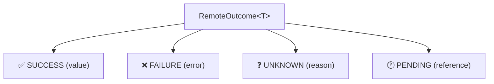

### 6.2 Honest Exception Classification (Correct)

```java
public class OutcomeClassifier {
    public <T> RemoteOutcome<T> classify(Callable<T> call) {
        try {
            return new RemoteOutcome.Success<>(call.call());
        } catch (HttpClientErrorException e) {
            int code = e.getStatusCode().value();
            if (code == 408 || code == 429) {
                return new RemoteOutcome.Unknown<>("HTTP " + code);
            }
            return new RemoteOutcome.Failure<>(e); // 4xx rejected definitively
        } catch (ConnectException e) {
            return new RemoteOutcome.Failure<>(e); // never sent
        } catch (SocketTimeoutException | HttpServerErrorException e) {
            return new RemoteOutcome.Unknown<>("Timeout or 5xx: " + e.getMessage());
        } catch (Exception e) {
            // Default to honesty: when in doubt, Unknown.
            return new RemoteOutcome.Unknown<>("Unclassified: " + e.getClass().getSimpleName());
        }
    }
}
```

| Observation | Outcome |
|-------------|---------|
| Connection refused / DNS failure | `Failure` |
| 400/422 validation, 402 declined | `Failure` |
| 200 OK with receipt | `Success` |
| 202 Accepted | `Pending` |
| Read timeout, 500/502/503/504, reset mid-response | **`Unknown`** |
| Client crash mid-call | **`Unknown`** |

> ⚠️ **Rule of thumb:** If the request *might* have reached the server and you have no definitive reply → `Unknown`.

### 6.3 Domain State Machine

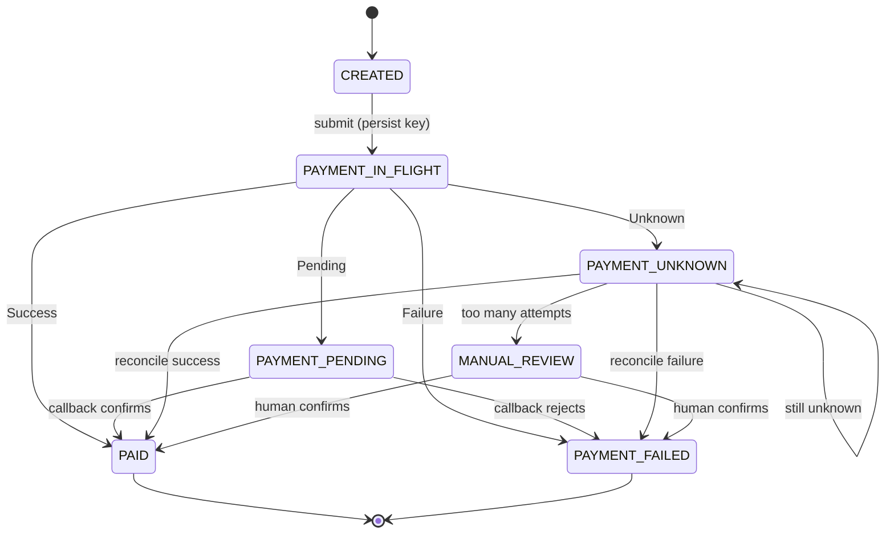

`PAYMENT_UNKNOWN` is a persisted state, never silently collapsed to FAILED.

## 7. Step 4: Idempotency Keys

> An operation is **idempotent** if performing it N times has the same effect as once.

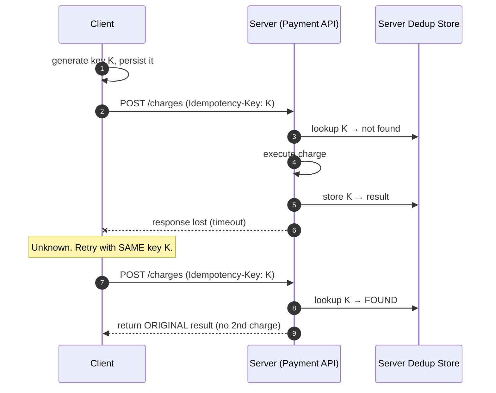

**Rules:** (1) generate before first attempt (2) persist before sending (3) reuse same key on retries (4) new key per new operation (5) bind key to payload hash (6) use UUID or `order-12345-payment-1`.

```java
public class PaymentService {
    private final PaymentGatewayClient gateway;
    private final PaymentAttemptRepository attempts;
    private final OutcomeClassifier classifier;

    public RemoteOutcome<PaymentReceipt> pay(Order order) {
        // 1. Create + PERSIST key BEFORE calling out
        PaymentAttempt attempt = attempts.findByOrderId(order.getId())
            .orElseGet(() -> attempts.save(new PaymentAttempt(
                order.getId(), UUID.randomUUID().toString(),
                order.getTotal(), AttemptStatus.IN_FLIGHT)));
        // 2. Call WITH the persisted key; 3. record honest outcome
        RemoteOutcome<PaymentReceipt> outcome = classifier.classify(() ->
            gateway.charge(attempt.getIdempotencyKey(),
                order.getCustomerId(), order.getTotal()));
        attempts.update(attempt.getId(), outcome);
        return outcome;
    }
}
```

```java
@PostMapping("/charges")
public ResponseEntity<Charge> create(
        @RequestHeader("Idempotency-Key") String key,
        @RequestBody ChargeRequest req) {
    Optional<StoredResult> existing = dedupStore.find(key);
    if (existing.isPresent()) {
        if (!existing.get().requestHash().equals(hash(req)))
            return ResponseEntity.status(422).build();
        return ResponseEntity.ok(existing.get().response());
    }
    Charge charge = chargeService.execute(req);
    dedupStore.save(key, hash(req), charge);
    return ResponseEntity.ok(charge);
}
```

| System | Mechanism |
|--------|-----------|
| Stripe / Adyen | `Idempotency-Key` header |
| AWS APIs | `ClientToken` |
| Kafka | `enable.idempotence=true` |
| DB | Unique constraint on business key |

## 8. Step 5: The Outbox Pattern

### 8.1 Dual-Write Problem

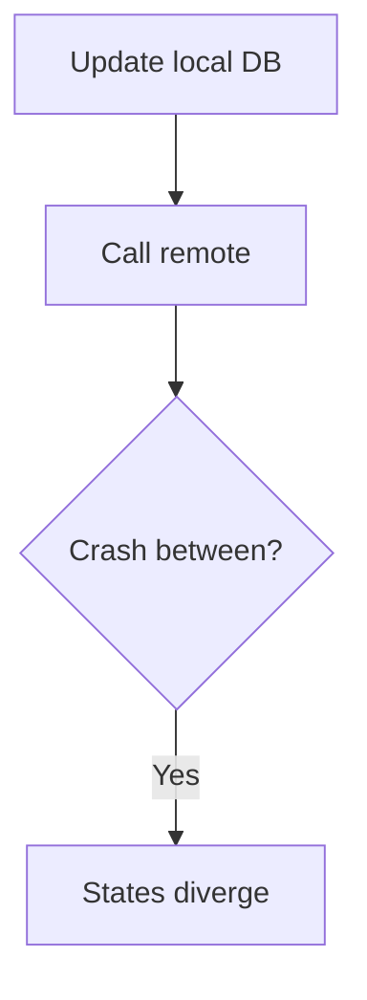

> Write **intent** to durable **outbox** in same TX; a worker talks remote.

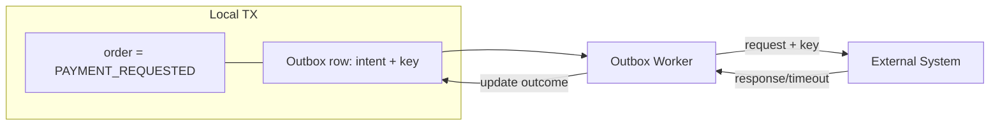

```sql
CREATE TABLE outbox (
    id BIGSERIAL PRIMARY KEY,
    aggregate_id VARCHAR(64) NOT NULL,
    operation VARCHAR(64) NOT NULL,
    idempotency_key VARCHAR(128) NOT NULL UNIQUE,
    payload JSONB NOT NULL,
    status VARCHAR(32) NOT NULL DEFAULT 'PENDING',
    attempts INT NOT NULL DEFAULT 0,
    next_attempt_at TIMESTAMPTZ NOT NULL DEFAULT now(),
    last_error TEXT,
    created_at TIMESTAMPTZ NOT NULL DEFAULT now(),
    updated_at TIMESTAMPTZ NOT NULL DEFAULT now()
);
CREATE INDEX idx_outbox_due ON outbox (status, next_attempt_at)
    WHERE status IN ('PENDING','UNKNOWN');
```

```java
@Transactional
public void placeOrder(OrderRequest req) {
    Order order = orderRepository.save(Order.create(req));
    outboxRepository.save(OutboxEntry.builder()
        .aggregateId(order.getId())
        .operation("CHARGE_CARD")
        .idempotencyKey("order-" + order.getId() + "-charge-1")
        .payload(toJson(new ChargeRequest(order)))
        .status(OutboxStatus.PENDING).build());
}
```

```java
@Scheduled(fixedDelay = 2000)
public void processOutbox() {
    List<OutboxEntry> due = outboxRepository.lockDueEntries(50);
    for (OutboxEntry entry : due) {
        RemoteOutcome<ChargeReceipt> outcome = classifier.classify(() ->
            gateway.charge(entry.getIdempotencyKey(), entry.getPayload()));
        switch (outcome) {
            case RemoteOutcome.Success<ChargeReceipt> s -> {
                entry.markSucceeded(); orderService.onPaid(entry.getAggregateId(), s.value()); }
            case RemoteOutcome.Failure<ChargeReceipt> f -> {
                entry.markFailed(f.error().getMessage()); orderService.onPaymentFailed(entry.getAggregateId()); }
            case RemoteOutcome.Unknown<ChargeReceipt> u -> {
                entry.markUnknown(u.reason());
                entry.scheduleNextAttempt(backoff(entry.getAttempts())); }
            case RemoteOutcome.Pending<ChargeReceipt> p -> entry.markPending(p.reference());
        }
        outboxRepository.save(entry);
    }
}
```

| Outbox does | Does NOT |
|-------------|----------|
| Preserve intent + uncertainty | Prove remote state |
| Safe same-key retries + audit | Replace reconciliation |

## 9. Step 6: Reconciliation

Reconciliation converts `UNKNOWN` to definitive result using **new evidence**.

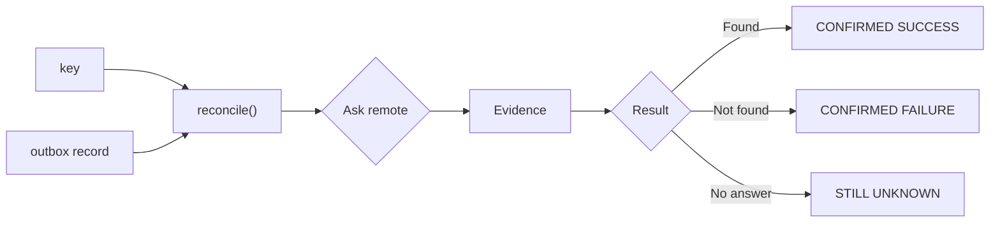

| Result | Meaning | Action |
|--------|---------|--------|
| Confirmed success | Side effect committed | Mark paid; stop retrying |
| Confirmed failure | No side effect | Safe to retry / notify |
| Still unknown | Cannot tell yet | Backoff, query later |
| Human review | Exhausted/ambiguous | Escalate to operator |

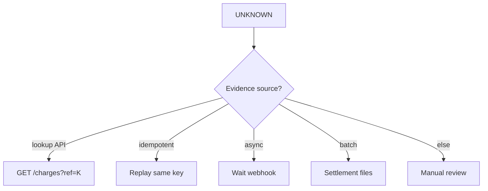

```java
public enum ReconcileResult { CONFIRMED_SUCCESS, CONFIRMED_FAILURE, STILL_UNKNOWN }

@Service
public class PaymentReconciler {
    private static final int MAX_ATTEMPTS = 10;

    public void reconcile(OutboxEntry entry) {
        ReconcileResult result = queryStatus(entry.getIdempotencyKey());
        switch (result) {
            case CONFIRMED_SUCCESS -> {
                entry.markSucceeded(); orderService.onPaid(entry.getAggregateId()); }
            case CONFIRMED_FAILURE -> {
                entry.markFailed("No remote record"); orderService.onPaymentFailed(entry.getAggregateId()); }
            case STILL_UNKNOWN -> {
                if (entry.getAttempts() >= MAX_ATTEMPTS) {
                    entry.markManualReview(); alerts.notifyOps("Stuck UNKNOWN", entry);
                } else entry.scheduleNextAttempt(exponentialBackoff(entry.getAttempts()));
            }
        }
    }

    private ReconcileResult queryStatus(String key) {
        try {
            Optional<RemoteCharge> c = gateway.findByReference(key);
            if (c.isEmpty()) return ReconcileResult.CONFIRMED_FAILURE;
            return switch (c.get().status()) {
                case "succeeded" -> ReconcileResult.CONFIRMED_SUCCESS;
                case "failed" -> ReconcileResult.CONFIRMED_FAILURE;
                default -> ReconcileResult.STILL_UNKNOWN;
            };
        } catch (Exception e) { return ReconcileResult.STILL_UNKNOWN; }
    }
}
```

> ⚠️ "Not found" proves failure only with **read-your-writes** consistency. With eventual consistency, wait a safety window before concluding failure.

```mermaid
gantt
    title Lifecycle of an UNKNOWN Payment
    dateFormat HH:mm:ss
    axisFormat %H:%M:%S
    section Attempt
    Send charge (key K) :a1, 00:00:00, 30s
    Timeout :milestone, m1, 00:00:30, 0s
    section Reconcile
    Query 1 (unknown) :a3, 00:01:00, 5s
    Query 2 (unknown) :a4, 00:03:00, 5s
    Query 3 (CONFIRMED) :a5, 00:07:00, 5s
    section Domain
    Marked PAID :milestone, m2, 00:07:05, 0s
```

## 10. Step 7: The Complete Safe Workflow

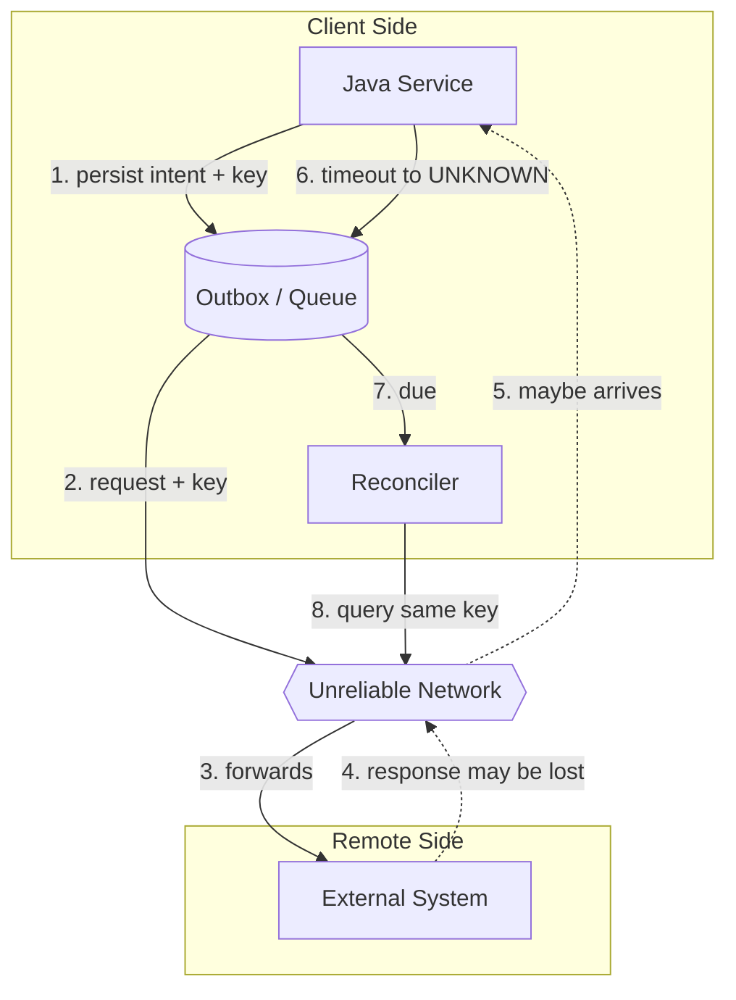

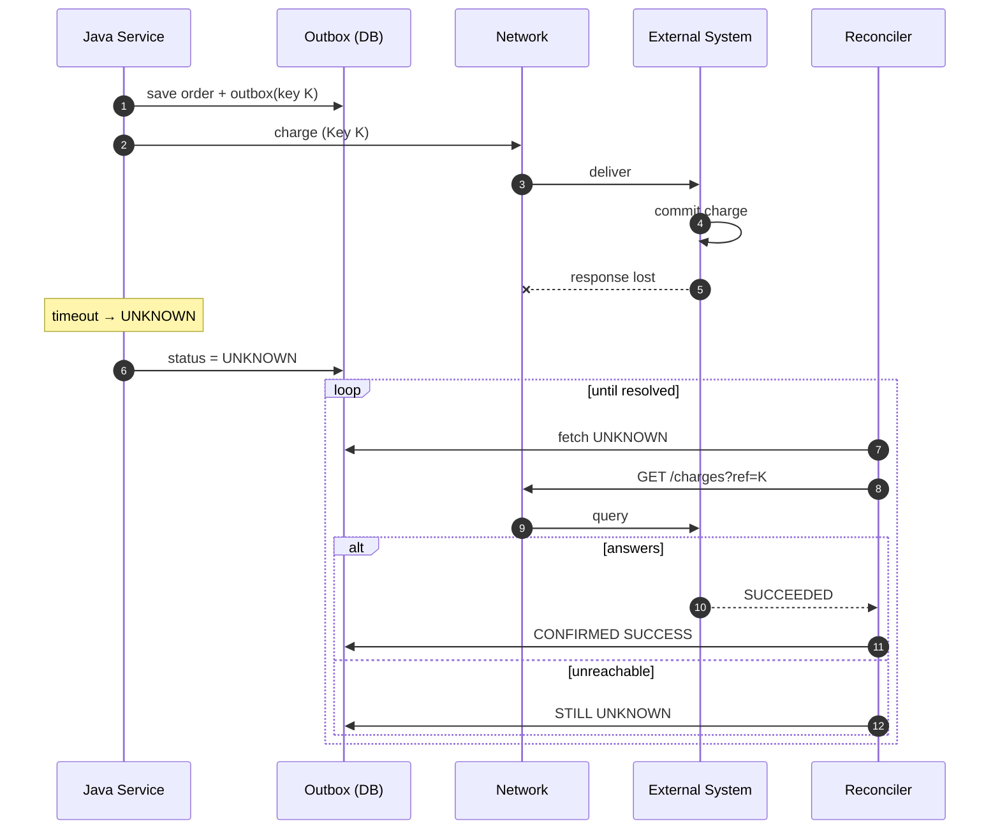

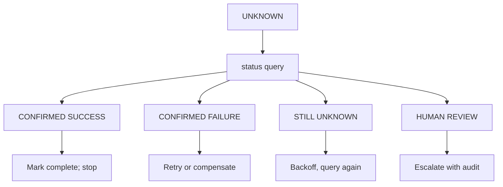

```java
@Transactional
public void checkout(Cart cart) {
    Order o = orders.save(Order.from(cart));
    outbox.save(OutboxEntry.charge(o, "order-" + o.getId() + "-charge-1"));
}
public void send(OutboxEntry e) {
    RemoteOutcome<Receipt> out = classifier.classify(() ->
        gateway.charge(e.getIdempotencyKey(), e.getPayload()));
    apply(e, out);
}
@Scheduled(fixedDelay = 30_000)
public void reconcileLoop() {
    outbox.findDueUnknown().forEach(reconciler::reconcile);
}
```

## 11. Real-World Examples and Use Cases

### 11.1 Payments (Classic)

Never retry without same key; reconcile first via `GET /payments?reference=...`, webhooks, nightly settlement files.

### 11.2 E-commerce Fulfillment

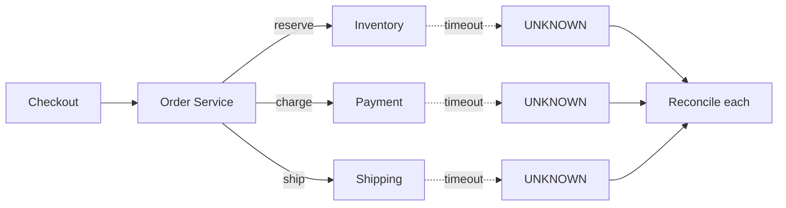

Inventory: query by order ID; re-reserve if absent. Shipping: query by ref; void duplicates. Payment: strictest.

### 11.3 Other Domains

- **Bank transfers:** async, settlement via camt.053/MT940 files; UNKNOWN lasts hours/days.
- **Emails/SMS:** duplicate cheap, miss costly → at-least-once retry freely.
- **Cloud provisioning:** AWS `ClientToken`; reconcile by listing tagged resources.
- **Seat booking:** query by confirmation ID; blind retry may double-book.

| Operation | Dup cost | Miss cost | Policy |
|-----------|----------|-----------|--------|
| Charge card | Very high | High | Same-key + query; human fallback |
| Transfer funds | Very high | High | Strict reconcile; never blind retry |
| Create shipment | Medium | Medium | Query by ref; void dups |
| Reserve inventory | Low-med | Medium | Idempotent reserve; expire holds |
| Send notification | Low | Medium | At-least-once retry |
| Metrics/log | Negligible | Negligible | Fire and forget |
| Read query | None | n/a | Retry freely |

## 12. Multiple Implementation Approaches

| Approach | Pros | Cons | Use when |
|----------|------|------|----------|
| Polling outbox (`SKIP LOCKED`) | Simple, no infra | Poll delay | Most Spring apps |
| CDC outbox (Debezium→Kafka) | Real-time, low DB load | Infra complexity | High throughput |
| Status-query reconcile | Precise | Needs API | Provider has lookup |
| Same-key replay | Self-healing | Needs idempotence | Stripe-like APIs |
| Webhook reconcile | Event-driven | Callbacks lost too | Async providers |

```java
// Backoff with jitter — avoids thundering herd
Duration exponentialBackoff(int attempt) {
    long base = (long) Math.min(300_000, 1000L * (1L << attempt));
    long jitter = ThreadLocalRandom.current().nextLong(0, 500);
    return Duration.ofMillis(base + jitter);
}
```

## 13. Best Practices

- [ ] Return types distinguish Success/Failure/Unknown/Pending
- [ ] Exceptions classified; unclassified default to Unknown
- [ ] Idempotency key created + persisted before first attempt
- [ ] Same key reused on every retry
- [ ] Intent + outcome in durable outbox, same TX as business change
- [ ] UNKNOWN persisted, never silently converted to failure
- [ ] Reconciler gathers evidence; attempts capped with backoff → human review
- [ ] UX says "confirming", not "failed", while unknown
- [ ] Fault-injection tests cover committed-but-response-lost

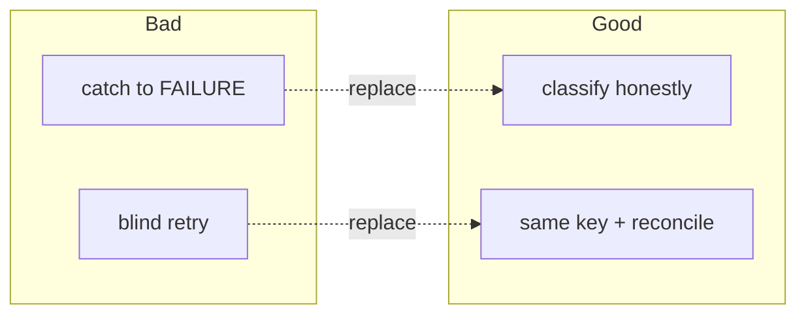

## 14. Anti-Patterns

1. `catch (Exception) → FAILURE` — lies. Fix: classify, default Unknown.
2. Blind retries without key — up to N charges. Fix: same key or reconcile first.
3. New key per retry — defeats dedup. Fix: generate once, persist, reuse.
4. Uncertainty only in memory — lost on restart. Fix: persist UNKNOWN.
5. "Not found" = failure immediately — eventual consistency. Fix: safety window.
6. Infinite silent retry — must escalate. Fix: cap + MANUAL_REVIEW + alerts.
7. Show "Payment Failed" on timeout — invites double submit. Fix: "confirming" UX.

```java
// ❌ INCORRECT: blind retry, new key each time
for (int i = 0; i < 3; i++) {
    try { return gateway.charge(UUID.randomUUID().toString(), c, amt); }
    catch (Exception e) { /* retry */ }
}
// ✅ CORRECT: same persisted key + honest classification
RemoteOutcome<Receipt> out = classifier.classify(() ->
    gateway.charge(persistedKey, c, amt));
```

## 15. Performance Considerations

- **Batch + SKIP LOCKED:** `lockDueEntries(50)` with `FOR UPDATE SKIP LOCKED` lets N workers poll without contention.
- **Partial index** on `(status, next_attempt_at) WHERE status IN ('PENDING','UNKNOWN')` keeps due-scans fast.
- **Backoff with jitter** (1s→5min cap) prevents hammering a struggling provider.
- **Dedup-store TTL:** Stripe keeps keys 24h; size your store and retention accordingly.
- **Payload size:** keep outbox payload minimal (IDs + amounts); large JSON slows polling.
- **Separate reconcile cadence:** send loop every 2s; reconcile loop every 30s.

## 16. Security Considerations

- **Key entropy:** use `UUIDv4` (122-bit); never sequential IDs guessable by others.
- **Bind key to payload hash:** reject same key + different body with 422 to block amount-swapping.
- **Auth on queries/webhooks:** sign webhooks (HMAC), verify signatures before confirming success.
- **PII minimization:** encrypt PAN/tokens in outbox payload; retain only reference IDs.
- **Replay window:** expire keys; log every replay for audit.

## 17. Testing Strategies

```java
class FlakyGateway implements PaymentGatewayClient {
    private final Map<String, Receipt> committed = new HashMap<>();
    private boolean dropNextResponse = true;

    @Override
    public Receipt charge(String key, String customer, Money amount) {
        Receipt r = committed.computeIfAbsent(key,
            k -> new Receipt(UUID.randomUUID(), amount));
        if (dropNextResponse) {
            dropNextResponse = false;
            throw new SocketTimeoutException("simulated lost response");
        }
        return r;
    }
    public Optional<Receipt> find(String key) {
        return Optional.ofNullable(committed.get(key));
    }
    public int chargeCount() { return committed.size(); }
}
```

```java
@Test
void timeoutThenRetry_withSameKey_chargesExactlyOnce() {
    FlakyGateway gateway = new FlakyGateway();
    PaymentService service = new PaymentService(gateway, ...);
    RemoteOutcome<Receipt> first = service.pay(order);
    assertThat(first).isInstanceOf(RemoteOutcome.Unknown.class);
    RemoteOutcome<Receipt> second = service.pay(order);
    assertThat(second).isInstanceOf(RemoteOutcome.Success.class);
    assertThat(gateway.chargeCount()).isEqualTo(1);
}
```

| Fault injected | Expected |
|----------------|----------|
| Connection refused | Failure |
| HTTP 400/422/402 | Failure |
| Read timeout, 503, reset | Unknown |
| HTTP 202 | Pending |
| Kill -9 mid-call | Unknown on restart |

Tools: Toxiproxy, WireMock faults, Chaos Monkey, Testcontainers.

## 18. Troubleshooting Guide

| Symptom | Likely cause | Fix |
|---------|--------------|-----|
| Duplicates despite keys | New key per retry | Persist key; reuse for same operation |
| UNKNOWN stuck forever | No reconciler running | Start reconcile loop; check `next_attempt_at` |
| "Not found" then charge appears | Eventual consistency | Safety window (e.g. 60s) before CONFIRMED_FAILURE |
| Outbox lag growing | Poll too slow / no index | Add partial index; raise batch; scale workers |
| 422 on replay | Payload changed with same key | Use new key for new intent |
| Webhook confirms but DB not updated | Non-idempotent handler | Dedup webhook by event ID |

## 19. Migration Guide

1. Introduce `RemoteOutcome<T>` alongside old `boolean` API; adapt callers gradually.
2. Wrap legacy client: `boolean charge()` → classifier returns Success/Failure/Unknown.
3. Add `idempotency_key` column (nullable → backfill → unique).
4. Add outbox table; dual-write temporarily, then switch worker on.
5. Mark `catch → FAILURE` paths `@Deprecated` with warning.

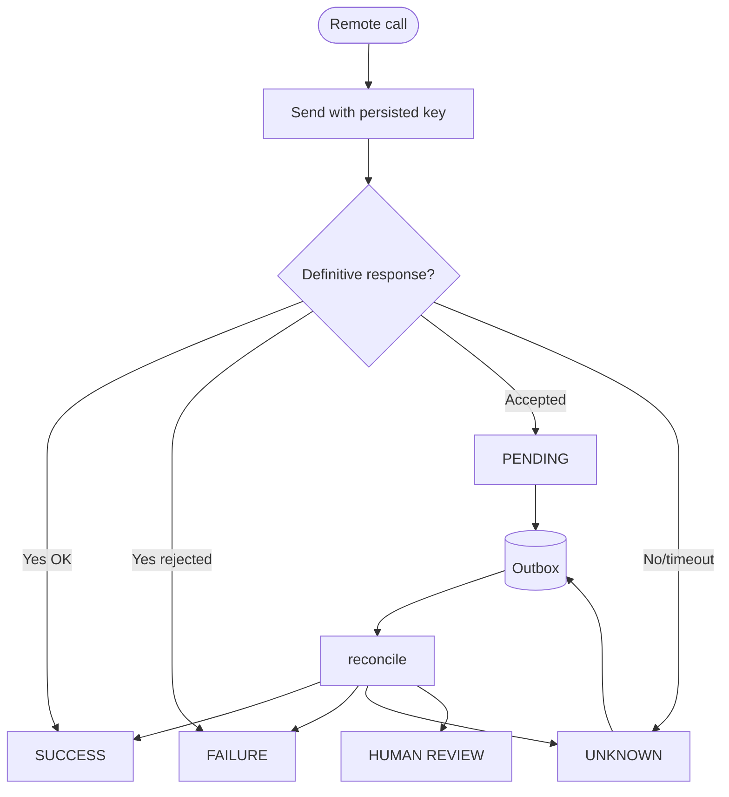

## 20. Summary / Key Takeaways

> A timeout is not a failed operation; it means the caller lacks evidence. Model explicitly. Let semantics drive retry policy.

**Self-assessment:** ☐ I classify honestly ☐ I persist keys ☐ I reuse keys ☐ UNKNOWN is durable ☐ Reconciler + backoff + review ☐ UX says confirming ☐ Fault tests pass.

## 21. Practice Exercises with Solutions

### Exercise 1 — Classifier Kata (Beginner)

**Task:** Implement `classify()` mapping: ConnectException→Failure, 400→Failure, 408/429→Unknown, timeout/5xx→Unknown, 202→Pending, default→Unknown.

**Solution:**

```java
public <T> RemoteOutcome<T> classify(Callable<T> call) {
    try {
        T v = call.call();
        if (v instanceof Accepted a)
            return new RemoteOutcome.Pending<>(a.reference());
        return new RemoteOutcome.Success<>(v);
    } catch (ConnectException e) { return new RemoteOutcome.Failure<>(e); }
      catch (HttpClientErrorException e) {
        int c = e.getStatusCode().value();
        if (c == 408 || c == 429)
            return new RemoteOutcome.Unknown<>("HTTP " + c);
        return new RemoteOutcome.Failure<>(e);
      } catch (SocketTimeoutException | HttpServerErrorException e) {
        return new RemoteOutcome.Unknown<>(e.getMessage());
      } catch (Exception e) { return new RemoteOutcome.Unknown<>(e.toString()); }
}
```

### Exercise 2 — Exactly-Once Lab (Intermediate)

**Task:** Using FlakyGateway, prove same-key retry charges once; new-key retry charges twice.

**Solution:** First call → Unknown, `chargeCount()==1`. Second call with persisted key → Success, count still 1. Variant with fresh UUID → count 2 (demonstrates bug).

### Exercise 3 — Outbox End-to-End (Advanced)

**Task:** Save order+outbox atomically, kill process after send, restart worker, reconcile to PAID with no duplicate.

**Solution sketch:** TX saves both rows. Worker classifies timeout as UNKNOWN. On restart `findDueUnknown()` re-queries `findByReference(key)` → CONFIRMED_SUCCESS → `onPaid()`. Assert one charge + order PAID.

## 22. Test Your Understanding

1. Why is `catch (Exception) → FAILURE` dishonest for remote calls?
2. Name the 4 outcomes and what evidence each requires.
3. Give 3 ways a timeout can happen with different remote truths.
4. Why must idempotency keys be persisted before the first attempt?
5. What does the outbox preserve, and what can it not prove?
6. List 4 reconciliation results and the action for each.
7. Why is "not found" not always proof of failure?
8. What UX message should a timeout show, and why?
9. How does a sealed interface enforce exhaustive handling?
10. When is at-least-once retry acceptable without reconciliation?
11. What happens if you reuse a key with a different payload?
12. How do backoff + MAX_ATTEMPTS + MANUAL_REVIEW work together?

## 23. Common Interview Questions

1. Explain the Two Generals Problem and its link to timeouts.
2. How would you design exactly-once payment charging over an unreliable network?
3. Compare status-query vs replay vs webhook reconciliation.
4. Why is 408/429 Unknown while 400 is Failure?
5. How does `FOR UPDATE SKIP LOCKED` enable parallel outbox workers?
6. What consistency guarantee does "not found = failure" need?
7. How do you handle a provider with no idempotency support?
8. Design the outbox schema and explain each column.
9. How do you test committed-but-response-lost?
10. When would you route to human review?
11. Polling outbox vs CDC — tradeoffs?
12. How do you prevent double-submit from the UI during UNKNOWN?

## 24. Question Bank (50 Questions)

### Beginner (1-15)

1. What are the four remote outcomes?
2. What does Unknown mean?
3. What does Pending mean?
4. Why can't a timeout prove failure?
5. What is an idempotency key?
6. When should you generate the key?
7. Should retries use the same or new key?
8. What is the outbox pattern in one sentence?
9. What is reconciliation?
10. Name two sources of Unknown outcomes.
11. What HTTP code means "accepted, in progress"?
12. Is connection-refused Failure or Unknown? Why?
13. Is read-timeout Failure or Unknown? Why?
14. What is a duplicate charge and how does it happen?
15. Why show "confirming" instead of "failed" on timeout?

### Intermediate (16-35)

16. Why are 408/429 Unknown but 400 Failure?
17. Why bind key to payload hash?
18. What columns does the outbox need?
19. Why must order + outbox save in one TX?
20. What does `FOR UPDATE SKIP LOCKED` do?
21. Compare polling outbox vs CDC outbox.
22. List 3 reconciliation strategies with tradeoffs.
23. What are the 4 reconcile results?
24. Why cap attempts and escalate to human?
25. How does backoff with jitter help?
26. How do webhooks complement status queries?
27. How to reconcile bank transfers without lookup API?
28. Why is email safe to retry blindly but payment is not?
29. How does AWS ClientToken provide idempotence?
30. What is read-your-writes consistency and why does it matter?
31. How do sealed interfaces enforce exhaustive switches?
32. What safety window guards "not found = failure"?
33. How to handle providers without idempotency keys?
34. What should `last_error` store and why?
35. How do partial indexes speed outbox polling?

### Advanced (36-50)

36. Relate Two Generals to exactly-once impossibility.
37. Design dedup store TX with charge execution.
38. How to make webhook handlers idempotent?
39. How to reconcile during provider outage (STILL_UNKNOWN)?
40. How to size MAX_ATTEMPTS and backoff caps?
41. How to prevent UI double-submit during UNKNOWN?
42. How to migrate boolean API to RemoteOutcome safely?
43. How to encrypt PII in outbox payloads?
44. How to test kill -9 mid-call with Testcontainers?
45. How to void duplicate shipments idempotently?
46. How does Debezium outbox avoid dual writes?
47. How to correlate logs via idempotency key across services?
48. When is at-least-once preferable to at-most-once?
49. How to audit replays for compliance?
50. Design ops runbook for MANUAL_REVIEW queue.

## 24b. Question Bank — Answer Key

### Beginner Answers (1-15)

**1. What are the four remote outcomes?**
**Success** — definitive proof the remote side-effect committed (e.g. `200 OK` + receipt). **Failure** — definitive proof it did *not* happen (e.g. connection-refused, `400/402/422` rejection). **Unknown** — no evidence either way (timeout, `5xx` after send, reset mid-response, client crash). **Pending** — remote accepted the work and it is still in progress (e.g. `202 Accepted` + reference).

**2. What does Unknown mean?**
It means: *"I asked, I didn't hear back, I don't know yet."* The request may never have arrived, may have committed with a lost response, or may still be processing — all three look identical to the caller. Persist it and reconcile; never silently convert it to Failure.

**3. What does Pending mean?**
The remote explicitly told you: received, valid, but not finished. Example: `202 Accepted` with a reference. Unlike Unknown, you *know* it was accepted, so poll the reference or wait for a webhook instead of re-sending blindly.

**4. Why can't a timeout prove failure?**
A timeout only observes your local wait expiring — it says nothing about the remote. The request could have been lost before arrival (no effect), committed with the response lost (effect happened), or still be executing. Without a definitive reply, you lack evidence.

**5. What is an idempotency key?**
A client-chosen unique ID (e.g. UUID, `order-12345-charge-1`) sent with the request letting the server deduplicate. First arrival executes + stores `key → result`; replays with the same key return the stored result without re-executing.

**6. When should you generate the key?**
Before the *first* attempt, persisted in the same local TX as your business change/outbox row. Generating after sending or only in memory means a crash/retry loses it and dedup fails.

**7. Should retries use the same or new key?**
**Same key** for the same logical operation. A new key signals a *different* operation → executes again → duplicate. New key only for genuinely new intent.

**8. What is the outbox pattern in one sentence?**
Write business change + send-intent (with idempotency key) atomically in one local DB TX, then a separate worker reads the outbox table and talks to the remote.

**9. What is reconciliation?**
Converting `UNKNOWN` to a definitive result by gathering *new evidence*: status query by key, same-key replay, webhook, settlement-file match, or manual investigation.

**10. Name two sources of Unknown outcomes.**
Any two: partition/packet loss, read timeout, `504`, reset mid-response, server crash after commit, slow/async processing, client crash/interrupt/restart mid-call.

**11. What HTTP code means "accepted, in progress"?**
`202 Accepted`. Map to `Pending(reference)`, then poll or await webhook — not Success/Failure.

**12. Is connection-refused Failure or Unknown? Why?**
`Failure`. TCP never opened, so the request was never sent — definitive proof the remote never saw it.

**13. Is read-timeout Failure or Unknown? Why?**
`Unknown`. Request *was* sent; reply never arrived. Server may/may not have committed — no evidence.

**14. What is a duplicate charge and how does it happen?**
Same purchase charged twice. Path: timeout after commit → assumed FAILURE → "Try again" with new key → second commit. Same-key + reconcile prevents it.

**15. Why show "confirming" instead of "failed" on timeout?**
"Failed" lies and invites re-submit → double charge. "Confirming, we'll notify you" is honest and matches persisted UNKNOWN.

### Intermediate Answers (16-35)

**16. Why are 408/429 Unknown but 400 Failure?**
`400/422` = server saw and rejected → definitive non-execution. `408/429` = may not have processed / unclear under load → no proof → Unknown, back off.

**17. Why bind key to payload hash?**
Prevents amount-swapping: same key + different body must return `422`, not execute. Server stores `hash(request)` and compares on replay.

**18. What columns does the outbox need?**
`id, aggregate_id, operation, idempotency_key UNIQUE, payload, status, attempts, next_attempt_at, last_error, created_at/updated_at`, plus partial index on `(status, next_attempt_at)`.

**19. Why must order + outbox save in one TX?**
Avoids dual-write divergence: crash between separate writes leaves local/remote diverged with no recovery record. One TX = both or neither.

**20. What does `FOR UPDATE SKIP LOCKED` do?**
Locks due batch while skipping rows locked by other workers — N pollers work in parallel without contention or double-send.

**21. Compare polling outbox vs CDC outbox.**
Polling (`@Scheduled` + `SKIP LOCKED`): simple, no infra, poll delay + DB load. CDC (Debezium WAL → Kafka): real-time, low DB load, needs Kafka ops. Polling for most Spring apps; CDC for high throughput.

**22. List 3 reconciliation strategies with tradeoffs.**
Status query: precise/cheap, needs lookup API. Same-key replay: simple/self-healing, needs idempotence. Webhook: event-driven, but losable/duplicable. Also: settlement files (authoritative, slow), manual (always possible, costly).

**23. What are the 4 reconcile results?**
Confirmed Success → mark paid, stop. Confirmed Failure → retry/notify safe. Still Unknown → backoff, query again. Human Review → escalate with audit trail.

**24. Why cap attempts and escalate to human?**
Infinite retry hides stuck money and hammers sick providers. `MAX_ATTEMPTS` + backoff bounds load; `MANUAL_REVIEW` + alert gets a person with full history.

**25. How does backoff with jitter help?**
Exponential backoff (1s→5min cap) lets remote recover; jitter (±500ms) avoids thundering herd when many UNKNOWNs retry together post-outage.

**26. How do webhooks complement status queries?**
Queries = pull ground-truth loop; webhooks = push fast-path hint. Both must be idempotent (dedup event ID) + signature-verified; webhooks can be lost/delayed/replayed.

**27. How to reconcile bank transfers without lookup API?**
Match outbox reference vs daily settlement files (camt.053/MT940); keep UNKNOWN hours/days; route mismatches to finance ops. Never blind-retry money.

**28. Why is email safe to retry blindly but payment is not?**
Duplicate cost drives policy: dup email = annoying, missing OTP = worse → at-least-once OK. Dup charge = financial/trust damage → same-key + reconcile first.

**29. How does AWS ClientToken provide idempotence?**
AWS stores `token → resource` ~24h; same-token retry returns same resource instead of creating another. Reconcile by listing tagged resources.

**30. What is read-your-writes consistency and why does it matter?**
Write immediately visible to reads. "Not found = failure" needs it; with eventual consistency a fresh commit may be invisible — wait a safety window first.

**31. How do sealed interfaces enforce exhaustive switches?**
`sealed ... permits Success, Failure, Unknown, Pending` + switch with no default fails compilation if any branch missing; new outcomes break forgetful switches.

**32. What safety window guards "not found = failure"?**
Wait out replication lag (60s–minutes per SLA) and/or require N consecutive not-founds across backoff before `CONFIRMED_FAILURE`.

**33. How to handle providers without idempotency keys?**
Natural unique business key, status query by reference, conditional `If-Match`, manual statement reconciliation. Strict reconcile-first, never blind retry.

**34. What should `last_error` store and why?**
Latest reason: exception class, HTTP status, timeout, attempt #, timestamp — powers debugging, dashboards, and MANUAL_REVIEW handoff.

**35. How do partial indexes speed outbox polling?**
`WHERE status IN ('PENDING','UNKNOWN')` indexes only due rows → tiny index scan instead of full scan over SUCCEEDED/FAILED history.

### Advanced Answers (36-50)

**36. Relate Two Generals to exactly-once impossibility.**
Two Generals: last message over unreliable channel can never be certain — final ACK losable. So exactly-once *delivery* is impossible; exactly-once *effect* comes from idempotence + reconciliation.

**37. Design dedup store TX with charge execution.**
One DB TX: `INSERT key/hash` (unique guards races) + execute + `UPDATE key → result`. On conflict, rollback and return stored result after hash check. Or `INSERT ... ON CONFLICT DO NOTHING` + conditional execute.

**38. How to make webhook handlers idempotent?**
Persist `event_id` unique before processing; duplicates return prior outcome. Verify HMAC, map reference to outbox, transition conditionally (UNKNOWN/PENDING → PAID only).

**39. How to reconcile during provider outage?**
Query also fails → `STILL_UNKNOWN`, increment, backoff reschedule, no state change. After MAX → MANUAL_REVIEW. Same key keeps recovery duplicate-free.

**40. How to size MAX_ATTEMPTS and backoff caps?**
Provider SLA + money risk: e.g. 10 attempts, `min(5min, 1s*2^n)` + jitter ≈ 15–30 min; banks need hours/days + file match. Alert early; tune via p95 UNKNOWN age. Always end in human review.

**41. How to prevent UI double-submit during UNKNOWN?**
Disable pay button after submit, reuse session key, show "confirming" + notify path; re-click resumes status query (same key). Server same-key dedup is backstop.

**42. How to migrate boolean API to RemoteOutcome safely?**
Add `RemoteOutcome` method alongside old, wrap legacy with classifier adapter, migrate callers incrementally, add key column nullable → backfill → unique, add outbox dual-write, deprecate `catch → FAILURE`.

**43. How to encrypt PII in outbox payloads?**
Store references only; envelope-encrypt (KMS) PAN/tokens at write, decrypt in worker memory only, mask logs, set retention/TTL, wipe after SUCCEEDED.

**44. How to test kill -9 mid-call with Testcontainers?**
App + Toxiproxy + DB containers; blackhole response, `kill -9` mid-call, restart, assert row still UNKNOWN same key and worker reconciles to one charge + PAID.

**45. How to void duplicate shipments idempotently?**
Query carrier by reference; call `voidLabel(id, void-<id>)` once — void itself idempotent; query-first, audit every void vs outbox.

**46. How does Debezium outbox avoid dual writes?**
Tails WAL: business + outbox rows commit atomically; CDC publishes outbox row to Kafka. Log *is* the queue — atomic publish without 2PC.

**47. How to correlate logs via idempotency key?**
Propagate as header/correlation ID, `MDC.put("idempotencyKey", k)`, spans, every log line. Group dashboards by key: send → timeout → queries → confirm.

**48. When is at-least-once preferable to at-most-once?**
Miss cost >> dup cost and dups cheap/idempotent: notifications, metrics, cache invalidation, TTL reserves. Money/non-voidable → reconcile-first.

**49. How to audit replays for compliance?**
Log every send/replay/query (key, hash, time, actor, result); retain per policy; replays return original code; export immutable trail (WORM/SIEM) key → evidence → final state.

**50. Design ops runbook for MANUAL_REVIEW queue.**
Show key/order/amount/timeline/evidence; operator queries `GET ?ref=K` + settlement file; committed → PAID (no retry); absent past window → fail + new-key retry; ambiguous → hold + provider ticket; record decision; SLA alert + post-mortem.

## 25. Further Reading / Resources

- Kleppmann, *Designing Data-Intensive Applications* — faults, timeouts, exactly-once.
- Hohpe & Woolf, *Enterprise Integration Patterns* — Idempotent Receiver, Guaranteed Delivery.
- Stripe API docs: *Idempotent Requests*.
- Chris Richardson: *Transactional Outbox* (microservices.io).
- Pat Helland: *Life Beyond Distributed Transactions*.
- AWS docs: *ClientToken idempotency*; Kafka idempotent producer.

## 26. Pro Tips and Next Steps

> 💡 **Pro tips:** Propagate the idempotency key as correlation ID in logs; disable auto "Try again" while UNKNOWN; dashboard UNKNOWN age + MANUAL_REVIEW depth; game-day kill -9 drills.

**Next steps:** implement classifier kata → FlakyGateway lab → outbox + reconciler → add webhook verification → study saga/compensation patterns.

*Honest callers say: "I asked. I didn't hear back. I don't know yet." Build types, DB, and workflows where that sentence is representable, persistable, and resolvable.*


- Kleppmann, *Designing Data-Intensive Applications* — faults, timeouts, exactly-once.
- Hohpe & Woolf, *Enterprise Integration Patterns* — Idempotent Receiver, Guaranteed Delivery.
- Stripe API docs: *Idempotent Requests*.
- Chris Richardson: *Transactional Outbox* (microservices.io).
- Pat Helland: *Life Beyond Distributed Transactions*.
- AWS docs: *ClientToken idempotency*; Kafka idempotent producer.

## 26. Pro Tips and Next Steps

> 💡 **Pro tips:** Propagate the idempotency key as correlation ID in logs; disable auto "Try again" while UNKNOWN; dashboard UNKNOWN age + MANUAL_REVIEW depth; game-day kill -9 drills.

**Next steps:** implement classifier kata → FlakyGateway lab → outbox + reconciler → add webhook verification → study saga/compensation patterns.

*Honest callers say: "I asked. I didn't hear back. I don't know yet." Build types, DB, and workflows where that sentence is representable, persistable, and resolvable.*


