<!--
  Tutorial: JWT Security Deep Dive - 15 Tampering Techniques and How Spring Security Stops Them
  Difficulty: Intermediate
  Estimated Reading Time: 90-120 minutes
  Last Updated: 2026-09-05
  Source: Content provided by the user, augmented to meet tutorial-preferences.md requirements
  Based on: RFC 7519 (JWT), RFC 7515 (JWS), RFC 8725 (Best Current Practices), Nimbus JOSE+JWT, and Spring Security 6 OAuth2 Resource Server (NimbusJwtDecoder, JwtValidators, JwtAuthenticationConverter)
-->

# JWT Security Deep Dive: 15 Tampering Techniques and How Spring Security Stops Them

> **_"If I can *read* the token, can I *rewrite* it? If I can rewrite it, can I make the server *believe* it?"_**

---

## ⏱️ Estimated Reading Time: 90–120 minutes

**Difficulty Level:** Intermediate
**Applies to:** Spring Boot 3.x / Spring Security 6 (Java 17+), OAuth2 Resource Server (`NimbusJwtDecoder`)
**Last Updated:** 2026-09-05

---

## 📋 Table of Contents

1. [Introduction: Why This Matters](#1-introduction)
2. [Prerequisites](#2-prerequisites)
3. [Learning Objectives](#3-learning-objectives)
4. [JWT Fundamentals](#4-fundamentals)
5. [Encoding vs. Signing vs. Encryption](#5-encoding-vs-signing-vs-encryption)
6. [The JWT Verification Lifecycle](#6-lifecycle)
7. [15 Tampering Scenarios (Deep Dive)](#7-scenarios)
8. [Security Filter Behavior — Step-by-Step Traces](#8-filter-behavior)
9. [401 vs. 403 — The Definitive Guide](#9-401-vs-403)
10. [Why Decoding ≠ Validating](#10-decoding-vs-validating)
11. [Secure Spring Boot Implementation](#11-implementation)
12. [Multiple Implementation Approaches Compared](#12-approaches)
13. [Logging & Monitoring](#13-logging)
14. [Best Practices](#14-best-practices)
15. [Anti-Patterns](#15-anti-patterns)
16. [Performance Considerations](#16-performance)
17. [Testing Strategies](#17-testing)
18. [Debugging & Troubleshooting](#18-troubleshooting)
19. [Real-World Use Cases](#19-use-cases)
20. [Hands-On Lab: Build, Attack, and Defend a JWT API](#20-lab)
21. [Practice Exercises (with Solutions)](#21-exercises)
22. [Pro Tips](#22-pro-tips)
23. [Test Your Understanding](#23-test-your-understanding)
24. [Question Bank (55 Questions)](#24-question-bank)
25. [Common Interview Questions](#25-interview-questions)
26. [Self-Assessment Checklist](#26-self-assessment)
27. [Summary Cheat Sheet](#27-summary)
28. [Further Reading and Learning Path](#28-further-reading)

---

<a name="1-introduction"></a>
## 1. Introduction: Why This Matters

Every day, millions of API requests carry a JWT in an `Authorization: Bearer` header. Developers often treat a "valid-looking" token as a "valid" token — and that single assumption is the root of most JWT-based breaches.

Consider this attacker mental model:

> "If I can *read* the token, can I *rewrite* it? If I can rewrite it, can I make the server *believe* it?"

The answer to the first question is always **yes** — a JWT payload is just Base64URL-encoded JSON, not encrypted. The answer to the second question depends **entirely** on how rigorously your server validates the token before trusting anything inside it.

This tutorial walks through:

- What a JWT actually is (and isn't)
- The exact validation pipeline inside Spring Security
- 15 distinct attack techniques against JWTs
- The precise stage at which each attack is caught (or isn't)
- Production-grade Spring Boot code to defend against all of them

### What You Will Get From This Guide

| You will learn... | By doing... |
|---|---|
| How JWTs are structured, signed, and verified | Decoding real tokens and inspecting every segment |
| Where Spring Security's validation pipeline rejects each attack | Tracing 15 attack scenarios through the filter chain |
| How to configure `NimbusJwtDecoder` securely | Writing production-grade decoder + filter chain code |
| How to test, log, and monitor token validation failures | Building a hands-on lab with attack simulation |

> **💡 Key Insight:** By the end, you'll be able to answer with certainty: *"At which line of code does my application reject this specific attack?"* If you cannot name that line, the attack is not defended.

---

<a name="2-prerequisites"></a>
## 2. Prerequisites

### Technical Requirements

- **Java 17+** and **Spring Boot 3.x** (Spring Security 6)
- **Maven or Gradle** basics (adding starters, running tests)
- Familiarity with **HTTP status codes** and the `Authorization` header
- Basic understanding of the **Spring Security filter chain** (`SecurityFilterChain`)
- No prior cryptography knowledge required — every concept is explained from first principles

### Optional but Helpful

- Prior exposure to OAuth2 concepts (issuer, audience, JWKS)
- A REST client (`curl`, HTTPie, or IntelliJ HTTP Client) for the hands-on lab
- Docker (only for the optional Keycloak lab variant)

---

<a name="3-learning-objectives"></a>
## 3. Learning Objectives

By the end of this tutorial you will be able to:

1. **Explain** the anatomy of a JWT (header, payload, signature) and precisely what the signature does and does not guarantee.
2. **Distinguish** encoding, signing, and encryption — and articulate why a signed JWT is tamper-evident but not secret.
3. **Trace** the full Spring Security JWT validation pipeline from `BearerTokenAuthenticationFilter` to `AuthorizationManager`.
4. **Analyze** 15 distinct tampering techniques and identify the exact defensive stage that catches each one.
5. **Configure** `NimbusJwtDecoder` with pinned algorithms, issuer, audience, and timestamp validators.
6. **Map** custom claims (e.g., `roles`, `tenantId`) to `GrantedAuthority` objects safely — without naive string matching.
7. **Differentiate** 401 vs 403 responses and implement consistent, non-leaking error handling.
8. **Test** token validation with unit and integration tests, including tampered-token fixtures.
9. **Detect and respond** to attacks using structured security logging and alerting thresholds.
10. **Recognize** the root-cause risk of weak key management and apply rotation and storage best practices.

---

<a name="4-fundamentals"></a>
## 4. JWT Fundamentals

### 4.1 What Problem Does JWT Solve?

Before JWTs, most web apps used **server-side sessions**: the server stores session state in memory or a database, and the client holds a session ID cookie. This works, but it has a scaling cost — every server in a cluster needs access to the same session store.

JWT flips the model: instead of the server remembering who you are, **the token itself carries the proof**.

| Approach | Where state lives | Scaling | Revocation |
|---|---|---|---|
| Server-side session | Server (Redis/DB) | Requires shared session store | Instant (delete session) |
| JWT (stateless) | Client (the token) | Any server can validate independently | Hard — needs denylist/short expiry |

### 4.2 Why Teams Choose JWT

- **Statelessness** — no server-side session lookup per request.
- **Scalability** — any node in a cluster can verify a token independently, since verification only needs a public key or shared secret, not a database round-trip.
- **Decoupling** — microservices can validate tokens locally without calling a central auth service for every request, reducing latency and single points of failure.

### 4.3 Anatomy of a JWT

A JWT is three Base64URL segments joined by dots:

```
header.payload.signature
```

**Example (annotated):**

```
eyJhbGciOiJIUzI1NiIsInR5cCI6IkpXVCJ9
.
eyJzdWIiOiIxMjM0NTY3ODkwIiwibmFtZSI6IkpvaG4gRG9lIiwiYWRtaW4iOnRydWUsImlhdCI6MTUxNjIzOTAyMn0
.
SflKxwRJSMeKKF2QT4fwpMeJf36POk6yJV_adQssw5c
```

#### Header

```json
{
  "alg": "HS256",
  "typ": "JWT"
}
```

The `alg` field tells the verifier *which algorithm the sender claims to have used*. As you'll see in Scenario 3, **trusting this field blindly is a critical vulnerability**.

#### Payload (Claims)

```json
{
  "sub": "1234567890",
  "name": "John Doe",
  "admin": true,
  "iat": 1516239022,
  "exp": 1516242622
}
```

Claims come in three flavors:

| Claim Type | Description | Examples |
|---|---|---|
| Registered | Predefined by RFC 7519 | `iss`, `sub`, `aud`, `exp`, `nbf`, `iat`, `jti` |
| Public | Custom but collision-resistant (namespaced or in an IANA registry) | `https://myapp.com/roles` |
| Private | Custom claims agreed upon between issuer and consumer | `tenantId`, `roles`, `permissions` |

#### Signature

```
HMACSHA256(
  base64UrlEncode(header) + "." + base64UrlEncode(payload),
  secret
)
```

The signature is a cryptographic fingerprint of the header + payload. Change either, and the fingerprint no longer matches.

### 4.4 A Visual Map of the Structure

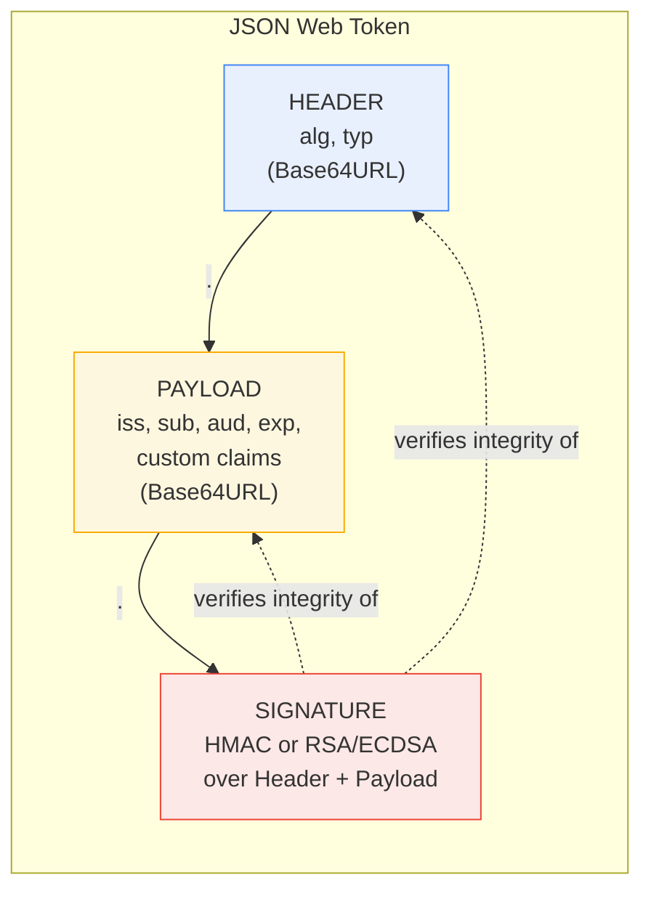

> **🔑 Key insight:** The signature only proves the header + payload haven't changed since signing. It says **nothing** about whether the data inside is secret (it isn't) or whether the claims are still true (they might have expired).

---

<a name="5-encoding-vs-signing-vs-encryption"></a>
## 5. Encoding vs. Signing vs. Encryption

This is the single most misunderstood concept in JWT security. Let's separate the three clearly.

| Property | Encoding (Base64URL) | Signing (HMAC/RSA/ECDSA) | Encryption (JWE) |
|---|---|---|---|
| Reversible by anyone? | ✅ Yes, trivially | ✅ Payload still readable | ❌ No, needs key |
| Provides confidentiality? | ❌ No | ❌ No | ✅ Yes |
| Provides integrity/tamper detection? | ❌ No | ✅ Yes | ✅ Yes (usually combined with signing) |
| Common use in auth | Transport-safe formatting | Standard JWT (JWS) | Rare — used when payload must stay secret from intermediaries |

### Example: Decoding Requires No Secret

Anyone — including an attacker with zero credentials — can run this:

```bash
echo 'eyJzdWIiOiIxMjM0NTY3ODkwIiwibmFtZSI6IkpvaG4gRG9lIn0' | base64 -d
```

Output:
```json
{"sub":"1234567890","name":"John Doe"}
```

No secret was needed. **This is why you must never put sensitive data (passwords, SSNs, internal system details) inside a JWT payload**, even if it's signed.

> **💡 The One-Sentence Summary:** A signed JWT is **tamper-evident**, not **tamper-proof**, and it is **not secret**.

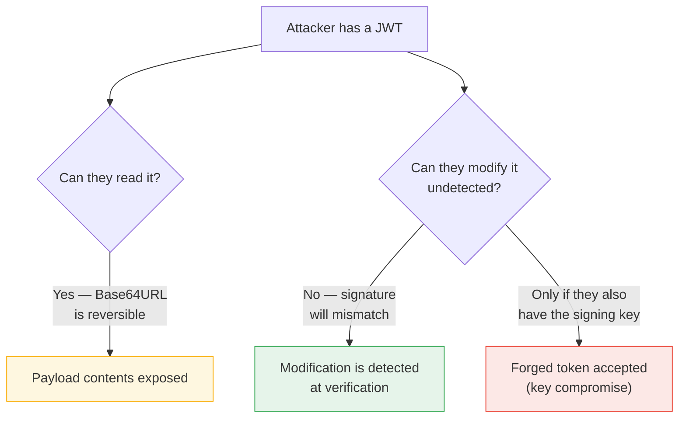

> **🧠 Analogy:** A JWT is like a **laminated ID card written in large print**. Anyone on the street can read it (encoding). A hologram seal makes it obvious if someone scratched out the photo and pasted a new one (signing). But the card itself is not inside a sealed envelope (no encryption) — only a sealed envelope (JWE) hides the contents.

---

<a name="6-lifecycle"></a>
## 6. The JWT Verification Lifecycle

Every JWT that hits a Spring Boot API travels through a strict pipeline. **A failure at any single stage must halt the entire request** — no partial trust, no "let's just check the rest anyway."

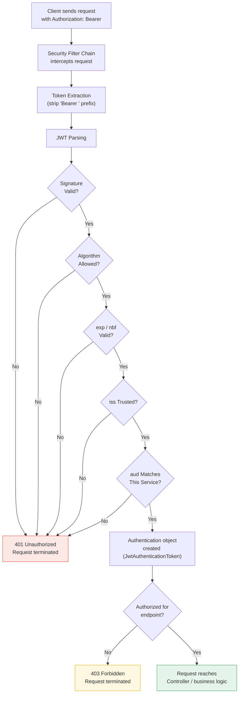

### 6.1 Stage-by-Stage Breakdown

| # | Stage | Component | What It Checks |
|---|---|---|---|
| 1 | JWT Creation | Auth Server (Keycloak/Okta/custom) | Issues signed token after login |
| 2 | Client sends JWT | HTTP client | Adds `Authorization: Bearer <token>` header |
| 3 | Security Filter | `OncePerRequestFilter` / `BearerTokenAuthenticationFilter` | Intercepts every request |
| 4 | Token Extraction | Filter | Strips `Bearer ` prefix, gets raw token string |
| 5 | Signature Verification | `JwtDecoder` (e.g. `NimbusJwtDecoder`) | Re-computes signature, compares to token's signature |
| 6 | Claims Validation | `JwtDecoder` validators | Checks `exp`, `nbf`, `iss`, `aud` |
| 7 | Authentication Creation | Spring Security core | Builds `JwtAuthenticationToken` with authorities |
| 8 | Authorization | `AuthorizationManager` | Checks required role/permission for the endpoint |
| 9 | Controller | Your application | Business logic finally executes |

### 6.2 The Golden Rule

> **⚠️ Never trust JWT claims until the token has been cryptographically verified and its claims validated.** You must not read the payload, look up a user, or check permissions before the signature is confirmed valid.

Violating this rule is the single most common root cause behind every scenario in the next section.

> **✅ Quick Recap (Sections 4–6):** A JWT is three readable, Base64URL-encoded segments. The signature guarantees *integrity only* — it neither encrypts the payload nor vouches for the truthfulness of the claims. Verification happens in a strict pipeline, and every check is a gate, not a suggestion.

---

<a name="7-scenarios"></a>
## 7. 15 Tampering Scenarios (Deep Dive)

For each scenario we cover: **the attack**, **why it fails**, **the exact defensive stage**, a **worked example**, and a **diagram**.

> ⚠️ **Disclaimer:** All techniques below are described for defensive/educational purposes. Test only in isolated lab environments you own or have explicit authorization to test. Do not use these techniques against systems you don't own or lack permission to test.

---

### Scenario 1 — Payload Claim Modification

**The Attack:** Attacker decodes the payload, flips `"role": "user"` to `"role": "admin"`, re-encodes it, and reassembles the token using the *original* signature (since they don't have the secret key).

**Worked Example:**

Original payload (decoded):
```json
{"sub": "user123", "role": "user", "exp": 1893456000}
```

Attacker's modified payload:
```json
{"sub": "user123", "role": "admin", "exp": 1893456000}
```

They Base64URL-encode this new JSON and stitch it back with the header and the *unchanged* signature. The result looks structurally like a JWT, but:

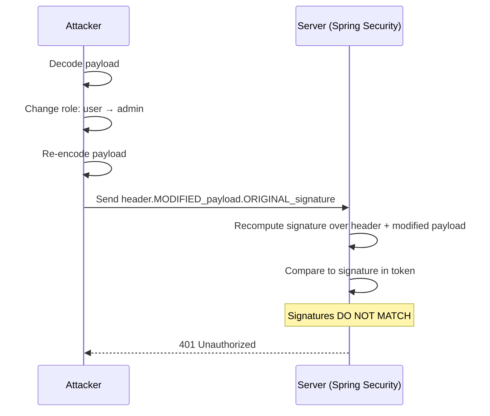

**Why It Fails:** The signature was computed over the *original* payload bytes. Any single-byte change to the payload produces a completely different signature when recomputed — this is a core property of cryptographic hash-based signatures (avalanche effect).

**Defensive Stage:** Signature Verification (before any claim is ever read).

**Real-world parallel:** This is functionally identical to changing a name on a cheque after it's been signed — the ink pattern (signature) no longer matches the altered content.

---

### Scenario 2 — Header Modification

**The Attack:** Attacker changes the `alg` field in the header, or the `kid` (Key ID), hoping to influence how the server picks a verification strategy.

**Example header before:**
```json
{"alg": "RS256", "typ": "JWT", "kid": "key-2024-01"}
```

**Attacker-modified header:**
```json
{"alg": "HS256", "typ": "JWT", "kid": "key-2024-01"}
```

**Why It Fails:** A secure server maintains a **static allowlist** of accepted algorithms, independent of what the token claims. If the server expects `RS256` and the token says `HS256`, it's rejected outright — regardless of anything else in the token.

**Defensive Stage:** Parsing & Algorithm Allowlist Validation.

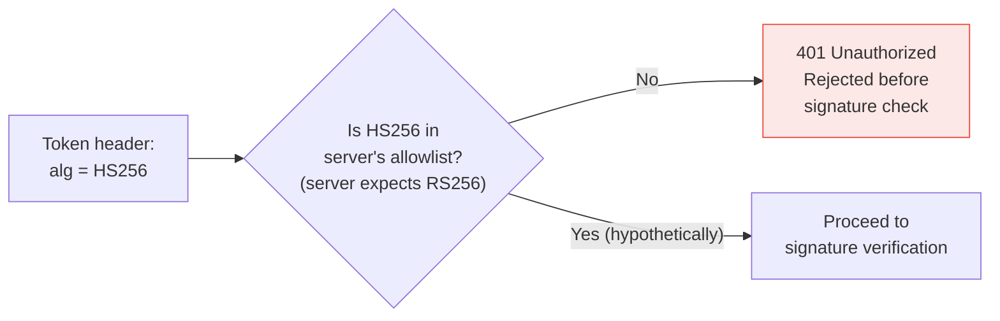

---

### Scenario 3 — Algorithm Confusion (`alg` Manipulation)

This is the most *historically damaging* JWT vulnerability class, so it deserves special attention.

**The Attack:** The server uses RSA (asymmetric — public key for verification, private key for signing). The attacker:
1. Obtains the server's **public** RSA key (often publicly available via a JWKS endpoint — this is by design, not a leak).
2. Crafts a new token with `alg: HS256`.
3. Signs it using **HMAC**, treating the public RSA key's bytes as the shared secret.

If the server's code naively does something like:

```java
// ❌ VULNERABLE PATTERN — DO NOT DO THIS
String alg = getHeaderClaim(token, "alg"); // trusts attacker input
Key key = alg.equals("HS256") ? hmacSecret : rsaPublicKey;
verifySignature(token, alg, key);
```

...then the server might use the RSA public key as an HMAC secret, and since the attacker *also* used that exact key as their HMAC secret, **the forged signature validates successfully**.

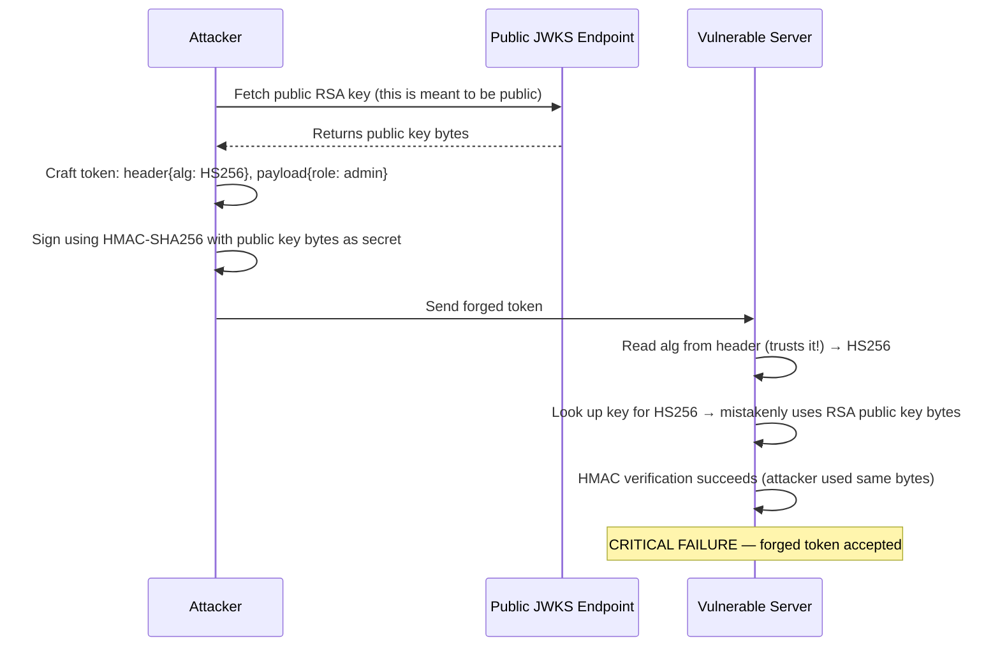

**Why It Fails (in a secure implementation):** The fix is to **never let the token's `alg` header dictate the verification algorithm**. Instead:

```java
// ✅ SECURE PATTERN
// The server is configured to ONLY use RS256 with its known public key.
// It does not branch based on the token's claimed alg.
JwtDecoder decoder = NimbusJwtDecoder.withPublicKey(rsaPublicKey)
        .signatureAlgorithm(SignatureAlgorithm.RS256) // explicitly pinned
        .build();
```

**Defensive Stage:** Algorithm Validation *tied explicitly to key type* — this is a configuration discipline, not just a runtime check.

> **🔑 Key Takeaway:** The algorithm must be a property of your **server's configuration**, never a property of the **untrusted input**.

---

### Scenario 4 — Unsigned Token (`alg: none`)

**The Attack:** JWT spec technically allows `alg: none` for "unsecured JWTs." Attacker crafts:

```json
{"alg": "none", "typ": "JWT"}
```
```json
{"sub": "admin", "role": "superadmin"}
```
...with an **empty** signature segment: `header.payload.`

**Why It Fails:** Any production-grade library and Spring Security's `NimbusJwtDecoder` explicitly excludes `none` from the allowed algorithm set. There is no valid configuration path where a Spring Security `oauth2ResourceServer` accepts this.

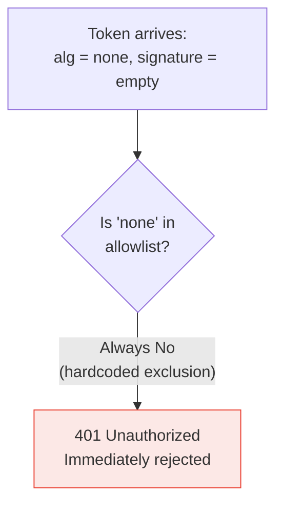

**Historical note:** This was a real vulnerability in several early JWT libraries (2015 era) before allowlisting became standard practice.

---

### Scenario 5 — Signature Removal or Corruption

**The Attack:** Attacker strips the signature entirely, truncates it, or flips a single character.

**Example:**
```
Original:  eyJhbGc...eyJzdWI...SflKxwRJSMeKKF2QT4fwpMeJf36POk6yJV_adQssw5c
Corrupted: eyJhbGc...eyJzdWI...SflKxwRJSMeKKF2QT4fwpMeJf36POk6yJV_adQssw5X
                                                                          ^ one char changed
```

**Why It Fails:** Cryptographic signatures don't degrade gracefully — a single-bit change produces a completely unrelated output. There's no "partial match" concept.

**Defensive Stage:** Signature Verification. The library throws `SignatureException`, caught and converted to 401.

---

### Scenario 6 — Expiration (`exp`) Manipulation

**The Attack:** Attacker has an expired-but-otherwise-valid token and tries to extend the `exp` claim into the future.

**Why It Fails at Two Layers:**
1. If they modify `exp`, the signature breaks (caught in Scenario 1's mechanism).
2. If somehow they had a *valid signature with a legitimately future `exp`* (e.g., a very long-lived token was issued by mistake), the fix is **not** signature-related — it's a **policy** fix: issue short-lived tokens.

**Worked Example:**

```json
// Original expired token
{"sub": "user1", "exp": 1700000000}  // in the past

// Attacker's attempt
{"sub": "user1", "exp": 9999999999}  // year 2286 — breaks signature
```

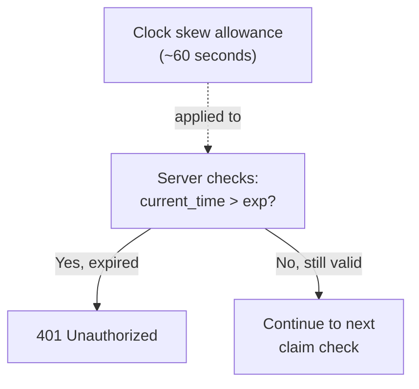

> **💡 Practical Tip:** Standard clock-skew tolerance (60 seconds) accounts for minor time drift between distributed servers — this is a deliberate, small, configurable window, not a vulnerability.

---

### Scenario 7 — `nbf` / `iat` Manipulation

**The Attack:** Using a token before its "not before" time, or manipulating `iat` (issued-at) to make a token appear freshly minted.

**Why It Fails:** Same signature-breaking mechanism as Scenario 6. Additionally:

```java
// Spring Security JwtTimestampValidator conceptually does:
if (now.isBefore(nbf)) {
    throw new JwtValidationException("Token used before nbf");
}
```

**Use case where this matters:** Pre-issued tokens for scheduled access (e.g., a token valid only during a specific maintenance window) rely on `nbf` to enforce the start boundary.

---

### Scenario 8 — Issuer (`iss`) Manipulation

**The Attack:** Attacker obtains a **legitimately signed** token from a completely different system (e.g., their own test application using the same JWT library) and tries it against your API.

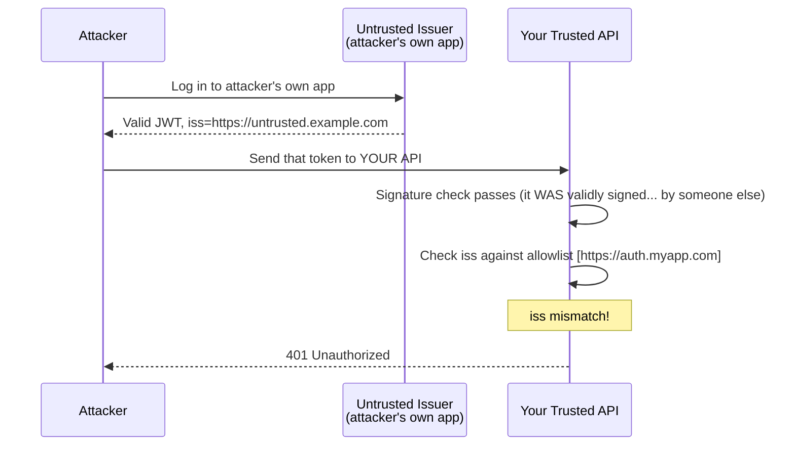

**Why It Fails:** A valid signature only proves the token wasn't tampered with — it says nothing about *who* signed it being someone you trust. The `iss` allowlist closes this gap.

**Defensive Stage:** Claims Validation (`iss` check against a static, configured list).

---

### Scenario 9 — Audience (`aud`) Manipulation

**The Attack:** In a microservices setup, a token legitimately issued for **Service A** is replayed against **Service B**.

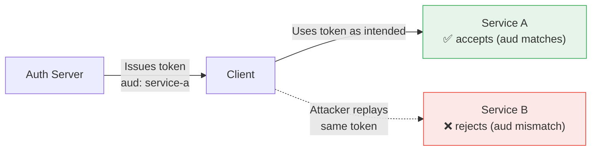

**Worked Example:**

```json
{
  "sub": "user123",
  "iss": "https://auth.myapp.com",
  "aud": ["service-a"],
  "exp": 1893456000
}
```

Service B's validation config:
```yaml
spring:
  security:
    oauth2:
      resourceserver:
        jwt:
          audiences: service-b   # only accepts tokens meant for it
```

Since `"service-b"` is not in the token's `aud` array, Service B rejects it — **even though the signature and issuer are both perfectly valid.**

**Real-world use case:** This is the primary control preventing **lateral movement** in a compromised microservices environment — a leaked token for the "billing" service can't be replayed against the "user-admin" service.

---

### Scenario 10 — Key ID (`kid`) Manipulation

**The Attack:** The `kid` header tells the verifier which key to use for signature verification (supporting key rotation). An attacker manipulates `kid` hoping to:
- Point to a key they control.
- Trigger a path/injection vulnerability if `kid` is used unsafely (e.g., `readFile("/keys/" + kid)`).

**Vulnerable pattern (DO NOT DO THIS):**
```java
// ❌ INSECURE
String kid = jwtHeader.get("kid");
String keyContent = Files.readString(Paths.get("/keys/" + kid + ".pem"));
// Attacker sets kid = "../../etc/shadow" → path traversal!
```

**Secure pattern:**
```java
// ✅ SECURE — kid is only used to look up in a trusted, closed key store
PublicKey key = trustedKeyStore.get(kid); // Map<String, PublicKey>, no filesystem/SQL involved
if (key == null) {
    throw new JwtException("Unknown key ID");
}
```

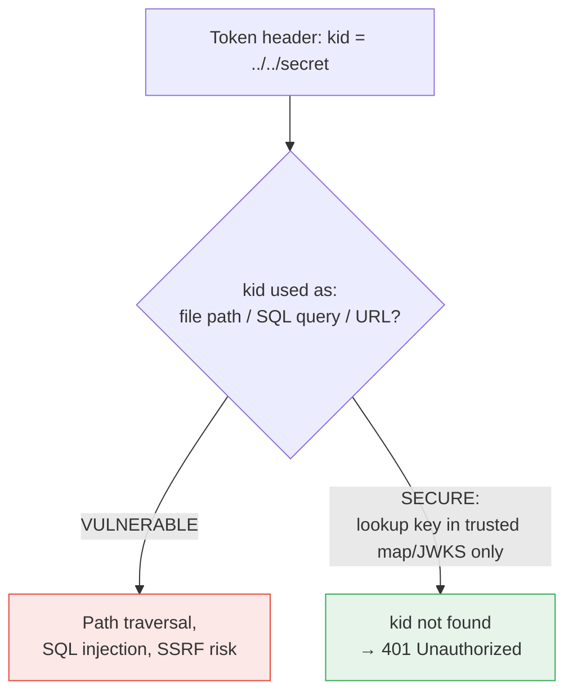

**Defensive Stage:** Key Resolution — treat `kid` strictly as an **index into a trusted, closed set**, never as executable input.

---

### Scenario 11 — Weak or Incorrect Key Management

**The Attack:** This isn't tampering with a specific token — it's compromising the *root of trust* itself. If the HMAC secret is `secret123` or hardcoded in a public GitHub repo, an attacker can forge **any** token, with **any** claims, that will pass signature verification perfectly.

**Real Example Pattern (found in real breaches):**
```java
// ❌ CATASTROPHIC
String secret = "mysecretkey"; // hardcoded, weak, in source control
```

**Why This Is Root-Cause Critical:**

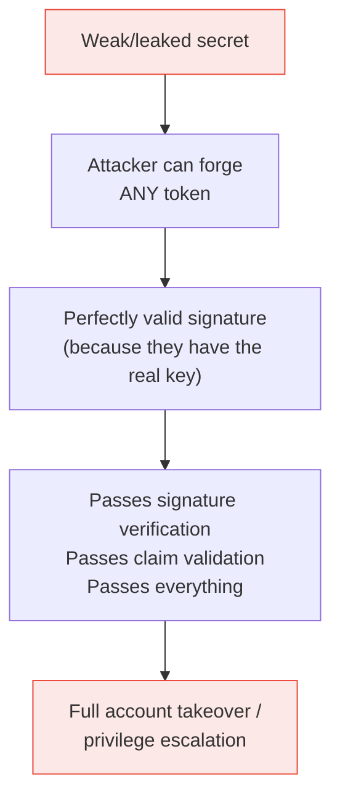

**Defense-in-depth checklist:**
- Use cryptographically random secrets (256-bit minimum for HS256).
- Prefer asymmetric keys (RS256/ES256) for anything beyond a single trusted service.
- Store private keys in a KMS/HSM, never in source control or plaintext config.
- Rotate keys on a schedule and support multiple active `kid`s during rotation windows.
- Distribute public keys via a JWKS endpoint, never manually copy-pasted.

---

### Scenario 12 — Token Replay

**The Attack:** A valid token is stolen (via XSS, network sniffing, log leakage) and reused by the attacker before it expires. **This is not a tampering attack** — the token is 100% authentic. It's a **theft** problem.

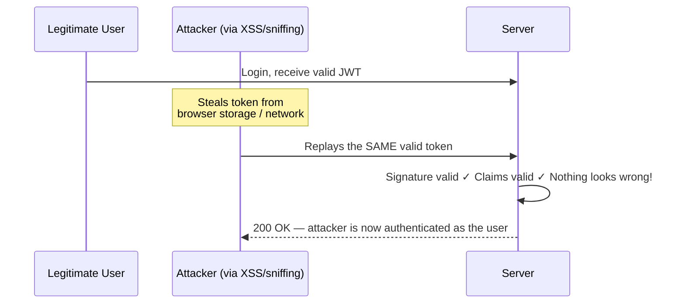

**Defenses (layered):**

| Defense | How It Helps |
|---|---|
| Short-lived tokens (`exp` of minutes) | Shrinks the attack window |
| Refresh token rotation | A stolen refresh token becomes useless after first reuse detection |
| Denylist via `jti` | Revoke specific tokens (e.g., on logout) even before expiry |
| Device/session binding | Bind token to a fingerprint; mismatched context triggers rejection |

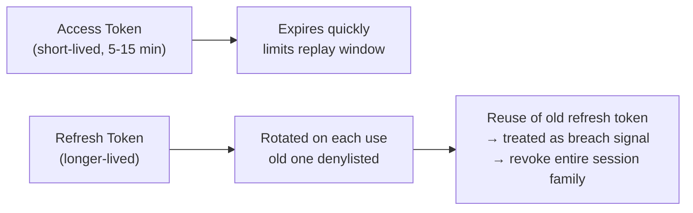

---

### Scenario 13 — Token Substitution (Cross-Environment)

**The Attack:** A token from staging/dev is used against production (or vice versa), typically because the same signing key was reused across environments (a common misconfiguration).

**Why It Fails (when properly configured):** Different environments should use **different signing keys AND different `iss`/`aud` values**. So even if an attacker somehow captures a staging token, production's issuer/audience allowlist rejects it.

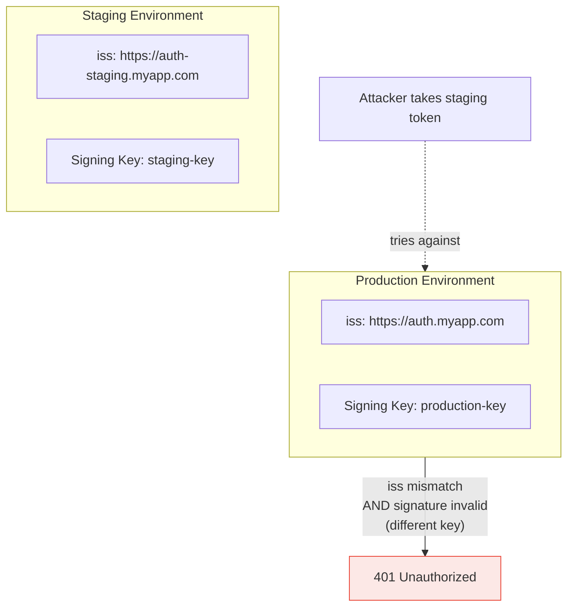

> **⚠️ Common misconfiguration to avoid:** Sharing an HMAC secret across dev/staging/prod "for convenience." This single mistake collapses environment isolation.

---

### Scenario 14 — Claim Injection / Unexpected Claims

**The Attack:** Attacker tries to add or manipulate custom claims like `roles`, `permissions`, or `tenantId`, hoping flawed application logic trusts them too literally.

**Vulnerable application logic:**
```java
// ❌ INSECURE — naive string matching on raw claim
String rolesClaim = jwt.getClaim("roles"); // e.g. "user,admin-support-readonly"
if (rolesClaim.contains("admin")) {
    grantAdminAccess(); // "admin-support-readonly" wrongly matches "admin"!
}
```

**Secure application logic:**
```java
// ✅ SECURE — explicit mapping to a closed set of GrantedAuthority objects
@Bean
public JwtAuthenticationConverter jwtAuthenticationConverter() {
    JwtGrantedAuthoritiesConverter authoritiesConverter = new JwtGrantedAuthoritiesConverter();
    authoritiesConverter.setAuthorityPrefix("ROLE_");
    authoritiesConverter.setAuthoritiesClaimName("roles");

    JwtAuthenticationConverter converter = new JwtAuthenticationConverter();
    converter.setJwtGrantedAuthoritiesConverter(authoritiesConverter);
    return converter;
}
```

**Why It Still Fails Even With a Valid Signature:** Modifying claims breaks the signature (caught upstream). But the deeper lesson: even *legitimately issued* claims should be mapped through an explicit, well-tested conversion — never through loose string matching like `.contains()`.

---

### Scenario 15 — Parsing / Canonical Validation Issues

**The Attack:** Attacker sends deliberately malformed input: invalid JSON, broken Base64URL, duplicate JSON keys (`{"role":"user","role":"admin"}`), or unexpected data types (`"exp": "not-a-number"`), hoping to trigger parser bugs or information leakage.

**Why It Fails:** Mature, well-audited JWT libraries (Nimbus JOSE+JWT, which underlies Spring Security's `NimbusJwtDecoder`) throw clean, typed exceptions for malformed input rather than exhibiting undefined behavior.

**Secure error handling:**
```java
try {
    Jwt jwt = jwtDecoder.decode(token);
} catch (JwtException e) {
    // Generic response — never leak internal parsing details
    return ResponseEntity.status(401)
            .body(Map.of("error", "invalid_token"));
}
```

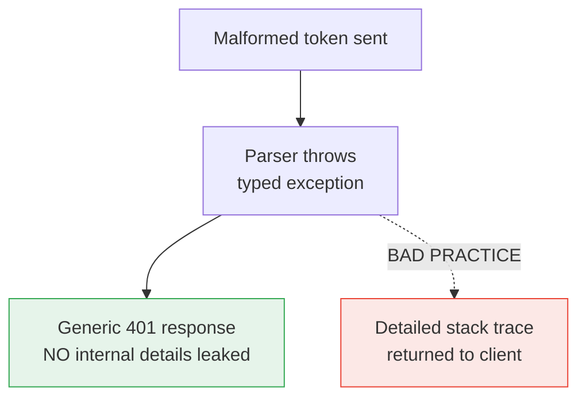

---

### 7.1 Scenario Summary Table

| # | Scenario | Defensive Stage | Result |
|---|---|---|---|
| 1 | Payload claim modification | Signature Verification | 401 |
| 2 | Header modification | Algorithm Allowlist | 401 |
| 3 | Algorithm confusion (alg swap) | Algorithm ↔ Key binding | 401 |
| 4 | `alg: none` | Algorithm Allowlist | 401 |
| 5 | Signature removal/corruption | Signature Verification | 401 |
| 6 | `exp` manipulation | Claims Validation | 401 |
| 7 | `nbf`/`iat` manipulation | Claims Validation | 401 |
| 8 | `iss` manipulation | Claims Validation | 401 |
| 9 | `aud` manipulation | Claims Validation | 401 |
| 10 | `kid` manipulation | Key Resolution | 401 |
| 11 | Weak key management | Key Generation/Storage Policy | Prevention, not detection |
| 12 | Token replay | App/Infra Layer | Mitigated, not "detected" |
| 13 | Token substitution (env) | Claims Validation + Key Separation | 401 |
| 14 | Claim injection | Authorization Mapping | Prevented by design |
| 15 | Malformed token parsing | Parsing Layer | 401 (generic) |

> **✅ Quick Recap (Section 7):** Every tampering attack dies in one of five places: the parser, the signature check, the algorithm/key binding, the claims validators, or the authorization mapping. The only attacks that pass all five are theft (replay) and key compromise — which are solved by policy (short lifetimes, rotation, revocation), not by the token format.

---

<a name="8-filter-behavior"></a>
## 8. Security Filter Behavior — Step-by-Step Traces

### Flow 1: Modified Payload

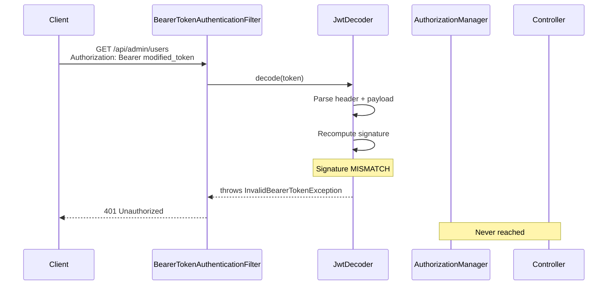

### Flow 2: Valid Signature, Untrusted Issuer

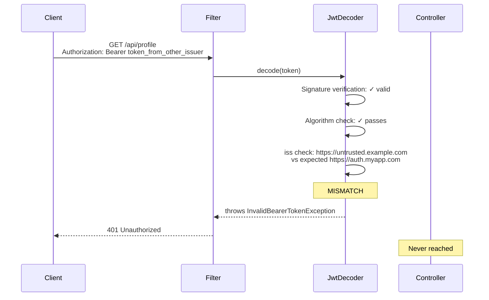

### Flow 3: Valid Token, Insufficient Permissions

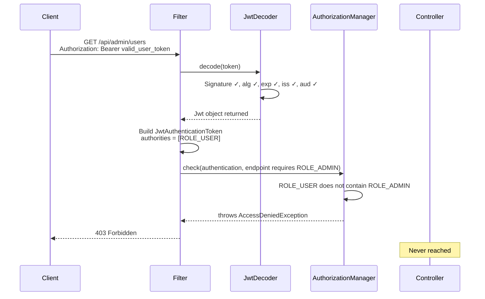

---

<a name="9-401-vs-403"></a>
## 9. 401 vs. 403 — The Definitive Guide

This distinction trips up even experienced developers. Here's the clean mental model:

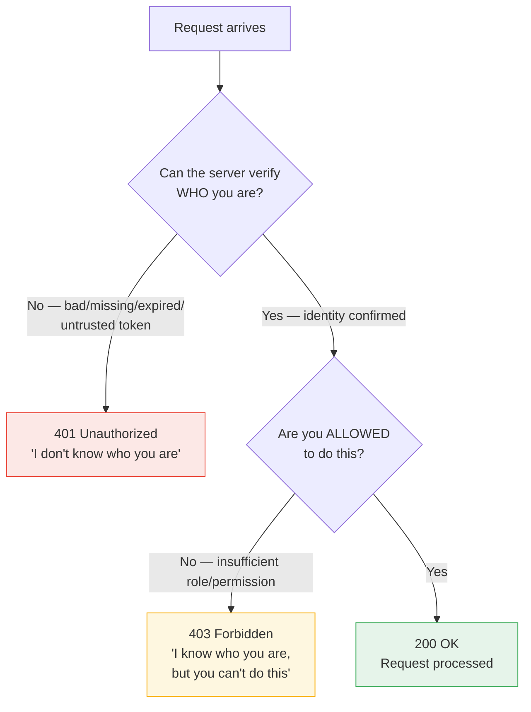

| Status | Meaning | JWT Examples |
|---|---|---|
| **401 Unauthorized** | Authentication failed — identity unknown/unproven | Invalid signature, expired token, unsupported alg, untrusted issuer, wrong audience |
| **403 Forbidden** | Authentication succeeded, but authorization failed | Valid token for a normal user hitting `/api/admin/**` |

> **🧠 Memory trick:** *401 = "Who ARE you?" 403 = "I know who you are, but NO."*

---

<a name="10-decoding-vs-validating"></a>
## 10. Why "Decoding JWT" Is Not "Validating JWT"

This is the crux of nearly every JWT vulnerability in production systems.

### The Insecure Pattern

```java
// ❌ INSECURE: DO NOT DO THIS
String payload = JwtUtils.decode(token).getPayload(); // just base64 decode
String role = extractJson(payload).get("role");
if ("admin".equals(role)) {
    grantAdminAccess(); // trusting unverified data!
}
```

Here's what an attacker does against this exact code, step by step:

```mermaid
flowchart TD
    A["1. Take any JWT<br/>(even one for a regular user)"] --> B["2. Split by '.'<br/>into header, payload, signature"]
    B --> C["3. Base64URL-decode<br/>the payload"]
    C --> D["4. Change sub/role<br/>to 'admin'"]
    D --> E["5. Base64URL-encode<br/>the new payload"]
    E --> F["6. Reassemble:<br/>original_header.NEW_payload.original_signature"]
    F --> G{"Does the app verify<br/>the signature FIRST?"}
    G -->|"NO — insecure app<br/>just reads the payload"| H["Attacker becomes admin<br/>CRITICAL BREACH"]
    G -->|"YES — secure app"| I["Signature mismatch detected<br/>401 Unauthorized"]

    style H fill:#fce8e6,stroke:#ea4335
    style I fill:#e6f4ea,stroke:#34a853
```

### The Secure Pattern

```java
// ✅ SECURE: Verification happens BEFORE any claim is trusted
Jwt jwt = jwtDecoder.decode(token); // throws if signature/claims invalid
// Only reachable AFTER full verification succeeds:
String role = jwt.getClaimAsString("role");
```

With Spring Security's `oauth2ResourceServer().jwt()` configuration, this ordering is enforced automatically — the framework will not hand you a `Jwt` object unless the token has already passed signature and claims validation.

---

<a name="11-implementation"></a>
## 11. Secure Spring Boot Implementation

### 11.1 Project Dependencies (Maven)

```xml
<dependency>
    <groupId>org.springframework.boot</groupId>
    <artifactId>spring-boot-starter-oauth2-resource-server</artifactId>
</dependency>
<dependency>
    <groupId>org.springframework.boot</groupId>
    <artifactId>spring-boot-starter-security</artifactId>
</dependency>
```

### 11.2 Token Issuance (Authorization Server Side — Conceptual)

```java
import io.jsonwebtoken.Jwts;
import io.jsonwebtoken.SignatureAlgorithm;
import java.security.PrivateKey;
import java.util.Date;
import java.util.List;
import java.util.UUID;

public class JwtIssuer {

    private final PrivateKey privateKey;
    private final String issuer = "https://auth.myapp.com";

    public JwtIssuer(PrivateKey privateKey) {
        this.privateKey = privateKey;
    }

    public String generateToken(String subject, String audience, List<String> roles) {
        long nowMillis = System.currentTimeMillis();
        Date now = new Date(nowMillis);
        Date exp = new Date(nowMillis + (5 * 60 * 1000)); // 5-minute short-lived token

        return Jwts.builder()
            .setSubject(subject)
            .setIssuer(issuer)
            .setAudience(audience)
            .claim("roles", roles)
            .setIssuedAt(now)
            .setExpiration(exp)
            .setId(UUID.randomUUID().toString()) // jti, enables revocation
            .signWith(privateKey, SignatureAlgorithm.RS256) // asymmetric, pinned
            .compact();
    }
}
```

### 11.3 Validation Configuration (`application.yml`)

```yaml
spring:
  security:
    oauth2:
      resourceserver:
        jwt:
          issuer-uri: https://auth.myapp.com
          # jwk-set-uri is auto-derived from issuer-uri's well-known config,
          # or set explicitly:
          jwk-set-uri: https://auth.myapp.com/.well-known/jwks.json
          audiences: service-b   # this service's own identifier
```

Behind the scenes, Spring Security's `NimbusJwtDecoder`:
1. Fetches and caches the JWKS (public keys) from `jwk-set-uri`.
2. Enforces algorithm allowlisting tied to key type.
3. Applies a `DelegatingOAuth2TokenValidator` chain that checks `exp`, `nbf`, `iss`, and `aud` in sequence.

### 11.4 Security Filter Chain Configuration

```java
import org.springframework.context.annotation.Bean;
import org.springframework.context.annotation.Configuration;
import org.springframework.security.config.annotation.web.builders.HttpSecurity;
import org.springframework.security.web.SecurityFilterChain;

@Configuration
public class SecurityConfig {

    @Bean
    public SecurityFilterChain filterChain(HttpSecurity http) throws Exception {
        http
            .authorizeHttpRequests(authz -> authz
                .requestMatchers("/api/admin/**").hasRole("ADMIN")
                .requestMatchers("/api/user/**").hasRole("USER")
                .anyRequest().authenticated()
            )
            .oauth2ResourceServer(oauth2 -> oauth2
                .jwt(jwt -> jwt.jwtAuthenticationConverter(jwtAuthenticationConverter()))
            );
        return http.build();
    }

    @Bean
    public JwtAuthenticationConverter jwtAuthenticationConverter() {
        JwtGrantedAuthoritiesConverter authoritiesConverter = new JwtGrantedAuthoritiesConverter();
        authoritiesConverter.setAuthorityPrefix("ROLE_");
        authoritiesConverter.setAuthoritiesClaimName("roles");

        JwtAuthenticationConverter converter = new JwtAuthenticationConverter();
        converter.setJwtGrantedAuthoritiesConverter(authoritiesConverter);
        return converter;
    }
}
```

### 11.5 Custom Failure Handling (Consistent, Safe 401 Responses)

```java
import org.springframework.security.web.authentication.AuthenticationFailureHandler;
import org.springframework.security.core.AuthenticationException;
import org.springframework.stereotype.Component;
import jakarta.servlet.http.HttpServletRequest;
import jakarta.servlet.http.HttpServletResponse;
import java.io.IOException;

@Component
public class JwtAuthenticationFailureHandler implements AuthenticationFailureHandler {

    @Override
    public void onAuthenticationFailure(HttpServletRequest request,
                                        HttpServletResponse response,
                                        AuthenticationException exception) throws IOException {

        response.setStatus(HttpServletResponse.SC_UNAUTHORIZED);
        response.setContentType("application/json");
        response.getWriter().write(
            "{\"error\":\"invalid_token\",\"message\":\"Authentication failed.\"}"
        );
        // Log failure category here — see Section 13 — but never log the raw token
    }
}
```

### 11.6 Explicit Key-Algorithm Pinning (Defends Scenario 3)

```java
import org.springframework.security.oauth2.jwt.NimbusJwtDecoder;
import org.springframework.security.oauth2.jose.jws.SignatureAlgorithm;
import java.security.interfaces.RSAPublicKey;

@Bean
public JwtDecoder jwtDecoder(RSAPublicKey publicKey) {
    return NimbusJwtDecoder.withPublicKey(publicKey)
            .signatureAlgorithm(SignatureAlgorithm.RS256) // explicitly pinned — no fallback to HS256
            .build();
}
```

---

<a name="12-approaches"></a>
## 12. Multiple Implementation Approaches Compared

There is no single "correct" decoder setup — the right choice depends on who issues your tokens and how many services consume them. All four approaches below are secure when configured as shown; they differ in operational cost.

### Approach A — Symmetric HS256 with a Managed Secret (Single Service)

Best for: one service, one issuer, no third parties. Simple and fast — but every verifier needs the *signing* secret, so a leak is catastrophic (Scenario 11).

```java
@Bean
public JwtDecoder hs256Decoder(@Value("${jwt.secret}") char[] secret) {
    // jwt.secret MUST be a cryptographically random 256-bit+ value from env/KMS,
    // e.g. generated with: openssl rand -base64 64
    SecretKey key = new SecretKeySpec(
            toUtf8Bytes(secret), "HmacSHA256");
    return NimbusJwtDecoder.withSecretKey(key)
            .signatureAlgorithm(SignatureAlgorithm.HS256) // pinned — no alg confusion
            .build();
}
```

### Approach B — Asymmetric RS256 with a Local Public Key (Recommended Default)

Best for: you control the issuer and can distribute the public key. The private key never leaves the auth server; verifiers hold only public material, so leaking a verifier's config is not a signing risk.

```java
@Bean
public JwtDecoder rs256Decoder(@Value("${jwt.public-key-location}") Resource pem) throws Exception {
    RSAPublicKey publicKey = readPemPublicKey(pem); // parse X.509 SubjectPublicKeyInfo
    return NimbusJwtDecoder.withPublicKey(publicKey)
            .signatureAlgorithm(SignatureAlgorithm.RS256) // pinned
            .build();
}
```

### Approach C — JWKS Endpoint + `issuer-uri` (Multi-Service / Key Rotation)

Best for: microservices, external identity providers (Keycloak, Okta, Auth0). Keys are fetched and cached from the provider's JWKS endpoint, and `kid` rotation works automatically.

```java
@Bean
public JwtDecoder jwksDecoder(@Value("${spring.security.oauth2.resourceserver.jwt.jwk-set-uri}") String jwkSetUri) {
    NimbusJwtDecoder decoder = NimbusJwtDecoder.withJwkSetUri(jwkSetUri)
            .build();

    // Layered validators: exp/nbf (default) + issuer + audience
    OAuth2TokenValidator<Jwt> withIssuerAndAudience = new DelegatingOAuth2TokenValidator<>(
            new JwtTimestampValidator(Duration.ofSeconds(60)),        // clock skew
            new JwtIssuerValidator("https://auth.myapp.com"),         // Scenario 8
            new JwtAudienceValidator("service-b"));                   // Scenario 9

    decoder.setJwtValidator(withIssuerAndAudience);
    return decoder;
}
```

### Approach D — Custom Decoder with Additional Claim Validation (Multi-Tenant)

Best for: policies that go beyond standard claims — e.g., tenant allowlists, token version checks, or `jti` denylist lookups.

```java
public class TenantClaimValidator implements OAuth2TokenValidator<Jwt> {

    private final Set<String> allowedTenants;

    public TenantClaimValidator(Set<String> allowedTenants) {
        this.allowedTenants = allowedTenants;
    }

    @Override
    public OAuth2TokenValidatorResult validate(Jwt jwt) {
        String tenantId = jwt.getClaimAsString("tenantId");
        if (tenantId == null || !allowedTenants.contains(tenantId)) {
            // Closed-set membership check — never string matching (Scenario 14)
            return OAuth2TokenValidatorResult.failure(
                new OAuth2Error("invalid_token", "Unknown tenant claim", null));
        }
        return OAuth2TokenValidatorResult.success();
    }
}
```

### Comparison Matrix

| Criterion | A: HS256 Secret | B: RS256 Pinned Key | C: JWKS + issuer-uri | D: Custom Validators |
|---|---|---|---|---|
| Key material on verifier | Signing secret ⚠️ | Public key only ✅ | Public keys (fetched) ✅ | Depends on A/B/C base |
| Key rotation | Manual redeploy | Manual redeploy | Automatic via `kid` ✅ | Inherited from base |
| Multi-service support | Weak (shared secret) | Good | Excellent ✅ | — |
| Rotation window risk | High | Medium | Low ✅ | Low |
| Config complexity | Lowest | Low | Medium | Highest |
| Defends Scenario 3 | ✅ (pinned HS256) | ✅ (pinned RS256) | ✅ (key-type bound) | — |
| **Use when** | Single internal service | Own issuer, no IdP infra | IdP / many services | Extra business rules |

> **💡 Recommendation:** Start with **C** (JWKS + issuer-uri) if you have an identity provider, or **B** if you sign tokens yourself. Add **D** validators only for genuine business rules — and always as closed-set checks, never string matching.

---

<a name="13-logging"></a>
## 13. Logging & Monitoring

Log validation failures with enough context to detect attacks — **never log the token itself**.

```java
@Slf4j
@Component
public class JwtFailureLogger {

    public void logFailure(String endpoint, String failureCategory,
                            String correlationId, String clientIp, String jti) {
        log.warn("JWT_VALIDATION_FAILURE endpoint={} category={} correlationId={} clientIp={} jti={}",
                endpoint, failureCategory, correlationId, clientIp, jti);
        // NEVER log the raw token string
    }
}
```

### Fields to Capture

| Field | Purpose |
|---|---|
| Timestamp | When the failure occurred |
| Endpoint | Which URI was targeted |
| Failure category | `SIGNATURE_MISMATCH`, `TOKEN_EXPIRED`, `INVALID_ISSUER`, `INVALID_AUDIENCE`, `MALFORMED_TOKEN` |
| Correlation ID | Trace across microservices |
| Client IP | Source of the request |
| `jti` (if available) | Enables targeted revocation |

```mermaid
flowchart LR
    A["Repeated failures<br/>from same IP"] --> B{"Alerting threshold<br/>exceeded?"}
    B -->|"Yes"| C["Trigger security alert /<br/>rate-limit / block IP"]
    B -->|"No"| D["Continue monitoring"]
```

> **⚠️ Never log the complete JWT** — it is functionally a bearer credential, equivalent to a password in transit.

---

<a name="14-best-practices"></a>
## 14. Best Practices

### Token Design

1. **Pin the algorithm in decoder configuration** — never derive it from the token (Scenario 3).
2. **Issue short-lived access tokens** (5–15 minutes); use refresh tokens for session longevity.
3. **Always include `jti`** so individual tokens can be denylisted.
4. **Enforce `iss` and `aud`** on every service — a valid signature alone is not enough (Scenarios 8–9).
5. **Keep payloads minimal** — identity and authorization data only; no PII, no secrets.

### Key Management

6. **Use asymmetric keys (RS256/ES256)** whenever more than one service verifies tokens.
7. **Store private keys in a KMS/HSM** (AWS KMS, Azure Key Vault, HashiCorp Vault) — never in git or plaintext config.
8. **Rotate keys on a schedule** with overlapping `kid`s so old tokens stay verifiable during the window.
9. **Separate keys per environment** — dev/staging/prod never share signing material (Scenario 13).

### Application Layer

10. **Map claims to authorities explicitly** via `JwtAuthenticationConverter` — never `.contains()` on raw strings (Scenario 14).
11. **Return generic 401 bodies** — error categories internally, no stack traces to clients (Scenario 15).
12. **Log failures, not tokens** — capture category, endpoint, IP, correlation ID, and `jti` (Section 13).
13. **Fail closed** — any validator exception must terminate the request; no partial trust paths.
14. **Prefer framework components** (`NimbusJwtDecoder`, `JwtValidators`) over hand-rolled parsers (Scenario 15).

> **💡 Operational insight:** Teams that follow items 6–9 turn a key leak from "full breach" into "rotate and move on" — because verifiers never held signing material and rotation is automated.

---

<a name="15-anti-patterns"></a>
## 15. Anti-Patterns

| # | Anti-Pattern | Why It's Dangerous | Do This Instead |
|---|---|---|---|
| 1 | Reading claims before `decode()` returns | Trusts unverified attacker-controlled data (Section 10) | Only touch claims on a `Jwt` from the decoder |
| 2 | Branching verification on the token's `alg` | Algorithm confusion (Scenario 3) | Pin algorithm per decoder bean |
| 3 | Validating only `exp` | Token substitution cross-issuer/audience (Scenarios 8–9) | Validate `exp` + `nbf` + `iss` + `aud` |
| 4 | `rolesClaim.contains("admin")` | Substring false positives (Scenario 14) | Closed-set authority mapping |
| 5 | Hardcoded `"mysecretkey"` | Total forge capability (Scenario 11) | KMS-managed 256-bit+ random keys |
| 6 | Long-lived tokens (days/months) | Enormous replay window (Scenario 12) | 5–15 min access + refresh rotation |
| 7 | Sharing HMAC secrets across environments | Cross-env substitution (Scenario 13) | Per-env keys + distinct `iss`/`aud` |
| 8 | Logging full tokens | Tokens in logs become stolen credentials (Scenario 12) | Log category + `jti` only |
| 9 | Detailed 401 error bodies (`"Signature mismatch: expected RS256"`) | Helps attacker calibrate (Scenario 15) | Generic `invalid_token` body |
| 10 | Custom JWT parsing/verification code | Reimplements battle-tested library logic badly | `NimbusJwtDecoder` / mature library |

### The Sneakiest Anti-Pattern: "I Just Decode It for Metrics"

Teams often decode tokens in a middleware "just to extract the user ID for logging" — outside the security chain. If any downstream code consumes that ID, you have a second, unverified trust path. **There must be exactly one place claims are read: after `decode()` succeeds.**

---

<a name="16-performance"></a>
## 16. Performance Considerations

### Where the Cost Actually Is

| Operation | Typical Cost | Notes |
|---|---|---|
| HMAC-SHA256 signature verification | ~microseconds | Negligible; HS256 is the cheapest option |
| RSA-2048 signature verification | ~0.1–0.5 ms | 10–50x slower than HMAC; still fine at API scale |
| ECDSA (ES256) verification | ~0.1 ms | Smaller keys/signatures than RSA; good mobile/IoT fit |
| JWKS fetch (on miss/rotation) | ~10–100 ms network | Cached; amortized to ~zero |
| Denylist lookup (`jti`) per request | +1 Redis call (~1 ms) | Only if you implement revocation |

### Practical Optimizations

1. **JWKS caching is built in** — `NimbusJwtDecoder` caches keys by `kid`; a fetch happens only on unknown `kid` or TTL expiry. Size your auth server for occasional fetch bursts during rotation.
2. **Keep tokens small.** The JWT travels in *every* request header — a 4 KB token with bloated claims inflates every request/response and can exceed proxy header limits (default 8 KB on many gateways). Emit roles, not the full permission catalog.
3. **Prefer ECDSA or HMAC over RSA** where verification throughput dominates; RSA *signing* is fast but *verification* is the slow side — and verification happens on every API node.
4. **Avoid per-request DB auth lookups.** The whole point of stateless JWT is local validation; if you hit the database to "confirm" the user on every request, you've rebuilt sessions without their benefits.
5. **Rate-limit before decoding.** Malformed-token floods (Scenario 15) cost parser work; cheap IP-based rate limiting at the gateway filters most of it.
6. **Set an explicit `JwtTimestampValidator` skew** (e.g., 60s) rather than a huge tolerance — a 10-minute skew window is a 10-minute extension of expired-token life.

---

<a name="17-testing"></a>
## 17. Testing Strategies

### Pattern 1: Unit-Test the Decoder Against Tampered Fixtures

Keep a test resource file containing one token per attack scenario. Every fixture must decode to a 401-shaped exception.

```java
@Test
void rejectsPayloadClaimModification() {
    // token built from: original header + MODIFIED payload + original signature
    JwtException ex = assertThrows(JwtException.class,
            () -> decoder.decode(TestTokens.TAMPERED_ROLE));
    // signature verification must be the failing stage
    assertTrue(ex.getMessage().contains("signature")
            || ex instanceof BadJwtException);
}

@Test
void rejectsAlgNoneToken() {
    assertThrows(JwtException.class, () -> decoder.decode(TestTokens.ALG_NONE));
}

@Test
void rejectsAlgorithmConfusionToken() {
    // HS256 token signed with the RSA public key bytes — Scenario 3
    assertThrows(JwtException.class, () -> decoder.decode(TestTokens.ALG_CONFUSION));
}
```

### Pattern 2: Integration-Test the Full Filter Chain (401 vs 403)

```java
@SpringBootTest
@AutoConfigureMockMvc
class ApiSecurityTest {

    @Autowired MockMvc mvc;

    @Test
    void validUserToken_onAdminEndpoint_is403() throws Exception {
        mvc.perform(get("/api/admin/users")
                .with(jwt().jwt(j -> j.subject("user1")
                        .claim("roles", List.of("USER")))))
           .andExpect(status().isForbidden());   // authenticated but not authorized
    }

    @Test
    void tamperedToken_is401_not403() throws Exception {
        mvc.perform(get("/api/admin/users")
                .header(HttpHeaders.AUTHORIZATION, "Bearer " + TestTokens.TAMPERED_ROLE))
           .andExpect(status().isUnauthorized()); // never authenticated
    }
}
```

> **💡 Note:** `spring-security-test`'s `jwt()` post-processor bypasses the decoder — use it to test *authorization* rules (403), and use raw fixture tokens in headers to test *authentication* (401). Both paths need coverage.

### Pattern 3: Test the Claim→Authority Mapping Explicitly

```java
@Test
void partialRoleNamesDoNotGrantAdmin() {
    // role "ADMIN-SUPPORT-READONLY" must NOT match hasRole("ADMIN")
    mvc.perform(get("/api/admin/users")
            .with(jwt().jwt(j -> j.claim("roles", List.of("ADMIN-SUPPORT-READONLY")))))
       .andExpect(status().isForbidden());
}
```

### Test Coverage Checklist

- [ ] Each of the 15 scenarios has a fixture and an asserting test (or a documented policy reason it can't happen)
- [ ] Expired token → 401; not-yet-valid (`nbf`) token → 401
- [ ] Wrong `iss` → 401; wrong `aud` → 401
- [ ] Clock-skew boundary: token expiring within tolerance accepted, outside rejected
- [ ] 401 vs 403 distinction verified end-to-end
- [ ] Error responses contain no internal details
- [ ] Key rotation: token signed with old `kid` verifies during grace period

---

<a name="18-troubleshooting"></a>
## 18. Debugging & Troubleshooting

### Common Failures and Fixes

| Symptom / Exception | Likely Cause | Fix |
|---|---|---|
| `JwtException: An error occurred while attempting to decode the Jwt: Signed JWT rejected: Another algorithm expected, or no matching keys found` | Token `alg` not in the pinned allowlist, or `kid` not in JWKS (Scenarios 2, 3, 10) | Verify the issuer actually signs with your pinned algorithm; check `kid` is published |
| `JwtValidationException: Jwt expired` | Token past `exp` (plus skew) | Issue shorter-lived tokens with refresh; check server clocks / NTP |
| `JwtValidationException: The iss claim is not valid` | Token from another issuer (Scenario 8) | Align `issuer-uri` with the issuer's exact URI (trailing slash matters!) |
| `JwtValidationException: The aud claim is not valid` | Token not minted for this service (Scenario 9) | Add this service's identifier to `audiences` or the `JwtAudienceValidator` |
| All tokens 401 after deploy | JWKS not reachable, or clock skew across nodes | Verify network path to `jwk-set-uri`; run NTP; configure `JwtTimestampValidator` skew |
| 401 returned instead of expected 403 | Token failed earlier in the pipeline — usually claims validation | Enable `Security` debug logging to see which validator failed |
| Works locally, fails behind gateway | Proxy strips/rewrites `Authorization` header, or header size limit exceeded by bloated token | Check proxy config; shrink token claims |

### Quick Verification Without a Debugger

```yaml
logging:
  level:
    org.springframework.security: TRACE
```

Then decode the failing token offline (`jwt.io`, or `echo <payload> | base64 -d 2>/dev/null`) to compare what the issuer *claims* vs. what the server *expects*. In 9 out of 10 incidents the mismatch is one of: algorithm, `kid`, issuer URI (trailing slash!), audience, or clock.

### Troubleshooting Flow

```mermaid
flowchart TD
    A["401/403 reported"] --> B{"Which status?"}
    B -->|"401"| C{"Token present &<br/>well-formed?"}
    C -->|"No"| D["Fix client header<br/>or shrink token size"]
    C -->|"Yes"| E{"Enable TRACE,<br/>read validator failure"}
    E --> F["signature/alg/kid issue?"]
    E --> G["exp/nbf/iss/aud issue?"]
    F --> F1["Align pinned algorithm<br/>and JWKS keys"]
    G --> G1["Align issuer URI,<br/>audiences, or clocks"]
    B -->|"403"| H["Check authorities mapping<br/>and role claim content"]
```

---

<a name="19-use-cases"></a>
## 19. Real-World Use Cases

### Use Case 1: Multi-Tenant SaaS Platform

A SaaS product serves multiple companies (tenants) from shared infrastructure. Each JWT carries a `tenantId` claim.

**Risk:** If claim injection (Scenario 14) isn't defended, a user from Tenant A could manipulate `tenantId` to access Tenant B's data.

**Mitigation:** `tenantId` must be mapped through a signed, verified claim — never accepted from a request parameter or header that bypasses the JWT. Combine with Approach D (Section 12) for closed-set tenant validation.

### Use Case 2: Microservices Architecture with Zero-Trust Networking

Dozens of internal services validate tokens independently (no central session store).

**Risk:** A token issued for the "reporting" service being replayed against the "payments" service (Scenario 9 — audience confusion).

**Mitigation:** Every service enforces its own `aud` check — no service trusts a token just because the signature is valid.

### Use Case 3: Mobile App with Refresh Tokens

A mobile banking app issues short-lived access tokens (5 min) and longer-lived refresh tokens.

**Risk:** Device is stolen or session hijacked via a compromised network (Scenario 12 — replay).

**Mitigation:** Refresh token rotation — each refresh invalidates the previous one. If an old refresh token is reused, the entire token family is revoked, since that signals a stolen token being used in parallel with the legitimate one.

### Use Case 4: Key Rotation During a Security Incident

A company suspects its signing key may have leaked.

**Risk:** Old tokens signed with the compromised key remain valid until they naturally expire.

**Mitigation:** Rotate to a new key with a new `kid`, publish it via JWKS, and set the old key to "verify-only" for a grace period before removing it entirely — while shortening `exp` windows to flush out old tokens quickly.

### Use Case 5: Third-Party API Integration

Your API accepts JWTs from a partner's identity provider.

**Risk:** Partner's system is compromised, or a similarly-configured system elsewhere issues tokens with an overlapping structure (Scenario 8 — issuer confusion).

**Mitigation:** Strict `iss` allowlisting scoped to exactly the partner's known issuer URI, combined with `aud` scoped to your specific service identifier.

---

<a name="20-lab"></a>
## 20. Hands-On Lab: Build, Attack, and Defend a JWT API

> ⚠️ **Lab disclaimer:** Perform these steps only against a local, isolated application you own.

### Lab Setup

```bash
# 1. Generate a project (or use start.spring.io with the dependency below)
spring init -d oauth2-resource-server,web jwt-lab && cd jwt-lab

# 2. Generate an RSA keypair (for local testing only — use a KMS in production)
openssl genpkey -algorithm RSA -pkeyopt rsa_keygen_bits:2048 -out private.pem
openssl rsa -pubout -in private.pem -out public.pem
```

### Step 1 — Configure a Pinned RS256 Decoder

```java
@Bean
public JwtDecoder jwtDecoder() throws Exception {
    RSAPublicKey publicKey = readPemPublicKey(Path.of("public.pem"));
    return NimbusJwtDecoder.withPublicKey(publicKey)
            .signatureAlgorithm(SignatureAlgorithm.RS256)
            .build();
}
```

### Step 2 — Issue a Token Locally (Test Helper)

Sign a token with `private.pem` carrying `"roles": ["USER"]` and a 5-minute `exp`.

### Step 3 — Run the Attacks

```bash
# Baseline: valid token → 200
curl -i http://localhost:8080/api/user/me -H "Authorization: Bearer $VALID_TOKEN"

# Attack 1: modify payload role → admin, keep original signature → expect 401
curl -i http://localhost:8080/api/admin/users -H "Authorization: Bearer $TAMPERED_TOKEN"

# Attack 4: alg=none with empty signature → expect 401
curl -i http://localhost:8080/api/admin/users -H "Authorization: Bearer $NONE_ALG_TOKEN"

# Attack 3: HS256 token signed with the public key bytes → expect 401
curl -i http://localhost:8080/api/admin/users -H "Authorization: Bearer $CONFUSED_TOKEN"

# Authorization check: valid USER token on admin endpoint → expect 403
curl -i http://localhost:8080/api/admin/users -H "Authorization: Bearer $VALID_TOKEN"
```

### Step 4 — Observe and Record

For each request, record: HTTP status, which log category fired (`JWT_VALIDATION_FAILURE category=...`), and — from your decoder configuration — **the exact line of configuration that caused the rejection**. That is the learning goal of this entire tutorial.

### Expected Results

| Request | Expected Status | Defensive Stage |
|---|---|---|
| Valid token, `/api/user/**` | 200 | — |
| Tampered payload | 401 | Signature verification |
| `alg: none` | 401 | Algorithm allowlist |
| Algorithm confusion | 401 | Algorithm ↔ key binding |
| Valid USER token on admin | 403 | Authorization mapping |
| Expired token | 401 | Claims validation |

---

<a name="21-exercises"></a>
## 21. Practice Exercises (with Solutions)

### Exercise 1: Spot the Vulnerability (Beginner → Intermediate)

A teammate's API accepts a JWT, and to "save a decode pass" caches a parsed token in a lightweight DTO:

```java
public record TokenInfo(String subject, String role, boolean expired) {}

public TokenInfo inspect(String rawToken) {
    String[] parts = rawToken.split("\\.");
    String payload = new String(Base64.getUrlDecoder().decode(parts[1]));
    JsonNode claims = objectMapper.readTree(payload);
    return new TokenInfo(
        claims.get("sub").asText(),
        claims.get("role").asText(),
        claims.get("exp").asLong() < Instant.now().getEpochSecond());
}
```

The controller then calls `inspect(token)` and checks `info.role().equals("admin")` before granting access. Which scenario(s) does this enable, and why does the `expired` flag not save them?

**Solution:**

This is the insecure pattern from Section 10 — claims are read *before* any signature verification, enabling **Scenario 1 (payload modification)** outright: the attacker replaces the payload, keeps the original signature, and the check `role.equals("admin")` passes. It also enables **Scenario 4 (`alg: none`)** in spirit — nothing verifies a signature at all, so even a two-part token would parse. And **Scenario 15**: `Base64.getUrlDecoder().decode` throws on malformed input with a raw exception that may leak internals to the client.

The `expired` check does not help because *the attacker chooses every claim value in the payload* — including `exp`. Tamper-evidence requires the signature; checking a signed-vs-unsigned value is meaningless. Fix: delete `inspect`, use `jwtDecoder.decode(rawToken)`, and read claims only from the returned `Jwt`.

### Exercise 2: Configure Audience and Role Mapping Correctly (Intermediate)

Your service (`billing-service`) accepts tokens from `https://auth.myapp.com` carrying `"roles": ["billing-read", "billing-write"]`. Endpoint `POST /invoices` must require `billing-write`. Write the decoder and security config, and explain why `setAuthorityPrefix("ROLE_")` plus `hasAuthority("billing-write")` vs `hasRole("BILLING-WRITE")` matters.

**Solution:**

```java
@Bean
public JwtDecoder jwtDecoder() {
    NimbusJwtDecoder decoder = NimbusJwtDecoder
            .withJwkSetUri("https://auth.myapp.com/.well-known/jwks.json")
            .build();
    decoder.setJwtValidator(new DelegatingOAuth2TokenValidator<>(
            new JwtTimestampValidator(Duration.ofSeconds(60)),
            new JwtIssuerValidator("https://auth.myapp.com"),
            new JwtAudienceValidator("billing-service")));   // Scenario 9 defense
    return decoder;
}

@Bean
public SecurityFilterChain filterChain(HttpSecurity http) throws Exception {
    JwtGrantedAuthoritiesConverter conv = new JwtGrantedAuthoritiesConverter();
    conv.setAuthorityPrefix("");                 // keep raw names: billing-write
    conv.setAuthoritiesClaimName("roles");

    JwtAuthenticationConverter converter = new JwtAuthenticationConverter();
    converter.setJwtGrantedAuthoritiesConverter(conv);

    http.authorizeHttpRequests(authz -> authz
            .requestMatchers(HttpMethod.POST, "/invoices")
                .hasAuthority("billing-write")
            .anyRequest().authenticated())
        .oauth2ResourceServer(o -> o.jwt(j -> j.jwtAuthenticationConverter(converter)));
    return http.build();
}
```

`setAuthorityPrefix("ROLE_")` would produce `ROLE_billing-write`, which matches `hasRole("BILLING-WRITE")` (Spring uppercases after the prefix) but *not* `hasAuthority("billing-write")`. The two must be consistent, otherwise every request 403s — a very common integration bug. Closed-set claim names also defend Scenario 14: only exact, enumerated authority strings are ever granted.

### Exercise 3: Prove the Algorithm-Confusion Defense (Advanced)

Write a test that constructs the Scenario 3 attack — a token with `alg: HS256` signed using the RSA public key's encoded bytes as the HMAC secret — and asserts the pinned decoder rejects it. Explain *where* the rejection happens.

**Solution:**

```java
@Test
void algorithmConfusionTokenIsRejected() throws Exception {
    RSAPublicKey pub = (RSAPublicKey) loadPublicKey("public.pem");

    // Attacker signs with HS256, using the PUBLIC key bytes as the secret
    SecretKey attackerKey = new SecretKeySpec(pub.getEncoded(), "HmacSHA256");
    String forged = Jwts.builder()
            .setHeader(Map.of("alg", "HS256", "typ", "JWT"))
            .setSubject("user1").claim("roles", List.of("ADMIN"))
            .setExpiration(Date.from(Instant.now().plusSeconds(300)))
            .signWith(attackerKey)
            .compact();

    // Decoder is pinned to RS256 with the public key (Section 11.6)
    assertThrows(BadJwtException.class, () -> decoder.decode(forged));
}
```

The rejection happens in **algorithm/key-type binding**: `NimbusJwtDecoder.withPublicKey(...).signatureAlgorithm(SignatureAlgorithm.RS256)` configures a `JwsSignatureVerifier` that accepts *only* RS256, so the HS256 header fails before any HMAC is even computed. This is why pinning (not key secrecy — the public key is public!) neutralizes the attack.

### Exercise 4: Design the Rotation Runbook (Advanced)

Your HS256 secret must be rotated this weekend with zero downtime and no shared secret across services afterward. Outline the migration.

**Solution (one valid runbook):**
1. **Move to asymmetric keys** (RS256) first: each service verifies via the JWKS endpoint; only the auth server holds the private key — this removes the shared-secret class entirely.
2. Publish the new RS256 public key with a new `kid` while continuing to *issue* HS256 tokens.
3. Update every verifier to the JWKS decoder (Approach C) that accepts both `kid`s during the window; deploy and confirm no 401 spike in dashboards.
4. Switch the issuer to sign RS256; old HS256 tokens drain out within their max `exp` window.
5. After the window, drop HS256 verification support, revoke the old secret in the KMS, and add a canary test asserting HS256 tokens are rejected.
6. Post-incident: shorten access-token TTL and enable refresh rotation so future rotations flush in minutes, not days.

Key sequencing principle: **add the new verification capability before changing what gets signed, and remove the old capability only after every old token has expired.**

---

<a name="22-pro-tips"></a>
## 22. Pro Tips

1. **Issuer URIs are compared exactly** — `https://auth.myapp.com` and `https://auth.myapp.com/` are different strings to `JwtIssuerValidator`. Trailing-slash mismatches cause a surprising share of "it works everywhere except prod" incidents.
2. **Decode tokens offline during incidents.** `echo <segment> | base64 -d` (or jwt.io) tells you what the token *says*; server logs tell you what the server *expected*. The diff is your diagnosis.
3. **Pair short access tokens with hard TTLs on denylist entries.** If you denylist a `jti`, set the entry TTL equal to the token's remaining lifetime — the denylist self-cleans and can stay in fast memory.
4. **Log the validation *category*, not the token.** Map every `JwtException` subclass to a category constant (`SIGNATURE_MISMATCH`, `TOKEN_EXPIRED`, ...) at a single choke point — your dashboards will thank you.
5. **Treat JWKS fetch failures as circuit-breaker events.** If your verifier can't refresh keys, it will reject everything once cached keys rotate. Alert on JWKS fetch errors *before* the rotation that triggers them.
6. **Boundary-test the clock-skew window** explicitly: a token expiring 30s ago (inside 60s skew) must succeed; one expiring 90s ago must fail. Off-by-one-skew bugs are invisible in normal testing.
7. **Watch token size in CI.** Add a test that fails when issued tokens exceed, say, 2 KB — claim bloat is gradual and breaks proxies abruptly.
8. **Never generate signing keys in application code.** Keys come from the KMS at boot; if your code contains `KeyPairGenerator`, an auditor will find a reason.

---

<a name="23-test-your-understanding"></a>
## 23. Test Your Understanding

Answer before checking the solutions below.

1. A token's signature verifies, but the `iss` is unknown. What status does Spring Security return, and at which stage?
2. Why can't an attacker change the `exp` claim of a token they don't have the key for?
3. What exactly does `NimbusJwtDecoder.withPublicKey(...).signatureAlgorithm(SignatureAlgorithm.RS256)` prevent?
4. A request returns 403 instead of the expected 200. Name the two most likely causes.
5. Why is `"role":"user,admin-support-readonly"` + `.contains("admin")` a vulnerability even though the token is validly signed?
6. What are the three claims every service should validate beyond the signature?
7. Why does `alg: none` fail against Spring Security by default?
8. What is the difference between how `JwtTimestampValidator` treats `exp` and `nbf`?
9. Why is logging the full JWT considered equivalent to logging a password?
10. An attacker replays a perfectly valid, unexpired token they stole. Which pipeline stage catches this — and what actually mitigates it?

**Answers:**

1. **401**, at Claims Validation — `JwtIssuerValidator` fails after signature/algorithm checks pass.
2. Changing any payload byte changes the recomputed signature (avalanche effect); without the key they can't produce a matching signature for the modified payload.
3. Algorithm confusion (Scenario 3): it rejects any token whose header is not RS256 before verification, so an HS256 token signed with the public key's bytes is refused.
4. (a) The authority mapping doesn't include the required role (claim name/prefix mismatch), or (b) the endpoint matcher requires a different role than configured — authentication itself succeeded.
5. Substring matching grants privileges for role names that merely *contain* "admin"; even legitimately issued claims must map through closed-set conversion, not loose matching.
6. `exp`/`nbf` (timestamps), `iss` (issuer allowlist), `aud` (audience for this service).
7. Spring Security's decoders hardcode an algorithm allowlist tied to the configured key type; `none` is never in that set and there is no configuration path that accepts it.
8. Both are time checks with configurable skew; `exp` fails if `now > exp + skew`, `nbf` fails if `now < nbf - skew`.
9. The token is a bearer credential — whoever holds it can authenticate as the user; a log line is as good as a stolen password until `exp`.
10. **None** — every stage passes because the token is authentic. Replay is mitigated outside the pipeline: short `exp`, refresh rotation with reuse detection, `jti` denylists, and device binding.

---

<a name="24-question-bank"></a>
## 24. Question Bank (55 Questions)

### Beginner (1–20)

1. **What are the three parts of a JWT?** — Header, payload, and signature: three Base64URL-encoded segments joined by dots (`header.payload.signature`).
2. **Does signing a JWT encrypt its payload?** — No. Signing provides integrity only; the payload remains readable by anyone.
3. **What does the `alg` header declare?** — The signing algorithm the token's sender *claims* to have used; the server must never trust it for its own configuration.
4. **What is the difference between JWS and JWE?** — JWS = signed token (integrity, readable payload); JWE = encrypted token (confidentiality).
5. **Name four registered claims from RFC 7519.** — `iss`, `sub`, `aud`, `exp` (also `nbf`, `iat`, `jti`).
6. **Which HTTP status does an invalid signature produce in Spring Security?** — 401 Unauthorized.
7. **In one sentence: 401 vs 403?** — 401 = identity could not be established; 403 = identity established but access denied.
8. **How does Base64URL differ from Base64?** — It uses URL-safe characters (`-`, `_` instead of `+`, `/`) and typically omits padding, so tokens survive in headers/URLs.
9. **What is the `kid` header used for?** — Selecting which verification key to use, enabling key rotation.
10. **What is a JWKS endpoint?** — A URL that publishes the issuer's public keys as a JSON Web Key Set, consumed by verifiers.
11. **Which Spring component checks `exp` and `nbf`?** — `JwtTimestampValidator` (part of the decoder's validator chain).
12. **What does `nbf` enforce?** — The token must not be accepted before the "not before" timestamp.
13. **What is `jti` and why include it?** — A unique token ID enabling per-token revocation/denylisting and audit correlation.
14. **Why must `alg: none` be rejected?** — It produces unsigned tokens anyone can forge; allowlists must exclude it.
15. **Is a JWT tamper-proof or tamper-evident?** — Tamper-evident: modifications are detected at verification, not prevented.
16. **Why do validators allow a small clock skew?** — Distributed servers' clocks drift; ~60 seconds of tolerance avoids false expiries.
17. **Which HTTP header carries JWTs to APIs?** — `Authorization: Bearer <token>`.
18. **What bytes does the signature cover?** — Base64URL(header) + "." + Base64URL(payload).
19. **Who can read the payload of a signed JWT?** — Anyone; no key is required to decode it.
20. **Which Spring interface does the token-verification work?** — `JwtDecoder` (commonly `NimbusJwtDecoder`).

### Intermediate (21–40)

21. **Explain algorithm confusion in your own words.** — Attacker changes `alg` to HS256 and signs with the RSA *public* key's bytes as the HMAC secret; a server that branches on the header verifies the forgery. Defense: pin the algorithm per key type.
22. **Why does changing one claim invalidate the signature?** — The signature is computed over the exact signed bytes; any change yields a completely different digest (avalanche effect), so the recomputed signature won't match.
23. **If the signature is valid, why validate `iss`?** — Validity proves integrity, not trust: an attacker's own system can produce perfectly signed tokens; the issuer allowlist establishes *whose* signatures you accept.
24. **What does `JwtAudienceValidator` protect against?** — Cross-service token replay: a token minted for service A is rejected by service B because `aud` doesn't include B.
25. **`withPublicKey` vs `withJwkSetUri` — when each?** — Static pinned key for a single known issuer; JWKS for IdPs and rotation, fetching/caching keys by `kid`.
26. **What does `DelegatingOAuth2TokenValidator` do?** — Composes multiple validators and fails if any one fails; the standard way to chain timestamp, issuer, and audience checks.
27. **How does `JwtGrantedAuthoritiesConverter` work?** — It reads a configurable claims array and converts entries into `GrantedAuthority` objects with a configurable prefix.
28. **Why is `roles.contains("admin")` dangerous?** — Substring matching grants access for any role containing the word (e.g., `admin-support-readonly`); use exact, closed-set mapping.
29. **What exception does `decode()` throw on a bad token, and what does the filter turn it into?** — A `JwtException` subclass; `BearerTokenAuthenticationFilter` converts the resulting `AuthenticationException` into a 401 via the entry point.
30. **How do you configure clock skew in Spring Security?** — `new JwtTimestampValidator(Duration.ofSeconds(60))` inside the validator chain.
31. **Why combine short-lived access tokens with refresh rotation?** — The short `exp` limits replay windows; rotation with reuse detection turns a stolen refresh token into a detectable, revocable event.
32. **What is refresh-token reuse detection?** — When an already-rotated refresh token is presented again, the system treats it as theft and revokes the whole token family.
33. **Why should you never log complete tokens?** — The token is a bearer credential; anyone reading logs inherits the user's session until `exp`.
34. **List three things a valid signature does NOT prove.** — Payload secrecy, issuer trustworthiness, and continued truthfulness of claims (e.g., not expired, user not disabled).
35. **Differentiate public and private claims.** — Public: namespaced/registered to avoid collisions; private: agreed between issuer and consumer, no guarantee against collision with other systems.
36. **Why must environments not share HMAC secrets?** — A dev/staging token becomes valid in production — environment substitution collapses isolation (Scenario 13).
37. **Is the `typ: JWT` header a security control?** — No; it's a type hint. Security-relevant headers (`alg`, `kid`) must be validated against server-side configuration.
38. **How do verifiers behave when two `kid`s are published?** — They select the key matching the token's `kid`; multiple active keys enable rotation grace windows.
39. **What's the caveat with `spring-security-test`'s `jwt()` post-processor?** — It injects an authenticated `Jwt` without running the decoder, so it tests authorization (403) but not authentication (401) paths.
40. **Where is the only legitimate place to read token claims?** — From the `Jwt` object returned by a successful `decode()` call — after signature and claims validation.

### Advanced (41–55)

41. **How does Nimbus bind key type to algorithm, and why does that defeat confusion attacks?** — The decoder is constructed around a key type (public key, secret key, or JWKS) with an explicitly configured `JwsAlgorithm`; the token header must match before any signature computation, so an HS256 header against an RS256-configured decoder fails immediately.
42. **Describe a `kid`-based path traversal and its mitigation.** — If a resolver concatenates `kid` into a filesystem path (`/keys/" + kid`), `../../etc/shadow` escapes the directory. Mitigation: use `kid` only as a lookup key into a closed in-memory map/JWKS, never in paths, SQL, or URLs.
43. **Why is RSA verification (not signing) the throughput bottleneck, and what's the implication?** — RSA verification is an expensive modular exponentiation with the public exponent; signing is cheap with a small private exponent. Since verification happens on every API node, prefer ECDSA/EdDSA or HMAC where throughput dominates.
44. **Design `jti`-based revocation at scale.** — On revocation (logout, incident), write `jti` to a fast store with TTL equal to the token's remaining lifetime; the validator checks the denylist after signature/claims validation; entries expire automatically so the store stays small.
45. **How do token binding schemes (e.g., DPoP) reduce replay risk?** — They cryptographically bind the token to a client-held key: the sender proves possession per request, so a stolen token alone is unusable elsewhere.
46. **Why do trailing slashes break `iss` validation, and how do you catch it?** — Validators compare strings exactly; `https://auth.myapp.com/` ≠ `https://auth.myapp.com`. Catch it by asserting the exact issuer URI in an integration test and by comparing issuer metadata from the IdP's discovery document.
47. **Why are duplicate JSON keys (`{"role":"a","role":"b"}`) dangerous, and how do mature libraries behave?** — Different parsers resolve duplicates differently, enabling parser-differential attacks across services. Mature libraries parse deterministically and/or reject ambiguous input; the defense is using one well-audited parser everywhere.
48. **What is the avalanche effect, and why does it matter for JWTs?** — A tiny input change to the hash/signature input produces a completely unrelated output; that's why flipping one Base64 character in a payload always fails verification — there is no partial signature match.
49. **Walk through zero-downtime key rotation.** — Publish new `kid` → verifiers accept both keys → switch signing to new key → old tokens drain within max TTL → remove old key → revoke old secret. Order matters: add verification before changing issuance.
50. **When would you choose JWE over JWS?** — When intermediaries or clients must not read claims (e.g., sensitive PII, or tokens passing through third-party infrastructure); costs complexity, and is rarely needed if payloads stay minimal.
51. **What's the risk of an oversized `JwtTimestampValidator` skew?** — Every second of skew extends the life of expired tokens uniformly; a 10-minute skew is a 10-minute window where expired tokens are accepted — effectively self-inflicted long-lived tokens.
52. **How do you test the 401 vs 403 boundary explicitly?** — Two integration tests: a tampered token on a protected endpoint must be 401 (never authenticated), and a valid low-privilege token on the same endpoint must be 403 (authenticated, not authorized).
53. **How does `BearerTokenAuthenticationFilter` route the two failure types?** — Authentication failures (decoder exceptions) go to the authentication entry point → 401; authorization failures (`AccessDeniedException` from `AuthorizationManager`) go to the access-denied handler → 403.
54. **Compare HS256, RS256, and ES256 in one table.** — HS256: shared secret, fastest, key distribution risk; RS256: keypair, slow verification, easy distribution via JWKS; ES256: keypair, compact keys/signatures, fast verification, good for constrained clients.
55. **What does RFC 8725 contribute to JWT security?** — It codifies best current practices: algorithm verification (allowlists, not headers), key validation, explicit typing, and cipher-suite discipline — the standard behind Scenario 3's defenses.

---

<a name="25-interview-questions"></a>
## 25. Common Interview Questions

1. **Explain the structure of a JWT and what each part does.** — Header (algorithm/type metadata), payload (claims), signature (HMAC/asymmetric fingerprint over the first two); all three Base64URL-encoded and dot-joined.
2. **JWT vs server-side sessions — trade-offs?** — Stateless, horizontally scalable, decoupled verification vs. instant revocation, easy invalidation, and no client-side storage concerns with sessions.
3. **How do you revoke a JWT if the format is stateless?** — You don't revoke the token itself: short TTLs, `jti` denylists, refresh-token rotation with family revocation, or moving critical authorization checks server-side.
4. **Walk me through the `alg: none` attack.** — Attacker sets the header to `none`, drops the signature, and forges claims; vulnerable libraries skip verification. Defeated by algorithm allowlists that exclude `none`.
5. **What is algorithm confusion and how does Spring Security prevent it?** — HS256 forgery using the RSA public key bytes as the secret; `NimbusJwtDecoder` binds verification to the configured key type and pinned algorithm, rejecting mismatched headers.
6. **Which claims must a resource server validate, and why?** — `exp`/`nbf` (freshness), `iss` (trusted signer), `aud` (intended recipient) — signature alone establishes none of these.
7. **401 vs 403 in your API — where does each come from?** — 401 from authentication failures in the filter chain (decoder exceptions); 403 from `AuthorizationManager` rejections after successful authentication.
8. **How would you secure inter-service calls in a microservices fleet?** — Per-service `aud` validation, shared trusted issuer, asymmetric keys with JWKS rotation, mTLS/network policy as defense-in-depth.
9. **Explain refresh-token rotation and reuse detection.** — Each refresh issues a new refresh token and retires the old one; presenting a retired one signals theft, so the entire token family is revoked.
10. **Where should a single-page app store its JWT, and what are the trade-offs?** — Memory or httpOnly cookies (XSS-resistant, but CSRF considerations) vs. `localStorage` (convenient but fully exposed to XSS). There is no perfect option — layer XSS defenses either way.
11. **How do you rotate signing keys without downtime?** — Overlapping `kid`s in JWKS, add verification before changing issuance, drain old tokens within their TTL, then retire the old key.
12. **Why prefer asymmetric over symmetric signing for microservices?** — Verifiers hold only public material, so a verifier compromise doesn't enable forgery; symmetric secrets must be distributed to every verifier and are a single catastrophic leak.

---

<a name="26-self-assessment"></a>
## 26. Self-Assessment Checklist

Rate yourself honestly — you're ready to ship JWT security when every box is true:

- [ ] I can name the exact pipeline stage that rejects each of the 15 scenarios.
- [ ] I can explain why a valid signature is insufficient without `iss`/`aud` checks.
- [ ] I know which line of my decoder configuration pins the algorithm — and why that matters.
- [ ] My service validates `exp`, `nbf`, `iss`, and `aud` — verified by tests, not vibes.
- [ ] My claims-to-authorities mapping is a closed set with no string-contains logic.
- [ ] No signing secret or private key exists in source control or plaintext config.
- [ ] My access tokens live minutes, not days, and I have a revocation story.
- [ ] My 401 responses are generic; my internal logs carry failure categories and `jti`, never tokens.
- [ ] I have integration tests covering both the 401 and 403 paths, including tampered fixtures.
- [ ] I know my key rotation procedure and how long old keys remain verifiable.

**Scoring:** 9–10 ✅ — production-ready; 6–8 — close, close the gaps this sprint; ≤5 — revisit Sections 7 and 11 before touching auth code.

---

<a name="27-summary"></a>
## 27. Summary Cheat Sheet

```mermaid
mindmap
  root((JWT Security))
    Structure
      Header alg+typ
      Payload claims
      Signature
    Trust Boundaries
      Encoding ≠ Security
      Signing = Integrity only
      Encryption = Confidentiality JWE
    Verification Pipeline
      Signature check
      Algorithm allowlist
      exp/nbf validation
      iss validation
      aud validation
      Authorization check
    Attack Classes
      Payload/Header tampering
      Algorithm confusion
      Claim manipulation exp/nbf/iss/aud
      Key management failures
      Replay and substitution
    Defenses
      Static algorithm allowlist
      Key-algorithm binding
      Short-lived tokens
      Refresh token rotation
      jti-based revocation
      Strict iss/aud checks
      Secure logging no raw tokens
```

### The Core Principles, Restated

1. **A JWT is tamper-evident, not tamper-proof, and not secret.**
2. **Never trust a claim before the signature is verified.**
3. **Algorithm choice must be server-configured, never token-dictated.**
4. **401 = "who are you?" failures. 403 = "you can't do that" failures.**
5. **Replay and substitution are theft/reuse problems — solved by short lifetimes, rotation, and revocation, not by the JWT format itself.**

With this pipeline correctly implemented in Spring Security — signature verification, algorithm pinning, full claims validation, and careful authorization mapping — every one of the 15 tampering scenarios above is caught before it ever reaches your business logic.

### One-Minute Review Table

| If you remember one thing... | It should be... |
|---|---|
| About encoding | Base64URL is not security — anyone can decode |
| About signing | Integrity only; it names no trusted sender |
| About `alg` | Pin it in config; never read it from the token |
| About claims | Validate `exp` + `nbf` + `iss` + `aud`, always |
| About authorization | Map claims to closed-set authorities, never `.contains()` |
| About failures | 401 = auth failed; 403 = permission denied; both generic to clients |
| About operations | Short tokens, rotation, `jti` revocation, log categories not tokens |

---

<a name="28-further-reading"></a>
## 28. Further Reading and Learning Path

### Specifications

- **RFC 7519** — JSON Web Token (JWT): the core claims registry
- **RFC 7515** — JSON Web Signature (JWS): the signing framework
- **RFC 7516** — JSON Web Encryption (JWE): confidentiality for tokens
- **RFC 8725** — Best Current Practices for JSON Object Signing and Encryption: the standard behind every defense in this tutorial

### Official Documentation

- Spring Security OAuth2 Resource Server — JWT configuration and `NimbusJwtDecoder` reference
- Spring Security architecture — filter chain, `AuthenticationManager`, and `AuthorizationManager` internals
- Nimbus JOSE+JWT — the library implementing parsing, verification, and key handling under Spring's decoder

### Community Resources

- OWASP cheat-sheet series on JSON Web Tokens and API security
- Auth0's JWT handbook and jwt.io debugger for hands-on token inspection
- Post-mortems of the 2015-era `alg: none` and algorithm-confusion disclosures — historical context for Scenario 3

### Related Tutorials in This Knowledge Base

- *Spring Boot Conditional Beans* — configuration-layer patterns referenced in Section 12
- *Spring Boot Microservices — 10 Essential Concepts* — where audience-scoped tokens fit in a fleet
- *Building a Distributed Rate Limiter* — the gateway-level control suggested in Section 16

### Suggested Next Steps

1. Run the Section 20 lab end-to-end and record the rejection stage for each attack.
2. Audit one real service against the Section 26 checklist; file tickets for every unchecked box.
3. Add the Section 17 test fixtures to your project's CI so tampered tokens stay rejected forever.
4. Deepen into DPoP/mTLS-bound tokens as the next evolution of replay defense.

---

*Last Updated: 2026-09-05* · *Difficulty: Intermediate* · *Part of the knowledge-base tutorial series, created per `tutorial-preferences.md` requirements.*
