# 📦 Java Records — Complete Tutorial

> **A complete deep dive into Java Records — what they are, why they exist, where to use them, and what you gain.**

| 📊 Tutorial Metadata | |
|---|---|
| **Difficulty Level** | 🟡 Intermediate |
| **Estimated Reading Time** | ⏱️ ~90 minutes (deep dive) |
| **Prerequisite Level** | Solid core Java (classes, interfaces, generics basics) |
| **Java Version** | Records: Java 16+ (final) · Sealed types: Java 17+ (final) |
| **Last Updated** | 2026-01-09 |
| **Hands-On Labs Included** | ✅ Yes (3 labs) |
| **Practice Exercises** | ✅ Yes (4 exercises with detailed solutions) |
| **Question Bank** | ✅ Yes (60 questions) |

---

## 🧭 Table of Contents

1. [Introduction / Overview](#1-introduction--overview)
2. [Prerequisites](#2-prerequisites)
3. [Learning Objectives](#3-learning-objectives)
4. [Historical Context: How Records Came to Be](#4-historical-context-how-records-came-to-be)
5. [What Is a Java Record?](#5-what-is-a-java-record)
6. [The Boilerplate Problem](#6-the-boilerplate-problem)
7. [Record Syntax Deep Dive](#7-record-syntax-deep-dive)
8. [Key Components: Value vs Object Identity](#8-key-components-value-vs-object-identity)
9. [Ten Surfaces Where Records Fit](#9-ten-surfaces-where-records-fit)
10. [Boundary Cards & Sealed Families](#10-boundary-cards--sealed-families)
11. [What You Gain — Correct by Default](#11-what-you-gain--correct-by-default)
12. [Multiple Implementation Approaches](#12-multiple-implementation-approaches)
13. [Four Key Takeaways](#13-four-key-takeaways)
14. [Real-World Use Cases](#14-real-world-use-cases)
15. [Best Practices & Anti-Patterns](#15-best-practices--anti-patterns)
16. [Common Pitfalls & Troubleshooting](#16-common-pitfalls--troubleshooting)
17. [Performance Considerations](#17-performance-considerations)
18. [Security Considerations](#18-security-considerations)
19. [Testing Strategies](#19-testing-strategies)
20. [Migration Guide](#20-migration-guide)
21. [Hands-On Labs](#21-hands-on-labs)
22. [Practice Exercises with Solutions](#22-practice-exercises-with-solutions)
23. [Test Your Understanding](#23-test-your-understanding)
24. [Common Interview Questions](#24-common-interview-questions)
25. [Question Bank (60 Questions)](#25-question-bank-60-questions)
26. [Self-Assessment Checklist](#26-self-assessment-checklist)
27. [Pro Tips](#27-pro-tips)
28. [Future Trends](#28-future-trends)
29. [Further Reading / Resources](#29-further-reading--resources)
30. [Summary](#30-summary)

---

## 1. Introduction / Overview

Imagine you need to pass a customer's name, ID, and email from your database layer to your API layer. In classic Java, that "simple" task means writing a class with a constructor, getters, `equals()`, `hashCode()`, and `toString()` — roughly 120 lines of mechanical code whose only job is to *carry data*. Every field you add means touching five more places. Every field you forget in `equals()` is a latent bug.

**Java Records** eliminate this entirely. One line of code declares the data, and the compiler generates everything else — *correctly, every time*. But records are more than a code generator: they are a **semantic statement** that says *"this type has no identity beyond its values."*

This tutorial takes you from your first `record` declaration to production-grade patterns: boundary cards, sealed families, framework integration, performance trade-offs, testing strategies, and safe migration paths.

### 💡 The "Aha" Moment

> The single most important insight in this tutorial: **records aren't about writing less code — they're about declaring intent.** When you write `record`, you're telling every future reader: *"Two instances with identical values are the same thing. This type is immutable. This type carries data."* The compiler then enforces that promise for you.

### Why This Tutorial Is Different

This isn't a syntax reference. You'll learn:

- **The *why*** — the semantic model (value identity vs. object identity) that tells you exactly when a record is right or wrong
- **The *where*** — ten concrete surfaces where records shine (HTTP, events, config, tests, and more)
- **The *gotchas*** — real pitfalls like records-as-JPA-entities, Jackson deserialization quirks, and accessor naming traps
- **The *mastery*** — sealed families + pattern matching that turn runtime surprises into compile-time errors

---

## 2. Prerequisites

Before starting, make sure you're comfortable with the following:

| Prerequisite | Why It Matters | Level Needed |
|---|---|---|
| **Java classes & constructors** | Records are compared against classes throughout | Intermediate |
| **`equals()` / `hashCode()` contracts** | Records generate these — you must understand what "correct" means | Intermediate |
| **Immutability concepts** | Records are deeply immutable; you need to know why immutability matters | Intermediate |
| **Interfaces & inheritance** | Sealed families build on interfaces | Intermediate |
| **Java 17+ JDK installed** | Sealed types are final in 17; record patterns mature later | Required |
| **Basic generics** | Some examples use `List<T>` with defensive copies | Basic |

### 🔧 Environment Setup

```bash
# Check your Java version — you need 17+ for everything in this tutorial
java --version

# Recommended JDKs (any of these works):
# - Eclipse Temurin 17, 21 (LTS releases)
# - Amazon Corretto 17/21
# - Oracle JDK 17/21
```

> ⚠️ **Version Note:** Records were **finalized in Java 16** (JEP 395). Sealed classes/interfaces were **finalized in Java 17** (JEP 409). Record patterns for destructuring in `switch`/`instanceof` arrived via **JEP 440 (Java 21)**. If you're on Java 14/15, records are preview-only — upgrade instead.

### Soft Prerequisites (Nice to Have)

- Experience with **Lombok** (`@Value`, `@Data`) — helpful context for the migration guide
- Familiarity with **Spring Boot** or **Jakarta EE** — the real-world use cases use Spring annotations
- Exposure to **JUnit 5** — the testing strategies section assumes it

---

## 3. Learning Objectives

By the end of this tutorial, you will be able to:

### 🎯 Core Objectives

1. **Explain** the semantic difference between *value identity* and *object identity*, and use the "one-sentence test" to decide between record and class
2. **Declare** records with components, compact canonical constructors, static factories, and computed methods
3. **Predict** exactly what the compiler generates (accessors, `equals`, `hashCode`, `toString`) and how those differ from hand-written or Lombok-generated code
4. **Apply** records at all ten boundary surfaces: HTTP requests/responses, configuration, domain events, DB projections, cache entries, message payloads, CLI options, test fixtures, and inter-service DTOs
5. **Design** sealed families of record variants and exploit exhaustive `switch` expressions for build-time safety
6. **Defend** immutability with defensive copies of mutable components (`List.copyOf`, etc.)
7. **Diagnose and avoid** the classic misuses: records as JPA entities, records with mutable internals, records with rich business logic
8. **Migrate** existing classes (including Lombok `@Value`) to records safely
9. **Test** record behavior correctly with JUnit 5, including equality contracts and validation
10. **Evaluate** performance and security implications of records in hot paths, caching, and deserialization

### 📈 Difficulty Progression Map


---

## 4. Historical Context: How Records Came to Be

Understanding *why* records exist helps you internalize *when* to use them. Records didn't appear overnight — they were the culmination of a decades-long pain point and a multi-year design effort led by Brian Goetz and the Java team at Oracle.

### 📜 Timeline

| Year | Release | Milestone |
|---|---|---|
| 1995 | Java 1.0 | "Getters/setters everywhere" culture begins with JavaBeans |
| 2014 | — | Brian Goetz publishes early "data classes" explorations |
| **2018** | — | **JEP Draft: Records** — first public design discussion |
| **2020** | Java 14 | **JEP 359** — Records as first preview |
| **2020** | Java 15 | **JEP 384** — Second preview (with refinements) |
| **2021** | Java 16 | **JEP 395** — Records become **standard/stable** ✅ |
| **2021** | Java 17 | **JEP 409** — Sealed classes final; pairs perfectly with records |
| **2021** | Java 17 | **JEP 406** — Pattern matching for switch (first preview) |
| **2023** | Java 21 | **JEP 440** — Record patterns final; **JEP 441** — pattern matching switch final |

### 🎯 The Design Philosophy

The Java team observed that developers were using **Lombok, AutoValue, Immutables, or IDE code generators** to paper over the same problem: Java had no first-class way to model *plain data*. Each workaround had costs:

- **Lombok** — annotation processing magic; invisible to the compiler's type system; IDE/plugin dependencies
- **AutoValue/Immutables** — annotation processors generating subclasses; indirection during debugging
- **IDE generation** — code drifts out of sync; every field change regenerates boilerplate

Rather than adding another annotation framework, the Java team made a bolder choice: **make "data-only types" a language-level construct with compiler-enforced semantics.** The result is a feature that is simultaneously:

- **Less code** (no boilerplate)
- **More correct** (compiler-generated equals/hashCode can't forget fields)
- **More expressive** (the type itself documents "I am data")

> 💡 **Key Insight:** Records are one pillar of Java's "data-oriented programming" direction — alongside sealed types and pattern matching, they form a coherent trio that Brian Goetz describes as *"making it easier to model data as data."*

---

## 5. What Is a Java Record?

A **Java Record** (introduced in Java 16 as a stable feature) is **not just a shorter class**. It is a fundamentally different semantic construct:

> *"A record is a **declaration** — a statement that this thing has no identity beyond its values, no lifecycle, and no behavior worth protecting."*

In other words, a Record is the Java language's way of saying:
- **Two instances with the same field values ARE the same thing.**
- There is no meaningful mutation over time.
- Its entire purpose is to **carry data** from one place to another.

### The One-Sentence Test

> *"If two identical copies are the same thing — use a record."*

```java
// Class: identity-based (mutable, has lifecycle)
class User {
    private Long id;
    private String name;
    // mutable, can drift, has identity
}

// Record: value-based (immutable, no lifecycle)
record UserView(Long id, String name) {}

// Two UserViews with the same data ARE equal — always.
var a = new UserView(1L, "Alice");
var b = new UserView(1L, "Alice");
System.out.println(a.equals(b)); // true — always, without you writing equals()
```

### 🔬 What Records Actually Are, Under the Hood

Every record implicitly:

- **Extends `java.lang.Record`** — the abstract base class (this is why records can't extend anything else)
- Is **`final`** — cannot be subclassed (value semantics require no polymorphic surprises)
- Has **`private final` fields** — one per component, assigned exactly once in the constructor
- Exposes **accessors named after the components** — `id()`, not `getId()`

```java
// These two declarations are semantically equivalent in spirit:
record Point(int x, int y) {}

// ... roughly what you'd hand-write as a class (minus compiler guarantees):
final class PointClass extends java.lang.Record {
    private final int x;
    private final int y;

    PointClass(int x, int y) {
        this.x = x;
        this.y = y;
    }

    int x() { return x; }   // note: no "get" prefix
    int y() { return y; }

    @Override public boolean equals(Object o) { /* all fields, always */ }
    @Override public int hashCode() { /* consistent with equals */ }
    @Override public String toString() { /* readable, automatic */ }
}
```

### ❓ Frequently Asked at This Stage

| Question | Answer |
|---|---|
| Can a record extend a class? | ❌ No — it already extends `java.lang.Record` |
| Can a record implement interfaces? | ✅ Yes — including sealed interfaces |
| Can a record be abstract? | ❌ No — records are implicitly final |
| Can records have instance methods? | ✅ Yes — as long as they don't mutate state |
| Can records have static members? | ✅ Yes — static fields, static factories, nested types |
| Are record fields truly immutable? | ✅ The *reference* is final; deep immutability is **your** job (see defensive copies) |

---

## 6. The Boilerplate Problem

Before Records, expressing a simple data carrier in Java required **~120 lines of hand-written, error-prone boilerplate** for even a modest class:

```java
// Old way: A simple OrderView class (imagine writing ALL of this by hand)
public class OrderView {
    private final OrderId id;
    private final Money total;
    private final Instant placedAt;

    // Constructor
    public OrderView(OrderId id, Money total, Instant placedAt) {
        Objects.requireNonNull(id, "id must not be null");
        Objects.requireNonNull(total, "total must not be null");
        Objects.requireNonNull(placedAt, "placedAt must not be null");
        this.id = id;
        this.total = total;
        this.placedAt = placedAt;
    }

    // Getters (3x)
    public OrderId getId() { return id; }
    public Money getTotal() { return total; }
    public Instant getPlacedAt() { return placedAt; }

    // equals() — must cover all fields
    @Override
    public boolean equals(Object o) {
        if (this == o) return true;
        if (!(o instanceof OrderView)) return false;
        OrderView that = (OrderView) o;
        return Objects.equals(id, that.id) &&
               Objects.equals(total, that.total) &&
               Objects.equals(placedAt, that.placedAt);
    }

    // hashCode() — must stay in sync with equals
    @Override
    public int hashCode() {
        return Objects.hash(id, total, placedAt);
    }

    // toString()
    @Override
    public String toString() {
        return "OrderView{id=" + id + ", total=" + total + ", placedAt=" + placedAt + "}";
    }
}
```

**Problems with this approach:**

- 🐛 Easy to forget a field in `equals()` or `hashCode()`
- 🔧 Every field addition requires changes in 5+ places
- 📖 Hard to read — intent is buried in noise
- ⚠️ Setter can be accidentally added, breaking immutability

### The Record Solution

```java
// New way: One declaration, zero boilerplate
public record OrderView(OrderId id, Money total, Instant placedAt) {}
```

That's **one line**. The compiler generates:
- ✅ All accessors (`id()`, `total()`, `placedAt()`)
- ✅ Correct `equals()` covering all components
- ✅ Correct `hashCode()` covering all components
- ✅ Readable `toString()`
- ✅ Compact canonical constructor

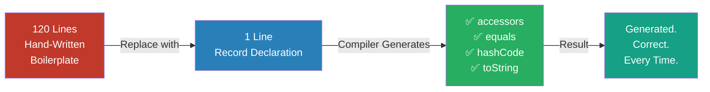

### 📊 Quantifying the Win

| Metric | Hand-Written Class | Record |
|---|---|---|
| Lines of code (3 fields) | ~45–120 lines | **1 line** |
| Places to touch when adding a field | 5+ (field, ctor, getter, equals, hashCode, toString) | **1** |
| Chance of forgetting a field in `equals` | Real & common | **Zero** (compiler covers all components) |
| `equals`/`hashCode` sync risk | Manual | **Impossible to break** |
| Intent visibility | Buried in noise | **Self-documenting** |

### 💬 Story Time: The `equals` Bug That Cost a Week

A team stored `Coordinate` objects in a `Set` used for geofence deduplication. A developer added an `altitude` field to the class but forgot to update `equals()` — the `Set` silently treated two different 3D positions as duplicates. Data loss was intermittent and nearly impossible to reproduce. The fix? Convert to `record Coordinate(double lat, double lon, double altitude) {}` — and the class of bug became structurally impossible. This story plays out in production teams *constantly*; records eliminate it at the source.

---

## 7. Record Syntax Deep Dive

### Basic Syntax

```java
public record RecordName(Type field1, Type field2, ...) {
    // Optional: compact canonical constructor for validation
    // Optional: additional methods (non-mutating)
    // Optional: static fields and factory methods
}
```

### Annotated Example

```java
// Full example with all optional features shown
public record OrderView(
    OrderId id,         // component 1 — auto-accessor: id()
    Money total,        // component 2 — auto-accessor: total()
    Instant placedAt    // component 3 — auto-accessor: placedAt()
) {
    // Compact canonical constructor — validation without boilerplate
    public OrderView {
        Objects.requireNonNull(id, "id required");
        Objects.requireNonNull(total, "total required");
        if (total.isNegative()) throw new IllegalArgumentException("Total cannot be negative");
    }

    // Additional computed method — fine in a record
    public boolean isRecent() {
        return placedAt.isAfter(Instant.now().minus(Duration.ofDays(7)));
    }

    // Static factory — good for named constructors
    public static OrderView placeholder() {
        return new OrderView(OrderId.of(0L), Money.ZERO, Instant.EPOCH);
    }
}
```

### What the Compiler Produces

```java
// After javap -p OrderView.class, you'd see something like:
public final class OrderView implements java.lang.Record {
    private final OrderId id;
    private final Money total;
    private final Instant placedAt;

    public OrderView(OrderId id, Money total, Instant placedAt) { ... }

    public OrderId id() { return id; }       // NOT getId() — record accessor style
    public Money total() { return total; }
    public Instant placedAt() { return placedAt; }

    @Override public boolean equals(Object o) { ... }
    @Override public int hashCode() { ... }
    @Override public String toString() { ... }
}
```

> ⚠️ **Note the accessor naming:** Records use `id()` not `getId()`. This is intentional — it aligns with the value-object style. It also means **JavaBeans-based tooling won't see these as properties automatically** (more in the Troubleshooting section).

### 🧩 Advanced Syntax Features

#### 1. Customizing the Accessor

You can override an accessor as long as the signature matches the component:

```java
public record Temperature(double celsius) {
    // Override generated accessor — legal if it returns the component's type
    @Override
    public double celsius() {
        return Math.round(celsius * 10.0) / 10.0; // normalize on read
    }
}
```

> ⚠️ **Caution:** Overriding accessors so that `x()` doesn't return the actual field is legal but can confuse `equals()` consumers (equals uses the *field*, not your override). Prefer keeping accessors raw and normalizing in the constructor.

#### 2. Compact Constructor Mechanics

In the compact form, you **don't write the field assignments** — they happen automatically *after* your validation code. You *can* reassign the parameter to transform values:

```java
public record Email(String value) {
    public Email {
        value = value.trim().toLowerCase(); // normalization — reassigning the parameter is allowed
        if (!value.contains("@")) throw new IllegalArgumentException("Invalid email");
    }
}
```

#### 3. Non-Canonical Constructors Must Delegate to the Canonical One

```java
public record Range(int low, int high) {
    public Range(int high) {           // convenience constructor
        this(0, high);                 // MUST call the canonical constructor
    }

    public Range {
        if (low > high) throw new IllegalArgumentException("low > high: %d > %d".formatted(low, high));
    }
}
```

#### 4. Static Members, Nested Records, and Constants

```java
public record Money(BigDecimal amount, Currency currency) {
    public static final Money ZERO = new Money(BigDecimal.ZERO, Currency.USD);

    // Static factory
    public static Money usd(String amount) {
        return new Money(new BigDecimal(amount), Currency.USD);
    }

    // Pure function over the data
    public Money plus(Money other) {
        if (!currency.equals(other.currency)) throw new IllegalArgumentException("Currency mismatch");
        return new Money(amount.add(other.amount), currency);
    }

    // Nested record — great for grouping
    public record Conversion(Money from, Money to, BigDecimal rate) {}
}
```

#### 5. Generic Records

```java
public record Pair<K, V>(K key, V value) {
    public static <K, V> Pair<K, V> of(K key, V value) {
        return new Pair<>(key, value);
    }
}

var pair = Pair.of("age", 42);
System.out.println(pair.key());   // "age"
```

#### 6. Local Records (Inside Methods)

Records can be declared inside methods — perfect for intermediate computation results:

```java
List<Trade> topTrades(List<Trade> trades) {
    record TradeValue(Trade trade, BigDecimal notional) {}   // scoped to this method

    return trades.stream()
        .map(t -> new TradeValue(t, t.price().multiply(t.quantity())))
        .sorted(Comparator.comparing(TradeValue::notional).reversed())
        .limit(10)
        .map(TradeValue::trade)
        .toList();
}
```

### 📝 Quick Recap — Section 7

- Records generate: accessors (`name()` style), `equals`, `hashCode`, `toString`, and a canonical constructor
- Compact constructors validate/normalize **without** writing field assignments
- Non-canonical constructors must delegate to the canonical one
- Static factories, computed methods, nested records, generics, and local records are all supported

---

## 8. Key Components: Value vs Object Identity

This distinction is **the most important concept** to internalize before using Records.

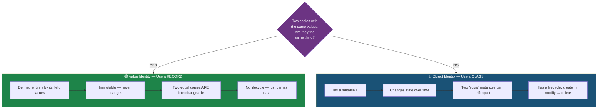

### Examples of Each

```java
// ❌ Wrong: Using a class for pure data
class OrderSummary {   // Has setters? Can mutate? Then it's wrong.
    private OrderId id;
    public void setId(OrderId id) { this.id = id; } // Breaking immutability
}

// ✅ Right: Record for value identity
record OrderSummary(OrderId id, Money total, String status) {}

// ❌ Wrong: Using a record for an entity with lifecycle
record Customer(Long id, String name, List<Order> orders) {}
// Customer changes over time (orders grow), has DB identity — use a class!

// ✅ Right: Record for the CustomerView projection
record CustomerView(Long customerId, String displayName, int orderCount) {}
```

### 🔎 The Mental Model: An Analogy

Think of the difference like this:

- **Object identity (class)** is like a **bank account**. Account #12345 is *the same account* even after every transaction changes its balance. It has a lifecycle: opened, deposited into, frozen, closed. Two accounts with identical balances are *still different accounts*.
- **Value identity (record)** is like a **$20 bill**. Any two crisp $20 bills are perfectly interchangeable. There's no "account" behind them — they're defined entirely by their value. Hand someone *a* $20 bill and you've handed them *the* $20 you owed.

### 🧪 Interactive Decision Drill

Ask these questions **in order**:

1. **"If I create two instances with identical field values, are they meaningfully the same thing?"** — Yes → keep going toward record. No → class.
2. **"Does this thing change over time in a way callers should observe?"** — Yes → class. No → keep going.
3. **"Does it exist independently of its data (e.g., a database row behind an ID)?"** — Yes → class. No → record.

### ⚖️ Identity Comparison Table

| Aspect | Class (Object Identity) | Record (Value Identity) |
|---|---|---|
| `a.equals(b)` for same field values | Whatever you wrote (often `false` via default `==`) | **Always `true`** |
| Two instances with same data interchangeable? | No — different objects | **Yes** |
| Can mutate after creation? | Usually yes | **Never** (reference-wise) |
| Lifespan meaning | Stateful lifetime (create→modify→delete) | Timeless — just a value |
| Typical home in an architecture | Domain core (entities, aggregates) | Boundaries (views, DTOs, events) |
| Hash-based collections (`Set`, `Map` key) | Risky unless equality is carefully designed | **Safe by default** |

### The Boundary Card

A **Boundary Card** is a special kind of record that:
- Lives at the **edge** of your application (API in/out, event payloads, config)
- Is **flat** — no nested mutable objects
- Is **immutable** — fields cannot change after creation
- Is **validated** — constructor ensures it's always in a legal state

```java
// A boundary card for an HTTP request body
public record CreateOrderRequest(
    @NotNull UUID customerId,
    @NotNull @Size(min = 1) List<OrderLineRequest> lines,
    @NotNull String deliveryAddress
) {
    public CreateOrderRequest {
        if (lines.isEmpty()) throw new IllegalArgumentException("Order must have at least one line");
        lines = List.copyOf(lines); // defensive copy for true immutability
    }
}
```

> 💡 **Aha Moment:** The moment you stop asking *"how many lines will this save?"* and start asking *"is this thing a value or an identity?"* is the moment records click. Length savings are a side effect, not the point.

---

## 9. Ten Surfaces Where Records Fit

The infographic shows an **Application Core** surrounded by ten surfaces. Records are perfect glue at each boundary:

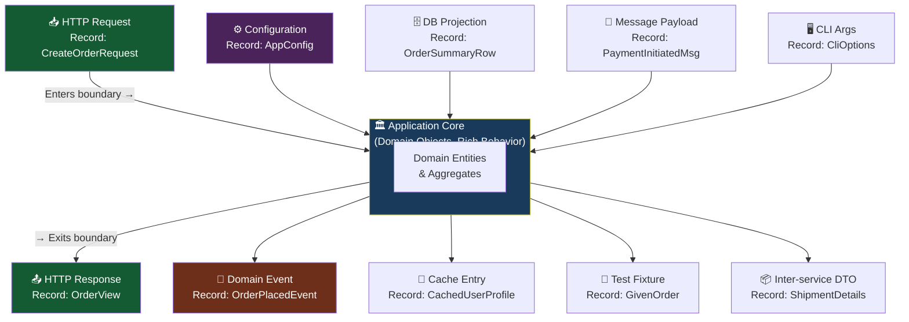

### All Ten Surfaces Explained

| # | Surface | Example Record | Why a Record? |
|---|---|---|---|
| 1 | **HTTP Request** | `record CreateOrderRequest(UUID customerId, ...)` | Validated once, immutable in handler |
| 2 | **HTTP Response** | `record OrderView(UUID id, String status, ...)` | Read-only projection of domain state |
| 3 | **Configuration** | `record DatabaseConfig(String url, int poolSize)` | Config doesn't change at runtime |
| 4 | **Domain Event** | `record OrderPlacedEvent(UUID orderId, Instant at)` | Events are facts — immutable by nature |
| 5 | **DB Projection** | `record OrderSummaryRow(UUID id, BigDecimal total)` | Query result is flat, read-only |
| 6 | **Cache Entry** | `record CachedProduct(UUID id, String name, Price price)` | Snapshot at a point in time |
| 7 | **Message Payload** | `record PaymentMessage(UUID paymentId, Amount amount)` | Serialized over the wire |
| 8 | **CLI Options** | `record CliOptions(Path input, Path output, boolean verbose)` | Args are set once at startup |
| 9 | **Test Fixture** | `record OrderFixture(UUID id, List<Line> lines)` | Makes test data building readable |
| 10 | **Inter-service DTO** | `record ShipmentDetails(UUID orderId, Address destination)` | Contract between services |

### Surface Deep Dives

#### Surface 1 & 2 — HTTP Requests and Responses

```java
// INBOUND: validated, immutable, safe to pass around
public record CreateOrderRequest(UUID customerId, List<UUID> productIds, String shippingAddress) {
    public CreateOrderRequest {
        Objects.requireNonNull(customerId);
        productIds = List.copyOf(productIds);   // unmodifiable snapshot
        if (productIds.isEmpty()) throw new IllegalArgumentException("No products");
    }
}

// OUTBOUND: a projection, not the entity
public record OrderResponse(UUID orderId, String status, BigDecimal total, Instant createdAt) {}
```

#### Surface 3 — Configuration

```java
// Spring Boot binds YAML/properties directly onto record components:
// app.cache.max-size=1000 in application.properties
@ConfigurationProperties(prefix = "app.cache")
public record CacheProperties(int maxSize, Duration ttl, boolean recordStats) {
    public CacheProperties {
        if (maxSize <= 0) throw new IllegalArgumentException("maxSize must be positive");
    }
}
```

> 💡 **Spring Tip:** Since Spring Boot 2.6+, constructor binding onto records works out of the box for `@ConfigurationProperties` — no setters needed, which is exactly what records want.

#### Surface 6 — Cache Entries

```java
public record CachedUserProfile(UUID userId, String displayName, Instant loadedAt) {}

// Records as cache keys: the hashCode is stable — perfect for ConcurrentHashMap
var cache = new ConcurrentHashMap<CacheKey, CachedUserProfile>();
record CacheKey(String tenantId, UUID userId) {}
```

#### Surface 8 — CLI Options

```java
public record CliOptions(Path inputFile, Path outputFile, boolean verbose, int parallelism) {
    public static CliOptions parse(String... args) {
        // parsing logic sets everything once — no mutation afterward
        Path in = null; Path out = null; boolean v = false; int p = 4;
        for (int i = 0; i < args.length; i++) {
            switch (args[i]) {
                case "--in"  -> in = Path.of(args[++i]);
                case "--out" -> out = Path.of(args[++i]);
                case "-v", "--verbose" -> v = true;
                case "--parallel" -> p = Integer.parseInt(args[++i]);
                default -> throw new IllegalArgumentException("Unknown flag: " + args[i]);
            }
        }
        return new CliOptions(in, out, v, p);
    }
}
```

### 📝 Quick Recap — Section 9

- Records fit at every *edge* where data enters or leaves your application
- The common threads: **validated once, immutable forever, flat shape**
- The application core (entities, aggregates) stays class-based and rich

---

## 10. Boundary Cards & Sealed Families

### Sealed Families — Exhaustive by Design

A **Sealed Family** is a `sealed interface` or `sealed class` with a **closed set of permitted subtypes** — all of which are records. This pairs perfectly with Java's `switch` expressions.

```java
// Define a sealed family of domain events
public sealed interface OrderEvent permits
    OrderPlaced,
    OrderShipped,
    OrderCancelled,
    OrderDelivered {}

// Each variant is a record
public record OrderPlaced(UUID orderId, Instant placedAt, Money total) implements OrderEvent {}
public record OrderShipped(UUID orderId, Instant shippedAt, String trackingCode) implements OrderEvent {}
public record OrderCancelled(UUID orderId, Instant cancelledAt, String reason) implements OrderEvent {}
public record OrderDelivered(UUID orderId, Instant deliveredAt) implements OrderEvent {}
```

**Why this is powerful — exhaustive switching:**

```java
// The compiler ENFORCES that you handle every case
String describe(OrderEvent event) {
    return switch (event) {
        case OrderPlaced p    -> "Order " + p.orderId() + " placed for " + p.total();
        case OrderShipped s   -> "Shipped via " + s.trackingCode();
        case OrderCancelled c -> "Cancelled: " + c.reason();
        case OrderDelivered d -> "Delivered at " + d.deliveredAt();
        // No default needed — compiler guarantees completeness
    };
}
```

**The Build-Time Safety Guarantee:**

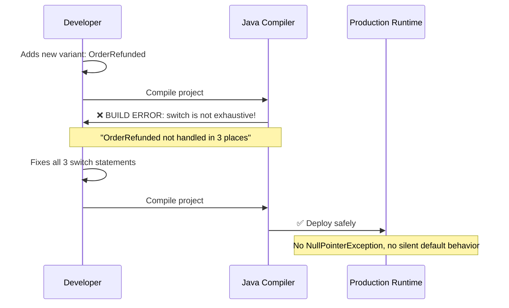

> 🔑 **Key Insight:** When you add a new record variant to a sealed family, every `switch` that doesn't handle it **fails at build time** — not at runtime. You fix it cheaply, before it ships.

### 🏗️ Class Diagram: The Sealed Family Structure

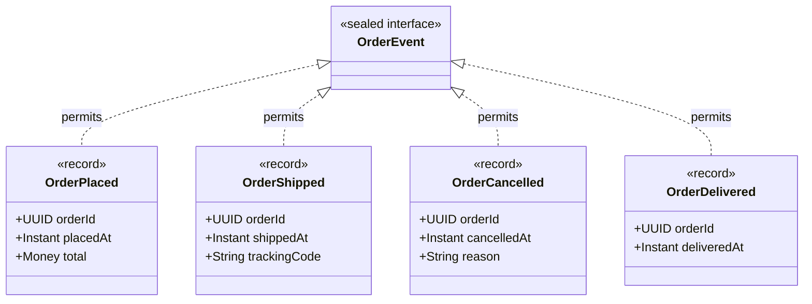

### 🎯 Record Patterns (Java 21): Destructuring Without Ceremony

Java 21's record patterns let you destructure records directly in `switch` and `instanceof`:

```java
// Nested destructuring — no intermediate variables needed
String describe(Object obj) {
    return switch (obj) {
        case OrderPlaced(UUID orderId, Instant placedAt, Money total) when total.isZero()
            -> "Free order " + orderId;
        case OrderPlaced(UUID orderId, var at, var total)
            -> "Order " + orderId + " for " + total;
        case OrderShipped s -> "Shipped";
        case OrderCancelled c -> "Cancelled";
        case OrderDelivered d -> "Delivered";
        default -> "Not an order event";
    };
}
```

### Guidelines for Sealed Families

| Guideline | Rationale |
|---|---|
| Keep the family **closed and small** (2–8 variants) | Exhaustiveness is most valuable when variants are manageable |
| Make **every variant a record** | Uniform value semantics across the family |
| Prefer **sealed interface** over sealed class | Records can only implement interfaces anyway |
| Use `when` guards for special cases | Avoids combinatorial explosion of variant types |
| Consider a **common accessor method** on the interface | e.g., `Instant occurredAt()` implemented differently per record |

```java
// Common accessor pattern — polymorphism across the family
public sealed interface OrderEvent permits OrderPlaced, OrderShipped, OrderCancelled, OrderDelivered {
    UUID orderId();          // every variant MUST have this — enforced by the compiler
    Instant occurredAt();    // each record implements it from its own component
}

public record OrderPlaced(UUID orderId, Instant placedAt, Money total) implements OrderEvent {
    @Override public Instant occurredAt() { return placedAt; }
}
public record OrderShipped(UUID orderId, Instant shippedAt, String trackingCode) implements OrderEvent {
    @Override public Instant occurredAt() { return shippedAt; }
}
```

### 📝 Quick Recap — Section 10

- Sealed interfaces + records = closed variant families with uniform value semantics
- Exhaustive `switch` turns "forgot to handle a case" from a runtime bug into a compile error
- Record patterns (Java 21) destructure records cleanly, including nested destructuring
- Common accessors on the sealed interface give you type-safe polymorphism

---

## 11. What You Gain — Correct by Default

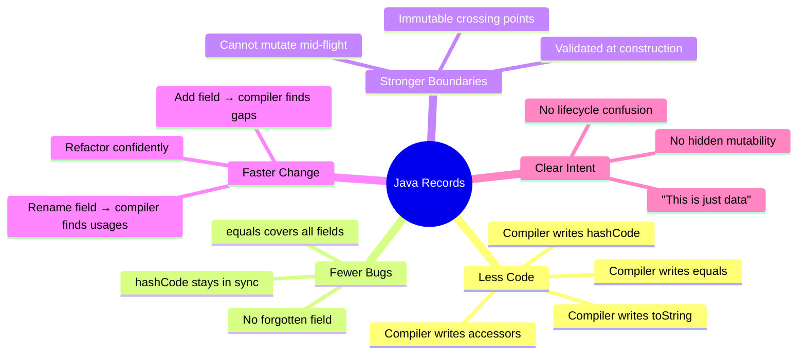

### Benefit 1: Less Code

```java
// Before: 5 methods, ~40 lines, all error-prone
// After:
record Point(double x, double y) {}
// Done. All methods correct. Zero effort.
```

### Benefit 2: Fewer Bugs — Correct Equality

```java
// Classic class bug: forgot a field in equals()
class Coordinate {
    double lat, lon, altitude;

    @Override
    public boolean equals(Object o) {
        // Bug: forgot altitude! Two points at same lat/lon but different altitudes are "equal"
        return lat == ((Coordinate) o).lat && lon == ((Coordinate) o).lon;
    }
}

// Record: all fields included — always
record Coordinate(double lat, double lon, double altitude) {}
// equals() checks all three. Automatically. Correctly.
```

### Benefit 3: Stronger Boundaries

```java
// Without records: mutation can happen anywhere
class ApiRequest {
    public String userId;  // public mutable field 😱
    public List<String> items;
}

// Handler receives request, but items list can be modified downstream!
void handle(ApiRequest req) {
    processItems(req.items); // processItems could clear the list!
}

// With record: immutable — no one can mutate after construction
record ApiRequest(String userId, List<String> items) {
    public ApiRequest {
        items = List.copyOf(items); // Unmodifiable copy
    }
}
// No matter how deep processItems goes — it cannot mutate req.items()
```

### Benefit 4: Faster Change

```java
// Adding a new field to a record
record OrderView(UUID id, String status, Money total) {}
// → Now add: Instant createdAt

record OrderView(UUID id, String status, Money total, Instant createdAt) {}
// The compiler now tells you everywhere OrderView is constructed!
// You can't miss a spot. Refactoring is safe.
```

### Benefit 5: Clear Intent

```java
// Looking at this class — what does it do? Does it have behavior? Can it mutate?
class OrderData {
    // 300 lines... somewhere inside...
}

// Looking at this record — intent is immediately clear
record OrderSummary(UUID orderId, String customerName, BigDecimal total, OrderStatus status) {}
// "This is data. It carries four values. Nothing more."
```

### 📊 Benefit-to-Mechanism Mapping

| Benefit | Mechanism | Who Enforces It |
|---|---|---|
| Less code | Compiler generates 5 members | ✅ Compiler |
| Fewer bugs | equals/hashCode always cover all components | ✅ Compiler |
| Stronger boundaries | Final fields + compact constructor validation | ✅ Language + your constructor |
| Faster change | New component → all construction sites must adapt | ✅ Compiler |
| Clear intent | `record` keyword is self-documenting | ✅ Language |
| Thread safety | Immutability means safe cross-thread sharing | ✅ Structural guarantee |

---

## 12. Multiple Implementation Approaches

Records aren't the only way to model immutable data in Java. A mature engineer knows the alternatives and their trade-offs. Here are four approaches side by side:

### Approach 1: Plain Class (The Legacy Baseline)

```java
public final class UserView {
    private final Long id;
    private final String name;

    public UserView(Long id, String name) {
        this.id = id;
        this.name = name;
    }
    public Long getId() { return id; }
    public String getName() { return name; }
    // equals/hashCode/toString: ~40 more lines...
}
```

- ✅ Maximum control, zero dependencies, works on any Java version
- ❌ Maximum boilerplate; correctness is manual; intent unclear

### Approach 2: Lombok (`@Value` / `@Data`)

```java
@Value
public class UserView {
    Long id;
    String name;
}
```

- ✅ Nearly as short as records; familiar on pre-16 codebases
- ❌ **Annotation-processing magic** — the class in the source isn't the class at runtime; IDE plugin required; semantics (e.g., mutability, equality) are configurable and thus *not guaranteed*; doesn't communicate value-identity to the compiler

### Approach 3: Google AutoValue

```java
@AutoValue
public abstract class UserView {
    public abstract Long id();
    public abstract String name();

    @AutoValue.Builder
    public static abstract class Builder { ... }
}
```

- ✅ Immutability + value semantics; good for pre-16; builder included
- ❌ Generated subclass indirection; debugging shows `AutoValue_UserView`; more ceremony than records

### Approach 4: Java Record (The Modern Default)

```java
public record UserView(Long id, String name) {}
```

- ✅ Language-level semantics; compiler-enforced; zero dependencies; sealed-family compatible; record-pattern destructuring
- ❌ Requires Java 16+; slightly less flexible for exotic needs (e.g., you can't extend another class)

### 📊 Full Comparison Matrix

| Criterion | Plain Class | Lombok `@Value` | AutoValue | **Record** |
|---|---|---|---|---|
| Lines of code (2 fields) | ~40 | ~5 | ~15 + generated | **1** |
| Value equality guaranteed | ❌ Manual | ⚠️ Generated | ✅ Generated | ✅ **Compiler** |
| No external dependency | ✅ | ❌ | ❌ | ✅ |
| Sealed-family compatible | ⚠️ Possible | ⚠️ Possible | ⚠️ Possible | ✅ **Natural** |
| Record-pattern destructuring | ❌ | ❌ | ❌ | ✅ |
| Visible in source as-is | ✅ | ⚠️ Transformed | ⚠️ Subclass | ✅ |
| Requires Java 16+ | ❌ No | ❌ No | ❌ No | ✅ Yes |
| Intent clarity ("this is data") | ❌ | ⚠️ | ⚠️ | ✅ **Highest** |

### 🤔 Decision Guide

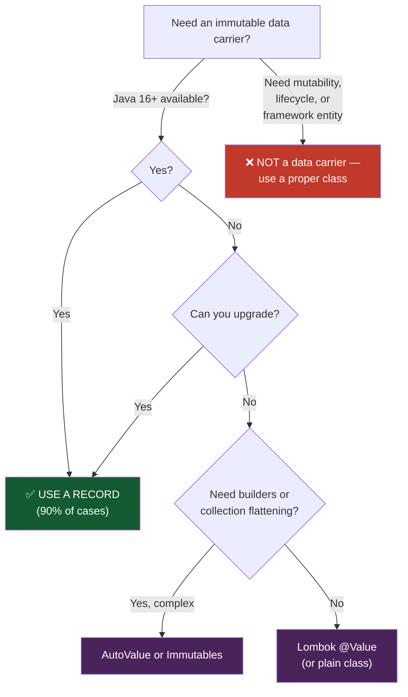

> 💡 **Recommendation:** On Java 16+, default to records for all data carriers. Keep Lombok only for legacy modules during migration (Section 20). Avoid mixing records and Lombok on the same type — their generated members can conflict.

---

## 13. Four Key Takeaways

```mermaid
flowchart TD
    subgraph T1["📏 Takeaway 1: Identity is the Test, Not Length"]
        T1A["Ask: Are two identical copies\nthe same thing?"]
        T1B{"Yes?"}
        T1C["Use a RECORD"]
        T1D["Use a CLASS"]
        T1A --> T1B
        T1B -->|Yes| T1C
        T1B -->|No| T1D
    end

    subgraph T2["📐 Takeaway 2: Flat at Edges, Rich in Middle"]
        T2A["Boundary Record\nFlat, validated, immutable"]
        T2B["🔄 Explicit Conversion"]
        T2C["Domain Entity\nRich behavior, stateful"]
        T2A -->|"Converted into"| T2C
        T2C -->|"Projected into"| T2A
        T2B -.->|"explicit"| T2A
        T2B -.->|"explicit"| T2C
    end

    subgraph T3["🔨 Takeaway 3: Sealed Families Fail at Build Time"]
        T3A["Add variant to sealed family"]
        T3B["Compiler finds every\nnon-exhaustive switch"]
        T3C["Fix them all before deploy"]
        T3A --> T3B --> T3C
    end

    subgraph T4["🛡️ Takeaway 4: Immutability Protects Validation"]
        T4A["Validate once\nat boundary"]
        T4B["Data flows through\n3+ layers"]
        T4C["Still valid at\nthe deepest layer"]
        T4A --> T4B --> T4C
    end

    style T1 fill:#1a3a5c,color:#fff
    style T2 fill:#145a32,color:#fff
    style T3 fill:#6e2f1a,color:#fff
    style T4 fill:#4a235a,color:#fff
```

### Takeaway 1 — Identity is the Test, Not Length

Don't choose between class and record based on how many lines you'd save. Ask the semantic question:

```java
// Two shopping carts with the same items — are they the same cart?
// A user might have two browsers open. NO — they're separate carts.
class ShoppingCart { UUID cartId; List<Item> items; } // ← Class: has identity

// Two "price quotes" for the same item at the same time — are they the same?
// YES — the quote is defined entirely by its values.
record PriceQuote(UUID productId, BigDecimal price, Currency currency, Instant validUntil) {} // ← Record
```

### Takeaway 2 — Flat at the Edges, Rich in the Middle

```java
// EDGE: Flat, validated record
record CreateProductRequest(
    String name,
    BigDecimal price,
    String currencyCode,
    String categoryCode
) {
    public CreateProductRequest {
        if (price.compareTo(BigDecimal.ZERO) <= 0)
            throw new IllegalArgumentException("Price must be positive");
    }
}

// CORE: Rich domain object
class Product {
    private ProductId id;
    private Money price;        // Rich type, not BigDecimal
    private Category category;  // Rich type, not String
    private List<ProductEvent> events;

    // Explicit conversion from the boundary record
    public static Product from(CreateProductRequest req) {
        return new Product(
            ProductId.generate(),
            Money.of(req.price(), Currency.of(req.currencyCode())),
            Category.byCode(req.categoryCode())
        );
    }

    // Explicit projection back to boundary record
    public ProductView toView() {
        return new ProductView(id.value(), price.amount(), price.currency().code());
    }
}
```

> 💡 **Why explicit conversion matters:** If boundary records leaked *into* the core, you'd end up with `String` prices and `String` categories scattered across domain logic — losing type safety. The conversion point is where primitive obsession gets cured, exactly once.

### Takeaway 3 — Sealed Families Fail at Build Time

```java
// When you add PaymentRefunded to this sealed interface:
public sealed interface PaymentEvent permits
    PaymentInitiated, PaymentCompleted, PaymentFailed, PaymentRefunded {}

// Every switch like this BREAKS AT COMPILE TIME:
String label = switch (event) {
    case PaymentInitiated i  -> "Pending";
    case PaymentCompleted c  -> "Paid";
    case PaymentFailed f     -> "Failed";
    // ❌ COMPILE ERROR: PaymentRefunded is not covered!
};
// You find ALL the gaps before the code ships.
```

### Takeaway 4 — Immutability Protects Validation

```java
record ValidatedEmail(String value) {
    public ValidatedEmail {
        if (!value.matches("^[\\w.-]+@[\\w.-]+\\.[a-z]{2,}$"))
            throw new IllegalArgumentException("Invalid email: " + value);
    }
}

// Once constructed, this email is guaranteed valid — forever, no matter where it travels
void layer1(ValidatedEmail email) {
    layer2(email);
}
void layer2(ValidatedEmail email) {
    layer3(email);
}
void layer3(ValidatedEmail email) {
    sendEmail(email.value()); // Still guaranteed valid — no re-validation needed
}
```

> ⚠️ **Subtle caveat:** Immutability protects the *record*, not the objects it references. If a component is a mutable type (`Date`, `ArrayList`, a mutable POJO), its internal state can still change. That's why defensive copies (Section 15) are mandatory for collection components — or better, use immutable types (`List.copyOf`, `Instant`, `String`).

---

## 14. Real-World Use Cases

### Use Case 1: REST API with Spring Boot

```java
// Request record with validation
public record RegisterUserRequest(
    @NotBlank String username,
    @Email String email,
    @Size(min = 8) String password
) {}

// Response record — clean API contract
public record UserResponse(
    UUID userId,
    String username,
    String email,
    Instant registeredAt
) {}

// Controller is clean and expressive
@RestController
@RequestMapping("/users")
public class UserController {

    @PostMapping
    public ResponseEntity<UserResponse> register(@Valid @RequestBody RegisterUserRequest request) {
        var user = userService.register(request);
        return ResponseEntity.ok(user.toResponse());
    }
}
```

> 💡 **Spring + Jackson:** Spring Boot 3.x serializes/deserializes records natively via Jackson 2.12+ — no `@JsonProperty` needed for standard names, and no no-arg constructor is required. Validation annotations on components work with `@Valid` exactly as on fields.

### Use Case 2: Event-Driven Architecture

```java
// Sealed event family
public sealed interface InventoryEvent permits
    StockAdded, StockReserved, StockReleased, StockDepleted {}

public record StockAdded(String sku, int quantity, Instant at) implements InventoryEvent {}
public record StockReserved(String sku, int quantity, UUID orderId) implements InventoryEvent {}
public record StockReleased(String sku, int quantity, UUID orderId) implements InventoryEvent {}
public record StockDepleted(String sku, Instant at) implements InventoryEvent {}

// Handler — safe and exhaustive
class InventoryEventHandler {
    void handle(InventoryEvent event) {
        switch (event) {
            case StockAdded a      -> inventory.add(a.sku(), a.quantity());
            case StockReserved r   -> inventory.reserve(r.sku(), r.quantity(), r.orderId());
            case StockReleased rel -> inventory.release(rel.sku(), rel.quantity(), rel.orderId());
            case StockDepleted d   -> alerts.notifyDepleted(d.sku());
        }
    }
}
```

> 💡 **Kafka Tip:** For Kafka consumers, deserialize to a sealed interface using Jackson's polymorphic handling (`@JsonTypeInfo` / `@JsonSubTypes` on the interface) — each variant stays a record, and the exhaustive switch in the consumer gains a new compile-time check whenever a producer adds an event type.

### Use Case 3: Configuration as Records

```java
// Application config — loaded once, never mutated
public record AppConfig(
    DatabaseConfig db,
    ServerConfig server,
    FeatureFlags features
) {}

public record DatabaseConfig(
    String url,
    String username,
    int poolSize,
    Duration connectionTimeout
) {
    public DatabaseConfig {
        if (poolSize < 1) throw new IllegalArgumentException("Pool size must be >= 1");
    }
}

public record ServerConfig(int port, int maxConnections, boolean tlsEnabled) {}

public record FeatureFlags(boolean newCheckoutEnabled, boolean betaSearchEnabled) {}

// Usage
AppConfig config = loadConfig();
// config.db().url() — always safe, always valid, always the same
```

> ⚠️ **Security Note:** Never log a whole config record containing credentials (`toString()` prints everything!). Either store secrets as a wrapper record with a redacting `toString()`, or keep the secret out of the record entirely — see Section 18.

### Use Case 4: Domain Query Results

```java
// Database projection — exactly what the query returns
public record OrderSummaryRow(
    UUID orderId,
    String customerName,
    BigDecimal totalAmount,
    String currency,
    String status,
    Instant placedAt
) {}

// Repository
interface OrderRepository {
    List<OrderSummaryRow> findRecentOrderSummaries(Instant since, int limit);
}

// Usage — records make query result types self-documenting
List<OrderSummaryRow> recent = repo.findRecentOrderSummaries(
    Instant.now().minus(Duration.ofDays(30)), 50
);

recent.stream()
    .filter(row -> "PENDING".equals(row.status()))
    .map(OrderSummaryRow::orderId)
    .forEach(this::sendReminder);
```

With Spring Data JPA, projections map straight onto records:

```java
public interface OrderRepository extends JpaRepository<OrderEntity, UUID> {
    // JPQL constructor expression — builds OrderSummaryRow records directly
    @Query("""
        select new com.example.OrderSummaryRow(
            o.id, o.customer.name, o.totalAmount, o.currency, o.status, o.placedAt)
        from OrderEntity o
        where o.placedAt >= :since
        """)
    List<OrderSummaryRow> findRecentOrderSummaries(@Param("since") Instant since);
}
```

With JDBC / JdbcTemplate:

```java
var rows = jdbc.query(
    "SELECT order_id, customer_name, total_amount, currency, status, placed_at " +
    "FROM orders WHERE placed_at > ? LIMIT ?",
    (rs, i) -> new OrderSummaryRow(
        rs.getObject("order_id", UUID.class),
        rs.getString("customer_name"),
        rs.getBigDecimal("total_amount"),
        rs.getString("currency"),
        rs.getString("status"),
        rs.getObject("placed_at", Instant.class)),
    since, limit);
```

### Use Case 5 (Bonus): Functional Pipelines with Records

```java
// Records + streams = readable data pipelines
record SalaryBand(String grade, BigDecimal min, BigDecimal max) {}

Map<String, List<Employee>> byBand = employees.stream()
    .collect(Collectors.groupingBy(e ->
        salaryBands.stream()
            .filter(b -> !e.salary().add(BigDecimal.ONE).min(b.max()).equals(b.max()))
            .findFirst()
            .map(SalaryBand::grade)
            .orElse("UNBANDED")));
```

---

## 15. Best Practices & Anti-Patterns

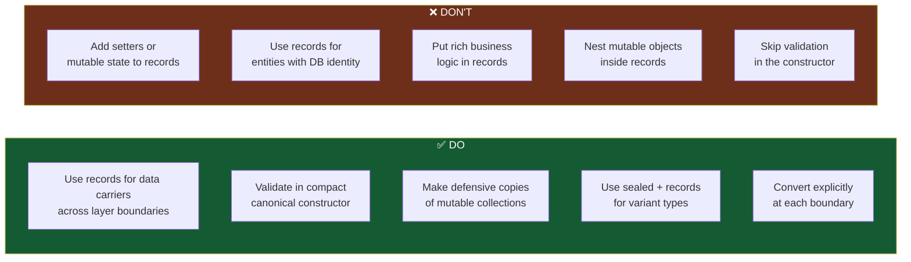

### ✅ Best Practice: Defensive Copy for Collections

```java
// Without defensive copy — someone outside can still mutate the list
record Order(UUID id, List<OrderLine> lines) {}

// With defensive copy — truly immutable
record Order(UUID id, List<OrderLine> lines) {
    public Order {
        lines = List.copyOf(lines); // Returns an unmodifiable copy
    }
}
```

> ⚠️ **Watch out:** `List.copyOf` **rejects null elements** (throws NPE) and **rejects null lists**. That's usually desirable — fail fast — but document the behavior. Also note it returns the *same instance* if the input is already an unmodifiable list from `List.of`/`List.copyOf`, so there's no repeated-copy overhead.

### ✅ Best Practice: Records in Tests

```java
// Records make test fixtures incredibly readable
record TestOrder(UUID id, List<OrderLine> lines, Money total) {
    static TestOrder simple() {
        return new TestOrder(
            UUID.randomUUID(),
            List.of(new OrderLine("SKU-1", 2, Money.of(10))),
            Money.of(20)
        );
    }
}

@Test
void shouldCalculateTax() {
    var order = TestOrder.simple();
    var tax = taxCalculator.calculate(order.total(), TaxRegion.UK);
    assertThat(tax).isEqualTo(Money.of(4)); // 20% VAT
}
```

### ✅ Best Practice: Static Factories for Readable Construction

```java
public record DateRange(Instant start, Instant end) {
    public DateRange {
        if (start.isAfter(end)) throw new IllegalArgumentException("start after end");
    }

    public static DateRange lastDays(long days) {
        var now = Instant.now();
        return new DateRange(now.minus(Duration.ofDays(days)), now);
    }

    public static DateRange singleDay(Instant day) {
        return new DateRange(day, day.plus(Duration.ofDays(1)));
    }
}
```

### ✅ Best Practice: Prefer Immutable Component Types

```java
// ✅ PREFER these component types — inherently immutable, thread-safe:
record GoodTypes(String name, Instant createdAt, List<String> tags /* copied in ctor */) {}

// ⚠️ AVOID these component types — mutable, leak state:
record RiskyTypes(java.util.Date created, int[] coords, StringBuilder builder) {}
// Use Instant/LocalDateTime, List<Integer> (copied), String instead.
```

### ❌ Anti-Pattern: Record as Entity

```java
// WRONG: An entity with a database identity should NOT be a record
record CustomerEntity(Long id, String name, String email) {} // ❌
// - id comes from DB, may be null before save
// - name and email change over time
// - "same customer" is identity-based, not value-based

// RIGHT: Use a class for the entity, a record for its view
class Customer {               // ← Entity: has identity, mutable over time
    @Id Long id;
    String name, email;
}
record CustomerView(Long id, String name) {} // ← Record: read-only projection
```

> 🔑 **Why JPA specifically rejects this:** JPA entities need a no-arg constructor (records only have the canonical one), lazy-loading proxies (they subclass your entity — impossible with `final` records), and dirty checking via mutation (records never mutate). Hibernate will *load* records as read-only embeddables in some versions, but **never use a record as a managed `@Entity`**.

### ❌ Anti-Pattern: Silent `equals` Drift via Accessor Overrides

```java
// DON'T override accessors to transform values — equals() uses the raw field
public record Price(BigDecimal amount) {
    @Override public BigDecimal amount() {
        return amount.setScale(2, RoundingMode.HALF_UP); // ⚠️ accessor ≠ field
    }
}
// new Price(new BigDecimal("1.005")).equals(new Price(new BigDecimal("1.01")))
// is false, even though .amount() prints identically! Debugging nightmare.
```

### ❌ Anti-Pattern: Records with Behavior-Rich Logic

```java
// DON'T: a record should carry data, not orchestrate workflows
record OrderProcessor(Order order, PaymentGateway gateway, InventoryService inventory) {
    void process() {                       // ❌ stateful orchestration
        gateway.charge(order.total());
        inventory.reserve(order.lines());
    }
}
// This is a SERVICE (use a class or component), not a value.
```

### ✅/❌ Quick Reference

| Practice | Verdict |
|---|---|
| Validate in compact constructor | ✅ Always |
| `List.copyOf` collection components | ✅ Always |
| Records for DTOs, events, config, projections | ✅ Ideal |
| Records as JPA `@Entity` | ❌ Never |
| Overriding accessors to transform values | ⚠️ Avoid (breaks equals intuition) |
| Adding setters / non-final statics | ❌ Never (impossible for fields anyway) |
| Local records for stream computation | ✅ Underrated & excellent |
| Records with >8–10 components | ⚠️ Smell — consider nesting related groups |

---

## 16. Common Pitfalls & Troubleshooting

### 🐞 Pitfall 1: Records with JPA/Hibernate

**Symptom:** `org.hibernate.InstantiationException: No default constructor for entity` or proxy/casting errors at runtime.

```java
@Entity                                    // ❌ DOES NOT WORK
public record User(@Id Long id, String name) {}
```

**Cause & Fix:** JPA needs a no-arg constructor, subclassable proxies, and mutable state for dirty checking. Records provide none of these. **Fix:** Use a class for the entity; use records for read-only projections (`select new ...` constructor expressions), DTOs, and API responses.

### 🐞 Pitfall 2: Jackson Deserialization Fails ("no Creators, like default constructor")

**Symptom:** Older Jackson (< 2.12) throws `InvalidDefinitionException` when deserializing records.

**Fixes (in order of preference):**
1. **Upgrade** — Jackson 2.12+ supports records natively; Spring Boot 2.5+ ships it.
2. If stuck on old Jackson, add `@JsonCreator` + `@JsonProperty` to the canonical constructor.
3. For parameter name resolution, compile with `-parameters` (Spring Boot's Gradle/Maven plugins do this by default).

```java
// Explicit creator for old Jackson versions:
public record UserResponse(UUID id, String name) {
    @JsonCreator
    public UserResponse(@JsonProperty("id") UUID id, @JsonProperty("name") String name) {}
}
```

### 🐞 Pitfall 3: Accessor Names Break Frameworks Expecting JavaBeans

**Symptom:** `BeanUtils.copyProperties` copies nothing; EL/JSP can't read `${user.name}`; some older MVC binders ignore fields.

**Cause:** Records expose `name()`, not `getName()` — JavaBeans introspection doesn't recognize them as properties.

**Fixes:**
- Modern frameworks (Spring 6+/Boot 3+, Jackson 2.12+, most JSON libs) understand records directly — upgrade.
- For old tooling, explicitly add `getName()` delegating to `name()` (harmless, local).

### 🐞 Pitfall 4: Mutable Components — The Fake Immutability Trap

```java
// DANGER: record fields are final, but the referenced object mutates!
record Report(String title, List<String> findings) {}

var findings = new ArrayList<String>();
var report = new Report("Audit", findings);
findings.add("injected later!");          // ⚠️ report just changed!
System.out.println(report.findings());    // includes the injected line
```

**Fix:** Defensive copy in the compact constructor (Section 15). Rule of thumb: **every `List`/`Set`/`Map`/array component gets `List.copyOf`/`Set.copyOf`/`Map.copyOf`/`clone()`**.

### 🐞 Pitfall 5: `null` Sneaking Past `List.copyOf`

```java
record Order(List<String> items) {
    public Order {
        items = List.copyOf(items); // throws NPE if items is null — good, but the message is cryptic
    }
}
```

**Better:** fail with a *clear* message:

```java
public Order {
    Objects.requireNonNull(items, "items must not be null");
    items = List.copyOf(items);
}
```

### 🐞 Pitfall 6: `equals()` Surprises with Mutable Component Values

Records call component `equals()` — if a component type has unusual equality (e.g., `BigDecimal` with different scales: `2.0` vs `2.00` are **not equal**), two "visually identical" records won't match:

```java
record Money(BigDecimal amount) {}
new Money(new BigDecimal("2.0")).equals(new Money(new BigDecimal("2.00"))) // false!
```

**Fix:** Normalize in the constructor (`amount = amount.setScale(2, RoundingMode.HALF_UP)`), or use `compareTo()`-based semantics consciously in `TreeSet`/`TreeMap` instead of hash-based collections.

### 🐞 Pitfall 7: Huge Canonical Constructors

A 15-component record means a 15-argument constructor — hard to read, easy to swap arguments of the same type.

**Fixes:**
- Static factories with names (`User.withDefaults(...)`)
- Break the record into nested records (`Address`, `ContactInfo`)
- Consider whether 15 fields on a boundary is a design smell

### 🩺 Troubleshooting Quick Table

| Symptom | Likely Cause | Fix |
|---|---|---|
| Hibernate instantiation error | Record as `@Entity` | Class for entity, record for projection |
| Jackson "no Creators" error | Jackson < 2.12 | Upgrade or add `@JsonCreator` |
| `NullPointerException` in ctor | Null passed to `List.copyOf` | `Objects.requireNonNull` first with message |
| `equals` returns false unexpectedly | Mutable/scale-prone components | Normalize in compact constructor |
| Framework ignores record properties | JavaBeans expectation | Upgrade framework or add `getX()` |
| Compilation error "cannot inherit from record" | Extending a class from a record | Records extend `java.lang.Record` only — use interface |
| Switch not exhaustive error after adding variant | ✅ Working as intended! | Handle the new case — build-time safety |

---

## 17. Performance Considerations

Records generally perform the same as equivalent hand-written classes — the compiler generates ordinary fields and methods. But there are nuances worth knowing:

### Memory Footprint

- A record has the same layout as an equivalent final class: one header + fields. **No extra overhead.**
- `record Point(int x, int y)` = 16 bytes on a typical 64-bit JVM with compressed oops — identical to a hand-written class.
- No memory advantage over classes, but also **no penalty** versus hand-written boilerplate.

### `equals()` / `hashCode()` Performance

```java
// Generated equals uses instanceof + field-by-field comparison — comparable to ideal hand-written code.
// Generated hashCode combines component hashes — NOT cached!
```

> ⚠️ **Hot-path note:** Unlike some libraries (e.g., Lombok's `@EqualsAndHashCode(cache = true)`), **record `hashCode()` is recomputed on every call**. If a record is used as a key in a `HashMap` queried millions of times, and hashing is expensive (e.g., huge lists as components), consider precomputing:

```java
// Advanced: caching hashCode in an extra (non-component) field
public record HugePayload(List<String> data) {
    private final int hash;   // extra final field — NOT a component

    public HugePayload {      // compact ctor
        data = List.copyOf(data);
        hash = Objects.hash(data);   // computed once
    }

    @Override
    public int hashCode() { return hash; }   // precomputed
}
```

> ⚠️ This works, but it's an advanced technique — `equals` still uses components only (correct), yet the extra field is visible to field-scanning tooling. Measure first; only optimize with evidence.

### Benchmark Expectations (indicative, JMH, single-threaded, JDK 21)

| Operation | Record | Hand-written class | Notes |
|---|---|---|---|
| Construction (3 fields) | ~same | ~same | Identical bytecode shape |
| `equals()` (3 fields) | ~same | ~same | Same comparison sequence |
| `hashCode()` (3 fields) | ~same | ~same | No caching on either |
| Accessor call | ~same | ~same | Both inline to field read |

### Things That *Do* Affect Performance

1. **Defensive copies** (`List.copyOf`) cost O(n) at construction. For giant lists constructed in loops, this is measurable — weigh safety vs. cost.
2. **Records as map keys with large components** — hashing the whole component graph on every lookup. Prefer small keys (IDs).
3. **Autoboxing** in components (`Integer`, `Long`) — same as classes, but worth remembering for hot numeric paths.
4. **No special layout** — records don't get field padding or cache-line alignment benefits; same as classes.

### 💡 Performance Rule of Thumb

> Records are never *slower* than the hand-written class you should have written. Performance differences come from your *design choices* (component types, copying, key sizes), not from using records.

---

## 18. Security Considerations

### 🔒 1. `toString()` Leaks Secrets

Generated `toString()` prints **every component**. A record containing a password, token, or PII will leak it into logs via a casual `log.info("request={}", request)`.

```java
// ✅ Defensive: redact sensitive components
public record LoginRequest(String username, String password) {
    @Override
    public String toString() {
        return "LoginRequest[username=" + username + ", password=REDACTED]";
    }
}
```

**Best practice:** Never put raw secrets in boundary records — pass them via dedicated secure channels (e.g., read from a vault inside a service), or wrap them in a type whose `toString` redacts.

### 🔒 2. Deserialization Attack Surface

Records participate in Java serialization and JSON deserialization. Records are actually **safer** than mutable POJOs for deserialization:

- No no-arg constructor means no "half-constructed" object state — **validation always runs**
- A compact constructor that rejects invalid data rejects it *during deserialization too*
- Final fields can't be tampered with post-construction

```java
// Validation runs even during deserialization — a real hardening win
public record TransferRequest(UUID from, UUID to, BigDecimal amount) {
    public TransferRequest {
        Objects.requireNonNull(from);
        Objects.requireNonNull(to);
        if (amount.signum() <= 0) throw new IllegalArgumentException("amount must be positive");
    }
}
```

> ⚠️ **But:** records implementing `Serializable` still inherit Java serialization's general risks. Prefer JSON/protobuf boundaries; if you must use native serialization, follow the standard serialization-filtering guidance (JEP 290 context filters).

### 🔒 3. Defensive Copies Prevent State Injection

The `List.copyOf` pattern isn't just immutability hygiene — it's a security boundary. Without it, a caller can hold the original mutable list and mutate the record's observable state after passing "validated" input:

```java
var lines = new ArrayList<>(List.of(validLine));
var request = new CreateOrderRequest(customerId, lines, address);
// Attack/bug: lines.clear() here changes the "validated" request downstream!
```

With the compact-constructor copy, the validated snapshot is frozen at the boundary.

### 🔒 4. Records as Capability Tokens

A validated record acts as a *proof*: "whoever holds this holds data that passed validation." Because records can't be mutated, the proof doesn't decay as it travels — a security-positive property when the record is the *only* way to obtain a value (e.g., a parsed-and-validated auth token wrapper).

### 📋 Security Checklist for Record Usage

- [ ] Sensitive components are redacted in `toString()` or kept out of records
- [ ] Collection components defensively copied (`List.copyOf` etc.)
- [ ] Compact constructors validate — especially for deserializable types
- [ ] Native Java serialization avoided or filtered (JEP 290)
- [ ] No secrets logged via whole-record logging statements

---

## 19. Testing Strategies

Records change how you test — less ceremony, sharper focus. Here's a complete strategy:

### Strategy 1: Test the Equality Contract Once, Trust It Everywhere

```java
@Test
void equalityContract() {
    var a = new Money(BigDecimal.TEN, Currency.USD);
    var b = new Money(BigDecimal.TEN, Currency.USD);

    assertThat(a).isEqualTo(b)            // value equality
        .hasSameHashCodeAs(b);            // hash consistency — compiler already guarantees, but the test documents intent
    assertThat(a).isNotEqualTo(new Money(BigDecimal.ONE, Currency.USD));
}
```

> 💡 **Philosophy:** You *could* skip this test — the compiler guarantees it. But this test acts as executable documentation and guards against future refactoring mistakes (like someone converting the record back to a class).

### Strategy 2: Test Validation Rules Exhaustively

```java
@ParameterizedTest
@ValueSource(strings = {"", "   ", "not-an-email", "@missing.com"})
void rejectsInvalidEmails(String bad) {
    assertThatThrownBy(() -> new ValidatedEmail(bad))
        .isInstanceOf(IllegalArgumentException.class);
}

@ParameterizedTest
@ValueSource(strings = {"user@example.com", "first.last@sub.domain.org"})
void acceptsValidEmails(String good) {
    assertThatCode(() -> new ValidatedEmail(good)).doesNotThrowAnyException();
}
```

### Strategy 3: Test Immutability (Defensive Copies)

```java
@Test
void collectionComponentsAreDefensivelyCopied() {
    var mutable = new ArrayList<String>();
    mutable.add("A");

    var report = new Report("Audit", mutable);

    // Attempt to mutate the original list AFTER construction
    mutable.add("B");
    assertThat(report.findings()).containsExactly("A");   // record unaffected ✅

    // Attempt to mutate via the accessor
    assertThatThrownBy(() -> report.findings().add("C"))
        .isInstanceOf(UnsupportedOperationException.class); // unmodifiable ✅
}
```

### Strategy 4: Test Sealed-Family Exhaustiveness via Compilation

Exhaustiveness itself is compile-time enforced, so the runtime test focuses on *each case's behavior*:

```java
@ParameterizedTest
@MethodSource("allEventTypes")
void handlerHandlesEveryVariant(InventoryEvent event) {
    // If this test compiles after adding a new variant but fails here,
    // you know exactly which case is missing behavior.
    assertThatCode(() -> handler.handle(event)).doesNotThrowAnyException();
}
```

### Strategy 5: Record Fixtures (Object Mother + Customization)

```java
// Fixture record with sensible defaults and wither-style customization
record TestUser(String name, String email, boolean admin, Instant createdAt) {
    static TestUser defaultUser() {
        return new TestUser("alice", "alice@example.com", false, Instant.EPOCH);
    }
    TestUser asAdmin() { return new TestUser(name, email, true, createdAt); }
    TestUser named(String n) { return new TestUser(n, email, admin, createdAt); }
}

// Tests read beautifully:
var user = TestUser.defaultUser().asAdmin().named("root");
```

> 💡 Withers are trivially cheap on records because `equals` makes comparisons and assertions effortless.

### Strategy 6: Property-Based Testing for Value Semantics

```java
// Using jqwik-style property tests:
@Property
void symmetricEquality(@ForAll("emails") ValidatedEmail a, @ForAll("emails") ValidatedEmail b) {
    assertThat(a.equals(b)).isEqualTo(b.equals(a));
    if (a.equals(b)) {
        assertThat(a.hashCode()).isEqualTo(b.hashCode());
    }
}
```

### 📝 Testing Checklist

- [ ] Equality contract test per important record
- [ ] Parameterized validation tests (both accept & reject cases)
- [ ] Defensive-copy/immutability test for collection components
- [ ] Fixture records with static factories for test data
- [ ] Exhaustive switch coverage exercised in handler tests

---

## 20. Migration Guide

### Scenario A: Migrating a Hand-Written Data Class → Record

**Step 1 — Verify the class is a value type:**
- All fields used in `equals`/`hashCode`? All effectively immutable? No inheritance hierarchy below it? No JPA management?

**Step 2 — Replace the declaration:**

```java
// BEFORE (~60 lines)
public final class CustomerView {
    private final Long id;
    private final String name;
    // constructor, getters, equals, hashCode, toString ...
}

// AFTER (1 line)
public record CustomerView(Long id, String name) {}
```

**Step 3 — Update call sites:**
| Old | New |
|---|---|
| `view.getId()` | `view.id()` |
| `new CustomerView(id, name)` | unchanged ✅ |
| Reflection via `getX` | framework check (Section 16) |

**Step 4 — Run tests.** If equality tests existed, they should pass unchanged — that's the point.

### Scenario B: Migrating Lombok `@Value` → Record

```java
// BEFORE
@Value
@Builder
public class Money {
    BigDecimal amount;
    Currency currency;

    public BigDecimal toEur(RateService rates) { ... }
}

// AFTER
public record Money(BigDecimal amount, Currency currency) {
    public static MoneyBuilder builder() { ... }   // only if you still need a builder
    public BigDecimal toEur(RateService rates) { ... }
}
```

**Lombok-specific gotchas during migration:**

| Lombok Feature | Record Equivalent |
|---|---|
| `@Value` immutability | ✅ Built-in |
| `@Builder` | ⚠️ Not built-in — keep Lombok's `@Builder` temporarily, or use static factories |
| `@With` | Write tiny wither methods (Section 19) |
| `@EqualsAndHashCode` | ✅ Built-in |
| `@ToString` | ✅ Built-in |
| `@NonNull` on fields | ✅ Use `Objects.requireNonNull` in compact ctor |

> ⚠️ **Mixing warning:** Don't put Lombok annotations on records — behavior is undefined/duplicative. Migrate one type fully at a time.

### Scenario C: Sealed Family Migration (from `instanceof` Chains)

```java
// BEFORE: fragile if/else-if chains with silent fall-throughs
if (event instanceof OrderPlaced p) { ... }
else if (event instanceof OrderShipped s) { ... }
else { /* silently swallows OrderCancelled & OrderDelivered! */ }

// AFTER: compiler-enforced exhaustiveness
switch (event) {
    case OrderPlaced p -> ...;
    case OrderShipped s -> ...;
    case OrderCancelled c -> ...;
    case OrderDelivered d -> ...;
}
```

**Migration order:** (1) seal the interface + `permits` list, (2) convert each event class to a record (update accessors), (3) convert `if/instanceof` chains to `switch` — the compiler will flag every gap.

### 🗺️ Migration Strategy Visualization

```mermaid
flowchart LR
    A["Legacy mutable\nDTO classes"] -->|"1. Add tests for\nequality & behavior"| B["Safety net in place"]
    B -->|"2. Convert leaf DTOs\n(lowest risk)"| C["Records at boundaries"]
    C -->|"3. Convert events to\nsealed record family"| D["Exhaustive switches"]
    D -->|"4. Migrate Lombok\n@Value types"| E["Lombok removed from\ndata types"]
    E -->|"5. Entities stay classes\n(projections become records)"| F["✅ Clean architecture:\nrecords at edges,\nclasses at core"]
    style A fill:#c0392b,color:#fff
    style F fill:#145a32,color:#fff
```

### Migration Risk Matrix

| Type to Migrate | Risk | Notes |
|---|---|---|
| Internal DTO / view | 🟢 Low | Pure mechanical refactor |
| Event classes | 🟢 Low | Pair with sealed interface |
| Config classes | 🟡 Medium | Check framework binding support |
| Lombok `@Builder` types | 🟡 Medium | Builder needs a plan |
| Public API types (library) | 🔴 High | `getX()` removal is source-breaking for consumers — consider keeping `getX()` delegating methods |
| JPA entities | 🔴 Never | Don't migrate |

> ⚠️ **Library authors:** if your record is a public API consumed by others compiled against the old getters, keep `getId()` as a normal method alongside `id()` until a major version bump.

---

## 21. Hands-On Labs

Complete these three labs in order. Each includes requirements and a reference solution.

### 🧪 Lab 1: Build a Validated Boundary Card (Beginner, ~20 min)

**Goal:** Create a record that validates itself and is truly immutable.

**Requirements:**
1. Record `ProductRequest(String name, BigDecimal price, List<String> tags)`
2. Reject blank names, non-positive prices
3. Defensively copy tags
4. Normalize tags to lowercase
5. Add a static factory `ProductRequest.of(...)`

**Reference Solution:**

```java
import java.math.BigDecimal;
import java.util.List;
import java.util.Objects;

public record ProductRequest(String name, BigDecimal price, List<String> tags) {

    public ProductRequest {
        Objects.requireNonNull(name, "name required");
        Objects.requireNonNull(price, "price required");
        Objects.requireNonNull(tags, "tags required");
        if (name.isBlank()) throw new IllegalArgumentException("name must not be blank");
        if (price.signum() <= 0) throw new IllegalArgumentException("price must be positive");
        tags = tags.stream()
            .map(String::toLowerCase)
            .toList();                       // copy + normalize in one pass
    }

    public static ProductRequest of(String name, String price, String... tags) {
        return new ProductRequest(name, new BigDecimal(price), List.of(tags));
    }
}
```

**Verify it:**

```java
public class Lab1 {
    public static void main(String[] args) {
        var p = ProductRequest.of("Mechanical Keyboard", "79.99", "ELECTRONICS", "Input");
        System.out.println(p.name());   // Mechanical Keyboard
        System.out.println(p.tags());   // [electronics, input]
        System.out.println(p);          // ProductRequest[name=..., price=79.99, tags=[electronics, input]]

        try {
            new ProductRequest("", new BigDecimal("1"), List.of());
        } catch (IllegalArgumentException e) {
            System.out.println("Rejected: " + e.getMessage()); // Rejected: name must not be blank
        }
    }
}
```

### 🧪 Lab 2: Sealed Family + Exhaustive Switch (Intermediate, ~25 min)

**Goal:** Model payment events so that adding a new one breaks the build until all handlers are updated.

**Requirements:**
1. Sealed interface `PaymentEvent` with 3+ record variants
2. A common accessor `Instant occurredAt()` on the interface
3. An exhaustive `switch` returning a human-readable description
4. A record pattern with a `when` guard for a special case

**Reference Solution:**

```java
import java.math.BigDecimal;
import java.time.Instant;
import java.util.UUID;

public sealed interface PaymentEvent permits PaymentInitiated, PaymentCompleted, PaymentFailed {
    UUID paymentId();
    Instant occurredAt();
}

public record PaymentInitiated(UUID paymentId, Instant at, BigDecimal amount)
        implements PaymentEvent {
    @Override public Instant occurredAt() { return at; }
}

public record PaymentCompleted(UUID paymentId, Instant at, String provider)
        implements PaymentEvent {
    @Override public Instant occurredAt() { return at; }
}

public record PaymentFailed(UUID paymentId, Instant at, String reason)
        implements PaymentEvent {
    @Override public Instant occurredAt() { return at; }
}
```

```java
public class PaymentDescriber {
    static String describe(PaymentEvent event) {
        return switch (event) {
            case PaymentInitiated i when i.amount().intValue() > 10_000
                 -> "LARGE payment " + i.paymentId() + " pending";
            case PaymentInitiated i -> "Payment " + i.paymentId() + " pending";
            case PaymentCompleted c -> "Payment " + c.paymentId() + " completed via " + c.provider();
            case PaymentFailed f    -> "Payment " + f.paymentId() + " failed: " + f.reason();
        };
    }
}
```

**Verify it:** add a `PaymentRefunded` record to the `permits` list and recompile — observe the compiler reject the non-exhaustive switch. That error *is* the feature.

---

### 🧪 Lab 3: Record-Based Query Projection (Advanced, ~30 min)

**Goal:** Replace a `List<Object[]>` repository query with a typed record projection.

**Requirements:**
1. Record `SalesByRegion(String region, BigDecimal revenue, long orderCount)`
2. A query returning the record directly
3. A stream pipeline over the results

**Reference Solution (Spring Data JPA):**

```java
public record SalesByRegion(String region, BigDecimal revenue, long orderCount) {}

public interface OrderRepository extends JpaRepository<OrderEntity, UUID> {
    @Query("""
        select new com.example.SalesByRegion(
            o.shippingRegion,
            sum(o.totalAmount),
            count(o))
        from OrderEntity o
        where o.placedAt >= :since
        group by o.shippingRegion
        order by sum(o.totalAmount) desc
        """)
    List<SalesByRegion> salesByRegionSince(@Param("since") Instant since);
}
```

```java
// Consumption pipeline
List<String> topRegions = repository.salesByRegionSince(since).stream()
    .limit(5)
    .map(SalesByRegion::region)
    .toList();
```

**Plain JDBC fallback (no Spring):**

```java
try (var conn = dataSource.getConnection();
     var ps = conn.prepareStatement(
         "SELECT shipping_region, SUM(total_amount) revenue, COUNT(*) cnt " +
         "FROM orders WHERE placed_at > ? GROUP BY shipping_region ORDER BY revenue DESC")) {
    ps.setObject(1, since);
    try (var rs = ps.executeQuery()) {
        var results = new ArrayList<SalesByRegion>();
        while (rs.next()) {
            results.add(new SalesByRegion(
                rs.getString("shipping_region"),
                rs.getBigDecimal("revenue"),
                rs.getLong("cnt")));
        }
        return results;
    }
}
```

---

## 22. Practice Exercises with Solutions

> 🎯 Work each exercise before reading the solution. Difficulty: 🟢 Beginner · 🟡 Intermediate · 🔴 Advanced

### Exercise 1 (🟢): Diagnose the Misused Record

**Task:** Explain what's wrong and fix it:

```java
public record BankAccount(String accountNumber, BigDecimal balance, List<Transaction> history) {
    public void deposit(BigDecimal amount) {
        balance = balance.add(amount);   // attempt to mutate
    }
}
```

**Solution:**

Two problems:
1. **`balance = ...` doesn't compile.** Record components are final fields; a method cannot reassign them. Mutating a record would also break its value semantics.
2. **A bank account has identity and lifecycle** — two accounts with identical balances are *still different accounts*. It's an entity, not a value.

**Fix:** Make the account a class; keep a record snapshot of its state:

```java
public class BankAccount {                       // entity: identity + lifecycle
    private final String accountNumber;
    private BigDecimal balance;
    private final List<Transaction> history = new ArrayList<>();

    public BankAccount(String accountNumber) {
        this.accountNumber = accountNumber;
    }
    public void deposit(BigDecimal amount) {
        balance = balance.add(amount);
    }

    public AccountSnapshot snapshot() {          // value projection — a record
        return new AccountSnapshot(accountNumber, balance, List.copyOf(history));
    }
}

public record AccountSnapshot(String accountNumber, BigDecimal balance,
                              List<Transaction> history) {
    public AccountSnapshot {
        history = List.copyOf(history);
    }
}
```

### Exercise 2 (🟡): Build a Sealed Result Family

**Task:** Model a `Result<T>` family with `Success<T>`, `Failure<T>`, and `Pending<T>` using a generic sealed interface over records. Provide an exhaustive `map` operation.

**Solution:**

```java
public sealed interface Result<T> permits Success, Failure, Pending {
    // map: transform the payload type while preserving the variant
    <U> Result<U> map(Function<? super T, ? extends U> fn);
}

public record Success<T>(T value) implements Result<T> {
    @Override
    public <U> Result<U> map(Function<? super T, ? extends U> fn) {
        return new Success<>(fn.apply(value));
    }
}

public record Failure<T>(String error, Instant at) implements Result<T> {
    @Override
    public <U> Result<U> map(Function<? super T, ? extends U> fn) {
        @SuppressWarnings("unchecked")
        var cast = (Failure<U>) this;    // safe: the error payload is T-independent
        return cast;
    }
}

public record Pending<T>(Instant since) implements Result<T> {
    @Override
    public <U> Result<U> map(Function<? super T, ? extends U> fn) {
        @SuppressWarnings("unchecked")
        var cast = (Pending<U>) this;
        return cast;
    }
}

// Usage — exhaustive, no default:
String render(Result<Order> r) {
    return switch (r) {
        case Success<Order> s -> "Got: " + s.value();
        case Failure<Order> f -> "Error: " + f.error();
        case Pending<Order> p -> "Waiting since " + p.since();
    };
}
```

---

### Exercise 3 (🟡): Fix the Fake Immutability

**Task:** This record claims immutability but leaks state. Find all leaks and fix them:

```java
public record TeamRoster(String teamName, List<Player> players, Date created) {}
```

**Solution:**

Three leaks: `players` (mutable list), `Date` (mutable!), and `Player` if it's a mutable class.

```java
public record TeamRoster(String teamName, List<Player> players, Instant created) {
    public TeamRoster {
        Objects.requireNonNull(players, "players required");
        players = List.copyOf(players);          // unmodifiable copy
        // Date replaced with Instant (immutable). If Player is mutable,
        // deep-copy defensively too — see below.
    }

    public record Player(String name, int number) {}   // nested immutable record
}
```

If `Player` must stay a mutable external class, deep-copy in the constructor:

```java
players = players.stream()
    .map(p -> new Player(p.getName(), p.getNumber()))
    .toList();
```

### Exercise 4 (🔴): Refactor a Mutable Builder into a Record Pipeline

**Task:** Convert this builder-heavy class into records with a functional pipeline, preserving validation:

```java
public class HttpRequest {
    private String method; private String url;
    private final Map<String, String> headers = new HashMap<>();
    private String body;
    // ...40 lines of builder...
}
```

**Solution:**

```java
// Immutable record + wither-style pipeline
public record HttpRequest(String method, String url,
                          Map<String, String> headers, String body) {
    public HttpRequest {
        Objects.requireNonNull(method);
        Objects.requireNonNull(url);
        headers = Map.copyOf(headers);
        body = body == null ? "" : body;
    }

    public static HttpRequest get(String url)  { return new HttpRequest("GET", url, Map.of(), null); }
    public static HttpRequest post(String url) { return new HttpRequest("POST", url, Map.of(), null); }

    public HttpRequest header(String name, String value) {
        var copy = new java.util.HashMap<>(headers);
        copy.put(name, value);
        return new HttpRequest(method, url, copy, body);
    }

    public HttpRequest withBody(String newBody) {
        return new HttpRequest(method, url, headers, newBody);
    }
}

// Pipeline usage:
var request = HttpRequest.post("https://api.example.com/orders")
    .header("Authorization", "Bearer " + token)
    .header("Content-Type", "application/json")
    .withBody(payload);
```

**Why this beats the builder:** each step returns a new immutable value; intermediate states are always valid HTTP requests; equality and hashing work for free; thread-safe sharing without locks.

---

## 23. Test Your Understanding

Answer these 10 questions before moving on. Answers are inverted below.

1. **What one question determines whether a type should be a record or a class?**
2. **Why can't a record extend another class?**
3. **What does the compact canonical constructor let you do, and what does it handle automatically?**
4. **Why is `List.copyOf(items)` inside a record's compact constructor necessary even though record fields are `final`?**
5. **What is the difference between `record User(Long id)` accessor style and JavaBean `getId()` style, and when does it matter?**
6. **What happens at compile time when you add a new record variant to a sealed interface used in exhaustive switches?**
7. **Name three of the ten boundary surfaces where records fit and explain why each benefits from record semantics.**
8. **Why must you never use a record as a JPA `@Entity`? Give at least two technical reasons.**
9. **If a record component is `BigDecimal`, why might `new Money("2.0")` and `new Money("2.00")` not be equal, and how do you fix it?**
10. **How does a compact constructor improve security during deserialization?**

<details>
<summary>📖 Click to reveal answers</summary>

1. *"If two instances with identical field values are the same thing, use a record."* (Value identity vs. object identity.)
2. Records implicitly extend `java.lang.Record`, and Java forbids multiple inheritance of classes — so the `extends` slot is taken.
3. You write validation/normalization logic *without* field assignments; parameter-to-field assignments happen automatically after your code (and you may reassign parameters to normalize values first).
4. `final` only freezes the *reference*. The referenced list can still be mutated externally. `List.copyOf` snapshots an unmodifiable copy, giving deep immutability at the boundary.
5. Records expose `id()`; JavaBeans tooling expects `getId()`. Modern frameworks (Jackson 2.12+, Spring 6+) understand records directly; older tooling (JSP/EL, some binders, `BeanUtils`) may need `getX()` compatibility methods.
6. Every switch over the sealed interface that doesn't handle the new variant **fails to compile** ("the switch expression does not cover all possible input values") — converting a potential runtime bug into a build error.
7. E.g., HTTP requests (validated once, then safely immutable), domain events (facts are immutable and value-compared), DB projections (flat, read-only snapshots that mirror query results).
8. (a) Records have no no-arg constructor which JPA requires; (b) records are `final` so Hibernate can't create lazy-loading proxies; (c) records can't be mutated so dirty checking is impossible.
9. `BigDecimal.equals` compares scale: `2.0` (scale 1) ≠ `2.00` (scale 2). Fix by normalizing scale in the compact constructor (e.g., `amount = amount.setScale(2, ...)`).
10. Deserialization must go through the constructor; a compact constructor that validates rejects malicious/invalid data *at construction time*, so no half-validated state can ever exist.

</details>

---

## 24. Common Interview Questions

1. **Q: What is a Java record and what does the compiler generate for it?**
   A: A final, immutable data-carrier class (Java 16, JEP 395). The compiler generates `private final` fields, component accessors (`name()` style), a canonical constructor, and correct `equals()`, `hashCode()`, and `toString()` covering all components.

2. **Q: How do records differ from Lombok `@Value` classes?**
   A: Records are a *language-level* construct with guaranteed semantics; Lombok is annotation processing that rewrites the class at compile time via IDE/plugin support. Records can't be subclassed, work with sealed types and record patterns, and their behavior can't be accidentally reconfigured — Lombok's can.

3. **Q: Can records have additional methods and fields?**
   A: Yes for methods (as long as non-mutating), static members, nested types, and static fields. *Instance* fields beyond components are not part of the public contract — equality only ever considers the components.

4. **Q: When would you deliberately choose a class over a record?**
   A: When the type has identity/lifecycle (entities, aggregates), needs mutability, needs to extend a base class, participates in JPA, or represents a stateful service component.

5. **Q: What are sealed interfaces and why do they pair with records?**
   A: `sealed` restricts which types may implement/extend a type via `permits`. Combined with records, they define closed variant families enabling exhaustive `switch` — new variants break non-exhaustive switches at compile time.

6. **Q: Explain defensive copying in records. When is it required?**
   A: Record components holding mutable types (`List`, `Map`, arrays, `Date`) must be copied in the compact constructor (`List.copyOf`, etc.), otherwise external code holding the original can mutate the record's observable state. Final references alone don't guarantee immutability.

7. **Q: Are records thread-safe? Always?**
   A: The record's *fields* are final with safe publication semantics (JMM final-field guarantee), and there's no mutable state — so sharing records across threads is safe. Caveat: thread safety is only as strong as the *component types* — a record holding a mutable object that escapes can still be mutated externally.

8. **Q: How does Jackson serialize/deserialize records?**
   A: Jackson 2.12+ natively supports records — it uses the canonical constructor as the creator, deriving property names from components (or with `-parameters`). No no-arg constructor needed. Validation in compact constructors runs during deserialization too.

9. **Q: What are record patterns (Java 21) and why are they useful?**
   A: Record patterns destructure records directly in `switch`/`instanceof` — `case OrderPlaced(UUID id, var at, Money total) ->`. They eliminate intermediate accessor calls, compose for nested destructuring, and combine with `when` guards for conditional matching.

10. **Q: What happens to `equals` if you override an accessor to return a transformed value?**
    A: Nothing — `equals` (and `hashCode`) use the *underlying fields*, not your accessor override. This creates a mismatch between what `x()` reports and what equality compares. Prefer normalizing in the constructor instead.

---

## 25. Question Bank (60 Questions)

> 60 questions across three difficulty levels. Answers included — attempt each before checking.

### 🟢 Beginner (1–20)

**1. What keyword declares a record in Java?**
→ `record`, e.g., `record Point(int x, int y) {}` (final in Java 16).

**2. Are record fields mutable?**
→ No. All component fields are implicitly `private final`.

**3. What methods does the compiler generate for a record?**
→ Component accessors, canonical constructor, `equals()`, `hashCode()`, `toString()`.

**4. Is a record implicitly final?**
→ Yes — records cannot be subclassed.

**5. What class does every record implicitly extend?**
→ `java.lang.Record`.

**6. Can a record implement an interface?**
→ Yes, including sealed interfaces.

**7. How do you access a record's component named `name`?**
→ `name()` — accessor style, not `getName()`.

**8. What is a compact canonical constructor?**
→ A constructor written without a parameter list (`public MyRecord { ... }`) that runs validation; field assignments happen automatically.

**9. Can records have static methods?**
→ Yes — static factories and helpers are common and encouraged.

**10. What happens if two records have identical component values?**
→ They are `equals()` to each other and share the same `hashCode()`.

**11. Are records thread-safe?**
→ The record itself is (final fields, no mutation), provided its components are immutable or defensively copied.

**12. What is the canonical constructor?**
→ The constructor whose signature matches all components in order — the one all record construction flows through.

**13. Can a record be local (declared inside a method)?**
→ Yes — local records are great for intermediate computations.

**14. Can a record be generic?**
→ Yes — `record Pair<K, V>(K key, V value) {}`.

**15. What version of Java finalized records?**
→ Java 16 (JEP 395); previewed in 14 and 15.

**16. Do records need getters like `getId()` for JSON serialization?**
→ Not with modern Jackson (2.12+) — it uses canonical constructors and component names directly.

**17. What does `record Point(int x, int y) {}` compile to at a high level?**
→ A `final class` extending `java.lang.Record` with `private final` fields, accessors, and generated `equals`/`hashCode`/`toString`.

**18. Can you override `toString()` in a record?**
→ Yes — commonly done to redact sensitive components.

**19. What does `List.copyOf()` return when given an `ArrayList`?**
→ A new unmodifiable copy (a fresh list that rejects mutation).

**20. True/False: Records reduce boilerplate but change runtime performance characteristics vs. an equivalent hand-written class.**
→ False — generated bytecode is essentially identical to a well-written final class.

---

### 🟡 Intermediate (21–40)

**21. What is the difference between value identity and object identity?**
→ Value identity: an object is defined entirely by its field values (two equal copies are interchangeable). Object identity: the object has a distinct existence regardless of values (lifecycle, mutable state).

**22. Why does a record's `hashCode()` stay consistent with `equals()` automatically?**
→ Both are generated from the same component list, so they can never drift out of sync — a common bug with hand-written classes.

**23. In a compact constructor, can you reassign a parameter before the implicit assignment happens?**
→ Yes — reassigning the parameter (e.g., `value = value.trim()`) is the standard way to normalize values before they're stored.

**24. What is wrong with `record Customer(Long id, String name, List<Order> orders) {}` as a domain entity?**
→ Entities have identity, mutable state, and lifecycle. A record is immutable and value-equal — wrong tool for a mutable aggregate.

**25. When does the compiler reject a switch over a sealed interface of records?**
→ When the switch is not exhaustive — i.e., some permitted variant has no matching case and there's no default.

**26. How do `when` guards extend record patterns?**
→ They add a boolean condition to a case label: `case OrderPlaced p when p.total().isZero() -> ...`, letting one variant take multiple branches.

**27. Why must non-canonical constructors in records delegate to the canonical one?**
→ So every instance — regardless of which constructor created it — passes through the same validation and assignment logic.

**28. What does `Map.copyOf` do differently from `Collections.unmodifiableMap`?**
→ `Map.copyOf` creates a new immutable map (a copy, rejecting nulls); `unmodifiableMap` is a *view* over the original, which still reflects changes to the underlying map.

**29. A record overrides its accessor `amount()` to round the value. Does `equals()` use the rounded value?**
→ No — `equals()` compares the raw underlying fields. This mismatch is why accessor overriding for transformation is discouraged.

**30. Why are records with >8–10 components considered a design smell?**
→ Huge canonical constructors invite transposed arguments; usually indicates the record should be split into cohesive nested records.

**31. How does Spring Boot bind configuration properties onto records?**
→ Constructor binding: Spring instantiates the record via its canonical constructor, mapping property names to components (supported since Boot 2.6).

**32. What is the interaction between records and JPA constructor expressions?**
→ `select new com.example.MyRecord(...)` builds read-only projections directly — the record is ideal for query results, but never as a managed entity.

**33. Why does `record Money(BigDecimal amount)` treat `2.0` and `2.00` as different values?**
→ `BigDecimal.equals` compares scale as well as value; normalize scale in the compact constructor if you want scale-insensitive equality.

**34. What happens if you pass null to `List.copyOf`?**
→ NullPointerException — copyOf rejects null collections and null elements; guard with `Objects.requireNonNull` for clearer messages.

**35. How do you give a record a "wither" method (copy with one changed component)?**
→ A regular method returning `new MyRecord(this.a, newValue, this.c)` — cheap and idiomatic with records.

**36. What's the record equivalent of Lombok's `@With`?**
→ Hand-written wither methods (see Q35) — or, on Java 21+, record patterns + explicit re-creation; no annotation needed.

**37. Can two different record types be `equals()` to each other?**
→ No — the generated `equals` checks `instanceof` of the exact record class first; different classes are never equal.

**38. How do you make a record's `toString()` safe for logging PII?**
→ Override `toString()` to redact sensitive components, or keep PII out of the record entirely.

**39. What is a "boundary card" in record-driven architecture?**
→ A flat, validated, immutable record living at the application edge (HTTP, events, config, messages) — data crosses boundaries as values, never as mutable domain objects.

**40. Why do sealed families make refactoring safer?**
→ Adding a variant forces every non-exhaustive switch to fail compilation, so the compiler enumerates all the places you must update.

---

### 🔴 Advanced (41–60)

**41. Explain the JMM (Java Memory Model) guarantee that makes record sharing safe across threads.**
→ Final-field semantics: fields assigned in a constructor are safely published to other threads that obtain the object after construction, without synchronization. Records only have final fields, so all components benefit.

**42. Why can't record components be lazy-loaded? What design alternative achieves similar benefits?**
→ Accessors return the stored field directly; there's no hook for deferred computation. Alternatives: `Supplier<T>` components, memoizing computed methods, or modeling lazy values as a separate abstract type.

**43. A record caches `hashCode` in an extra private final field set in the compact constructor. Why is `equals` still correct?**
→ `equals` uses only components; the cached field is an implementation detail never consulted by generated `equals` — correctness is preserved while hashing is precomputed.

**44. How does deserialization of records differ from mutable POJOs from a security standpoint?**
→ Records deserialize through the canonical constructor — compact-constructor validation runs for untrusted input, so no "half-constructed" state can survive; POJOs may be instantiated and populated field-by-field via reflection with no validation.

**45. What does `@SuppressWarnings("unchecked")` in a generic sealed family's `map` implementation (Failure→Failure<U>) rely on for safety?**
→ Type erasure — the variant carries no `T`-dependent payload, so the cast can't be wrong at runtime; the warning is suppressed with proof-by-reasoning, a standard (if delicate) pattern.

**46. Why does `List.copyOf` sometimes return the *same* instance it was given?**
→ If the source is already an unmodifiable list produced by `List.of`/`List.copyOf`, copying again is unnecessary — the JDK returns it as-is, making repeated defensive copies idempotent and cheap.

**47. How would you model a "valid at construction, forever" email domain type, and where does validation belong?**
→ `record Email(String value)` with a compact constructor doing format checks and normalization. Validation belongs at construction — the type is thereafter used as a capability proving validity.

**48. What is the performance trade-off of defensive copying in hot construction paths?**
→ O(n) copy per construction. For large collections built in loops this dominates; alternatives: require callers to pass `List.of(...)` (documented), or accept the shared-list risk with strict discipline — a genuine, measured engineering decision.

**49. How do record patterns enable "algebraic data type" style programming in Java?**
→ Sealed interface = sum type; records = product types; exhaustive pattern matching = case analysis — together the classic ADT trio, enforced by the compiler.

**50. When would a `TreeMap<Money>` behave differently from a `HashMap<Money>` with `BigDecimal` components?**
→ `TreeMap` uses `compareTo` (value-based, scale-insensitive) while `HashMap` uses `equals`/`hashCode` (scale-sensitive) — the two collections can disagree about duplicates and lookups.

---

**51. What reflection-related capability do records expose for frameworks?**
→ `java.lang.Record` + `Class#getRecordComponents()` (name, type, accessor) — letting frameworks build serializers/mappers from the record's structure without bean conventions.

**52. Why is a record's generated `equals` an `instanceof` check rather than a `getClass()` comparison?**
→ The spec uses `instanceof` against the record class; since records are final, subclass asymmetry problems can't occur, and the check is simple and safe.

**53. How do a sealed interface's common accessor methods interact with the switch's exhaustiveness check?**
→ The switch dispatches on variant type, not accessor; common accessors reduce duplication inside case bodies but don't affect exhaustiveness — the compiler still requires all variants covered.

**54. What's the difference between "shallowly immutable" and "deeply immutable" records, and how do you achieve the latter?**
→ Shallow: component references final. Deep: the entire object graph reachable from components is immutable — achieved via defensive copies + choosing immutable component types (`String`, `Instant`, nested records).

**55. Under what circumstances might you implement `Serializable` on a record, and what caveats apply?**
→ Legacy/remoting needs. Caveats: the serialized shape derives from components; deserialization runs the canonical constructor (good); native serialization remains a risk surface (prefer JSON/protobuf; use JEP 290 filters).

**56. How do you unit test that a sealed-family handler remains exhaustive?**
→ Exhaustiveness is compile-time; tests can only verify behavior per variant. Pair the compiler check with a parameterized test over all variants so behavior gaps surface at test time.

**57. Why do records as `ConcurrentHashMap` keys work well?**
→ A stable `hashCode` derived from immutable components means hash values can never change after insertion — no lost entries from key mutation.

**58. Describe a scenario where converting a class to a record is a *breaking* change even with no accessor call sites.**
→ Subclassing (records are final), serialization shape changes, framework expectations of `getX()`/no-arg ctor, and callers relying on identity semantics (`==` or mutation).

**59. How would you implement a `Validated` wrapper that carries either a value or a list of errors as a sealed record family?**
→ `sealed interface Validated<T> permits Valid, Invalid` with `record Valid<T>(T value)` and `record Invalid<T>(List<String> errors)`; `errors = List.copyOf(errors)` in the compact ctor; exhaustive switch to consume.

**60. What future JDK directions build on records?**
→ Record patterns evolution (JEP 440), derived record creation / withers (JEP 468 draft), value objects, structured concurrency payloads in scoped values, and the broader data-oriented programming unification across the JDK.

---

## 26. Self-Assessment Checklist

Rate yourself honestly. You've mastered Java Records when you can check every box:

### Foundations
- [ ] I can declare a record and predict every member the compiler generates
- [ ] I can explain value identity vs. object identity with a concrete example
- [ ] I can use the "one-sentence test" to classify any given type
- [ ] I understand why records are final and can't extend classes

### Syntax Mastery
- [ ] I can write a compact canonical constructor with validation and normalization
- [ ] I can add static factories, computed methods, and nested records
- [ ] I can write local records inside methods for stream pipelines
- [ ] I know non-canonical constructors must delegate to the canonical one

### Architecture
- [ ] I can name all ten boundary surfaces and apply records appropriately
- [ ] I can design a sealed family with record variants and exhaustive switches
- [ ] I keep domain entities as classes and use records at the edges
- [ ] I convert explicitly between boundary records and rich domain objects

### Production Readiness
- [ ] I always defensively copy collection components
- [ ] I never use records as JPA entities (and can explain why)
- [ ] I can troubleshoot Jackson/JavaBeans accessor issues
- [ ] I consider `hashCode` caching only with measured evidence
- [ ] I redact sensitive components from `toString()`

### Advanced
- [ ] I use record patterns (Java 21) including nesting and `when` guards
- [ ] I can migrate Lombok `@Value` classes to records
- [ ] I know when record-based withers beat builders
- [ ] I can explain the JMM final-field guarantee for records

**Scoring:** 20–22 ✅ = Record Master 🏆 · 15–19 = Solid — revisit weak areas · <15 = Re-run the labs

---

## 27. Pro Tips

💡 **Tip 1 — Local records are the most underrated feature.** Any time you're tempted to return `Object[]`, `Map.Entry`, or a parallel-array hack, declare a local record instead. Two lines, named fields, type-safe.

💡 **Tip 2 — Normalize in the constructor, never in the accessor.** `value = value.trim().toLowerCase()` in the compact ctor keeps `equals`, `hashCode`, and accessors perfectly consistent.

💡 **Tip 3 — Use records as free "typed tuples" between services in the same codebase.** Instead of 7 method parameters, pass one record — call sites become self-documenting and parameter order bugs vanish.

💡 **Tip 4 — Pair every domain event with a sealed interface from day one.** Retrofitting `sealed` is trivial; converting a switch-forest afterwards is not.

💡 **Tip 5 — `Objects.requireNonNull(x, "msg")` before `List.copyOf(x)`.** The NPE from `copyOf` is correct but cryptic; one line makes failure messages actionable.

💡 **Tip 6 — Record-based withers beat builders for small immutable types.** `request.header("X", "Y")` reads better than `builder().header("X","Y").build()` and every intermediate value is valid.

💡 **Tip 7 — Audit every `log.info("{}", record)` containing user data.** The generated `toString()` prints *everything* — PII and secrets included. Redact deliberately.

💡 **Tip 8 — If your record has more than ~8 components, split it.** `record Customer(String name, String email, Address address, Preferences prefs)` beats a 12-argument constructor every time.

💡 **Tip 9 — Records make excellent `Map` keys.** Stable hash, correct equality, no mutation — replacing hand-rolled composite keys of parallel arrays or concatenated strings.

💡 **Tip 10 — Turn on compiler warnings for non-exhaustive switches (`-Xlint:switch`).** Combined with sealed families, this converts "forgot a case" into a build failure by default.

---

## 28. Future Trends

Records are a foundation, not a finish line. Watch these directions:

### 🔮 Where Records Are Heading

| Trend | Status | Impact |
|---|---|---|
| **Record patterns (JEP 440)** | Final in Java 21 | Destructuring everywhere — `switch` and `instanceof` |
| **Derived record creation (withers) — JEP 468** | Preview/draft | Compiler-generated `with` methods for records |
| **Value objects (Project Valhalla)** | In progress | Records as candidates for flat, identity-free layouts |
| **Data-oriented programming** | Ongoing direction | Records + sealed + patterns as the standard way to model plain data |
| **Structured concurrency & scoped values** | Preview/finalizing | Immutable records as payloads carried through concurrent scopes |

### 📈 Industry Adoption Signals

- **Spring Boot 3.x** uses records throughout its documentation for DTOs, config properties, and event payloads
- **New framework APIs** (HTTP clients, Kafka serializers, mapper libraries) increasingly offer record-first bindings
- **Jackson, Gson, and protobuf-java** all have mature record support paths
- **Code review culture** is shifting: "should this be a record?" is now a standard review question for new data types

> 💡 **Prediction:** Within a few years, hand-writing `equals`/`hashCode`/`toString` on a data class will look like hand-writing JDBC today — technically possible, professionally obsolete. Teams that master records + sealed families now will find the pattern-matching-heavy future JDK natural.

### 🎓 Learning Path Recommendations

After this tutorial, deepen your skills in this order:

1. **Pattern matching for switch (JEP 441)** — the other half of sealed-family mastery
2. **Project Valhalla's value objects** — where records meet memory layout
3. **Domain-driven design with records** — boundary-driven architecture in practice
4. **Property-based testing (jqwik)** — rigorous equality/immutability verification

---

## 29. Further Reading / Resources

### 📚 Official Documentation
- **JEP 395 — Records (final):** https://openjdk.org/jeps/395
- **JEP 409 — Sealed Classes (final):** https://openjdk.org/jeps/409
- **JEP 440 — Record Patterns:** https://openjdk.org/jeps/440
- **JEP 441 — Pattern Matching for switch:** https://openjdk.org/jeps/441
- **java.lang.Record API:** https://docs.oracle.com/en/java/javase/21/docs/api/java.base/java/lang/Record.html

### ✍️ Authoritative Articles
- Brian Goetz, *"Data-oriented programming in Java"* (InfoQ / JetBrains) — the philosophy behind records
- Amber project design notes — https://openjdk.org/projects/amber/ — where all related features evolve
- Java Language Specification §8.10 — the formal record specification

### 🎓 Tutorials & Guides
- Baeldung: *Guide to Java Records* — practical recipes
- Vlad Mihalcea: records + JPA/Hibernate integration notes
- Spring Blog: *Configuration Properties with Records*

### 🛠️ Tools Worth Knowing
- **jqwik** — property-based testing for equality contracts
- **JMH** — benchmarking record hot paths before optimizing
- **Error Prone / NullAway** — static analysis that complements record validation

---

## 30. Summary

### 🏁 The Whole Tutorial in One Diagram

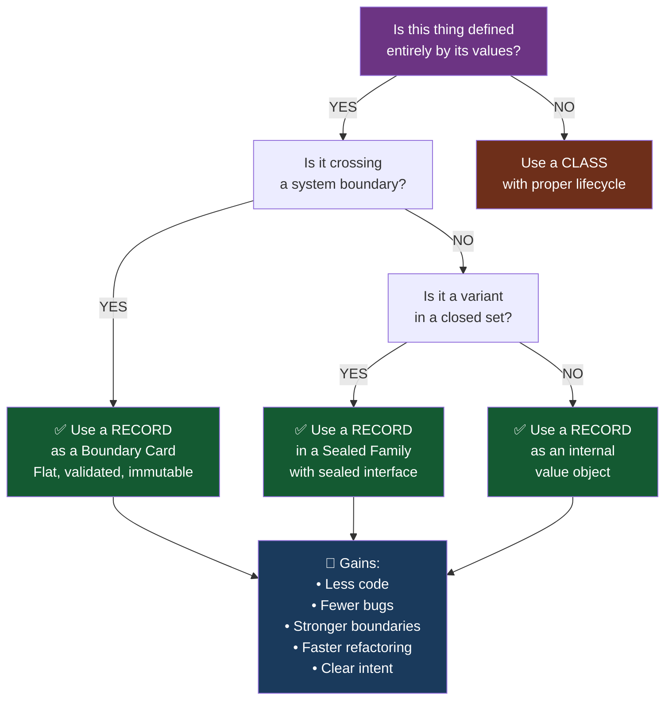

### Quick Reference Card

| Question | Answer |
|---|---|
| **When should I use a record?** | When two instances with identical values are interchangeable |
| **Can a record have methods?** | Yes — non-mutating methods and static factories are fine |
| **Can a record extend a class?** | No — records implicitly extend `java.lang.Record` |
| **Can a record implement an interface?** | Yes — this is how sealed families work |
| **Are records serializable?** | Yes — they work well with Jackson, Gson, and Java serialization |
| **Can I add validation?** | Yes — use the compact canonical constructor |
| **Are records thread-safe?** | Yes — immutability makes them inherently safe to share |
| **When is a record wrong?** | When the thing has identity, lifecycle, or meaningful mutability |

### The Four Takeaways, Distilled

1. **📏 Identity is the test, not length** — ask "are two identical copies the same thing?" before counting lines saved
2. **📐 Flat at the edges, rich in the middle** — boundary records carry data; domain classes carry behavior; convert explicitly
3. **🔨 Sealed families fail at build time** — new variants break every non-exhaustive switch at compile time, not in production
4. **🛡️ Immutability protects validation** — validate once at the boundary; the guarantee holds through every layer

> 💡 **The Compiler is Your Safety Net.** With records and sealed families, correctness is enforced structurally — not by convention, code review, or discipline. Lean into what the type system guarantees.

---

*📚 Tutorial complete! Continue with pattern matching for switch (JEP 441) and the Amber project to complete your data-oriented programming toolkit.*

**Last Updated:** 2026-01-09 · **Difficulty:** Intermediate · **Reading Time:** ~90 minutes
