# Java Records vs Lombok - Complete Tutorial

> Know the difference. Choose the right tool.

- Difficulty: Intermediate
- Reading time: ~65 minutes + lab
- Java 17+ (Records final since 16, JEP 395), Java 21 patterns noted
- Lombok 1.18.34
- Last Updated: 2026-10-03

## Table of Contents (full tutorial covers)

1. Introduction, 2. Prerequisites, 3. Objectives, 4. Boilerplate, 5. Records, 6. Lombok, 7. Differences, 8-9. Deep dives, 10. API example, 11-12. Where each shines, 13. Shallow immutability, 14. Notes, 15. Decision, 16. Cheat sheet, 17. Together, 18. Multi-approach, 19. Best practices, 20. Anti-patterns, 21. Performance, 22. Security, 23. Testing, 24. Troubleshooting, 25. Migration, 26. Exercises, 27. Lab, 28. Test yourself (10), 29. Interview (10), 30. Bank (50+), 31. Summary, 32. Reading, 33. Appendix.

## 1. Introduction / Overview

A Customer with id, name, email took ~35 lines before Java 16. Two fixes: Lombok (2009, annotation processor) and Records (Java 14 preview, Java 16 final JEP 395). Thesis: ask What kind of object am I modeling? Data carrier = Record. Mutable entity = Class (maybe Lombok).

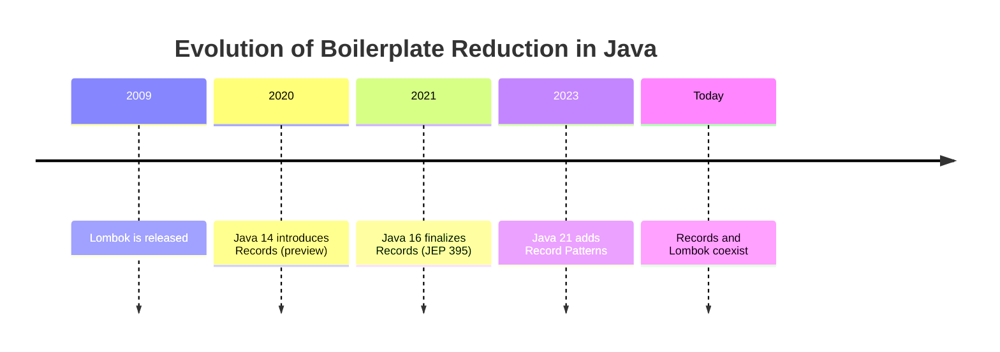

## 2. Prerequisites

Java 17+, Maven/Gradle basics, OOP + equals/hashCode, Jackson/Spring high-level, Lombok IDE plugin, Jackson 2.12+.

## 3. Learning Objectives

Explain boilerplate; write records with validation/factories/interfaces; use Data/Value/Builder/With; model DTOs/events/values/configs/projections; model JPA with Lombok; fix shallow bugs; apply decision framework; combine tools; test/secure/tune; migrate Value to record; avoid anti-patterns; answer interview questions.

## 4. The Boilerplate Problem

```java
import java.util.Objects;
public class Customer {
    private final Long id;
    private final String name;
    private final String email;
    public Customer(Long id, String name, String email) {
        this.id = id; this.name = name; this.email = email;
    }
    public Long getId() { return id; }
    public String getName() { return name; }
    public String getEmail() { return email; }
    @Override public boolean equals(Object o) {
        if (this == o) return true;
        if (o == null || getClass() != o.getClass()) return false;
        Customer that = (Customer) o;
        return Objects.equals(id, that.id)
            && Objects.equals(name, that.name)
            && Objects.equals(email, that.email);
    }
    @Override public int hashCode() { return Objects.hash(id, name, email); }
    @Override public String toString() {
        return "Customer[id=" + id + ", name=" + name + ", email=" + email + "]";
    }
}
```

Preview fixes:

```java
public record Customer(Long id, String name, String email) {}
```

```java
import lombok.Getter;
import lombok.AllArgsConstructor;
@Getter @AllArgsConstructor
public class CustomerLombok {
    private final Long id;
    private final String name;
    private final String email;
}
```

## 5. What Is a Java Record?

A record is a transparent, immutable carrier of data.

```java
public record Customer(Long id, String name, String email) {}
```

Generates: canonical constructor, private final fields, accessors id()/name()/email(), equals, hashCode, toString, final class.

```java
Customer c = new Customer(1L, "Asha", "asha@example.com");
System.out.println(c.id());
System.out.println(c.name());
System.out.println(c);
Customer c2 = new Customer(1L, "Asha", "asha@example.com");
System.out.println(c.equals(c2)); // true
```

Characteristics: auto-provides members; implicitly final; value-based; cannot extend class (extends java.lang.Record); can implement interfaces.

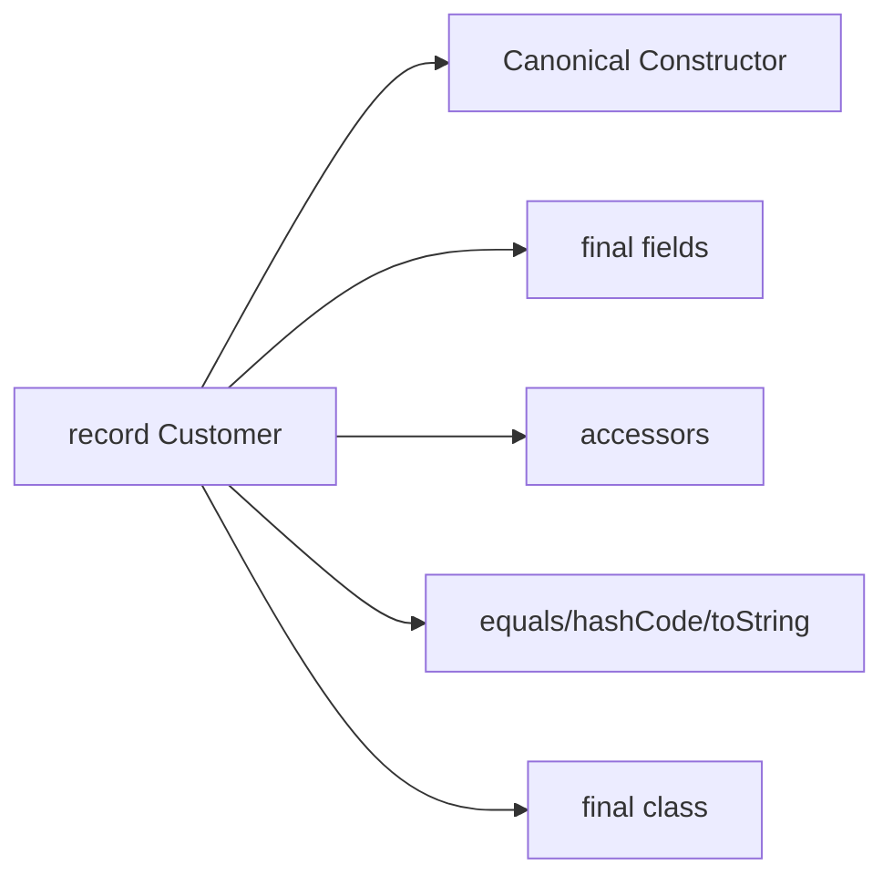

## 6. What Is Lombok?

Library reducing boilerplate via annotations + compile-time AST magic.

```java
import lombok.Getter;
import lombok.Setter;
import lombok.AllArgsConstructor;
import lombok.NoArgsConstructor;
@Getter @Setter @AllArgsConstructor @NoArgsConstructor
public class Customer {
    private Long id;
    private String name;
    private String email;
}
```

Maven:

```xml
<dependency>
  <groupId>org.projectlombok</groupId>
  <artifactId>lombok</artifactId>
  <version>1.18.34</version>
  <scope>provided</scope>
</dependency>
```

Gradle:

```groovy
compileOnly 'org.projectlombok:lombok:1.18.34'
annotationProcessor 'org.projectlombok:lombok:1.18.34'
```

Need Lombok IDE plugin. Check Maven Central for latest.

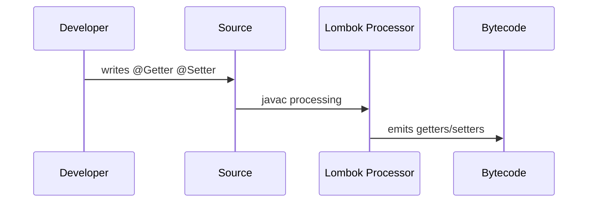

Common annotations: Getter/Setter, NoArgs/AllArgs/RequiredArgsConstructor, ToString, EqualsAndHashCode, Data, Value, Builder, With, Slf4j.

## 7. Key Differences at a Glance

| Feature | Record | Lombok |
|---------|--------|--------|
| Type | Language feature | Library |
| Dependency | None | Yes |
| Designed for | Immutable carriers | Mutable or immutable |
| Accessors | name() | getName() |
| Setters | No | Yes with Setter |
| Inheritance | Cannot extend | Can extend |
| Builder | None built-in | Builder yes |
| Best fit | DTOs Events Values | Entities Builders POJOs |

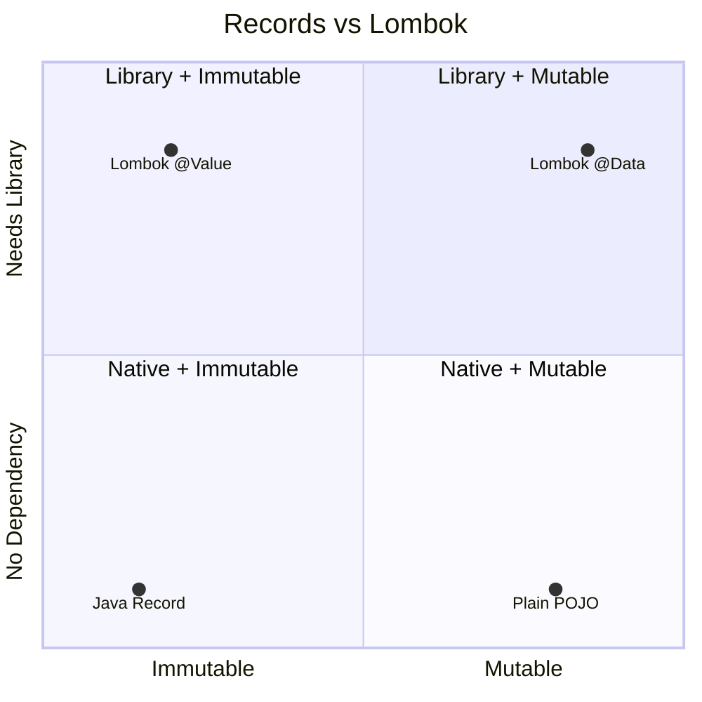

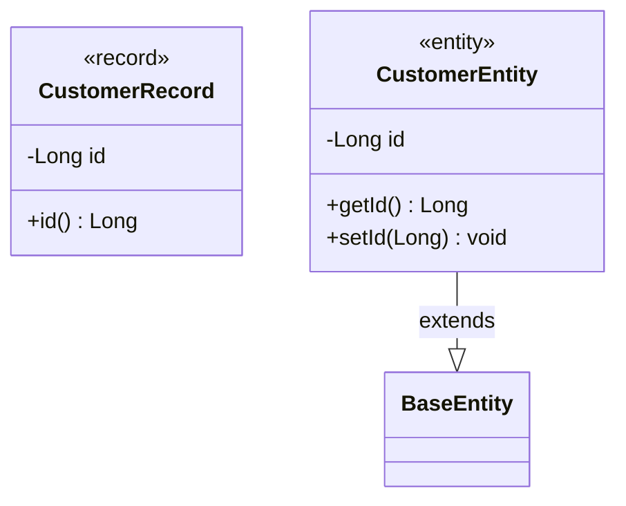

## 8. Deep Dive Records

Compact constructor validation:

```java
public record Person(String name, int age) {
    public Person {
        if (name == null || name.isBlank()) throw new IllegalArgumentException("Name required");
        if (age < 0) throw new IllegalArgumentException("Age negative");
        name = name.trim();
    }
}
```

Factories and methods:

```java
public record Rectangle(double width, double height) {
    public double area() { return width * height; }
    public static Rectangle square(double side) { return new Rectangle(side, side); }
}
```

Interfaces:

```java
public interface Shape { double area(); }
public record Circle(double radius) implements Shape {
    public Circle { if (radius < 0) throw new IllegalArgumentException("radius"); }
    @Override public double area() { return Math.PI * radius * radius; }
}
```

Local records:

```java
import java.util.*;
import java.util.stream.Collectors;
public class ReportService {
    public Map<String, Long> countByCity(List<Customer> customers) {
        record CityCount(String city, long count) {}
        return customers.stream()
            .collect(Collectors.groupingBy(Customer::city, Collectors.counting()))
            .entrySet().stream()
            .map(e -> new CityCount(e.getKey(), e.getValue()))
            .collect(Collectors.toMap(CityCount::city, CityCount::count));
    }
}
```

Java 21 patterns:

```java
public record Point(int x, int y) {}
static String describe(Object obj) {
    return switch (obj) {
        case Point(int x, int y) when x == 0 && y == 0 -> "Origin";
        case Point(int x, int y) when x == y -> "Diagonal";
        case Point(int x, int y) -> "Point " + x + "," + y;
        default -> "Unknown";
    };
}
```

Generics:

```java
public record Pair<A, B>(A first, B second) {}
```

Lifecycle:

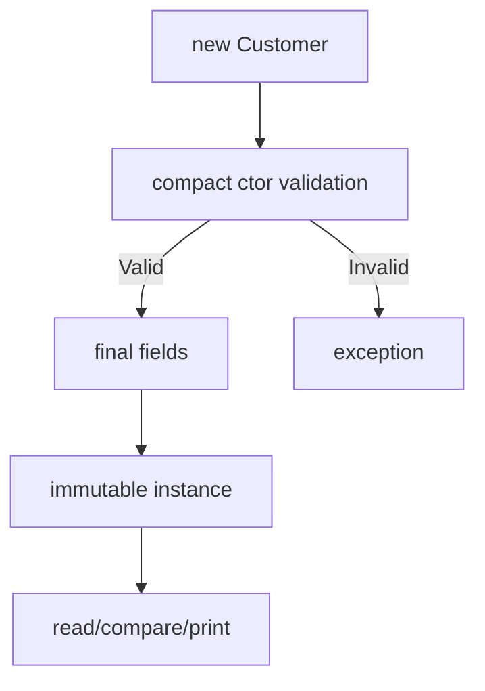

## 9. Deep Dive Lombok

```java
import lombok.Data;
@Data
public class Product {
    private Long id;
    private String name;
    private double price;
}
```

```java
import lombok.Builder;
import lombok.Getter;
import java.util.List;
@Builder @Getter
public class Order {
    private Long id;
    private String customerName;
    private List<String> items;
    private String status;
}
```

```java
import lombok.Value;
import java.math.BigDecimal;
@Value
public class Money {
    String currency;
    BigDecimal amount;
}
```

```java
import lombok.Builder;
import lombok.Getter;
import lombok.With;
@Builder @With @Getter
public class Settings {
    @Builder.Default private String theme = "dark";
    private int fontSize;
}
```

JPA done right (avoid Data):

```java
import jakarta.persistence.*;
import lombok.Getter;
import lombok.NoArgsConstructor;
import lombok.Setter;
@Entity @Table(name = "customers")
@Getter @Setter @NoArgsConstructor
public class CustomerEntity {
    @Id @GeneratedValue(strategy = GenerationType.IDENTITY)
    private Long id;
    private String name;
    private String email;
}
```

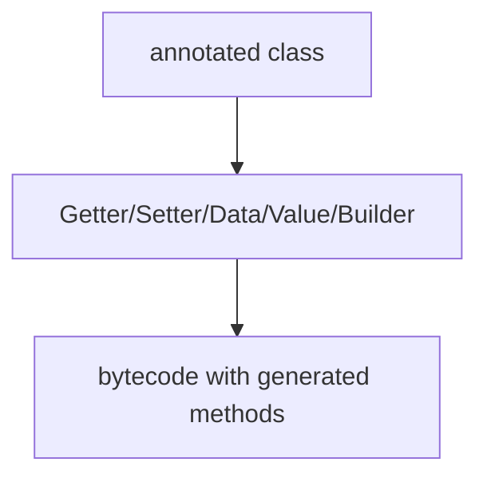

## 10. Real-World API Example

```java
import jakarta.validation.constraints.*;
public record CreateOrderRequest(@NotNull Long productId, @Min(1) int quantity) {}
```

```java
import java.math.BigDecimal;
public record OrderResponse(Long id, String customerName, BigDecimal total, String status) {}
```

Controller + service map record at edge to Lombok entity inside. Accessors are productId() not getProductId().

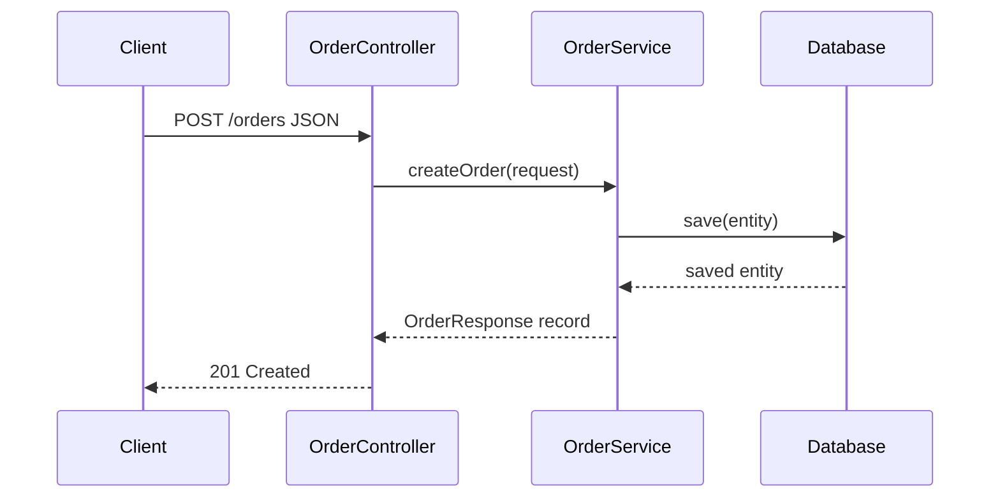

Sample JSON request: productId 42 quantity 2. Response: id 1001 customer Asha total 1998 status NEW.

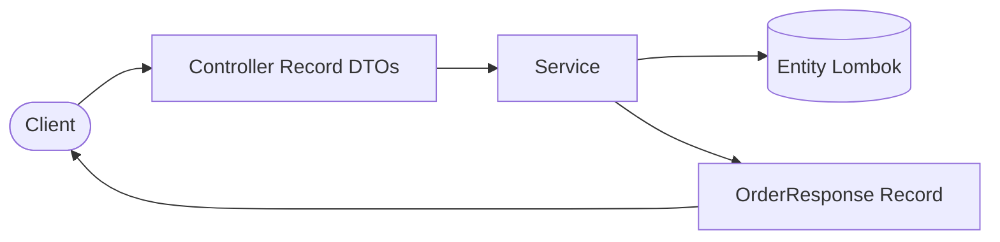

Pattern: records at edges, Lombok entities inside.

## 11. Where Records Shine

DTOs, Kafka events, value objects, immutable config, read-only projections.

```java
import java.math.BigDecimal;
import java.time.Instant;
public record OrderPlacedEvent(String orderId, String customerId, BigDecimal amount, Instant occurredAt) {}
```

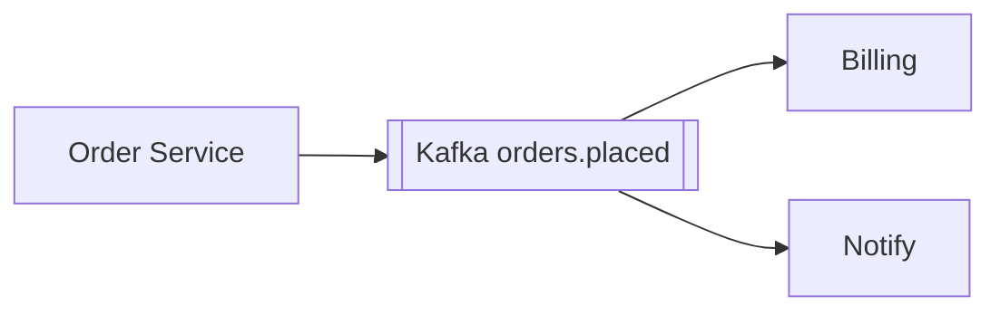

```java
public record Email(String value) {
    public Email {
        if (value == null || !value.matches("^[\\w.+-]+@[\\w-]+\\.[\\w.]+$")) throw new IllegalArgumentException("bad email");
        value = value.toLowerCase();
    }
}
public record Money(BigDecimal amount, String currency) {
    public Money add(Money o) {
        if (!currency.equals(o.currency)) throw new IllegalArgumentException("currency");
        return new Money(amount.add(o.amount), currency);
    }
}
```

```java
import org.springframework.boot.context.properties.ConfigurationProperties;
@ConfigurationProperties(prefix = "app.mail")
public record MailProperties(String host, int port, String username) {}
public record CustomerSummary(Long id, String name) {}
record MinMax(int min, int max) {}
```

## 12. Where Lombok Shines

Entities, mutable domain, setters, builders, legacy.

```java
import lombok.*;
import java.util.*;
@Getter @Setter @ToString
public class ShoppingCart {
    private Long id;
    private List<String> items = new ArrayList<>();
    private double total;
    public void addItem(String i, double p) { items.add(i); total += p; }
}
```

Inheritance works with Lombok (records cannot extend):

```java
import jakarta.persistence.*;
import lombok.Getter;
import lombok.Setter;
@Getter @Setter @MappedSuperclass
public abstract class BaseEntity {
    @Id @GeneratedValue private Long id;
}
@Getter @Setter @Entity
public class Invoice extends BaseEntity {
    private java.math.BigDecimal amount;
}
```

## 13. Shallow Immutability

Trap:

```java
import java.util.*;
public record Order(List<String> items) {}
Order o = new Order(new ArrayList<>());
o.items().add("Laptop"); // allowed! ref final, list mutable
```

Fix:

```java
public record Order(List<String> items) {
    public Order { items = List.copyOf(items); }
}
```

Other types:

```java
import java.util.*;
public record Schedule(Date start, Map<String, String> tags, int[] numbers) {
    public Schedule {
        start = new Date(start.getTime());
        tags = Map.copyOf(tags);
        numbers = numbers.clone();
    }
    public Date start() { return new Date(start.getTime()); }
    public int[] numbers() { return numbers.clone(); }
}
```

Arrays: equals compares refs, use List.

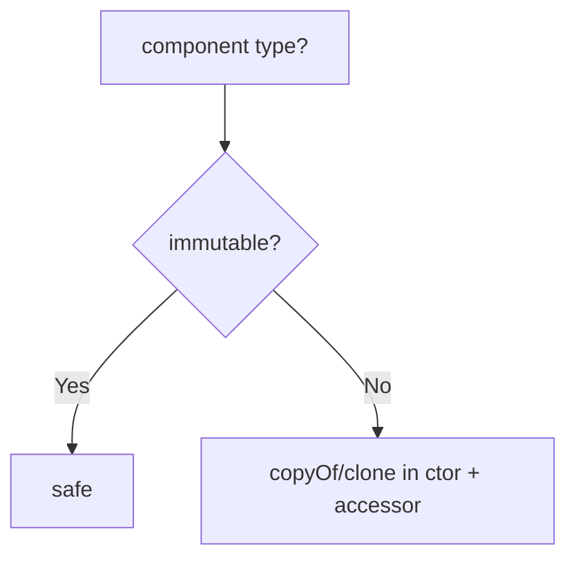

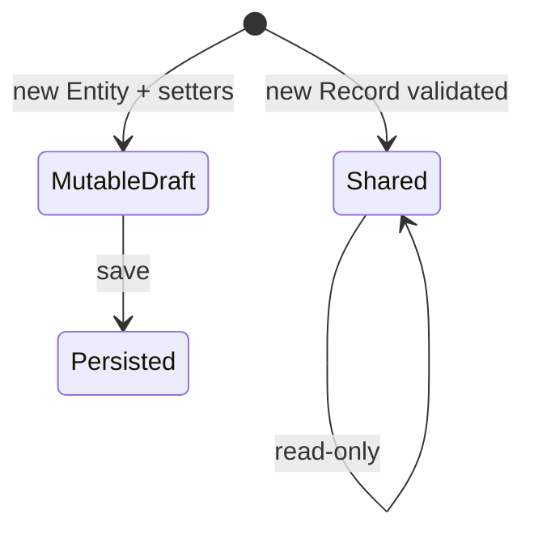

## 14. Notes and 15. Decision and 16. Cheat Sheet

Notes: components final but contents mutable; accessors name() not getName(); final no extends; Jackson 2.12+ Boot 2.5+ ok; JPA entities cannot be records; Hibernate 6 embeddable/projection ok.

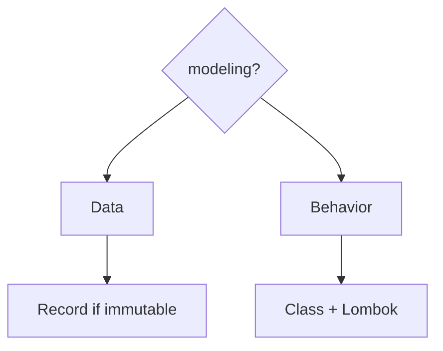

Cheat: CreateUserRequest record; UserEntity Lombok; PaymentCompletedEvent record; 15-field config Builder; Coordinates record; ShoppingCart Lombok; local tuple local record; extends Lombok.

## 17. Together and 18. Approaches

```java
public record UserResponse(Long id, String name, String email) {
    public static UserResponse from(UserEntity e) {
        return new UserResponse(e.getId(), e.getName(), e.getEmail());
    }
}
```

```java
import lombok.Builder;
import java.math.BigDecimal;
@Builder
public record ProductDto(Long id, String name, String description, BigDecimal price, boolean active) {}
```

```java
import lombok.With;
@With
public record Account(String id, String owner, java.math.BigDecimal balance) {}
```

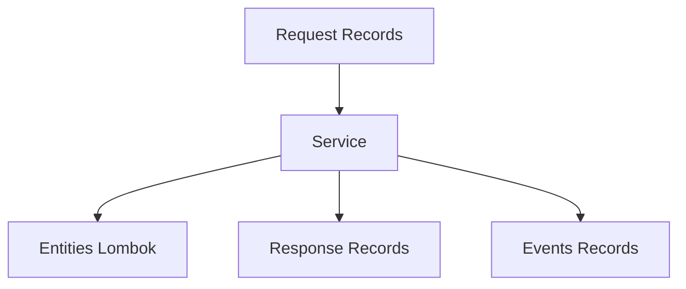

Approaches: Record 3 lines immutable none; Data mutable Lombok; Value+Builder immutable+builder; Plain explicit verbose. Pick record default for DTOs, Builder for many optionals, class for mutable/inheritance.

## 19. Best Practices

Intent first; validate in compact ctor; normalize; defensive-copy mutables in+out; List over arrays; small flat records; static factories from/square; records at boundaries; entities Getter/Setter/NoArgs not Data; keep Lombok updated; no secrets in toString; test Jackson round-trip.

## 20. Anti-Patterns

Entity as record; Data on entity; mutable list no copy; int array; Builder on tiny class; getX on record; mutating record; leaking password toString. Correct: class entity, copyOf, List, ctor, x(), new instance/With, redacted toString.

```java
// INCORRECT entity record
// @Entity public record UserEntity(@Id Long id, String name) {}
// CORRECT
import jakarta.persistence.*;
import lombok.*;
@Entity @Getter @Setter @NoArgsConstructor
public class UserEntityOK {
    @Id @GeneratedValue private Long id;
    private String name;
}
```

## 21. Performance

Compile-time Lombok zero runtime overhead. Records no builder objects unless added. equals compares all components keep small. copyOf O(n) for huge lists use unmodifiable view or ownership docs. toString all fields avoid logging large payloads. Record patterns avoid casts JIT-friendly.

## 22. Security

Validate in compact ctor fail fast. Normalize trim/lowercase. Redact secrets:

```java
public record LoginRequest(String username, String password) {
    public LoginRequest {
        if (username == null || username.isBlank()) throw new IllegalArgumentException("user");
        if (password == null || password.length() < 8) throw new IllegalArgumentException("weak");
    }
    @Override public String toString() { return "LoginRequest[username=" + username + ", password=****]"; }
}
```

Use Valid + NotNull/Min on records. Strict unknown-props for APIs. Copy before publishing events to Kafka/audit. Prefer Getter + mutators over Data setters.

## 23. Testing

```java
import static org.junit.jupiter.api.Assertions.*;
import org.junit.jupiter.api.Test;
record Customer(Long id, String name) {}
class T {
    @Test void eq() {
        assertEquals(new Customer(1L, "A"), new Customer(1L, "A"));
    }
    @Test void copy() {
        record Team(String n, java.util.List<String> m) {
            public Team { m = java.util.List.copyOf(m); }
        }
        java.util.List<String> s = new java.util.ArrayList<>(java.util.List.of("A"));
        Team t = new Team("T", s);
        s.add("B");
        assertEquals(1, t.m().size());
    }
}
```

Jackson round-trip needs databind 2.12+. Test builder/with copies unchanged original.

## 24. Troubleshooting

getX->x(); no setter->new/With; entity record boot fail->class; Data lazy/recursion->Getter/Setter; mutable leak->copyOf; array equals->List; Builder tiny->ctor; Lombok JDK fail->upgrade; Jackson record fail->2.12 + parameters; IDE red->plugin + annotation processing + rebuild.

## 25. Migration Value to Record

Before Value getX, after record x. Steps: confirm immutable no JPA/inheritance; replace; update call sites; verify Jackson; add copies; remove import; test.

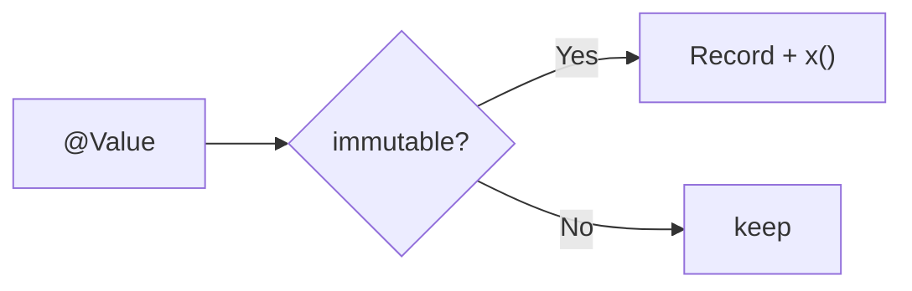

## 26. Exercises (5 with solutions)

1. Convert Product name/price to record price>=0. Solution: record Product(String name,double price) with compact check.
2. Fix Team members mutable. Solution: members=List.copyOf(members).
3. Choose: LoginRequest record; CustomerEntity Lombok; TemperatureReading record; Game mutable class; 20-field filter Builder.
4. Spot: Entity record UserEntity fails (final/no-arg/proxy). Use class Getter/Setter/NoArgs.
5. Builder on ProductDto + With on Account prove original unchanged. Note Builder nulls need requireNonNull validation.

## 27. Lab

Build CreateOrderRequest record + OrderEntity Lombok + OrderResponse record + OrderPlacedEvent record. Map record->entity->record. Log event JSON. Tests: quantity 0 fails; copy; JSON round-trip. Checklist: x() not getX; validate+copy; entity no-arg no Data; Valid RequestBody; JSON test; explain entity not record. Pro tips: local records, Money/Email values, redact toString.

## 28. Test Your Understanding (10)

Generates? final why? getName fix? compact vs canonical? Value vs record? Data risks x2? fix Order list? arrays? versions + JPA? edge-inside split? Answers: ctor/fields/accessors/equals; value semantics extends Record; compile err use name(); compact auto-assign validation; inheritance/JDK/ecosystem; lazy recursion identity; shallow copyOf; ref equals use List; Jackson2.12 Boot2.5 JPA no; boundary records inside entities.

## 29. Interview (10)

Record vs Value; why not JPA entity; shallow vs deep; Builder when; Lombok how AST; Data why bad; interfaces yes extends no; Jackson how; compact use; patterns Java21 destructuring.

## 30. Bank 50+

Beginner 1-18: problem, 3-field record, generated, accessors, shallow, setters no, extends no implements yes, Getter, NoArgs, Data bundle, Value, Builder, components, canonical/compact, 16 JEP395, deps, read, toString.
Intermediate 19-38: age validate, email normalize, List copy, Date/array both dirs, array List, Money add, Email regex, local use, Pair, Builder.Default, With, Builder on record, from(), Valid, Kafka immutable, config, projection, migrate, getX fix, IDE.
Advanced 39-55: edge-inside diagram, Data identity Set/Map, toString recursion, lazy equals, Jackson unknown+validation, redact, copyOf cost, builder hot loop, guards describe, sealed+records, embeddable, binding, ownership huge, codemod, upgrade playbook, contract-test Kafka, keep Lombok 3 reasons.

## 31. Summary

Records native immutable DTOs/events/values; Lombok flexible entities/builders/legacy; weakness no setters/builder/inherits vs dep/magic; mindset model data vs reduce boilerplate. Golden: data carrier Record, mutable entity Class. Design with intent code with clarity.

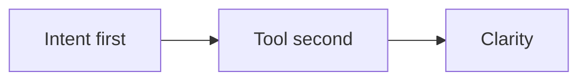

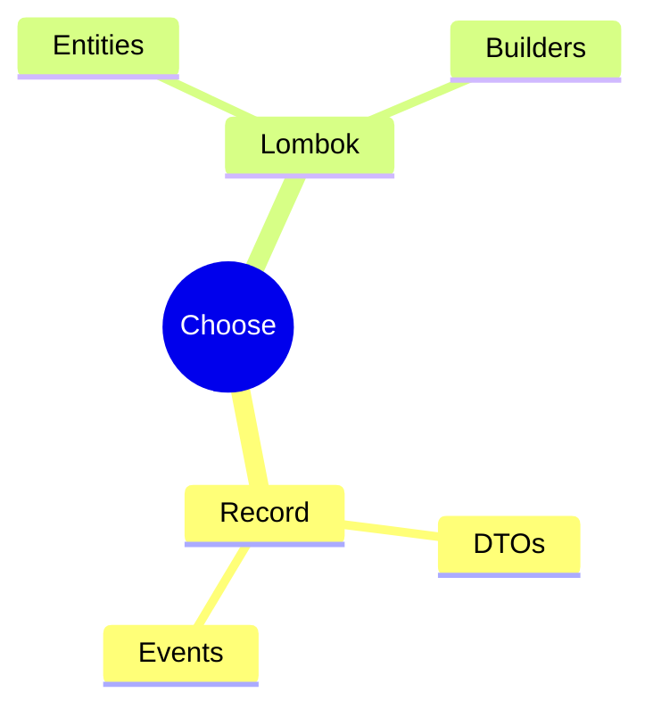

## 32. Reading

JEP395; JEP440/441 patterns; Lombok Data/Value/Builder/With; Jackson2.12; Boot2.5; Hibernate6; Validation Valid; related Java Records tutorial in Programming and Coding folder.

## 33. Appendix Matrix

Jackson yes/yes; MVC yes/yes; Config yes/yes; Entity no/yes; Embeddable yes/yes; projections yes/yes; inheritance no/yes; builder manual-or-Builder/yes.


