<!-- Jev+Java Tutorial | Intermediate | 100-130 min | Updated 2026-10-05 -->
# Jev + Java: Turning Fuzzy AI Judgement into Typed Application Logic — Complete Tutorial

> **_"Let a model sense meaning. Let Java decide what to do. Semantic Signal → Java Policy → Safe Action."_**

## Time and Scope

**Difficulty:** Intermediate (Advanced in Sections 16-18)  
**Reading Time:** 100-130 minutes  
**Applies to:** Java 17+ (21 ideal), Spring Boot 3.2+, Jev `jev-latest` (pin `jev-1.13.0` in prod)  
**Prerequisites:** Java records, Spring basics, HTTP/JSON, Maven/Gradle

## Table of Contents

1. [Introduction](#1-introduction--overview) 2. [Prerequisites](#2-prerequisites) 3. [Learning Objectives](#3-learning-objectives) 4. [Fuzzy Input Problem](#4-the-problem-fuzzy-input-strict-systems) 5. [What Is Jev?](#5-what-is-jev) 6. [Noul, Choice, Score](#6-the-three-primitives-noul-choice-score) 7. [Sensor vs Decider](#7-architecture-sensor-vs-decision-maker) 8. [HTTP Contract](#8-the-http-contract-post-v1systemone) 9. [Java Domain](#9-modeling-the-domain-in-java) 10. [Policy Gate](#10-the-deterministic-policy-gate) 11. [Spring Boot](#11-spring-boot-integration) 12. [Worked Example](#12-worked-example-end-to-end-support-ticket-routing) 13. [More Examples](#13-more-examples-and-use-cases) 14. [Approaches Compared](#14-multiple-implementation-approaches-compared) 15. [Real-World Cases](#15-real-world-use-cases-and-case-studies) 16. [Performance](#16-performance-considerations) 17. [Security](#17-security-considerations) 18. [Testing](#18-testing-strategies) 19. [Migration](#19-migration-guide) 20. [Best Practices](#20-best-practices-checklist) 21. [Anti-Patterns](#21-anti-patterns) 22. [Troubleshooting](#22-common-pitfalls--troubleshooting) 23. [Hands-On Lab](#23-hands-on-lab-build-a-ticket-triage-service) 24. [Exercises](#24-practice-exercises-with-solutions) 25. [Pro Tips](#25-pro-tips) 26. [Test Understanding](#26-test-your-understanding) 27. [Question Bank](#27-question-bank-55-questions) 28. [Interview Qs](#28-common-interview-questions) 29. [Self-Assessment](#29-self-assessment-checklist) 30. [Summary](#30-summary-and-key-takeaways) 31. [Further Reading](#31-further-reading-and-learning-path)

<a name="1-introduction--overview"></a>
## 1. Introduction / Overview

Real input is fuzzy. Java systems are strict. This tutorial shows the clean split: **Jev senses meaning → returns typed probabilities → Java decides deterministically**.

- ✅ Auditability: every action traces to a rule you wrote.
- ✅ Safety: model cannot trigger side effects directly.
- ✅ Tunability: change threshold in config, no retraining.
- ✅ Testability: policy is plain Java, test with fake signals.

**What you build:** `SupportTicket`, `RoutingDecision`, sealed `Decision` (`AutoRoute`/`ReviewRequired`), `JevClient`, `TriageService`, `TicketHandler`, resilience + tests.

> Skim tip: know brittle matching pain? Jump to Sec 6. Want Spring code? Jump to Sec 11. Need buy-in? See Sec 15.

**Quick Recap:** Jev=probabilistic sensor; Java=deterministic decider; primitives=Noul/Choice/Score.

## 2. Prerequisites

| Req | Details | Check |
|---|---|---|
| Java | JDK 17+ (21 ideal), records + sealed | `java --version` |
| Spring | Boot 3.2+ for RestClient | starter-web dep |
| Key | `JEV_API_KEY` env var, base `https://api.typesafe.ai` | `echo $JEV_API_KEY` |
| Build | Maven 3.9+ / Gradle 8+ | `mvn -v` |
| Test | WireMock / MockRestServiceServer, JUnit 5 | - |

```bash
java --version
curl --version
```

> 💡 Sec 4-10 work with plain Java + curl. Spring needed from Sec 11.

## 3. Learning Objectives

1. Explain sensor-vs-decider + why auditable/safe/tunable/testable.
2. Pick Noul vs Choice vs Score and phrase questions well.
3. Call POST /v1/systemone and parse per-ID answers.
4. Model with records + sealed interface + exhaustive switch.
5. Build configurable policy gate (confidence + severity).
6. Integrate Spring RestClient + JevClient + validation + handler.
7. Add timeouts/retries/breaker + pick fail-open vs fail-closed.
8. Test policy, contract-test client, run golden dataset.

---

<a name="4-the-problem-fuzzy-input-strict-systems"></a>
## 4. The Problem: Fuzzy Input, Strict Systems

Ticket: *"Stripe connection failing — help ASAP"* — human reads urgency, domain ambiguity (billing vs technical), mild frustration instantly.

**Brittle approach:**

```java
// ❌ brittle: misses intent, false hits, no nuance
if (message.contains("urgent")) {
    routeToPriority();
}
```

| Message | contains urgent | Reality |
|---|---|---|
| Stripe failing — help ASAP | miss | Urgent |
| This is NOT urgent, just curious | false hit | Not urgent |
| urgente por favor | miss | Urgent |
| Payments down for an hour!!! | miss | Very urgent |

Problems: variation, negation, multilingual, intensity, context.

**New approach:**

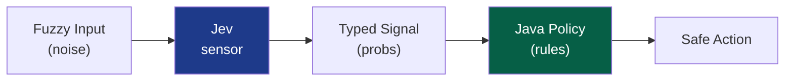

> ✅ Correct: ask Jev Noul is_urgent + Choice department + Score severity, then gate in Java.

**Quick Recap:** String matching cannot do intent; semantic sensor + deterministic gate can.

---

<a name="5-what-is-jev"></a>
## 5. What Is Jev?

**Jev is a bounded semantic decision service** — small fast model over HTTP. NOT chat/generator/agent. IS learned decision function returning typed probabilistic answers.

| Concern | Free-form LLM | Jev |
|---|---|---|
| Shape | free text to parse | typed by question ID |
| Space | unbounded | closed set / fixed scale |
| Certainty | implied prose | explicit probs + confidence |
| Latency | higher | lower (classification-style) |
| Best for | writing/reasoning | routing/scoring/gating |

> 💡 Rule: if AI output feeds an `if`, you want decision API not generation API.

**Quick Recap:** Jev is sensor not decider.

---

<a name="6-the-three-primitives-noul-choice-score"></a>
## 6. The Three Primitives: Noul, Choice, Score

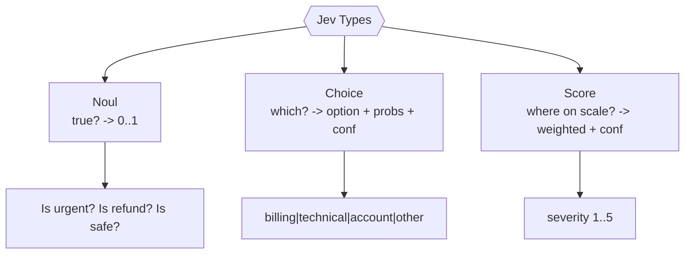

**6.1 Noul (yes/no prob):** `"Stripe failing ASAP"` + `Is urgent?` -> `0.94`. Pricing tiers -> `0.03`. Delete account + `privacy/legal?` -> `0.91`.

**6.2 Choice (closed set):** options billing|technical|account|sales|other. Input Stripe ASAP -> billing 0.94, technical 0.04, conf high.

**6.3 Score (ordered scale):** 1 trivial..5 outage. Stripe ASAP -> ~2.1 weighted (not just int), with distribution + confidence.

> 🔎 Answer + certainty separate: `if (conf>=0.80) auto else confirm`.

```java
// ✅ use confidence independently
if (answer.confidence() >= 0.80) {
    routeTicket(answer.choice()); // auto
} else {
    askForConfirmation(answer.choice()); // human loop
}
```

**Quick Recap:** Noul=prob yes; Choice=bucket+conf; Score=spectrum weighted.

---

<a name="7-architecture-sensor-vs-decision-maker"></a>
## 7. Architecture: Sensor vs Decision-Maker

| Layer | Job | Nature |
|---|---|---|
| Jev | interpret meaning | probabilistic |
| Java policy | thresholds, side effects, retries, security, fallbacks | deterministic |

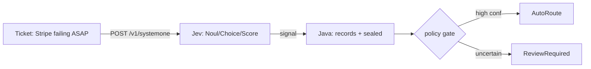

**Why separation:** auditability (rule not whim), safety (no direct side effects), tunability (config), testability (fake signals).

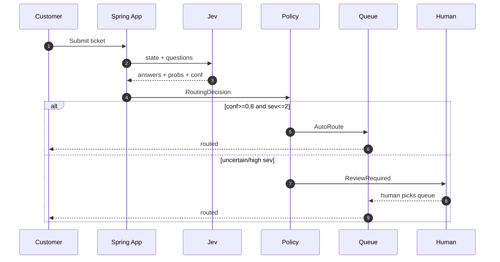

**Quick Recap:** Model at edge (fuzzy), Java in core (strict).

---

<a name="8-the-http-contract-post-v1systemone"></a>
## 8. The HTTP Contract: POST /v1/systemone

- Base: `https://api.typesafe.ai` + `/v1/systemone`. Model `jev-latest` default; pin `jev-1.13.0` in prod for reproducibility.
- `questions` is map ID -> typed object (not simple list; check docs for exact fields).

```json
{
  "model": "jev-latest",
  "state": "Subject: Stripe connection failing — help ASAP",
  "questions": {
    "is_urgent": { "type": "noul" },
    "department": { "type": "choice" },
    "severity": { "type": "score" }
  }
}
```

```json
{
  "answers": {
    "is_urgent": { "type": "noul", "noul": 0.95 },
    "department": { "type": "choice", "choice": "billing" },
    "severity": { "type": "score", "score": 1.27 }
  }
}
```

```bash
curl -X POST https://api.typesafe.ai/v1/systemone \
  -H "Content-Type: application/json" \
  -H "Authorization: Bearer $JEV_API_KEY" \
  -d @request.json
```

> 🔐 Key in env/secrets, never source. ⚠️ Confirm exact question/response fields vs official docs.

**Quick Recap:** One answer per ID; validate keys/types/ranges at boundary.

---

<a name="9-modeling-the-domain-in-java"></a>
## 9. Modeling the Domain in Java

```java
// messy input
public record SupportTicket(String id, String message,
    String customerId, Instant createdAt) {}

// typed signal
public record RoutingDecision(String intent, double confidence,
    int severity, Decision outcome) {}

// closed outcomes
public sealed interface Decision permits AutoRoute, ReviewRequired {}
public record AutoRoute(String queue, String reason) implements Decision {}
public record ReviewRequired(String reason) implements Decision {}
```

Sealed = compiler-checked exhaustiveness, no default needed:

```java
String describe(Decision d) {
    return switch (d) {
        case AutoRoute a -> "Routed to " + a.queue() + " because " + a.reason();
        case ReviewRequired r -> "Needs human: " + r.reason();
    };
}
```

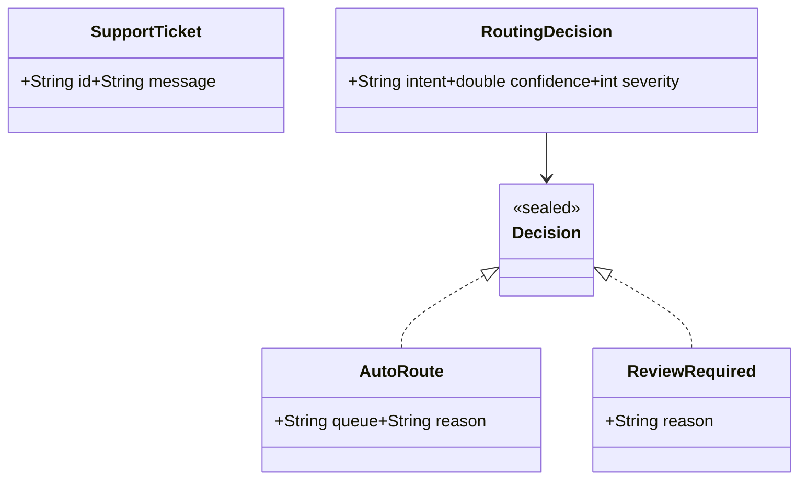

**Quick Recap:** records=data, sealed=closed outcomes.

---

<a name="10-the-deterministic-policy-gate"></a>
## 10. The Deterministic Policy Gate

```java
// heart of pattern: ordinary Java consumes signal
public Decision decide(String queue, double confidence, int severity) {
    if (confidence >= 0.8 && severity <= 2) {
        return new AutoRoute(queue, "High confidence, manageable severity");
    }
    return new ReviewRequired("Low confidence or elevated severity");
}
```

| Branch | Condition | Action |
|---|---|---|
| Auto | conf>=0.8 and sev<=2 | create->route->log/notify |
| Review | else | create->notify team->track/resolve |

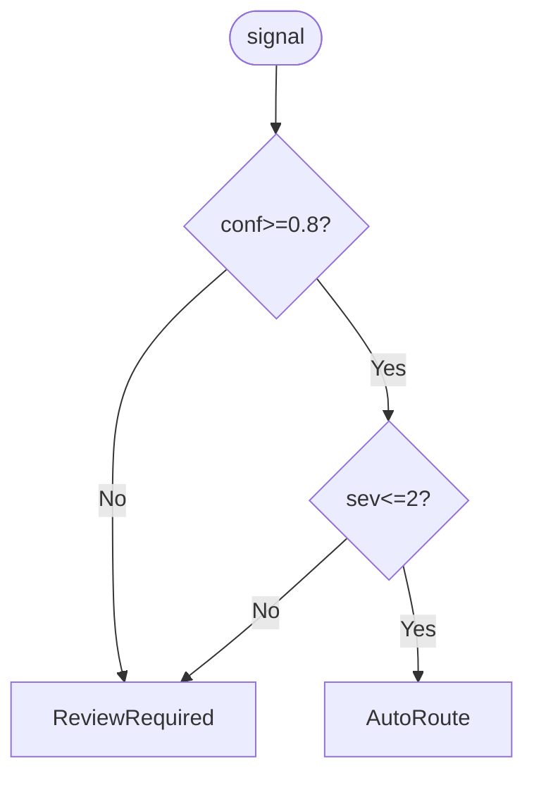

Configurable thresholds (never hardcode):

```java
@ConfigurationProperties(prefix = "triage")
public record TriageProperties(double minConfidence, int maxAutoSeverity) {}
```

```yaml
triage:
  min-confidence: 0.80
  max-auto-severity: 2
```

**Quick Recap:** Policy in Java + config = tunable without retraining.

---

<a name="11-spring-boot-integration"></a>
## 11. Spring Boot Integration

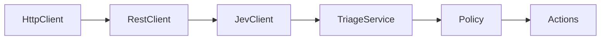

**11.1 RestClient bean:**

```java
@Configuration
public class JevConfig {
    @Bean
    RestClient jevRestClient(
        @Value("${jev.base-url:https://api.typesafe.ai}") String baseUrl,
        @Value("${jev.api-key}") String apiKey) {
        return RestClient.builder().baseUrl(baseUrl)
            .defaultHeader(HttpHeaders.AUTHORIZATION, "Bearer " + apiKey)
            .defaultHeader(HttpHeaders.CONTENT_TYPE,
                MediaType.APPLICATION_JSON_VALUE).build();
    }
}
```

```yaml
jev:
  base-url: https://api.typesafe.ai
  api-key: ${JEV_API_KEY}
  model: jev-latest # pin jev-1.13.0 in prod
```

**11.2 JevClient abstraction:**

```java
@Component
public class JevClient {
    private final RestClient http;
    private final String model;
    public JevClient(RestClient r, @Value("${jev.model}") String m) {
        this.http = r; this.model = m;
    }
    public JsonNode evaluate(String state, Map<String, Object> qs) {
        return http.post().uri("/v1/systemone")
            .body(Map.of("model", model, "state", state, "questions", qs))
            .retrieve().body(JsonNode.class);
    }
}
```

**11.3 Typed signal at edge:**

```java
public record TicketSignal(boolean urgent, String department,
    double departmentProb, double severity) {}
```

> ✅ Validate: every ID present, type matches, probs 0..1. Reject malformed early.

**Quick Recap:** model at edge, typed logic in core.

---

<a name="12-worked-example-end-to-end-support-ticket-routing"></a>
## 12. Worked Example End-to-End: Support Ticket Routing

**Step 1 — questions:**

```java
Map<String, Object> questions = Map.of(
    "is_urgent", Map.of("type", "noul"),
    "department", Map.of("type", "choice"),
    "severity", Map.of("type", "score"));
```

**Step 2 — call + decide:**

```java
@Service
public class TriageService {
    private final JevClient jev;
    private final TriageProperties props;
    public TriageService(JevClient j, TriageProperties p) {
        this.jev = j; this.props = p;
    }
    public Decision triage(SupportTicket t) {
        JsonNode res = jev.evaluate(t.message(), buildQuestions());
        String dept = res.at("/answers/department/choice").asText();
        double conf = res.at("/answers/department/confidence").asDouble();
        double sev = res.at("/answers/severity/score").asDouble();
        return decide(dept, conf, (int) Math.round(sev));
    }
    Decision decide(String q, double c, int s) {
        if (c >= props.minConfidence() && s <= props.maxAutoSeverity())
            return new AutoRoute(q, "High confidence, manageable severity");
        return new ReviewRequired("Confidence=%.2f severity=%d".formatted(c, s));
    }
}
```

**Step 3 — act:**

```java
@Component
public class TicketHandler {
    public void handle(SupportTicket t, Decision d) {
        switch (d) {
            case AutoRoute a -> {
                queues.enqueue(a.queue(), t);
                audit.log(t.id(), "AUTO_ROUTED", a.reason());
                notifier.notifyQueue(a.queue(), t);
            }
            case ReviewRequired r -> {
                tickets.createUnassigned(t);
                notifier.notifyTriageTeam(t, r.reason());
                audit.log(t.id(), "REVIEW_REQUIRED", r.reason());
            }
        }
    }
}
```

**Step 4 — trace:**

| Ticket | Signal | Result |
|---|---|---|
| Stripe failing ASAP | billing 0.94, sev 2.1->2 | AutoRoute billing |
| Checkout down losing sales | technical 0.91, sev 4.6->5 | Review (sev high) |
| things feel weird | other 0.41, sev 1.4->1 | Review (low conf) |

> 📝 Confirm JSON pointer paths vs docs. Row 2 shows confident signal still escalated — business policy wins.

**Quick Recap:** extract->type->decide->act->audit.

---

<a name="13-more-examples-and-use-cases"></a>
## 13. More Examples and Use Cases

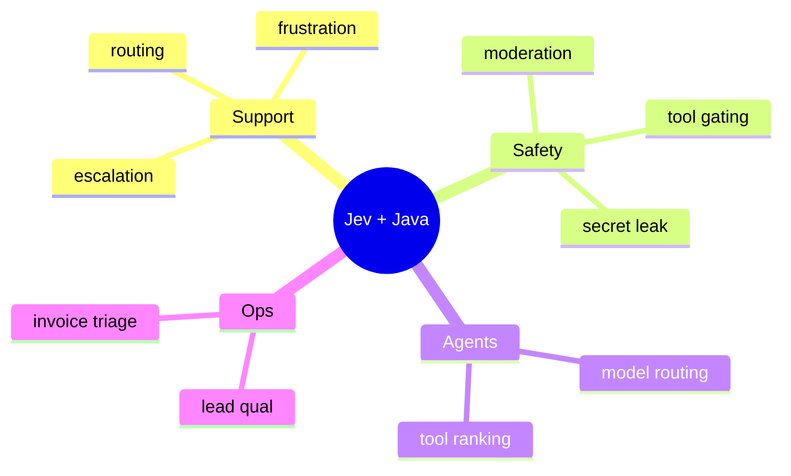

**A. Lead qual:** Choice segment + Noul intent + Score budget. `if intent>=0.85 && enterprise -> senior rep`.

**B. Tool-call guardrail:**

```java
double pSafe = res.at("/answers/call_safe/noul").asDouble();
if (pSafe < SAFETY_THRESHOLD)
    throw new ToolCallDeniedException("Blocked P(safe)=" + pSafe);
```

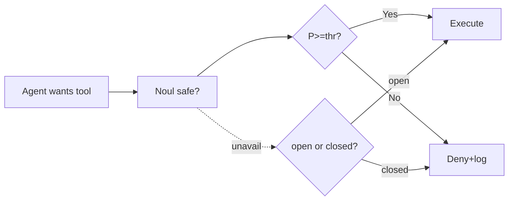

**C. Model routing:** Choice fast|powerful per request, reuse whole run.

**D-F:** feedback bug 0.88 + frustration 2.4; email invoice>=0.9->AP, legal threat>=0.7->legal; PII Score <=2 auto, 3 review, >=4 block.

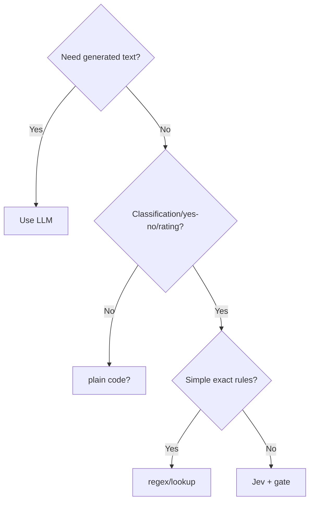

**Quick Recap:** Same 3 primitives + gate everywhere.

---

<a name="14-multiple-implementation-approaches-compared"></a>
## 14. Multiple Implementation Approaches Compared

| Approach | Pros | Cons | Use when |
|---|---|---|---|
| RestClient (Boot 3.2+) | fluent, typed, Spring-native | Boot 3.2+ only | default |
| WebClient reactive | non-blocking, streaming | harder to debug | reactive stack |
| HttpClient JDK | zero dep, full control | verbose, manual JSON | library/minimal |
| Feign/OpenFeign | declarative | extra dep, magic | many endpoints |

```java
// ❌ incorrect: JsonNode leaks everywhere
public JsonNode triageRaw(SupportTicket t) {
    return jev.evaluate(t.message(), qs); // caller parses!
}
// ✅ correct: typed at edge
public Decision triage(SupportTicket t) {
    TicketSignal s = parser.parse(jev.evaluate(t.message(), qs));
    return policy.decide(s);
}
```

**Quick Recap:** RestClient default; always convert to records at boundary.

<a name="15-real-world-use-cases-and-case-studies"></a>
## 15. Real-World Use Cases and Case Studies

- Support: 60-70% auto-route, review catches outages + ambiguous.
- Security: secret-leak Noul>=0.7 blocks push; moderation Choice routes.
- Sales: enterprise+intent>=0.85 -> senior rep, else nurture/archive.
- Product: bug+frustration>=3 -> on-call board, else digest.
- Compliance: PII Score triage 2/3/4.

**Quick Recap:** High-volume fuzzy triage + human for tail = ROI.

---

<a name="16-performance-considerations"></a>
## 16. Performance Considerations

- Batch related questions in ONE request (1 network roundtrip, shared context).
- Timeouts: connect 2s, read 5s. Bulkhead so spike cannot flood Jev.
- Cache routing for idempotent re-tries (key: hash(state+model+questions)).
- Metrics: latency, error rate, decision distribution (auto vs review).

```java
// ✅ performance-optimized: single call, reused signal
JsonNode res = jev.evaluate(msg, Map.of("a", q1, "b", q2, "c", q3));
// ❌ slow: three sequential calls
```

**Quick Recap:** batch + timeout + bulkhead + metrics.

<a name="17-security-considerations"></a>
## 17. Security Considerations

- Key in env/secrets manager, rotate, never log. Least-privilege.
- Redact PII before sending (emails, tokens, cards). Check data-residency.
- Fail-closed for dangerous actions (deny tool if Jev down). Fail-open only for niceties.
- Log signal+threshold+outcome for audit; immutable trail.
- Pin model version in prod (`jev-1.13.0`) for reproducibility.

**Quick Recap:** redact, fail-closed for safety, audit everything.

---

<a name="18-testing-strategies"></a>
## 18. Testing Strategies

**Unit-test policy (no network):**

```java
@ParameterizedTest
@CsvSource({"0.95,1,AutoRoute","0.95,2,AutoRoute","0.95,4,ReviewRequired",
  "0.50,1,ReviewRequired","0.80,2,AutoRoute"})
void policyGate(double c, int s, String exp) {
    assertEquals(exp, service.decide("billing", c, s).getClass().getSimpleName());
}
```

**Contract-test with WireMock:** canned + malformed responses; assert reject nulls/wrong types.

**Golden dataset (50-200 labeled):** track accuracy, auto-rate, auto-error, review-rate.

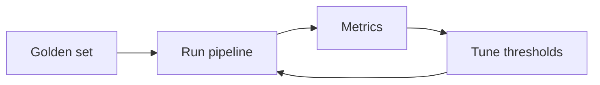

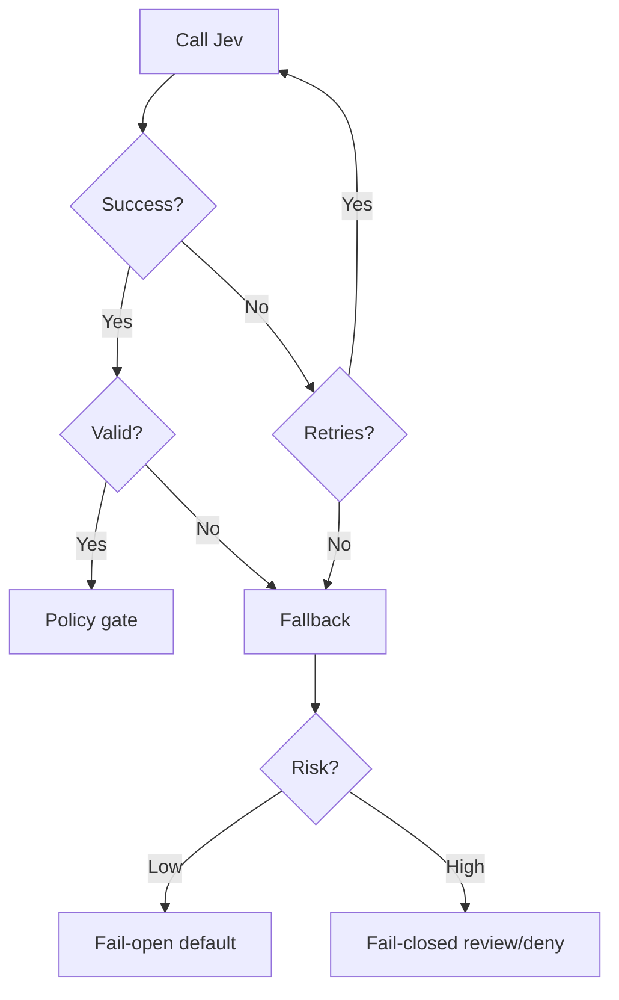

| Scenario | Strategy | Why |
|---|---|---|
| Ticket routing | fail-closed Review | human routes, nothing lost |
| Tool ranking | fail-open keep list | nicety |
| Danger gate | fail-closed deny | safety first |
| Analytics tag | fail-open skip | do not block flow |

```java
@CircuitBreaker(name="jev", fallbackMethod="fallback")
@Retry(name="jev")
public Decision triage(SupportTicket t) { /* ... */ }
Decision fallback(SupportTicket t, Throwable ex) {
    return new ReviewRequired("Jev unavailable: " + ex.getClass().getSimpleName());
}
```

**Quick Recap:** deterministic policy = fast tests; mock edge; tune via goldens.

---

<a name="19-migration-guide"></a>
## 19. Migration Guide

**From regex/if-else:** 1) log current routing + errors. 2) add Jev sidecar (shadow mode, no action). 3) compare vs goldens. 4) flip gate with high threshold (0.9), lower gradually. 5) delete keyword lists.

**From LLM free-text:** replace parse(prose) with typed questions; map old prompts to Noul/Choice/Score; keep LLM for generation, Jev for decisions.

**Quick Recap:** shadow -> compare -> gate -> remove legacy.

<a name="20-best-practices-checklist"></a>
## 20. Best Practices Checklist

1. Sensor only, gate all side effects. 2. Closed sets, non-overlapping options. 3. Separate answer vs certainty. 4. Pin model in prod. 5. Validate at edge. 6. Config thresholds. 7. Log signal+threshold+outcome. 8. Batch questions.

<a name="21-anti-patterns"></a>
## 21. Anti-Patterns

| Anti-pattern | Why hurts | Fix |
|---|---|---|
| Prob as certainty | 0.94 wrong 6% | keep review path |
| Overlapping options | splits mass | mutually exclusive |
| Hardcoded thresholds | redeploy to tune | config props |
| No fallback | outage halts | breaker + fail policy |
| PII casual | leaves network | redact |
| Jev for generation | not chat | use LLM |
| JsonNode leaks | fragile | typed records |

<a name="22-common-pitfalls--troubleshooting"></a>
## 22. Common Pitfalls / Troubleshooting

| Symptom | Cause | Fix |
|---|---|---|
| Low confidence everywhere | overlapping options | rewrite descriptions |
| Missing answer ID | typo in questions map | validate keys |
| Wrong type | schema drift | check type field |
| Prob out of range | malformed mock | reject + log |
| Flaky prod behavior | jev-latest drift | pin version |
| Timeouts | no limits | 2s/5s + breaker |
| Auto-route errors up | threshold loose | raise to 0.85, review goldens |

---

<a name="23-hands-on-lab-build-a-ticket-triage-service"></a>
## 23. Hands-On Lab: Build a Ticket Triage Service

**Goal (30 min):** triage 3 tickets via mock Jev, assert Auto vs Review.

Steps: 1) Create Spring Boot proj with web + validation. 2) Add JevConfig + JevClient + TriageProperties + records. 3) Wire TriageService + TicketHandler with in-memory queues. 4) WireMock stub answers for 3 tickets. 5) Run + check audit logs. 6) Break it: malformed JSON -> Review fallback; stop mock -> breaker fallback.

Success: Stripe->Auto billing; outage->Review sev; vague->Review conf.

<a name="24-practice-exercises-with-solutions"></a>
## 24. Practice Exercises (with Solutions)

**Ex1 — Policy gate boundaries:** Implement decide() with props (0.8,2). Test (0.95,1)->Auto, (0.95,4)->Review, (0.5,1)->Review, (0.8,2)->Auto. *Solution: >= and <= inclusive as in Sec 10.*

**Ex2 — Add frustration Score:** Add question frustration 1..5; policy: bug + frustration>=3 -> Auto on-call board else digest. *Solution: parse score, branch before generic gate, log reason.*

**Ex3 — Fail-closed guardrail:** Noul call_safe with thr 0.9; on exception deny. *Solution: try evaluate catch -> throw Denied; if pSafe<thr deny else execute.*

<a name="25-pro-tips"></a>
## 25. Pro Tips

- One routing Choice per request, reuse whole run (prevents mid-task flips).
- Weighted Score 2.1 enables fine thresholds (e.g., 2.5) ints cannot.
- Track decision distribution metric; sudden review spike = drift.
- Shadow new question wording before switching policy.

---

<a name="26-test-your-understanding"></a>
## 26. Test Your Understanding

1. Why does contains(urgent) miss ASAP and hit NOT urgent? 2. Sensor vs decider? 3. When Noul vs Choice vs Score? 4. Why weighted Score 2.1? 5. What does sealed Decision guarantee? 6. Gate condition for AutoRoute? 7. Why config thresholds? 8. Why validate at edge? 9. Fail-open vs fail-closed for ticket vs danger gate? 10. What 4 golden metrics? 11. Why pin model? 12. Why batch questions?

<a name="27-question-bank-55-questions"></a>
## 27. Question Bank (55 Questions)

**Beginner (1-20):** 1. What is Jev? 2. Sensor vs decider? 3. Endpoint? 4. Default model? 5. Noul returns? 6. Choice returns? 7. Score returns? 8. What is confidence? 9. Example Noul? 10. Example Choice options? 11. Example Score scale? 12. Why not chat LLM for if? 13. What is state? 14. What is questions map? 15. One answer per what? 16. What is SupportTicket? 17. What is Decision? 18. AutoRoute fields? 19. ReviewRequired fields? 20. Gate thresholds?

**Intermediate (21-40):** 21. Weighted score meaning? 22. Separate answer vs certainty how? 23. Exhaustive switch benefit? 24. TriageProperties fields? 25. JevClient.evaluate signature? 26. TicketSignal fields? 27. JSON pointers for dept/conf/sev? 28. Trace Stripe ticket? 29. Why outage still Review if confident? 30. Lead qual mapping? 31. Tool guardrail code? 32. Fail-open vs closed table? 33. Timeout values? 34. Breaker fallback returns? 35. Golden metrics? 36. WireMock tests what? 37. Overlapping options effect? 38. PII handling? 39. Audit log what? 40. RestClient vs HttpClient?

**Advanced (41-55):** 41. Design bulkhead for Jev? 42. Cache key for signals? 43. Shadow migration steps? 44. Tune thresholds via goldens? 45. Model routing per-request why? 46. Prevent JsonNode leaks? 47. Handle schema drift? 48. Decision distribution alerting? 49. Data-residency tradeoffs? 50. Version pin vs latest? 51. Test boundary inclusivity? 52. Malformed response strategy? 53. When plain code beats Jev? 54. Cost/latency of batch vs separate? 55. Design compliance PII gate?

---

<a name="28-common-interview-questions"></a>
## 28. Common Interview Questions

1. Explain sensor vs decider with ticket example. 2. Noul vs Choice vs Score with examples. 3. Why sealed Decision? 4. Write decide() + test boundaries. 5. Fail-open vs fail-closed examples. 6. How to make thresholds tunable? 7. How to validate Jev JSON? 8. Batch vs separate calls? 9. Golden dataset loop? 10. Guardrail for tool calls? 11. Why pin model? 12. Handle Jev outage?

<a name="29-self-assessment-checklist"></a>
## 29. Self-Assessment Checklist

- [ ] I can pick Noul/Choice/Score for a business question.
- [ ] I can call /v1/systemone and parse per-ID answers.
- [ ] I can model records + sealed + exhaustive switch.
- [ ] I can implement configurable gate + handler + audit.
- [ ] I can add breaker/retry/fallback and choose open vs closed.
- [ ] I can unit/contract/golden test the pipeline.

<a name="30-summary-and-key-takeaways"></a>
## 30. Summary and Key Takeaways

| Concept | One-liner |
|---|---|
| Jev | bounded decision service, sensor not decider |
| Noul | true? -> 0..1 |
| Choice | which? -> option+probs+conf |
| Score | where on scale? -> weighted+conf |
| Endpoint | POST /v1/systemone |
| Model | jev-latest / pin jev-1.13.0 |
| Java | records + sealed |
| Gate | if conf>=x && sev<=y |
| High conf | Auto -> create route log notify |
| Uncertain | Review -> create notify track |
| Spring | config + observability + resilience |
| Mantra | Signal -> Policy -> Safe Action |

Model at edge (fuzzy) -> Java in core (strict) = predictable auditable safe.

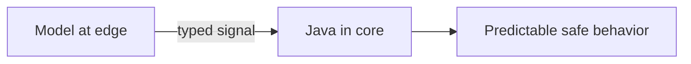

<a name="31-further-reading-and-learning-path"></a>
## 31. Further Reading and Learning Path

- Jev official docs (systemone schema, version IDs).
- Spring RestClient + Resilience4j + Micrometer docs.
- Next: add frustration Score, PII gate, golden harness; then model routing + tool guardrails.
- *Last Updated: 2026-10-05*

