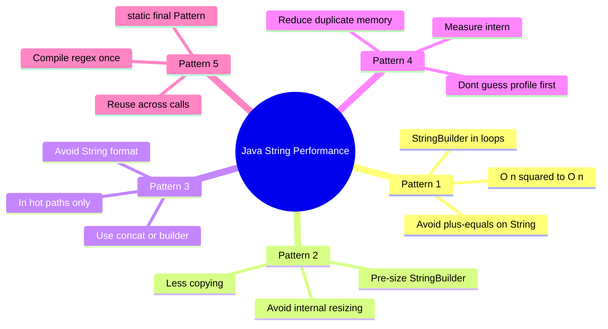
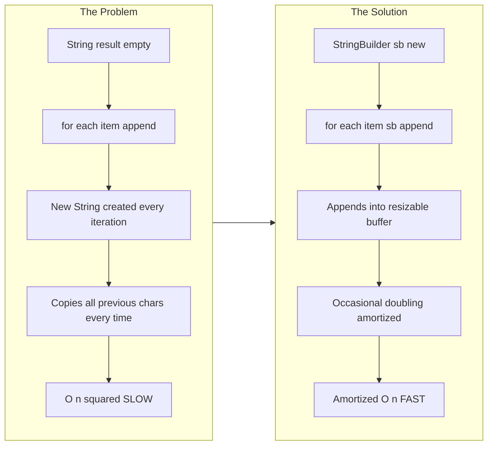
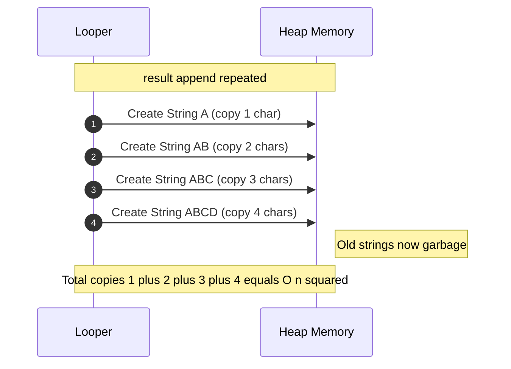
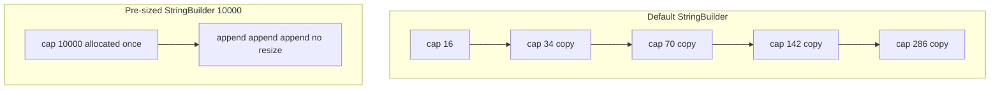
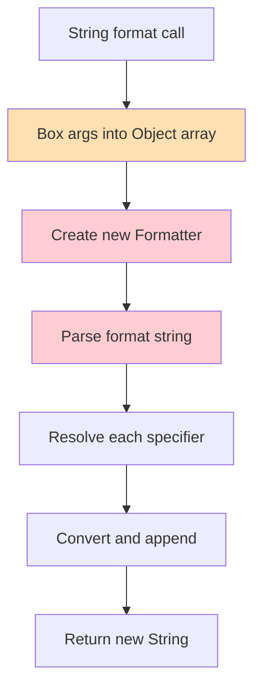
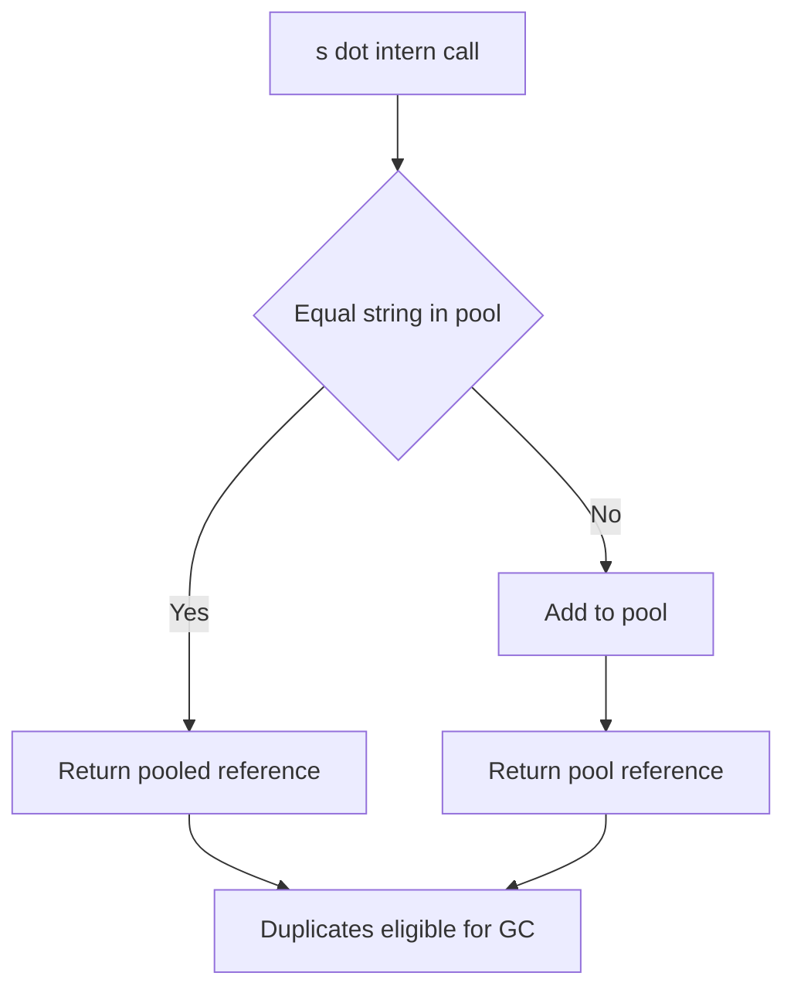
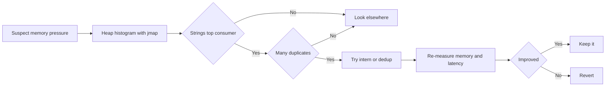
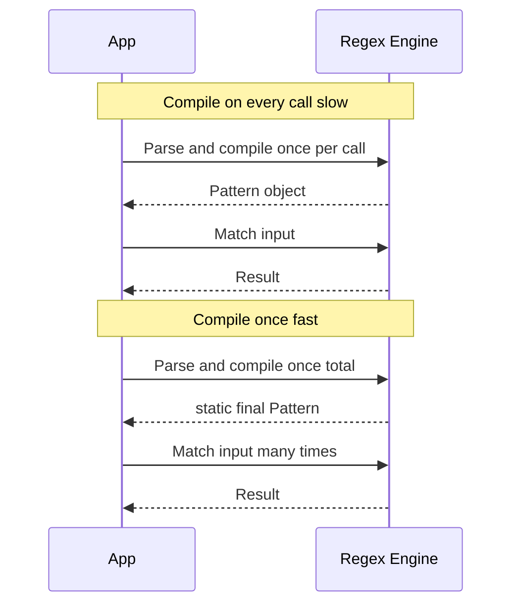
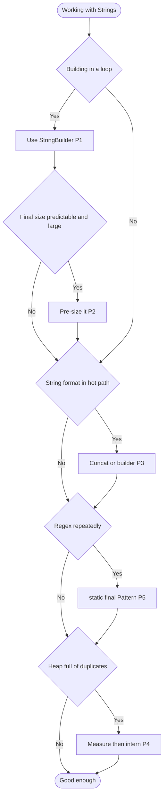
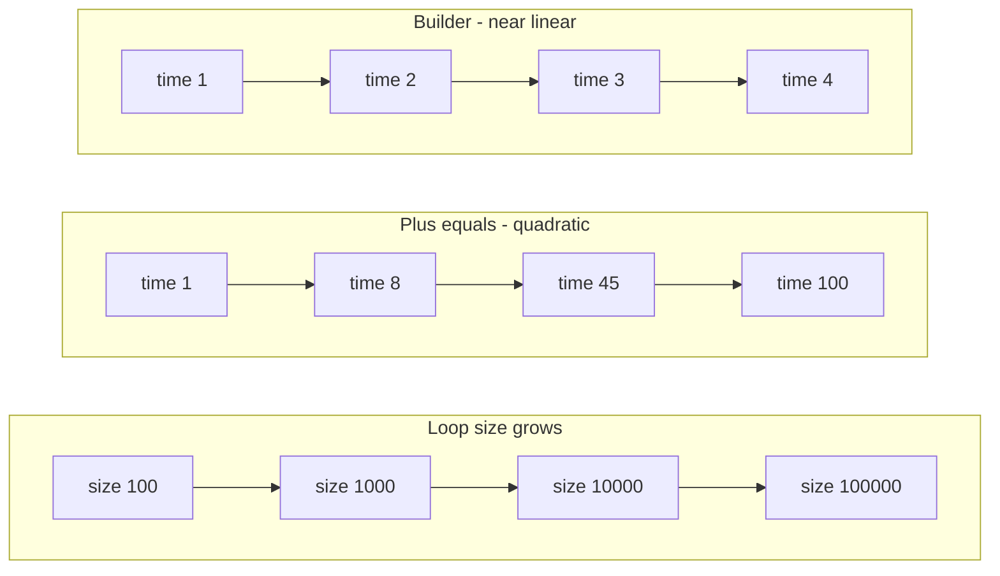

# Master Java String Performance: 5 Patterns Senior Developers Follow — Complete Tutorial

> ⏱️ **Estimated Reading Time:** 60-75 minutes | 🎯 **Level:** Intermediate | ☕ **Java:** 8+ (with notes for 9, 11, 17, 21) | 📊 **Difficulty:** 🟢 Beginner → 🟡 Intermediate → 🔴 Advanced (progressive)

> 💡 **Who is this for?** Java developers (beginner to advanced, focused on Intermediate) who want string-handling code that is fast, memory-friendly, and production-ready.
> 
> **What you'll learn:** Why naive string code is slow, and five battle-tested patterns to fix it — with benchmarks, Mermaid diagrams, real-world use cases, security and testing guidance.

**Last Updated:** 2026-10-06 | **JDK Covered:** 8 through 21 | **Related:** Compact Strings (Java 9+), `StringConcatFactory`, G1 String Deduplication

---

## 📑 Table of Contents

- [1. Introduction / Overview](#1-introduction--overview)
- [2. Prerequisites](#2-prerequisites)
- [3. Learning Objectives](#3-learning-objectives)
- [4. The Big Picture: Why Strings Are a Performance Hotspot](#4-the-big-picture-why-strings-are-a-performance-hotspot)
- [5. Pattern 1: Use `StringBuilder` in Loops](#5-pattern-1-use-stringbuilder-in-loops)
- [6. Pattern 2: Pre-size Your `StringBuilder`](#6-pattern-2-pre-size-your-stringbuilder)
- [7. Pattern 3: Avoid `String.format()` in Hot Paths](#7-pattern-3-avoid-stringformat-in-hot-paths)
- [8. Pattern 4: Measure Before You `intern()`](#8-pattern-4-measure-before-you-intern)
- [9. Pattern 5: Compile Regex Once](#9-pattern-5-compile-regex-once)
- [10. Putting It All Together](#10-putting-it-all-together)
- [11. How to Benchmark Correctly with JMH](#11-how-to-benchmark-correctly-with-jmh)
- [12. Real-World Examples and Use Cases](#12-real-world-examples-and-use-cases)
- [13. Performance Considerations Deep Dive](#13-performance-considerations-deep-dive)
- [14. Security Considerations](#14-security-considerations)
- [15. Testing Strategies](#15-testing-strategies)
- [16. Best Practices](#16-best-practices)
- [17. Anti-Patterns](#17-anti-patterns)
- [18. Common Pitfalls / Troubleshooting Guide](#18-common-pitfalls--troubleshooting-guide)
- [19. Migration Guides](#19-migration-guides)
- [20. Cheat Sheet & Decision Guide](#20-cheat-sheet--decision-guide)
- [21. Practice Exercises with Detailed Solutions](#21-practice-exercises-with-detailed-solutions)
- [22. Hands-On Lab Project](#22-hands-on-lab-project)
- [23. Test Your Understanding](#23-test-your-understanding)
- [24. Common Interview Questions](#24-common-interview-questions)
- [25. Question Bank for Knowledge Reinforcement](#25-question-bank-for-knowledge-reinforcement)
- [25A. Answer Key Part 1: Beginner](#25a-question-bank--answer-key-part-1-beginner-118)
- [25B. Answer Key Part 2: Intermediate](#25b-answer-key-part-2-intermediate-1938)
- [25C. Answer Key Part 3: Advanced](#25c-answer-key-part-3-advanced-3955--test-your-understanding)
- [26. Self-Assessment Checklist](#26-self-assessment-checklist)
- [27. Pro Tips for Senior Developers](#27-pro-tips-for-senior-developers)
- [28. Summary / Key Takeaways](#28-summary--key-takeaways)
- [29. Further Reading / Resources](#29-further-reading--resources)
- [30. Historical Context & Future Trends](#30-historical-context--future-trends)

---

## 1. Introduction / Overview

Imagine this story: your team ships a CSV export feature. It works fine for 100 rows in QA. In production, a customer exports 500,000 rows and the service stalls — GC pauses spike, latency alerts fire, and the heap dump is 85% `char[]` / `byte[]` from `String`.

The culprit is rarely business logic. It is string handling: immutable `String` + loop concatenation + repeated `String.format()` + recompiled regex + duplicate strings.

This tutorial is a **comprehensive deep-dive** into five patterns senior developers follow to keep Java string code fast and lean:

1. **Use `StringBuilder` in loops** — O(n²) → amortized O(n)
2. **Pre-size your `StringBuilder`** — avoid hidden resizing
3. **Avoid `String.format()` in hot paths** — cut parsing/boxing overhead
4. **Measure before you `intern()`** — dedupe only when profiling proves it
5. **Compile regex once** — reuse thread-safe `Pattern`

> 🧠 **Senior-developer mindset:** Readability first. Know the cost model (immutability = allocation). Measure, don't guess. Prefer simple, low-risk fixes.

### How to use this tutorial

- Follow **Sections 4–11 step-by-step** — each pattern has ❌ vs ✅ code, diagrams, and when-to-use guidance.
- Skim **Section 20 Cheat Sheet** if you need a quick decision aid after reading.
- Do the **Lab + Exercises** to lock in muscle memory. Run JMH yourself — exact numbers vary by machine/JDK, but the *shape* (quadratic vs linear) is universal.

## 2. Prerequisites

### What you need

| Requirement | Details |
|---|---|
| Java | JDK 8 or later (JDK 17 or 21 recommended to observe Compact Strings + `StringConcatFactory`) |
| Build tool | Maven 3.6+ or Gradle 7+ (for JMH section) |
| IDE | IntelliJ IDEA, Eclipse, or VS Code with Java extension |
| Fundamentals | Loops, collections (`List`, `ArrayList`), `String` basics, basic OOP |

### Optional but recommended

- **JMH** dependencies (see Section 11) for benchmarking.
- **Profilers:** VisualVM, Eclipse MAT (Duplicate Strings report), Java Flight Recorder (JFR), `jcmd GC.class_histogram`.
- Familiarity with JUnit 5 for testing strategies.

> 💡 **Edge case note:** All code in this tutorial uses only the JDK standard library except JMH (benchmarking) and optionally Guava `Interners` (mentioned as an alternative). No other external frameworks required.

## 3. Learning Objectives

By the end of this tutorial, you will be able to:

1. **Explain** why `String` immutability causes O(n²) cost in loops, with the `n(n+1)/2` copy math.
2. **Refactor** `String +=` loops to `StringBuilder` (amortized O(n)) and choose `String.join` / `Collectors.joining` when clearer.
3. **Pre-size** `StringBuilder` using `N * (avgLen + separator)` estimation for large outputs.
4. **Replace** `String.format()` in hot paths with concatenation / builder / `String.join`, while keeping it where readability wins.
5. **Evaluate** `String.intern()` with heap histograms and duplicate-string analysis; apply scoped interner / enum / G1 dedup alternatives.
6. **Reuse** regex via `static final Pattern` (thread-safe) + per-use `Matcher`, and avoid regex when plain `replace`/`split(",")` suffices.
7. **Benchmark** correctly with JMH (warmup, fork, dead-code-elimination avoidance) and interpret quadratic vs linear shapes.

## 4. The Big Picture: Why Strings Are a Performance Hotspot

### Why do strings cause performance problems?

In Java, `String` is **immutable**. Once created, its contents can never change. This gives thread-safety, safe hash keys, and string-pool sharing, but every "modification" creates a brand-new object.

```java
String s = "Hello";
s = s + " World";   // Creates a NEW String; "Hello" is untouched and becomes garbage
// s now points to a different object; the old "Hello" is eligible for GC
```

Most of the time this is harmless. But inside **loops**, **hot paths** (code running millions of times), or **high-throughput services**, hidden costs pile up:

| Hidden Cost | Effect |
|---|---|
| Repeated object allocation | More garbage, more GC pauses |
| Repeated copying of characters | CPU time grows with string length |
| Parsing format strings / regexes repeatedly | Wasted CPU on work that never changes |
| Duplicate strings in memory | Higher heap usage, longer GC |

### The five patterns at a glance



### The Problem vs Solution at a glance



> ⚠️ **Callout:** Immutability is a *feature*, not a bug. Don't fight it globally — apply these patterns only where profiling or clear hot-path reasoning justifies it.

## 5. Pattern 1: Use `StringBuilder` in Loops

> 🟢 **Difficulty:** Beginner | **Impact:** Very High | **Risk:** Very Low

### 5.1 The problem: `String +=` in loops

```java
// ❌ SLOW: O(n²) — DO NOT DO THIS in loops
public static String joinNumbersSlow(int n) {
    String result = "";
    for (int i = 0; i < n; i++) {
        result += i + ",";     // creates a new String every iteration
    }
    return result;
}
```

#### Why is this O(n²)?

Each iteration, Java must:
1. Allocate a new buffer big enough for `old + new`.
2. **Copy all the old characters** into it.
3. Copy the new characters.
4. Throw the old string away.

If the final string has *n* characters appended one at a time, total character copies ≈:

```text
1 + 2 + 3 + ... + n = n(n+1)/2 ≈ n²/2
```

So doubling input size roughly **quadruples** work.

#### Visualizing the copying



### 5.2 The solution: `StringBuilder`

`StringBuilder` is a **mutable** character buffer. Appending writes into the existing buffer and only grows it occasionally.

```java
// ✅ FAST: amortized O(n)
public static String joinNumbersFast(int n) {
    StringBuilder sb = new StringBuilder();
    for (int i = 0; i < n; i++) {
        sb.append(i).append(',');
    }
    return sb.toString();   // one final copy into exact-size String
}
```

#### Why amortized O(n)?

The buffer **doubles** (roughly `newCapacity = 2*old + 2`) when full. Doubling is occasionally expensive but cheap on average — total copy work bounded by ~2n.


### 5.3 But doesn't the compiler optimize `+`?

Partly — a common confusion:

| Situation | Verdict |
|---|---|
| `String s = a + b + c;` (single expression) | ✅ Fine. Compiler/JVM optimizes (Java 9+: `invokedynamic` / `StringConcatFactory`). |
| `s += x;` **inside a loop** | ❌ Not fine. Each iteration still builds a new String. JIT does not fuse loop into one builder. |
| Building across many statements/branches | ⚠️ Prefer `StringBuilder` when many parts or loops involved. |

**Rule of thumb:** `+` for readable one-liners; `StringBuilder` for loops or many conditional appends.

### 5.4 Multiple examples

#### Example A: Building a CSV row ✅

```java
import java.util.List;

public static String toCsvRow(List<String> columns) {
    // Handles edge cases: empty list -> "", null columns guarded by caller
    if (columns == null || columns.isEmpty()) {
        return "";
    }
    StringBuilder sb = new StringBuilder();
    for (int i = 0; i < columns.size(); i++) {
        if (i > 0) sb.append(',');
        // Null-safe: avoid "null" surprises
        String col = columns.get(i);
        sb.append(col == null ? "" : col);
    }
    return sb.toString();
}
```

#### Example B: Building an SQL `IN` clause ✅

```java
import java.util.List;

public static String buildInClause(List<Integer> ids) {
    // NOTE: uses ? placeholders — safe from SQL injection (see Section 14)
    if (ids == null || ids.isEmpty()) {
        throw new IllegalArgumentException("ids must not be empty");
    }
    StringBuilder sb = new StringBuilder("SELECT * FROM users WHERE id IN (");
    for (int i = 0; i < ids.size(); i++) {
        sb.append(i == 0 ? "?" : ",?");
    }
    sb.append(')');
    return sb.toString();
}
// For 3 ids -> SELECT * FROM users WHERE id IN (?,?,?)
```

#### Example C: Reversing and editing in place ✅

```java
StringBuilder sb = new StringBuilder("Hello, World");
sb.reverse();                    // "dlroW ,olleH"
sb.insert(0, ">> ");             // ">> dlroW ,olleH"
sb.setCharAt(3, 'D');            // ">> DlroW ,olleH"
sb.deleteCharAt(sb.length() - 1);// drop last char
System.out.println(sb);          // >> DlroW ,olle
```

#### Example D: `String.join` and streams as alternatives ✅

```java
import java.util.List;
import java.util.stream.Collectors;

// Clean and efficient for simple joins — uses StringJoiner/StringBuilder internally
String joined = String.join(",", list);

String viaStream = list.stream()
        .collect(Collectors.joining(",", "[", "]"));
// ["a,b,c"] style with prefix/suffix
```

> 💡 Prefer `String.join` / `Collectors.joining` when they express intent clearly — no manual loop needed.

### 5.5 `StringBuilder` vs `StringBuffer`

| Feature | `StringBuilder` | `StringBuffer` |
|---|---|---|
| Thread-safe | ❌ No (not synchronized) | ✅ Yes (synchronized) |
| Speed | 🚀 Faster | Slower (lock overhead) |
| Use when | Single-threaded or method-local (99% of cases) | Buffer genuinely shared across threads |

> 💡 A `StringBuilder` created inside a method and never published is automatically thread-confined — no lock needed.

### 5.6 Real-world use cases

- **Log message assembly:** many fields per line, high volume.
- **Report/CSV/JSON generation:** thousands of rows.
- **Dynamic SQL/HTML/XML builders:** piecewise markup.
- **Protocol/message encoders:** wire-format text.

> ⚠️ **Error handling:** Always guard `toCsvRow`/`buildInClause` against `null`/empty inputs. For user data embedded in HTML/SQL, escape or use prepared statements — never raw concat of untrusted input.

## 6. Pattern 2: Pre-size Your `StringBuilder`

> 🟡 **Difficulty:** Intermediate | **Impact:** Medium-High for large outputs | **Risk:** Low

### 6.1 The problem: hidden resizing

A default `StringBuilder` starts with capacity **16**. When full, Java allocates a bigger array and copies everything.

```java
// ❌ Works, but may resize many times for large lists
StringBuilder sb = new StringBuilder();
for (String line : hugeListOfLines) {
    sb.append(line).append('\n');
}
```

### 6.2 The solution: set an initial capacity

```java
// ✅ Estimate final size up front — avoids most resizes
int estimated = hugeListOfLines.size() * 80;   // ~80 chars per line
StringBuilder sb = new StringBuilder(estimated);
for (String line : hugeListOfLines) {
    if (line != null) sb.append(line).append('\n');
}
```

### 6.3 What changes under the hood



### 6.4 How to estimate capacity

| Scenario | Estimation strategy |
|---|---|
| Joining N items of known avg length | `N * (avgLen + separatorLen)` |
| Known template with placeholders | Template length + sum of expected value lengths |
| Unknown size | Slight over-estimate beats many resizes; avoid MBs just in case |

```java
import java.util.List;

public static String joinIds(List<Long> ids) {
    // Each id <= 19 digits + 1 comma
    if (ids == null || ids.isEmpty()) return "";
    StringBuilder sb = new StringBuilder(ids.size() * 20);
    for (Long id : ids) {
        sb.append(id).append(',');
    }
    sb.setLength(sb.length() - 1); // trim trailing comma
    return sb.toString();
}
```

### 6.5 Caveats

- ⚠️ Over-allocating wastes memory with many builders.
- ⚠️ For small strings (<100 chars) benefit is negligible.
- ✅ Use where sizes are large or code is hot.
- 💡 `sb.toString()` copies into exact-size String; extra capacity freed when builder is GC'd.

### 6.6 Real-world use cases

- Bulk export (CSV/JSON/XML) with predictable row counts.
- Batch SQL generation with known placeholder counts.
- Template rendering with known baseline length.

## 7. Pattern 3: Avoid `String.format()` in Hot Paths

> 🟡 **Difficulty:** Intermediate | **Impact:** High in hot paths | **Risk:** Low

### 7.1 The problem

`String.format()` is readable but expensive. Every call parses the format string, creates a `Formatter`, handles locale, and boxes primitives via varargs.

```java
// ❌ Readable, but slow if called millions of times
for (Order o : orders) {
    String line = String.format("Order %d for %s: $%.2f",
        o.id(), o.customer(), o.total());
    out.println(line);
}
```

### 7.2 What happens on each call



The parse repeats every call even though the format never changes.

### 7.3 Faster alternatives

```java
// ✅ Option 1: Plain concatenation — best for simple cases
String line = "Order " + o.id() + " for " + o.customer();

// ✅ Option 2: StringBuilder — best for loops or many parts
StringBuilder sb = new StringBuilder(64);
sb.append("Order ").append(o.id())
  .append(" for ").append(o.customer())
  .append(": $").append(o.total());

// ✅ Option 3: String.join for keys
String key = String.join(":", tenantId, userId, sessionId);

// ⚠️ Option 4: formatted() — readable but NOT faster (same engine)
String msg = "Hello, %s!".formatted(name);
```

### 7.4 When `String.format()` is still right

| Situation | Verdict |
|---|---|
| Rare ops (startup, error paths, admin UI) | ✅ Use it, readability wins |
| Complex locale/number formatting | ✅ Use it or cached NumberFormat |
| Per-request, per-row hot path | ❌ Avoid; use concat/builder |
| Logging | ✅ Use placeholders: `log.debug("User {} logged in", user)` |

### 7.5 Logging tip

```java
// ❌ Built even if DEBUG off
log.debug("Processing " + order + " for " + customer);

// ✅ Skipped when DEBUG disabled
log.debug("Processing {} for {}", order, customer);
```

## 8. Pattern 4: Measure Before You `intern()`

> 🔴 **Difficulty:** Advanced | **Impact:** High memory win OR net loss | **Risk:** Medium-High

### 8.1 What is the String pool?

Java keeps a pool of unique literals. Identical literals share one object:

```java
String a = "java";
String b = "java";
System.out.println(a == b);          // true: same pooled object

String c = new String("java");
System.out.println(a == c);          // false: different object
System.out.println(a == c.intern()); // true: intern returns pooled instance
```

### 8.2 What `intern()` does



### 8.3 Promise and catch

| Potential benefit | Potential cost |
|---|---|
| Saves memory with millions of duplicates | Hash-table lookup per call (slower than allocation) |
| Allows fast == comparison (risky, see below) | Shared pool contention; bad `-XX:StringTableSize` causes long chains |
| | Interning unique strings wastes time, gains nothing |

### 8.4 When interning helps vs hurts

```java
// ✅ Good: 10M rows, only ~200 distinct countries
for (String[] row : csvRows) {
    String country = row[3].intern(); // dedupe repeated names
    records.add(new Record(row[0], country));
}

// ❌ Bad: unique UUIDs/timestamps/free text — no saving, added cost
String id = UUID.randomUUID().toString().intern(); // DO NOT DO THIS
```

### 8.5 Alternatives

| Alternative | Idea |
|---|---|
| Own scoped map | `ConcurrentHashMap` or Guava `Interners.newWeakInterner()` |
| G1 String Deduplication | `-XX:+UseStringDeduplication` background dedup of backing arrays |
| Enums / IDs | Model known sets as enum or int codes |
| Normalize model | Lookup table for repeated values |

```java
// ✅ Scoped interner, GC-able with map
Map<String, String> interner = new HashMap<>();
String canonical = interner.computeIfAbsent(country, k -> k);
```

### 8.6 Golden rule: measure



Tools: VisualVM, Eclipse MAT Duplicate Strings, JFR, `jcmd GC.class_histogram`.

> ⚠️ Never use `==` for string logic. Interning is for memory, not replacing `equals()`.

## 9. Pattern 5: Compile Regex Once

> 🟡 **Difficulty:** Intermediate | **Impact:** High for validation/parsing loops | **Risk:** Low

### 9.1 The problem

`Pattern.compile()` builds a state machine — expensive. Convenience methods recompile every call:

```java
// ❌ Each compiles a Pattern internally on every call
boolean ok     = email.matches("^[\\w.+-]+@[\\w-]+\\.[\\w.]+$");
String cleaned = text.replaceAll("\\s+", " ");
String[] parts = line.split("\\s*,\\s*");
```

In a 1M loop you compile the same regex 1M times.

### 9.2 The solution: compile once, reuse

```java
import java.util.regex.Pattern;

public final class Validators {
    // ✅ Compiled once; Pattern is immutable and thread-safe
    private static final Pattern EMAIL =
            Pattern.compile("^[\\w.+-]+@[\\w-]+\\.[\\w.]+$");
    private static final Pattern WHITESPACE = Pattern.compile("\\s+");
    private static final Pattern COMMA_SPLIT = Pattern.compile("\\s*,\\s*");

    public static boolean isValidEmail(String s) {
        if (s == null) return false;
        return EMAIL.matcher(s).matches(); // fresh Matcher per use
    }

    public static String normalizeSpaces(String s) {
        if (s == null) return null;
        return WHITESPACE.matcher(s).replaceAll(" ");
    }

    public static String[] splitCsv(String s) {
        if (s == null) return new String[0];
        return COMMA_SPLIT.split(s);
    }
}
```

### 9.3 Compile-per-call vs compile-once



### 9.4 Pattern vs Matcher thread-safety

| Class | Thread-safe? | How to use |
|---|---|---|
| `Pattern` | ✅ Yes (immutable) | Share as `static final` |
| `Matcher` | ❌ No (holds match state) | Create per use: `PATTERN.matcher(input)` |

> ⚠️ Never cache a `Matcher` in a static field or share across threads.

### 9.5 More examples

```java
import java.util.ArrayList;
import java.util.List;
import java.util.regex.Matcher;
import java.util.regex.Pattern;

private static final Pattern LOG_LINE =
        Pattern.compile("^(\\d{4}-\\d{2}-\\d{2}) (\\w+) (.*)$");

static void parse(String line) {
    Matcher m = LOG_LINE.matcher(line);
    if (m.matches()) {
        String date = m.group(1); String level = m.group(2); String msg = m.group(3);
    }
}
// "2026-10-06 ERROR Disk full" -> date=2026-10-06, level=ERROR

private static final Pattern HASHTAG = Pattern.compile("#(\\w+)");

static List<String> hashtags(String text) {
    List<String> result = new ArrayList<>();
    Matcher m = HASHTAG.matcher(text);
    while (m.find()) result.add(m.group(1));
    return result;
}

// ✅ Skip regex when unneeded
String[] parts = line.split(",");       // single-char fast path
String s2 = text.replace("foo", "bar"); // plain text, no regex
// ❌ Regex engine for plain job
String s3 = text.replaceAll("foo", "bar");
```

> ⚠️ Beware catastrophic backtracking: `Pattern.compile("(a+)+$")` can hang on `aaaaaaaaaaaaaaaaaaaaaaaa!` (ReDoS). Prefer simple specific patterns; test untrusted input.

## 10. Putting It All Together

### 10.1 Before/after refactor

```java
// ❌ BEFORE: all five anti-patterns in one method
public String buildReport(List<Order> orders) {
    String report = "";                                            // Pattern 1
    for (Order o : orders) {
        String id = String.format("ORD-%06d", o.id());             // Pattern 3
        String customer = o.customer().replaceAll("\\s+", " ");    // Pattern 5
        report += id + "," + customer + "," + o.country() + "\n";  // Patterns 1+2
    }
    return report;
}
```

```java
import java.util.List;
import java.util.regex.Pattern;

// ✅ AFTER: all five patterns applied
private static final Pattern WS = Pattern.compile("\\s+");  // Pattern 5

public String buildReport(List<Order> orders) {
    if (orders == null || orders.isEmpty()) return "";
    StringBuilder sb = new StringBuilder(orders.size() * 48); // Pattern 2
    for (Order o : orders) {                                  // Pattern 1
        sb.append("ORD-");
        String idStr = Integer.toString(o.id());              // Pattern 3 fix
        for (int i = idStr.length(); i < 6; i++) sb.append('0');
        sb.append(idStr).append(',')
          .append(WS.matcher(o.customer()).replaceAll(" "))
          .append(',')
          .append(o.country())  // intern only if measured (Pattern 4)
          .append('\n');
    }
    return sb.toString();
}
```

### 10.2 Decision flow



## 11. How to Benchmark Correctly with JMH

> Never trust a quick `System.nanoTime()` loop. JIT, dead-code elimination, and warmup will mislead you. Use **JMH**.

### 11.1 Maven dependencies

```xml
<dependency>
  <groupId>org.openjdk.jmh</groupId>
  <artifactId>jmh-core</artifactId>
  <version>1.37</version>
</dependency>
<dependency>
  <groupId>org.openjdk.jmh</groupId>
  <artifactId>jmh-generator-annprocess</artifactId>
  <version>1.37</version>
  <scope>provided</scope>
</dependency>
```

### 11.2 Sample benchmark

```java
import org.openjdk.jmh.annotations.*;
import java.util.concurrent.TimeUnit;

@State(Scope.Thread)
@BenchmarkMode(Mode.AverageTime)
@OutputTimeUnit(TimeUnit.MICROSECONDS)
@Warmup(iterations = 3, time = 1)
@Measurement(iterations = 5, time = 1)
@Fork(1)
public class StringConcatBenchmark {

    @Param({"100", "1000", "10000"})
    int n;

    @Benchmark
    public String plusEquals() {
        String s = "";
        for (int i = 0; i < n; i++) s += i;
        return s; // returning prevents dead-code elimination
    }

    @Benchmark
    public String stringBuilder() {
        StringBuilder sb = new StringBuilder();
        for (int i = 0; i < n; i++) sb.append(i);
        return sb.toString();
    }

    @Benchmark
    public String stringBuilderPresized() {
        StringBuilder sb = new StringBuilder(n * 5);
        for (int i = 0; i < n; i++) sb.append(i);
        return sb.toString();
    }
}
```

Run: `mvn clean package` then `java -jar target/benchmarks.jar StringConcatBenchmark`.

### 11.3 Illustrative results shape



Top line: `+=` quadratic. Bottom line: builder near-linear. Always run on your JDK/hardware.

> 💡 JMH pitfalls: no warmup, single fork, not returning results, including `System.out` in benchmark, benchmarking on loaded machine.

## 12. Real-World Examples and Use Cases

| Domain | Example | Patterns applied |
|---|---|---|
| Logging pipeline | Assemble `timestamp level traceId msg` per event (10k/sec) | P1 builder, P3 no format, placeholder logging |
| CSV export service | 500k rows x 8 cols; pre-size `rows*avgLen` | P1+P2, `String.join` per row |
| Dynamic SQL builder | `IN (?, ?, ...)` with N placeholders | P1+P2, `?` placeholders (safe) |
| REST validation | Email/phone check on every request | P5 static Pattern |
| Log parser/monitor | Parse `date level msg` for millions of lines | P5 groups, P1 builder for output |
| ETL cache keys | `tenant:user:session` per record | P3 join instead of format |
| Analytics cache | Country/status labels repeated millions of times | P4 measured intern or enum |

> 🏭 **Case study:** An export endpoint building CSV with `+=` took 42s for 200k rows and triggered full GCs. After P1+P2 refactor + JMH verification, same export took ~3s with flat heap.

## 13. Performance Considerations Deep Dive

- **O(n²) math:** `1+2+...+n = n(n+1)/2`. Doubling N quadruples copies.
- **Amortized O(n):** doubling buffer costs ~2n total copies; per-append O(1) average.
- **Capacity growth:** `newCapacity = (old*2)+2` in OpenJDK `AbstractStringBuilder`.
- **Compact Strings (Java 9+):** backing is `byte[]` + coder (LATIN1 vs UTF16); ASCII uses half memory vs `char[]`.
- **`+` concat (Java 9+):** single expression uses `StringConcatFactory` (invokedynamic) — efficient; loop `+=` still per-iteration Strings.
- **format cost:** parsing + `Formatter` + boxing + locale lookup per call.
- **regex cost:** compile (parse + NFA build) vs match; reuse saves 10-100x in loops.
- **intern cost:** global `StringTable` hash lookup + potential contention; size via `-XX:StringTableSize` (default ~60013 buckets).

> ⚠️ Always verify on your JDK: `java -version`, GC (`G1` vs `ZGC`), and hardware affect absolute numbers.

## 14. Security Considerations

| Risk | How string code triggers it | Mitigation |
|---|---|---|
| SQL injection | Building SQL with raw values: `"... id=" + userId` | Always use `?` placeholders + `PreparedStatement`; builder only for structure |
| ReDoS | Nested quantifiers `(a+)+$` on untrusted input hangs thread | Simple specific patterns, timeouts, input length caps, test adversarial strings |
| Log injection | User newline `foo\n[FAKE] ERROR` forges log lines | Sanitize `\r\n`, use encoding layout, validate length |
| Sensitive leakage | `String` immutable stays in heap/dump; passwords linger | Prefer `char[]` for secrets, clear after use; avoid logging PII |
| DoS via huge alloc | `new StringBuilder(userControlledN)` OOM | Cap estimates: `Math.min(n*hint, MAX)`; stream large outputs |

```java
// ❌ Vulnerable: raw concat
String sql = "SELECT * FROM users WHERE name = '" + name + "'";

// ✅ Safe: structure via builder, values via bind variables
String sql2 = "SELECT * FROM users WHERE name = ?";
PreparedStatement ps = conn.prepareStatement(sql2);
ps.setString(1, name);
```

## 15. Testing Strategies

```java
import static org.junit.jupiter.api.Assertions.*;
import org.junit.jupiter.api.Test;
import java.util.Arrays;

// Unit tests for refactored helpers
class StringPerfTest {
    @Test void csvRowJoinsWithCommas() {
        assertEquals("a,b,c", toCsvRow(Arrays.asList("a","b","c")));
    }
    @Test void csvRowEmptyAndNullSafe() {
        assertEquals("", toCsvRow(Arrays.asList()));
        assertEquals("a,,c", toCsvRow(Arrays.asList("a", null, "c")));
    }
    @Test void emailValidator() {
        assertTrue(Validators.isValidEmail("a@b.co"));
        assertFalse(Validators.isValidEmail(null));
        assertFalse(Validators.isValidEmail("not-an-email"));
    }
}
```

- **JMH:** assert shape not exact ms; fail if `plusEquals` >> builder at N=10000 (regression guard in CI with tolerance).
- **Memory:** compare heap with/without intern via `jmap -histo` or MAT Duplicate Strings; test both memory AND p99 latency.
- **Regex:** include adversarial input test with timeout (`assertTimeoutPreemptively`).

## 16. Best Practices

1. Readability first; optimize hot code proven by profiling.
2. `+` for one-liners; `StringBuilder` for loops/many parts.
3. Pre-size large builders; keep sane caps for untrusted N.
4. Keep `format` for rare/complex locale formatting; builder/join in hot paths.
5. `static final Pattern` + fresh `Matcher` per use; prefer `replace`/`split(",")` for plain text.
6. Intern only after heap proof; prefer scoped map/enum/G1 dedup.
7. Use placeholder logging; never build disabled log strings.
8. Null/empty guards + `?` placeholders for SQL; escape HTML/XML.

## 17. Anti-Patterns

| Anti-pattern | Why it hurts | Fix |
|---|---|---|
| `s += x` in loop | O(n²) copies + GC churn | `StringBuilder.append` |
| Default builder for MBs output | Many resizes/copies | `new StringBuilder(estimate)` |
| `String.format` per record | Parse+box per call | Concat/builder/join |
| Blind `intern()` everything | Lookup cost, no saving for uniques | Measure; scoped interner |
| `matches()/replaceAll()` in loop | Recompile per call | `static final Pattern` |
| `StringBuffer` by habit | Lock overhead | `StringBuilder` (method-local) |
| Sharing `Matcher` | Race/corruption | New matcher per use |
| `==` for equality | Reference compare bug | `equals()` always |
| Raw SQL concat | Injection | `PreparedStatement` |
| MB pre-size just in case | Heap waste | Estimate + cap |

## 18. Common Pitfalls / Troubleshooting Guide

| Symptom | Likely cause | Fix |
|---|---|---|
| GC pauses on export | `+=` loop | Refactor to pre-sized builder; stream output |
| Slow per-request keys | `format` in hot path | Switch to `join`/concat; JMH verify |
| High heap of Strings | Duplicates | MAT Duplicate Strings; try scoped dedup/enum |
| `intern()` slower, no saving | Unique values | Revert; use plain Strings |
| Regex hang on input | Catastrophic backtracking | Simplify pattern; length cap; timeout |
| Wrong decimal/locale | Manual concat lost formatting | Keep `format`/`NumberFormat` where correctness needs it |
| `NumberFormat` race | Shared non-thread-safe instance | ThreadLocal or per-use instance |
| OOM on pre-size | Untrusted N*size | `Math.min(est, MAX)` + streaming |

## 19. Migration Guides

### 19.1 StringBuffer to StringBuilder

```java
// Before (legacy, synchronized overhead)
StringBuffer buf = new StringBuffer();
buf.append(a).append(b);

// After (method-local, faster)
StringBuilder sb = new StringBuilder();
sb.append(a).append(b);
// Keep StringBuffer only if buffer escapes to multiple threads.
```

### 19.2 Plus-equals loop to builder

1. Replace `String s=""` with `new StringBuilder(estimate)`.
2. Replace `s += x` with `sb.append(x)`.
3. Return `sb.toString()`; add null/empty guards.

### 19.3 Format to builder/join

- `String.format("%s-%s-%d", r, t, seq)` -> `r + "-" + t + "-" + seq` or builder.
- Keep `format` if `%,.2f`/`%08d`/locale matters; cache `NumberFormat` per thread.

### 19.4 Inline regex to constants

Move every `matches/replaceAll/split(regex)` inside loops to `private static final Pattern`; create matcher per call.

## 20. Cheat Sheet & Decision Guide

| # | Pattern | Do ✅ | Not ❌ | Impact |
|---|---|---|---|---|
| 1 | Builder in loops | `sb.append(x)` | `s += x` | O(n²) to O(n) |
| 2 | Pre-size | `new StringBuilder(est)` | Default 16 for big | Fewer copies |
| 3 | Avoid format hot | Concat/builder/join | `format` per record | Less parse/alloc |
| 4 | Measure intern | Profile then dedupe | Blind intern | Mem down if dups |
| 5 | Compile once | `static final Pattern` | `matches()` in loop | Avoid recompile |

🧠 Senior mindset: readability first; know cost model; measure with JMH/profiler; prefer simple fixes.

## 21. Practice Exercises with Detailed Solutions

### Exercise 1: Fix the loop 🟢

Rewrite with `StringBuilder`:

```java
String out = "";
for (String w : words) out += w.toUpperCase() + " ";
```

**Solution:**

```java
import java.util.List;

public static String upperJoin(List<String> words) {
    if (words == null || words.isEmpty()) return "";
    StringBuilder sb = new StringBuilder(words.size() * 16);
    for (String w : words) {
        if (w == null) continue;
        sb.append(w.toUpperCase()).append(' ');
    }
    // Optional: trim trailing space
    if (sb.length() > 0) sb.setLength(sb.length() - 1);
    return sb.toString();
}
// Why: single buffer, amortized O(n); null-safe; pre-sized.
```

### Exercise 2: Pre-size 🟡

50,000 rows, 6 cols, avg 12 chars each + 5 commas + newline (~6 chars) per row.

**Solution:** per row ≈ `6*12 + 6 = 78`. Total ≈ `50,000*78 = 3,900,000`. Use `new StringBuilder(3_900_000)` (or `4_000_000` rounded). Slight over-estimate OK; don't use 100M. Cap if rows untrusted.

### Exercise 3: Replace format 🟡

Rewrite `String.format("%s-%s-%d", region, type, seq)` two ways, then JMH all three.

**Solution:**

```java
// Concat
String k1 = region + "-" + type + "-" + seq;
// Builder (pre-sized ~32)
StringBuilder sb = new StringBuilder(32);
sb.append(region).append('-').append(type).append('-').append(seq);
String k2 = sb.toString();
// JMH: @Benchmark each, @Param sizes, return value, warmup+measure.
```

### Exercise 4: Interning experiment 🔴

Generate 5M strings from 100 values; compare heap with/without `intern()` and with `HashMap` interner. Use `Runtime` stats + heap dump/MAT.

**Solution sketch:**

```java
List<String> base = ...; // 100 distinct
List<String> plain = new ArrayList<>(5_000_000);
for (int i=0;i<5_000_000;i++) plain.add(new String(base.get(i % 100)));
// vs interned: plain.add(new String(...).intern());
// vs map: map.computeIfAbsent(new String(...), k->k);
// Measure: Runtime.getRuntime().totalMemory()-freeMemory() after GC + MAT Duplicate Strings.
```

Expect: intern/map sharply reduces retained heap for 100-value case; no win for unique UUIDs.

### Exercise 5: Regex refactor 🟡

Find `matches/replaceAll/split` in loops; move to constants.

**Solution:**

```java
// Before
for (String e : emails) if (e.matches("^[\\w.+-]+@[\\w-]+\\.[\\w.]+$")) ...
// After
private static final Pattern EMAIL = Pattern.compile("^[\\w.+-]+@[\\w-]+\\.[\\w.]+$");
for (String e : emails) if (e != null && EMAIL.matcher(e).matches()) ...
```

## 22. Hands-On Lab Project

**Goal:** Refactor a slow CSV exporter and prove the win.

1. Create `SlowExporter` using `+=` + `String.format` + inline `replaceAll`.
2. Write JUnit tests for correctness (commas, nulls, zero-pad).
3. Add JMH benchmark (N=1k/10k/50k).
4. Refactor to `FastExporter` (pre-sized builder + manual pad + static Pattern).
5. Re-run JMH; capture heap histogram before/after.
6. Stretch: add G1 dedup flag run; document memory vs latency.

**Quick recap:** P1 fixes quadratic; P2 cuts resizes; P3 cuts parse; P5 cuts recompile; P4 only with proof.

## 23. Test Your Understanding

1. Why does `s += x` in a loop cost O(n²)?
2. What does amortized O(n) mean for `StringBuilder`?
3. Default capacity and growth formula?
4. When is `+` fine vs not?
5. Why pre-size? How to estimate `N*(avg+sep)`?
6. Why is `String.format` slow in hot paths (4 costs)?
7. When should you still use `format`?
8. Why is `formatted()` not a perf fix?
9. What does `intern()` return? When does it save memory?
10. Why never use `==` for logic even after interning?
11. `Pattern` vs `Matcher` thread-safety?
12. How does JMH avoid nanoTime pitfalls (warmup, DCE)?

## 24. Common Interview Questions

1. **Why is String immutable? Trade-offs?** Safety, hash stability, pooling; cost is new object per change.
2. **`StringBuilder` vs `StringBuffer`?** Sync vs not; builder for 99% method-local.
3. **Why is `+` in loop slow if compiler optimizes?** Opt is per-expression; loop still new String per iter.
4. **How does pre-sizing help?** Avoids `(2n+2)` resizes/copies; estimate N*(avg+sep).
5. **Why avoid `format` hot?** Parse+Formatter+boxing+locale per call.
6. **When would you keep `format`?** Rare/complex locale formatting; readability wins.
7. **What does `intern()` do? Risks?** Pool lookup/dedupe; contention, no win for uniques — measure.
8. **Alternatives to intern?** Scoped map, WeakInterner, G1 dedup, enum/IDs.
9. **Why `static final Pattern`?** Compile once; Pattern safe, Matcher per-use.
10. **How to benchmark strings correctly?** JMH warmup/fork/return, params, no println.
11. **What is ReDoS? Example?** `(a+)+$` exponential; simplify + cap input.
12. **How to build SQL safely with builder?** Builder for structure + `?` binds.

## 25. Question Bank for Knowledge Reinforcement

### Beginner (1-18)

1. What does immutable mean for String?
2. What happens on `s = s + "x"`?
3. Why do old Strings become garbage in loops?
4. Write `+=` loop vs builder loop.
5. What is `StringBuilder`?
6. What does `append` return and why chainable?
7. What does `toString()` do on builder?
8. Default builder capacity?
9. What is `String.join` used for?
10. `Collectors.joining` prefix/suffix example?
11. `StringBuilder` vs `StringBuffer` speed?
12. When is method-local builder thread-safe?
13. What is a hot path?
14. Name two hidden costs of naive strings.
15. Why does doubling input quadruple `+=` work?
16. What is `formatted()`?
17. What is placeholder logging?
18. Why return value from JMH benchmark?

### Intermediate (19-38)

19. Derive `n(n+1)/2` copies for char-by-char `+=`.
20. Explain amortized O(1) append via doubling.
21. Growth formula `(2*old+2)` — total copies bound?
22. Estimate capacity for 10k lines * 80 chars.
23. Why is over-allocation harmful?
24. When is pre-size negligible (<100 chars)?
25. List 4 per-call costs of `String.format`.
26. Rewrite `format("%s-%d")` with concat and builder.
27. When is `String.join` better than builder?
28. Why is shared `NumberFormat` unsafe? Fix?
29. What is string pool? `a=="java"` vs `new String`?
30. What does `intern()` return on hit vs miss?
31. Good vs bad intern candidate (countries vs UUIDs)?
32. How does scoped `HashMap` interner work?
33. What flag enables G1 string dedup?
34. Why does `split("\\s*,\\s*")` compile per call?
35. Refactor `replaceAll` loop to static Pattern.
36. `split(",")` fast path vs regex split?
37. `replace` vs `replaceAll` for plain text?
38. Why fresh `Matcher` per use?

### Advanced (39-55)

39. How does `StringConcatFactory` (Java 9+) change `+`?
40. What are Compact Strings (coder + byte[])?
41. Size `StringTableSize` effect on intern chains?
42. How to detect duplicates (MAT/JFR/histo)?
43. Design JMH to compare concat vs builder vs presized.
44. Why warmup/forks matter for JIT?
45. How does DCE skew microbenchmarks?
46. Explain ReDoS exponential backtracking.
47. How to test regex with adversarial input + timeout?
48. SQL injection via builder — safe pattern?
49. Log injection via unsanitized strings — fix?
50. Why `char[]` for passwords vs String?
51. Cap user-controlled builder capacity — code it.
52. When does G1 dedup beat `intern()`?
53. How do enums beat interning for known sets?
54. Refactor `buildReport` fully — explain each change.
55. What would you profile before optimizing strings?

> 💡 **How to use this bank:** try answering from memory, then check answers in Section 25A below. All answers are covered in Sections 4–18.

## 25A. Question Bank — Answer Key (Part 1: Beginner 1–18)

**1. Immutable?** Content can never change; every change allocates a new String. Pro: thread-safe, safe keys, pooling. Con: allocation per change.

**2. `s = s + "x"`?** New String sized old+1 allocated, chars copied, `s` repointed, old becomes garbage. No in-place edit.

**3. Garbage in loops?** Each `+=` abandons previous String; N iters leave N-1 garbage intermediates, pressuring GC.

**4. Loop comparison?** `String s=""; for(...) s+=i;` is O(n²). `StringBuilder sb=new StringBuilder(); for(...) sb.append(i); sb.toString();` is amortized O(n).

**5. `StringBuilder`?** Mutable unsynchronized buffer; mutate via append/insert/delete, one exact-size copy on `toString()`.

**6. `append` returns?** Returns `this` for chaining: `sb.append(a).append(b)`.

**7. Builder `toString()`?** Copies buffer into new exact-size String; oversized capacity freed with builder.

**8. Default capacity?** 16; grows roughly `(old*2)+2`.

**9. `String.join`?** `String.join(",", list)` → `"a,b,c"`. Builder-based internally; best for simple delimited joins.

**10. `Collectors.joining`?** `collect(joining(",", "[", "]"))` → `"[a,b,c]"` with delimiter, prefix, suffix.

**11. Builder vs Buffer?** Builder faster (no locks). Buffer synchronized per call. Use Builder unless shared across threads.

**12. Method-local safe?** Yes when confined: created locally, never published, one thread only.

**13. Hot path?** Code run millions of times (per-request/row/event) where small costs multiply.

**14. Two hidden costs?** Allocation/GC churn, O(n²) copying, re-parsing format/regex, duplicate heap Strings.

**15. Doubling quadruples?** Cost ≈ n²/2, so (2n)²/2 = 4×. Quadratic signature (Section 11 chart).

**16. `formatted()`?** `"Hi %s".formatted(n)` = `String.format` shorthand (Java 15+). Same engine; readability only.

**17. Placeholder logging?** `log.debug("User {} in", u)` formats only if level enabled; avoids building disabled strings.

**18. Return from JMH?** Prevents dead-code elimination where JIT deletes unused computation and fakes near-zero time.

## 25B. Answer Key (Part 2: Intermediate 19–38)

**19. Derive n(n+1)/2?** Iter k copies k chars; total 1+2+...+n = n(n+1)/2 ≈ n²/2.

**20. Amortized O(1)?** Doubling sizes 16,34,70... sum < 2× final; ≤2n copies for n appends → O(1) avg.

**21. Growth bound?** `(2*old+2)` geometric series → total copies linear, not quadratic.

**22. 10k×80?** 800_000. Use `new StringBuilder(800_000)` plus headroom for newlines.

**23. Over-alloc harm?** Wasted heap per builder; many concurrent builders inflate GC/OOM risk.

**24. Pre-size negligible?** Outputs under ~100 chars fit 1–2 resizes; estimation clutter outweighs saving.

**25. 4 format costs?** Parse format string, allocate Formatter, box varargs, resolve locale/convert.

**26. Rewrite format?** `region + "-" + seq`, or builder `sb.append(region).append('-').append(seq)`.

**27. `join` better?** Simple delimited join of existing collection — clearer and efficient. Builder when conditional/mixed logic.

**28. Shared NumberFormat?** Not thread-safe (mutable state). Fix: ThreadLocal or per-use instance.

**29. Pool?** JVM table of unique literals. `a=="java"` true for same literal; `new String` forces distinct object (use `equals`, or `intern` for canonical).

**30. `intern()` hit/miss?** Hit: returns pooled ref. Miss: adds string, returns pool ref.

**31. Good vs bad intern?** Good: countries/statuses (few values, many occurrences). Bad: UUIDs/timestamps (unique, zero dedup + lookup cost).

**32. Scoped map interner?** `map.computeIfAbsent(s, k->k)` returns first-seen canonical per key; GC-able, no global contention.

**33. G1 dedup flag?** `-XX:+UseStringDeduplication` with G1GC; background-dedupes backing arrays.

**34. `split` compiles?** Multi-char split delegates to `Pattern.compile(regex).split` every call — parse + NFA build each time.

**35. Refactor replaceAll?** `private static final Pattern WS = Pattern.compile("\\s+");` then `WS.matcher(raw).replaceAll(" ")` in loop.

**36. `split(",")` fast?** Single-char non-meta takes JDK fast path without full regex compile. Multi-char always regex — hoist.

**37. `replace` vs `replaceAll`?** `replace` is literal (no regex, faster/safer). `replaceAll` treats first arg as regex — slower, meta-char risk. Use `replace` for plain text.

**38. Fresh Matcher?** Matcher holds mutable state (position, groups, input). Sharing across calls/threads corrupts results. Pattern is shareable; `matcher(input)` per use is cheap.

## 25C. Answer Key (Part 3: Advanced 39–55 + Test-Your-Understanding)

**39. StringConcatFactory?** Java 9+ single-expression `+` uses invokedynamic bootstrap for exact-size efficient concat. Loop `+=` still per-iteration Strings (no cross-iteration fusion).

**40. Compact Strings?** Java 9+ `byte[]` + coder (LATIN1/UTF16). ASCII uses 1 byte/char (half memory vs `char[]`).

**41. StringTableSize?** Pool hash buckets (default ~60013). Too small for millions of interns → long chains → slow lookup. Tune `-XX:StringTableSize` after profiling; prefer reducing scope first.

**42. Detect duplicates?** MAT Duplicate Strings report; `jmap -histo` / `jcmd GC.class_histogram` for String rank; JFR allocation profiling for sites.

**43. JMH design?** `@State`, `@Param({"100","1000","10000"})`, 3 `@Benchmark` returning String, warmup/measurement/fork via `benchmarks.jar`. Compare scaling shape.

**44. Warmup/forks?** Warmup stabilizes C1/C2 JIT; forks isolate JVMs and expose variance. Without them you time interpreted code.

**45. DCE skew?** Unused results get eliminated → fake near-zero. Fix: return or Blackhole.consume.

**46. ReDoS?** Nested quantifiers `(a+)+$` explore exponentially many partitions on near-miss input (`aaa...a!`) → hang. Fix: atomic groups, simpler patterns, caps, timeouts.

**47. Regex adversarial test?** Evil long-repeat + mismatch input inside `assertTimeoutPreemptively(1s, ()->match)`. Timeout fail = harden pattern.

**48. Safe SQL builder?** Builder for structure with `?`; bind values via `PreparedStatement`. Never concat untrusted values.

**49. Log injection fix?** Strip/encode CR/LF, cap length, use JSON/encoding layout so newlines cannot forge lines.

**50. `char[]` passwords?** String immutable lingers in heap/dumps. `char[]` can be zeroed via `Arrays.fill` right after use.

**51. Cap capacity?** `int est = (int) Math.min((long) n * hint, 10_000_000L); new StringBuilder(Math.max(est, 16));`

**52. G1 dedup beats intern?** Long-lived dups with unclear scope or high churn: no code change, no fast-path lookup cost, automatic backing-array dedup.

**53. Enums beat interning?** Closed sets: canonical by construction, type-safe, fast `==`/switch, no lookup/pool cost.

**54. buildReport refactor?** See Section 10.1: `+=`→builder (P1), `size*48` presize (P2), manual zero-pad (P3), static WS Pattern (P5), country intern only if proven (P4), plus null guard.

**55. Profile first?** Allocation flame graph (async-profiler/JFR), histogram + Duplicate Strings, GC logs, JMH on hotspots. Optimize top contributors; re-measure memory AND latency.

**Test-Your-Understanding quick answers:** 1: copies 1..n sum n²/2. 2: doubling → ~2n total, O(1) avg. 3: 16, (2*old+2). 4: single-expression fine, loop not. 5: avoid resizes, N*(avg+sep). 6: parse, Formatter, boxing, locale. 7: rare/complex locale paths. 8: same engine, readability only. 9: pooled ref; saves only with dups. 10: reference compare breaks; use equals. 11: Pattern shared, Matcher per-use. 12: warmup/forks stabilize JIT, return defeats DCE.


## 26. Self-Assessment Checklist

- [ ] I can explain O(n²) vs amortized O(n) with copy math.
- [ ] I use builder in loops and `join` for simple joins.
- [ ] I pre-size large builders with sane caps.
- [ ] I avoid `format` in hot paths; keep it for locale/complex cases.
- [ ] I intern only after heap proof; know scoped/enum/G1 alternatives.
- [ ] I use `static final Pattern` + per-use matcher.
- [ ] I benchmark with JMH (warmup, return, params).
- [ ] I guard null/empty, use `?` binds, sanitize logs, cap allocations.

## 27. Pro Tips for Senior Developers

- Profile first (async-profiler/JFR flame graphs) — biggest string hotspot is rarely the one you guess.
- Stream huge outputs (`Writer`) instead of one giant String.
- Reuse builders via `setLength(0)` in tight loops to cut allocation (keep thread-confined).
- Cache `NumberFormat` per-thread; prefer `DateTimeFormatter` (immutable, thread-safe) for dates.
- For ASCII-heavy data on Java 9+, Compact Strings already halves memory — measure before extra tricks.

## 28. Summary / Key Takeaways

- `+=` in loops is O(n²); builder is amortized O(n).
- Pre-size when final length predictable and large.
- Keep `format` out of hot paths; use concat/builder/join.
- `intern()` is memory trade-off: measure before/after.
- Compile regex once; reuse thread-safe `Pattern`.
- Verify with JMH + heap tools; readability first.

## 29. Further Reading / Resources

- `java.lang.String`, `StringBuilder`, `StringBuffer`, `Formatter`, `Pattern` Javadoc (docs.oracle.com).
- JMH Samples (openjdk.org/projects/code-tools/jmh).
- Aleksey Shipiliev on String concat / JMH pitfalls.
- Oracle GC Tuning Guide: G1 `-XX:+UseStringDeduplication`, `-XX:StringTableSize`.
- Eclipse MAT: Duplicate Strings / histogram docs; VisualVM + JFR guides.
- OWASP: SQL Injection Prevention, ReDoS / Log Injection cheatsheets.

## 30. Historical Context & Future Trends

- **Pre-9:** `char[]` backing; `+` via `StringBuilder` bytecode; permgen string pool issues (moved to heap in Java 7).
- **Java 9:** Compact Strings (`byte[]` + coder), `StringConcatFactory` invokedynamic.
- **Later:** G1 string dedup, ZGC/Shenandoah low-pause GCs reduce pressure from temp Strings.
- **Future:** Template expressions / string templates (preview iterations), Valhalla value objects potentially reshaping concatenation; trend stays: measure, keep hot-path code simple.

> Next steps: explore `StringJoiner`, text blocks (Java 15), `MessageFormat` vs `Formatter`, async-profiler flame graphs, and advanced JMH profilers (`-prof gc`, `-prof perfasm`).

*End of tutorial. Happy optimizing!*


