<!--
  Tutorial: Phantom Types in Java - Carry Compile-Time Guarantees Without Changing Runtime Data
  Difficulty: Intermediate
  Estimated Reading Time: 90-120 minutes
  Last Updated: 2026-10-05
  Source: Content provided by the user, augmented to meet tutorial-preferences.md requirements
  Based on: Java 17+ (sealed interfaces, records), generics and type erasure (JLS 4.6), type-state design
-->

# Phantom Types in Java: Carry Compile-Time Guarantees Without Changing Runtime Data - Complete Tutorial

> **_"Add a type parameter that carries information, make the only way to obtain it go through methods that prove the claim, and let the compiler reject any code that uses a value in the wrong state."_**

---

## Time and Scope

**Difficulty Level:** Intermediate (progresses to Advanced in Patterns 5-6 and Testing)  
**Estimated Reading Time:** 90-120 minutes  
**Applies to:** Java 17+ (sealed interfaces, records, `Optional`); concepts apply to Java 8+ with minor syntax changes  
**Prerequisites:** Java fundamentals, generics basics (`Box<T>`), Maven or Gradle basics, any IDE

---

## Table of Contents

1. [Introduction / Overview](#1-introduction--overview)
2. [Prerequisites](#2-prerequisites)
3. [Learning Objectives](#3-learning-objectives)
4. [What Is a Phantom Type?](#4-what-is-a-phantom-type)
5. [The Problem: The Unsafe Way](#5-the-problem-the-unsafe-way)
6. [The Solution: The Type-Safe Way](#6-the-solution-the-type-safe-way)
7. [How It Works Under the Hood (Type Erasure)](#7-how-it-works-under-the-hood-type-erasure)
8. [Pattern 1: Type-State APIs](#8-pattern-1-type-state-apis-order-lifecycle)
9. [Pattern 2: Typed Identifiers](#9-pattern-2-typed-identifiers)
10. [Pattern 3: Validated Data](#10-pattern-3-validated-data)
11. [Pattern 4: Units of Measure](#11-pattern-4-units-of-measure)
12. [Pattern 5: Resource Handles](#12-pattern-5-resource-handles-openclosed)
13. [Pattern 6: Staged Builders](#13-pattern-6-staged-builders)
14. [Multiple Implementation Approaches Compared](#14-multiple-implementation-approaches-compared)
15. [Real-World Use Cases](#15-real-world-use-cases)
16. [Performance Considerations](#16-performance-considerations)
17. [Security Considerations](#17-security-considerations)
18. [Testing Strategies](#18-testing-strategies)
19. [Migration Guide: Enum-Status to Phantom Types](#19-migration-guide-enum-status-to-phantom-types)
20. [Best Practices Checklist](#20-best-practices-checklist)
21. [Anti-Patterns](#21-anti-patterns)
22. [Common Pitfalls / Troubleshooting](#22-common-pitfalls--troubleshooting)
23. [Hands-On Lab](#23-hands-on-lab-build-a-document-approval-service)
24. [Practice Exercises (with Solutions)](#24-practice-exercises-with-solutions)
25. [Pro Tips](#25-pro-tips)
26. [Test Your Understanding](#26-test-your-understanding)
27. [Question Bank](#27-question-bank-55-questions)
28. [Common Interview Questions](#28-common-interview-questions)
29. [Self-Assessment Checklist](#29-self-assessment-checklist)
30. [Summary and Key Takeaways](#30-summary-and-key-takeaways)
31. [Further Reading and Learning Path](#31-further-reading-and-learning-path)

---

<a name="1-introduction--overview"></a>
## 1. Introduction / Overview

A **phantom type** is a generic type parameter that appears in a type signature but is **never used to store data**. It exists only so the compiler can tell otherwise identical values apart.

Think of it as a ghost label stuck on a box: the warehouse worker (the JVM at runtime) cannot see it, but the inventory system (the compiler) can, and it will refuse to ship a box with the wrong label.

> One-line summary from your content: `record Order<S>(String id) { }` where `S` is never used inside the body makes `Order<Unpaid>` and `Order<Paid>` **different types at compile time, identical objects at runtime**.

### Why This Matters

- **Better APIs:** the method signature itself documents the required state: `ship(Order<Paid>)` says it all.
- **Stronger type systems:** illegal transitions become compile errors, not production incidents.
- **Safer refactoring:** rename or reorder a workflow and the compiler finds every broken call site.
- **Zero runtime cost:** thanks to erasure, the label is free.

### What You Will Build

By the end you will have built `Order<Unpaid/Paid/Shipped>`, `Id<T>`, `Request<Raw/Validated>`, `Length<Meters/Feet>`, `Connection<Open/Closed>`, `HttpRequestBuilder<HasUrl,HasMethod>`, and an XSS-safe `Html<Escaped>` renderer - all fully working Java 17+ code.

> Forward reference: if you already know generics, skim Section 4 and jump to Section 6. If you are here for a specific pattern, use the decision flowchart in Section 15.

### Quick Recap

- Phantom = generic parameter never stored, only checked by `javac`.
- Goal: move wrong-state bugs from runtime to compile time with no extra memory.

---

<a name="2-prerequisites"></a>
## 2. Prerequisites

| Requirement | Details | Check |
|---|---|---|
| Java | JDK 17+ (for `sealed`, `record`). Java 8+ works if you replace records/sealed with final classes | `java --version` |
| Build | No dependencies needed; `javac` directly or Maven/Gradle | `javac --version` |
| Knowledge | Generics (`List<String>`), immutability, `Optional` basics | - |
| Tooling | Any IDE with Java support; enable `-Xlint:unchecked` | IDE settings |

> Tip: compile every example in this tutorial with `javac -Xlint:unchecked` and treat warnings as errors. Phantom-type guarantees depend on it (see Section 12 of original taxonomy / Section 22 here).

---

<a name="3-learning-objectives"></a>
## 3. Learning Objectives

After completing this tutorial you will be able to:

1. Define a phantom type and contrast it with a regular generic like `Box<T>`.
2. Explain why `Order<Unpaid>` vs `Order<Paid>` are different to `javac` but identical in bytecode.
3. Encode an order/document lifecycle so illegal transitions do not compile.
4. Apply all six patterns: type-state, typed IDs, validated data, units, resource handles, staged builders.
5. Describe erasure consequences: no `instanceof Order<Paid>`, no overloads differing only by phantom arg.
6. Migrate an enum-status codebase to phantom types incrementally.
7. Test both happy paths and that illegal states are unrepresentable.

------

<a name="4-what-is-a-phantom-type"></a>
## 4. What Is a Phantom Type?

A normal generic parameter describes the data a class holds:

```java
class Box<T> {
    T value;   // T is used for storage -- real generic
    Box(T value) { this.value = value; }
    T get() { return value; }
}
```

A **phantom** type parameter is different. It is declared, but no field ever stores it:

```java
record Order<S>(String id) { }   // S is never used inside the body -- phantom!
```

`S` is a *ghost*: it adds no data at runtime, but the compiler still sees it. `Order<Unpaid>` and `Order<Paid>` are therefore **different types** to the compiler, yet **identical objects** at runtime.

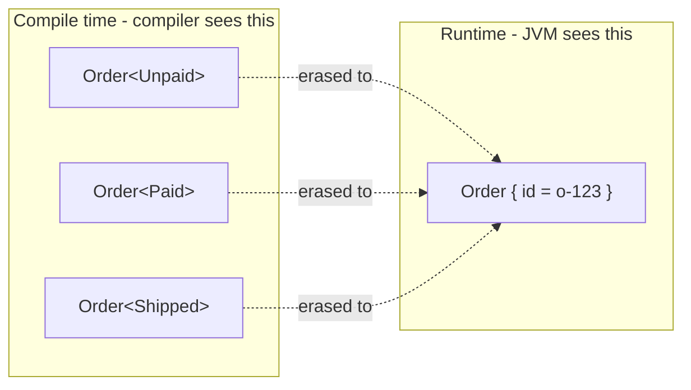

### The Core Idea in Three Sentences

1. Add a type parameter that **carries information** (for example, this order is paid).
2. Make the **only way** to obtain a given parameterization go through methods that *prove* the claim (factories like `pay()`, `validate()`, `open()`).
3. Let the compiler reject any code that uses a value in the wrong state.

> Analogy: a phantom type is like a coloured wristband at a conference. It carries no food or drink itself, but staff (the compiler) check its colour before letting you into a room. After the event (runtime), all wristbands go in the bin -- but during the event they control everything.

### Quick Recap

- Regular generic `T` = stored data. Phantom `S` = compile-time label only.
- Same runtime shape, different compile-time meaning. That is the whole trick.

---

<a name="5-the-problem-the-unsafe-way"></a>
## 5. The Problem: The Unsafe Way

This is the mutable state plus runtime-checks approach:

```java
enum OrderStatus { UNPAID, PAID, SHIPPED }

class Order {
    String id;
    OrderStatus status;   // mutable field -- anyone can rewrite it

    Order(String id) {
        this.id = id;
        this.status = OrderStatus.UNPAID;
    }
}

class Shipping {
    static void ship(Order order) {
        if (order.status != OrderStatus.PAID) {   // runtime check -- easy to forget
            throw new IllegalStateException("Order not paid: " + order.id);
        }
        System.out.println("Shipping " + order.id);
    }
}

// Caller: compiles fine, explodes at runtime
Order order = new Order("o-123");
Shipping.ship(order);   // IllegalStateException in production!
```

### Why This Is Fragile

| Problem | Explanation |
|---|---|
| **Compiler cannot distinguish unpaid from paid** | Both are just `Order`. The signature `ship(Order)` says nothing about required state. |
| **Boolean soup and runtime checks** | Every method must remember to re-check `status`. One forgotten `if` is a production bug. |
| **Possible illegal transitions** | Anyone can write `order.status = OrderStatus.SHIPPED` directly, skipping payment entirely. |
| **Errors surface late** | Bugs appear in testing or production instead of at compile time. |

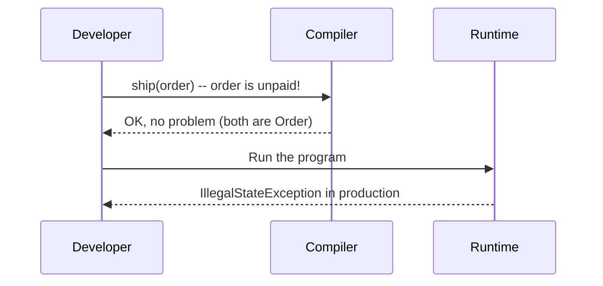

> Wrong implementation above: the `ship()` method trusts the caller and checks late. Correct implementation (next section) makes the wrong call unrepresentable.

---
<a name="6-the-solution-the-type-safe-way"></a>
## 6. The Solution: The Type-Safe Way

We encode the state **in the type** so illegal code does not compile.

### Step 1: Define the states (the ghosts)

```java
// Marker types: no fields, no methods -- exist only as labels.
public sealed interface OrderState permits Unpaid, Paid, Shipped { }

public final class Unpaid   implements OrderState { private Unpaid()   { } }
public final class Paid     implements OrderState { private Paid()     { } }
public final class Shipped  implements OrderState { private Shipped()  { } }
```

- Private constructors mean nobody can ever instantiate them.
- `sealed` guarantees no extra states can be added elsewhere.

### Step 2: Define the order with a phantom parameter

```java
public final class Order<S extends OrderState> {
    private final String id;                    // the ONLY runtime data

    private Order(String id) { this.id = id; }  // private: no outside construction

    public String id() { return id; }

    // Entry point: every new order starts as Unpaid
    public static Order<Unpaid> create(String id) {
        return new Order<>(id);
    }

    // Transitions: each accepts only the correct input state
    public static Order<Paid> pay(Order<Unpaid> order) {
        // e.g. charge card here, then:
        return new Order<>(order.id);
    }

    public static Order<Shipped> ship(Order<Paid> order) {
        System.out.println("Shipping " + order.id);
        return new Order<>(order.id);
    }
}
```

> Note: `S` is never used in a field or method body. It is *phantom*.

### Step 3: Use it

```java
Order<Unpaid>  o1 = Order.create("o-123");
Order<Paid>    o2 = Order.pay(o1);
Order<Shipped> o3 = Order.ship(o2);   // compiles

Order<Unpaid> bad = Order.create("o-999");
// Order.ship(bad);  // COMPILE-TIME ERROR (uncomment to see):
// incompatible types: Order<Unpaid> cannot be converted to Order<Paid>
```

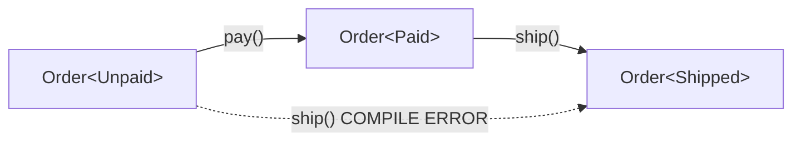

### Side-by-Side Comparison

| Aspect | Unsafe Way | Type-Safe Way |
|---|---|---|
| State lives in | A mutable field | The type |
| Illegal transition | Runtime exception | Compile error |
| Runtime overhead | Field + checks | None extra |
| Documentation value | Comments, naming | The method signature itself |
| Refactoring safety | Low | High: compiler finds every broken call site |

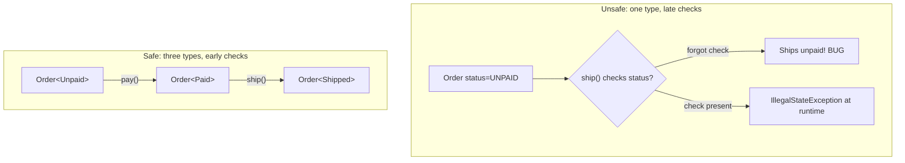

### Quick Recap

- Seal the states, privatize the constructor, expose only proving factories.
- After this, `ship()` can trust its argument -- the type *is* the proof.

---
<a name="7-how-it-works-under-the-hood-type-erasure"></a>
## 7. How It Works Under the Hood (Type Erasure)

Java generics are **erased** at compile time (JLS 4.6). After compilation, `Order<Unpaid>`, `Order<Paid>` and `Order<Shipped>` are all just `Order`. This is exactly why phantom types cost nothing at runtime.

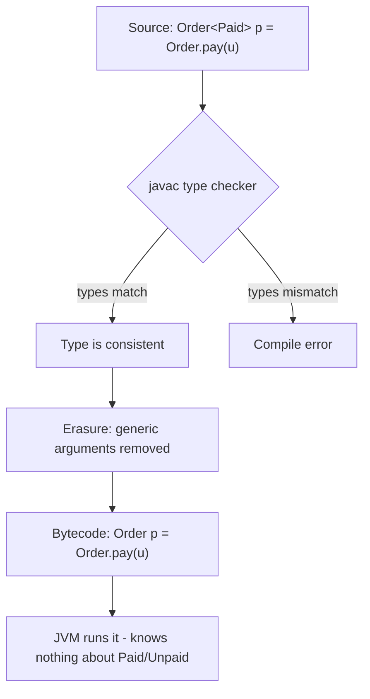

### Consequences of Erasure

- No extra memory is used for the phantom parameter.
- You **cannot** write `if (order instanceof Order<Paid>)`. It is illegal, because the info is gone at runtime.
- You cannot overload two methods that differ only by phantom argument:

```java
// WRONG -- does not compile: same erasure handle(Order)
// void handle(Order<Paid> o)    { }
// void handle(Order<Shipped> o) { }  // ERROR: name clash

// CORRECT -- use different method names:
void handlePaid(Order<Paid> o)       { }
void handleShipped(Order<Shipped> o) { }
```

> You can verify erasure yourself: compile `Order.java` and run `javap -c Order.class`. You will see plain `Order` references with no `Unpaid`/`Paid` in the bytecode. The `Signature` attribute retains generics for reflection on declarations, but method bodies and `instanceof` see only the raw type.

### Quick Recap

- Compiler checks, then erases. JVM never knows the label existed. That is the zero-cost guarantee -- and the source of the three limits above.

---

<a name="8-pattern-1-type-state-apis-order-lifecycle"></a>
## 8. Pattern 1: Type-State APIs (Order Lifecycle)

A **type-state API** is a design where the *available operations change with the state*, and the compiler enforces it.

### Example A: Order lifecycle (Section 6)

See `create -> pay -> ship` above. The key file is one `final class Order<S extends OrderState>` with static transitions.

### Example B: Document approval workflow (full working code)

```java
sealed interface DocState permits Draft, InReview, Approved { }
final class Draft    implements DocState { private Draft()    { } }
final class InReview implements DocState { private InReview() { } }
final class Approved implements DocState { private Approved() { } }

final class Document<S extends DocState> {
    private final String content;
    private Document(String content) { this.content = content; }

    static Document<Draft> newDraft(String text) { return new Document<>(text); }
    static Document<InReview> submit(Document<Draft> d)     { return new Document<>(d.content); }
    static Document<Approved> approve(Document<InReview> d) { return new Document<>(d.content); }
    static Document<Draft> reject(Document<InReview> d)     { return new Document<>(d.content); }

    static void publish(Document<Approved> d) {
        System.out.println("Publishing: " + d.content);
    }

    String content() { return content; }
}

// Usage:
// var draft = Document.newDraft("Hello");
// var review = Document.submit(draft);
// var approved = Document.approve(review);
// Document.publish(approved);        // OK
// Document.publish(draft);           // COMPILE ERROR: needs Document<Approved>
```

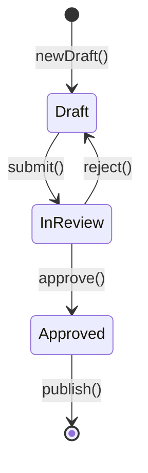

### Example C: Making a method work for *several* states

Use a sub-interface bound when an operation is valid in more than one state:

```java
sealed interface OrderState2 permits Unpaid2, Paid2, Shipped2, Cancelled { }
sealed interface Cancellable extends OrderState2 permits Unpaid2, Paid2 { }

final class Unpaid2    implements Cancellable { private Unpaid2()    { } }
final class Paid2      implements Cancellable { private Paid2()      { } }
final class Shipped2   implements OrderState2 { private Shipped2()   { } }
final class Cancelled  implements OrderState2 { private Cancelled()  { } }

// Inside Order2<S>:
// static Order2<Cancelled> cancel(Order2<? extends Cancellable> order) {
//     audit("cancel " + order.id());
//     return new Order2<>(order.id());
// }
// cancel(shippedOrder); // COMPILE ERROR -- Shipped2 is not Cancellable
```

> Pattern: introduce a `Cancellable extends OrderState` marker so `cancel()` accepts `Order<? extends Cancellable>`. `cancel(Order<Shipped>)` will not compile.

---
<a name="9-pattern-2-typed-identifiers"></a>
## 9. Pattern 2: Typed Identifiers

> From your content: *Different types, same runtime shape.*

### The Bug This Prevents

```java
// WRONG: every ID is a String, so swapped arguments are invisible.
User  findUser(String userId)   { return null; }
OrderX findOrder(String orderId){ return null; }

String uid = "u-123";
String oid = "o-123";
// findUser(oid);  // Compiles! Wrong ID, silent bug.
```

### The Fix (full working code)

```java
import java.util.Objects;

public record Id<T>(String value) {
    public Id {
        Objects.requireNonNull(value, "id value");
        if (value.isBlank()) throw new IllegalArgumentException("id must not be blank");
    }
}

final class UserTag  { private UserTag()  { } }
final class OrderTag { private OrderTag() { } }

// User  findUser(Id<UserTag> id)   { ... }
// Order findOrder(Id<OrderTag> id) { ... }

// Id<UserTag> uid = new Id<>("u-123");
// Id<OrderTag> oid = new Id<>("o-123");
// findUser(uid);   // OK
// findUser(oid);   // COMPILE ERROR: Id<OrderTag> is not Id<UserTag>
```

### Multi-argument example (where swaps really hurt)

```java
final class AccountTag  { private AccountTag()  { } }
final class CurrencyTag { private CurrencyTag() { } }

// void transfer(Id<AccountTag> from, Id<AccountTag> to, Id<CurrencyTag> currency) { ... }
// Mixing up from and currency is now a compile error.
```

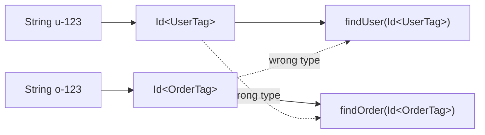

> Tip: an alternative is a separate wrapper record per ID (`record UserId(String v)`). That is simpler but repeats boilerplate for every entity. `Id<T>` gives you one reusable class. Prefer `Id<T>` when you have 3+ entity types; prefer dedicated records when an ID needs its own validation rules.

---

<a name="10-pattern-3-validated-data"></a>
## 10. Pattern 3: Validated Data

> From your content: *From runtime checks to static guarantees.* Validate once at the boundary; downstream code trusts the type.

```java
import java.util.Optional;

final class Raw       { private Raw()       { } }
final class Validated { private Validated() { } }

public final class Request<S> {
    private final String email;
    private final int age;

    private Request(String email, int age) {
        this.email = email;
        this.age = age;
    }

    public static Request<Raw> fromInput(String email, int age) {
        return new Request<>(email, age);
    }

    // The ONLY way to get Request<Validated>
    public static Optional<Request<Validated>> validate(Request<Raw> r) {
        if (r.email == null || !r.email.contains("@")) return Optional.empty();
        if (r.age < 0 || r.age > 150)                    return Optional.empty();
        return Optional.of(new Request<>(r.email, r.age));
    }

    public String email() { return email; }
    public int age()      { return age; }
}

class RegistrationService {
    // Demands proof of validation in the signature -- no re-checks needed.
    void register(Request<Validated> req) {
        System.out.println("Registering " + req.email());
    }
}

// Usage:
// var raw = Request.fromInput("ana@example.com", 30);
// Request.validate(raw).ifPresent(service::register);  // OK
// service.register(raw);  // COMPILE ERROR: needs Request<Validated>
```

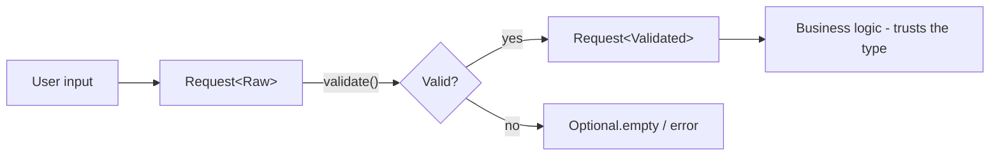

This is a lightweight version of the well-known principle **parse, do not validate** (Parker, Alexis King). Validate at the edge, encode success in the type, and inner layers stay clean.

---
<a name="11-pattern-4-units-of-measure"></a>
## 11. Pattern 4: Units of Measure

Mixing units is famously dangerous (Mars Climate Orbiter: pound-force vs newton). Phantom types make the unit part of the signature. The `double` is still just 8 bytes -- the unit is free.

```java
final class Meters { private Meters() { } }
final class Feet   { private Feet()   { } }

public record Length<U>(double value) {
    public Length<U> plus(Length<U> other) {
        return new Length<>(value + other.value);
    }
}

// Conversion is explicit:
// static Length<Meters> feetToMeters(Length<Feet> f) {
//     return new Length<>(f.value() * 0.3048);
// }

// Length<Meters> a = new Length<>(10);
// Length<Feet> b = new Length<>(30);
// a.plus(a);                // OK
// a.plus(b);                // COMPILE ERROR: Length<Feet> is not Length<Meters>
// a.plus(feetToMeters(b));  // OK, explicit conversion
```

---

<a name="12-pattern-5-resource-handles-openclosed"></a>
## 12. Pattern 5: Resource Handles (Open/Closed)

Prevent use-after-close and use-before-open bugs by encoding handle state.

```java
final class Open   { private Open()   { } }
final class Closed { private Closed() { } }

public final class Connection<S> {
    private final String url;
    private Connection(String url) { this.url = url; }

    public static Connection<Closed> create(String url) {
        return new Connection<>(url);
    }

    public static Connection<Open> open(Connection<Closed> c) {
        System.out.println("Opening " + c.url);
        return new Connection<>(c.url);
    }

    public static String query(Connection<Open> c, String sql) {
        return "result of " + sql + " on " + c.url;
    }

    public static Connection<Closed> close(Connection<Open> c) {
        System.out.println("Closing " + c.url);
        return new Connection<>(c.url);
    }
}

// var c0 = Connection.create("db://local");
// Connection.query(c0, "SELECT 1");  // COMPILE ERROR: not open
// var c1 = Connection.open(c0);
// Connection.query(c1, "SELECT 1");  // OK
// var c2 = Connection.close(c1);
// Connection.query(c2, "SELECT 1");  // COMPILE ERROR: closed
```

> Caveat: Java has no linear/affine types, so you can still keep using the *old* `c1` variable after closing. Phantom types stop **wrong-state** usage, not **stale-reference** usage. Mitigation: make handles immutable and adopt a convention (or static analysis rule) to always reassign: `c = Connection.close(c);` and never touch the old binding. For strict linear guarantees, consider Rust or a separate per-state wrapper that nulls internals on close.

---

<a name="13-pattern-6-staged-builders"></a>
## 13. Pattern 6: Staged Builders

Force required fields to be set before `build()` is callable -- with two phantom flags.

```java
final class Yes { private Yes() { } }
final class No  { private No()  { } }

public final class HttpRequestBuilder<HasUrl, HasMethod> {
    private final String url;
    private final String method;

    private HttpRequestBuilder(String url, String method) {
        this.url = url;
        this.method = method;
    }

    public static HttpRequestBuilder<No, No> newBuilder() {
        return new HttpRequestBuilder<>(null, null);
    }

    public static <M> HttpRequestBuilder<Yes, M> url(
            HttpRequestBuilder<No, M> b, String url) {
        return new HttpRequestBuilder<>(url, b.method);
    }

    public static <U> HttpRequestBuilder<U, Yes> method(
            HttpRequestBuilder<U, No> b, String method) {
        return new HttpRequestBuilder<>(b.url, method);
    }

    // build() only accepts a fully configured builder
    public static String build(HttpRequestBuilder<Yes, Yes> b) {
        return b.method + " " + b.url;
    }
}

// var b = HttpRequestBuilder.newBuilder();
// HttpRequestBuilder.build(b);  // COMPILE ERROR: needs <Yes, Yes>
// var b2 = HttpRequestBuilder.method(
//     HttpRequestBuilder.url(b, "https://api.example.com"), "GET");
// HttpRequestBuilder.build(b2);  // OK: "GET https://api.example.com"
```

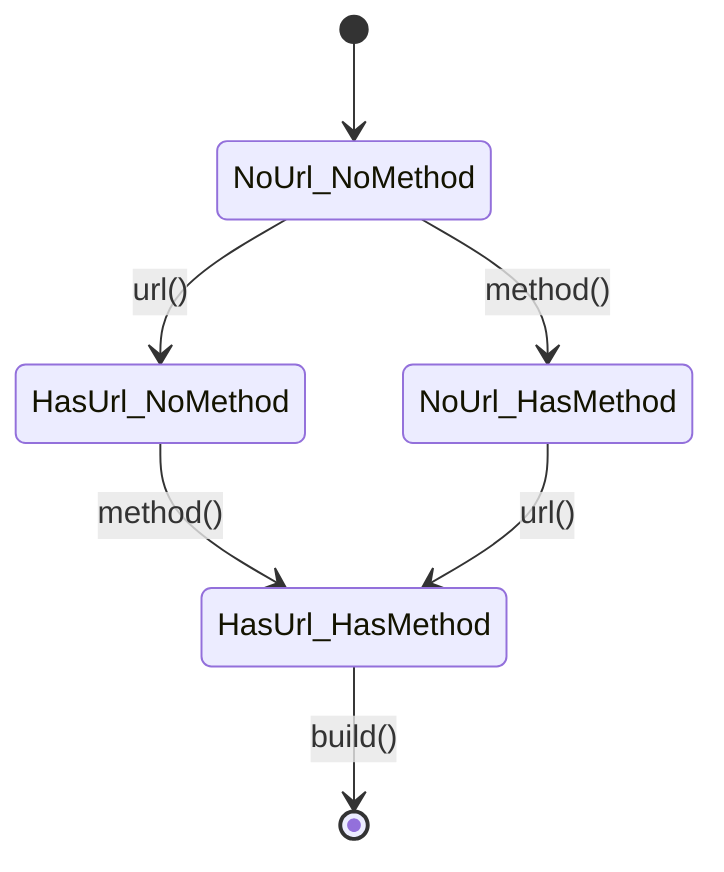

---
<a name="14-multiple-implementation-approaches-compared"></a>
## 14. Multiple Implementation Approaches Compared

Pick the lightest tool that still makes the bug impossible. Phantom types shine when a wrong-state bug is *costly* (money, safety, security-adjacent correctness).

| Approach | Safety | Boilerplate | Runtime cost | Refactoring safety | When to choose |
|---|---|---|---|---|---|
| Enum field + `if` checks | Low: forgotten check = bug | Minimal | Field + branches | Low | Prototypes, 2-state throwaway code |
| Bean Validation (`@NotNull`, `@Email`) | Medium: still runtime, stringly messages | Low | Reflection/validators | Medium | Form/DTO validation at REST boundary (combine with `Request<Validated>`) |
| Per-state wrapper classes (`UnpaidOrder`, `PaidOrder`) | High: different data per state possible | High: one class per state | None extra | High | States need *different fields* (e.g. `Paid` has receipt, `Shipped` has tracking) |
| **Phantom types** (`Order<S>`) | High: illegal states unrepresentable | Medium: one class + markers | **Zero** (erased) | High | Same data, different meaning; 3+ entities sharing `Id<T>`; units; validated data |
| State machine library | High + visualization | Dependency | Small | Medium | Complex graphs with persistence/monitoring needs |

> Rule of thumb: same data + stage-dependent operations = phantom types. Different data per stage = separate wrapper classes (optionally sharing a sealed super-interface). Both can coexist: `Order<S>` for flow, `@Valid` at the HTTP boundary.

---

<a name="15-real-world-use-cases"></a>
## 15. Real-World Use Cases

| Domain | Phantom type usage | Bug prevented |
|---|---|---|
| **E-commerce** | `Order<Unpaid/Paid/Shipped>` | Shipping unpaid orders |
| **Banking** | `Money<USD>`, `Money<EUR>` | Adding different currencies |
| **Web security** | `Html<Escaped>` vs `Html<Raw>` | XSS from unescaped output |
| **Databases** | `Id<UserTag>`, `Id<OrderTag>` | Querying with the wrong key |
| **APIs / Forms** | `Request<Raw>` to `Request<Validated>` | Processing unvalidated input |
| **Networking** | `Socket<Connected>` | Sending on a closed socket |
| **Files** | `FileHandle<ReadOnly/ReadWrite>` | Writing to a read-only file |
| **Auth** | `User<Authenticated>` (design aid only!) | Calling protected code anonymously (still enforce server-side!) |
| **Physics / Science** | `Quantity<Meters>`, `Quantity<Seconds>` | Unit mix-ups |
| **Cryptography** | `Key<Public>` vs `Key<Private>` | Leaking or misusing keys |

### Mini Case Study: Preventing XSS (full working code)

```java
final class Escaped { private Escaped() { } }
final class Unsafe  { private Unsafe()  { } }

record Html<S>(String text) {
    static Html<Unsafe> fromUser(String s) { return new Html<>(s); }

    static Html<Escaped> escape(Html<Unsafe> h) {
        String safe = h.text()
            .replace("&", "&amp;")
            .replace("<", "&lt;")
            .replace(">", "&gt;");
        return new Html<>(safe);
    }
}

// void render(Html<Escaped> html) { response.write(html.text()); }
// render(Html.fromUser("<script>alert(1)</script>"));            // COMPILE ERROR
// render(Html.escape(Html.fromUser("<script>alert(1)</script>"))); // OK
```

The compiler now forces every code path to pass through `escape` before rendering. (Output-encoding library + CSP headers still required -- see Section 17.)

### Choosing the Right Pattern

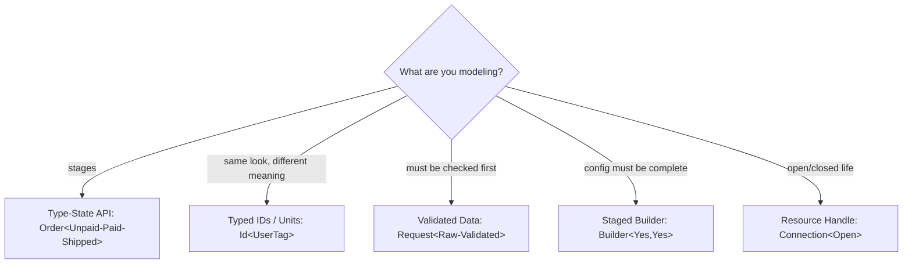

---
<a name="16-performance-considerations"></a>
## 16. Performance Considerations

Phantom types are a **zero-cost abstraction** on the JVM:

| Concern | Reality | Evidence |
|---|---|---|
| Extra memory per object | None: phantom parameter has no field | `javap -c Order.class` shows one `String id` field only |
| Extra CPU per call | None: transitions are plain constructors | Same bytecode as enum version minus branches |
| Class-file bloat | Tiny: one `Order.class` + tiny marker classes | Markers have no members; JIT treats them as absent |
| Megamorphic risk | None: transitions are static, easily inlined | No virtual dispatch on `S` |
| When *not* to use | State explosion (20+ markers) hurts readability more than it helps safety | Prefer a state-machine lib or DB-driven workflow |

> Keep it proportionate: use phantom types where a wrong-state bug is *costly* (money movement, shipping, units, validated input), not for every boolean in your codebase. Over-modeling creates generic-signature noise that slows readers down.

---

<a name="17-security-considerations"></a>
## 17. Security Considerations

> The infographic legend makes three points worth spelling out:

| Symbol | Meaning | Explanation |
|---|---|---|
| Ghost | **Compile-time only** | The phantom type is visible only to the compiler. |
| No-entry | **Erased at runtime** | No additional data is stored or checked. |
| Shield | **Not a security feature** | Reflection, unsafe casts, or deserialization can forge any state. Do not use phantom types as authorization. |

Phantom types are a **correctness and API-design tool**, not a replacement for:

- Real authentication and authorization checks (server-side, per request).
- Input validation at trust boundaries (they *encode* the result of validation, they do not perform it).
- Database constraints or business-rule enforcement.
- Output encoding + Content-Security-Policy for XSS (the `Html<Escaped>` pattern forces the call, but the `escape()` function itself must be correct and complete).

```java
// WRONG: trusting a phantom type across a trust boundary
// Order<Paid> o = objectMapper.readValue(json, Order.class); // unchecked! must re-validate
// CORRECT: deserialize to Raw/untyped, then re-prove:
// Order<Unpaid> fresh = Order.create(dto.id());
// Order<Paid> paid = paymentGateway.confirm(fresh); // server-side proof
```

---

<a name="18-testing-strategies"></a>
## 18. Testing Strategies

| Layer | What to test | How |
|---|---|---|
| Factories | `create/pay/ship/validate/open` happy paths | Plain JUnit 5 asserts on resulting data |
| Validation | `validate(badEmail)` returns `Optional.empty()` | `assertTrue(...isEmpty())`, boundary ages -1/0/150/151 |
| Illegal states | Wrong-state code does not compile | Compilation tests: keep `src/test/resources/negative/*.java` snippets that must fail `javac`; assert failure in CI (or use a compile-testing lib) |
| No unchecked leaks | No raw types or casts | `javac -Xlint:unchecked -Werror` in build; fail on warnings |
| Serialization | JSON round-trip re-proves state | Deserialize to DTO, then call factory; never deserialize directly to `Order<Paid>` |
| Mutation | Stale handle reuse | Test that `close(open(c))` returns new object and old `c1` is documented as stale |

```java
// Example: JUnit 5 for validated data
// @Test void rejectsBadEmail() {
//     var raw = Request.fromInput("not-an-email", 30);
//     assertTrue(Request.validate(raw).isEmpty());
// }
// @Test void fullOrderFlow() {
//     var shipped = Order.ship(Order.pay(Order.create("o-1")));
//     assertEquals("o-1", shipped.id());
// }
```

---
<a name="19-migration-guide-enum-status-to-phantom-types"></a>
## 19. Migration Guide: Enum-Status to Phantom Types

Migrate incrementally -- both models can coexist behind overloads during the transition.

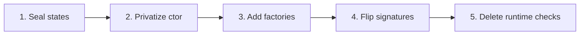

| Step | Action | Example |
|---|---|---|
| 1 | Introduce `sealed interface OrderState` + markers alongside existing enum | Keep `OrderStatus` temporarily |
| 2 | Add `Order<S>` with private ctor; keep old `Order` as `LegacyOrder` or facade | `LegacyOrder.toPhantom()` helper |
| 3 | Add `create/pay/ship` factories; delegate to existing payment/shipping logic | No behaviour change yet |
| 4 | Flip one call site at a time: `ship(Order)` to `ship(Order<Paid>)`; compiler lists the rest | Fix each compile error = one migrated site |
| 5 | Delete `status` field + `if` checks; remove enum; enable `-Werror` | Verify with full test suite |

Rollback: keep the enum version in git history; a thin `toLegacy()` converter lets you revert one service at a time.

---

<a name="20-best-practices-checklist"></a>
## 20. Best Practices Checklist

- [ ] Use **sealed interfaces** for the set of states so the list is closed.
- [ ] Make state marker classes **final with private constructors**.
- [ ] Bound the parameter: `<S extends OrderState>`, so `Order<String>` is rejected.
- [ ] Keep entity constructors **private**; expose factories and transitions.
- [ ] Make entities **immutable** (`final` fields, no setters).
- [ ] Name transitions clearly (`pay`, `ship`, `validate`, `open`, `close`).
- [ ] Prefer returning a **new** typed value over mutating state.
- [ ] Enable `-Xlint:unchecked` and treat warnings as errors (`-Werror`).
- [ ] Keep it proportionate: use phantom types where a wrong-state bug is *costly*, not everywhere.
- [ ] Document the state diagram next to the class (Mermaid `stateDiagram-v2`).

---

<a name="21-anti-patterns"></a>
## 21. Anti-Patterns

| Anti-pattern | Why it breaks the guarantee | Fix |
|---|---|---|
| Public constructor / public record | Anyone can `new Order<Paid>("x")` without paying | Private ctor + factories; avoid public records for guarded entities |
| Raw types + unchecked casts | `(Order<Paid>) raw` forges proof with a warning | `-Xlint:unchecked -Werror`; code review for casts |
| `instanceof Order<Paid>` | Illegal (erased); will not compile | Branch on separate wrapper types or carry an explicit enum for runtime dispatch |
| Overloads differing only by phantom arg | Same erasure: `handle(Order)` clash | Distinct names: `handlePaid` / `handleShipped` |
| `String`-typed IDs everywhere | Swaps invisible | `Id<Tag>` per entity |
| Phantom type as auth (`User<Authenticated>`) | Client can forge; no runtime check | Server-side session check per request; phantom only documents intent |
| Reusing stale handle after `close()` | Old variable still in scope | Reassign (`c = close(c)`) + immutability |
| Mega-state explosion (20+ markers) | Signature noise, unreadable errors | State-machine lib or DB workflow |

---
<a name="22-common-pitfalls--troubleshooting"></a>
## 22. Common Pitfalls / Troubleshooting

| Symptom (compiler / runtime) | Cause | Fix |
|---|---|---|
| `incompatible types: Order<Unpaid> cannot be converted to Order<Paid>` | Calling `ship(unpaid)` | Insert `pay()` first: `ship(pay(o))` |
| `name clash: handle(Order) has same erasure` | Two overloads differing only by phantom arg | Rename to `handlePaid` / `handleShipped` |
| `illegal generic type for instanceof` | `instanceof Order<Paid>` (erased) | Redesign: separate classes or explicit status field for dispatch |
| `unchecked cast / raw type warning` | `(Order<Paid>) raw` forgery | Remove cast; obtain via factory; enable `-Werror` |
| `new Order<Paid>(x) bypasses pay()` | Public ctor or public record canonical ctor | Make ctor private; use `final class` (records must expose canonical ctor) |
| `cannot infer type-variable(s) S` | Missing bound or ambiguous factory | Add `<S extends OrderState>`; give explicit witness `Order.<Paid>...` |
| JSON deserializes to wrong state | Jackson/Gson ignore phantom arg | Deserialize to DTO/`Order<Unpaid>`, then re-validate |
| Stale `c1` still queries after close | Java has no linear types | Reassign handles; document staleness; consider wrappers |

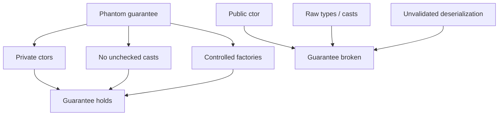

> Records warning from your content: a record canonical constructor must be at least as visible as the record itself. A `public record Order<S>(String id)` lets anyone call `new Order<Paid>("x")`. For strong guarantees, use a `final class` with a private constructor, or keep the record package-private.

---

<a name="23-hands-on-lab-build-a-document-approval-service"></a>
## 23. Hands-On Lab: Build a Document Approval Service

**Goal (30-40 min):** ship a `Document<Draft/InReview/Approved>` pipeline plus a `Money<USD/EUR>` ledger that refuses to mix currencies.

**Steps:**

1. Create `DocState`, `Draft`, `InReview`, `Approved` (Section 8, Example B). Compile with `javac -Xlint:unchecked DocState.java Document.java`.
2. Add `submit/reject/approve/publish`. Write a `Main` that runs `newDraft -> submit -> approve -> publish`. Confirm it prints.
3. Uncomment `Document.publish(draft);` -- confirm the exact `incompatible types` error, then re-comment.
4. Add currency: `final class USD/EUR`, `record Money<C>(long cents)` with `plus(Money<C>)` and `convertUSDToEUR(Money<USD>, BigDecimal rate)`. Confirm `usd.plus(eur)` fails to compile.
5. Add `Request<Raw/Validated>` gate in front of publishing: only `Validated` docs publish.
6. Stretch: add `Cancelled` + `Cancellable` bound (Section 8C) and a `cancel()` that rejects `Approved`.

**Done when:** `Main` compiles clean with `-Werror`, negative snippets fail as expected, and `publish()` has no `if (status...)` checks left.

---
<a name="24-practice-exercises-with-solutions"></a>
## 24. Practice Exercises (with Solutions)

### Exercise 1: Traffic Light (full solution)

Model `Light<Red>`, `Light<Green>`, `Light<Yellow>` with `Red -> Green -> Yellow -> Red`. Only `cross(Light<Green>)` may cross.

```java
sealed interface LightState permits Red, Green, Yellow { }
final class Red    implements LightState { private Red()    { } }
final class Green  implements LightState { private Green()  { } }
final class Yellow implements LightState { private Yellow() { } }

final class Light<S extends LightState> {
    private Light() { }
    static Light<Red>    start()               { return new Light<>(); }
    static Light<Green>  go(Light<Red> l)      { return new Light<>(); }
    static Light<Yellow> slow(Light<Green> l)  { return new Light<>(); }
    static Light<Red>    stop(Light<Yellow> l){ return new Light<>(); }
    static void cross(Light<Green> l)           { System.out.println("Crossing"); }
}
// Light.cross(Light.go(Light.start())); // OK
// Light.cross(Light.start());            // COMPILE ERROR -- needs Green
```

### Exercise 2: Currency safety (solution sketch)

```java
final class USD { private USD() { } }
final class EUR { private EUR() { } }
record Money<C>(long cents) {
    Money<C> plus(Money<C> other) { return new Money<>(cents + other.cents); }
    static Money<EUR> convertUSDToEUR(Money<USD> m, double rate) {
        return new Money<>((long) (m.cents() * rate));
    }
}
// new Money<USD>(100).plus(new Money<USD>(50)); // OK
// new Money<USD>(100).plus(new Money<EUR>(50)); // COMPILE ERROR
```

### Exercise 3: Read/write files (solution sketch)

```java
final class ReadOnly  { private ReadOnly()  { } }
final class ReadWrite { private ReadWrite() { } }
final class FileHandle<S> {
    private final String path;
    private FileHandle(String p) { path = p; }
    static FileHandle<ReadOnly> openRead(String p)  { return new FileHandle<>(p); }
    static FileHandle<ReadWrite> openWrite(String p){ return new FileHandle<>(p); }
    static String read(FileHandle<?> h)              { return "data:" + h.path; }
    static void write(FileHandle<ReadWrite> h, String d) { System.out.println("write " + d); }
}
// FileHandle.write(FileHandle.openRead("a"), "x"); // COMPILE ERROR
```

### Exercise 4: Multi-state cancel (solution sketch)

Add `Cancelled` + `Cancellable extends OrderState` (permits `Unpaid`, `Paid`); `cancel(Order<? extends Cancellable>)` returns `Order<Cancelled>`. `cancel(shipped)` fails because `Shipped` does not implement `Cancellable`. See Section 8C.

### Exercise 5: Break it, then harden it

```java
// FORGERY (do not do this):
// Order raw = Order.create("o-1");
// Order<Shipped> fake = (Order<Shipped>) raw; // unchecked warning, compiles
// Order.ship(fake); // lies to the compiler!
// HARDENING: private ctor + -Werror + no raw types in review + re-validate after deserialization.
// Strongest: separate wrapper classes per state when forgery risk is high.
```

---

<a name="25-pro-tips"></a>
## 25. Pro Tips

- **Pro Tip 1:** draw the state diagram *first* (Mermaid `stateDiagram-v2`), then write markers to match it. Reviewers grasp the diagram faster than signatures.
- **Pro Tip 2:** for multi-state ops, prefer a `Cancellable`-style bound over overloads -- one method, compiler-enforced.
- **Pro Tip 3:** `Id<T>` wins at 3+ entities; dedicated `UserId` records win when one ID has unique validation.
- **Pro Tip 4:** keep `validate()` returning `Optional<Request<Validated>>` (or `Result`/`Either`) -- the empty case *is* the error path, not an exception.
- **Pro Tip 5:** never deserialize directly to a trusted state. Deserialize to DTO, then re-prove via factory.
- **Pro Tip 6:** combine with Bean Validation at the HTTP edge (`@Email`), then lift into `Request<Validated>` for the inner layers.

---
<a name="26-test-your-understanding"></a>
## 26. Test Your Understanding

Try these before peeking at the Question Bank answers:

1. What makes a type parameter phantom as opposed to regular?
2. Why are `Order<Unpaid>` and `Order<Paid>` different to `javac` but identical at runtime?
3. Write the three transition signatures for `create/pay/ship`.
4. What compiler error do you get from `Order.ship(Order.create("x"))`?
5. Why must marker classes have private constructors?
6. Why must the entity constructor be private (and why are public records risky)?
7. What does `sealed interface OrderState permits ...` buy you?
8. Why is `instanceof Order<Paid>` illegal?
9. Why do two overloads differing only by phantom arg clash?
10. How does `Id<UserTag>` prevent swapped-argument bugs?
11. Where should `validate()` live, and what should it return?
12. Name two ways to forge a phantom state, and how to block each.

---

<a name="27-question-bank-55-questions"></a>
## 27. Question Bank (55 Questions)

### Beginner (Q1-Q20)

1. Define phantom type in one sentence. -- A generic parameter declared but never stored, used only for compile-time distinction.
2. Contrast `Box<T>` with `Order<S>`. -- `T` is stored/returned; `S` never appears in fields.
3. What is the only runtime data in `Order<S>`? -- `String id`.
4. What does `sealed` guarantee? -- Closed set of permitted subtypes.
5. Why private constructors on markers? -- Prevents instantiation; they are labels only.
6. What is the entry point for orders? -- `Order.create(id)` returning `Order<Unpaid>`.
7. What does `pay()` accept/return? -- Accepts `Order<Unpaid>`, returns `Order<Paid>`.
8. What does `ship()` accept/return? -- Accepts `Order<Paid>`, returns `Order<Shipped>`.
9. What error does shipping an unpaid order produce? -- `incompatible types: Order<Unpaid> cannot be converted to Order<Paid>`.
10. What is type erasure? -- Removal of generic args at compile time (JLS 4.6).
11. Do phantom types use extra memory? -- No.
12. Can you `instanceof Order<Paid>`? -- No: erased, illegal.
13. Can you overload on phantom arg alone? -- No: same erasure, name clash.
14. What is a marker type? -- Empty final class with private ctor, used as label.
15. Why bound `<S extends OrderState>`? -- Rejects `Order<String>`.
16. Why make entities immutable? -- Stale references stay harmless.
17. What is `Id<T>`? -- One reusable typed-identifier record.
18. What are `UserTag`/`OrderTag`? -- Phantom labels distinguishing ID kinds.
19. What is `Request<Raw>` vs `Request<Validated>`? -- Unchecked input vs proven-valid data.
20. What principle does validated data embody? -- Parse, do not validate.

### Intermediate (Q21-Q40)

21. How does `cancel(Order<? extends Cancellable>)` work? -- Accepts only states implementing `Cancellable`.
22. Why can `cancel(shipped)` not compile? -- `Shipped` does not extend `Cancellable`.
23. How do units prevent Mars-style bugs? -- `plus(Length<U>)` only accepts same unit; conversion explicit.
24. What is the conversion function for feet/meters? -- `feetToMeters(Length<Feet>)` multiplying by 0.3048.
25. How do resource handles prevent use-after-close? -- `query()` demands `Connection<Open>`.
26. What do phantom handles *not* prevent? -- Stale-reference reuse; no linear types in Java.
27. How do staged builders enforce completeness? -- `build()` demands `Builder<Yes,Yes>`.
28. How does `Html<Escaped>` prevent XSS? -- `render()` demands escaped; every path must call `escape()`.
29. Is `Html<Escaped>` sufficient for security alone? -- No: needs correct escaping + CSP + review.
30. Phantom vs per-state wrappers: when wrappers? -- When states need different fields.
31. Phantom vs enum+checks: main trade-off? -- Zero runtime cost + compile errors vs minimal boilerplate.
32. Why keep transitions static? -- Java cannot restrict instance methods by `S`; statics take state-specific args.
33. Why return new values instead of mutating? -- Preserves immutability; stale refs harmless.
34. What javac flags protect guarantees? -- `-Xlint:unchecked -Werror`.
35. How do raw types forge states? -- `(Order<Paid>) raw` with unchecked warning.
36. How does deserialization forge states? -- Libraries ignore phantom args; must re-validate.
37. Why are public records risky here? -- Canonical ctor must be public; anyone can forge.
38. How to migrate incrementally? -- Seal states, add factories, flip signatures one site at a time.
39. When should you *not* use phantom types? -- Cheap bugs, 20+ states, or differing per-state data.
40. What does `javap -c` show for `Order`? -- Plain `Order` with one `String` field; no markers.

### Advanced (Q41-Q55)

41. How would you test that illegal code does not compile? -- Negative compile tests failing `javac` in CI.
42. How to combine Bean Validation with phantom types? -- `@Valid` at edge, lift into `Request<Validated>` inside.
43. How to model `Paid+Shipped` cancellable-until-shipped with refunds? -- `Cancellable` bound + `Refundable` sub-bound returning `Order<Refunded>`.
44. Why no virtual dispatch on `S`? -- `S` is erased; transitions are static and inlineable.
45. How do reflection/serialization see `Order<Paid>`? -- Raw `Order`; `Signature` attribute only on declarations.
46. How to debug `cannot infer type-variable(s) S`? -- Add explicit bound/witness; check factory generics.
47. How to handle runtime dispatch needing state? -- Carry explicit enum alongside, or use visitor/wrappers.
48. Compare `Id<T>` vs per-entity records at scale. -- `Id<T>` less boilerplate; dedicated records allow per-ID rules.
49. How to prevent stale-handle reuse in review? -- Reassign convention + immutability + static analysis.
50. What is the trust-boundary rule for `Order<Paid>` from JSON? -- Never trust; deserialize to DTO then re-prove.
51. How do Haskell/Rust compare for phantom/typestate? -- Haskell: phantom types idiomatic; Rust: typestate + ownership gives linear guarantees Java lacks.
52. How to document a phantom API? -- State diagram + transition table next to class.
53. What is the biggest readability risk? -- Generic-signature noise from over-modeling.
54. How to version a phantom API? -- Add new markers/factories; keep old transitions deprecated one release.
55. When would you choose a state-machine library instead? -- Persistent/long-lived workflows needing monitoring.

---
<a name="28-common-interview-questions"></a>
## 28. Common Interview Questions

1. **What is a phantom type?** -- Generic parameter never stored; lets the compiler distinguish identical-at-runtime values.
2. **How do phantom types differ from regular generics?** -- Regular `T` describes stored data; phantom `S` is a compile-time label.
3. **Why do phantom types cost nothing at runtime?** -- Erasure removes them; one `Order.class` remains.
4. **Why can illegal transitions become compile errors?** -- Transitions demand specific `Order<State>` inputs; wrong state mismatches the signature.
5. **Why keep constructors private?** -- Otherwise anyone forges `new Order<Paid>` without proof.
6. **What breaks if you use a public record?** -- Public canonical ctor allows forgery; use private-ctor class.
7. **Why can two `handle(Order<Paid/Shipped>)` overloads not coexist?** -- Same erasure `handle(Order)`; use distinct names.
8. **How do you allow one method for several states?** -- Bounded wildcard: `cancel(Order<? extends Cancellable>)`.
9. **How do typed IDs stop swap bugs?** -- `findUser(Id<UserTag>)` rejects `Id<OrderTag>` at compile time.
10. **Validated data: where is the check, where is the trust?** -- Check once in `validate()` at boundary; trust `Request<Validated>` inside.
11. **Are phantom types a security mechanism?** -- No: casts/reflection/deserialization forge them; enforce auth server-side.
12. **How would you migrate a status-enum service?** -- Add markers + factories beside enum, flip signatures per call site, delete checks, enable `-Werror`.

---

<a name="29-self-assessment-checklist"></a>
## 29. Self-Assessment Checklist

- [ ] I can define phantom vs regular generics and draw the compile/runtime split.
- [ ] I can write `Order<S>` with sealed states, private ctor, and `create/pay/ship`.
- [ ] I can explain erasure limits: no `instanceof`, no phantom-only overloads.
- [ ] I can apply `Id<T>`, `Request<Raw/Validated>`, `Length<U>`, `Connection<S>`, staged builders.
- [ ] I can migrate an enum-status codebase incrementally.
- [ ] I build with `-Xlint:unchecked -Werror` and test negative compilation.
- [ ] I never trust phantom types across trust boundaries without re-validation.

---

<a name="30-summary-and-key-takeaways"></a>
## 30. Summary and Key Takeaways

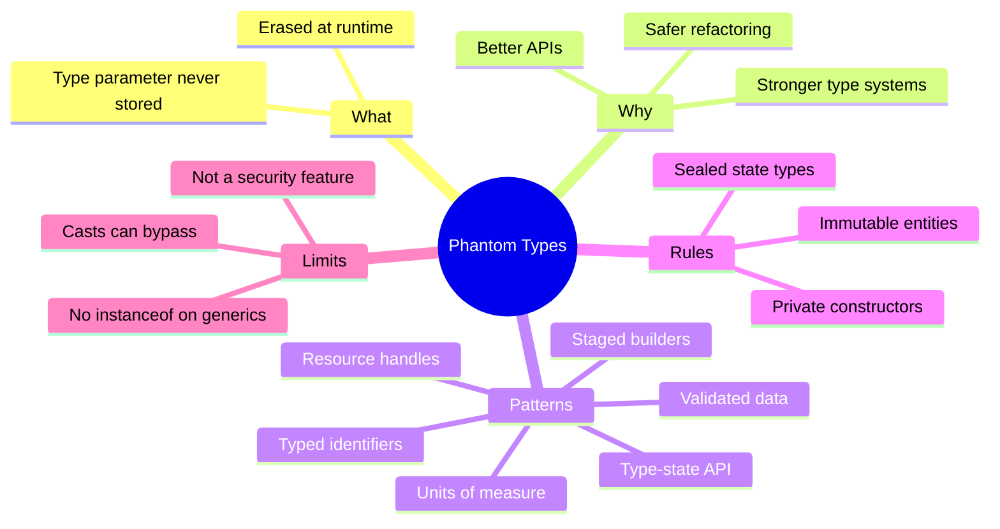

**Key takeaways (from your content):**

1. A phantom type parameter lets the compiler distinguish values that are **identical at runtime**.
2. It moves a class of bugs (illegal transitions, mixed-up IDs, unvalidated data) from **runtime to compile time**.
3. It costs **nothing at runtime** thanks to type erasure.
4. The guarantee is only as strong as your **encapsulation**: private constructors and controlled factories are essential.
5. It is a **design aid, not a security mechanism**.

> Better APIs / Stronger Type Systems / Safer Refactoring -- the three promises on the infographic, delivered by one ghost parameter.

---

<a name="31-further-reading-and-learning-path"></a>
## 31. Further Reading and Learning Path

| Resource | Why |
|---|---|
| JLS 4.6 (Type Erasure) + JLS 8.1.6 (Sealed) | Authoritative erasure/sealed semantics |
| *Effective Java* (Bloch), Items on generics/immutability | API-design grounding |
| Parse, Do Not Validate (Parker; Kings Thinking with Types) | Validated-data philosophy |
| Haskell phantom types / Rust typestate literature | Linear guarantees Java lacks; design inspiration |
| Your next steps | 1. Convert one enum-status class. 2. Introduce `Id<T>`. 3. Gate one form with `Request<Validated>`. 4. Add `-Werror` + negative compile tests |

*Last Updated: 2026-10-05* - *Difficulty: Intermediate* - *Part of the knowledge-base tutorial series, created per tutorial-preferences.md requirements.*

*Source: Content provided by the user (Phantom Types in Java), augmented with erasure/JLS notes, approach comparisons, testing/migration guides, and production context to meet the comprehensive deep-dive standard.*
