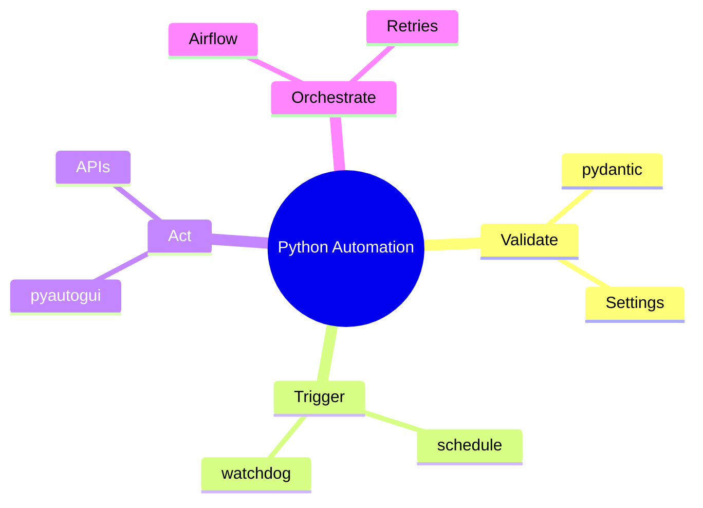
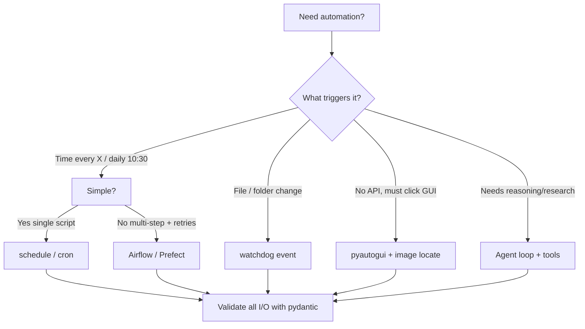
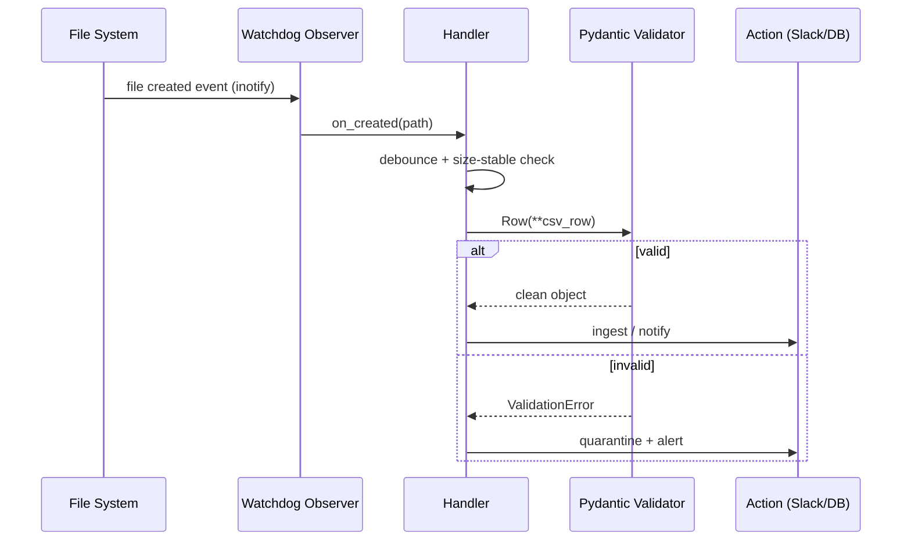
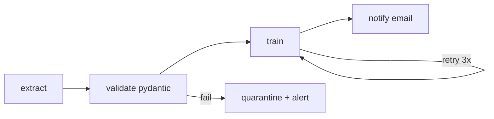
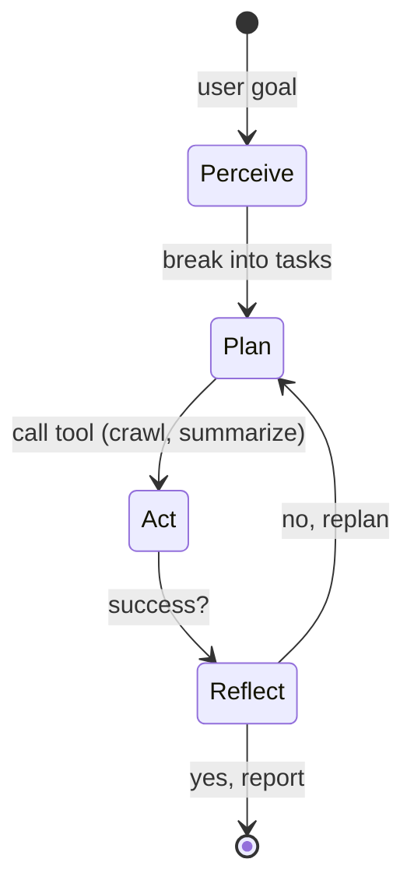
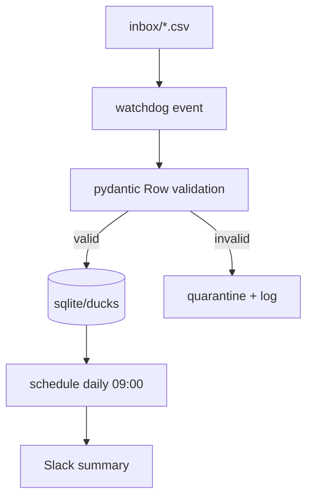

# Python Automation Superpowers: Master 6 Libraries

> **Difficulty:** Intermediate | **Reading Time:** ~55-60 min + Labs | **Last Updated:** 2026-10-01
> **Python:** 3.9+ | **Stack:** pydantic v2, schedule, pyautogui, watchdog, airflow 2.x, agents

Based on *These 6 Python Libraries Made Me Look Like a Genius* by Abdul Ahad — expanded and corrected.

> How to use: Each section goes Simple -> Realistic -> Production. Run code as you go.
## Table of Contents
- [1. Introduction](#1-introduction--overview)
- [2. Prerequisites](#2-prerequisites)
- [3. Learning Objectives](#3-learning-objectives)
- [4. Automation Landscape](#4-automation-landscape-overview)
- [5. Pydantic](#5-deep-dive-1-pydantic)
- [6. Schedule](#6-deep-dive-2-schedule)
- [7. PyAutoGUI](#7-deep-dive-3-pyautogui)
- [8. Watchdog](#8-deep-dive-4-watchdog)
- [9. Airflow](#9-deep-dive-5-airflow)
- [10. Agents](#10-deep-dive-6-agents)
- [11. Capstone](#11-capstone-project)
- [12. Real-World Uses](#12-real-world-examples)
- [13. Approaches](#13-multiple-implementation-approaches)
- [14. Best Practices](#14-best-practices)
- [15. Anti-Patterns](#15-anti-patterns)
- [16. Performance](#16-performance-considerations)
- [17. Security](#17-security-considerations)
- [18. Testing](#18-testing-strategies)
- [19. Troubleshooting](#19-troubleshooting)
- [20. Migration](#20-migration-guides)
- [21. Summary](#21-summary)
- [22. Exercises](#22-practice-exercises-with-solutions)
- [23. Test Understanding](#23-test-your-understanding)
- [24. Interview Qs](#24-common-interview-questions)
- [25. Question Bank](#25-question-bank)
- [26. Resources](#26-further-reading--resources)

## 1. Introduction / Overview
Automation is not cheating, it is smart engineering. Most engineers loop: write script > run script > repeat manually. Leverage comes when code runs itself, responds to events, and acts like micro-bots.
> The first time I built something that worked while I slept, I felt like I unlocked a secret level. - Abdul Ahad (paraphrased)

| # | Library | Superpower | Use When |
|---|---------|------------|----------|
| 1 | pydantic | validation that never sleeps | any dict/JSON/API boundary |
| 2 | schedule | human cron | simple in-process periodic jobs |
| 3 | pyautogui | mouse/keyboard control | legacy GUI with no API |
| 4 | watchdog | react to files instantly | new PDF/CSV/log triggers |
| 5 | airflow | observable DAGs | multi-step retryable workflows |
| 6 | autogpt/agents | outsource thinking | research multi-step tasks |



## 2. Prerequisites
You need Python 3.9+, pip, venv, basic functions/dicts/classes/type hints, JSON.

```bash
python -m venv automagic
# Windows:
automagic\Scripts\activate
pip install --upgrade pip
pip install "pydantic[email]>=2.0" schedule pyautogui watchdog pytest
# Airflow heavy - use Docker/WSL2 only for lab:
# See https://airflow.apache.org/docs/apache-airflow/stable/installation/
```

> OS Notes: pyautogui needs a display (fails headless, needs permissions on macOS). watchdog uses native inotify/FSEvents where available. Airflow on Windows: use WSL2/Docker.

```python
# verify.py
import sys
print(sys.version)
for mod in ["pydantic", "schedule", "watchdog"]:
    try:
        __import__(mod)
        print(f"OK {mod}")
    except Exception as e:
        print(f"FAIL {mod}: {e}")
```

## 3. Learning Objectives
By the end you will be able to:
1. Validate payloads with pydantic v2 + custom validators + settings.
2. Schedule jobs with schedule and know when to graduate to cron/APScheduler/Airflow.
3. Automate GUI safely with pyautogui + failsafe + image search.
4. Build event file pipelines with watchdog + debouncing.
5. Design Airflow DAG with retries/dependencies.
6. Explain AutoGPT loop and build modern equivalent.
7. Combine libs into production pipeline.
8. Apply security/performance/testing practices.

## 4. Automation Landscape Overview
Three automation patterns: (A) Time-based (poll/schedule), (B) Event-based (react), (C) Orchestrated (DAG with retries).



| Tool | Complexity | Persistence | Observability | Best For | Avoid When |
|------|------------|-------------|---------------|----------|------------|
| schedule | low | in-memory, dies on restart | logs only | dev scripts, Slack reporter | need persistence/retry |
| cron/systemd | low-med | OS-level | OS logs | always-on server jobs | need dependencies |
| watchdog | med | process must run | custom | instant file reaction | can poll daily is enough |
| pyautogui | med-high brittle | none | screenshots | legacy ERP no API | API exists - use API! |
| Airflow | high | DB-backed | UI, retries, alerts | ML ETL, multi-task | single cron job overkill |
| Agents | high + nondeterministic | varies | traces | research/summarize | deterministic ETL |

## 5. Deep Dive 1: pydantic
Your data validator that never sleeps. Remembers pain of dicts with random None where str expected? Define models once, let lib handle type checking, defaults, validation.

### 5.1 Basic (from article, corrected for v2)

```python
# user_basic.py
from pydantic import BaseModel, EmailStr

class User(BaseModel):
    name: str
    email: EmailStr
    is_active: bool = True

data = {"name": "Ahad", "email": "ahad@example.com"}
user = User(**data)
print(user.model_dump())  # v2: model_dump(), not .dict()
# {'name': 'Ahad', 'email': 'ahad@example.com', 'is_active': True}

# Validation error example:
try:
    User(name="Ahad", email="not-an-email")
except Exception as e:
    print(e)
```

> Tip: Need EmailStr? Install `pip install "pydantic[email]"`. Plays really well with FastAPI - non-negotiable for APIs.

### 5.2 Intermediate: validators, nested, settings

```python
# user_advanced.py
from pydantic import BaseModel, Field, field_validator, ValidationError
from typing import List, Optional

class Address(BaseModel):
    city: str
    zip_code: str = Field(pattern=r"^\d{5}(-\d{4})?$")  # edge: regex validation

class UserPro(BaseModel):
    name: str = Field(min_length=2, max_length=50)
    email: str
    age: Optional[int] = Field(default=None, ge=0, le=130)
    addresses: List[Address] = []

    @field_validator("name")
    @classmethod
    def strip_name(cls, v: str) -> str:
        v = v.strip()
        if not v:
            raise ValueError("name cannot be empty")
        return v

# Correct:
print(UserPro(name="  Ahad  ", email="a@b.com").model_dump())
# Incorrect: age=-5 raises ValidationError - catch it, don't crash worker
try:
    UserPro(name="x", email="a@b.com", age=-5)
except ValidationError as e:
    print(e.json())  # structured, log this
```

```python
# settings.py - 12-factor config, never hardcode secrets
from pydantic_settings import BaseSettings

class Settings(BaseSettings):
    slack_webhook: str
    watch_dir: str = "./inbox"
    log_level: str = "INFO"
    class Config:
        env_file = ".env"  # SLACK_WEBHOOK=... in .env, not in git!

# pip install pydantic-settings
```

### 5.3 Production: FastAPI + error handling

```python
# api.py
from fastapi import FastAPI
from pydantic import BaseModel, EmailStr

class UserIn(BaseModel):
    name: str
    email: EmailStr

app = FastAPI()

@app.post("/users")
def create_user(payload: UserIn):
    # FastAPI auto-validates via pydantic, returns 422 on bad input
    return {"ok": True, "user": payload.model_dump()}
# Run: uvicorn api:app --reload
```

> Incorrect vs Correct: Don't do `data["email"]` + manual `if "@" not in` checks scattered everywhere. Do centralize in one BaseModel and reuse in API, workers, tests.


## 6. Deep Dive 2: schedule
Turn Python into personal assistant. Sometimes you don't need full cron - just script every hour or Tuesday.

### 6.1 Basic (from article)

```python
# reminder.py
import schedule
import time

def send_reminder():
    print("Time to stand up and stretch!")

schedule.every(1).hours.do(send_reminder)
# Human readable: schedule.every().day.at("10:30").do(send_reminder)
# schedule.every().tuesday.at("09:00").do(send_reminder)

while True:
    schedule.run_pending()
    time.sleep(1)
```

Why it feels like cheating: `every().day.at("10:30")` just works. No cron syntax. Real talk: used for reporting scripts dropping summaries in Slack every morning.

### 6.2 Production: threading, graceful shutdown, error isolation

```python
# reporter.py - production-ready pattern
import schedule, time, threading, logging
from datetime import datetime

logging.basicConfig(level=logging.INFO)
log = logging.getLogger("reporter")

def job_wrapper(fn):
    def _run():
        try:
            fn()
        except Exception:
            log.exception("job failed, will retry next tick")
    return _run

def morning_report():
    log.info(f"report at {datetime.now():%Y-%m-%d %H:%M} - send to Slack here")

schedule.every().day.at("09:00").do(job_wrapper(morning_report))

def run_loop(stop: threading.Event):
    while not stop.is_set():
        schedule.run_pending()
        time.sleep(1)

stop = threading.Event()
t = threading.Thread(target=run_loop, args=(stop,), daemon=True)
t.start()
try:
    while True:
        time.sleep(3600)
except KeyboardInterrupt:
    stop.set()  # graceful, not kill -9
```

> Incorrect: bare `while True` with no try/except - one failure kills all future runs. Correct: wrap each job, catch + log, keep scheduler alive. schedule is in-memory: restart loses state. For persistence/retries use cron/systemd or Airflow.

## 7. Deep Dive 3: pyautogui
GUI automation that feels illegal. Move mouse, click, type, screenshot programmatically.

### 7.1 Basic (from article)

```python
import pyautogui
pyautogui.moveTo(500, 500)
pyautogui.click()
pyautogui.write("Hello, world!", interval=0.1)
```

Use case: log into legacy ERP with no API, run report, export daily at 6 AM. No one knew it wasn't manual.

### 7.2 Safe + robust

```python
# erp_bot.py - DO NOT run blind
import pyautogui, time
from pathlib import Path

pyautogui.FAILSAFE = True  # move mouse to corner to abort - MANDATORY
pyautogui.PAUSE = 0.5  # half-sec between actions, less flaky

# 1. Locate button by screenshot, don't hardcode coords (breaks on resolution change)
# pip install opencv-python for confidence=
try:
    btn = pyautogui.locateCenterOnScreen("login_btn.png", confidence=0.9)
    if btn:
        pyautogui.click(btn)
    else:
        raise FileNotFoundError("login_btn.png not found - UI changed?")
except Exception as e:
    pyautogui.screenshot("failure.png")  # observability
    raise

# 2. Type safely (avoid password in code - env var)
import os
pyautogui.write(os.environ["ERP_USER"], interval=0.05)
pyautogui.press("tab")
pyautogui.write(os.environ["ERP_PASS"], interval=0.05)
pyautogui.press("enter")
```

> Security: never hardcode creds, never `write()` secrets into logs. Prefer API/MCP/RPA with audit over GUI scraping. GUI breaks on UI update, resolution, focus loss. Keep screenshots for debugging but redact PII.

## 8. Deep Dive 4: watchdog
Event-driven file automation. Most scripts poll; watchdog reacts the moment it happens.

### 8.1 Basic (from article, fixed with lifecycle)

```python
# watch_basic.py - original missed stop/join, added here
from watchdog.observers import Observer
from watchdog.events import FileSystemEventHandler
import time

class MyHandler(FileSystemEventHandler):
    def on_created(self, event):
        if not event.is_directory:
            print(f"File created: {event.src_path}")

observer = Observer()
observer.schedule(MyHandler(), path='.', recursive=True)
observer.start()
try:
    while True:
        time.sleep(1)
except KeyboardInterrupt:
    observer.stop()
observer.join()  # without this, thread leaks
```

Why cheating: no loops checking `if file exists`. Tells you immediately like folder ninja. Perfect for new PDFs/CSVs/logs.

### 8.2 Production: debounced CSV validator

```python
# folder_ninja.py
import time, logging
from pathlib import Path
from watchdog.observers import Observer
from watchdog.events import FileSystemEventHandler
from pydantic import BaseModel, ValidationError

log = logging.getLogger("ninja")

class Row(BaseModel):
    id: int
    email: str

class DebouncedHandler(FileSystemEventHandler):
    def __init__(self, inbox: Path):
        self.inbox = inbox
        self._seen: dict[str, float] = {}

    def on_created(self, event):
        if event.is_directory or not event.src_path.endswith(".csv"):
            return
        now = time.time()
        # debounce: editors fire multiple events, wait 1s stable
        if now - self._seen.get(event.src_path, 0) < 2:
            return
        self._seen[event.src_path] = now
        time.sleep(1)  # let write finish; better: check size stable
        try:
            self.process(Path(event.src_path))
        except Exception:
            log.exception(f"failed {event.src_path}")

    def process(self, p: Path):
        # guard path traversal: must stay in inbox
        if self.inbox not in p.resolve().parents and p.resolve() != self.inbox:
            log.warning(f"skipped outside inbox: {p}")
            return
        log.info(f"processing {p.name}")
        # TODO: parse CSV, validate each row with Row(**r)

if __name__ == "__main__":
    inbox = Path("./inbox"); inbox.mkdir(exist_ok=True)
    obs = Observer()
    obs.schedule(DebouncedHandler(inbox), str(inbox), recursive=False)
    obs.start()
    try:
        while True: time.sleep(1)
    except KeyboardInterrupt: obs.stop()
    obs.join()
```




## 9. Deep Dive 5: airflow
King of pipelines. Turns scattered scripts into powerful observable DAG (Directed Acyclic Graph).

### 9.1 Basic (corrected - old import deprecated)

```python
# dags/daily_greeting.py - Airflow 2.x correct imports
from airflow import DAG
from airflow.operators.python import PythonOperator  # NOT python_operator (removed in 3.x)
from datetime import datetime, timedelta

def greet():
    print("Running daily task...")

with DAG(
    dag_id="daily_greeting",
    start_date=datetime(2024, 1, 1),
    schedule="@daily",  # 2.x: schedule, not schedule_interval (deprecated)
    catchup=False,
    default_args={"retries": 2, "retry_delay": timedelta(minutes=5)},
    tags=["tutorial"],
) as dag:
    say_hello = PythonOperator(task_id="say_hello", python_callable=greet)
```

Why cheating: retry logic, scheduling, monitoring, dependencies out of box. Use case: weekly ML training pipeline - woke up to completed models + email reports, not failures.

### 9.2 Realistic ETL DAG

```python
# dags/ml_weekly.py
from airflow import DAG
from airflow.operators.python import PythonOperator
from datetime import datetime, timedelta

def extract(): print("extract...")
def validate(): print("validate with pydantic...")
def train(): print("train model...")
def notify(): print("send email report...")

with DAG("ml_weekly", start_date=datetime(2024,1,1), schedule="@weekly",
         catchup=False, default_args={"retries":3}) as dag:
    e = PythonOperator(task_id="extract", python_callable=extract)
    v = PythonOperator(task_id="validate", python_callable=validate)
    t = PythonOperator(task_id="train", python_callable=train)
    n = PythonOperator(task_id="notify", python_callable=notify)
    e >> v >> t >> n  # dependency chain - v waits for e, etc.
```



> Run: `airflow dags test ml_weekly 2024-01-07` to test one run. Full: `airflow standalone` (dev only). Don't use Airflow for single cron job - overkill.

## 10. Deep Dive 6: Agents (from AutoGPT to modern stacks)
Experimental, wildly powerful. Spin up autonomous agent that reads instructions, breaks into tasks, completes them.

Original claimed `pip install autogpt` then `autogpt` - no longer works as described in 2026. Preserve idea, teach working path.

### 10.1 The agent loop (concept)



### 10.2 Modern minimal agent (function-calling pattern)

```python
# mini_agent.py - illustrates loop without heavy framework
import json

# Fake tools - replace with real API calls
def crawl(url: str) -> str: return f"content of {url}..."
def summarize(text: str) -> str: return text[:100] + "...summary"

TOOLS = {"crawl": crawl, "summarize": summarize}

# Simulated planner (in real: LLM returns JSON tool calls)
plan = [
    {"tool": "crawl", "args": {"url": "https://example.com/pricing"}},
    {"tool": "summarize", "args": {"text": "very long page..."}},
]

report = []
for step in plan:
    fn = TOOLS[step["tool"]]
    out = fn(**step["args"])
    report.append(out)
    print(f"STEP {step['tool']} -> {out[:60]}")

print("REPORT:", "\n".join(report))
# Real stacks: LangChain, CrewAI, OpenAI Assistants, AutoGen.
# Fact: AutoGPT was fastest to 100k stars - proved demand for agents.
```

> Guardrails: agents are nondeterministic. Never give unchecked shell/DB write, always human-in-loop for prod, cap cost/iterations, log traces.

## 11. Capstone Project: Folder Ninja Reporting Pipeline
Combine watchdog + pydantic + schedule into one runnable system.



```python
# capstone.py - run me: mkdir inbox && python capstone.py
import time, logging, csv, threading
from pathlib import Path
from pydantic import BaseModel, ValidationError
import schedule

logging.basicConfig(level=logging.INFO)
log = logging.getLogger("capstone")

class SaleRow(BaseModel):
    id: int
    email: str
    amount: float

INBOX = Path("./inbox"); INBOX.mkdir(exist_ok=True)
STORE: list[SaleRow] = []

def ingest_csv(p: Path):
    ok, bad = 0, 0
    with open(p, newline="", encoding="utf-8") as f:
        for r in csv.DictReader(f):
            try:
                STORE.append(SaleRow(**r)); ok += 1
            except ValidationError as e:
                bad += 1; log.warning(f"bad row {r}: {e.errors()[0]['msg']}")
    log.info(f"{p.name}: ok={ok} bad={bad} total_store={len(STORE)}")

def daily_summary():
    total = sum(s.amount for s in STORE)
    log.info(f"DAILY SUMMARY: n={len(STORE)} total={total:.2f} (send to Slack here)")

# watchdog part
from watchdog.observers import Observer
from watchdog.events import FileSystemEventHandler
class H(FileSystemEventHandler):
    def on_created(self, e):
        if not e.is_directory and e.src_path.endswith(".csv"):
            time.sleep(0.5); ingest_csv(Path(e.src_path))

obs = Observer(); obs.schedule(H(), str(INBOX)); obs.start()
schedule.every().day.at("09:00").do(daily_summary)
try:
    while True:
        schedule.run_pending(); time.sleep(1)
except KeyboardInterrupt: obs.stop()
obs.join()
```

Challenge: pick one lib this weekend, automate folder cleanup, scrape, or email report. Once one succeeds, you see opportunities everywhere.

## 12. Real-World Examples
- ERP 6AM bot (pyautogui): legacy no-API export. Saved 30min/day. Brittle - screenshot each run.
- Slack morning reporter (schedule+pydantic): validates DB rows, posts summary. Slept through alerts.
- Log quarantine (watchdog): new .log -> parse -> pydantic -> alert on error spike.
- Weekly ML (Airflow): extract>validate>train>notify with retries + email on fail.
- Competitive analysis (agent): crawl 10 sites, summarize, generate report - human reviews before sending.

## 13. Multiple Implementation Approaches
| Need | Simple | Robust | Enterprise |
|------|--------|--------|------------|
| daily 10:30 | schedule | cron/systemd + logs | Airflow DAG |
| file trigger | poll loop `exists()` | watchdog event | object storage event (S3->Lambda) |
| validation | manual ifs | pydantic model | pydantic + JSONSchema + contracts |
| GUI no-API | pyautogui coords | image locate + failsafe | RPA (UiPath) / ask vendor for API |
| agent research | single LLM prompt | loop + tools + human review | evals + traces + cost caps |

## 14. Best Practices
1. Validate at boundaries with pydantic everywhere (API, CSV, env).
2. One job = one try/except; scheduler never dies on job error.
3. watchdog: debounce, wait size-stable, graceful stop/join.
4. pyautogui: FAILSAFE=True, image locate not coords, screenshots on fail.
5. Airflow: idempotent tasks, catchup=False, retries + alerts.
6. Agents: least privilege, iteration cap, human-in-loop.
7. Secrets in env/secret manager, never code. Log structured, redact PII.

## 15. Anti-Patterns
| Anti-pattern | Why Bad | Do Instead |
|--------------|---------|------------|
| Manual dict checks everywhere | drifts, missed None | Single BaseModel |
| `while True` no except | one fail kills all | wrap job, log, continue |
| Poll file every sec | latency + CPU | watchdog event |
| Hardcoded (500,500) clicks | breaks on resize | locateOnScreen + confidence |
| Airflow for single cron | ops overhead | schedule/cron |
| Agent with shell access, no review | destructive hallucination | read-only tools + approval |
| `.dict()` in v2 / old operator import | deprecation break | `model_dump()`, `airflow.operators.python` |

## 16. Performance Considerations
- pydantic v2 (Rust core) ~5-20x faster than v1; use `model_construct()` only when already trusted (skips validation, unsafe).
- schedule: `sleep(1)` loop fine; 100s jobs in one process -> use APScheduler/threadpool or Airflow.
- watchdog: native events ~ms latency, near-zero CPU; polling fallback (`PollingObserver`) CPU heavy - only for network mounts.
- pyautogui: `interval=0.05` vs 0.1 = 2x speed but flakier; `locateOnScreen` is CV expensive - cache template, limit region=`region=(x,y,w,h)`.
- Airflow: scheduler needs DB tuning; make tasks idempotent, avoid huge XComs (use S3/DB).
- Agents: cap tokens/steps; cache crawls; batch summarize.

## 17. Security Considerations
- Never `pyautogui.write(secret)` from hardcoded string; use env + OS keyring; screenshots may leak PII - redact.
- watchdog: validate path stays in inbox (traversal), limit size/type, quarantine invalid, don't `eval()` file content.
- pydantic: still validate after auth; use `constr/strip`, `EmailStr`, regex to block injection; don't echo raw errors with internals to client.
- schedule/cron: run as least-priv user, lock file perms (600 for .env).
- Airflow: secrets via Connections/Variables (not code), RBAC, audit DAG changes.
- Agents: prompt injection via crawled pages - treat external text as data, not instructions; allowlist tools; require approval for writes.

## 18. Testing Strategies
```python
# test_validation.py
import pytest
from pydantic import ValidationError
# assume UserPro from section 5
from user_advanced import UserPro

def test_valid(): assert UserPro(name="Ahad", email="a@b.com").name == "Ahad"
def test_bad_age():
    with pytest.raises(ValidationError): UserPro(name="Ahad", email="a@b.com", age=-1)

# test schedule job isolation: test fn directly, not loop
# test watchdog: create temp file, call handler.process(path), assert store len
# test pyautogui: mock pyautogui.click/locateCenterOnScreen, assert called
# test airflow: airflow dags test ml_weekly 2024-01-07 + unit test python_callable alone
```

- Mock GUI/FS/clock; use tmp_path fixture; test incorrect inputs (None, empty, traversal `../`).
- Contract test: FastAPI TestClient post invalid -> 422.

## 19. Troubleshooting
| Symptom | Cause | Fix |
|---------|-------|-----|
| `ImportError: EmailStr` | missing extra | `pip install "pydantic[email]"` |
| `.dict() deprecated` | v2 | use `model_dump()` / `model_dump_json()` |
| schedule runs twice / misses | multiple `do()` regs, process restart | register once, persist via cron if needed |
| pyautogui `FailSafeException` | mouse hit corner | expected abort; increase PAUSE, don't park corner |
| image not found | resolution/theme change | re-capture, lower confidence 0.8, set region |
| watchdog duplicate events | editor save bursts | debounce 2s + size-stable check |
| file locked while writing | handler too fast | wait + retry open, or watch `on_modified` stable |
| Airflow `python_operator` import fail | Airflow 3 removed | `from airflow.operators.python import PythonOperator` |
| DAG not appearing | bad path/parse error | `airflow dags list-import-errors`, check `dags/` folder |
| autogpt install fails | package renamed/dead | use modern agent framework (see Migration) |

## 20. Migration Guides
- **Pydantic v1 -> v2:** `.dict()`->`model_dump()`, `.json()`->`model_dump_json()`, `@validator`->`@field_validator`, `orm_mode`->`model_config = ConfigDict(from_attributes=True)`. Run `pip install bump-pydantic && bump-pydantic app/`.
- **Airflow:** `schedule_interval`->`schedule`, `airflow.operators.python_operator`->`airflow.operators.python`, add `catchup=False`. Test with `airflow dags test`.
- **schedule -> cron/systemd:** when need reboot persistence. Cron: `30 10 * * * /path/venv/bin/python /opt/reporter.py`.
- **AutoGPT -> modern:** AutoGPT historic. Use LangChain/CrewAI/OpenAI Agents SDK with same loop (plan->tool->reflect) + guardrails. Keep prompts versioned.

## 21. Summary
Key takeaways: validate once with pydantic; prefer events over polling; keep schedule simple, graduate to Airflow when need retries/UI; automate GUI only when no API; agents need guardrails. Start with one weekend win, then systematize.
Self-check:
- [ ] v2 model + validator + model_dump vs dict?
- [ ] schedule job survives failure?
- [ ] watchdog debounce + stop/join?
- [ ] why coords brittle?
- [ ] DAG retries + e>>v?
- [ ] agent loop + 3 guardrails?
Recap: pydantic=validate, schedule=time, watchdog=file, pyautogui=act, airflow=orchestrate, agents=reason.

## 22. Practice Exercises with Solutions
### Ex1 Product API
Task: Product(id>0,name min2,price>=0,tags=[]), strip name, FastAPI 422 on bad.
```python
from pydantic import BaseModel, Field, field_validator
class Product(BaseModel):
    id: int = Field(gt=0); name: str = Field(min_length=2); price: float = Field(ge=0); tags: list[str] = []
    @field_validator("name")
    @classmethod
    def _s(cls, v): v=v.strip(); assert v, "empty"; return v
```

### Ex2 Morning reporter
Task: daily 09:00, survives exception + KeyboardInterrupt.
See Sec 6.2 + add requests.post(SLACK_WEBHOOK) inside job, wrapped.

### Ex3 Folder ninja quarantine
Task: validate SaleRow, bad->quarantine/*.bad, debounce + traversal guard.
Extend Sec 8.2 process() to csv read + try/except per row.

### Ex4 Mini Airflow ETL
Task: sales_weekly extract->validate->notify, retries=2, idempotent.
See Sec 9.2; validate reads data/{{ds}}.csv writes clean/{{ds}}.csv overwrite.

## 23. Test Your Understanding

1. Why should you use `model_dump()` instead of `.dict()` in pydantic v2?
2. When does `Field(ge=0)` trigger a validation error?
3. What happens if a `schedule` job raises an exception? How do you fix it?
4. When should you graduate from `schedule` to cron/systemd or Airflow?
5. Why is `pyautogui.FAILSAFE = True` mandatory?
6. What is the difference between hardcoded coordinates and `locateOnScreen()`?
7. Why does watchdog sometimes fire duplicate events? How do you fix it?
8. Why should you sleep/wait before reading a newly created file?
9. What does `e >> v` mean in an Airflow DAG?
10. Why do you set `catchup=False` in a DAG?
11. What are the four steps of the agent loop?
12. Name one guardrail you must add before running an agent in production.

**Answers (one per line):**
1. Because `.dict()` is deprecated/removed in v2; `model_dump()` is the replacement.
2. When the value is less than 0.
3. It kills all future runs unless each job is wrapped in try/except + logging.
4. When you need persistence across restarts, retries, or multi-host orchestration.
5. Moving the mouse to a corner aborts a runaway bot and saves you.
6. Hardcoded coords break on resize/resolution; image search adapts to UI.
7. Editor save bursts emit multiple events — fix with debouncing (e.g. 2s window).
8. Because the file may still be writing/locked and reads would be partial.
9. It declares a task dependency: `v` waits for `e` to succeed.
10. To avoid a backfill storm of old missed runs on first deploy.
11. Perceive -> Plan -> Act -> Reflect.
12. Human approval, iteration/cost cap, or tool allowlist (any one).


## 24. Common Interview Questions

1. Pydantic vs dataclasses — when would you choose one?
2. How do you handle the pydantic v1 to v2 breaking change?
3. A schedule job fails silently — how do you debug it?
4. When would you NOT use `schedule`?
5. Why is pyautogui flaky in CI/headless environments?
6. Watchdog missed a file on a network mount — why?
7. What is the difference between Airflow retry and catchup?
8. Why must Airflow tasks be idempotent?
9. Polling vs events — what is the tradeoff?
10. How do you reduce agent hallucination risk?
11. Where do you store secrets in automation?
12. GUI automation vs API — which do you prefer and why?

**Model answers (one per line):**
1. Use pydantic for validation, parsing, and JSON Schema — not just storage.
2. Replace `.dict()` with `model_dump()` and `@validator` with `@field_validator`; run bump-pydantic.
3. Wrap each job in try/except, log.exception, add alerts, and keep the scheduler alive.
4. When you need persistence, retries, or observability — use cron or Airflow.
5. It needs a real display; use Xvfb or prefer an API instead.
6. Native events do not fire reliably there — fall back to polling plus size-stable checks.
7. Retry re-runs a failed task; catchup backfills past schedule intervals.
8. So safe retries and re-runs produce no duplicates or side effects.
9. Polling is simple but high latency/CPU; events are instant but more complex.
10. Constrain tools to read-only, require human review, and add evals/traces.
11. In env vars or a secret manager — never in git or hardcoded.
12. Prefer stable, auditable APIs; GUI automation is a brittle last resort.


## 25. Question Bank (55 Questions)

**Beginner (1-15, questions with answers on separate lines):**
1. What is pydantic used for?
   - Answer: To validate and parse dicts/JSON/API payloads using typed models with defaults and errors.
2. What extra do you install for `EmailStr`?
   - Answer: Install with `pip install "pydantic[email]"` to get email validation support.
3. What replaced `.dict()` in pydantic v2?
   - Answer: `model_dump()` (and `model_dump_json()` for JSON strings).
4. How do you import the `schedule` library?
   - Answer: With `import schedule` after `pip install schedule`.
5. How do you run a job every day at 10:30 with `schedule`?
   - Answer: With `schedule.every().day.at("10:30").do(my_job)` plus a `run_pending()` loop.
6. What does `schedule.run_pending()` do?
   - Answer: It runs any jobs whose scheduled time has arrived; call it in a loop with `time.sleep(1)`.
7. What does `pyautogui.FAILSAFE = True` do?
   - Answer: It aborts the script if you slam the mouse into a screen corner, stopping runaway bots.
8. What does `locateOnScreen()` do?
   - Answer: It finds a button/UI element by matching a screenshot template instead of hardcoded coordinates.
9. What is the watchdog `Observer`?
   - Answer: The background thread that watches folders and dispatches file-system events to your handler.
10. What is `on_created()` in watchdog?
   - Answer: The handler method called immediately when a new file or folder is created.
11. What is a DAG in Airflow?
   - Answer: A Directed Acyclic Graph of tasks with dependencies, schedule, retries, and monitoring.
12. What does `PythonOperator` do?
   - Answer: It runs a Python function as an Airflow task inside a DAG.
13. What does `schedule="@daily"` mean?
   - Answer: The DAG runs once per day on its schedule interval.
14. What are the steps of the agent loop?
   - Answer: Perceive -> Plan -> Act -> Reflect, repeating until the goal report is done.
15. Why is validation better than manual `if` checks?
   - Answer: Because one central model enforces types everywhere instead of scattered, drifting checks.


**Intermediate (16-40, questions with answers on separate lines):**
16. When would you use `@field_validator`?
   - Answer: To add custom validation/cleanup for a field, e.g. stripping whitespace or rejecting empty strings.
17. How do you model nested objects in pydantic?
   - Answer: Define a separate `BaseModel` (e.g. `Address`) and use it as a field type or `List[Address]`.
18. What is `BaseSettings` used for?
   - Answer: To load app config from environment variables / `.env` files with validation instead of hardcoding secrets.
19. Why does FastAPI return 422?
   - Answer: Because the request body failed pydantic validation against the declared model.
20. Why wrap each `schedule` job in try/except?
   - Answer: So one failing job is logged but does not kill the scheduler and future runs still execute.
21. How do you shut down a `schedule` loop gracefully?
   - Answer: Use a `threading.Event` stop flag plus try/except `KeyboardInterrupt` that sets it, then joins the thread.
22. Why do you debounce watchdog events?
   - Answer: Because editors/saves fire multiple rapid events for one logical change; debouncing groups them.
23. What is a size-stable check?
   - Answer: Waiting until the file size stops changing before reading, proving the write has finished.
24. How do you guard against path traversal in watchdog?
   - Answer: Resolve the path and verify it stays inside the watched inbox directory before processing.
25. Why are hardcoded click coordinates brittle?
   - Answer: They break on resolution, scaling, window moves, or UI redesigns.
26. Why take a screenshot on GUI failure?
   - Answer: To capture what the screen actually showed for debugging and auditability.
27. What does `e >> v` declare?
   - Answer: A dependency: task `v` runs only after task `e` succeeds.
28. What do Airflow retries do?
   - Answer: They automatically re-run a failed task up to N times with a delay before marking the DAG failed.
29. What does `catchup=False` prevent?
   - Answer: It prevents a backfill storm of old missed schedule intervals on first deploy.
30. How do you test a DAG run locally?
   - Answer: With `airflow dags test <dag_id> <date>` plus unit-testing each `python_callable` directly.
31. Why is polling more CPU-heavy than events?
   - Answer: Because it wakes up and checks repeatedly even when nothing changed, unlike push-based native events.
32. Why should you avoid huge Airflow XComs?
   - Answer: Because XComs go through the metadata DB and large payloads slow/bloat it; use S3/DB instead.
33. What makes a task idempotent?
   - Answer: Re-running it with the same input produces the same result with no duplicates, e.g. overwriting output.
34. Where should secrets live?
   - Answer: In environment variables or a secret manager / Airflow Connections, never in code or git.
35. Why redact PII from logs/screenshots?
   - Answer: To avoid leaking emails, passwords, or personal data into logs that others can read.
36. When do you use `PollingObserver`?
   - Answer: Only when native events are unreliable, e.g. on network/shared mounts.
37. What does the `confidence` param do in image search?
   - Answer: It sets the fuzzy-match threshold for `locateOnScreen` (needs opencv); lower is more tolerant.
38. What does `pyautogui.PAUSE` control?
   - Answer: The automatic pause inserted between every pyautogui call to make automation less flaky.
39. Cron vs `schedule` — when to pick each?
   - Answer: Pick `schedule` for simple in-process dev scripts; pick cron/systemd for reboot-persistent server jobs.
40. What are agent tools?
   - Answer: Functions an agent can call (crawl, summarize, query DB) to perceive and act on the world.


**Advanced (41-55, questions with answers on separate lines):**
41. Why is pydantic v2 faster than v1?
   - Answer: Because its core validation is rewritten in Rust (pydantic-core), roughly 5-20x faster.
42. What is dangerous about `model_construct()`?
   - Answer: It skips validation entirely, so bad data can enter silently; use only for already-trusted data.
43. What does `ConfigDict(from_attributes=True)` replace?
   - Answer: It replaces v1's `orm_mode = True` for reading data from ORM objects/attributes.
44. How do you test a watchdog handler with `tmp_path`?
   - Answer: Create a temp file in `tmp_path`, call `handler.process(path)` directly, and assert the store/quarantine result.
45. How do you mock `pyautogui` in tests?
   - Answer: Patch `pyautogui.click` and `locateCenterOnScreen` with mocks and assert they were called; never move a real mouse in tests.
46. What is a backfill storm?
   - Answer: Airflow trying to run all missed past intervals at once on first deploy when `catchup=True`.
47. How does Airflow RBAC help security?
   - Answer: It restricts who can view, trigger, or edit DAGs and connections by role, enforcing least privilege.
48. What is prompt injection via crawled pages?
   - Answer: When external web text contains instructions that trick an agent into unsafe actions; treat crawled text as data, not commands.
49. Why cap agent iterations?
   - Answer: To prevent infinite loops, runaway cost, and endless tool calls on a stuck plan.
50. How do you control agent cost?
   - Answer: Cap steps/tokens, cache crawls, batch summarization, and log/tracespend per run.
51. S3 event vs watchdog — when to use which?
   - Answer: Use watchdog for local folders; use S3/object-storage events (e.g. S3->Lambda) for cloud buckets.
52. How does `region=` speed up image search?
   - Answer: By limiting template matching to a small screen rectangle instead of the full screen.
53. XCom vs S3 for large data — which and why?
   - Answer: Use S3/DB for large data; XCom is for small metadata via the Airflow DB only.
54. How do you design human-in-the-loop approval?
   - Answer: Pause before writes/sends, require explicit approve/reject, and log who approved what and when.
55. How do you migrate from AutoGPT to a modern stack?
   - Answer: Keep the perceive-plan-act-reflect loop but rebuild on LangChain/CrewAI/OpenAI Agents with versioned prompts and guardrails.


## 26. Further Reading / Resources
- Pydantic: https://docs.pydantic.dev/latest/
- Schedule: https://schedule.readthedocs.io/
- PyAutoGUI: https://pyautogui.readthedocs.io/
- Watchdog: https://python-watchdog.readthedocs.io/
- Airflow: https://airflow.apache.org/docs/apache-airflow/stable/
- Agents: LangChain, CrewAI, AutoGen
Next: do capstone + Ex1-4; path pydantic->schedule/watchdog->Airflow->agents.
> When asked how you get so much done? Smile: I wrote a little Python script.

