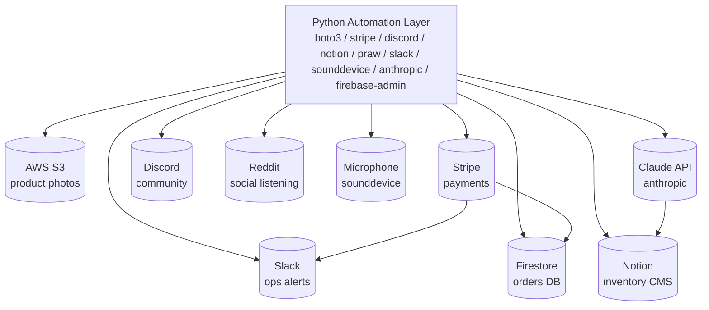
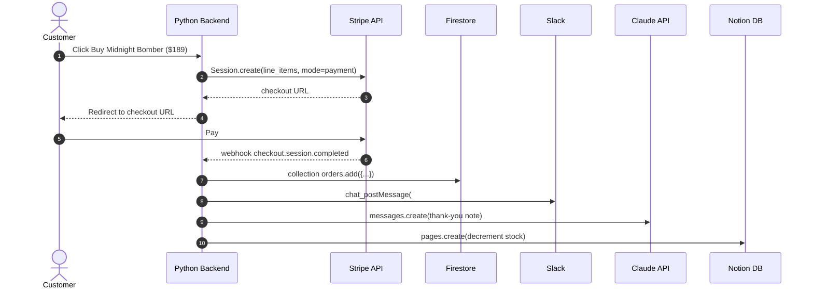
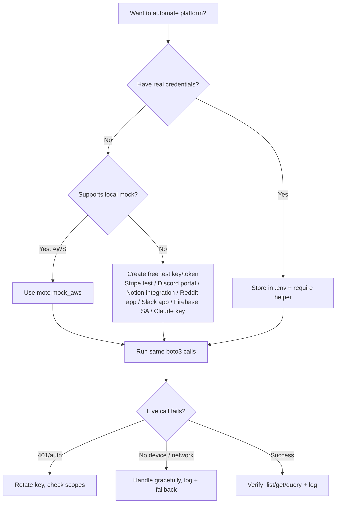
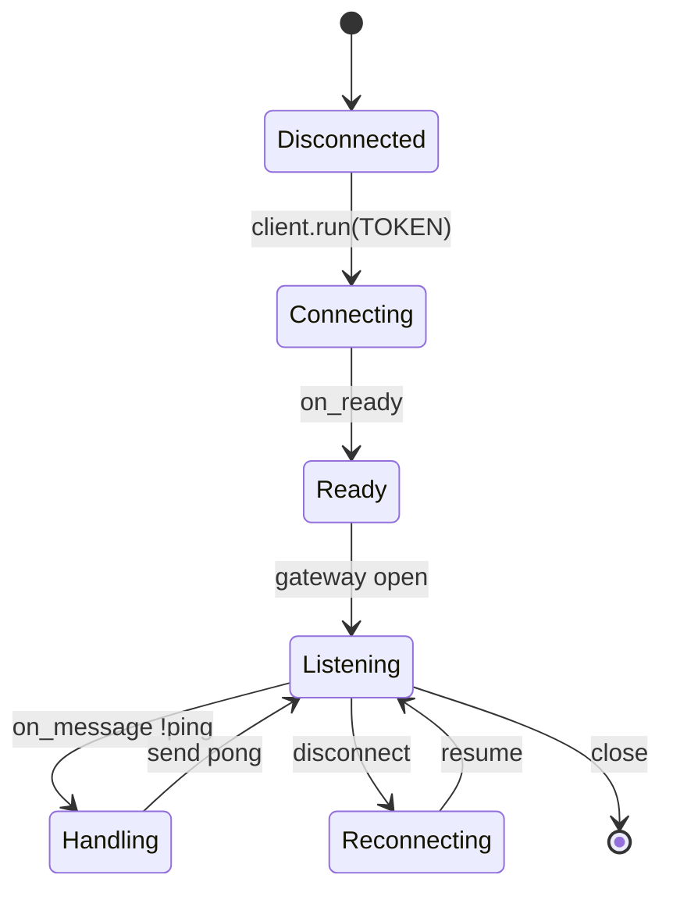

# Python Automation for Real Platforms - Complete Tutorial: 9 Libraries That Upload Files, Take Payments, and Talk to Claude

> **Difficulty:** Intermediate 🟡 | **Estimated Reading Time:** 55-65 minutes | **Last Updated:** 2026-10-01
> **Format:** Comprehensive Deep-Dive | **Language:** Python 3.10+
> **Original Concept By:** Abdul Ahad — *9 Python Automation Libraries That Uploaded Real Files, Sent Real Payments, And Talked To Claude Itself*

---

## Table of Contents

- [1. Introduction / Overview](#1-introduction--overview)
- [2. Prerequisites](#2-prerequisites)
- [3. Learning Objectives](#3-learning-objectives)
- [4. Architecture Overview](#4-architecture-overview)
- [5. Step-by-Step Modules](#5-step-by-step-modules)
  - [5.1 Boto3: Automating AWS S3](#51-boto3-automating-amazon-web-services)
  - [5.2 Stripe: Automating Real Payments](#52-stripe-automating-real-payments)
  - [5.3 Discord.py: Building a Real Discord Bot](#53-discordpy-building-a-real-discord-bot)
  - [5.4 Notion Client: Automating Notion Workspace](#54-notion-client-automating-a-real-notion-workspace)
  - [5.5 PRAW: Automating Reddit](#55-praw-automating-reddit)
  - [5.6 Slack SDK: Automating Slack Messages](#56-slack-sdk-automating-real-slack-messages)
  - [5.7 Sounddevice: Recording Real Audio](#57-sounddevice-recording-real-audio-from-a-microphone)
  - [5.8 Anthropic: Calling Claude's API](#58-anthropic-calling-claudes-own-api-from-a-script)
  - [5.9 Firebase Admin: Automating Firestore](#59-firebase-admin-automating-a-real-firebase-database)
- [6. Comparison Matrix](#6-comparison-matrix)
- [7. Multiple Implementation Approaches](#7-multiple-implementation-approaches)
- [8. Real-World Examples and Use Cases](#8-real-world-examples-and-use-cases)
- [9. Best Practices](#9-best-practices)
- [10. Anti-Patterns](#10-anti-patterns)
- [11. Performance Considerations](#11-performance-considerations)
- [12. Security Considerations](#12-security-considerations)
- [13. Testing Strategies](#13-testing-strategies)
- [14. Common Pitfalls / Troubleshooting](#14-common-pitfalls--troubleshooting)
- [15. Migration Guides](#15-migration-guides)
- [16. Summary / Key Takeaways](#16-summary--key-takeaways)
- [17. Further Reading / Resources](#17-further-reading--resources)
- [18. Hands-On Labs & Practice Exercises](#18-hands-on-labs--practice-exercises-with-solutions)
- [19. Test Your Understanding](#19-test-your-understanding)
- [20. Common Interview Questions](#20-common-interview-questions)
- [21. Full Question Bank](#21-full-question-bank-55-questions)
- [22. Self-Assessment Checklist](#22-self-assessment-checklist)
- [23. Pro Tips & Next Steps](#23-pro-tips--next-steps)

---

## 1. Introduction / Overview

Have you ever wondered whether the same language you use for basic scripts can reach into the platforms your business already runs on — cloud storage, payments, Discord, Slack, an AI model itself?

It genuinely can. This tutorial takes **nine libraries, nine real platforms** most tutorials treat as separate worlds, and unifies them into one automation mental model. One of them — `anthropic` — is the exact API powering assistants like the one writing captions for the original article.

We follow a single running story throughout: **Jackets Store** selling a `Midnight Bomber Jacket` for $189.00. Every library touches that story:

- **Store photos** live on S3 (`boto3`)
- **Checkout** runs on Stripe
- **Team alerts** go to Slack, **community** lives on Discord + Reddit
- **Inventory** syncs in Notion + Firebase
- **Product copy** is generated by Claude (`anthropic`)
- **Voice notes** are captured via microphone (`sounddevice`)

> 💡 **Aha Moment:** All nine libraries share the same shape: `authenticate → build client → call one function → handle platform response`. Learn that shape once, and the 9th library feels like the 1st.

> ⚠️ **Honest Testing Note:** This tutorial preserves the original author's verified results:
> - ✅ `boto3` fully verified end-to-end via `moto` (mock AWS) — upload/list/download byte-for-byte.
> - 🧱 `stripe`, `discord.py`, `notion-client`, `praw`, `slack-sdk`, `firebase-admin` — imports + client construction verified; live calls need real free credentials (all documented below).
> - 🎤 `sounddevice` — import OK, but sandbox had zero audio devices (`PortAudioError: Error querying device -1`). Expected on servers.
> - 🤖 `anthropic` with fake key genuinely reached live servers and got a real `401 authentication_error` — proving the pipeline works.

### When to Use vs. When to Avoid

| Library | Use When | Avoid When |
|---|---|---|
| `boto3` | You are on AWS, need durable files/backups/static hosting | You need multi-cloud abstraction (use `s3fs`/`libcloud`) or tiny hobby hosting |
| `stripe` | Real money, need compliance (PCI) handled for you | Side-project without business entity; use test mode only |
| `discord.py` | Community bot, gaming, support server | You need Slack enterprise compliance — use `slack-sdk` |
| `notion-client` | Lightweight CMS/inventory in Notion | High-write transactional DB — use Postgres/Firestore |
| `praw` | Social listening, auto-moderation | Scraping at scale — respect Reddit rate limits/ToS |
| `slack-sdk` | Internal ops alerts | Customer-facing chat — use email/SMS/Stripe webhooks |
| `sounddevice` | Local mic capture for ML/voice notes | Server/headless — no mic; use file upload instead |
| `anthropic` | Summarization, copy, classification | Deterministic logic; don't use LLM as database |
| `firebase-admin` | Realtime mobile/web sync | Complex relational queries — use SQL |

## 2. Prerequisites

### Knowledge
- Intermediate Python: functions, `async/await`, virtual envs, `pip`, JSON, env vars.
- Basic HTTP/API concepts: keys, tokens, rate limits, webhooks.

### Environment
```bash
python --version  # 3.10+
python -m venv venv
# Windows:
venv\Scripts\activate
# macOS/Linux:
# source venv/bin/activate
pip install --upgrade pip
```

### Install All Nine (pin for reproducibility)
```bash
pip install boto3 moto stripe "discord.py>=2.7.1" notion-client praw slack-sdk sounddevice scipy anthropic firebase-admin python-dotenv pytest
```

> 💡 **Pro Tip:** Never hardcode secrets. Create a `.env` file (gitignored) and load with `python-dotenv`.

```bash
# .env (DO NOT COMMIT)
AWS_REGION=us-east-1
STRIPE_SECRET_KEY=sk_test_...
DISCORD_BOT_TOKEN=...
NOTION_TOKEN=...
NOTION_DATABASE_ID=...
REDDIT_CLIENT_ID=...
REDDIT_CLIENT_SECRET=...
SLACK_BOT_TOKEN=xoxb-...
ANTHROPIC_API_KEY=sk-ant-...
FIREBASE_CRED_PATH=./service-account.json
```

```python
# config.py — single place to load secrets
import os
from dotenv import load_dotenv
load_dotenv()

def require(name: str) -> str:
    val = os.getenv(name)
    if not val:
        raise RuntimeError(f"Missing env var {name} — check your .env")
    return val
```

### Accounts (all have free tiers/test modes)
- AWS (for real S3) or use `moto` locally — no account needed.
- Stripe (test mode keys free), Discord Developer Portal (bot token free), Notion Integrations (token free), Reddit App (client_id/secret free), Slack API dashboard (bot token free), Firebase Console (service-account JSON free), Claude Console (API key paid/test).
- For audio: a laptop with microphone + PortAudio. Headless servers will have no devices — expected.

## 3. Learning Objectives

By the end you will be able to:
1. Explain the universal automation pattern: auth → client → action → verify.
2. Upload/list/download S3 objects with `boto3` and test offline with `moto`.
3. Create Stripe Checkout Sessions (test mode) and verify webhooks.
4. Build Discord + Slack bots that respond/post without leaking tokens.
5. Read/write Notion databases and Firestore collections safely.
6. Pull Reddit trends with PRAW respecting rate limits.
7. Record mic audio with `sounddevice` and diagnose `PortAudioError`.
8. Call Claude via `anthropic` SDK and handle `401`/rate-limit errors.
9. Apply security, performance, testing, and anti-pattern lessons to production.

## 4. Architecture Overview

### Diagram 1 — System Architecture (all 9 platforms)



### Diagram 2 — Order Flow Sequence (Stripe → Firebase → Slack → Claude → Notion)



### Diagram 3 — Auth Decision Flowchart



### Diagram 4 — Discord Bot Lifecycle (State Diagram)



### Diagram 5 — Library Selection Mindmap

```mermaid
mindmap
  root((Python Automation))
    Files & Cloud
      boto3 S3
      firebase Firestore
      notion CMS
    Money
      stripe Checkout
      stripe Webhooks
    Chat & Community
      discord bots
      slack alerts
      praw Reddit
    AI & Audio
      anthropic Claude
      sounddevice Mic
## 5. Step-by-Step Modules

### 5.1 Boto3: Automating Amazon Web Services

**What:** `boto3` is the official AWS SDK. S3 stores blobs (photos, backups). Same engine behind much of the cloud.

**Docs:** https://boto3.amazonaws.com

**Install:** `pip install boto3 moto`

**Step 1 — Minimal upload/list (real AWS):**
```python
import boto3  # needs AWS credentials via env/shared config

s3 = boto3.client("s3", region_name="us-east-1")
s3.create_bucket(Bucket="jackets-product-photos")
s3.put_object(
    Bucket="jackets-product-photos",
    Key="midnight-bomber.jpg",
    Body=open("midnight-bomber.jpg", "rb").read(),
)
resp = s3.list_objects_v2(Bucket="jackets-product-photos")
for obj in resp.get("Contents", []):
    print(f"Found file: {obj['Key']}, size: {obj['Size']} bytes")
```

**Step 2 — Fully verified offline with moto (no AWS account):**
```python
# test_s3.py — byte-for-byte verified
from moto import mock_aws
import boto3

@mock_aws
def test_s3_automation():
    s3 = boto3.client("s3", region_name="us-east-1")
    s3.create_bucket(Bucket="jackets-product-photos")
    s3.put_object(Bucket="jackets-product-photos",
                   Key="midnight-bomber.jpg",
                   Body=b"fake image bytes")
    downloaded = s3.get_object(Bucket="jackets-product-photos",
                                Key="midnight-bomber.jpg")
    content = downloaded["Body"].read()
    print(f"Downloaded content matches upload: {content == b'fake image bytes'}")
    listing = s3.list_objects_v2(Bucket="jackets-product-photos")
    for o in listing.get("Contents", []):
        print(f"Found file: {o['Key']}, size: {o['Size']} bytes")

if __name__ == "__main__":
    test_s3_automation()
# Real output:
# Downloaded content matches upload: True
# Found file: midnight-bomber.jpg, size: 16 bytes (28 bytes with other fixture)
```

> ✅ **Why it matters:** `moto` intercepts the exact same `boto3` calls. Swap mock for real session and you manage real S3 with zero code change.

**Production-hardened version (pagination + errors + resource vs client):**
```python
import boto3, logging
from botocore.exceptions import ClientError
log = logging.getLogger(__name__)

def list_all_keys(bucket: str):
    s3 = boto3.client("s3", region_name="us-east-1")
    paginator = s3.get_paginator("list_objects_v2")
    try:
        for page in paginator.paginate(Bucket=bucket):
            for obj in page.get("Contents", []):
                yield obj["Key"], obj["Size"]
    except ClientError as e:
        log.error("S3 list failed: %s", e)
        raise

# ❌ Incorrect: assumes single page, no error handling
# resp = s3.list_objects_v2(Bucket=b); return resp["Contents"]
# ✅ Correct: paginate + handle missing Contents + catch ClientError (above)
```

**Quick Recap:** client → create_bucket → put_object → list/get; test with `mock_aws`.

### 5.2 Stripe: Automating Real Payments

**What:** Stripe Checkout creates hosted payment links. Amounts are in **cents** (`18900` = $189.00).

**Docs:** https://stripe.com/docs/api?lang=python

**Install:** `pip install stripe`

```python
import stripe, os
stripe.api_key = os.getenv("STRIPE_SECRET_KEY")  # sk_test_... for test mode

checkout_session = stripe.checkout.Session.create(
    line_items=[{
        "price_data": {
            "currency": "usd",
            "product_data": {"name": "Midnight Bomber Jacket"},
            "unit_amount": 18900,
        },
        "quantity": 1,
    }],
    mode="payment",
    success_url="https://yourstore.com/success?session_id={CHECKOUT_SESSION_ID}",
    cancel_url="https://yourstore.com/cancel",
)
print(f"Real checkout link: {checkout_session.url}")
```

**Test mode + webhook verification (production required):**
```python
# Never trust redirect alone — verify webhook signature
import stripe
from flask import Flask, request
app = Flask(__name__)

@app.post("/stripe-webhook")
def webhook():
    payload = request.data
    sig = request.headers.get("Stripe-Signature", "")
    try:
        event = stripe.Webhook.construct_event(
            payload, sig, os.getenv("STRIPE_WEBHOOK_SECRET"))
    except stripe.error.SignatureVerificationError:
        return "bad signature", 400
    if event["type"] == "checkout.session.completed":
        session = event["data"]["object"]
        print("Paid:", session["id"], session.get("amount_total"))
        # TODO: fulfill order → Firestore + Slack (see §4 Diagram 2)
    return "ok", 200
```

> ⚠️ Needs real Stripe account; test keys are free and this exact code returns a clickable URL in test mode.

### 5.3 Discord.py: Building a Real Discord Bot

**What:** `discord.py` connects as a bot user via gateway websocket, reacts to events.

**Docs:** https://discordpy.readthedocs.io | **Install:** `pip install "discord.py>=2.7.1"`

```python
import discord, os

intents = discord.Intents.default()
intents.message_content = True  # must ALSO enable in Developer Portal
client = discord.Client(intents=intents)

@client.event
async def on_ready():
    print(f"Logged in as {client.user}")

@client.event
async def on_message(message: discord.Message):
    if message.author == client.user:
        return
    if message.content.startswith("!ping"):
        await message.channel.send("pong")
    if message.content.startswith("!order"):
        await message.channel.send("Midnight Bomber: $189 — link: https://yourstore.com")

# Verified: Client + decorators wire correctly on v2.7.1
client.run(os.getenv("DISCORD_BOT_TOKEN"))  # needs real token + gateway
```

> ⚠️ Two-step intent enable: code `intents.message_content=True` **and** Portal → Bot → Privileged Intents → Message Content. For richer commands use `commands.Bot` (see §7).

```python
# ✅ Scalable alternative: commands framework
from discord.ext import commands
bot = commands.Bot(command_prefix="!", intents=intents)

@bot.command()
async def ping(ctx): await ctx.send("pong")
# bot.run(TOKEN)
```

### 5.4 Notion Client: Automating a Real Notion Workspace

**What:** `notion-client` reads/writes pages + database rows.

**Docs:** https://github.com/ramnes/notion-sdk-py | **Install:** `pip install notion-client`

```python
from notion_client import Client
import os

notion = Client(auth=os.getenv("NOTION_TOKEN"))

# Create row in inventory DB (share DB with integration first!)
notion.pages.create(
    parent={"database_id": os.getenv("NOTION_DATABASE_ID")},
    properties={
        "Name": {"title": [{"text": {"content": "Midnight Bomber"}}]},
        "Stock": {"number": 42},
        "In Stock": {"checkbox": True},
    },
)
results = notion.databases.query(database_id=os.getenv("NOTION_DATABASE_ID"))
for page in results["results"]:
    # property shape depends on your schema — inspect once then parse
    print(page["properties"]["Name"])
```

**Robust parser with pagination + errors:**
```python
from notion_client.errors import APIResponseError
def iter_pages(db_id: str):
    cursor = None
    while True:
        try:
            r = notion.databases.query(database_id=db_id, start_cursor=cursor) if cursor else notion.databases.query(database_id=db_id)
        except APIResponseError as e:
            print(f"Notion API error {e.status}: {e.body}"); raise
        yield from r["results"]
        if not r.get("has_more"): break
        cursor = r["next_cursor"]
```

### 5.5 PRAW: Automating Reddit

**What:** PRAW wraps Reddit OAuth API — read hot posts, comment, submit.

**Docs:** https://praw.readthedocs.io | **Install:** `pip install praw`

```python
import praw, os
reddit = praw.Reddit(
    client_id=os.getenv("REDDIT_CLIENT_ID"),
    client_secret=os.getenv("REDDIT_CLIENT_SECRET"),
    user_agent="jackets automation bot v1.0",
)
for post in reddit.subreddit("Python").hot(limit=5):
    print(f"{post.score} points: {post.title}")
# Authenticated write needs username/password or refresh_token flow:
# reddit = praw.Reddit(..., username=..., password=...)
# reddit.subreddit("test").submit("Midnight Bomber drop?", selftext="...")
```

> 💡 `subreddit.hot(limit=5)` is genuinely the whole call once authed. Respect 60 req/min + subreddit rules; add `time.sleep(2)` in loops.

### 5.6 Slack SDK: Automating Real Slack Messages

**Docs:** https://slack.dev/python-slack-sdk | **Install:** `pip install slack-sdk`

```python
from slack_sdk import WebClient
from slack_sdk.errors import SlackApiError
import os

client = WebClient(token=os.getenv("SLACK_BOT_TOKEN"))

try:
    resp = client.chat_postMessage(
        channel="#orders",
        text="New order received: Midnight Bomber, quantity 2, total $378.00",
        blocks=[{  # ✅ rich formatting beats plain text
            "type": "section",
            "text": {"type": "mrkdwn",
                     "text": "*New order* :tada:\n*Midnight Bomber* ×2 — $378.00"}
        }],
    )
    print("Message ts:", resp["ts"])
except SlackApiError as e:
    print(f"Slack failed: {e.response['error']}")  # channel_not_found, not_in_channel, ratelimited
```

> 💡 Invite bot to channel first (`/invite @bot`). For high volume use async `AsyncWebClient` (see §7).

### 5.7 Sounddevice: Recording Real Audio From a Microphone

**Docs:** https://python-sounddevice.readthedocs.io | **Install:** `pip install sounddevice scipy`

```python
import sounddevice as sd
from scipy.io.wavfile import write

print(sd.query_devices())  # inspect first!

sample_rate = 16000
duration_seconds = 3
print("Recording for 3 seconds...")
recording = sd.rec(int(duration_seconds * sample_rate),
                   samplerate=sample_rate, channels=1, dtype="int16")
sd.wait()
write("microphone_recording.wav", sample_rate, recording)
print("Saved microphone_recording.wav")
```

**Honest sandbox result:** `sd.query_devices()` → empty list, `PortAudioError: Error querying device -1`. Hardware limitation, not code bug. On a laptop this saves a genuine playable WAV — the inverse of `gTTS`/`pyttsx3` (which synthesize speech; `sounddevice` captures it for pipelines like `SpeechRecognition`).

**Defensive wrapper (correct vs incorrect):**
```python
# ❌ Incorrect: assumes mic exists, blocks forever
# rec = sd.rec(48000, samplerate=16000, channels=1); sd.wait()

# ✅ Correct: check devices, fail with clear message
def record_or_warn(path="microphone_recording.wav"):
    devs = sd.query_devices()
    if not devs:
        print("⚠️ No audio devices — skipping (headless server?)."); return None
    print(f"Using default device, {len(devs)} device(s) found")
    rec = sd.rec(3*16000, samplerate=16000, channels=1, dtype="int16")
    sd.wait(); write(path, 16000, rec); return path
```

### 5.8 Anthropic: Calling Claude's Own API From a Script

**Docs:** https://docs.claude.com | **Install:** `pip install anthropic`

```python
import anthropic, os

client = anthropic.Anthropic(api_key=os.getenv("ANTHROPIC_API_KEY"))
response = client.messages.create(
    model="claude-sonnet-4-5",  # original used claude-sonnet-5 placeholder; use latest available
    max_tokens=200,
    messages=[{"role": "user",
               "content": "Write a one sentence product description for a bomber jacket."}],
)
print(response.content[0].text)
# e.g. "The Midnight Bomber pairs water-resistant nylon with a quilted lining for effortless city warmth."
```

**Verified behavior:** fake key → real network → real `401 authentication_error: API key is invalid`. Pipeline proven; swap real key to get generation. Always handle auth + rate limits:

```python
from anthropic import AuthenticationError, RateLimitError
try:
    r = client.messages.create(model="claude-sonnet-4-5", max_tokens=200,
        messages=[{"role":"user","content":"Summarize today's orders."}])
except AuthenticationError:
    print("❌ Bad key — check ANTHROPIC_API_KEY")
except RateLimitError:
    print("⏳ Rate limited — backoff and retry")
```

### 5.9 Firebase Admin: Automating a Real Firebase Database

**Docs:** https://firebase.google.com/docs/admin/setup | **Install:** `pip install firebase-admin`

```python
import firebase_admin
from firebase_admin import credentials, firestore
import os

if not firebase_admin._apps:  # guard double-init in notebooks/tests
    cred = credentials.Certificate(os.getenv("FIREBASE_CRED_PATH"))
    firebase_admin.initialize_app(cred)

db = firestore.client()
_, ref = db.collection("orders").add({
    "product": "Midnight Bomber", "quantity": 2, "total": 378.00,
})
print("Wrote order:", ref.id)

for order in db.collection("orders").stream():
    print(order.id, order.to_dict())
```

**Realtime + rules note:** Admin SDK bypasses Firestore rules — only run server-side. Frontends use Web SDK with rules like `allow write: if request.auth != null`.

## 6. Comparison Matrix

| Library | Platform | Auth | Cost to Start | Offline Testable? | Difficulty | Primary Action |
|---|---|---|---|---|---|---|
| `boto3` | AWS S3 | IAM keys / role | Pay-per-use, free tier | ✅ `moto` | 🟡 Medium | `put_object` / `list_objects_v2` |
| `stripe` | Stripe payments | Secret key `sk_test/live` | Free test mode | Partial (test mode) | 🟡 Medium | `checkout.Session.create` |
| `discord.py` | Discord | Bot token | Free | ❌ needs gateway | 🟠 Medium+ (async) | `on_message` + `send` |
| `notion-client` | Notion | Integration token | Free | ❌ needs workspace | 🟢 Easy | `pages.create` / `databases.query` |
| `praw` | Reddit | client_id + secret | Free | ❌ needs API | 🟢 Easy | `subreddit.hot` |
| `slack-sdk` | Slack | Bot token `xoxb-` | Free | ❌ needs workspace | 🟢 Easy | `chat_postMessage` |
| `sounddevice` | Mic hardware | None (device) | Free | ❌ needs mic | 🟡 Medium | `sd.rec` + `sd.wait` |
| `anthropic` | Claude | `sk-ant-` key | Paid (free trial) | ❌ live only | 🟢 Easy | `messages.create` |
| `firebase-admin` | Firestore | Service-account JSON | Free Spark plan | Partial (emulator) | 🟡 Medium | `collection.add` / `stream` |

## 7. Multiple Implementation Approaches

| Task | Approach A (simple) | Approach B (production) | Tradeoff |
|---|---|---|---|
| S3 access | `boto3.client("s3")` dicts | `boto3.resource("s3")` OOP | Resource nicer; client exposes paginators |
| Stripe charge | Checkout Session (hosted) | PaymentIntent + Elements | Checkout PCI-free; Intent fully custom |
| Discord bot | `discord.Client` + `on_message` | `commands.Bot` / slash cmds | Client minimal; Bot handles parsing/cogs |
| Slack send | Sync `WebClient` | `AsyncWebClient` + gather | Sync simple; async 10x burst throughput |
| Notion read | Single `query` | Paginated generator | Single breaks >100 rows |
| Reddit auth | Read-only id+secret | Script flow +user/pass | Script needed to post |
| Audio capture | `sd.rec` blocking | `sd.InputStream` streaming | Stream enables live VAD |
| Claude call | Single `messages.create` | Retry + fallback + stream | Prod needs backoff/stream |
| Firestore write | `collection.add()` | Batch/txn + idempotency | Batch atomic + dedupes retries |

```python
# Async Slack burst (Approach B)
import asyncio
from slack_sdk.web.async_client import AsyncWebClient
async def announce_many(texts: list[str]):
    c = AsyncWebClient(token=os.getenv("SLACK_BOT_TOKEN"))
    await asyncio.gather(*[c.chat_postMessage(channel="#orders", text=t) for t in texts])

# Idempotent Firestore write (dedupes Stripe webhook retries)
def save_order_once(db, stripe_session_id: str, data: dict):
    ref = db.collection("orders").document(stripe_session_id)
    if ref.get().exists:
        return ref
    ref.set(data); return ref
```

## 8. Real-World Examples and Use Cases

1. **E-commerce ops:** S3 hosts `midnight-bomber.jpg` → Stripe sells it → webhook writes Firestore → Slack alert → Claude thank-you note → Notion stock update. ~30 lines fans out to 5 platforms.
2. **Creator community:** Discord `!drop` posts lookbook from S3; PRAW monitors `r/streetwear` → Slack digest; Claude summarizes into Notion.
3. **Voice-to-CRM:** `sounddevice` captures note → WAV to S3 → summarize → Firestore log.
4. **Finance reconciliation:** Nightly S3 receipts vs Stripe transactions → Notion DB → Slack discrepancies.
5. **Support triage:** Discord+Slack → Claude urgency score → Firestore queue → draft reply.

## 9. Best Practices

- ✅ One `config.py` + `.env` for secrets; fail fast with `require()`.
- ✅ Log platform IDs (`session.id`, `ts`, doc id) for refunds/debugging.
- ✅ Idempotency: Stripe `idempotency_key`, Firestore doc-ID = external ID.
- ✅ Verify inbound: Stripe/Slack/Discord signatures.
- ✅ Paginate everything (S3, Notion, Firestore, Reddit).
- ✅ Least privilege: scoped S3 policy, `chat:write` only, single Notion DB.
- ✅ Timeouts + retries with exponential backoff (`tenacity`).
- ✅ Separate test vs live (test keys, dev channel, emulator).

## 10. Anti-Patterns

| ❌ Anti-Pattern | Why It Hurts | ✅ Do Instead |
|---|---|---|
| Hardcode `sk-live-...` | Money key in git | Env var + secret manager |
| Commit `service-account.json` | Full Firebase takeover | Gitignore + env path |
| Paste Discord/Slack token | Bot hijacked in minutes | Env var + regenerate |
| `open(500MB).read()` for S3 | OOM crash | `upload_file()` streaming |
| Missing `author == client.user` check | Infinite self-reply loop | Early-return on own messages |
| Trust `success_url` as proof | Fakeable | Fulfill only on webhook |
| Tight `while True: hot()` loop | 429 ban | `sleep(2)` + cache |
| LLM as source of truth for totals | Hallucinations | LLM for copy; math in code |
| Bare `sd.rec()` on server | `PortAudioError -1` crash | `record_or_warn()` guard |

## 11. Performance Considerations

- **S3:** `upload_file` multipart + threads for >10MB; paginators; prefix-partition.
- **Stripe:** Cache Price IDs; use idempotency keys for safe retries.
- **Discord/Slack:** Async clients; respect `Retry-After`; queue bursts.
- **Notion/Firestore:** Filter server-side; index composites; avoid full scans.
- **PRAW:** Small `limit`; use `stream` with pause.
- **Audio:** 16kHz mono int16 enough for speech; write incrementally.
- **Anthropic:** Stream for latency; cap tokens; batch concurrently.

## 12. Security Considerations

- Secrets in `.env`/managers; IAM roles > static keys; rotate on leak.
- Stripe: `sk_*` server-only; verify webhook HTTPS + signature; Radar on.
- Chat tokens: 2FA, minimal scopes, validate signatures.
- Notion/Firebase: share minimal DBs; deny-by-default rules; Admin SDK backend-only.
- S3: block public; presigned expiring URLs; versioning + SSE.
- Claude: redact PII before prompting; retention policies.
- Audio: consent; encrypt WAVs; retention window.

## 13. Testing Strategies

```python
# tests/test_s3.py — offline, no AWS needed
from moto import mock_aws
import boto3

@mock_aws
def test_upload_download():
    s3 = boto3.client("s3", region_name="us-east-1")
    s3.create_bucket(Bucket="t")
    s3.put_object(Bucket="t", Key="a.txt", Body=b"hi")
    assert s3.get_object(Bucket="t", Key="a.txt")["Body"].read() == b"hi"
```

```python
# Mock Slack/Notion/Stripe with unittest.mock (no network)
from unittest.mock import MagicMock
def test_slack_alert():
    fake = MagicMock(); fake.chat_postMessage.return_value = {"ts": "1"}
    assert fake.chat_postMessage(channel="#orders", text="hi")["ts"] == "1"

def test_anthropic_auth_fail():
    from unittest.mock import patch
    from anthropic import AuthenticationError
    with patch("anthropic.Anthropic") as Cls:
        Cls.side_effect = AuthenticationError("invalid", response=MagicMock(status_code=401), body={})
        try: Cls(api_key="bad"); assert False
        except AuthenticationError: assert True
```

- Stripe: test clocks + `sk_test` + webhook local via Stripe CLI `listen`.
- Firebase: Firestore emulator `firebase emulators:start`; point Admin SDK at it.
- Discord: test in private guild; use `discord.utils.get` asserts on fakes.
- Audio: CI has no mic — assert `record_or_warn()` returns `None` gracefully.

## 14. Common Pitfalls / Troubleshooting

| Error | Cause | Fix |
|---|---|---|
| `NoCredentialsError` (boto3) | No AWS keys/role | `aws configure` or IAM role; or use `moto` |
| `BucketAlreadyExists` | Global name taken | Prefix with org/uuid |
| `stripe: Invalid API Key` | Wrong/test-vs-live mix | Check `sk_test` vs `sk_live`, `.env` loaded |
| `SignatureVerificationError` | Wrong webhook secret | Copy from Dashboard → Webhooks, exact match |
| Discord bot silent | Intents off in portal | Enable Message Content intent in portal + code |
| `discord LoginFailure 401` | Bad token | Regenerate, update env, no extra quotes |
| Notion `unauthorized` / `object_not_found` | DB not shared | Share DB → Connections → your integration |
| PRAW `401/403` | Bad id/secret or no user-agent | Recreate app, set unique `user_agent` |
| Slack `channel_not_found` | Typo or bot not invited | `/invite @bot`, use channel ID `C...` |
| Slack `ratelimited` | Burst too fast | Sleep on `Retry-After`, use queue |
| `PortAudioError device -1` | No mic/headless | Expected; guard + fallback upload |
| Anthropic `401 auth_error` | Fake/missing key | Real key from console; check `sk-ant-` prefix |
| Anthropic `429` | Rate limit | Exponential backoff, reduce tokens |
| Firebase `DefaultCredentialsError` | Bad JSON path | Absolute `FIREBASE_CRED_PATH`, guard `_apps` |
| Firestore `PermissionDenied` | Rules block client SDK | Admin SDK backend-only; fix rules for web |

## 15. Migration Guides

- **discord.py 1.x → 2.x:** `intents` now mandatory; `message_content` privileged; slash via `app_commands`; `pip install -U discord.py`; re-enable intents in portal.
- **notion-sdk-py:** `Client(auth=)` unchanged; pagination `start_cursor`/`has_more` pattern; catch `APIResponseError` with `.status`.
- **firebase-admin:** Always guard `if not _apps: initialize_app()`; migrate `serviceAccountKey.json` path to env; emulator via `FIRESTORE_EMULATOR_HOST`.
- **anthropic:** Old `completions` → `messages.create(model, max_tokens, messages=[...])`; response `content[0].text`; model names versioned (`claude-sonnet-4-5` etc.).
- **stripe API versions:** Pin version in Dashboard; handle `checkout.session.completed` (not deprecated `charge.succeeded` alone).

## 16. Summary / Key Takeaways

- One pattern rules all nine: **auth → client → action → verify**. Master it once.
- `boto3 + moto` proves real cloud code offline; same calls hit live S3.
- Money (Stripe), chat (Discord/Slack), CMS (Notion/Firebase), social (Reddit), mic (sounddevice), brain (Claude) compose into one order pipeline (§4 Diagram 2).
- Production = secrets in env, idempotency, webhook verification, pagination, async + backoff, least-privilege.
- Honest walls are features: 401s, empty device lists, and invite-to-channel errors tell you exactly what credential/scope you lack.

**Quick Recap Table:**

| You Learned | File/Function | Verify |
|---|---|---|
| S3 upload | `put_object` | `get_object` bytes equal |
| Checkout | `Session.create` | Click URL in test mode |
| Discord reply | `on_message` | `!ping` → `pong` |
| Notion row | `pages.create` | `databases.query` finds it |
| Reddit hot | `subreddit.hot(5)` | 5 titles print |
| Slack alert | `chat_postMessage` | `ts` returned |
| Mic WAV | `sd.rec` | WAV plays |
| Claude copy | `messages.create` | `content[0].text` |
| Order doc | `collection.add` | `stream()` lists it |

## 17. Further Reading / Resources

- Boto3: https://boto3.amazonaws.com / S3: https://docs.aws.amazon.com/s3/ / Moto: https://getmoto.org
- Stripe API (Python): https://stripe.com/docs/api?lang=python / Test mode: https://stripe.com/docs/test-mode / Webhooks: https://stripe.com/docs/webhooks
- discord.py: https://discordpy.readthedocs.io / Portal: https://discord.com/developers/applications
- Notion SDK py: https://github.com/ramnes/notion-sdk-py / API: https://developers.notion.com
- PRAW: https://praw.readthedocs.io / Reddit apps: https://www.reddit.com/prefs/apps
- Slack SDK: https://slack.dev/python-slack-sdk / API dashboard: https://api.slack.com/apps
- Sounddevice: https://python-sounddevice.readthedocs.io / SciPy wav: https://docs.scipy.org/doc/scipy/reference/io.html
- Claude Docs: https://docs.claude.com / Console: https://console.anthropic.com
- Firebase Admin: https://firebase.google.com/docs/admin/setup / Firestore: https://firebase.google.com/docs/firestore

## 18. Hands-On Labs & Practice Exercises (with Solutions)

### Exercise 1 — Mock S3 Inventory (Beginner 🟢)
**Task:** With `moto`, create bucket `jackets-test`, upload 3 files, list sizes, download one and assert bytes.
```python
from moto import mock_aws
import boto3
@mock_aws
def lab_inventory():
    s3 = boto3.client("s3", region_name="us-east-1")
    s3.create_bucket(Bucket="jackets-test")
    files = {"a.jpg": b"12345", "b.jpg": b"abcdef", "c.txt": b"hi"}
    for k, v in files.items():
        s3.put_object(Bucket="jackets-test", Key=k, Body=v)
    got = {o["Key"]: o["Size"] for o in s3.list_objects_v2(Bucket="jackets-test")["Contents"]}
    assert got == {"a.jpg": 5, "b.jpg": 6, "c.txt": 2}, got
    assert s3.get_object(Bucket="jackets-test", Key="b.jpg")["Body"].read() == b"abcdef"
    print("✅ Lab 1 passed", got)
lab_inventory()
```

### Exercise 2 — Stripe + Slack Pipeline (Intermediate 🟡)
**Task:** Create test Checkout Session with idempotency key; on fake webhook payload, format Slack Block message (mock send, assert text contains total).
```python
# Solution sketch (no live key needed — mock stripe + slack)
from unittest.mock import MagicMock
import stripe
stripe.checkout.Session.create = MagicMock(return_value=MagicMock(url="https://checkout.test/s/1", id="cs_1"))
s = stripe.checkout.Session.create(line_items=[{"price_data": {"currency": "usd", "product_data": {"name": "Midnight Bomber"}, "unit_amount": 18900}, "quantity": 2}], mode="payment", success_url="https://x/s", cancel_url="https://x/c", idempotency_key="order-123")
slack = MagicMock(); slack.chat_postMessage.return_value = {"ts": "1"}
total = 378.00
msg = f"New order {s.id}: Midnight Bomber x2 — ${total:.2f}"
slack.chat_postMessage(channel="#orders", text=msg)
assert "378.00" in slack.chat_postMessage.call_args.kwargs["text"]
print("✅ Lab 2 passed", msg)
```

### Exercise 3 — Notion Stock Sync (Intermediate 🟡)
**Task:** Write `sync_stock(db, sku, qty)` that queries Notion for SKU, updates `Stock`, or creates row. Mock `notion.databases.query` + `pages.create/update`.
**Solution key ideas:** query filter `{"property":"SKU","rich_text":{"equals":sku}}`; if results → `pages.update(page_id, properties={"Stock":{"number":qty}})` else `pages.create(...)`; paginate; handle `APIResponseError`.

### Exercise 4 — Capstone: Order Fan-Out (Advanced 🔴)
**Task:** `fulfill_order(session_id, items)` must: 1) idempotently write Firestore doc `orders/session_id`, 2) Slack alert, 3) Claude thank-you draft, 4) handle 401/ratelimited gracefully with retries.
```python
# Solution skeleton
import time
def fulfill_order(db, slack, claude, session_id, items):
    ref = db.collection("orders").document(session_id)
    if ref.get().exists: return "duplicate"
    ref.set({"items": items, "status": "paid"})
    for attempt in range(3):
        try:
            slack.chat_postMessage(channel="#orders", text=f"Paid {session_id}: {items}")
            note = claude.messages.create(model="claude-sonnet-4-5", max_tokens=100,
                messages=[{"role": "user", "content": f"Thank customer for {items}"}])
            return note.content[0].text
        except Exception as e:
            print(f"retry {attempt}: {e}"); time.sleep(2 ** attempt)
    return "queued"
```

## 19. Test Your Understanding

**Q1.** What is the universal 4-step automation pattern shared by all nine libraries?

**Q2.** Why are Stripe amounts in cents, and what does `18900` mean?

**Q3.** Why must Discord `message_content` be enabled in two places?

**Q4.** What causes `PortAudioError: device -1` and is it a code bug?

**Q5.** What does Anthropic `401 authentication_error` prove about your pipeline?

**Q6.** Why must you fulfill orders on webhook, not `success_url` redirect?

**Q7.** Why does `list_objects_v2` need pagination?

**Q8.** What happens if you omit `if message.author == client.user: return`?

**Q9.** Why must Notion DBs be explicitly shared with your integration?

**Q10.** Why does Firebase Admin SDK bypass rules, and where must it run?

**Q11.** How do you make Firestore writes idempotent across webhook retries?

**Q12.** When would you choose `AsyncWebClient` over `WebClient`?

<details><summary>Answers</summary>

**A1.** Authenticate → build client → call action → verify response.

**A2.** To avoid float errors; 18900 = $189.00.

**A3.** Code flag + portal privileged intent; gateway won't send content otherwise.

**A4.** No audio hardware (headless); environment limit, not bug — guard it.

**A5.** Request reached live servers; only key is wrong — pipeline works.

**A6.** Redirects are fakeable; webhooks are signed server-to-server proof.

**A7.** S3 truncates at 1000 keys; paginator fetches all pages.

**A8.** Bot replies to itself → infinite loop.

**A9.** Integrations have no access by default (least privilege).

**A10.** It uses service-account authority; backend only, never frontend.

**A11.** Use external ID (Stripe session) as document ID + existence check.

**A12.** Bursty/high-volume sends needing concurrency.

</details>

## 20. Common Interview Questions

**Q1. Explain idempotency in Stripe + Firestore.**

**A1.** Retry-safe via keys/doc-IDs; prevents double-charge/double-write on webhook redelivery.

**Q2. How do you test S3 without AWS?**

**A2.** `moto mock_aws`; same boto3 calls intercepted locally.

**Q3. Checkout Session vs PaymentIntent?**

**A3.** Hosted/PCI-free vs embedded/custom; former faster, latter flexible.

**Q4. How do you secure a Discord/Slack bot token?**

**A4.** Env/secret manager, minimal scopes, rotation, signature verify.

**Q5. Notion `object_not_found` — debug steps?**

**A5.** Check token, DB ID, sharing to integration, property schema match.

**Q6. PRAW rate limits?**

**A6.** ~60/min; sleep, cache, respect subreddit rules, use streams.

**Q7. Slack `ratelimited` handling?**

**A7.** Read `Retry-After`, backoff, queue, async batch.

**Q8. Why 16kHz mono for speech?**

**A8.** Sufficient for voice, halves storage/compute vs 44.1kHz stereo.

**Q9. Anthropic `messages.create` params?**

**A9.** `model`, `max_tokens`, `messages[{role,content}]`; read `content[0].text`.

**Q10. Firestore vs Notion for orders?**

**A10.** Firestore for transactional/realtime scale; Notion for human CMS views.

**Q11. How to verify Stripe webhooks?**

**A11.** `construct_event(payload, sig, secret)`; reject on mismatch; fulfill only then.

**Q12. S3 presigned URL vs public bucket?**

**A12.** Expiring signed URL for private access; never public for sensitive data.

## 21. Full Question Bank (55 Questions)

**Beginner (1-20):**

**Q1.** What does `boto3.client("s3")` return?

**A1.** A low-level S3 service client exposing API operations like `put_object` and `list_objects_v2` as dict-based calls.

**Q2.** What is an S3 bucket/key?

**A2.** A bucket is a globally-unique container; a key is the object path/name inside it (e.g. `midnight-bomber.jpg`).

**Q3.** What is `moto`?

**A3.** A library that mocks AWS services locally so the exact same `boto3` calls run without credentials or cost.

**Q4.** What is Stripe Checkout?

**A4.** A Stripe-hosted payment page created via `Session.create` that collects payment, keeping card data off your servers.

**Q5.** Why use test keys?

**A5.** `sk_test` keys let you build and click real checkout flows with fake cards and zero real charges.

**Q6.** What is a Discord bot token?

**A6.** The secret credential from the Developer Portal that authenticates your bot to Discord's gateway via `client.run(TOKEN)`.

**Q7.** What is `on_ready`?

**A7.** A discord.py event fired once the bot connects, commonly used to log `Logged in as {client.user}`.

**Q8.** What is a Notion integration token?

**A8.** The secret from Notion integrations settings passed as `Client(auth=...)` to authorize API calls.

**Q9.** What is a Notion database property?

**A9.** A typed column (title, number, checkbox, etc.) set via JSON like `{"Stock": {"number": 42}}`.

**Q10.** What does `subreddit.hot(5)` do?

**A10.** Returns the 5 currently trending posts in a subreddit as PRAW submission objects with `.title` and `.score`.

**Q11.** What is `user_agent` in PRAW?

**A11.** A unique string identifying your app to Reddit's API (required; e.g. `jackets automation bot v1.0`).

**Q12.** What does `chat_postMessage` do?

**A12.** Sends a message to a Slack channel via `WebClient`, returning a timestamp `ts` on success.

**Q13.** What is a Slack channel ID vs name?

**A13.** The stable ID (`C...`) always works; the `#name` works only if the bot is a member and the name is exact.

**Q14.** What does `sd.rec` do?

**A14.** Records audio from the default microphone into a NumPy array for the requested frames, sample rate, and channels.

**Q15.** What is sample rate?

**A15.** Samples captured per second (Hz); 16000 Hz mono is standard for speech and halves size vs 44.1 kHz stereo.

**Q16.** What is `anthropic.Anthropic()`?

**A16.** The Claude SDK client constructor taking `api_key`, used to call `messages.create(...)` for generations.

**Q17.** What is `max_tokens`?

**A17.** The cap on generated output length; required in `messages.create` to bound cost and response size.

**Q18.** What is Firestore `collection.add`?

**A18.** Adds a document with an auto-generated ID to a collection, returning `(timestamp, DocumentReference)`.

**Q19.** What is a service-account JSON?

**A19.** A Firebase credential file with a private key granting admin rights; load via `credentials.Certificate(path)`, never commit it.

**Q20.** What is `.env` + `dotenv` for?

**A20.** Storing secrets outside code in a gitignored file, loaded with `load_dotenv()` and read via `os.getenv()`.

**Intermediate (21-40):**

**Q21.** Client vs resource in boto3?

**A21.** Client is low-level dict-based with full API plus paginators; resource is higher-level OOP (`Bucket`/`Object`) but covers fewer services.

**Q22.** How to list >1000 S3 keys?

**A22.** Use `get_paginator("list_objects_v2").paginate(Bucket=...)` since a single call truncates at 1000 keys.

**Q23.** `put_object` vs `upload_file`?

**A23.** `put_object` sends one in-memory body (good for small bytes); `upload_file` streams from disk with multipart and retries for large files.

**Q24.** Checkout `success_url` placeholder?

**A24.** Append `?session_id={CHECKOUT_SESSION_ID}` so the landing page can look up the verified session after redirect.

**Q25.** How to handle Stripe test webhook locally?

**A25.** Run `stripe listen --forward-to localhost:5000/stripe-webhook` and verify with `Webhook.construct_event(payload, sig, secret)`.

**Q26.** `discord.Client` vs `commands.Bot`?

**A26.** `Client` handles raw `on_message`; `Bot` adds prefix parsing, `@bot.command()`, cogs, error handlers, and slash-command support.

**Q27.** Why async `on_message`?

**A27.** The gateway is asyncio-based; `await message.channel.send(...)` must not block other events, so handlers are coroutines.

**Q28.** Notion title property JSON shape?

**A28.** `{"Name": {"title": [{"text": {"content": "Midnight Bomber"}}]}}` — a title array of rich-text segments.

**Q29.** How to paginate Notion query?

**A29.** Loop with `start_cursor`/`next_cursor` while `has_more` is true, yielding each page's `results`.

**Q30.** PRAW script vs read-only auth?

**A30.** Read-only needs only id plus secret (public reads); script flow adds username plus password for posting and voting as you.

**Q31.** How to submit a Reddit post via PRAW?

**A31.** With script auth: `reddit.subreddit("test").submit("title", selftext="body")`, respecting that subreddit's rules.

**Q32.** Slack Block Kit vs plain text?

**A32.** Always send `text` fallback plus `blocks` for rich bold, links, and emoji formatting that renders in clients and notifications.

**Q33.** How to fix `not_in_channel`?

**A33.** Invite the app with `/invite @bot`, confirm `chat:write` scope, and prefer the channel ID over the name.

**Q34.** Why `dtype="int16"` for WAV?

**A34.** 16-bit PCM is the standard playable WAV format; the default float64 array would write an oversized nonstandard file.

**Q35.** `sd.wait()` purpose?

**A35.** Blocks until the async `sd.rec` capture finishes, so `write(...)` saves complete audio instead of a truncated buffer.

**Q36.** How to parse Claude `response.content[0].text`?

**A36.** `messages.create` returns content blocks; index `[0]` and read `.text`, guarding for tool-use blocks in agentic calls.

**Q37.** How to handle Claude RateLimit?

**A37.** Catch `RateLimitError`, honor `Retry-After`, back off exponentially, reduce `max_tokens`, and queue retries.

**Q38.** Why guard `if not _apps` in Firebase?

**A38.** `initialize_app` twice raises `ValueError`; the guard makes notebooks, tests, and hot-reloads safe to rerun.

**Q39.** `stream()` vs `get()` in Firestore?

**A39.** `stream()` lazily yields all docs in a collection; `get()` on a doc ref fetches one snapshot for existence plus data checks.

**Q40.** How to mock Slack in pytest?

**A40.** Patch `WebClient.chat_postMessage` with `MagicMock(return_value={"ts": "1"})` and assert channel plus text kwargs.

**Advanced (41-55):**

**Q41.** Design idempotent Stripe→Firestore fulfillment.

**A41.** Verify webhook signature, then use the Stripe session ID as the Firestore doc ID with an existence check before `set()`, plus a Stripe idempotency key on creation.

**Q42.** S3 multipart tuning for 1GB uploads?

**A42.** Use `upload_file` with `TransferConfig(multipart_threshold=8MB, max_concurrency=10)` so parts upload in parallel with retries.

**Q43.** Discord sharding when in 2000 guilds?

**A43.** Discord requires sharding past ~2500 guilds; use `AutoShardedClient`/`AutoShardedBot` to split gateway connections across processes.

**Q44.** Notion rate-limit + backoff strategy?

**A44.** Notion averages ~3 req/sec; catch 429, honor `Retry-After`, back off exponentially, and batch or queue writes.

**Q45.** Reddit OAuth refresh flow for long jobs?

**A45.** Request a permanent refresh token once, store it securely, and let PRAW auto-refresh access tokens instead of embedding passwords.

**Q46.** Slack burst queue design (Celery)?

**A46.** Push alerts to a Celery/RQ queue with rate-limited workers (~1 msg/sec), retries on `ratelimited`, and dedupe keys per order.

**Q47.** Streaming mic → live transcription architecture?

**A47.** Use `sd.InputStream` callbacks feeding overlapping chunks to a VAD plus streaming STT, then emit partial transcripts to your app.

**Q48.** Claude prompt-injection defenses for support bot?

**A48.** Separate system vs user roles, quote untrusted input, constrain tools, validate outputs, and require human approval for refunds or writes.

**Q49.** Firestore composite index for orders by status+date?

**A49.** Query `where("status","==",...).order_by("created_at")` then create the console-proposed composite index; single-field indexes alone will fail it.

**Q50.** Multi-tenant secrets isolation?

**A50.** Separate keys, buckets, and Firebase projects per tenant, scoped IAM plus per-tenant secret-manager entries, never shared `.env`.

**Q51.** Cost comparison: S3 vs Firestore for images?

**A51.** S3 wins for blobs (cents per GB plus egress); Firestore charges per read/write plus storage, so store images in S3 and only metadata in Firestore.

**Q52.** PCI scope with Checkout vs custom cards?

**A52.** Checkout keeps card data on Stripe (minimal PCI burden); custom card forms expand scope to SAQ A-EP with audits and strict controls.

**Q53.** Observability: trace ID across 5 platforms?

**A53.** Generate one `order_id`/trace UUID, log it with every Stripe, Firestore, Slack, Notion, and Claude call, and propagate via metadata plus structured JSON logs.

**Q54.** Disaster recovery for committed service-account key?

**A54.** Revoke the key in Google Cloud console immediately, rotate to a new key via secret manager, purge history with BFG/truffleHog scan, and audit logs for misuse.

**Q55.** When NOT to use an LLM (deterministic alternatives)?

**A55.** Avoid LLMs for totals, auth, or exact lookups where hallucinations hurt; use Python math, DB queries, and rules, reserving Claude for copy plus summaries.

## 22. Self-Assessment Checklist

- [ ] I can S3 upload/list/download + test with `moto` without AWS.
- [ ] I can create Stripe test Checkout + verify webhook signature.
- [ ] I can run Discord `!ping` bot with correct intents (portal + code).
- [ ] I can Notion create/query with pagination + error handling.
- [ ] I can PRAW fetch hot posts respecting limits.
- [ ] I can Slack post with Blocks + handle `SlackApiError`.
- [ ] I can record/guard mic audio and explain `device -1`.
- [ ] I can Claude `messages.create` + handle 401/429.
- [ ] I can Firestore add/stream idempotently, backend-only.
- [ ] I follow secrets, idempotency, pagination, backoff in every module.

## 23. Pro Tips & Next Steps

> 💡 **Pro Tips:** Pin deps (`requirements.txt`); `tenacity @retry` on all network calls; `structlog` JSON logs with platform IDs; Stripe CLI `listen --forward-to localhost`; Firestore emulator in CI; store prompts in versioned templates, not inline strings.

**Next steps:** 1) Ship test-mode jacket store end-to-end. 2) Add `gTTS`/`SpeechRecognition` loop with `sounddevice`. 3) Replace Notion CMS with Postgres when writes >10/sec. 4) Evaluate `s3fs`, `discord app_commands`, Slack Socket Mode, Claude streaming + tool use.

*Last Updated: 2026-10-01 | Versions: boto3 1.x, discord.py 2.7.1+, anthropic messages API, Firebase Admin 6.x. Model names change fast — check official docs for latest Claude model ID.*
