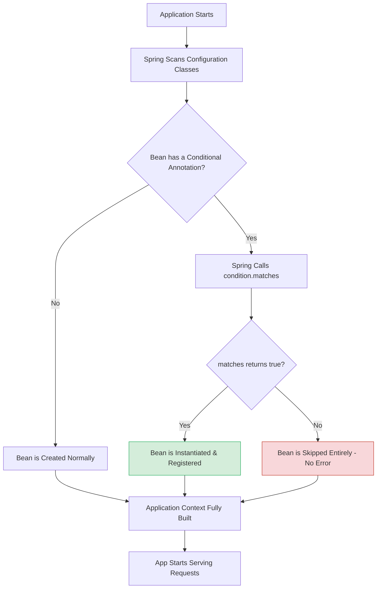
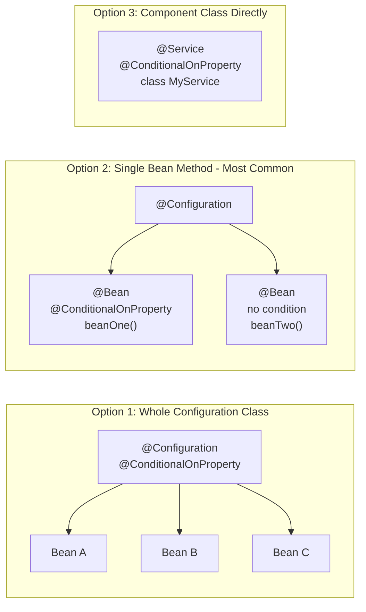
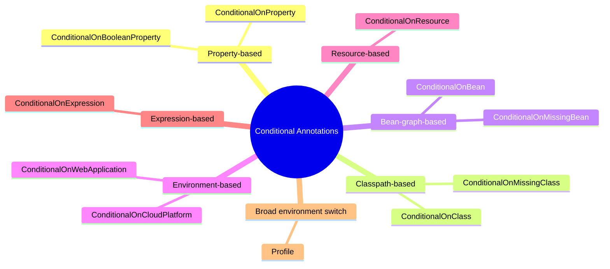
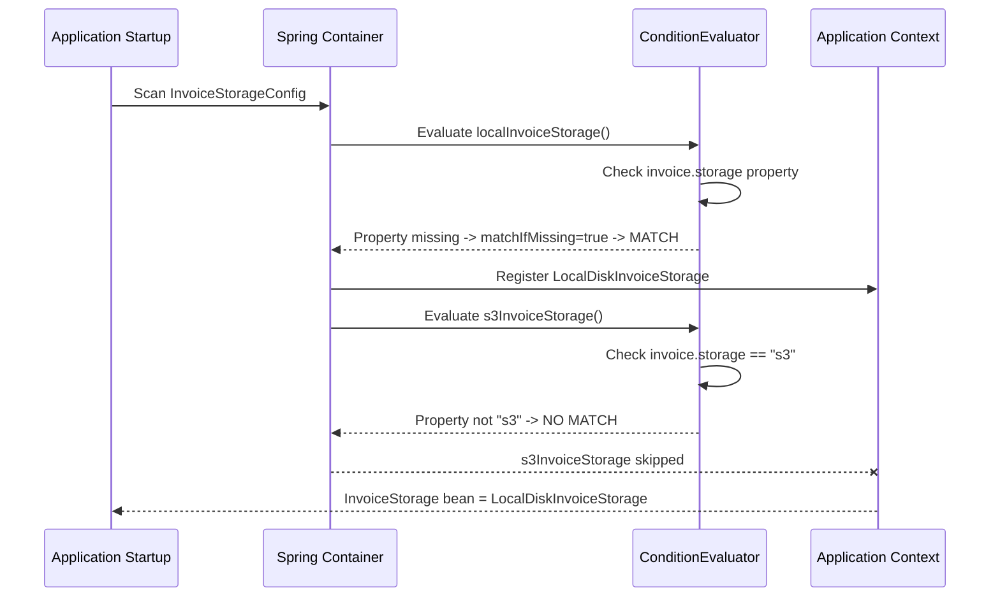
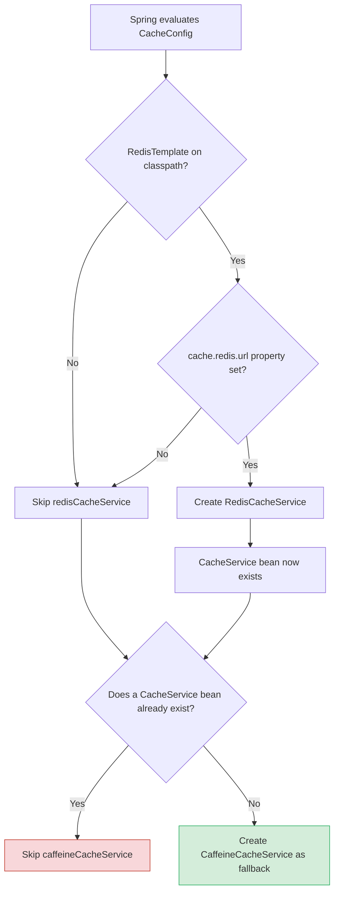
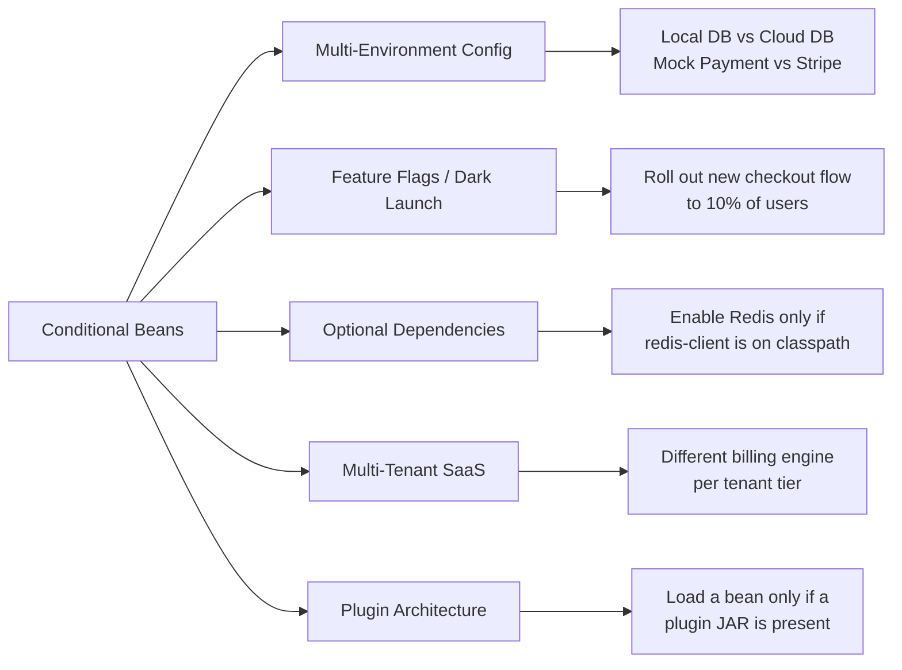
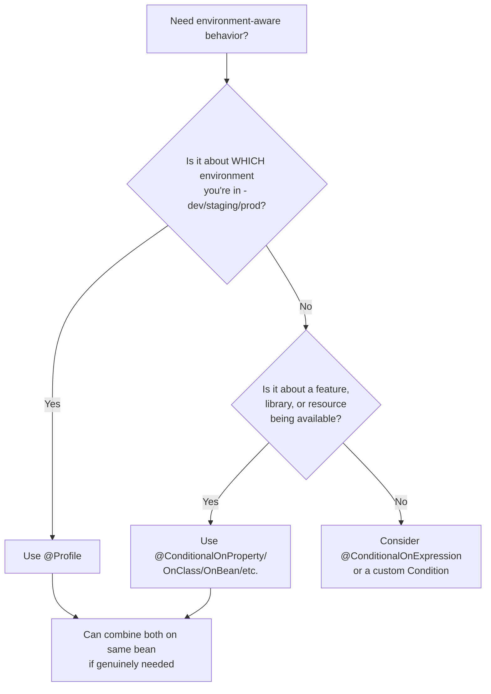
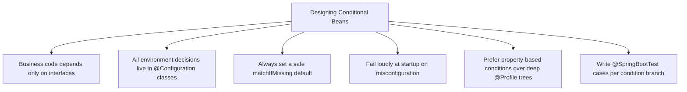
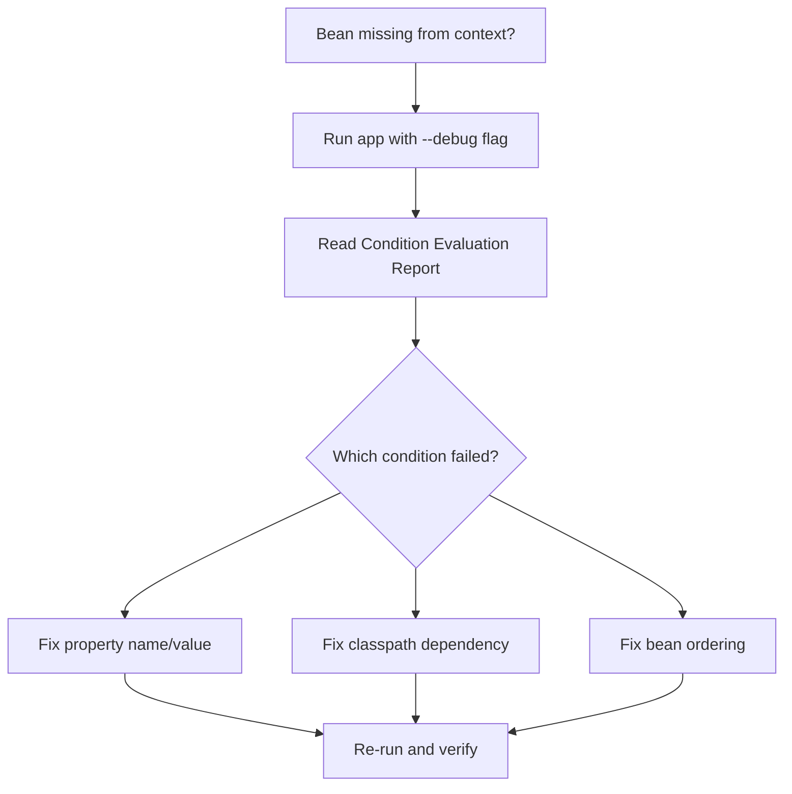

<!--
  Tutorial: Mastering Conditional Bean Creation in Spring Boot
  Difficulty: Intermediate
  Estimated Reading Time: 75-95 minutes
  Last Updated: 2026-09-04
  Source: Content provided by the user, augmented to meet tutorial-preferences.md requirements
  Based on: Spring Framework Condition API, Spring Boot @ConditionalOn* annotations, auto-configuration internals, and environment-aware bean wiring patterns
-->

# Mastering Conditional Bean Creation in Spring Boot: The Complete Guide to Environment-Aware Applications Without a Single `if` Statement

> **_"Instead of teaching your business logic where it's running, teach your configuration layer to build different implementations depending on the environment — and your services stay blissfully ignorant of which one they got."_**

---

## ⏱️ Estimated Reading Time: 75–95 minutes

**Difficulty Level:** Intermediate
**Applies to:** Spring Boot 2.x / 3.x (Java 17+ recommended)
**Prerequisites:** Java fundamentals, basic Spring Boot (container, DI, `@Configuration`), Maven or Gradle basics

---

## 📋 Table of Contents

1. [Introduction: Why Environment-Aware Configuration Matters](#1-introduction)
2. [Prerequisites](#2-prerequisites)
3. [Learning Objectives](#3-learning-objectives)
4. [Understanding Conditions: What Happens Under the Hood](#4-under-the-hood)
5. [Where to Place Conditions: A Structural Overview](#5-placement)
6. [The Essential Conditional Annotations (Deep Dive)](#6-annotations)
7. [Hands-On Examples: Four Production Patterns](#7-hands-on)
8. [Multiple Implementation Approaches Compared](#8-approaches)
9. [Real-World Use Cases](#9-use-cases)
10. [`@Conditional` vs `@Profile`: Choosing the Right Tool](#10-conditional-vs-profile)
11. [Building Custom Conditions](#11-custom-conditions)
12. [Best Practices](#12-best-practices)
13. [Anti-Patterns](#13-anti-patterns)
14. [Performance Considerations](#14-performance)
15. [Security Considerations](#15-security)
16. [Testing Strategies](#16-testing)
17. [Migration Guide](#17-migration)
18. [Debugging and Troubleshooting](#18-debugging)
19. [Practice Exercises (with Solutions)](#19-exercises)
20. [Hands-On Lab: Multi-Environment Alerts & Storage App](#20-lab)
21. [Pro Tips](#21-pro-tips)
22. [Test Your Understanding](#22-test-your-understanding)
23. [Question Bank (55+ Questions)](#23-question-bank)
24. [Common Interview Questions](#24-interview-questions)
25. [Self-Assessment Checklist](#25-self-assessment)
26. [Summary and Key Takeaways](#26-summary)
27. [Further Reading and Learning Path](#27-further-reading)

---

<a name="1-introduction"></a>
## 1. Introduction: Why Environment-Aware Configuration Matters

Imagine your Spring Boot application as a single, unchanged JAR file that travels through four very different worlds:

- **Your laptop** — fast, offline-friendly, no real credentials
- **CI pipeline** — ephemeral, mocked, disposable
- **Staging** — real integrations, fake money
- **Production** — real customers, real Stripe charges, real consequences

The same compiled code has to behave differently in each of these environments — different databases, different alerting channels, different payment gateways — **without a single line like:**

```java
// ❌ The code smell this tutorial eliminates
if (activeProfile.equals("prod")) {
    // do something different
}
```

scattered through your service layer.

This is exactly the problem Spring's **conditional bean creation** mechanism was built to solve. Instead of teaching your business logic *where it's running*, you teach your **configuration layer** to build different implementations depending on the environment — and your services stay blissfully ignorant of which one they got.

> **💡 Key Insight:** This tutorial expands that idea from the ground up: how conditions work internally, every major conditional annotation with practical examples, common failure modes, and how to debug them when something silently doesn't show up.

### What You Will Get From This Guide

| You will learn... | Why it matters |
|---|---|
| How `Condition.matches()` drives bean registration | Stop guessing why a bean did (or didn't) appear |
| Every major `@ConditionalOn*` annotation | Pick the precise tool instead of `@Profile` for everything |
| Four production patterns (storage, alerts, caching, dark launch) | Copy-paste-ready, battle-tested skeletons |
| Correct vs. incorrect implementations | Recognize the code smells before code review does |
| Performance, security, and testing implications | Ship conditions that survive production |
| 3 practice exercises + a hands-on lab | Lock the knowledge in through doing |

<a name="2-prerequisites"></a>
## 2. Prerequisites

### Technical Requirements

| Skill | Minimum Level |
|---|---|
| **Java** | Comfortable with interfaces, `@Configuration` classes, and constructor injection |
| **Spring Boot** | Have built and run at least one `@SpringBootApplication` |
| **Dependency Injection** | Understand what a bean is and how `@Autowired`/constructor wiring works |
| **Build tool** | Maven or Gradle basics (adding and removing dependencies) |
| **Spring Boot version** | 2.4+ for `@ConditionalOnBooleanProperty` (Boot 3.x recommended) |

> **📝 This tutorial IS:** a deep dive into the *mechanics* of conditional bean creation, with runnable code, diagrams, and production patterns.
>
> **❌ This tutorial is NOT:** a general Spring dependency-injection tutorial, nor a guide to Spring Cloud configuration servers (we touch profiles only where they interact with conditions).

---

<a name="3-learning-objectives"></a>
## 3. Learning Objectives

By the end of this tutorial, you will be able to:

1. Explain what happens **inside the Spring container** when a conditional annotation is evaluated, and how it differs from a runtime `if` statement.
2. Choose the right **placement** for a condition — configuration class, `@Bean` method, or component class — based on blast radius.
3. Apply all major conditional annotations: `@ConditionalOnProperty`, `@ConditionalOnBooleanProperty`, `@ConditionalOnClass`, `@ConditionalOnMissingBean`, `@ConditionalOnWebApplication`, `@ConditionalOnResource`, `@ConditionalOnCloudPlatform`, and `@ConditionalOnExpression`.
4. Implement the **interface-based switchover pattern**: local disk vs. S3, email vs. Slack, Redis vs. Caffeine — with zero `if` statements in service code.
5. Write **custom `Condition` implementations**, including annotation-driven and percentage-rollout conditions.
6. Decide correctly between `@Conditional` and `@Profile` (and when to combine both).
7. Avoid the classic pitfalls: `@ConditionalOnMissingBean` ordering traps, case-sensitive `havingValue`, and missing `matchIfMissing` defaults.
8. Diagnose missing beans using the **Condition Evaluation Report** (`--debug`) and targeted `@SpringBootTest` tests.
9. Write **one test per condition branch** so refactors can't silently change wiring.
10. Apply performance and security best practices to condition-heavy applications.

---

<a name="4-under-the-hood"></a>
## 4. Understanding Conditions: What Happens Under the Hood

At its core, a **condition** is a yes/no question that Spring asks itself *before* it decides to instantiate a bean.

During application startup, for every candidate `@Bean` method or `@Component` class annotated with a conditional annotation, Spring invokes a method called `matches()`:

```java
// The single interface every conditional annotation delegates to
public interface Condition {
    boolean matches(ConditionContext context, AnnotatedTypeMetadata metadata);
}
```

- If `matches()` returns `true` → the bean is created and registered in the application context.
- If `matches()` returns `false` → the bean is **never created**. No exception, no null placeholder — it simply doesn't exist in the context.

> **💡 Key Insight:** This is a fundamentally different mental model from an `if` statement at runtime. An `if` statement makes a decision **every time the method runs**. A condition makes a decision **once, at startup**, about what gets *built* in the first place.



### Key Mental Model Shift

| Runtime `if` statement | Spring Condition |
|---|---|
| Evaluated on every method call | Evaluated once, at startup |
| Lives inside business logic | Lives in configuration classes |
| Both code paths exist and are compiled in | Only the matching bean is ever instantiated |
| Hard to test in isolation | Easy to test with `@SpringBootTest(properties = ...)` |
| Scales badly past 2–3 branches | Scales cleanly to dozens of environments/features |

### What `ConditionContext` Gives You

When Spring calls `matches()`, it hands your condition a `ConditionContext` — your window into the entire startup environment:

| Method | What you can do with it |
|---|---|
| `getEnvironment()` | Read any property (YAML, env vars, system properties) |
| `getBeanFactory()` | Check for other bean definitions (carefully — ordering!) |
| `getClassLoader()` | Check whether a class exists on the classpath |
| `getResourceLoader()` | Check whether a file or classpath resource exists |
| `getRegistry()` | Inspect registered bean definitions |

And `AnnotatedTypeMetadata` lets you read the *attributes of your own annotation* — the foundation for building custom, parameterized conditions (Section 11).

<a name="5-placement"></a>
## 5. Where to Place Conditions: A Structural Overview

You can attach a conditional annotation in three places, each with a different **blast radius**:



| Placement | Effect | When to Use |
|---|---|---|
| On `@Configuration` class | Turns off **every** bean inside at once | Grouping a whole feature module (e.g., "everything Redis-related") |
| On individual `@Bean` method | Most granular, most flexible | The default choice for 90% of cases |
| On `@Service`/`@Component` | Works, but mixes infra decisions into the component layer | Small apps, or when the component itself *is* the environment-specific piece |

> **✅ Rule of thumb:** Put conditions on `@Bean` methods inside dedicated configuration classes. This keeps your `@Service`, `@Controller`, and `@Repository` classes completely free of environment awareness.

---

<a name="6-annotations"></a>
## 6. The Essential Conditional Annotations (Deep Dive)

Spring Boot ships with more conditional annotations than anyone memorizes, but a handful cover almost every real scenario.



### 6.1 `@ConditionalOnProperty`

Checks whether a property exists in the environment, and optionally whether it matches a specific value.

```java
@ConditionalOnProperty(name = "invoice.storage", havingValue = "s3")
```

Useful attributes:

| Attribute | Meaning |
|---|---|
| `name` / `value` | The property key(s) to check |
| `prefix` | Shared prefix prepended to `name` (e.g., `prefix = "alerts.slack"`, `name = "enabled"`) |
| `havingValue` | Required string value for a match |
| `matchIfMissing` | Whether to match when the property is **absent** (default: `false`) |

> **⚠️ Important detail:** the comparison is a **string comparison**. `havingValue = "true"` will **not** match a property set to `True` or `TRUE`. This is the single most common "why doesn't my condition fire?" bug.

```java
// ❌ BROKEN in production where ALERTS_SLACK_ENABLED=true (env var → ALERTS.SLACK.ENABLED=true)
@ConditionalOnProperty(name = "alerts.slack.enabled", havingValue = "true")

// ✅ Robust: Spring Boot's relaxed binding-aware boolean check
@ConditionalOnBooleanProperty("alerts.slack.enabled")
```

### 6.2 `@ConditionalOnBooleanProperty`

The newer (Spring Boot 2.4+), type-safe replacement for boolean flags — it accepts `true`/`false`, `on`/`off`, `yes`/`no`, `1`/`0`, and any casing, and avoids the string-casing trap above.

```java
// Matches when alerts.slack.enabled is any truthy form; supports matchIfMissing too
@ConditionalOnBooleanProperty(name = "alerts.slack.enabled", matchIfMissing = false)
```

### 6.3 `@ConditionalOnClass` / `@ConditionalOnMissingClass`

Checks whether a given class is present on the classpath — commonly used to detect whether an optional dependency (like a Redis client) was actually added to the project.

```java
@ConditionalOnClass(RedisTemplate.class)
```

> **💡 Pro tip:** reference the class **by name string** when the dependency might not exist at compile time: `@ConditionalOnClass(name = "org.springframework.data.redis.core.RedisTemplate")` — otherwise your configuration class won't even compile without the dependency.

### 6.4 `@ConditionalOnBean` / `@ConditionalOnMissingBean`

Checks whether another bean already exists (or doesn't) in the application context. Perfect for "use X unless Y already provided a Z" fallback patterns.

```java
// Provide a default only if nobody else defined one
@Bean
@ConditionalOnMissingBean(CacheService.class)
public CacheService caffeineCacheService() {
    return new CaffeineCacheService();
}
```

> **⚠️ Ordering warning:** `@ConditionalOnBean`/`@ConditionalOnMissingBean` are evaluated **in bean-definition registration order**. They are only reliable inside auto-configuration classes (which Spring Boot orders explicitly) — not across arbitrary user `@Configuration` classes. See Section 7.3 and the pitfalls table in Section 18.

### 6.5 `@ConditionalOnWebApplication` / `@ConditionalOnNotWebApplication`

Activates a bean only inside a web application context (servlet or reactive), as opposed to a batch job or CLI tool built on Spring Boot.

```java
@Bean
@ConditionalOnWebApplication(type = ConditionalOnWebApplication.Type.SERVLET)
public RequestLoggingFilter requestLoggingFilter() {
    return new RequestLoggingFilter();
}
```

### 6.6 `@ConditionalOnResource`

Checks whether a specific file or classpath resource actually exists — useful for things like optional local config files.

```java
@Bean
@ConditionalOnResource(resources = "classpath:local-overrides.yml")
public PropertySourceLoader localOverridesLoader() {
    return new LocalOverridesLoader();
}
```

### 6.7 `@ConditionalOnCloudPlatform`

Auto-detects platforms like Kubernetes or Cloud Foundry without you writing any detection logic yourself.

```java
@Bean
@ConditionalOnCloudPlatform(CloudPlatform.KUBERNETES)
public HealthIndicator kubernetesHealthIndicator() {
    return new KubernetesHealthIndicator();
}
```

> **💡 How detection works:** for Kubernetes, Spring checks for the `KUBERNETES_SERVICE_HOST` / `KUBERNETES_SERVICE_PORT` environment variables that the platform injects into every pod — so this works even before your app opens a socket.

### 6.8 `@ConditionalOnExpression`

An escape hatch — write a raw SpEL expression when nothing else fits.

```java
@Bean
@ConditionalOnExpression("${feature.enabled:false} and ${feature.beta:false}")
public BetaFeatureService betaFeatureService() {
    return new BetaFeatureService();
}
```

> **⚠️ Use sparingly:** SpEL conditions are stringly-typed, hard to unit test, and fail at startup on typos. Prefer a custom `Condition` (Section 11) when logic gets non-trivial.

### 6.9 `@Profile`

Switches beans based on the *active Spring profile* (`dev`, `staging`, `prod`). Broad and coarse — answers "which environment bucket am I in," not "which capability is available." `@Profile` is itself meta-annotated with `@Conditional(ProfileCondition.class)` — it *is* a condition, just a coarse one.

### Quick Reference Matrix

| Annotation | Question it answers | Evaluated against |
|---|---|---|
| `@ConditionalOnProperty` | Is this property set to this value? | Environment |
| `@ConditionalOnBooleanProperty` | Is this boolean flag on? | Environment |
| `@ConditionalOnClass` | Is this library on the classpath? | Classpath |
| `@ConditionalOnBean` / `MissingBean` | Does this bean (not) exist yet? | Bean registry |
| `@ConditionalOnWebApplication` | Am I running a web app? | Context type |
| `@ConditionalOnResource` | Does this file/resource exist? | Classpath / filesystem |
| `@ConditionalOnCloudPlatform` | Am I on K8s / Cloud Foundry? | Environment variables |
| `@ConditionalOnExpression` | Does this SpEL evaluate truthy? | Environment (via SpEL) |
| `@Profile` | Which environment bucket am I in? | Active profiles |

---

<a name="7-hands-on"></a>
## 7. Hands-On Examples: Four Production Patterns

Four complete, runnable patterns that together cover most real-world needs. Each follows the same discipline: **an interface, a dedicated configuration class, and zero environment awareness in services.**

### 7.1 Invoice Storage (Local Disk vs S3)

**Goal:** Local disk on your laptop, S3 in production — with zero `if` statements in the service layer.

```java
// The interface every implementation fulfills — the service will only ever see this
public interface InvoiceStorage {
    void store(Invoice invoice);
    Optional<Invoice> load(String invoiceId);
}

@Configuration
public class InvoiceStorageConfig {

    @Bean
    @ConditionalOnProperty(
        name = "invoice.storage",
        havingValue = "local",
        matchIfMissing = true)          // 👈 safe default when property is absent
    public InvoiceStorage localInvoiceStorage() {
        return new LocalDiskInvoiceStorage();
    }

    @Bean
    @ConditionalOnProperty(name = "invoice.storage", havingValue = "s3")
    public InvoiceStorage s3InvoiceStorage() {
        return new S3InvoiceStorage();
    }
}
```

`matchIfMissing = true` makes local storage the **safe default** when nobody has set the property at all — a fresh clone of the repo just works.

```java
// ✅ The service depends ONLY on the interface — it never learns which implementation it got
@Service
public class InvoiceService {
    private final InvoiceStorage storage;

    public InvoiceService(InvoiceStorage storage) {
        this.storage = storage; // Spring injects whichever bean matched
    }
}
```

**Extended variation — adding a third option (Google Cloud Storage):**

```java
@Bean
@ConditionalOnProperty(name = "invoice.storage", havingValue = "gcs")
public InvoiceStorage gcsInvoiceStorage() {
    return new GcsInvoiceStorage();
}
```

Notice how adding a fourth, fifth, or sixth environment costs you exactly one new `@Bean` method — never a new `if` branch inside `InvoiceService`.



### 7.2 Alerts (Fixed Bean + Optional Beans via `List<T>`)

**Goal:** Always send email alerts. Only send Slack alerts if explicitly enabled.

```java
@Configuration
public class AlertConfig {

    @Bean
    public OrderAlerter emailAlerter() {              // always present
        return new EmailOrderAlerter();
    }

    @Bean
    @ConditionalOnBooleanProperty("alerts.slack.enabled")
    public OrderAlerter slackAlerter() {              // optional
        return new SlackOrderAlerter();
    }
}
```

```java
// The magic: injecting a List<T> collects ALL matching implementations
@Service
public class OrderNotificationService {
    private final List<OrderAlerter> alerters;

    public OrderNotificationService(List<OrderAlerter> alerters) {
        this.alerters = alerters; // 1 or 2 items, service doesn't care
    }

    public void notifyOrderPlaced(Order order) {
        alerters.forEach(alerter -> alerter.alert(order));
    }
}
```

**Extended variation — adding PagerDuty for critical alerts only:**

```java
@Bean
@ConditionalOnBooleanProperty("alerts.pagerduty.enabled")
public OrderAlerter pagerDutyAlerter() {
    return new PagerDutyOrderAlerter();
}
```

Now production can run with `[Email, Slack, PagerDuty]`, staging with `[Email, Slack]`, and local dev with just `[Email]` — all controlled purely through `application.yml`, no code changes.

### 7.3 Caching (Redis with Caffeine Fallback)

**Goal:** Use Redis when the library is on the classpath *and* a connection URL is configured. Otherwise, fall back to an in-memory Caffeine cache.

```java
@Configuration
public class CacheConfig {

    @Bean
    @ConditionalOnClass(RedisTemplate.class)
    @ConditionalOnProperty(name = "cache.redis.url")   // exists (any value) → match
    public CacheService redisCacheService() {
        return new RedisCacheService();
    }

    @Bean
    @ConditionalOnMissingBean(CacheService.class)      // only if Redis didn't win
    public CacheService caffeineCacheService() {
        return new CaffeineCacheService();
    }
}
```

> **⚠️ Why order matters:** `@ConditionalOnMissingBean` only behaves correctly if Spring evaluates the Redis bean *first*. In practice, this fallback pattern is safest inside a properly ordered Spring Boot **auto-configuration** class (using `@AutoConfigureOrder` or `@AutoConfigureBefore`/`@AutoConfigureAfter`, registered via `META-INF/spring/org.springframework.boot.autoconfigure.AutoConfiguration.imports`), rather than hand-placed across unrelated `@Configuration` classes. Inside a single configuration class, methods are evaluated top-to-bottom, which keeps the pattern working predictably.



### 7.4 Kubernetes Detection & Custom Dark-Launch Condition

**Built-in platform detection:**

```java
@Bean
@ConditionalOnCloudPlatform(CloudPlatform.KUBERNETES)
public HealthIndicator kubernetesHealthIndicator() {
    return new KubernetesHealthIndicator();
}
```

**Custom condition for a feature flag / dark launch:**

```java
public class DarkLaunchCondition implements Condition {
    @Override
    public boolean matches(ConditionContext context, AnnotatedTypeMetadata metadata) {
        String value = context.getEnvironment()
                .getProperty("feature.dark-launch.enabled");
        return "true".equalsIgnoreCase(value);   // case-safe boolean check
    }
}
```

```java
@Bean
@Conditional(DarkLaunchCondition.class)
public FeatureXService featureXService() {
    return new FeatureXService();
}
```

**Extended variation — a condition that checks a percentage rollout:**

```java
public class PercentageRolloutCondition implements Condition {
    @Override
    public boolean matches(ConditionContext context, AnnotatedTypeMetadata metadata) {
        String raw = context.getEnvironment().getProperty("feature.rollout.percent", "0");
        int percent = Integer.parseInt(raw);
        return new Random().nextInt(100) < percent;   // startup-time coin flip
    }
}
```

> **💡 Key Insight:** This shows how flexible custom conditions can get — `ConditionContext` gives you access to the environment, the bean factory, class loader, and resource loader, so almost any *startup-time* decision is possible. What a condition can **never** do is change behavior *per request* — that's the job of a runtime feature-flag library. Know the boundary.

### 7.5 Correct vs. Incorrect: The Same Feature Two Ways

```java
// ❌ INCORRECT — environment logic leaks into the service; grows into a monster
@Service
public class InvoiceService {
    private final Environment env;

    public void store(Invoice invoice) {
        String profile = env.getActiveProfiles().length > 0
                ? env.getActiveProfiles()[0] : "default";
        if (profile.equals("prod")) {
            s3Client.putObject(...);
        } else if (profile.equals("staging")) {
            minioClient.putObject(...);
        } else {
            Files.write(localPath(invoice), invoice.bytes());
        }
        // Every new environment = a new branch, a new merge conflict, a new test matrix
    }
}
```

```java
// ✅ CORRECT — the service has no idea environments exist
@Service
public class InvoiceService {
    private final InvoiceStorage storage;

    public void store(Invoice invoice) {
        storage.store(invoice);   // that's it. That's the whole method.
    }
}
// The environment decision lives in ONE annotated configuration class.
```

---

<a name="8-approaches"></a>
## 8. Multiple Implementation Approaches Compared

There is more than one legitimate way to build environment-aware wiring. Here's when each wins:

| Approach | Granularity | Best For | Drawback |
|---|---|---|---|
| **`@ConditionalOnProperty` on `@Bean` methods** | Fine (per property) | Capability switches, infra selection | Property typos fail silently unless tested |
| **`@Profile` on `@Configuration` classes** | Coarse (per environment) | Genuinely environment-bucketed config | Combinatorial explosion past 3–4 profiles |
| **Custom `Condition` classes** | Any logic you like | Rollouts, platform quirks, compound rules | More code to maintain and test |
| **Auto-configuration module + `@ConditionalOnMissingBean`** | Library-grade | Shared starter libraries / plugins | Requires ordering care (`@AutoConfigureAfter`) |
| **Strategy map built at runtime** | Per-tenant / per-request | Multi-tenant SaaS where the choice is data-driven | Not a startup decision — conditions can't do this alone |

> **💡 Decision shortcut:** if the answer changes **between environments** for the *same* deployment artifact → conditions. If the answer changes **per request/tenant** inside one environment → a runtime strategy pattern (possibly *combined* with conditions that register the candidate strategies).

<a name="9-use-cases"></a>
## 9. Real-World Use Cases



1. **Multi-environment configuration** (the article's core example): local disk vs. S3, mock payment gateway vs. Stripe, console logging vs. Slack/PagerDuty alerts.
2. **Feature flags and dark launches**: gate a risky new bean behind a property so it only activates for a subset of traffic, without a deployment.
3. **Optional third-party integrations**: a library like Redis, Kafka, or an APM agent is only wired up if its client library is actually on the classpath — this is exactly how Spring Boot's own auto-configuration modules work internally.
4. **Multi-tenant SaaS platforms**: register a `BillingStrategy` or `NotificationChannel` bean per tenant tier (often combined with `@ConditionalOnExpression`, with the final per-request choice made by a runtime strategy map).
5. **Plugin-style architectures**: a bean only gets created if a particular resource or marker file exists in the deployment package, effectively turning optional modules on or off.

### Case Study: How Spring Boot Itself Uses This

Open any Spring Boot starter and you'll find exactly these patterns. `RedisAutoConfiguration` is guarded by `@ConditionalOnClass(RedisOperations.class)` — which is why your app runs fine without Redis installed. `DataSourceAutoConfiguration` uses `@ConditionalOnMissingBean(DataSource.class)` so *your* `DataSource` bean always wins over the default. When you understand conditions, Spring Boot's "magic" becomes readable source code.

---

<a name="10-conditional-vs-profile"></a>
## 10. `@Conditional` vs `@Profile`: Choosing the Right Tool



- **`@Profile`** answers: *"Which environment bucket am I in?"* — broad, coarse-grained.
- **Other `@Conditional*` annotations** answer: *"Is this specific feature/library/resource/bean available?"* — narrow, fine-grained.

You *can* combine both:

```java
@Bean
@Profile("prod")   // AND — both must match
@ConditionalOnProperty(name = "alerts.pagerduty.enabled", havingValue = "true")
public OrderAlerter pagerDutyAlerter() {
    return new PagerDutyOrderAlerter();
}
```

> **⚠️ Watch out:** multiple conditions on one bean are combined with **AND** semantics — all of them must pass. There is no built-in "OR" at the annotation level; you model OR by defining multiple beans (as in the storage example) or by writing one custom condition that contains the OR logic.

### Side-by-Side Comparison

| Dimension | `@Profile` | `@ConditionalOn*` |
|---|---|---|
| Question answered | "Which bucket am I in?" | "Is this capability available?" |
| Granularity | Coarse | Fine |
| Combinatorics | Multiplies with every new profile | Linear — one property per switch |
| Self-documenting config | Moderate | High (`invoice.storage=s3` reads like a sentence) |
| Testing | `@ActiveProfiles` | `@SpringBootTest(properties = ...)` — no profile juggling |
| Risk | Profile sprawl, "prod+canary+" monsters | Typos; `matchIfMissing` mistakes |

**Practical guidance:** most mature codebases lean heavily on property-based conditions and use `@Profile` sparingly — profiles tend to get messy once you have more than three or four of them, since every new profile is a new combinatorial branch to reason about.

---

<a name="11-custom-conditions"></a>
## 11. Building Custom Conditions

When no built-in annotation fits, write your own `Condition`. Three escalating levels:

### Level 1: Simple Property Condition (from Section 7.4)

```java
public class DarkLaunchCondition implements Condition {
    @Override
    public boolean matches(ConditionContext context, AnnotatedTypeMetadata metadata) {
        return "true".equalsIgnoreCase(
                context.getEnvironment().getProperty("feature.dark-launch.enabled"));
    }
}
```

### Level 2: Annotation-Driven, Reusable Condition

Avoid duplicating magic strings by pairing a custom annotation with a condition that reads its attributes from `AnnotatedTypeMetadata`:

```java
// 1. The custom annotation — the condition is wired via @Conditional here
@Target({ElementType.TYPE, ElementType.METHOD})
@Retention(RetentionPolicy.RUNTIME)
@Conditional(OnFeatureFlagCondition.class)
public @interface ConditionalOnFeatureFlag {
    String value();                           // property name
    int rolloutPercent() default 100;
}
```

```java
// 2. The condition reads the annotation's attributes from metadata
public class OnFeatureFlagCondition implements Condition {
    @Override
    public boolean matches(ConditionContext ctx, AnnotatedTypeMetadata meta) {
        var attrs = meta.getAnnotationAttributes(
                ConditionalOnFeatureFlag.class.getName());
        if (attrs == null) return false;
        String property = (String) attrs.get("value");
        int percent = (int) attrs.getOrDefault("rolloutPercent", 100);
        return Boolean.parseBoolean(
                       ctx.getEnvironment().getProperty(property, "false"))
                && new Random().nextInt(100) < percent;
    }
}
```

```java
// 3. Usage reads like a sentence
@Bean
@ConditionalOnFeatureFlag(value = "checkout.v2.enabled", rolloutPercent = 10)
public CheckoutV2Service checkoutV2Service() {
    return new CheckoutV2Service();
}
```

### Level 3: Compound Conditions

`@ConditionalOnProperty` + `@ConditionalOnClass` stack with AND semantics; for OR or complex logic, one condition class can combine the checks internally:

```java
public class RedisAvailableCondition implements Condition {
    @Override
    public boolean matches(ConditionContext ctx, AnnotatedTypeMetadata meta) {
        boolean onClasspath = ClassUtils.isPresent(
                "org.springframework.data.redis.core.RedisTemplate",
                ctx.getClassLoader());
        boolean configured = ctx.getEnvironment().getProperty("cache.redis.url") != null;
        return onClasspath && configured;   // Section 7.3 expressed as ONE condition
    }
}
```

### Rules for Well-Behaved Custom Conditions

| Rule | Why |
|---|---|
| Conditions must be **fast** | They run synchronously during startup, before every bean decision |
| Conditions must be **deterministic** per evaluation | Spring may evaluate the same condition multiple times |
| Never perform I/O beyond light classpath/resource checks | Startup latency is a feature |
| Never depend on beans being instantiated | Conditions run during *definition* registration, before beans exist |
| Catch and translate `NumberFormatException`-style input errors | A malformed property should fail loudly, not NPE |

> **⚠️ A condition is a startup-time decision.** It cannot change behavior per request. If you need per-request or per-tenant switching, register *all* candidate strategies via conditions and choose between them at runtime.

---

<a name="12-best-practices"></a>
## 12. Best Practices



- ✅ Business code should only ever depend on **interfaces**, never on which implementation got wired in.
- ✅ One configuration class owns the decision of which bean gets created for which environment.
- ✅ Set sensible `matchIfMissing` defaults so fresh environments don't break.
- ✅ Prefer failing loudly at startup over silently running with the wrong bean in production.
- ✅ Write a `@SpringBootTest` per meaningful property combination to lock in behavior.
- ✅ Use the Condition Evaluation Report (`--debug`) whenever a bean unexpectedly goes missing.
- ✅ Name your configuration classes after the decision they own (`InvoiceStorageConfig`, not `AppConfig2`).
- ✅ Keep property names namespaced and documented (`invoice.storage`, not `storageMode`).

---

<a name="13-anti-patterns"></a>
## 13. Anti-Patterns

| ❌ Anti-Pattern | Why It Hurts | ✅ Fix |
|---|---|---|
| `if (env.equals("prod"))` in services | Business logic coupled to environments; untestable branches | Move the choice into a conditional `@Bean` |
| One giant `@Configuration` with 40 conditional beans | Nobody can tell which conditions interact | Split per capability, named after the decision |
| `havingValue = "true"` for booleans | Breaks on `TRUE`, env vars, `YES` | Use `@ConditionalOnBooleanProperty` |
| `@ConditionalOnMissingBean` across unrelated user configs | Bean registration order isn't guaranteed → duplicate beans | Keep it in one config class or a real auto-configuration |
| Conditions that call the DB / network to decide | Startup stalls; flaky bootstrap | Decide from classpath/environment only |
| "Just in case" catch-all beans with `matchIfMissing = true` everywhere | Wrong bean silently runs in prod | Fail fast on missing required config instead |
| Profile-per-environment-per-feature (`prod-payments-eu`) | Combinatorial profile explosion | Property-based conditions per capability |
| Testing only the "happy" branch | A refactor can silently flip wiring | One test per property combination |

### The Sneakiest Anti-Pattern: Environment Checks Reborn as Code

```java
// ❌ The condition layer exists, but someone routes around it anyway
@Bean
public InvoiceStorage invoiceStorage(Environment env) {
    if (env.getProperty("invoice.storage", "local").equals("s3")) {
        return new S3InvoiceStorage();          // decision made in Java, not by the container
    }
    return new LocalDiskInvoiceStorage();
}
```

This *works* — and that's the danger. It forfeits the Condition Evaluation Report, per-branch tests, and the ability to override via the environment without a code change. Configuration belongs in configuration classes.

<a name="14-performance"></a>
## 14. Performance Considerations

Conditions run **during startup**, so their cost profile is different from runtime code:

| Aspect | Impact | Guidance |
|---|---|---|
| Condition evaluation cost | Tiny per check (property map lookup, class name check) | Negligible for dozens of conditions; don't write conditions that scan the filesystem recursively |
| Skipped beans **never instantiate** | Positive — skipped `S3InvoiceStorage` never builds an S3 client | Gate expensive clients behind conditions instead of creating-then-ignoring |
| `@ConditionalOnClass` on the config class vs. bean method | Class-level check prevents parsing/loading the whole config class | Prefer class-level `@ConditionalOnClass` when the entire config needs a library |
| Many OR-conditions via `@ConditionalOnExpression` | Each is a SpEL parse + evaluation | Batch related checks into one custom condition |
| Lazy initialization interplay | `spring.main.lazy-initialization=true` defers instantiation, not condition evaluation | Conditions still run at startup — wiring decisions are always made upfront |

> **💡 Benchmark intuition:** Spring Boot's own startup evaluates **hundreds** of conditions (every auto-configuration class is conditional) in well under a second. Your handful of custom conditions won't move the needle — unless they do I/O.

```java
// ✅ Performance-friendly: whole config vanishes from the startup path
// if the library is absent — its bean methods are never even parsed for conditions
@Configuration(proxyBeanMethods = false)     // 👈 also skips CGLIB proxying
@ConditionalOnClass(name = "software.amazon.awssdk.services.s3.S3Client")
public class S3StorageConfig { ... }
```

**Tip:** `proxyBeanMethods = false` on condition-heavy configuration classes avoids CGLIB proxy overhead and is safe as long as `@Bean` methods don't call each other.

---

<a name="15-security"></a>
## 15. Security Considerations

Conditional wiring directly affects *what code runs where* — treat it as a security-relevant surface:

1. **Secrets referenced by conditional properties.** If a condition depends on `cache.redis.url`, the URL may contain credentials. Inject it via environment variables or a secrets manager — never commit a real value to `application.yml` just to "activate" the bean.
2. **`matchIfMissing = true` on dangerous beans.** A dev-friendly default (`S3Client` off locally) can accidentally disable a security control in prod if the property is misspelled. For security-relevant beans (audit logging, rate limiting), prefer `matchIfMissing = true` *only* when the bean is the safe choice — otherwise make absence a hard startup failure.
3. **Feature-flag exposure.** `@ConditionalOnExpression("${feature.enabled:false}")` values often live in config that is visible in actuator `/env` endpoints. Lock actuator down (`management.endpoints.web.exposure.exclude=env,configprops`) or use a secrets-backed property source.
4. **Dark launches are not access control.** A bean gated by `DarkLaunchCondition` is invisible — but if a controller mapping still exists, ensure the endpoint itself is secured; don't rely on the service bean being absent to "hide" functionality (a `NoSuchBeanDefinitionException` is a 500, not a 403).
5. **Platform detection isn't authentication.** `@ConditionalOnCloudPlatform(KUBERNETES)` tells you where you run, not who's calling. Combine with proper network policies and auth.
6. **Conditional beans in shared libraries.** A starter that conditionally registers a permissive `CorsConfigurationSource` when a property is unset can silently weaken apps that never set the property. Ship secure defaults with `matchIfMissing = true` on the *secure* variant.

> **⚠️ Rule:** for anything security-critical, add a startup assertion that the *right* bean was chosen — e.g., an `ApplicationListener<ApplicationReadyEvent>` that fails startup unless an audit-log bean exists in prod. Bad configuration becomes impossible to ignore.

<a name="16-testing"></a>
## 16. Testing Strategies

Conditions are wiring logic — and wiring logic deserves its own test suite. The core technique: spin up (a slice of) the context with specific properties and assert on the bean type.

### Pattern 1: Assert the Wired Implementation

```java
@SpringBootTest(properties = "invoice.storage=s3")
class InvoiceStorageConfigTest {

    @Autowired
    private InvoiceStorage invoiceStorage;

    @Test
    void shouldWireS3StorageWhenPropertySetToS3() {
        assertThat(invoiceStorage).isInstanceOf(S3InvoiceStorage.class);
    }
}
```

### Pattern 2: Assert Absence, Not Just Presence

```java
@SpringBootTest(properties = "alerts.slack.enabled=false")
class AlertConfigOffTest {

    @Autowired
    private List<OrderAlerter> alerters;

    @Test
    void slackAlerterShouldBeAbsentWhenDisabled() {
        assertThat(alerters).extracting(Object::getClass)
                .doesNotContain(SlackOrderAlerter.class);
    }
}
```

### Pattern 3: `ApplicationContextRunner` — Fast, Focused Condition Tests

`ApplicationContextRunner` is the tool Spring Boot's own team uses to test auto-configuration. It's faster than `@SpringBootTest` and expresses each scenario in a few lines:

```java
class CacheConfigRunnerTest {

    private final ApplicationContextRunner runner = new ApplicationContextRunner()
            .withUserConfiguration(CacheConfig.class);

    @Test
    void redisWinsWhenClassAndUrlPresent() {
        runner.withPropertyValues("cache.redis.url=redis://localhost:6379")
              .withClassLoader(new FilteredClassLoader(CacheService.class)) // simulate classpath
              .run(ctx -> assertThat(ctx).hasSingleBean(CacheService.class));
    }

    @Test
    void caffeineFallsBackWhenRedisPropertyMissing() {
        runner.run(ctx -> {
            assertThat(ctx).hasSingleBean(CacheService.class);
            assertThat(ctx.getBean(CacheService.class)).isInstanceOf(CaffeineCacheService.class);
        });
    }
}
```

### Test Coverage Checklist

- ✅ One test per property value (`local`, `s3`, `gcs`) *and* the missing-property case
- ✅ A test proving optional beans are **absent** (not just present elsewhere)
- ✅ A test for each custom `Condition` with property present / absent / malformed
- ✅ An integration smoke test with the production-like property set to catch cross-condition interactions

> **💡 Rule of thumb:** every condition you write is a promise about the context. Every promise gets a test that would fail if the promise broke.

---

<a name="17-migration"></a>
## 17. Migration Guide

### From Profile Sprawl → Property-Based Conditions

**Before** — every feature multiplied the number of profiles:

```java
@Configuration
@Profile("prod-payments-stripe")
public class StripePaymentConfig { ... }

@Configuration
@Profile("prod-payments-mock")
public class MockPaymentConfig { ... }
```

**After** — one capability, one property, N profiles irrelevant:

```java
@Configuration
public class PaymentConfig {
    @Bean
    @ConditionalOnProperty(name = "payments.gateway", havingValue = "stripe")
    public PaymentGateway stripeGateway() { return new StripePaymentGateway(); }

    @Bean
    @ConditionalOnProperty(name = "payments.gateway",
                           havingValue = "mock", matchIfMissing = true)
    public PaymentGateway mockGateway() { return new MockPaymentGateway(); }
}
```

Migration steps:
1. Inventory every `@Profile` bean and classify it: "environment bucket" (keep `@Profile`) vs. "capability switch" (convert).
2. Introduce the namespaced property (e.g., `payments.gateway`) and a `matchIfMissing` default matching today's most common environment.
3. Convert one profile-branch at a time, running both the old and new path in parallel in staging.
4. Write the per-branch tests (Section 16) *before* deleting the profile classes.
5. Delete the now-unused profiles and update deployment manifests.

### From Runtime `Environment` Checks → Conditions

1. Find every `env.getActiveProfiles()` / `env.getProperty(...).equals(...)` decision in services.
2. Extract an interface for the varying behavior.
3. Move each branch into a conditional `@Bean` in a dedicated config class.
4. Replace the `if` in the service with constructor injection of the interface.
5. Verify with the Condition Evaluation Report that exactly one implementation registers per environment.

### Version Notes

- **`@ConditionalOnBooleanProperty`** requires Spring Boot 2.4+ — on older versions use `OnPropertyCondition` semantics carefully or a custom condition.
- **Auto-configuration registration** moved from `META-INF/spring.factories` (Boot 2.x) to `META-INF/spring/org.springframework.boot.autoconfigure.AutoConfiguration.imports` (Boot 3.x) when packaging your own starters.
- `@ConditionalOnJava`, `@ConditionalOnSingleCandidate`, and `@ConditionalOnWarDeployment` exist beyond this tutorial's essentials — check the Javadoc before writing a custom condition that overlaps one.

<a name="18-debugging"></a>
## 18. Debugging and Troubleshooting

When a bean silently fails to appear, Spring Boot gives you a built-in diagnostic tool: the **Condition Evaluation Report**.

Run your app with the debug flag:

```bash
java -jar app.jar --debug
```

or in `application.yml`:

```yaml
debug: true
```

This prints a full report of **every** condition Spring checked, whether it passed or failed, and why — invaluable when two conditions interact in a non-obvious way. (In tests: enable debug logging for `org.springframework.boot.autoconfigure`.)

Sample output shape:

```text
   InvoiceStorageConfig matched:
      - @ConditionalOnProperty (invoice.storage=s3) matched (OnPropertyCondition)

   InvoiceStorageConfig#localInvoiceStorage:
      Did not match:
         - @ConditionalOnProperty (invoice.storage=local) did not find property 'invoice.storage' (OnPropertyCondition)
```

### Quick Verification Without Debug Output

```java
@Autowired ApplicationContext ctx;

ctx.getBeanNamesForType(InvoiceStorage.class);           // what did I actually get?
ctx.containsBean("s3InvoiceStorage");                     // was this candidate skipped?
ctx.getBeanProvider(SlackOrderAlerter.class).getIfAvailable();
```

### Common Pitfalls and How to Avoid Them

| Pitfall | Why It Happens | Fix |
|---|---|---|
| `@ConditionalOnMissingBean` creates a duplicate | Bean ordering isn't guaranteed outside auto-configuration | Use `@AutoConfigureOrder` / `@AutoConfigureAfter`, or place fallback logic in proper auto-config classes |
| `havingValue = "true"` doesn't match `TRUE` | String comparison, case-sensitive | Normalize casing, or use `@ConditionalOnBooleanProperty` |
| App fails to start in a fresh environment | Forgot `matchIfMissing` on the default bean | Set a sensible `matchIfMissing = true` default |
| Condition "never triggers" | Mixed up `prefix` and `name` attributes on `@ConditionalOnProperty` | Double-check attribute names against the property path you're actually setting |
| `NoSuchBeanDefinitionException` at injection time | All candidates for an interface were skipped | Provide one `matchIfMissing = true` fallback or `@Autowired(required = false)` + `ObjectProvider` |
| `UnsatisfiedDependencyException`: two beans, one injection point | Two conditional beans matched at once | Make conditions mutually exclusive (`havingValue` pairs) or use `@Primary` deliberately |
| Debugging becomes painful | Stacking too many conditions with strict AND logic on one bean | Split into smaller, clearly named conditions; use the Condition Evaluation Report |
| An `if (env.equals("prod"))` sneaks back into a service | Someone bypasses the configuration layer under time pressure | Code review discipline — business code should only depend on interfaces, never on environment checks |
| `--debug` prints thousands of lines | Every auto-configuration condition is reported | Pipe to a file and grep for your config class name |

### Troubleshooting Flow



<a name="19-exercises"></a>
## 19. Practice Exercises (with Solutions)

Work these with a real Spring Boot project — reading the solutions without running the code defeats the purpose.

### Exercise 1: Region-Based Storage Switch (Beginner → Intermediate)

**Task:** Extend `InvoiceStorageConfig` so the app supports **Azure Blob Storage** in addition to local disk and S3. Requirements:
- Property `invoice.storage` accepts `local`, `s3`, or `azure`.
- A fresh clone with no property set must work out of the box (local).
- Setting the property to an **unknown value** must fail the application **at startup** with a clear message — not silently pick a default.

**Solution:**

```java
@Configuration
public class InvoiceStorageConfig {

    @Bean
    @ConditionalOnProperty(name = "invoice.storage", havingValue = "local", matchIfMissing = true)
    public InvoiceStorage localInvoiceStorage() { return new LocalDiskInvoiceStorage(); }

    @Bean
    @ConditionalOnProperty(name = "invoice.storage", havingValue = "s3")
    public InvoiceStorage s3InvoiceStorage() { return new S3InvoiceStorage(); }

    @Bean
    @ConditionalOnProperty(name = "invoice.storage", havingValue = "azure")
    public InvoiceStorage azureInvoiceStorage() { return new AzureBlobInvoiceStorage(); }

    // ✅ Fail loudly on typos: runs only when the property exists but matches nothing above
    @Bean
    @ConditionalOnProperty(name = "invoice.storage")
    @ConditionalOnMissingBean(InvoiceStorage.class)
    public InvoiceStorage invalidInvoiceStorage() {
        throw new IllegalStateException(
            "invoice.storage must be one of: local, s3, azure");
    }
}
```

**Why this works:** the first three beans are mutually exclusive on `havingValue`. The guard bean matches whenever the property is set (so `matchIfMissing` is false by default) *and* nothing else matched — converting a silent misconfiguration into a startup failure. Note the ordering caveat: within one configuration class, methods evaluate top-to-bottom, so the guard runs last; for library-grade safety, use `ApplicationContextRunner` tests (Section 16) to lock this in.

### Exercise 2: Notification Pipeline with Optional Channels (Intermediate)

**Task:** Build an `OrderNotificationService` that collects any number of `OrderAlerter` beans. Requirements:
- Email always registered; Slack and PagerDuty only when `alerts.slack.enabled` / `alerts.pagerduty.enabled` are true (any casing, e.g. `TRUE`, `Yes`, `1`).
- A test must prove that PagerDuty is **absent** when its flag is false.

**Solution:**

```java
@Configuration
public class AlertConfig {
    @Bean
    public OrderAlerter emailAlerter() { return new EmailOrderAlerter(); }

    @Bean
    @ConditionalOnBooleanProperty("alerts.slack.enabled")
    public OrderAlerter slackAlerter() { return new SlackOrderAlerter(); }

    @Bean
    @ConditionalOnBooleanProperty("alerts.pagerduty.enabled")
    public OrderAlerter pagerDutyAlerter() { return new PagerDutyOrderAlerter(); }
}
```

```java
@SpringBootTest(properties = "alerts.pagerduty.enabled=false")
class AlertConfigTest {
    @Autowired List<OrderAlerter> alerters;

    @Test
    void pagerDutyIsAbsentWhenDisabled() {
        assertThat(alerters).extracting(a -> a.getClass().getSimpleName())
                .doesNotContain("PagerDutyOrderAlerter");
    }
}
```

**Why `@ConditionalOnBooleanProperty`:** it handles `true`, `TRUE`, `yes`, `on`, `1` via Spring Boot's relaxed binding — `havingValue = "true"` would reject all of those except lowercase `true`.

### Exercise 3: Custom Rollout Condition with Startup Determinism (Advanced)

**Task:** Improve `PercentageRolloutCondition` from Section 7.4. Problems with the naive version: (a) it throws an unhandled exception on a non-numeric property, and (b) each evaluation flips a new random number, so behavior differs between evaluations. Requirements:
- Malformed input → fail startup with a clear message.
- The decision must be **stable for the lifetime of the JVM** (no re-rolling).

**Solution:**

```java
public class PercentageRolloutCondition implements Condition {

    private volatile boolean decided;          // evaluate-once guard
    private volatile boolean enabled;

    @Override
    public boolean matches(ConditionContext ctx, AnnotatedTypeMetadata metadata) {
        if (!decided) {                        // not thread-safe across contexts; fine for startup,
            synchronized (this) {              // deterministic per JVM thereafter
                if (!decided) {
                    String raw = ctx.getEnvironment()
                            .getProperty("feature.rollout.percent", "0");
                    int percent;
                    try {
                        percent = Integer.parseInt(raw.trim());
                    } catch (NumberFormatException e) {
                        throw new IllegalStateException(
                            "feature.rollout.percent must be an integer, got: '" + raw + "'", e);
                    }
                    if (percent < 0 || percent > 100) {
                        throw new IllegalStateException(
                            "feature.rollout.percent must be 0-100, got: " + percent);
                    }
                    this.enabled = new Random().nextInt(100) < percent;
                    this.decided = true;
                }
            }
        }
        return enabled;
    }
}
```

**Key points:** validation errors surface immediately with a readable message; the random roll happens once and is cached, so Spring's repeated evaluations stay consistent (the Condition Evaluation Report will also match actual behavior). An even better production variant replaces the random roll with a hash of a stable instance ID so restarts are deterministic too.

---

<a name="20-lab"></a>
## 20. Hands-On Lab: Multi-Environment Alerts & Storage App

**Estimated time:** 60–90 minutes. Build a small order-placement app that behaves differently per environment with zero `if` statements in services.

### Lab Setup

```bash
# Spring Boot 3.x, Java 17+, deps: spring-boot-starter-web, spring-boot-starter-test
spring init -d web --build maven conditional-beans-lab
```

### Step 1 — Define the contracts

```java
public interface InvoiceStorage { void store(String invoiceId, byte[] pdf); }
public interface OrderAlerter { void alert(String message); }
```

Create three `InvoiceStorage` implementations and two `OrderAlerter` implementations. Print to console in each method — this is a lab, not a real S3 integration.

### Step 2 — Wire the conditions

```java
@Configuration
public class LabConfig {
    @Bean @ConditionalOnProperty(name = "lab.storage", havingValue = "local", matchIfMissing = true)
    public InvoiceStorage local() { return (id, pdf) -> System.out.println("LOCAL disk: " + id); }

    @Bean @ConditionalOnProperty(name = "lab.storage", havingValue = "cloud")
    public InvoiceStorage cloud() { return (id, pdf) -> System.out.println("CLOUD bucket: " + id); }

    @Bean
    public OrderAlerter email() { return msg -> System.out.println("EMAIL: " + msg); }

    @Bean
    @ConditionalOnBooleanProperty("lab.slack.enabled")
    public OrderAlerter slack() { return msg -> System.out.println("SLACK: " + msg); }
}
```

### Step 3 — Consume via interfaces only

```java
@Service
public class OrderService {
    private final InvoiceStorage storage;
    private final List<OrderAlerter> alerters;

    public OrderService(InvoiceStorage storage, List<OrderAlerter> alerters) {
        this.storage = storage;
        this.alerters = alerters;
    }

    public void placeOrder(String id) {
        storage.store(id, new byte[0]);
        alerters.forEach(a -> a.alert("Order " + id + " placed"));
    }
}
```

### Step 4 — Run the matrix

| Run | `lab.storage` | `lab.slack.enabled` | Expected output |
|---|---|---|---|
| 1 | *(unset)* | *(unset)* | `LOCAL disk` + `EMAIL` only |
| 2 | `cloud` | `true` | `CLOUD bucket` + `EMAIL` + `SLACK` |
| 3 | `cloud` | `false` | `CLOUD bucket` + `EMAIL` only |
| 4 | `weird` | *(unset)* | **Startup failure** (Exercise 1 guard pattern) |

```bash
java -jar target/conditional-beans-lab.jar --debug 2>&1 | grep -A2 LabConfig
```

### Step 5 — Verify with tests (Section 16 patterns)

Write `ApplicationContextRunner` tests for runs 1–4. **Stretch goal:** add a `@ConditionalOnResource(resources = "classpath:lab-plugin.yml")` bean and a test using the runner to toggle its presence.

<a name="21-pro-tips"></a>
## 21. Pro Tips

1. **`ObjectProvider` for truly optional beans.** `@Autowired(required = false) OrderAlerter pagerDuty` works, but `ObjectProvider<OrderAlerter>` is cleaner and lazily resolves — great when a conditional bean may or may not exist and you don't want `List<T>` semantics.
2. **`@ConditionalOnProperty` with no `havingValue` = "exists" check.** `@ConditionalOnProperty("cache.redis.url")` matches if the property exists at all (and isn't `false` for booleans) — perfect for "configure a URL to enable."
3. **Read auto-configuration source code.** `@ConditionalOnClass(RedisOperations.class)` on `RedisAutoConfiguration` teaches more about condition design than any blog post. Your IDE can open it via `@SpringBootApplication → @EnableAutoConfiguration → imports file`.
4. **Keep one decision per configuration class.** `PaymentGatewayConfig` deciding gateway + currency + retries means three reasons to change and three conditions to untangle in reports.
5. **Name conditional beans deliberately.** Bean names show up in Actuator `/beans` and in error messages: `s3InvoiceStorage` beats `invoiceStorage1`.
6. **`matchIfMissing` is a policy statement.** Ask explicitly: "should a fresh, unconfigured environment get this?" Write the answer in a comment next to the annotation.
7. **Guard against unknown enum-ish values.** The Exercise 1 pattern (`@ConditionalOnProperty` + `@ConditionalOnMissingBean` guard that throws) turns typo'd config into instant, actionable startup failure.
8. **Combine `--debug` with grep in CI.** A CI job that runs with `--debug` and asserts your condition's name appears under "matched" catches environment-specific wiring drift before production does.
9. **`ApplicationContextRunner` is 10–50x faster than `@SpringBootTest`** for condition tests — no web server, no full auto-configuration — and it fails on multiple matching beans immediately.
10. **Don't fight AND semantics — refactor.** Three stacked conditions ANDed on one bean means one custom condition with the compound logic, so the Condition Evaluation Report explains the whole decision in one line.

---

<a name="22-test-your-understanding"></a>
## 22. Test Your Understanding

Answer before peeking at the solutions below.

1. When does Spring evaluate a condition — once at startup, or on every method call?
2. What happens to a bean whose condition returns `false`? Is an error raised?
3. What does `matchIfMissing = true` change about `@ConditionalOnProperty` behavior?
4. Why doesn't `havingValue = "true"` match an environment variable set to `TRUE`?
5. Which annotation should you use instead for boolean flags, and what forms does it accept?
6. Where should conditions live: `@Service` classes or `@Configuration` `@Bean` methods — and why?
7. What are the three placement options and their blast radii?
8. Why is `@ConditionalOnMissingBean` risky across unrelated `@Configuration` classes?
9. How do multiple conditions on one bean combine — AND or OR?
10. How do you inject "all implementations that matched" into a service?
11. What tool prints every condition evaluation with pass/fail reasons, and how do you enable it?
12. Why can't a `Condition` decide behavior per HTTP request?

**Solutions**

1. Once, during startup, before the bean definition is registered.
2. The bean is silently skipped — no exception, no placeholder; it simply doesn't exist in the context.
3. The condition matches even when the property is entirely absent, creating a safe default.
4. The comparison is a plain, case-sensitive string comparison between property value and `havingValue`.
5. `@ConditionalOnBooleanProperty` — accepts `true/false`, `on/off`, `yes/no`, `1/0`, any casing.
6. `@Bean` methods in `@Configuration` classes — keeps services free of environment awareness and decisions centralized.
7. Configuration class (turns off all beans inside), single `@Bean` method (most granular — default choice), component class (works but mixes infra into the component layer).
8. Bean definition registration order isn't guaranteed between user configs, so the "missing" check may run before the bean it should defer to is registered — producing duplicates.
9. AND — all conditions must pass; OR is modeled with multiple beans or a custom condition.
10. Inject `List<T>` (or `ObjectProvider<T>`) of the interface type.
11. The Condition Evaluation Report, enabled via `--debug` or `debug: true`.
12. Conditions run once during bean-definition registration; per-request behavior needs a runtime mechanism (strategy map, feature-flag client).

<a name="23-question-bank"></a>
## 23. Question Bank (55+ Questions)

### Beginner (1–20)

1. **What is a conditional bean?** A bean that Spring only registers if an attached condition evaluates to true at startup.
2. **Which interface do all conditions implement?** `org.springframework.context.annotation.Condition` with a single `matches()` method.
3. **When is `matches()` called?** Once per candidate bean during startup, during bean-definition registration.
4. **What happens when a condition fails?** The bean is skipped silently — no exception and no registration.
5. **What does `@ConditionalOnProperty` check?** Whether a property exists and optionally equals `havingValue`.
6. **What is `matchIfMissing`?** A flag deciding whether the condition matches when the property is absent.
7. **Is `havingValue` comparison case-sensitive?** Yes — it's a plain string comparison.
8. **What is `@ConditionalOnClass` used for?** Detecting whether a class (usually from an optional dependency) is on the classpath.
9. **What does `@ConditionalOnMissingBean` do?** Matches only when no bean of the given type has been registered yet.
10. **What does `@Profile` check?** The set of active Spring profiles.
11. **Is `@Profile` itself a condition?** Yes — it is meta-annotated with `@Conditional(ProfileCondition.class)`.
12. **How do you enable the Condition Evaluation Report?** Run with `--debug` or set `debug: true`.
13. **How do you inject every matching implementation of an interface?** Constructor-inject `List<T>` (or use `ObjectProvider<T>`).
14. **Can conditions be placed on `@Component` classes?** Yes, though `@Bean` methods in config classes are preferred.
15. **What does `@ConditionalOnWebApplication` detect?** Whether the context is a servlet or reactive web application.
16. **What does `@ConditionalOnResource` check?** Whether a specific classpath or file resource exists.
17. **What is `@ConditionalOnExpression`?** A SpEL-based escape hatch evaluated against the environment.
18. **Do multiple conditions on one bean combine with AND or OR?** AND — all must match.
19. **What happens if no bean matches an interface your service requires?** Startup fails with `NoSuchBeanDefinitionException` / `UnsatisfiedDependencyException`.
20. **What's the recommended home for environment decisions?** Dedicated `@Configuration` classes, not service classes.

### Intermediate (21–40)

21. **How is a condition different from a runtime `if`?** A condition decides once at startup what gets built; an `if` re-decides on every method call with both code paths compiled in.
22. **Why prefer `@ConditionalOnBooleanProperty`?** It uses relaxed binding (`true/TRUE/on/yes/1`), avoiding case-sensitivity bugs.
23. **Why is `@ConditionalOnMissingBean` ordering-sensitive?** It only sees bean definitions registered *before* it; across unrelated configs that order isn't guaranteed.
24. **How does `@ConditionalOnCloudPlatform(KUBERNETES)` detect Kubernetes?** By the `KUBERNETES_SERVICE_HOST`/`PORT` environment variables injected into pods.
25. **What does `ConditionContext.getEnvironment()` let you do?** Read any property from any property source (YAML, env vars, system properties).
26. **What does `AnnotatedTypeMetadata` enable?** Reading your custom annotation's attributes, powering reusable parameterized conditions.
27. **How do you reference a class that may not be a compile dependency?** `@ConditionalOnClass(name = "com.example.Foo")` with the FQCN string.
28. **How do you test a condition without starting the full app?** `ApplicationContextRunner` with `.withPropertyValues(...)` and `withUserConfiguration(...)`.
29. **What does `FilteredClassLoader` simulate?** A classpath where certain classes are absent — for testing `@ConditionalOnClass` branches.
30. **How do you make an unknown property value fail fast?** A guard bean matching the bare property plus `@ConditionalOnMissingBean` that throws (Exercise 1).
31. **What does `proxyBeanMethods = false` do?** Skips CGLIB proxying of `@Configuration`; safe when `@Bean` methods don't call each other.
32. **Why should conditions avoid I/O?** They run synchronously during startup for every candidate bean; heavy I/O stalls bootstrap.
33. **Why can't conditions make per-request decisions?** They execute once during registration, before any request exists.
34. **How does `spring.main.lazy-initialization` interact with conditions?** Instantiation is deferred, but condition evaluation still happens at startup.
35. **What's the difference between `@Profile` and `@ConditionalOnProperty`?** Profile = coarse environment bucket; property = fine capability switch; the latter scales linearly with features.
36. **How do you override a conditional property per test?** `@SpringBootTest(properties = "key=value")` or `ApplicationContextRunner.withPropertyValues`.
37. **What happens if two conditional beans match the same interface at one injection point?** `UnsatisfiedDependencyException` unless you use `@Primary`, a qualifier, or `List<T>`.
38. **Where were auto-configurations registered in Boot 2 vs Boot 3?** `META-INF/spring.factories` → `META-INF/spring/org.springframework.boot.autoconfigure.AutoConfiguration.imports`.
39. **What's the role of `@AutoConfigureBefore`/`@AutoConfigureAfter`?** Explicit ordering of auto-configuration classes so `@ConditionalOnMissingBean` fallbacks behave.
40. **How do you see exactly which bean was wired at runtime?** Actuator `/beans`, `ctx.getBeanNamesForType(...)`, or the Condition Evaluation Report.

### Advanced (41–55)

41. **When are custom conditions evaluated relative to bean instantiation?** During bean-definition registration — before any bean instance exists, so they can't inspect other beans' instances.
42. **Why can a condition not safely call `beanFactory.getBean(...)`?** It forces premature instantiation and may not find beans registered later — use bean *definition* checks instead.
43. **How would you implement an OR across two properties?** One custom `Condition` that reads both and returns `a || b` (annotations can only AND).
44. **How do you make a rollout condition deterministic across restarts?** Replace `Random` with a stable hash of an instance/tenant ID, or persist the roll.
45. **What's the risk of `matchIfMissing = true` on a security-control bean?** A misspelled override property silently disables the control instead of failing startup.
46. **How does Spring Boot avoid parsing `RedisAutoConfiguration` when Redis isn't present?** Class-level `@ConditionalOnClass` fails before bean methods are processed, skipping the whole class cheaply.
47. **What is `ConfigurationPhase` in `ConfigurationCondition`?** It controls whether a condition runs during parsing (config-class registration) or registration (regular bean definitions) — crucial for `@ConditionalOnMissingBean`-style checks.
48. **Why might a condition's report say "matched" twice for one bean?** Conditions can be evaluated on both the class and the bean-method metadata — Spring evaluates at each registration point.
49. **How do you share conditional beans across services?** Package them as an auto-configuration module (starter) with ordering annotations and an imports file, so user beans always win via `@ConditionalOnMissingBean`.
50. **What's the interaction between conditions and `@ConditionalOnThreading`/virtual threads (Boot 3.2+)?** Same mechanism — conditions select infrastructure variants (e.g., async executor types) based on runtime capabilities.

51. **How do you unit-test an annotation-driven condition?** Build `AnnotatedTypeMetadata` from the annotation (e.g., `StandardMethodMetadata` or an `AnnotationMetadata` mock) and pass a stubbed `ConditionContext` with a test `Environment`.
52. **Why is a `Random`-based condition problematic in the Condition Evaluation Report?** The report shows one evaluation's result while another evaluation may have decided differently — non-deterministic conditions break observability.
53. **What happens to `@ConditionalOnProperty(prefix = "alerts.slack", name = "enabled")` vs `name = "alerts.slack.enabled"`?** Both resolve to the same key here; mixing up `prefix` with a full path (e.g., `prefix = "alerts.slack.enabled"`) is the classic bug.
54. **How can conditions cause a silent security regression in libraries?** A starter's permissive default matches when the app never sets the property; fix by defaulting to the secure variant and requiring explicit opt-in for permissive ones.
55. **Design question:** your team wants per-tenant billing engines *and* a prod-only Stripe integration — how do you split the problem? **Answer:** conditions register all candidate `BillingStrategy` beans (Stripe gated by `@Profile("prod")`/property), and a runtime strategy map picks per tenant — startup decisions via conditions, per-request selection via strategy pattern.

---

<a name="24-interview-questions"></a>
## 24. Common Interview Questions

1. **"Explain how `@ConditionalOnProperty` works internally."** → It's `@Conditional(OnPropertyCondition.class)`; during startup `matches()` reads the environment and compares strings, with `matchIfMissing` controlling the absent-property case.
2. **"What's the difference between `@Profile` and `@Conditional`?"** → `@Profile` is a coarse, built-in condition over active profiles; `@Conditional` is the general mechanism, and property/class/bean conditions are fine-grained specializations.
3. **"Why does `havingValue = 'true'` fail for `TRUE`?"** → `OnPropertyCondition` does an exact string comparison; use `@ConditionalOnBooleanProperty` for relaxed binding.
4. **"How would you switch implementations between local and production without `if` statements?"** → Interface + mutually exclusive `@ConditionalOnProperty` beans + `matchIfMissing` default; services inject the interface only.
5. **"When would `@ConditionalOnMissingBean` misbehave?"** → When placed across unordered user configurations; registration order isn't guaranteed — it's designed for ordered auto-configuration classes.
6. **"How do you test conditional wiring?"** → `ApplicationContextRunner` per branch, plus `@SpringBootTest(properties = ...)` integration tests asserting bean presence *and* absence.
7. **"How do you debug a bean that isn't being created?"** → Condition Evaluation Report via `--debug`; check property names, classpath, and condition ordering; verify with `getBeanNamesForType`.
8. **"How does Spring Boot's auto-configuration use conditions?"** → Every auto-config class is guarded (`@ConditionalOnClass`, `@ConditionalOnMissingBean`) so starters degrade gracefully and user beans override defaults.
9. **"Can a condition make per-request decisions?"** → No — it's a startup-time build decision; per-request needs a runtime strategy/flag mechanism.
10. **"How do multiple conditions on one bean combine?"** → AND; OR requires multiple beans or a custom condition with the OR logic inside.
11. **"What does `ConditionContext` expose and when would you use each part?"** → Environment (properties), classLoader (classpath checks), beanFactory/registry (definition checks), resourceLoader (resource checks).
12. **"How would you build a reusable `@ConditionalOnFeatureFlag` annotation?"** → Meta-annotate it with `@Conditional(YourCondition.class)` and read its attributes from `AnnotatedTypeMetadata.getAnnotationAttributes(...)` in the condition.
13. **"What's the performance cost of conditions?"** → Negligible per check (property lookup, class-presence check); they run during startup and skipped beans are never instantiated.
14. **"How do you prevent invalid config values from silently choosing a default?"** → A guard bean matching the bare property with `@ConditionalOnMissingBean` that throws at startup, or validation in a custom condition.

<a name="25-self-assessment"></a>
## 25. Self-Assessment Checklist

Rate yourself honestly — anything below "confident" points you back to a specific section:

- [ ] I can explain what happens inside the container when a condition matches or fails (Section 4)
- [ ] I know the three placement options and default to `@Bean` methods in config classes (Section 5)
- [ ] I can list every essential `@ConditionalOn*` annotation and what it checks (Section 6)
- [ ] I understand why `havingValue = "true"` breaks on `TRUE` and reach for `@ConditionalOnBooleanProperty` (Section 6.1–6.2)
- [ ] I can implement the storage/alerts/caching patterns from scratch (Section 7)
- [ ] I know when `@ConditionalOnMissingBean` is safe and when it isn't (Sections 6.4, 7.3, 18)
- [ ] I can decide between `@Conditional` and `@Profile` for a new requirement (Section 10)
- [ ] I have written at least one custom `Condition` and tested it (Sections 11, 16)
- [ ] My business services contain zero environment checks (Sections 7.5, 13)
- [ ] Every condition branch in my project has a test (Section 16)
- [ ] I can diagnose a missing bean with `--debug` in under five minutes (Section 18)
- [ ] I know the performance and security implications of `matchIfMissing` (Sections 14–15)

**Scoring:** 10–12 ✅ → you're ready to design condition-driven architectures for your team. 6–9 → re-read the flagged sections and do the lab. < 6 → work through the tutorial again with the hands-on lab running alongside.

---

<a name="26-summary"></a>
## 26. Summary and Key Takeaways

Conditional bean creation moves environment-awareness out of your business logic and into a single, well-defined configuration layer. Instead of scattering `if` statements that get harder to maintain with every new environment or feature flag, you define **what gets built** at startup — and your services simply consume the interface, unaware of (and indifferent to) which implementation showed up underneath.

The real payoff isn't just cleaner code. It's that **bad configuration becomes impossible to ignore** — a missing property or misconfigured value causes a loud, obvious startup failure instead of a quietly wrong bean silently running in production.

### Key Takeaways

| # | Takeaway |
|---|---|
| 1 | Conditions are **startup-time build decisions**; runtime `if` statements are per-call branch decisions |
| 2 | `@ConditionalOnProperty` + `@ConditionalOnClass` + `@ConditionalOnBean` + `@Profile` cover ~95% of cases |
| 3 | Always set a deliberate `matchIfMissing` default — it's a policy, not an afterthought |
| 4 | Multiple conditions AND together; OR requires multiple beans or a custom condition |
| 5 | `@ConditionalOnMissingBean` is only reliable inside ordered auto-configuration |
| 6 | Services depend on interfaces; config classes own the environment decision |
| 7 | Test every branch with `ApplicationContextRunner` / `@SpringBootTest(properties = ...)` |
| 8 | `--debug` + Condition Evaluation Report turns "magic" into a readable pass/fail table |
| 9 | Conditions cannot decide per request — use runtime strategies for tenant/request-level choice |
| 10 | Master the built-ins first; reach for custom `Condition` implementations only when they don't fit |

---

<a name="27-further-reading"></a>
## 27. Further Reading and Learning Path

### Official Documentation

- **Spring Framework — Conditional Annotations:** [docs.spring.io — `@Conditional` and derived annotations](https://docs.spring.io/spring-framework/reference/core/beans/context-introduction.html#context-functionality-annotations-conditional)
- **Spring Boot — Auto-configuration:** [docs.spring.io/spring-boot — Developing Auto-Configuration](https://docs.spring.io/spring-boot/reference/using/auto-configuration.html)
- **Spring Boot API Javadoc:** the `org.springframework.boot.autoconfigure.condition` package — every `@ConditionalOn*` with authoritative semantics
- **Source code worth reading:** `OnPropertyCondition`, `OnClassCondition`, `OnBeanCondition` in `spring-boot-autoconfigure` (GitHub: `spring-projects/spring-boot`)

### Related Tutorials in This Knowledge Base

- *Spring Boot Profiles for Environment Configuration* — the coarse-grained complement to property conditions
- *Order of Configuration in Spring Boot* — the ordering mechanics behind `@ConditionalOnMissingBean`
- *Advanced Spring Boot Explained* — where conditions fit in the broader bootstrapping pipeline
- *Beyond Basic Hooks — Event Listeners vs `PostConstruct`/`PreDestroy`* — what happens *after* conditional beans are built

### Suggested Next Steps

1. **Build the lab** (Section 20) end-to-end, including the `ApplicationContextRunner` tests.
2. **Audit your current project:** grep for `getActiveProfiles()` and `@Profile` — classify each as bucket vs. capability.
3. **Write your own starter** with a conditional bean and `@ConditionalOnMissingBean` override support (Section 17 covers the Boot 3 imports file).
4. **Add a `--debug` CI check** that asserts your critical conditions appear under "matched."

---

*Last Updated: 2026-09-04* · *Difficulty: Intermediate* · *Part of the knowledge-base tutorial series, created per `tutorial-preferences.md` requirements.*