# Spring Boot Lazy JDBC Connection Fetching - Complete Tutorial

> **Optimize resource acquisition, not just resource capacity.** Learn how `spring.datasource.connection-fetch: lazy` stops `@Transactional` methods from borrowing HikariCP connections they never use.

- **Last Updated:** 2026-10-13
- **Level:** Intermediate
- **Estimated Reading Time:** ~50 minutes + hands-on labs
- **Applies to:** Spring Boot 4.1+ (`connection-fetch` property), Spring Framework 6.1.2+ / 6.2.6+ / 7.x (`LazyConnectionDataSourceProxy`), HikariCP, Java 17+
- **Tone:** Technical yet conversational, with practical examples

---

## Table of Contents

- [1. Introduction / Overview](#1-introduction--overview)
- [2. Prerequisites](#2-prerequisites)
- [3. Learning Objectives](#3-learning-objectives)
- [4. The Problem: Connection Pool Exhaustion](#4-the-problem-connection-pool-exhaustion)
- [5. Core Concepts](#5-core-concepts-logical-transactions-vs-physical-connections)
- [6. Step-by-Step: Enabling Lazy Fetching](#6-step-by-step-enabling-lazy-fetching)
- [7. How Auto-Configuration Works](#7-how-auto-configuration-works)
- [8. Inside LazyConnectionDataSourceProxy](#8-inside-lazyconnectiondatasourceproxy)
- [9. The Three Levels of Proxy Dispatch](#9-the-three-levels-of-proxy-dispatch)
- [10. DataSourceTransactionManager Integration](#10-datasourcetransactionmanager-integration)
- [11. Cache-Hit vs Cache-Miss Walkthrough](#11-cache-hit-vs-cache-miss-walkthrough)
- [12. Honest Performance Deep-Dive](#12-honest-performance-deep-dive)
- [13. Virtual Threads and Lazy Fetching](#13-virtual-threads-and-lazy-fetching)
- [14. Real-World Use Cases](#14-real-world-use-cases)
- [15. Hands-On Labs](#15-hands-on-labs)
- [16. Multiple Implementation Approaches](#16-multiple-implementation-approaches)
- [17. Best Practices](#17-best-practices)
- [18. Anti-Patterns](#18-anti-patterns)
- [19. Performance Considerations](#19-performance-considerations)
- [20. Security Considerations](#20-security-considerations)
- [21. Testing Strategies](#21-testing-strategies)
- [22. Migration Guide](#22-migration-guide-eager--lazy)
- [23. Operational Considerations and Pitfalls](#23-operational-considerations-and-pitfalls)
- [24. Troubleshooting Guide](#24-troubleshooting-guide)
- [25. Practice Exercises](#25-practice-exercises-with-detailed-solutions)
- [26. Test Your Understanding](#26-test-your-understanding)
- [27. Question Bank](#27-question-bank-55-questions)
- [28. Common Interview Questions](#28-common-interview-questions)
- [29. Summary and Cheat Sheet](#29-summary-and-cheat-sheet)
- [30. Self-Assessment, Pro Tips, Next Steps](#30-self-assessment-pro-tips-and-next-steps)
- [31. Further Reading](#31-further-reading--resources)

---

## 1. Introduction / Overview

Imagine a busy library where every visitor who *might* borrow a book is handed a physical book at the door — even if they only came to ask a quick question. Shelves empty fast, and real readers wait. That is what Spring does by default with JDBC connections.

When a `@Transactional` method starts, `DataSourceTransactionManager` eagerly borrows a physical connection from HikariCP. If the method then hits Redis, calls a remote API, or validates input — and never runs SQL — that connection sat idle, blocking someone else.

Spring Boot 4.1 introduces a one-property fix:

```yaml
spring:
  datasource:
    connection-fetch: lazy
```

With `lazy`, Spring wraps your pool in a `LazyConnectionDataSourceProxy`. Transaction boundaries work exactly as before, but the physical connection is fetched only when the first JDBC `Statement` is created — or never, if no SQL runs.

> 💡 **Feynman version:** A transaction is your *promise* to do work atomically. A connection is the *tool* to talk to the database. Lazy fetching says: make the promise now, pick up the tool only when needed.

**Scope note:** the `connection-fetch` Boot property is new in Spring Boot 4.1. The underlying `LazyConnectionDataSourceProxy` has existed in Spring Framework for years (improved in 6.1.2, 6.2.6, 7.x). On older Boot, wrap the `DataSource` manually (see Section 16).

## 2. Prerequisites

| Requirement | Details |
|---|---|
| Java | 17+ (21+ for virtual threads) |
| Spring Boot | 4.1+ for the property; 3.x works with manual proxy |
| Pool | HikariCP (default); concepts apply to Tomcat JDBC, DBCP2 |
| Persistence | `spring-boot-starter-jdbc`, MyBatis, jOOQ, or JPA/Hibernate |
| Cache | Redis or `ConcurrentHashMap` stand-in for labs |
| Observability | Actuator + Micrometer (`hikaricp.connections.*`) |
| Knowledge | `@Transactional` basics, Hikari `maximum-pool-size` |

```bash
java -version
./mvnw -v
```

## 3. Learning Objectives

By the end you will be able to:

1. Explain logical transaction vs physical connection.
2. Enable lazy fetching and verify the proxy is active.
3. Trace auto-configuration, BeanPostProcessor, and proxy collaboration.
4. Classify any `Connection` call into Level 1, 2, or 3 dispatch.
5. Predict when lazy saves connections vs when it does not.
6. Measure benefit with Hikari metrics and Little's Law.
7. Migrate safely with a rollback plan.
8. Test rollback, read-only, isolation, and multi-datasource cases.

## 4. The Problem: Connection Pool Exhaustion

### 4.1 A deceptively efficient service

```java
@Transactional
public OrderDetail getOrderDetail(String orderId) {
    OrderDetail cached = redisTemplate.get(CACHE_KEY + orderId);
    if (cached != null) {
        return cached; // cache hit: no SQL needed
    }
    OrderDetail detail = orderMapper.findById(orderId);
    redisTemplate.set(CACHE_KEY + orderId, detail);
    return detail;
}
```

Looks ideal: Redis serves hits, DB queried only on misses.

### 4.2 The hidden cost

Entering `@Transactional` borrows a connection until commit. On a Redis hit, that borrow was waste. If 80 percent of requests are hits, most of your pool is held by requests that never run SQL.

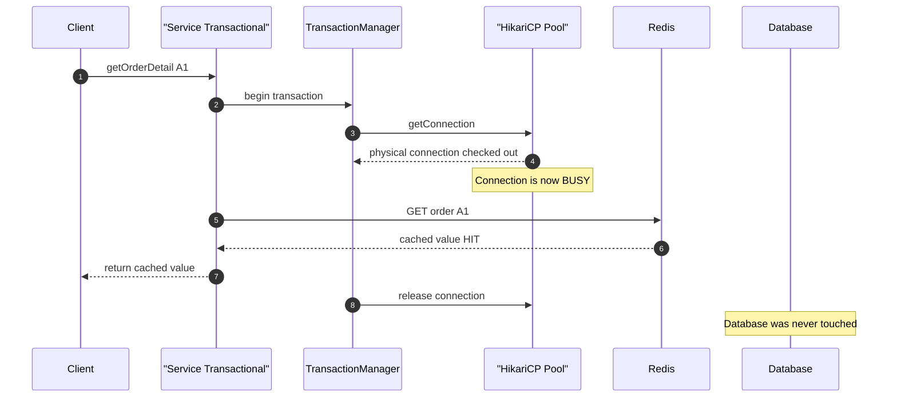

## 5. Core Concepts: Logical Transactions vs. Physical Connections

| Concept | Meaning | Managed by |
|---|---|---|
| Logical transaction | Boundaries, synchronization, rollback rules | Spring |
| Physical connection | Socket-backed pooled connection | HikariCP |

Key insight: separate transaction management from physical acquisition.

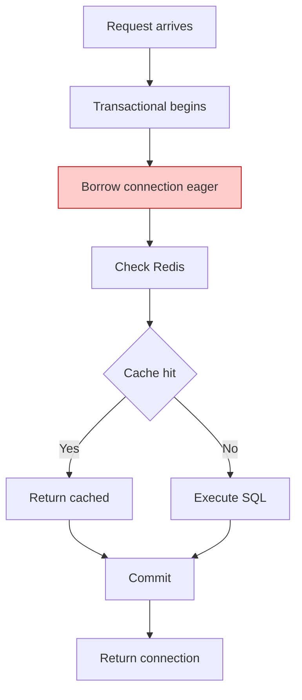

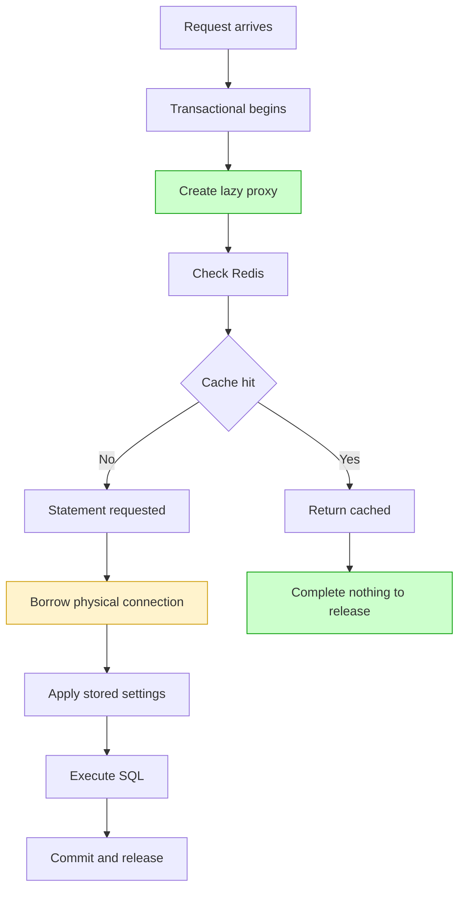

> 💡 **Analogy:** Eager rents a car just in case. Lazy calls a taxi only when you need a ride.

### Quick Recap

- Logical transaction is not the physical connection.
- Eager couples them; lazy decouples them.

## 6. Step-by-Step: Enabling Lazy Fetching

```yaml
spring:
  datasource:
    connection-fetch: lazy
```

```properties
spring.datasource.connection-fetch=lazy
```

| Value | Behavior |
|---|---|
| `eager` (default) | Fetch at transaction start |
| `lazy` | Defer until first statement; skip if no SQL |

> Eager stays default so upgrades never silently change acquisition semantics.

Verify it is active:

```java
@Component
class DataSourceInspector implements ApplicationRunner {
    private final DataSource ds;
    DataSourceInspector(DataSource ds) { this.ds = ds; }
    @Override
    public void run(ApplicationArguments args) {
        // Expect LazyConnectionDataSourceProxy
        System.out.println("DataSource: " + ds.getClass().getName());
    }
}
```

Note: this property is not a field on `DataSourceProperties`. It is a `@ConditionalOnProperty` guard deciding whether configuration activates.

## 7. How Auto-Configuration Works

```java
@Configuration
@ConditionalOnBean(DataSource.class)
@ConditionalOnProperty(name = "spring.datasource.connection-fetch", havingValue = "lazy")
class LazyConnectionDataSourceConfiguration {
    @Bean
    @Role(BeanDefinition.ROLE_INFRASTRUCTURE)
    static LazyConnectionDataSourceBeanPostProcessor lazyConnectionDataSourceBeanPostProcessor(
            ObjectProvider<MBeanExporter> mbeanExporter) {
        return new LazyConnectionDataSourceBeanPostProcessor(mbeanExporter);
    }
}
```

The post-processor wraps only the bean named `dataSource`:

```java
@Override
public Object postProcessAfterInitialization(Object bean, String beanName) {
    if (beanName.equals("dataSource") && bean instanceof DataSource dataSource) {
        return new LazyConnectionDataSourceProxy(dataSource);
    }
    return bean;
}
```

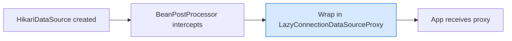

> ⚠️ Only `dataSource` is auto-wrapped. Custom, multiple, routing, JNDI, or XA beans need manual wrapping. JMX registers the real pool before wrapping so metrics stay visible.

## 8. Inside LazyConnectionDataSourceProxy

`org.springframework.jdbc.datasource.LazyConnectionDataSourceProxy` returns a JDK dynamic proxy, not a real connection:

```java
@Override
public Connection getConnection() throws SQLException {
    checkDefaultConnectionProperties();
    return (Connection) Proxy.newProxyInstance(
        ConnectionProxy.class.getClassLoader(),
        new Class<?>[] { ConnectionProxy.class },
        new LazyConnectionInvocationHandler());
}
```

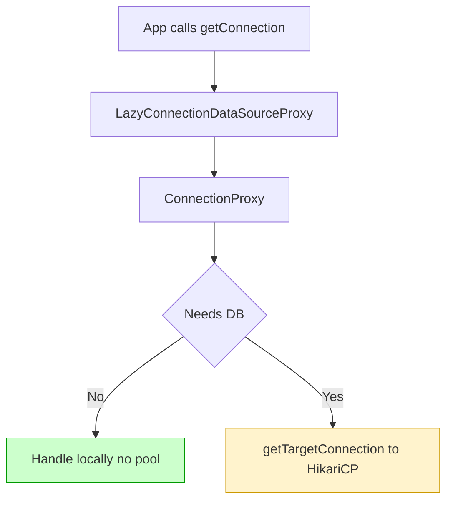

On first use, `checkDefaultConnectionProperties()` may briefly borrow a connection to learn default auto-commit and isolation, then return it. Preset them when constructing manually to skip even that probe:

```java
LazyConnectionDataSourceProxy proxy = new LazyConnectionDataSourceProxy(pool);
proxy.setDefaultAutoCommit(true);
proxy.setDefaultTransactionIsolation(Connection.TRANSACTION_READ_COMMITTED);
```

## 9. The Three Levels of Proxy Dispatch

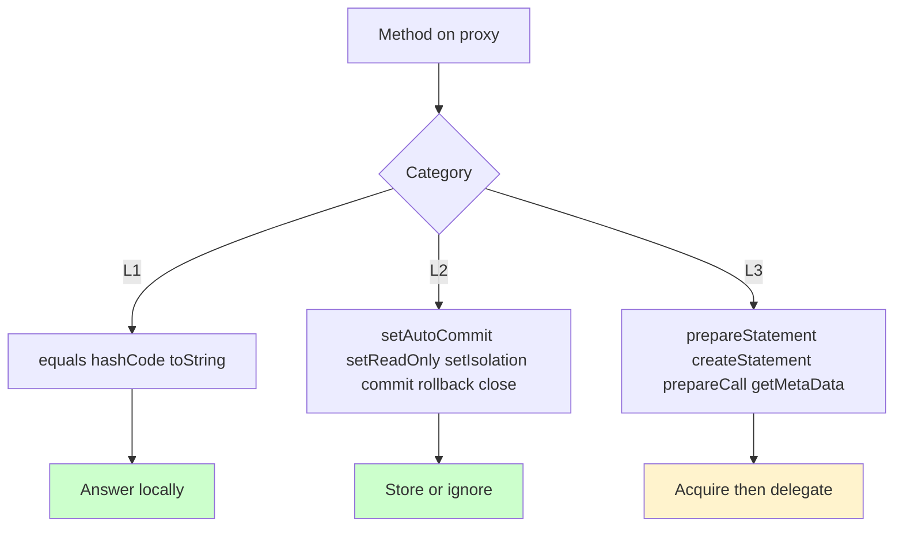

Level 1 never acquires. Level 2 stores state (`setAutoCommit`, `setReadOnly`, `setTransactionIsolation`) and turns `commit`/`rollback`/`close` into no-ops when no target exists. Level 3 (`prepareStatement` etc.) calls `getTargetConnection()`, replays stored settings, then delegates.

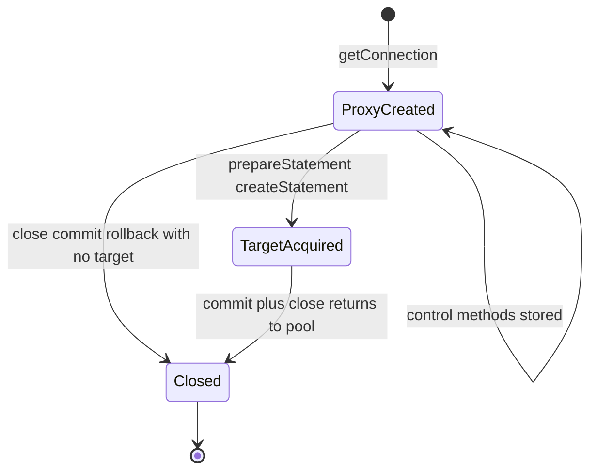

## 10. DataSourceTransactionManager Integration

```java
Connection con = obtainDataSource().getConnection(); // proxy
DataSourceUtils.prepareConnectionForTransaction(con, definition.getIsolationLevel(), definition.isReadOnly());
if (con.getAutoCommit()) {
    con.setAutoCommit(false); // stored, not sent to DB
}
```

| Call in doBegin | Proxy action |
|---|---|
| `getConnection()` | Returns proxy |
| `getAutoCommit()` | Cached default |
| `setAutoCommit/setReadOnly/setIsolation` | Stored |

The `ConnectionHolder` still binds to the thread. Only the physical connection is deferred.

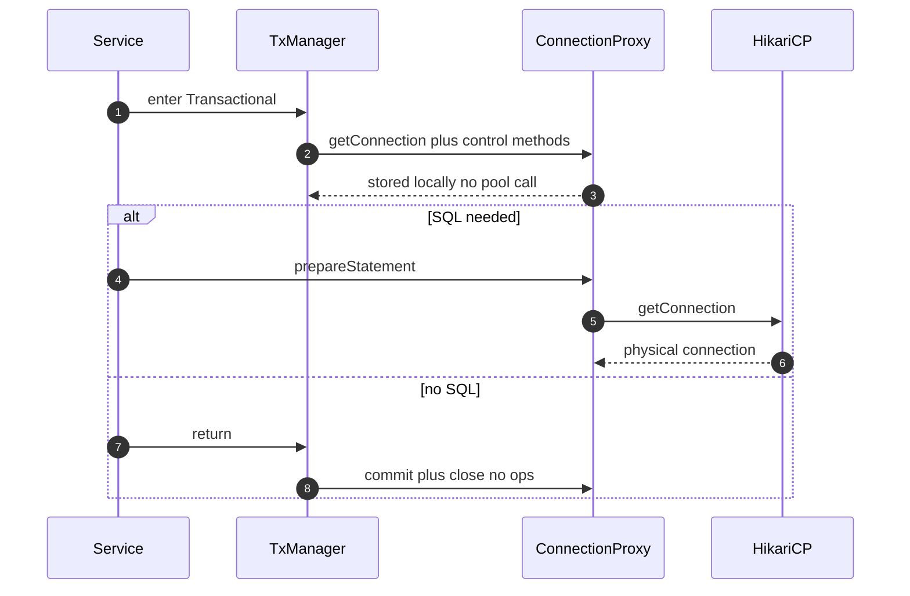

## 11. Cache-Hit vs Cache-Miss Walkthrough

```java
@Transactional
public OrderDetail getOrderDetail(String orderId) {
    OrderDetail cached = redisTemplate.get(CACHE_KEY + orderId);
    if (cached != null) return cached; // HIT
    return orderMapper.findById(orderId); // MISS
}
```

Hit path: begin (proxy), configure (stored), Redis hit, return, commit/close absorbed. Zero physical connections.

Miss path: first statement creation borrows real connection, replays settings, executes, commits, releases.

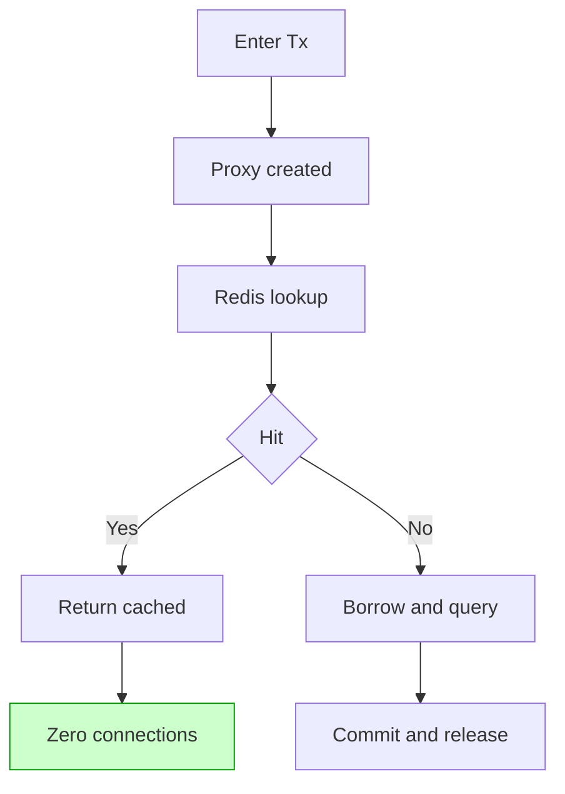

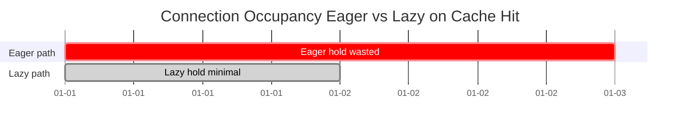

## 12. Honest Performance Deep-Dive

The 80 percent figure is an illustration, not a guarantee. With 1000 requests, 800 hits, 200 misses: eager may borrow 1000 times, lazy borrows 200 times. That is 80 percent fewer acquisitions for that workload — not 80 percent faster queries or throughput.

| Claim | True? |
|---|---|
| Fewer borrows when many Tx skip SQL | Yes |
| Query latency down 80 percent | No |
| Pool size shrinks exactly 80 percent | No |
| Every app benefits equally | No |

Occupancy matters more than count. Lazy also shortens hold time for SQL transactions by skipping pre-SQL work (remote calls, computation). Mental model with Little's Law (avg connections = arrival rate x hold time):

```text
Eager hold = full Tx duration
Lazy hold  = first-SQL to Tx end
Saving ~= (no-SQL share x duration) + (pre-SQL time x rest)
```

Dan Vega's Boot 4.1 demo (remote call + save): eager `hikaricp.connections.usage` max ~2.2s, lazy ~0.015s. Same query, wildly different hold time.

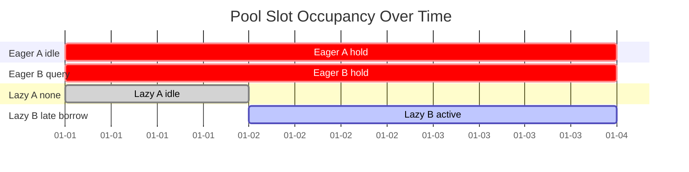

## 13. Virtual Threads and Lazy Fetching

Complementary, not interchangeable:

| Mechanism | Solves |
|---|---|
| Virtual threads | Thread overhead for huge blocking concurrency |
| Lazy fetching | Borrowing for Tx that never need JDBC |
| HikariCP | Finite physical connection management |

```yaml
spring:
  threads:
    virtual:
      enabled: true
  datasource:
    connection-fetch: lazy
```

Virtual threads are not enabled by default. More concurrency makes pool discipline more important: 10,000 virtual threads against 20 connections fails fast if every Tx borrows eagerly.

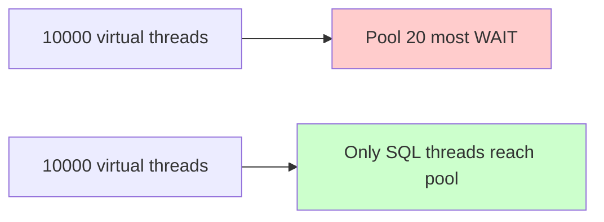

> Principle: more concurrency demands better resource management, not less.

## 14. Real-World Use Cases

1. Cache-aside reads (product, order, profile; 70-95 percent hits, service-layer `@Transactional`).
2. Validation-heavy endpoints: validate + fraud HTTP (200ms) + inventory call, then `save`. Eager holds through both calls; lazy borrows at `save`.
3. Feature-flagged persistence: flag off means return early, zero DB.
4. Idempotency checks: duplicate requestId returns cached result, skips DB.
5. Aggregation gateways: orchestrate downstream APIs, occasionally persist audit row.
6. Batch/scheduled jobs: long external fetch before writes; avoids starving online traffic.

Weak fit: write-heavy CRUD where every Tx runs SQL immediately; first line is SQL; tiny pool with no contention; JPA with open-in-view or early flush (verify with your stack).

```java
@Transactional
public void placeOrder(OrderRequest req) {
    validate(req);                       // CPU only
    fraudService.check(req);             // 200 ms HTTP
    inventoryClient.reserve(req);        // remote call
    orderRepository.save(toEntity(req)); // first SQL here
}
```

```java
@Transactional
public void enrichAndSave(String id) {
    Profile p = httpClient.fetchProfile(id); // ~300 ms, no DB
    Score s = scoringEngine.compute(p);      // ~50 ms CPU
    profileRepository.save(p.with(s));       // ~5 ms DB
}
// Eager hold ~355 ms; lazy hold ~5 ms. At 100 rps: ~35 conns vs ~1.
```

## 15. Hands-On Labs

### Lab 1 — Minimal setup (H2 + JdbcTemplate)

`pom.xml` excerpt: `spring-boot-starter-jdbc`, `spring-boot-starter-data-redis` (or skip Redis, use map), `h2` runtime, `spring-boot-starter-actuator`, `micrometer-registry-prometheus`.

```yaml
spring:
  datasource:
    url: jdbc:h2:mem:demo
    connection-fetch: lazy
    hikari:
      maximum-pool-size: 5
      leak-detection-threshold: 5000
management:
  endpoints:
    web:
      exposure:
        include: metrics
```

```java
@Service
public class OrderService {
    private final Map<String, String> cache = new ConcurrentHashMap<>();
    private final JdbcTemplate jdbc;
    public OrderService(JdbcTemplate jdbc) { this.jdbc = jdbc; }

    @Transactional(readOnly = true)
    public String getOrder(String id) {
        String cached = cache.get(id);
        if (cached != null) return cached; // HIT
        String value = jdbc.queryForObject(
            "SELECT description FROM orders WHERE id = ?", String.class, id);
        cache.put(id, value);
        return value;
    }
}
```

### Lab 2 — Prove a hit borrows nothing

```java
@SpringBootTest
class LazyConnectionTest {
    @Autowired OrderService service;
    @Autowired DataSource dataSource;
    @Autowired MeterRegistry registry;

    @Test
    void cacheHitDoesNotBorrowConnection() {
        service.getOrder("1"); // miss warms cache
        // Unwrap to real pool for metrics:
        DataSource target = ((LazyConnectionDataSourceProxy) dataSource).getTargetDataSource();
        double before = registry.get("hikaricp.connections.acquire").timer().count();
        for (int i = 0; i < 100; i++) service.getOrder("1");
        double after = registry.get("hikaricp.connections.acquire").timer().count();
        assertThat(after - before).isZero();
    }
}
```

Check live: `curl -s localhost:8080/actuator/metrics/hikaricp.connections.usage`.

### Lab 3 — Pre-SQL remote work (Dan Vega style)

Add a 2s simulated remote call before `save()`. Compare `hikaricp.connections.usage` max eager (~2.2s) vs lazy (~0.015s). Same result, pool free during the call.

### Lab 4 — Secondary DataSource (manual)

Auto-config wraps only `dataSource`. Wrap others yourself (see Section 16).

## 16. Multiple Implementation Approaches

### Approach A — Boot auto-config (recommended on 4.1+)

One property. Zero code. Only `dataSource` bean.

### Approach B — Manual proxy (any Boot version, full control)

```java
@Bean
DataSource dataSource(HikariDataSource pool) {
    LazyConnectionDataSourceProxy proxy = new LazyConnectionDataSourceProxy(pool);
    proxy.setDefaultAutoCommit(true);
    proxy.setDefaultTransactionIsolation(Connection.TRANSACTION_READ_COMMITTED);
    proxy.checkDefaultConnectionProperties(); // fail fast at startup (6.1.2+)
    return proxy;
}
```

Use for Boot 3.x backport, secondary pools, or to preset defaults and skip the probe.

### Approach C — Stacked with TransactionAwareDataSourceProxy

Framework guidance: `TransactionAwareDataSourceProxy` outermost, lazy inside, pool innermost.

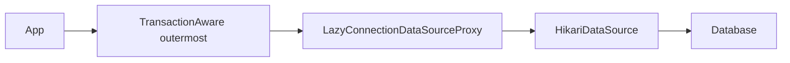

Apply the transaction-aware wrapper via a `BeanPostProcessor` with positive order. Validate the chain; do not assume order.

### Approach D — Read-only routing (advanced)

Framework 6.1.2+ supports a dedicated read-only `DataSource` (`setReadOnlyDataSource`) plus routing by read-only flag/isolation (e.g. `IsolationLevelDataSourceRouter`). The single Boot property is not read-replica routing — configure replicas explicitly.

## 17. Best Practices

1. Profile first: confirm no-SQL or late-SQL share before enabling.
2. Keep `@Transactional` boundaries tight; prefer read-only for reads.
3. Verify `dataSource.getClass()` is the lazy proxy in every environment.
4. Preset `defaultAutoCommit`/`defaultTransactionIsolation` on manual proxies.
5. Keep `leak-detection-threshold` on (e.g. 5000ms).
6. Dashboard `active`, `pending`, `acquire`, `usage`, latency, errors, DB QPS together.
7. Wrap secondary pools manually; name beans clearly.
8. Respect proxy order: TransactionAware outermost.
9. Re-test rollback, read-only, isolation after enabling.
10. Roll out gradually: test env, canary, fleet — with revert flag ready.

## 18. Anti-Patterns

### AP1 — Bigger pool instead of less waste

Incorrect: raise `maximum-pool-size` 10 to 50 and hope.

```yaml
# Incorrect: masks reservation-without-use
spring:
  datasource:
    hikari:
      maximum-pool-size: 50
```

Correct: enable lazy, measure `usage` and `pending`, then right-size.

### AP2 — Assuming every DataSource is wrapped

Incorrect: set property, assume reporting/JNDI/XA pools inherit it. Correct: inspect each bean, wrap manually.

### AP3 — Transaction wrapping remote calls without thought

Incorrect: 2s HTTP inside Tx on eager and blame DB. Correct: move non-DB work out, or enable lazy so hold starts at first SQL — with timeout handling.

```java
// Incorrect: holds connection through remote call on eager
@Transactional
public void register(Long id) {
    slowHttpClient.call(id); // 2s
    repo.save(new Customer(id));
}
```

```java
// Correct: same code benefits from lazy, or restructure
@Transactional
public void register(Long id) {
    slowHttpClient.call(id); // no connection held under lazy
    repo.save(new Customer(id)); // borrow here
}
```

### AP4 — Treating 80 percent as a promise

Incorrect: commit to headcount/capacity on headline math. Correct: measure your hit rate and hold times.

### AP5 — Ignoring ORM early acquisition

Incorrect: assume Hibernate never touches connection. Correct: test with your provider, flush mode, ID strategy, open-in-view.

### AP6 — Disabling leak detection

Incorrect: turn it off because durations changed. Correct: keep it; checkout duration now differs from Tx duration by design.

## 19. Performance Considerations

| Metric | Expected |
|---|---|
| `hikaricp.connections.active` | Down |
| `hikaricp.connections.pending` | Down under load |
| `hikaricp.connections.acquire` count | Fewer |
| `hikaricp.connections.usage` hold time | Shorter per borrow |
| p95/p99 latency | Down or flat |
| Error rate, DB QPS | Unchanged |

Benchmark sketch (illustrative, measure your own):

| Scenario | Eager hold | Lazy hold |
|---|---|---|
| Cache hit, 50ms Tx | 50ms | 0ms |
| 300ms HTTP + 5ms save | ~355ms | ~5ms |
| 2s remote + save (Vega demo) | ~2.2s | ~0.015s |

Load test with k6: 200 VUs, 2 min, 80 percent hot IDs. Run once eager, once lazy; compare Hikari metrics.

```javascript
import http from 'k6/http';
import { check } from 'k6';
export const options = { vus: 200, duration: '2m' };
export default function () {
  const id = Math.random() < 0.8 ? Math.floor(Math.random() * 50) : Math.floor(Math.random() * 100000);
  const res = http.get(`http://localhost:8080/orders/${id}`);
  check(res, { 'status 200': (r) => r.status === 200 });
}
```

Lower `active` after enabling is healthy — interpret with volume, throughput, latency, pending.

## 20. Security Considerations

Lazy fetching does not change auth, but the surrounding surface needs care:

1. Least privilege: app DB user gets only needed grants; separate read-only user for `readOnlyDataSource` if used.
2. Secrets: pool credentials via vault/secret manager, not plaintext; rotate regularly.
3. JMX: real pool registers before wrapping — restrict JMX access; do not expose unauthenticated Jolokia/Actuator endpoints publicly.
4. Actuator: expose only `metrics`/`health` needed; secure with Spring Security.
5. Timeouts: remote work inside Tx can outlive DB timeouts — set Tx, statement, and HTTP timeouts explicitly; handle rollback on timeout.
6. Tenant routing: verify lazy + routing order so tenant context applies to the physical borrow, not just the proxy.

## 21. Testing Strategies

| Layer | What to assert |
|---|---|
| Unit | Proxy stores control state; no borrow on `commit`/`close` without SQL |
| Integration | Cache hit borrows zero (Lab 2); miss borrows once |
| Tx semantics | Rollback still discards writes; read-only honored; isolation applied |
| ORM | Hibernate flow with your flush/ID strategy borrows when expected |
| Load | k6 eager vs lazy: `pending`, `usage`, p99 |
| Chaos | Pool of 2-3 under burst; no `Connection is not available` regressions |

```java
@Test
@Transactional
void rollbackStillWorks() {
    jdbc.update("INSERT INTO orders(id, description) VALUES (?, ?)", "X", "temp");
    TestTransaction.flagForRollback();
    TestTransaction.end();
    Integer count = jdbc.queryForObject(
        "SELECT COUNT(*) FROM orders WHERE id = 'X'", Integer.class);
    assertThat(count).isZero();
}
```

Always test direct JDBC use and custom wrappers — proxy order bugs surface here.

## 22. Migration Guide: Eager to Lazy

1. Baseline (1-2 days prod-like load): `active`/`idle`, acquire latency, Tx duration, throughput, DB QPS.
2. Enable in test env: set `connection-fetch: lazy`; log `dataSource.getClass()`.
3. Exercise hit and miss paths separately; compare metrics under equal load.
4. Validate semantics: rollback, read-only, isolation, custom wrappers, direct JDBC, JPA flows, secondary/JNDI/XA pools.
5. Canary then fleet. Revert = set back to `eager` (or remove property) and redeploy.

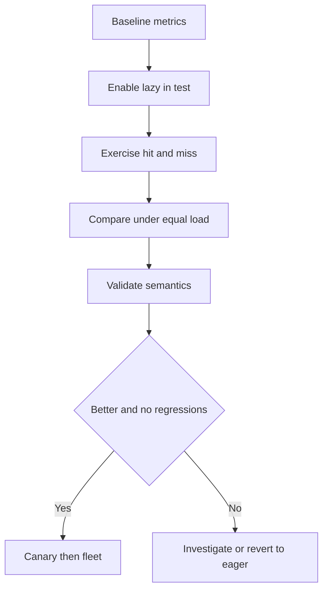

Pre-flight: what share returns from cache? How often is there zero JDBC? Is saturation real? Any custom/routing/JNDI/XA pools? Are acquire latency and Tx duration measured separately?

## 23. Operational Considerations and Pitfalls

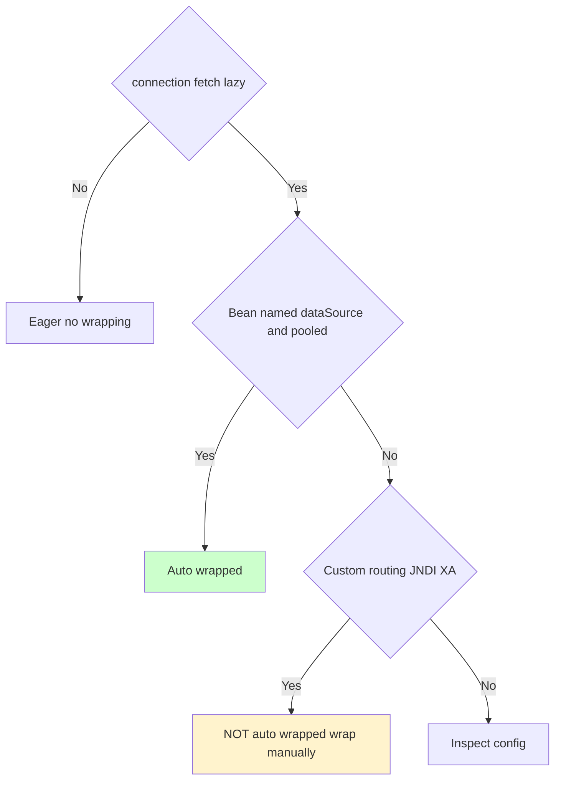

| Pitfall | Mitigation |
|---|---|
| Expecting every DS wrapped | Verify beans; wrap manually |
| Assuming zero pool access ever | Remember default-properties probe |
| Treating 80 percent as promise | Measure your hit rate |
| Proxy order bugs | Validate chain |
| ORM early acquisition | Test with real stack |
| Ignoring leak detection | Keep enabled |

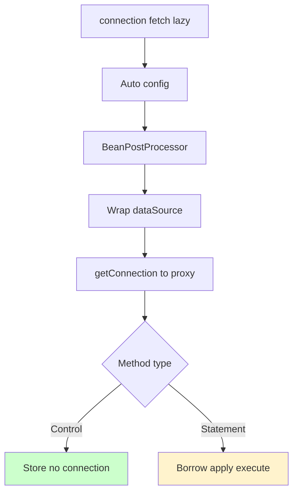

## 24. Troubleshooting Guide

| Symptom | Likely cause | Action |
|---|---|---|
| No metric change | All Tx run SQL early, or bean not wrapped | Print `dataSource.getClass()`; confirm proxy |
| Property ignored | Bean not named `dataSource` / not pooled | Wrap manually |
| Still borrows on hits | ORM/interceptor touches connection | Breakpoint in `getTargetConnection` |
| Wrong isolation/read-only | Proxy order or direct JDBC | Validate chain, re-test |
| One borrow at startup | Default-properties probe | Preset defaults |
| Leak warnings | Real leak after acquire | Review statements/result sets |

## 25. Practice Exercises with Detailed Solutions

### Exercise 1 — Zero-borrow proof (Beginner)

Goal: prove 100 cache hits borrow zero connections. Steps: seed one row, warm cache with one miss, record `hikaricp.connections.acquire` count, run 100 hits, assert delta zero. Solution: Lab 2 test. Key: unwrap via `getTargetDataSource()` for metrics; remember first-call probe may add one borrow — measure after warmup.

### Exercise 2 — Hold-time showdown (Intermediate)

Goal: quantify eager vs lazy on 300ms pre-SQL work. Steps: add `Thread.sleep(300)` before `save()`, run with `eager`, record `usage` max; switch to `lazy`, repeat. Solution: expect ~305ms vs ~5ms. Explain with Little's Law at 100 rps (~30 conns vs ~1). Handle `InterruptedException` properly; restore interrupt flag.

### Exercise 3 — Rollback and isolation (Intermediate)

Goal: prove semantics unchanged. Steps: insert then `flagForRollback`, assert zero rows; run `@Transactional(readOnly = true)` write and confirm failure/ignore per stack; set isolation explicitly and verify replay on physical connection via proxy-target inspection. Solution: Section 21 test + `ConnectionProxy.getTargetConnection()` check after first statement.

### Exercise 4 — Multi-datasource wrap (Advanced, hands-on project)

Goal: lazy-wrap a secondary `reportingDataSource`. Steps: define second Hikari pool, expose `reportingDataSource` wrapped in `LazyConnectionDataSourceProxy` with preset defaults, log both bean classes, run a no-SQL Tx against reporting and assert zero borrows. Solution:

```java
@Configuration
class SecondaryDataSourceConfig {
    @Bean("reportingDataSource")
    DataSource reportingDataSource(@Qualifier("reportingPool") DataSource pool) {
        LazyConnectionDataSourceProxy proxy = new LazyConnectionDataSourceProxy(pool);
        proxy.setDefaultAutoCommit(true);
        proxy.setDefaultTransactionIsolation(Connection.TRANSACTION_READ_COMMITTED);
        return proxy;
    }
}
```

## 26. Test Your Understanding

1. What is the difference between a logical transaction and a physical connection?
2. What property enables lazy fetching, and what are its two values?
3. Which bean name does auto-config wrap, and why does that matter?
4. What does `getConnection()` return under lazy, and why?
5. Classify: `equals`, `setReadOnly`, `prepareStatement`.
6. Why are `commit`/`rollback` no-ops when no target exists?
7. What does `getTargetConnection()` do before delegating?
8. Why might you see one borrow at startup even with lazy?
9. How do you skip that startup probe?
10. When does lazy not help? Name two workloads.
11. Why do virtual threads plus eager borrowing exhaust small pools?
12. Which Hikari metrics prove lazy is working, and what direction should each move?

Answers: (1) boundaries/sync vs socket borrow; (2) `spring.datasource.connection-fetch`, eager/lazy; (3) only `dataSource`; (4) JDK ConnectionProxy, defers borrow; (5) L1/L2/L3; (6) nothing to commit; (7) borrow + replay stored settings; (8) default-properties probe; (9) preset defaults; (10) immediate-SQL CRUD, early-flush ORM; (11) thousands of threads each pinning a slot; (12) active/pending/acquire down, usage shorter, latency flat/down, errors/QPS flat.

## 27. Question Bank: 55 Questions

### Beginner (1-20)

1. What problem does lazy fetching solve?

Answer: It stops transactions that never run SQL from borrowing and holding pool connections.

2. What is HikariCP's role?

Answer: It owns and manages the finite pool of physical JDBC connections.

3. What does `@Transactional` do by default about connections?

Answer: It eagerly borrows a physical connection at transaction start and holds it until commit or rollback.

4. What is the exact property key for lazy fetching?

Answer: spring.datasource.connection-fetch with value lazy.

5. What is the default value and why?

Answer: eager, so upgrades never silently change connection acquisition semantics.

6. Which Boot version introduced the property?

Answer: Spring Boot 4.1.

7. What class does Boot wrap your pool in?

Answer: org.springframework.jdbc.datasource.LazyConnectionDataSourceProxy.

8. What does `getConnection()` return under lazy?

Answer: A JDK dynamic proxy implementing ConnectionProxy, not a physical connection.

9. What is a JDK dynamic proxy?

Answer: A runtime-generated object that implements given interfaces and routes calls through an invocation handler.

10. What is `ConnectionProxy`?

Answer: The Spring interface the lazy handle implements, exposing access to the underlying target connection.

11. Name one Level 1 method.

Answer: equals (also hashCode and toString).

12. Name two Level 2 methods.

Answer: setAutoCommit and setReadOnly (also setTransactionIsolation, commit, rollback, close).

13. Name two Level 3 methods.

Answer: prepareStatement and createStatement (also prepareCall and getMetaData).

14. What happens to `close()` with no target?

Answer: It is a no-op because nothing was borrowed, so nothing is released.

15. What is a cache hit vs miss in this tutorial?

Answer: A hit returns the order from Redis with no SQL, while a miss queries the database and then populates the cache.

16. Why do cache hits waste connections under eager?

Answer: Because the transaction borrows a connection at entry and holds it through the Redis lookup even though no SQL runs.

17. What is `maximum-pool-size`?

Answer: The HikariCP cap on concurrent physical connections in the pool.

18. What does `leak-detection-threshold` do?

Answer: It logs a warning when a connection is checked out longer than the configured threshold.

19. How do you check the active DataSource class?

Answer: Log or print dataSource.getClass().getName() and confirm it is LazyConnectionDataSourceProxy.

20. What does `hikaricp.connections.active` measure?

Answer: The number of physical connections currently checked out of the pool.

### Intermediate (21-40)

21. How does `@ConditionalOnProperty` gate the config?

Answer: It activates LazyConnectionDataSourceConfiguration only when spring.datasource.connection-fetch equals lazy.

22. Why is the property not on `DataSourceProperties`?

Answer: It never binds to a Java object and only decides whether the auto-configuration runs.

23. Why use a BeanPostProcessor instead of rewriting pool setup?

Answer: It wraps whatever pooled DataSource Boot built without changing pool construction logic.

24. Why only the `dataSource` bean name?

Answer: The post-processor checks beanName.equals("dataSource"), so secondary or custom beans are left untouched.

25. Why register JMX before wrapping?

Answer: It keeps operational visibility on the real pool for active, idle, max, and acquisition metrics.

26. How does `doBegin()` interact with the proxy?

Answer: It calls getConnection and transaction-control setters, which the proxy stores locally without touching the pool.

27. Where is the ConnectionHolder bound?

Answer: It is bound to the current thread by Spring transaction synchronization, exactly as in eager mode.

28. How are isolation/read-only applied under lazy?

Answer: They are stored on the invocation handler and replayed onto the physical connection when it is first borrowed.

29. What is `getTargetConnection()`?

Answer: The internal method that borrows the real connection from the delegate DataSource on first statement creation.

30. What is replayed onto the physical connection?

Answer: The stored auto-commit, read-only, and transaction-isolation settings.

31. What is the default-properties probe?

Answer: A one-time short borrow that reads default auto-commit and isolation so the proxy can answer getters correctly.

32. How do `setDefaultAutoCommit`/`setDefaultTransactionIsolation` help?

Answer: They preset the defaults on a manually built proxy so even the first-call probe can be skipped.

33. When is `checkDefaultConnectionProperties()` useful at startup?

Answer: On Framework 6.1.2 and later it forces default discovery at startup instead of on first request.

34. Why does Little's Law matter here?

Answer: Average connections in use equals arrival rate times hold time, so shorter holds directly cut pool pressure.

35. Eager hold vs lazy hold: define each.

Answer: Eager hold is the full transaction duration, while lazy hold is only from the first SQL statement to transaction end.

36. Why can lower `active` be healthy?

Answer: It means fewer idle borrows, provided throughput, latency, pending threads, and DB queries look normal.

37. Which metrics must you read together?

Answer: Active, pending, acquire count, usage time, request latency, error rate, and DB query count.

38. Why must TransactionAware be outermost?

Answer: So application code talks transaction-aware first, which then delegates into the lazy proxy and pool in the correct order.

39. Why do custom/routing/JNDI/XA pools need manual work?

Answer: They use different bean names or auto-configuration paths, so the single-property wrapper does not cover them automatically.

40. Why test Hibernate flush/ID strategies?

Answer: Hibernate may touch the connection earlier than expected, which changes when or whether lazy defers acquisition.

### Advanced (41-55)

41. Design a proof that 100 hits borrow zero.

Answer: Warm the cache with one miss, record the acquire counter, run 100 cache hits, then assert the counter delta is zero.

42. Estimate pool savings at 200 rps with 70 percent hits.

Answer: About 140 of 200 requests skip borrowing, so acquisitions fall by roughly 70 percent before counting shorter holds.

43. When does Hibernate already defer acquisition, and why does that blunt the win for JPA?

Answer: Hibernate often uses a logical handle and borrows late in common JPA flows, so the Boot-level proxy adds less benefit than for JdbcTemplate, MyBatis, or jOOQ.

44. How would you add a read-only DataSource (6.1.2+)?

Answer: Configure LazyConnectionDataSourceProxy with setReadOnlyDataSource pointing at the read replica for read-only transactions.

45. How does `IsolationLevelDataSourceRouter` use the deferred flag?

Answer: It reads the deferred read-only and isolation state to route before a physical connection exists.

46. What changed in 6.2.6 around timeout rollback?

Answer: The proxy suppresses a rollback attempt after a timeout where the connection was never acquired.

47. Why is lazy no substitute for replica routing?

Answer: It only changes borrow timing on the same DataSource and does not split reads and writes across replicas.

48. How do tenant-aware routing + lazy interact?

Answer: Tenant context must be resolved at borrow time so the physical connection comes from the correct tenant pool.

49. What breaks if you unwrap the proxy incorrectly for metrics?

Answer: You may read the proxy instead of the Hikari pool and miss active, idle, acquire, and usage metrics.

50. How would you canary this in production?

Answer: Enable it on a small subset, compare active, pending, acquire, usage, latency, and errors against the baseline fleet.

51. What is the revert plan?

Answer: Set spring.datasource.connection-fetch back to eager or remove the property, then redeploy.

52. How do you separate acquire latency from Tx duration in dashboards?

Answer: Chart hikaricp acquire time independently from transaction duration so queueing is not confused with business logic time.

53. Why doesn't lazy help JtaTransactionManager?

Answer: JTA and container data sources manage enlistment themselves, so the local lazy proxy adds no value.

54. Compare manual proxy vs Boot property: when to choose each?

Answer: Use the Boot property on 4.1 and later for zero code, and use the manual proxy for older Boot, secondary pools, or preset defaults.

55. Predict behavior: Tx calls `getMetaData()` but no query — borrow or not? Why?

Answer: It borrows, because getMetaData is a Level 3 database operation that needs the real connection.

## 28. Common Interview Questions

1. Eager vs lazy connection fetching?

Answer: Eager borrows a physical connection the moment a transaction starts and holds it until commit or rollback, even if no SQL ever runs. Lazy returns a connection proxy at transaction start and borrows the physical connection only when the first statement is created, or never if no SQL runs. The trade-off is a thin proxy dispatch cost in exchange for eliminating idle holds on cache hits and pre-SQL remote work.

2. How does Boot activate it?

Answer: Setting spring.datasource.connection-fetch to lazy satisfies a ConditionalOnProperty guard on LazyConnectionDataSourceConfiguration alongside a ConditionalOnBean for DataSource. That configuration registers a LazyConnectionDataSourceBeanPostProcessor, which wraps only the bean named dataSource in a LazyConnectionDataSourceProxy. JMX registration of the real pool happens before wrapping so metrics stay visible.

3. What happens on a no-SQL Tx?

Answer: The transaction manager receives the proxy, stores auto-commit, read-only, and isolation settings locally, and binds the ConnectionHolder as usual. Since no statement is created, getTargetConnection is never called, so commit and close become no-ops. After the one-time defaults warmup, the transaction completes with zero physical borrows.

4. Three dispatch levels?

Answer: Level 1 covers identity methods such as equals, hashCode, and toString, which the proxy answers locally and must never trigger acquisition. Level 2 covers transaction-control methods such as setAutoCommit, setReadOnly, setTransactionIsolation, commit, rollback, and close, which store state or are deferred when no target exists. Level 3 covers database operations such as prepareStatement, createStatement, prepareCall, and getMetaData, which borrow the physical connection and then delegate.

5. How are auto-commit/isolation handled?

Answer: The invocation handler records setAutoCommit, setReadOnly, and setTransactionIsolation as fields on the proxy. When the first statement forces acquisition, getTargetConnection borrows from the delegate pool and replays those stored values onto the real connection before delegating the call. This keeps DataSourceTransactionManager semantics identical while deferring the borrow.

6. Why one startup borrow?

Answer: On first use, checkDefaultConnectionProperties may briefly borrow a connection to learn the default auto-commit and isolation values so getters answer correctly. You will see at most one early borrow at startup or first use, then none for no-SQL transactions. Presetting defaultAutoCommit and defaultTransactionIsolation on a manually built proxy, optionally with an explicit startup check, avoids even that probe.

7. Cache-hit service, pool exhausted, DB idle — diagnose?

Answer: This is reservation without use: transactions borrow eagerly at entry but 80 percent return from Redis without SQL, so pool slots stay busy while the database sits idle. I would compare the acquire count against DB query count, check pending threads and usage hold time in Hikari metrics, verify whether dataSource is actually the lazy proxy, then enable lazy fetching and measure hit versus miss paths separately.

8. When would you NOT enable it?

Answer: I would skip it for write-heavy CRUD where nearly every transaction runs SQL immediately, for transactions whose first line is already a query, for applications with no pool contention, and for JPA stacks with open-in-view or flush and ID-generation behavior that touches the connection early. In those cases the proxy adds overhead without meaningful savings, so I would verify with the real persistence layer first.

9. Virtual threads + lazy?

Answer: Virtual threads cheaply handle thousands of blocking tasks but do not add connections, while lazy fetching stops transactions that never need JDBC from reaching the pool at all. With 10,000 virtual threads against a 20-connection pool, eager borrowing exhausts the pool immediately, whereas lazy lets only SQL-executing threads borrow. They are complementary and should be enabled together with spring.threads.virtual.enabled plus connection-fetch lazy.

10. Proxy order with TransactionAware?

Answer: The correct chain is application to TransactionAwareDataSourceProxy outermost, then LazyConnectionDataSourceProxy in the middle, then the Hikari pool innermost. The transaction-aware layer must see the logical transaction first and delegate into the lazy proxy, which defers the physical borrow. I would apply the transaction-aware wrapper through a BeanPostProcessor with positive order and validate the resulting chain rather than assuming it.

11. Multi-datasource?

Answer: Boot auto-configuration wraps only the bean named dataSource, so reporting, routing, JNDI, XA, or custom pools are not covered automatically. For each additional pool I would declare an explicit LazyConnectionDataSourceProxy bean with preset defaults, log every DataSource class at startup, and test no-SQL transactions per pool. The single property is never a blanket fix for every DataSource in the context.

12. How to prove it in prod?

Answer: I would baseline active, idle, acquire latency, transaction duration, throughput, and DB queries, then enable lazy in test, exercise hit and miss paths separately, and compare under equal load. I would validate rollback, read-only, isolation, custom wrappers, direct JDBC, and ORM flows, then canary to a subset before fleet rollout. Reverting is a config change back to eager, and lower active counts as healthy only alongside flat latency, flat errors, and unchanged DB throughput.

## 29. Summary and Cheat Sheet

Three truths: lazy is not Tx elimination (boundaries stay); not connection elimination (SQL still needs one); 80 percent is workload math, not a promise.

| Question | Answer |
|---|---|
| Enable? | `spring.datasource.connection-fetch: lazy` |
| Default? | `eager` |
| Boot registers? | Post-processor wrapping `dataSource` |
| Core class? | `LazyConnectionDataSourceProxy` |
| Borrow when? | First statement creation |
| commit/rollback without SQL? | No-ops |
| JNDI/XA/custom/multi? | Not automatic; verify |
| Replica routing? | No |
| Virtual threads? | Complementary |
| Best fit? | High hits, long pre-SQL work |
| Weak fit? | Immediate-SQL writes |

Design lessons: reuse infra (Framework proxy), separate wrapper from pool, defer cost until needed, optimize for measured workload.

## 30. Self-Assessment, Pro Tips, and Next Steps

Checklist: can you explain L1/L2/L3, verify proxy class, design zero-borrow test, estimate Little's Law savings, wrap a second pool, order stacked proxies, canary safely?

Pro tips: measure after warmup; dashboard pending not just active; keep leak detection; log bean class per env; test your ORM; preset defaults on manual proxies.

Next: add Micrometer alerts on `pending`/`usage`; audit `@Transactional` scope; evaluate read-only routing; load-test virtual threads + lazy together.

## 31. Further Reading / Resources

- Spring Framework javadoc: `LazyConnectionDataSourceProxy` (7.x current; notes on 6.1.2 read-only support, 6.2.6 timeout suppression, TransactionAware ordering).
- Dan Vega: Lazy JDBC Connections in Spring Boot 4.1 (2.2s to 15ms demo, Actuator metrics walkthrough).
- Spring Boot 4.1 release notes / highlights (property `spring.datasource.connection-fetch`).
- chiwa spring-boot-4.1-features: JPA vs JDBC nuance (Hibernate may already defer; biggest win for JdbcTemplate/MyBatis/jOOQ).
- HikariCP wiki: pool sizing, `leak-detection-threshold`, Micrometer metrics.
- Official docs: `DataSourceTransactionManager`, `@Transactional`, virtual threads (`spring.threads.virtual.enabled`).

*Last Updated: 2026-10-13. Verify exact Boot 4.1 property spelling against your release before production rollout.*

