# 🔐 .NET API Security: The Complete Master Guide
### From HTTPS to JWT to Rate Limiting — Build Production-Grade Secure APIs

| 📊 Difficulty | ⏱️ Estimated Reading Time | 🛠️ Technology Stack | 📅 Last Updated |
|---|---|---|---|
| 🟡 Intermediate | ~2 hours | .NET 8/9 · ASP.NET Core Web API · EF Core | 2026-09-05 |

> **Who is this for?** .NET developers who want to understand and implement real-world API security — from absolute foundations to advanced authorization and data protection.
>
> **What you'll build:** A fully secured .NET Web API with layered defenses: encrypted transport, authentication, role-based authorization, and data protection.
>
> **How to read this guide:** Part I (sections 1–6) is the complete core tutorial with step-by-step instructions, code, and diagrams. Part II (sections 7–22) is the mastery section: real-world use cases, best practices, anti-patterns, troubleshooting, performance, testing, hands-on lab, practice exercises, a 50-question quiz bank, interview questions, and more.

---

## 📋 Table of Contents

1. [The Big Picture — Why Security is Layered](#big-picture)
2. [Foundation: Transport & Browser Security](#foundation)
   - 2.1 HTTPS
   - 2.2 HSTS
   - 2.3 CORS
3. [Identity — Authentication (Who Are You?)](#identity)
   - 3.1 JWT
   - 3.2 Refresh Tokens
   - 3.3 Security Headers
   - 3.4 API Keys
4. [Authorization (What Are You Allowed to Do?)](#authorization)
5. [Data Protection & Sanitization](#data-protection)
   - 5.1 DTOs
   - 5.2 Encryption at Rest
   - 5.3 Rate Limiting
   - 5.4 Error Handling
   - 5.5 Client IP Tracking
6. [Putting It All Together — Full Pipeline](#full-pipeline)
7. [Real-World Examples & Use Cases](#real-world)
8. [Best Practices](#best-practices)
9. [Anti-Patterns](#anti-patterns)
10. [Common Pitfalls & Troubleshooting](#troubleshooting)
11. [Performance Considerations](#performance)
12. [Testing Strategies](#testing)
13. [Multiple Implementation Approaches](#approaches)
14. [Migration Guides](#migration)
15. [Hands-On Lab — Build "SecureShop"](#hands-on-lab)
16. [Practice Exercises (With Solutions)](#exercises)
17. [Test Your Understanding](#test-your-understanding)
18. [Question Bank — 50 Questions](#question-bank)
19. [Common Interview Questions](#interview-questions)
20. [Self-Assessment Checklist](#self-assessment)
21. [Pro Tips](#pro-tips)
22. [Key Takeaways & Further Reading](#summary)

---

## 🎯 Prerequisites

To get the most out of this tutorial, you should have:

- ✅ **.NET 8 SDK (or later)** installed — [dotnet.microsoft.com/download](https://dotnet.microsoft.com/download)
- ✅ **C# fundamentals** — classes, records, interfaces, dependency injection
- ✅ **ASP.NET Core basics** — minimal APIs, middleware, `Program.cs`, configuration
- ✅ **EF Core basics** — `DbContext`, migrations, LINQ queries
- ✅ **HTTP fundamentals** — verbs, status codes, headers, cookies
- 🔹 *Optional:* Postman, curl, or `.http` files for testing endpoints
- 🔹 *Optional:* Basic understanding of cryptography concepts (hashing vs. encryption)

> 💡 **New to ASP.NET Core?** Complete a basic minimal API tutorial first (e.g., the official "Create a web API with ASP.NET Core" doc), then return here.

## 🎓 Learning Objectives

By the end of this tutorial, you will be able to:

1. **Explain** why security must be layered and map each layer to the threats it neutralizes
2. **Configure** HTTPS redirection, HSTS, and environment-specific CORS policies in ASP.NET Core
3. **Implement** JWT-based authentication end-to-end: token generation, validation, and login endpoints
4. **Design** a refresh-token system with rotation, revocation, and IP anomaly detection
5. **Write** custom security-headers middleware and configure a strict Content-Security-Policy
6. **Choose** between JWT and API keys for different client types (humans vs. machines)
7. **Build** role-based and claim-based authorization policies, including custom requirements and handlers
8. **Defend** against mass assignment and data leaks using request/response DTOs
9. **Encrypt** sensitive fields at rest with EF Core value converters
10. **Apply** rate limiting per endpoint class and return proper `429` responses with `Retry-After`
11. **Handle** exceptions globally without leaking internal details
12. **Test** the full security pipeline with unit and integration tests

---

## 1. The Big Picture — Why Security is Layered 🏰 {#big-picture}

Think of API security like a medieval castle. You don't rely on just one wall — you have a moat, a drawbridge, a portcullis, guards, and a vault inside. Each layer protects against a different kind of attacker.

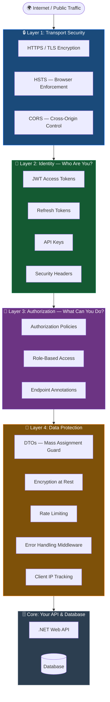

### 🚩 The Threat Landscape — What Are We Defending Against?

| Threat | Without Protection | Our Solution |
|---|---|---|
| Eavesdropping | Passwords travel in plain text | **HTTPS** |
| CSRF Attacks | Malicious site tricks browser | **CORS + CSRF Tokens** |
| Impersonation | Anyone can call your API | **JWT Authentication** |
| Privilege Escalation | User becomes admin | **Authorization Policies + DTOs** |
| Brute Force | 10,000 password attempts | **Rate Limiting** |
| Token Theft | Stolen JWT used indefinitely | **Refresh Tokens + Short Expiry** |
| Data Leaks | DB schema exposed in responses | **DTOs** |
| XSS Attacks | Scripts steal tokens | **Security Headers + HttpOnly Cookies** |
| Info Disclosure | Stack traces in errors | **Error Handling Middleware** |

### 🏗️ The Middleware Pipeline Order

The ORDER of middleware in `Program.cs` is critical. Think of it as a series of checkpoints:

```mermaid
flowchart LR
    REQ([Incoming Request]) --> A

    A["1️⃣ UseHttpsRedirection\n(HTTP → HTTPS)"]
    B["2️⃣ UseHsts\n(Enforce HTTPS in browser)"]
    C["3️⃣ UseCors\n(Origin whitelist check)"]
    D["4️⃣ SecurityHeadersMiddleware\n(XSS / Clickjack protection)"]
    E["5️⃣ UseRateLimiter\n(Throttle requests)"]
    F["6️⃣ UseAuthentication\n(Verify WHO you are)"]
    G["7️⃣ UseAuthorization\n(Check WHAT you can do)"]
    H["8️⃣ MapControllers / Endpoints\n(Your Business Logic)"]

    A --> B --> C --> D --> E --> F --> G --> H

    H --> RES([Response])

    style A fill:#0d6efd,color:#fff
    style B fill:#0dcaf0,color:#000
    style C fill:#20c997,color:#000
    style D fill:#ffc107,color:#000
    style E fill:#fd7e14,color:#fff
    style F fill:#6f42c1,color:#fff
    style G fill:#d63384,color:#fff
    style H fill:#198754,color:#fff
```

> ⚠️ **Critical Rule:** `UseAuthentication` MUST come before `UseAuthorization`. The system must know WHO you are before it can decide WHAT you can do.

> 🧠 **Feynman-style analogy:** Each middleware is a bouncer at successive doors of a club. The HTTPS bouncer checks you came through the right entrance, the CORS bouncer verifies where your invitation came from, the authentication bouncer checks who you are, and the authorization bouncer checks whether your wristband lets you into the VIP area. Order matters — you can't check wristbands before checking IDs.

---

## 2. Foundation: Transport & Browser Security {#foundation}

> **Goal:** Make sure data traveling between the client and server cannot be read or tampered with.

---

### 2.1 HTTPS — Encrypting the Wire 🔐

#### Why HTTPS Is the Foundation of Everything

Every other security measure collapses without HTTPS. Here's a concrete example:

```
❌ HTTP (Plain Text — Visible to Anyone on the Network)
─────────────────────────────────────────────────────────
POST /api/auth/login HTTP/1.1
Host: mywebshop.com
Content-Type: application/json

{
  "email": "alice@example.com",
  "password": "MySecurePass123!"
}

🕵️ Hacker on coffee shop WiFi reads EVERY byte above.


✅ HTTPS (Encrypted — Looks Like Gibberish)
─────────────────────────────────────────────────────────
ÃÇ▒╗╗╦╗╠╗éÈ╬ûÿ§╧╕╚ÀÃ╣¡╥▓d╗╣╗─╗ ûÞ¡ÎÀÇëÒpÑA╗ü╗╗╠╗╗╣
↑ Complete gibberish to the hacker ✅
```

#### The HTTPS Handshake — Step by Step

This happens automatically before any data is sent, in ~50 milliseconds:

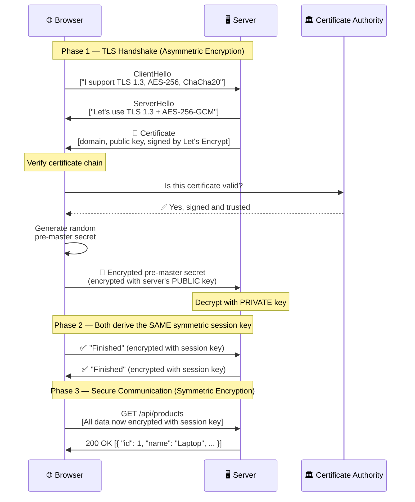

#### Why Two Types of Encryption?

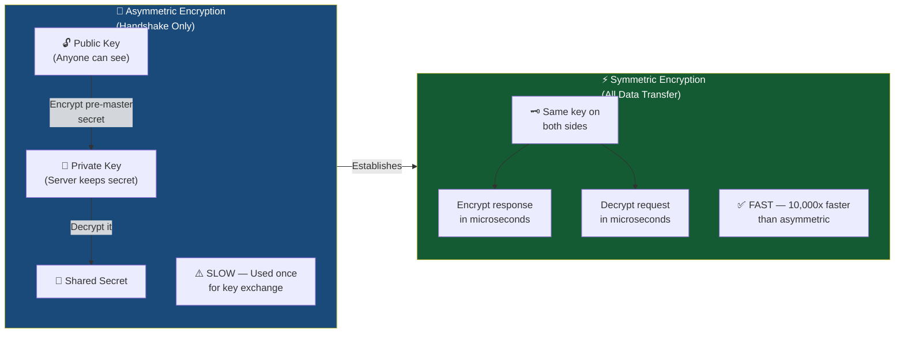

#### HTTPS Implementation in .NET

```csharp
// Program.cs

// ====== STEP 1: Configure HTTPS Redirection ======
builder.Services.AddHttpsRedirection(options =>
{
    // 307 = Temporary Redirect (preserves POST body, unlike 301)
    options.RedirectStatusCode = StatusCodes.Status307TemporaryRedirect;
    options.HttpsPort = 7001; // From launchSettings.json
});

// ====== STEP 2: Configure HSTS (browser enforcement) ======
builder.Services.AddHsts(options =>
{
    options.MaxAge = TimeSpan.FromDays(365);   // Browser remembers for 1 year
    options.IncludeSubDomains = true;          // api.myapp.com also gets HTTPS
    options.Preload = true;                    // Add to Chrome/Firefox preload list
});

var app = builder.Build();

// ====== STEP 3: Add to Pipeline ======
if (!app.Environment.IsDevelopment())
{
    app.UseHsts(); // Only in production (localhost doesn't need it)
}

app.UseHttpsRedirection(); // Redirect all HTTP → HTTPS
```

#### What Happens in Practice

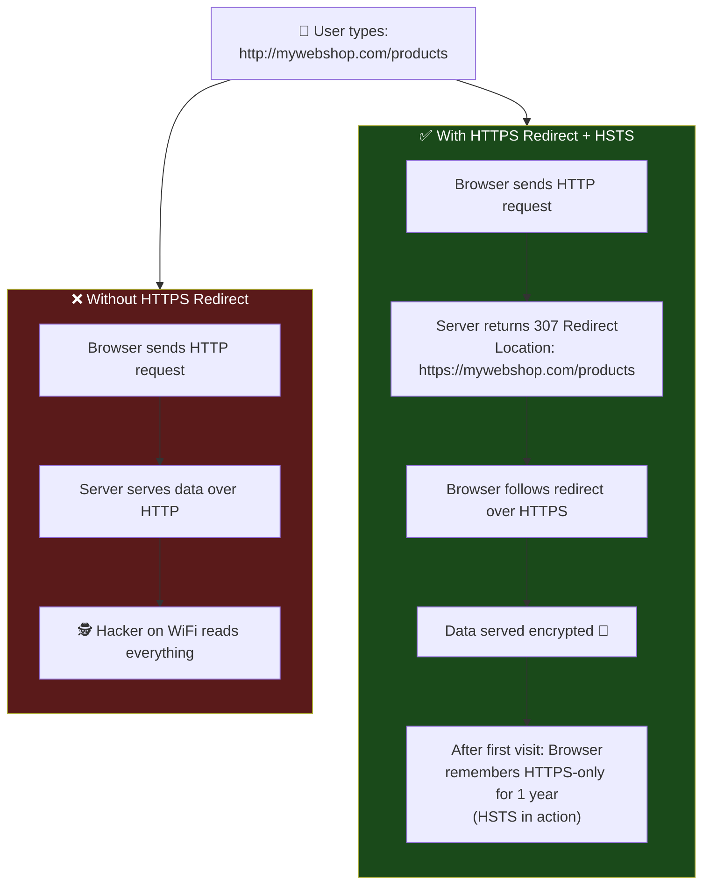

---

### 2.2 HSTS — Making HTTPS Permanent 🛡️

HSTS (HTTP Strict Transport Security) is the browser-side enforcement. After the first HTTPS visit, the browser **never sends an HTTP request to your domain again** — even if the user types `http://`.

#### HSTS Without vs. With

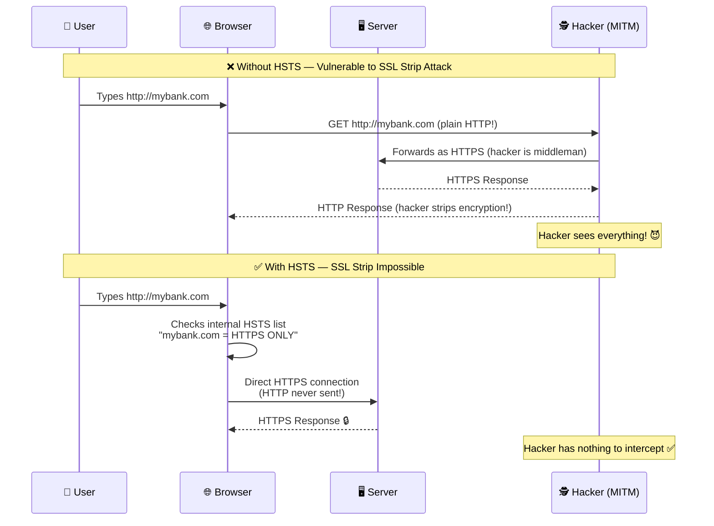

#### The HSTS Header

When your server responds, it sends:

```
Strict-Transport-Security: max-age=31536000; includeSubDomains; preload
                                  ↑                  ↑              ↑
                              1 year          api.mysite.com    Browser
                              in seconds      also protected   preload list
```

#### HSTS Preload List

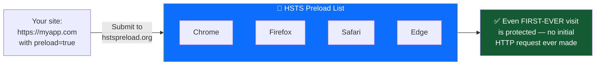

> **Real-world Use Case:** Banks, e-commerce sites, healthcare platforms all use HSTS with preload. If you're building a payment API, HSTS is non-negotiable.

---

### 2.3 CORS — Cross-Origin Resource Sharing 🌐

#### Understanding "Origins"

An origin is the combination of **protocol + domain + port**. All three must match for requests to be "same-origin."

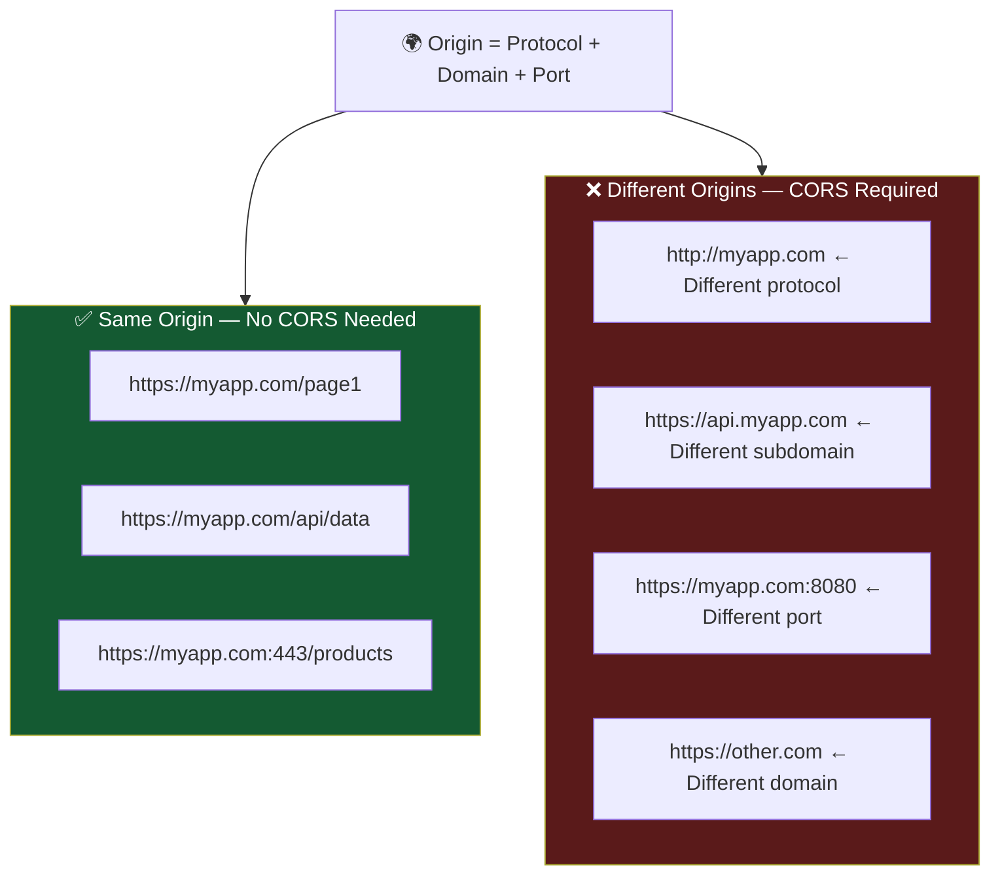

#### Why CORS Exists — The CSRF Threat

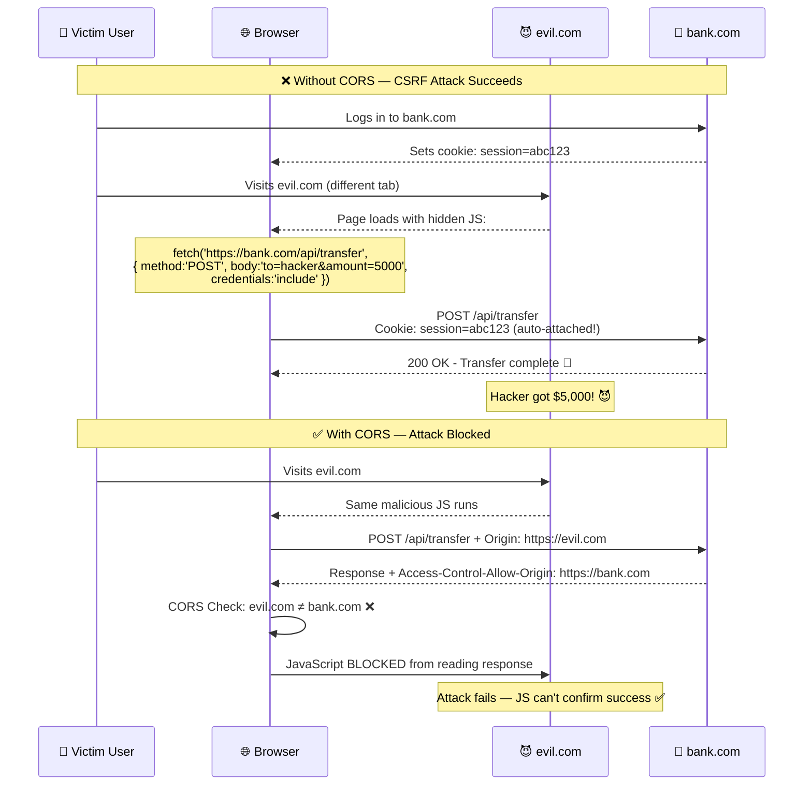

> ⚠️ **Important Nuance:** CORS blocks JavaScript from **reading** the response. The request may still reach the server. Full protection requires both CORS + CSRF tokens. With JWT (stateless, no cookies by default), CSRF is naturally avoided.

#### CORS Preflight — How Browsers Check Permission

For non-simple requests (POST with JSON, custom headers), the browser sends a **preflight** first:

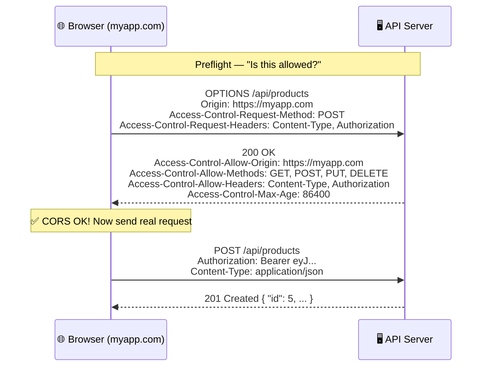

#### CORS Implementation in .NET

```csharp
// Program.cs

// ====== CORS CONFIGURATION ======
builder.Services.AddCors(options =>
{
    // Policy 1: Strict — for production frontend
    options.AddPolicy("ProductionPolicy", policy =>
    {
        policy
            .WithOrigins(
                "https://myapp.com",
                "https://www.myapp.com",
                "https://admin.myapp.com"
            )
            .WithMethods("GET", "POST", "PUT", "DELETE", "PATCH")
            .WithHeaders("Content-Type", "Authorization", "X-API-Key")
            .AllowCredentials()             // Required for cookies
            .SetPreflightMaxAge(TimeSpan.FromHours(24)); // Cache preflight 24h
    });

    // Policy 2: Relaxed — for development/Swagger
    options.AddPolicy("DevelopmentPolicy", policy =>
    {
        policy
            .AllowAnyOrigin()   // ⚠️ Never in production!
            .AllowAnyMethod()
            .AllowAnyHeader();
    });
});

var app = builder.Build();

// Apply correct policy by environment
if (app.Environment.IsDevelopment())
    app.UseCors("DevelopmentPolicy");
else
    app.UseCors("ProductionPolicy");
```

#### Per-Endpoint CORS (Advanced)

```csharp
// Allow a specific public endpoint to be called by anyone
app.MapGet("/api/public/products", GetPublicProducts)
    .RequireCors("AllowAll");

// Restrict admin endpoint to internal dashboard only
app.MapDelete("/api/admin/users/{id}", DeleteUser)
    .RequireCors("AdminDashboardOnly")
    .RequireAuthorization("AdminOnly");
```

#### When Do You Actually Need CORS?

```mermaid
flowchart TD
    Q{"Who calls your API?"}
    Q -->|Browser (SPA, website)| CORS_YES["✅ CORS Required\nConfigure carefully"]
    Q -->|Mobile App| CORS_NO1["❌ No CORS needed\nMobile apps aren't browsers"]
    Q -->|Another Server / Microservice| CORS_NO2["❌ No CORS needed\nServer-to-server calls bypass CORS"]
    Q -->|Postman / curl| CORS_NO3["❌ No CORS needed\nOnly browsers enforce CORS"]
    Q -->|Swagger / OpenAPI| CORS_NO4["⚠️ Swagger in browser needs CORS\nfor cross-origin testing"]

    style CORS_YES fill:#145a32,color:#fff
    style CORS_NO1 fill:#1a4a7a,color:#fff
    style CORS_NO2 fill:#1a4a7a,color:#fff
    style CORS_NO3 fill:#1a4a7a,color:#fff
    style CORS_NO4 fill:#6c3483,color:#fff
```

> 🔄 **Quick Recap (Section 2):** HTTPS encrypts the wire (asymmetric handshake → symmetric data transfer), HSTS makes browsers refuse HTTP permanently, and CORS stops other websites' JavaScript from reading your API's responses. These three form your transport foundation — everything else builds on top.

---

## 3. Identity — Authentication (Who Are You?) {#identity}

> **Goal:** Verify the identity of every caller before allowing access to protected resources.

---

### 3.1 JWT — JSON Web Tokens ⚡

#### The Problem With Traditional Sessions

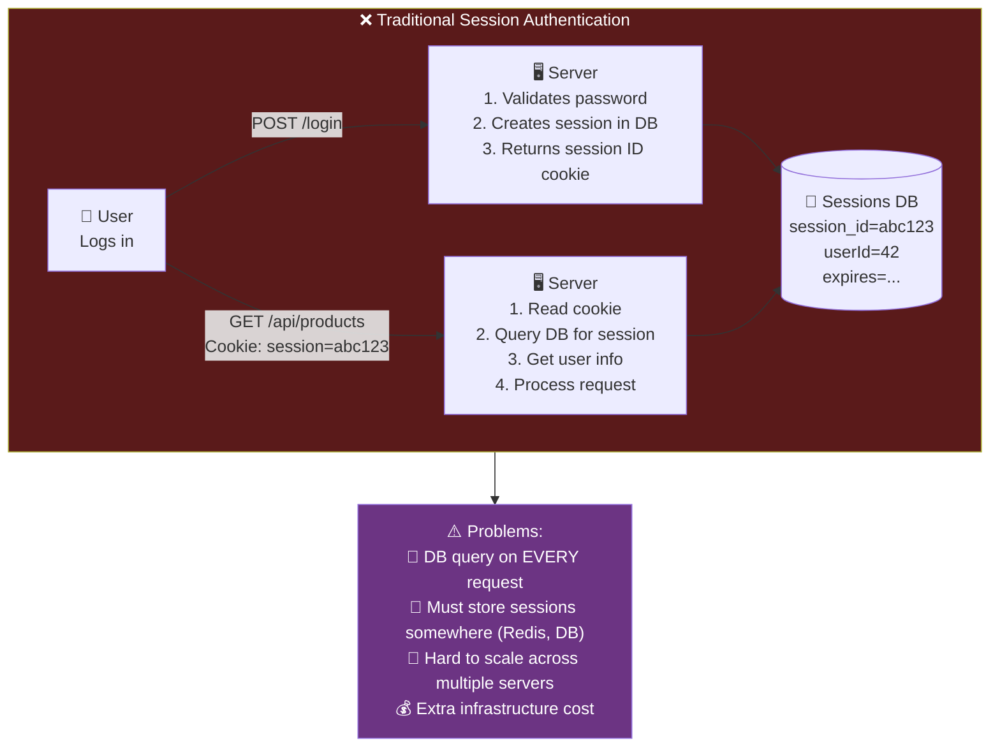

#### JWT — The Stateless Alternative

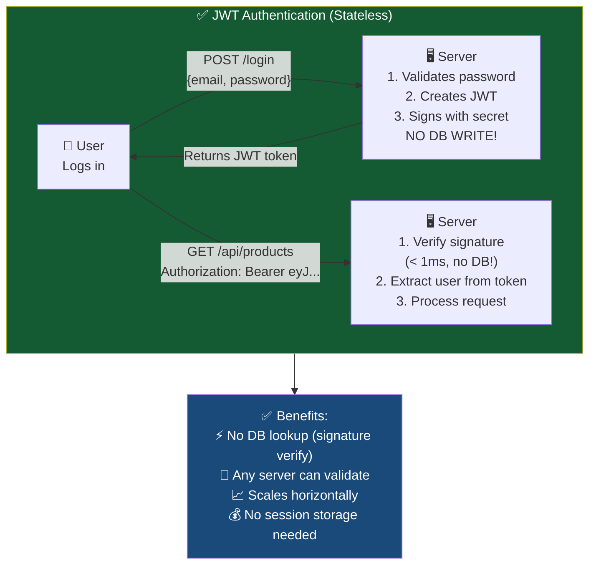

#### Anatomy of a JWT Token

A JWT is three Base64-encoded JSON objects joined by dots: `header.payload.signature`

```
eyJhbGciOiJIUzI1NiIsInR5cCI6IkpXVCJ9
        ↑ HEADER
.
eyJzdWIiOiI0MiIsImVtYWlsIjoiYWxpY2VAZXhhbXBsZS5jb20iLCJyb2xlIjoiVXNlciIsImp0aSI6ImFiYzEyMyIsImV4cCI6MTcwMDAwMDAwMH0
        ↑ PAYLOAD (Claims)
.
SflKxwRJSMeKKF2QT4fwpMeJf36POk6yJV_adQssw5c
        ↑ SIGNATURE (HMAC-SHA256 of header+payload with secret)
```

Decoded:

```json
// HEADER
{
  "alg": "HS256",
  "typ": "JWT"
}

// PAYLOAD (Claims)
{
  "sub": "42",                         // Subject (user ID)
  "email": "alice@example.com",        // User email
  "role": "User",                      // Role for authorization
  "jti": "abc123",                     // Unique token ID
  "iss": "https://myapi.com",          // Issuer
  "aud": "https://myapp.com",          // Audience
  "exp": 1700000000,                   // Expiration (Unix timestamp)
  "iat": 1699999100                    // Issued at
}

// SIGNATURE = HMACSHA256(base64(header) + "." + base64(payload), secretKey)
```

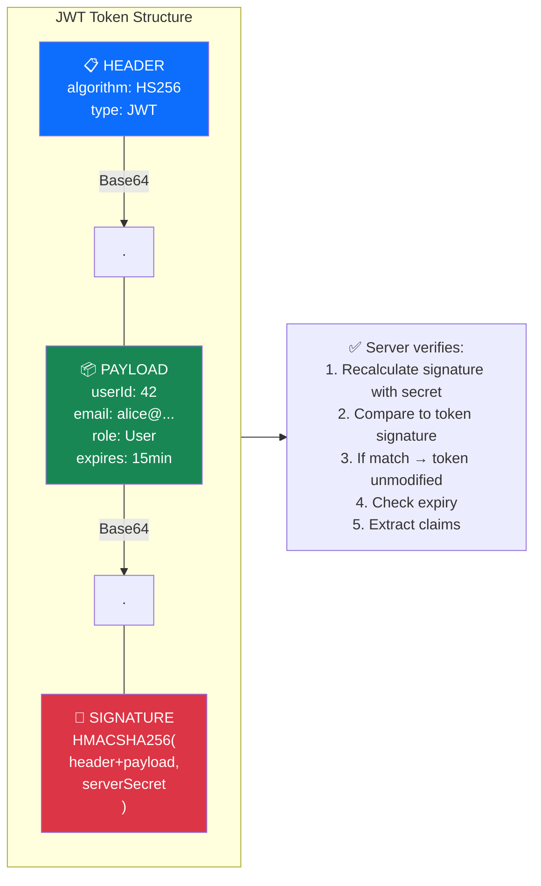

> ⚠️ **Important:** JWT payload is Base64 encoded, NOT encrypted. Anyone can decode it. NEVER put sensitive data (passwords, PII) in JWT claims. Use HTTPS to protect the token in transit.

#### Complete JWT Implementation

**Step 1: Add NuGet Package**

```xml
<PackageReference Include="Microsoft.AspNetCore.Authentication.JwtBearer" Version="9.0.0" />
```

**Step 2: Configuration (`appsettings.json`)**

```json
{
  "Jwt": {
    "SecretKey": "YourSuperSecretKeyThatIsAtLeast32CharactersLong!",
    "Issuer": "https://myapi.com",
    "Audience": "https://myapp.com",
    "AccessTokenExpiryMinutes": 15,
    "RefreshTokenExpiryDays": 7
  }
}
```

> 🔐 **Security note:** Never commit real secret keys to source control. Use `dotnet user-secrets` in development and Azure Key Vault / AWS Secrets Manager / environment variables in production. The value above is illustrative only.

**Step 3: Token Service**

```csharp
public interface ITokenService
{
    string GenerateAccessToken(int userId, string email, string role);
    RefreshToken GenerateRefreshToken(string ipAddress);
    Task<TokenResponse> RefreshTokenAsync(string token, string ipAddress);
    Task RevokeTokenAsync(string token);
}

public class TokenService : ITokenService
{
    private const string DEFAULT_ROLE = "User";
    private readonly IConfiguration _configuration;
    private readonly ApplicationDbContext _context;

    public TokenService(IConfiguration configuration, ApplicationDbContext context)
    {
        _configuration = configuration;
        _context = context;
    }

    public string GenerateAccessToken(int userId, string email, string role)
    {
        var jwtSettings = _configuration.GetSection("Jwt");
        var secretKey = jwtSettings["SecretKey"]
            ?? throw new InvalidOperationException("JWT SecretKey not configured");
        var expiryMinutes = int.Parse(jwtSettings["AccessTokenExpiryMinutes"] ?? "15");

        // Claims = statements about the user embedded in the token
        var claims = new List<Claim>
        {
            new(JwtRegisteredClaimNames.Sub, userId.ToString()),   // User ID
            new(JwtRegisteredClaimNames.Email, email),             // Email
            new(ClaimTypes.Role, role),                            // Role (for AuthZ)
            new(JwtRegisteredClaimNames.Jti, Guid.NewGuid().ToString()), // Unique ID
            new(JwtRegisteredClaimNames.Iat,
                DateTimeOffset.UtcNow.ToUnixTimeSeconds().ToString(),
                ClaimValueTypes.Integer64)
        };

        var key = new SymmetricSecurityKey(Encoding.UTF8.GetBytes(secretKey));
        var credentials = new SigningCredentials(key, SecurityAlgorithms.HmacSha256);

        var token = new JwtSecurityToken(
            issuer: jwtSettings["Issuer"],
            audience: jwtSettings["Audience"],
            claims: claims,
            notBefore: DateTime.UtcNow,                          // Valid from now
            expires: DateTime.UtcNow.AddMinutes(expiryMinutes),  // Expires in 15 min
            signingCredentials: credentials
        );

        return new JwtSecurityTokenHandler().WriteToken(token);
    }
}
```

**Step 4: Register JWT Authentication (`Program.cs`)**

```csharp
builder.Services.AddAuthentication(JwtBearerDefaults.AuthenticationScheme)
    .AddJwtBearer(options =>
    {
        var jwtSettings = builder.Configuration.GetSection("Jwt");

        options.TokenValidationParameters = new TokenValidationParameters
        {
            ValidateIssuer = true,                // Check iss claim
            ValidateAudience = true,              // Check aud claim
            ValidateLifetime = true,              // Check exp claim
            ValidateIssuerSigningKey = true,      // Verify signature

            ValidIssuer = jwtSettings["Issuer"],
            ValidAudience = jwtSettings["Audience"],
            IssuerSigningKey = new SymmetricSecurityKey(
                Encoding.UTF8.GetBytes(jwtSettings["SecretKey"]!)),

            ClockSkew = TimeSpan.FromSeconds(30)  // Allow 30s time drift
        };
    });
```

**Step 5: Login Endpoint**

```csharp
app.MapPost("/api/auth/login", async (
    LoginRequest request,
    IUserService userService,
    ITokenService tokenService,
    HttpContext ctx) =>
{
    // 1. Validate credentials
    var user = await userService.ValidateCredentialsAsync(request.Email, request.Password);
    if (user is null)
        return Results.Unauthorized(); // Don't say "email not found" — prevents user enumeration!

    // 2. Generate tokens
    var ipAddress = ctx.Connection.RemoteIpAddress?.ToString() ?? "unknown";
    var accessToken = tokenService.GenerateAccessToken(user.Id, user.Email, user.Role);
    var refreshToken = tokenService.GenerateRefreshToken(ipAddress);

    // 3. Save refresh token to DB
    refreshToken.UserId = user.Id;
    await userService.SaveRefreshTokenAsync(refreshToken);

    // 4. Return tokens
    return Results.Ok(new TokenResponse(
        AccessToken: accessToken,
        RefreshToken: refreshToken.Token,
        ExpiresIn: 900 // 15 minutes
    ));
});
```

---

### 3.2 Refresh Tokens — Solving JWT's Biggest Weakness ♻️

#### The Core Problem: JWT Can't Be Revoked

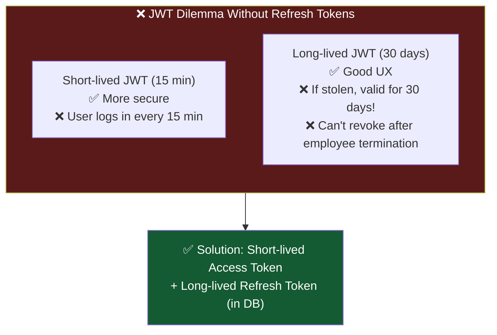

#### The Refresh Token Flow

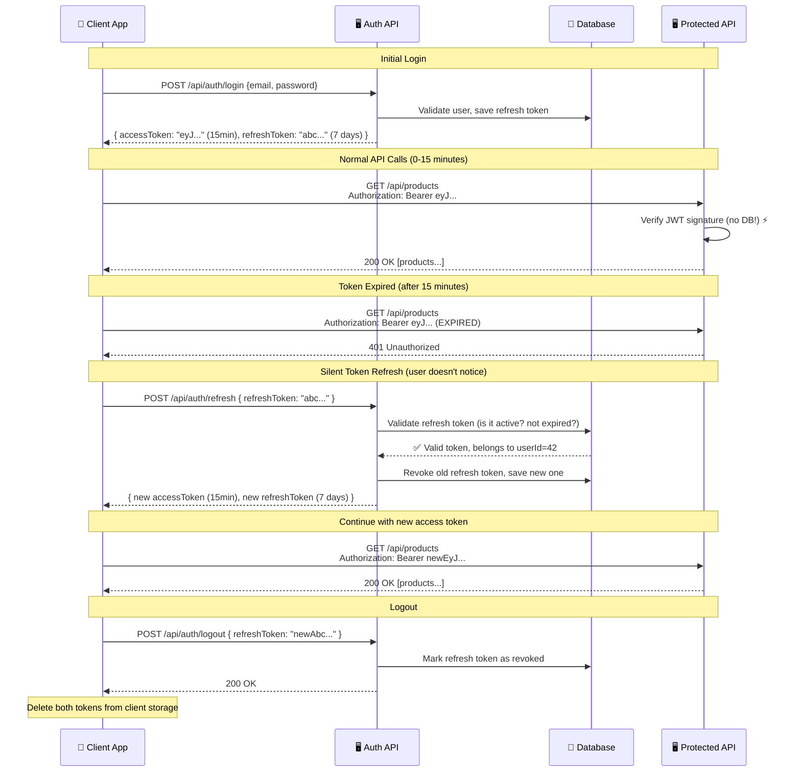

#### Refresh Token Data Model

```csharp
public class RefreshToken
{
    public int Id { get; set; }
    public string Token { get; set; } = string.Empty;      // Cryptographically random (64 bytes)
    public DateTime ExpiresAt { get; set; }                 // 7 days from creation
    public DateTime CreatedAt { get; set; } = DateTime.UtcNow;
    public string CreatedByIp { get; set; } = string.Empty; // For anomaly detection
    public DateTime? RevokedAt { get; set; }                // null = still active
    public string? RevokedByIp { get; set; }
    public int UserId { get; set; }
    public User User { get; set; } = null!;

    // Computed property: active if not revoked AND not expired
    public bool IsActive => RevokedAt == null && DateTime.UtcNow < ExpiresAt;
}
```

#### Complete Refresh Token Service

```csharp
public RefreshToken GenerateRefreshToken(string ipAddress)
{
    // Use cryptographically secure random number generator
    var randomBytes = new byte[64];
    using var rng = RandomNumberGenerator.Create();
    rng.GetBytes(randomBytes);

    return new RefreshToken
    {
        Token = Convert.ToBase64String(randomBytes), // 88 chars, URL-safe after encoding
        ExpiresAt = DateTime.UtcNow.AddDays(7),
        CreatedByIp = ipAddress
    };
}

public async Task<TokenResponse> RefreshTokenAsync(string token, string ipAddress)
{
    // Find refresh token with eager loading of user
    var refreshToken = await _context.RefreshTokens
        .Include(rt => rt.User)
        .FirstOrDefaultAsync(rt => rt.Token == token);

    // Validate
    if (refreshToken == null)
        throw new UnauthorizedAccessException("Invalid refresh token");

    if (!refreshToken.IsActive)
        throw new UnauthorizedAccessException("Refresh token expired or revoked");

    // 🔄 Token Rotation — revoke old, issue new
    refreshToken.RevokedAt = DateTime.UtcNow;
    refreshToken.RevokedByIp = ipAddress;

    var newAccessToken = GenerateAccessToken(
        refreshToken.User.Id,
        refreshToken.User.Email,
        refreshToken.User.Role ?? DEFAULT_ROLE
    );

    var newRefreshToken = GenerateRefreshToken(ipAddress);
    newRefreshToken.UserId = refreshToken.UserId;
    _context.RefreshTokens.Add(newRefreshToken);

    await _context.SaveChangesAsync();

    return new TokenResponse(newAccessToken, newRefreshToken.Token, 900);
}
```

#### Token Storage Strategy

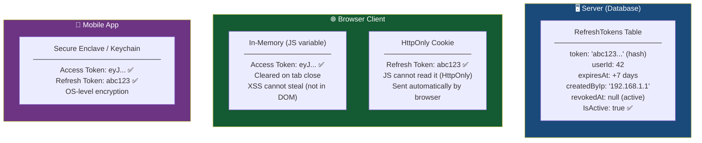

---

### 3.3 Security Headers — Browser-Level Defense 🛡️

#### What Security Headers Do

Security headers tell the browser how to behave when rendering your content. Without them, browsers make permissive assumptions that attackers exploit.

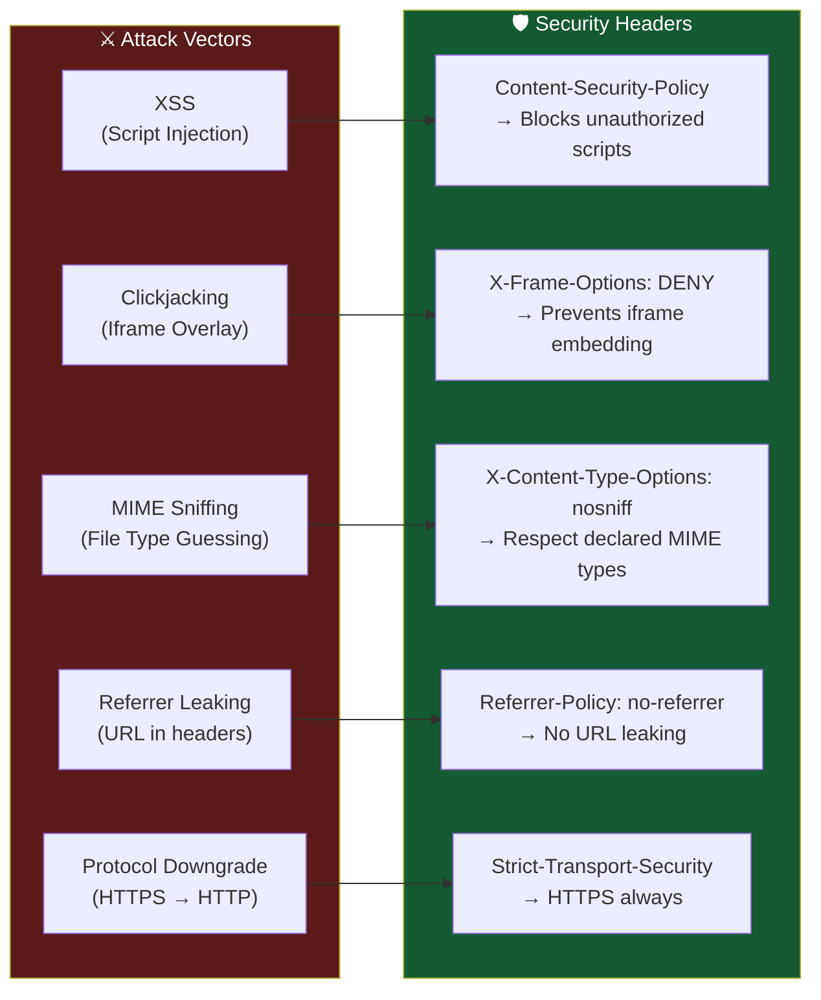

#### XSS Attack + CSP Defense

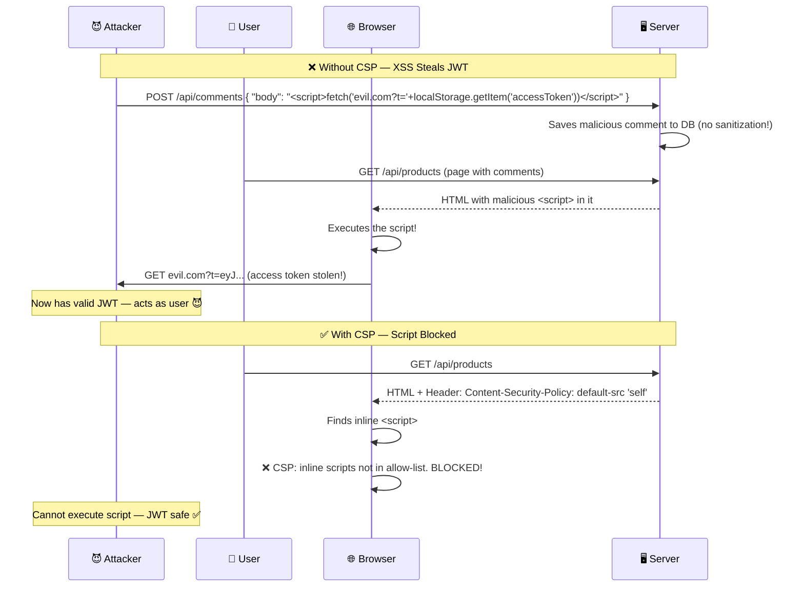

#### Security Headers Middleware Implementation

```csharp
public class SecurityHeadersMiddleware
{
    private readonly RequestDelegate _next;

    public SecurityHeadersMiddleware(RequestDelegate next) => _next = next;

    public async Task InvokeAsync(HttpContext context)
    {
        // Remove server fingerprinting (don't reveal .NET version!)
        context.Response.Headers.Remove("Server");
        context.Response.Headers.Remove("X-Powered-By");

        var headers = context.Response.Headers;

        // Prevent MIME type sniffing
        headers["X-Content-Type-Options"] = "nosniff";

        // Prevent clickjacking via iframes
        headers["X-Frame-Options"] = "DENY";

        // Control referrer information
        headers["Referrer-Policy"] = "strict-origin-when-cross-origin";

        // Disable browser features not needed
        headers["Permissions-Policy"] = "camera=(), microphone=(), geolocation=()";

        // Content Security Policy — customize for your app!
        headers["Content-Security-Policy"] = string.Join("; ",
            "default-src 'self'",           // Only load from same origin
            "script-src 'self'",            // Only our scripts
            "style-src 'self' 'unsafe-inline'", // Allow inline CSS for Swagger
            "img-src 'self' data:",         // Allow data: URIs for images
            "font-src 'self'",
            "connect-src 'self'",           // API calls only to same origin
            "frame-ancestors 'none'",       // No iframes embedding this page
            "form-action 'self'"            // Forms only submit to same origin
        );

        await _next(context);
    }
}

// Register in Program.cs
app.UseMiddleware<SecurityHeadersMiddleware>();
```

#### HttpOnly Cookies for Refresh Tokens

```csharp
// Set refresh token as HttpOnly cookie — JS CANNOT read this
public static void SetRefreshTokenCookie(HttpResponse response, string refreshToken)
{
    var cookieOptions = new CookieOptions
    {
        HttpOnly = true,    // ✅ JavaScript cannot access (XSS protection)
        Secure = true,      // ✅ Only sent over HTTPS
        SameSite = SameSiteMode.Strict, // ✅ Only sent to same site (CSRF protection)
        Expires = DateTimeOffset.UtcNow.AddDays(7),
        Path = "/api/auth"  // Only sent to auth endpoints
    };

    response.Cookies.Append("refreshToken", refreshToken, cookieOptions);
}
```

> 🔄 **Quick Recap (Sections 3.1–3.3):** JWT gives you fast, stateless identity verification; refresh tokens add revocability via rotation; security headers harden the browser against XSS, clickjacking, and MIME attacks. Store access tokens in memory and refresh tokens in HttpOnly cookies.

---

### 3.4 API Keys — Service-to-Service Authentication 🗝️

While JWT is ideal for user-facing apps, API keys serve machine-to-machine scenarios.

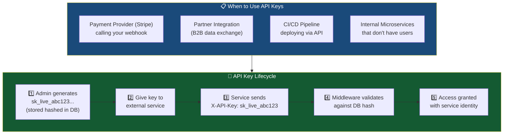

#### API Key vs JWT Comparison

| Aspect | API Key | JWT |
|---|---|---|
| **Statefulness** | Stateful (DB lookup every time) | Stateless (signature verify) |
| **Revocation** | Instant (delete from DB) | Can't revoke until expiry |
| **Ideal for** | Services/machines | Human users |
| **Expiry** | Long-lived or never | Short-lived (15 min) |
| **Contains user info** | No (just an ID) | Yes (claims embedded) |
| **Size** | Small (~32 chars) | Larger (~500 bytes) |

#### API Key Implementation

```csharp
// Model
public class ApiKey
{
    public int Id { get; set; }
    public string KeyHash { get; set; } = string.Empty;  // Store HASH, not plain key!
    public string Name { get; set; } = string.Empty;     // "StripeWebhook", "PartnerX"
    public string[] Scopes { get; set; } = [];           // ["read:products", "write:orders"]
    public bool IsActive { get; set; } = true;
    public DateTime CreatedAt { get; set; } = DateTime.UtcNow;
    public DateTime? LastUsedAt { get; set; }
    public DateTime? ExpiresAt { get; set; }
}

// API Key Middleware
public class ApiKeyMiddleware
{
    private readonly RequestDelegate _next;
    private const string API_KEY_HEADER = "X-API-Key";

    public ApiKeyMiddleware(RequestDelegate next) => _next = next;

    public async Task InvokeAsync(HttpContext context, ApplicationDbContext db)
    {
        // If already authenticated by JWT, skip API key check
        if (context.User.Identity?.IsAuthenticated == true)
        {
            await _next(context);
            return;
        }

        if (!context.Request.Headers.TryGetValue(API_KEY_HEADER, out var apiKeyValue))
        {
            await _next(context);
            return;
        }

        // Hash the provided key before DB lookup
        var keyHash = ComputeHash(apiKeyValue.ToString());

        var apiKey = await db.ApiKeys
            .FirstOrDefaultAsync(k =>
                k.KeyHash == keyHash &&
                k.IsActive &&
                (k.ExpiresAt == null || k.ExpiresAt > DateTime.UtcNow));

        if (apiKey == null)
        {
            context.Response.StatusCode = StatusCodes.Status401Unauthorized;
            await context.Response.WriteAsJsonAsync(new { error = "Invalid API Key" });
            return;
        }

        // Update last used timestamp
        apiKey.LastUsedAt = DateTime.UtcNow;
        await db.SaveChangesAsync();

        // Set claims so AuthZ works the same way
        var claims = new List<Claim>
        {
            new(ClaimTypes.Name, apiKey.Name),
            new("auth_method", "api_key"),
        };
        claims.AddRange(apiKey.Scopes.Select(s => new Claim("scope", s)));

        context.User = new ClaimsPrincipal(
            new ClaimsIdentity(claims, "ApiKey"));

        await _next(context);
    }

    private static string ComputeHash(string input)
    {
        var bytes = SHA256.HashData(Encoding.UTF8.GetBytes(input));
        return Convert.ToHexString(bytes);
    }
}
```

---

## 4. Authorization — What Are You Allowed to Do? {#authorization}

> **After** knowing WHO you are (authentication), the system decides WHAT you're allowed to do (authorization).

```mermaid
flowchart LR
    AUTHN["🪪 Authentication\n'Who are you?'\nJWT / API Key verified"]
    AUTHZ["🛂 Authorization\n'What can you do?'\nPolicies / Roles checked"]
    RESOURCE["📦 Protected Resource\nAccessed or Denied"]

    AUTHN -->|"Identity established"| AUTHZ
    AUTHZ -->|"✅ Permitted"| RESOURCE
    AUTHZ -->|"❌ Forbidden → 403"| BLOCKED["🚫 Access Denied"]

    style AUTHN fill:#1a4a7a,color:#fff
    style AUTHZ fill:#6c3483,color:#fff
    style RESOURCE fill:#145a32,color:#fff
    style BLOCKED fill:#5a1a1a,color:#fff
```

### 4.1 Role-Based Authorization

```mermaid
flowchart TD
    subgraph ROLES["👥 Role Hierarchy"]
        ADMIN["👑 Admin\nFull access:\n• Create/edit/delete products\n• Manage users\n• View analytics\n• Approve orders"]
        MANAGER["🏢 Manager\nLimited admin:\n• Edit products\n• View analytics\n• Approve orders"]
        USER["👤 User\nCustomer access:\n• Browse products\n• Place orders\n• View own profile"]
        GUEST["🎭 Guest\nUnauthenticated:\n• Browse public products\n• No account actions"]
    end

    ADMIN -->|"Includes"| MANAGER
    MANAGER -->|"Includes"| USER
    USER -->|"Includes"| GUEST

    style ADMIN fill:#dc3545,color:#fff
    style MANAGER fill:#fd7e14,color:#fff
    style USER fill:#0d6efd,color:#fff
    style GUEST fill:#6c757d,color:#fff
```

### 4.2 Authorization Policies

Policies let you define complex rules beyond simple roles — combining roles, claims, custom requirements, and external conditions.

```csharp
// Program.cs — Define all authorization policies in one place
builder.Services.AddAuthorization(options =>
{
    // Simple role-based
    options.AddPolicy("AdminOnly", policy =>
        policy.RequireRole("Admin"));

    options.AddPolicy("AdminOrManager", policy =>
        policy.RequireRole("Admin", "Manager"));

    // Claim-based
    options.AddPolicy("VerifiedUser", policy =>
        policy.RequireClaim("email_verified", "true"));

    // Combined role + claim
    options.AddPolicy("PremiumUser", policy =>
    {
        policy.RequireRole("User");
        policy.RequireClaim("subscription", "premium");
    });

    // Custom requirement (complex business logic)
    options.AddPolicy("MustBeOver18", policy =>
        policy.Requirements.Add(new MinimumAgeRequirement(18)));

    options.AddPolicy("CanManageProducts", policy =>
    {
        policy.RequireAuthenticatedUser();
        policy.Requirements.Add(new ScopeRequirement("write:products"));
    });
});
```

#### Custom Policy Requirements

```csharp
// Define the requirement
public class MinimumAgeRequirement : IAuthorizationRequirement
{
    public int MinimumAge { get; }
    public MinimumAgeRequirement(int minimumAge) => MinimumAge = minimumAge;
}

// Implement the handler
public class MinimumAgeHandler : AuthorizationHandler<MinimumAgeRequirement>
{
    protected override Task HandleRequirementAsync(
        AuthorizationHandlerContext context,
        MinimumAgeRequirement requirement)
    {
        var dateOfBirthClaim = context.User.FindFirst("date_of_birth");

        if (dateOfBirthClaim == null)
        {
            context.Fail(); // No DOB claim → fail
            return Task.CompletedTask;
        }

        var dob = DateTime.Parse(dateOfBirthClaim.Value);
        var age = DateTime.Today.Year - dob.Year;
        if (dob.Date > DateTime.Today.AddYears(-age)) age--;

        if (age >= requirement.MinimumAge)
            context.Succeed(requirement); // ✅
        else
            context.Fail();              // ❌

        return Task.CompletedTask;
    }
}

// Register the handler
builder.Services.AddSingleton<IAuthorizationHandler, MinimumAgeHandler>();
```

### 4.3 Endpoint Authorization Annotations

```csharp
// ===== PUBLIC ENDPOINTS =====
app.MapGet("/api/products", GetProducts)
    .AllowAnonymous();  // No auth required — public catalog

app.MapGet("/api/products/{id}", GetProduct)
    .AllowAnonymous();

// ===== USER ENDPOINTS =====
app.MapPost("/api/orders", CreateOrder)
    .RequireAuthorization(); // Any authenticated user

app.MapGet("/api/orders/my", GetMyOrders)
    .RequireAuthorization("VerifiedUser");

// ===== MANAGER ENDPOINTS =====
app.MapPut("/api/products/{id}", UpdateProduct)
    .RequireAuthorization("AdminOrManager");

app.MapGet("/api/analytics/sales", GetSalesReport)
    .RequireAuthorization("AdminOrManager");

// ===== ADMIN ENDPOINTS =====
app.MapDelete("/api/products/{id}", DeleteProduct)
    .RequireAuthorization("AdminOnly");

app.MapGet("/api/admin/users", GetAllUsers)
    .RequireAuthorization("AdminOnly");

app.MapPost("/api/admin/apikeys", GenerateApiKey)
    .RequireAuthorization("AdminOnly");

// ===== AGE-RESTRICTED =====
app.MapGet("/api/products/alcohol", GetAlcoholProducts)
    .RequireAuthorization("MustBeOver18");
```

#### Authorization Flow Diagram

```mermaid
flowchart TD
    REQ(["📨 Request Arrives\nGET /api/admin/users"])

    REQ --> A{"Is user\nauthenticated?"}
    A -->|No| R1["❌ 401 Unauthorized\nPlease login first"]
    A -->|Yes| B{"Does endpoint\nneed authorization?"}
    B -->|AllowAnonymous| SUCCESS["✅ Allow access"]
    B -->|RequireAuthorization| C{"Check policies\nand roles"}

    C -->|"Policy: AdminOnly\nUser role: User"| R2["❌ 403 Forbidden\nInsufficient permissions"]
    C -->|"Policy: AdminOnly\nUser role: Admin"| D{"Custom requirements\nmet?"}
    D -->|No| R3["❌ 403 Forbidden\nCustom rule failed"]
    D -->|Yes| SUCCESS

    SUCCESS --> HANDLER["🔧 Endpoint Handler\nExecutes business logic"]

    style R1 fill:#5a1a1a,color:#fff
    style R2 fill:#5a1a1a,color:#fff
    style R3 fill:#5a1a1a,color:#fff
    style SUCCESS fill:#145a32,color:#fff
    style HANDLER fill:#1a4a7a,color:#fff
```

> 🔄 **Quick Recap (Sections 3.4–4):** API keys authenticate machines with instant revocation via hashed DB lookup; JWT authenticates humans statelessly. After identity comes authorization: roles for coarse control, policies for fine-grained rules, and custom `IAuthorizationRequirement` handlers for business logic like age checks.

---

## 5. Data Protection & Sanitization {#data-protection}

> **Goal:** Protect data at every stage — in transit, in use, and at rest. Prevent leaks, injection, and abuse.

---

### 5.1 DTOs — Data Transfer Objects 📦

DTOs are the contract between your API and the outside world. They prevent three critical vulnerabilities:

```mermaid
flowchart TD
    subgraph DB_ENTITY["💾 Database Entity (Internal)"]
        direction TB
        E1["Id: 42"]
        E2["Email: alice@..."]
        E3["PasswordHash: $2b$10$..."]
        E4["Role: User"]
        E5["CreatedAt: 2024-01-01"]
        E6["RefreshTokens: [...]"]
        E7["IsDeleted: false"]
    end

    subgraph DTO_RESP["📤 Response DTO (External)"]
        direction TB
        R1["Id: 42"]
        R2["Email: alice@..."]
        R3["Role: User"]
        R4["CreatedAt: 2024-01-01"]
    end

    subgraph DTO_REQ["📥 Request DTO (Create/Update)"]
        direction TB
        Q1["Email: (required)"]
        Q2["Password: (required, 8+ chars)"]
        Q3["Name: (required)"]
    end

    DB_ENTITY -->|"Filter out sensitive fields"| DTO_RESP
    DTO_REQ -->|"Controlled input only"| DB_ENTITY

    BLOCK1["🚫 PasswordHash\nnever exposed"]
    BLOCK2["🚫 Role\nnot settable by user"]
    BLOCK3["🚫 RefreshTokens\nnever leaked"]

    DB_ENTITY -.->|"Blocked by DTO"| BLOCK1
    DB_ENTITY -.->|"Blocked by DTO"| BLOCK2
    DB_ENTITY -.->|"Blocked by DTO"| BLOCK3

    style DB_ENTITY fill:#5a1a1a,color:#fff
    style DTO_RESP fill:#145a32,color:#fff
    style DTO_REQ fill:#1a4a7a,color:#fff
    style BLOCK1 fill:#6c3483,color:#fff
    style BLOCK2 fill:#6c3483,color:#fff
    style BLOCK3 fill:#6c3483,color:#fff
```

#### The Mass Assignment Attack

```csharp
// ❌ DANGEROUS — No DTO, binding directly to entity
app.MapPost("/api/users/register", async (User user, ApplicationDbContext db) =>
{
    // Attacker sends: { "email": "hacker@evil.com", "role": "Admin" }
    // 🔥 Attacker just made themselves Admin!
    await db.Users.AddAsync(user);
    await db.SaveChangesAsync();
});

// ✅ SAFE — Using Request DTO
public record RegisterUserRequest(
    [Required][EmailAddress] string Email,
    [Required][MinLength(8)] string Password,
    [Required] string Name
    // Note: No Role field! Users can't set their own role.
);

app.MapPost("/api/users/register", async (RegisterUserRequest request, ApplicationDbContext db) =>
{
    var user = new User
    {
        Email = request.Email,
        PasswordHash = BCrypt.HashPassword(request.Password),
        Name = request.Name,
        Role = "User"  // Always set by server, never by client!
    };
    await db.Users.AddAsync(user);
    await db.SaveChangesAsync();

    return Results.Created($"/api/users/{user.Id}", new UserResponse(user.Id, user.Email, user.Name));
});
```

#### Complete DTO Pattern

```csharp
// ===== PRODUCT DTOs =====

// Request DTOs (what clients send to us)
public record CreateProductRequest(
    [Required][MaxLength(200)] string Name,
    [Required][MaxLength(2000)] string Description,
    [Required][Range(0.01, 1_000_000)] decimal Price,
    [Required][Range(0, 100_000)] int StockQuantity,
    [Required] string CategoryId
    // ⛔ No: Id, CreatedAt, IsDeleted, InternalNotes
);

public record UpdateProductRequest(
    [MaxLength(200)] string? Name,
    [MaxLength(2000)] string? Description,
    [Range(0.01, 1_000_000)] decimal? Price,
    [Range(0, 100_000)] int? StockQuantity
);

// Response DTOs (what we send back to clients)
public record ProductResponse(
    int Id,
    string Name,
    string Description,
    decimal Price,
    int StockQuantity,
    string CategoryName,
    DateTime CreatedAt
    // ⛔ No: Cost (internal margin), SupplierId, InternalNotes
);

// Admin-only response with extra fields
public record ProductAdminResponse(
    int Id,
    string Name,
    decimal Price,
    decimal Cost,          // ✅ Admin can see margin
    int StockQuantity,
    string SupplierId,
    string InternalNotes,
    bool IsActive
);
```

---

### 5.2 Encryption at Rest 🔐

HTTPS protects data **in transit**. But what about data stored on disk?

```mermaid
flowchart LR
    subgraph STATES["📊 Data States"]
        direction TB
        TRANSIT["🚀 In Transit\n(HTTPS protects this)"]
        USE["⚡ In Use / In Memory\n(RAM — relatively safe)"]
        REST["💾 At Rest\n(Disk — needs protection!)"]
    end

    subgraph THREATS["⚔️ Threats at Rest"]
        direction TB
        BREACH["Database breach\n(SQL injection, misconfig)"]
        BACKUP["Stolen backup files\n(.bak files unencrypted)"]
        PHYSICAL["Physical disk theft\n(Datacenter intrusion)"]
    end

    subgraph SOLUTIONS["🛡️ Solutions"]
        direction TB
        TDE["Transparent Data Encryption (TDE)\nDatabase-level, automatic"]
        FIELD["Field-Level Encryption\nEncrypt specific sensitive columns"]
        VAULT["Key Vault (Azure / AWS)\nSecure key management"]
    end

    REST --> THREATS
    THREATS --> SOLUTIONS

    style THREATS fill:#5a1a1a,color:#fff
    style SOLUTIONS fill:#145a32,color:#fff
```

#### Sensitive Field Encryption in .NET

```csharp
// Encrypt sensitive fields at the entity level
public class EncryptedField
{
    private readonly IDataProtectionProvider _protector;

    public string Encrypt(string plainText)
    {
        var protector = _protector.CreateProtector("SensitiveData");
        return protector.Protect(plainText);
    }

    public string Decrypt(string cipherText)
    {
        var protector = _protector.CreateProtector("SensitiveData");
        return protector.Unprotect(cipherText);
    }
}

// Use value converters in EF Core to encrypt/decrypt automatically
protected override void OnModelCreating(ModelBuilder modelBuilder)
{
    var converter = new ValueConverter<string, string>(
        v => encryptionService.Encrypt(v),    // Write to DB: encrypt
        v => encryptionService.Decrypt(v)     // Read from DB: decrypt
    );

    modelBuilder.Entity<PaymentMethod>()
        .Property(p => p.CardNumber)
        .HasConversion(converter);

    modelBuilder.Entity<User>()
        .Property(u => u.SocialSecurityNumber)
        .HasConversion(converter);
}
```

> 💡 **Key insight:** Encrypted columns can't be queried efficiently (`WHERE cardNumber = ...` won't match ciphertext). If you need lookups, store a deterministic hash alongside the encrypted value and query the hash.

---

### 5.3 Rate Limiting — Stopping Abuse 🚦

Rate limiting prevents brute force, DoS, and scraping attacks by limiting how many requests a client can make.

```mermaid
flowchart TD
    subgraph ALGORITHMS["📊 Rate Limiting Algorithms"]
        direction TB

        subgraph FIXED["Fixed Window"]
            F1["Window: 1 minute\nLimit: 5 requests\n─────────────\n[1] ✅ req 1\n[2] ✅ req 2\n[3] ✅ req 3\n[4] ✅ req 4\n[5] ✅ req 5\n[6] ❌ 429 Too Many"]
        end

        subgraph SLIDING["Sliding Window"]
            S1["Tracks last 60 seconds\nmore accurately\n─────────────\nFairer than fixed\nPrevents burst at\nwindow boundaries"]
        end

        subgraph TOKEN["Token Bucket"]
            T1["Bucket: 10 tokens\nRefill: 1/second\n─────────────\nBursts allowed!\nup to bucket size\nThen throttled"]
        end

        subgraph CONCUR["Concurrency Limiter"]
            C1["Max 5 concurrent\nrequests at a time\n─────────────\nFor slow endpoints\nPrevents DB flooding"]
        end
    end

    style FIXED fill:#1a4a7a,color:#fff
    style SLIDING fill:#145a32,color:#fff
    style TOKEN fill:#6c3483,color:#fff
    style CONCUR fill:#7e5109,color:#fff
```

#### Comprehensive Rate Limiting Implementation

```csharp
// Program.cs
builder.Services.AddRateLimiter(options =>
{
    // Global fallback policy
    options.GlobalLimiter = PartitionedRateLimiter.Create<HttpContext, string>(ctx =>
        RateLimitPartition.GetFixedWindowLimiter(
            partitionKey: ctx.User.Identity?.Name ?? ctx.Connection.RemoteIpAddress?.ToString() ?? "anonymous",
            factory: _ => new FixedWindowRateLimiterOptions
            {
                PermitLimit = 100,
                Window = TimeSpan.FromMinutes(1)
            }));

    // Auth endpoints — very strict (prevent brute force)
    options.AddFixedWindowLimiter("auth", opt =>
    {
        opt.PermitLimit = 5;                        // 5 login attempts
        opt.Window = TimeSpan.FromMinutes(15);      // per 15 minutes
        opt.QueueProcessingOrder = QueueProcessingOrder.OldestFirst;
        opt.QueueLimit = 0;                         // No queuing — fail fast
    });

    // API endpoints — moderate
    options.AddSlidingWindowLimiter("api", opt =>
    {
        opt.PermitLimit = 100;
        opt.Window = TimeSpan.FromMinutes(1);
        opt.SegmentsPerWindow = 6;                  // More accurate sliding window
    });

    // Search endpoints — token bucket (allows bursts)
    options.AddTokenBucketLimiter("search", opt =>
    {
        opt.TokenLimit = 20;                        // Up to 20 burst
        opt.QueueProcessingOrder = QueueProcessingOrder.OldestFirst;
        opt.QueueLimit = 5;
        opt.ReplenishmentPeriod = TimeSpan.FromSeconds(1);
        opt.TokensPerPeriod = 2;                   // Refill 2/second
    });

    // Configure 429 response
    options.OnRejected = async (context, cancellationToken) =>
    {
        context.HttpContext.Response.StatusCode = StatusCodes.Status429TooManyRequests;

        if (context.Lease.TryGetMetadata(MetadataName.RetryAfter, out var retryAfter))
        {
            context.HttpContext.Response.Headers.RetryAfter =
                ((int)retryAfter.TotalSeconds).ToString();
        }

        await context.HttpContext.Response.WriteAsJsonAsync(new
        {
            error = "Too many requests. Please slow down.",
            retryAfterSeconds = context.Lease.TryGetMetadata(MetadataName.RetryAfter, out var ra)
                ? (int)ra.TotalSeconds : 60
        }, cancellationToken);
    };
});

// Apply to endpoints
app.MapPost("/api/auth/login", HandleLogin)
    .RequireRateLimiting("auth");

app.MapGet("/api/products", GetProducts)
    .RequireRateLimiting("api");

app.MapGet("/api/products/search", SearchProducts)
    .RequireRateLimiting("search");
```

#### Rate Limiting Flow

```mermaid
sequenceDiagram
    participant C as 👤 Client
    participant RL as 🚦 Rate Limiter
    participant API as 🖥️ API

    Note over C,API: Normal requests (within limit)
    C->>RL: Request 1/5
    RL->>API: ✅ Forwarded
    API-->>C: 200 OK

    C->>RL: Request 2/5
    RL->>API: ✅ Forwarded
    API-->>C: 200 OK

    Note over C,API: Limit exceeded
    C->>RL: Request 6/5 ❌
    RL-->>C: 429 Too Many Requests<br/>Retry-After: 54s<br/>{ "error": "Slow down!" }
    Note over RL: Request never reaches API

    Note over C,API: After window resets
    C->>RL: Request 1/5 (new window)
    RL->>API: ✅ Forwarded
    API-->>C: 200 OK
```

---

### 5.4 Error Handling Middleware — Hiding Your Secrets 🤫

```mermaid
flowchart TD
    subgraph BAD["❌ Without Error Handling — Information Disclosure"]
        B1["System.NullReferenceException: Object reference not set\n  at SecureApi.Services.ProductService.GetById(Int32 id)\n     in C:\\Users\\john\\projects\\secureapi\\Services\\ProductService.cs:42\n  at SecureApi.Endpoints.ProductEndpoints.<GetProduct>b__0\n     in C:\\Users\\john\\projects\\secureapi\\Endpoints\\ProductEndpoints.cs:15"]
        NOTE1["😈 Attacker learns:\n• File structure\n• Class names\n• Developer's username\n• Code paths to target"]
    end

    subgraph GOOD["✅ With Error Handling — Safe Response"]
        G1["{\n  'error': 'An unexpected error occurred',\n  'statusCode': 500,\n  'traceId': 'abc-123'  ← for internal log lookup\n}"]
        NOTE2["✅ No internal details\n✅ Trace ID for debugging\n✅ Full error in server logs\n✅ Consistent format"]
    end

    style BAD fill:#5a1a1a,color:#fff
    style GOOD fill:#145a32,color:#fff
```

#### Global Exception Handling Middleware

```csharp
public class GlobalExceptionHandlingMiddleware
{
    private readonly RequestDelegate _next;
    private readonly ILogger<GlobalExceptionHandlingMiddleware> _logger;

    public GlobalExceptionHandlingMiddleware(
        RequestDelegate next,
        ILogger<GlobalExceptionHandlingMiddleware> logger)
    {
        _next = next;
        _logger = logger;
    }

    public async Task InvokeAsync(HttpContext context)
    {
        try
        {
            await _next(context);
        }
        catch (Exception ex)
        {
            await HandleExceptionAsync(context, ex);
        }
    }

    private async Task HandleExceptionAsync(HttpContext context, Exception exception)
    {
        // Log the FULL error internally
        var traceId = Activity.Current?.Id ?? context.TraceIdentifier;
        _logger.LogError(exception, "Unhandled exception. TraceId: {TraceId}", traceId);

        // Return a SAFE response externally
        var (statusCode, message) = exception switch
        {
            UnauthorizedAccessException => (401, "Unauthorized"),
            ForbiddenException => (403, "Forbidden"),
            NotFoundException => (404, "Resource not found"),
            ValidationException ve => (400, ve.Message),
            _ => (500, "An unexpected error occurred")
        };

        context.Response.StatusCode = statusCode;
        context.Response.ContentType = "application/json";

        await context.Response.WriteAsJsonAsync(new
        {
            error = message,
            statusCode,
            traceId // Client can report this ID for support tickets
        });
    }
}

// Register FIRST in pipeline (wraps everything)
app.UseMiddleware<GlobalExceptionHandlingMiddleware>();
```

#### Input Validation with FluentValidation

```csharp
// Install: dotnet add package FluentValidation.AspNetCore

public class CreateProductValidator : AbstractValidator<CreateProductRequest>
{
    public CreateProductValidator()
    {
        RuleFor(x => x.Name)
            .NotEmpty().WithMessage("Product name is required")
            .MaximumLength(200).WithMessage("Name cannot exceed 200 characters")
            .Matches(@"^[a-zA-Z0-9\s\-\.]+$").WithMessage("Name contains invalid characters");
            // ↑ Prevents XSS injection in names

        RuleFor(x => x.Price)
            .GreaterThan(0).WithMessage("Price must be positive")
            .LessThanOrEqualTo(1_000_000).WithMessage("Price exceeds maximum");

        RuleFor(x => x.StockQuantity)
            .GreaterThanOrEqualTo(0).WithMessage("Stock cannot be negative");

        RuleFor(x => x.Description)
            .NotEmpty()
            .MaximumLength(2000)
            .Must(NotContainScript).WithMessage("Description contains invalid content");
            // ↑ Prevents stored XSS in descriptions
    }

    private static bool NotContainScript(string? text)
    {
        if (string.IsNullOrEmpty(text)) return true;
        return !text.Contains("<script", StringComparison.OrdinalIgnoreCase) &&
               !text.Contains("javascript:", StringComparison.OrdinalIgnoreCase);
    }
}
```

---

### 5.5 Client IP Tracking — Anomaly Detection 🌍

Storing the IP address that creates and uses refresh tokens enables powerful security features.

```mermaid
flowchart TD
    subgraph NORMAL["✅ Normal Refresh Token Usage"]
        direction LR
        N1["Login from\n📍 New York, USA\nIP: 192.168.1.100"]
        N2["Refresh token\n📍 New York, USA\nIP: 192.168.1.100"]
        N3["✅ Same location\nAllow refresh"]
        N1 --> N2 --> N3
    end

    subgraph SUSPICIOUS["🚨 Suspicious Activity Detected"]
        direction LR
        S1["Login from\n📍 New York, USA\nIP: 192.168.1.100"]
        S2["Refresh token\n📍 Moscow, Russia\nIP: 91.108.56.200"]
        S3["⚠️ Location anomaly!\nPossible token theft"]
        S4["🛑 Revoke ALL\nrefresh tokens\nfor this user"]
        S1 --> S2 --> S3 --> S4
    end

    style NORMAL fill:#145a32,color:#fff
    style SUSPICIOUS fill:#5a1a1a,color:#fff
```

#### IP Tracking Implementation

```csharp
// Get real client IP (handles proxies, load balancers, CDN)
public static string GetClientIp(HttpContext context)
{
    // Check forwarded headers first (set by reverse proxies)
    var forwardedFor = context.Request.Headers["X-Forwarded-For"].FirstOrDefault();
    if (!string.IsNullOrEmpty(forwardedFor))
    {
        // X-Forwarded-For can be a comma-separated list — take the first (original client)
        var ip = forwardedFor.Split(',').FirstOrDefault()?.Trim();
        if (!string.IsNullOrEmpty(ip)) return ip;
    }

    // Cloudflare
    var cfConnectingIp = context.Request.Headers["CF-Connecting-IP"].FirstOrDefault();
    if (!string.IsNullOrEmpty(cfConnectingIp)) return cfConnectingIp;

    // Direct connection fallback
    return context.Connection.RemoteIpAddress?.ToString() ?? "unknown";
}

// Anomaly detection service
public class TokenSecurityService
{
    public async Task<bool> IsRefreshSuspiciousAsync(
        RefreshToken token, string currentIp, ApplicationDbContext db)
    {
        // Check if IP country changed dramatically
        var originalCountry = await GetCountryFromIp(token.CreatedByIp);
        var currentCountry = await GetCountryFromIp(currentIp);

        if (originalCountry != currentCountry)
        {
            _logger.LogWarning(
                "Suspicious refresh: Token created in {OriginalCountry}, " +
                "refresh attempted from {CurrentCountry}. UserId: {UserId}",
                originalCountry, currentCountry, token.UserId);

            // Revoke ALL tokens for this user as a precaution
            await RevokeAllUserTokensAsync(token.UserId, db);
            return true; // Suspicious!
        }

        return false;
    }
}
```

> ⚠️ **Trust warning:** Only trust `X-Forwarded-For` from proxies YOU control. Configure `ForwardedHeadersOptions` (or Cloudflare's known-proxy settings) so attackers can't spoof their IP by setting the header themselves.

> 🔄 **Quick Recap (Section 5):** DTOs control what goes in and out of your API; EF Core value converters encrypt sensitive fields at rest; rate limiters stop brute force and abuse; a global exception handler hides stack traces; and IP tracking catches stolen-token anomalies.

---

## 6. Putting It All Together — The Complete Pipeline {#full-pipeline}

### Full `Program.cs`

```csharp
var builder = WebApplication.CreateBuilder(args);

// ═══════════════════════════════════════════
// 1. INFRASTRUCTURE SERVICES
// ═══════════════════════════════════════════
builder.Services.AddDbContext<ApplicationDbContext>(options =>
    options.UseSqlite("Data Source=secureapi.db"));

builder.Services.AddEndpointsApiExplorer();
builder.Services.AddSwaggerGen(c =>
{
    c.AddSecurityDefinition("Bearer", new OpenApiSecurityScheme
    {
        Name = "Authorization",
        Type = SecuritySchemeType.Http,
        Scheme = "bearer",
        BearerFormat = "JWT",
        Description = "Enter your JWT token"
    });
});

// ═══════════════════════════════════════════
// 2. HTTPS / HSTS
// ═══════════════════════════════════════════
builder.Services.AddHttpsRedirection(options =>
{
    options.RedirectStatusCode = StatusCodes.Status307TemporaryRedirect;
    options.HttpsPort = 7001;
});
builder.Services.AddHsts(options =>
{
    options.MaxAge = TimeSpan.FromDays(365);
    options.IncludeSubDomains = true;
    options.Preload = true;
});

// ═══════════════════════════════════════════
// 3. CORS
// ═══════════════════════════════════════════
builder.Services.AddCors(options =>
{
    options.AddPolicy("ProductionPolicy", policy =>
        policy.WithOrigins("https://myapp.com", "https://www.myapp.com")
              .WithMethods("GET", "POST", "PUT", "DELETE")
              .WithHeaders("Content-Type", "Authorization", "X-API-Key")
              .AllowCredentials());
});

// ═══════════════════════════════════════════
// 4. AUTHENTICATION (JWT)
// ═══════════════════════════════════════════
var jwtSettings = builder.Configuration.GetSection("Jwt");
builder.Services.AddAuthentication(JwtBearerDefaults.AuthenticationScheme)
    .AddJwtBearer(options =>
    {
        options.TokenValidationParameters = new TokenValidationParameters
        {
            ValidateIssuer = true,
            ValidateAudience = true,
            ValidateLifetime = true,
            ValidateIssuerSigningKey = true,
            ValidIssuer = jwtSettings["Issuer"],
            ValidAudience = jwtSettings["Audience"],
            IssuerSigningKey = new SymmetricSecurityKey(
                Encoding.UTF8.GetBytes(jwtSettings["SecretKey"]!)),
            ClockSkew = TimeSpan.FromSeconds(30)
        };
    });

// ═══════════════════════════════════════════
// 5. AUTHORIZATION POLICIES
// ═══════════════════════════════════════════
builder.Services.AddAuthorization(options =>
{
    options.AddPolicy("AdminOnly", p => p.RequireRole("Admin"));
    options.AddPolicy("AdminOrManager", p => p.RequireRole("Admin", "Manager"));
    options.AddPolicy("VerifiedUser", p => p.RequireClaim("email_verified", "true"));
});

// ═══════════════════════════════════════════
// 6. RATE LIMITING
// ═══════════════════════════════════════════
builder.Services.AddRateLimiter(options =>
{
    options.AddFixedWindowLimiter("auth", opt =>
    {
        opt.PermitLimit = 5;
        opt.Window = TimeSpan.FromMinutes(15);
    });
    options.AddSlidingWindowLimiter("api", opt =>
    {
        opt.PermitLimit = 100;
        opt.Window = TimeSpan.FromMinutes(1);
        opt.SegmentsPerWindow = 6;
    });
    options.OnRejected = async (ctx, ct) =>
    {
        ctx.HttpContext.Response.StatusCode = 429;
        await ctx.HttpContext.Response.WriteAsJsonAsync(
            new { error = "Too many requests", retryAfterSeconds = 60 }, ct);
    };
});

// ═══════════════════════════════════════════
// 7. APPLICATION SERVICES
// ═══════════════════════════════════════════
builder.Services.AddScoped<ITokenService, TokenService>();
builder.Services.AddScoped<IUserService, UserService>();
builder.Services.AddSingleton<IAuthorizationHandler, MinimumAgeHandler>();
builder.Services.AddValidatorsFromAssemblyContaining<CreateProductValidator>();

// ═══════════════════════════════════════════
// BUILD THE APP
// ═══════════════════════════════════════════
var app = builder.Build();

// ═══════════════════════════════════════════
// MIDDLEWARE PIPELINE (ORDER MATTERS!)
// ═══════════════════════════════════════════
app.UseMiddleware<GlobalExceptionHandlingMiddleware>(); // 1st — catches all errors

if (app.Environment.IsDevelopment())
{
    app.UseSwagger();
    app.UseSwaggerUI();
    app.UseCors("DevelopmentPolicy");
}
else
{
    app.UseHsts();                    // Browser HTTPS enforcement
    app.UseCors("ProductionPolicy"); // Cross-origin control
}

app.UseHttpsRedirection();           // HTTP → HTTPS redirect
app.UseMiddleware<SecurityHeadersMiddleware>(); // XSS / clickjack headers
app.UseRateLimiter();                // Throttle requests
app.UseAuthentication();             // Verify WHO you are
app.UseMiddleware<ApiKeyMiddleware>(); // API key auth (after JWT)
app.UseAuthorization();              // Check WHAT you can do

// ═══════════════════════════════════════════
// ENDPOINTS
// ═══════════════════════════════════════════
app.MapAuthEndpoints();
app.MapProductEndpoints();
app.MapOrderEndpoints();
app.MapAdminEndpoints();

app.Run();
```

### Complete Security Checklist

```mermaid
mindmap
    root(("🔐 .NET API\nSecurity\nChecklist"))
        Transport
            HTTPS Redirect ✅
            HSTS Enabled ✅
            TLS 1.2+ Only ✅
            Certificate Valid ✅
        CORS
            Whitelist Origins ✅
            Limit Methods ✅
            AllowCredentials Intentional ✅
            No AllowAnyOrigin in Prod ✅
        Authentication
            JWT with Short Expiry ✅
            Refresh Token Rotation ✅
            Secure Secret Storage ✅
            Validate Issuer + Audience ✅
        Security Headers
            CSP Configured ✅
            X-Frame-Options DENY ✅
            nosniff ✅
            Server Header Removed ✅
        Authorization
            Policies Defined ✅
            Role-Based Access ✅
            No Over-Privileged Tokens ✅
        Data Protection
            DTOs on All Endpoints ✅
            No Mass Assignment ✅
            Sensitive Fields Encrypted ✅
            Passwords Hashed BCrypt ✅
        Operational
            Rate Limiting on Auth ✅
            Global Error Handler ✅
            IP Tracking ✅
            Logging + Audit Trail ✅
```

---

## 📚 Quick Reference

### HTTP Status Codes in Security Context

| Code | Meaning | When to Use |
|---|---|---|
| `200` | OK | Request succeeded |
| `201` | Created | Resource created (POST) |
| `400` | Bad Request | Validation failed |
| `401` | Unauthorized | Not authenticated |
| `403` | Forbidden | Authenticated but not authorized |
| `404` | Not Found | Resource doesn't exist (or hidden for security) |
| `429` | Too Many Requests | Rate limit exceeded |
| `500` | Internal Server Error | Unexpected error (show generic message!) |

### Security Headers Quick Reference

| Header | Value | Protection |
|---|---|---|
| `Strict-Transport-Security` | `max-age=31536000; includeSubDomains` | SSL Strip attacks |
| `Content-Security-Policy` | `default-src 'self'` | XSS attacks |
| `X-Frame-Options` | `DENY` | Clickjacking |
| `X-Content-Type-Options` | `nosniff` | MIME sniffing |
| `Referrer-Policy` | `strict-origin-when-cross-origin` | URL leaking |
| `Permissions-Policy` | `camera=(), microphone=()` | Feature abuse |

### Attack to Defense Mapping

```mermaid
flowchart LR
    subgraph ATTACKS["⚔️ Attacks"]
        A1["Eavesdropping"]
        A2["CSRF"]
        A3["XSS Token Theft"]
        A4["Brute Force"]
        A5["Stolen JWT"]
        A6["Mass Assignment"]
        A7["Data Exposure"]
        A8["Clickjacking"]
        A9["Info Disclosure"]
    end

    subgraph DEFENSES["🛡️ Defenses"]
        D1["HTTPS + HSTS"]
        D2["CORS + SameSite Cookie"]
        D3["CSP Header + HttpOnly Cookie"]
        D4["Rate Limiting"]
        D5["Short Expiry + Refresh Token Rotation"]
        D6["DTOs (Request)"]
        D7["DTOs (Response)"]
        D8["X-Frame-Options: DENY"]
        D9["Global Error Handler"]
    end

    A1 --> D1
    A2 --> D2
    A3 --> D3
    A4 --> D4
    A5 --> D5
    A6 --> D6
    A7 --> D7
    A8 --> D8
    A9 --> D9

    style ATTACKS fill:#5a1a1a,color:#fff
    style DEFENSES fill:#145a32,color:#fff
```

---

## 🎓 Summary — Part I

You've built a production-grade security system with **four defense layers**:

1. **Transport Security** — HTTPS + HSTS + CORS ensure data never travels in plain text and browsers enforce strict origin policies.

2. **Authentication** — JWT provides stateless, scalable identity verification. Refresh tokens solve JWT's revocation problem. Security headers and API keys round out the auth toolkit.

3. **Authorization** — Policies and role-based annotations ensure every user can only access exactly what they're permitted to.

4. **Data Protection** — DTOs prevent data leaks and mass assignment. Rate limiting stops abuse. Global error handling prevents information disclosure. IP tracking detects anomalies.

No single layer is perfect. The power comes from combining all four — an attacker who bypasses one layer still faces three more.

---

*GitHub Repo: [Gabegi/.net_api_security_authentication_authorisation](https://github.com/Gabegi/.net_api_security_authentication_authorisation)*

---

# Part II — Mastery Section

> Everything so far was the core implementation. The rest of this guide deepens your expertise with real-world scenarios, battle-tested practices, troubleshooting, performance tuning, testing, exercises, and a full quiz bank.

---

## 7. Real-World Examples & Use Cases {#real-world}

Security is context-dependent. Here is how the four layers map onto four very different production systems:

### 🛒 Case Study 1 — E-Commerce API (Public Shop)

| Layer | What It Looks Like in Production |
|---|---|
| Transport | HTTPS + HSTS everywhere; CORS whitelist for the storefront and admin SPA only |
| Identity | JWT (15 min) for shoppers; refresh tokens (14 days) in HttpOnly cookies |
| Authorization | `AdminOrManager` for catalog edits; users can only view their own orders (resource-based authz) |
| Data Protection | Strict `auth` rate limiter (5/15 min) on login & password reset; DTOs hide supplier costs; global error handler |

**Aha moment:** The biggest real-world win for e-commerce APIs is rate limiting on authentication endpoints — credential-stuffing bots attack checkout and login flows far more often than product listings.

### 🏦 Case Study 2 — Banking / Payments API

- **HSTS with `preload` is non-negotiable** — a single plain-HTTP request can be a man-in-the-middle attack
- **Encryption at rest** for account numbers and transaction metadata (field-level + TDE)
- **IP anomaly detection**: a refresh from a new country triggers step-up authentication (re-login + 2FA) rather than silently succeeding
- **Full audit trail**: every sensitive action logs who/what/when/where — required by regulators

### 🏥 Case Study 3 — Healthcare API (HIPAA / GDPR)

- Field-level encryption for patient identifiers, with **key rotation** via a Key Vault
- Response DTOs are legally required — leaking a `DateOfBirth` alongside a name is a reportable breach
- Authorization policies combine role + relationship ("doctor can only see patients assigned to them" → custom `IAuthorizationRequirement`)
- Error handling never confirms whether a patient ID exists (return `404` for forbidden records too)

### 🔌 Case Study 4 — B2B SaaS with Partner Integrations

- **API keys with scopes** (`read:invoices`, `write:invoices`) for partner machines
- **Per-key rate limiting tiers**: free partners get 60 req/min, enterprise partners get 1,000 req/min (partition by key ID, not IP)
- **Instant revocation** when a partnership ends — just deactivate the key row; JWTs would linger until expiry
- Usage tracking via `LastUsedAt` and per-key metrics feeds billing dashboards

### 🧭 Choosing Your Combination — Decision Guide

```mermaid
flowchart TD
    Q1{"Who calls your API?"}
    Q1 -->|"Humans via browser"| Q2{"Need instant revocation?"}
    Q1 -->|"Machines / partners"| APIKEY["🗝️ API Keys + scopes\n+ per-key rate limits"]
    Q1 -->|"Mobile apps"| JWT2["⚡ JWT + refresh in\nOS secure storage"]
    Q2 -->|"Yes, compliance-driven"| BFF["🛡️ Short JWT + refresh rotation\nin HttpOnly cookies (BFF pattern)"]
    Q2 -->|"Typical SaaS"| JWT3["⚡ JWT 15 min + refresh\n7 days with rotation"]

    style APIKEY fill:#1a4a7a,color:#fff
    style JWT2 fill:#6c3483,color:#fff
    style BFF fill:#145a32,color:#fff
    style JWT3 fill:#145a32,color:#fff
```

---

## 8. Best Practices {#best-practices}

### 🔑 Secrets & Configuration

- ✅ Store the JWT signing key in **Azure Key Vault / AWS Secrets Manager / environment variables** — never in `appsettings.json` in source control
- ✅ Use `dotnet user-secrets` for local development
- ✅ Rotate signing keys on a schedule; support `kid` (key ID) in token headers for smooth rotation
- ✅ Use a **randomly generated 256-bit+ key** for HS256 — a short key can be brute-forced offline

### 🪪 Tokens & Authentication

- ✅ Keep **access tokens short-lived** (5–15 min) and refresh tokens longer (7–14 days) with **rotation**
- ✅ Always validate **issuer, audience, lifetime, and signing key** — never disable a validation flag "temporarily"
- ✅ Return the **same generic `401`** for wrong email and wrong password (prevents user enumeration)
- ✅ Store refresh tokens **hashed** in the database, exactly like passwords
- ✅ Detect **refresh-token reuse**: if a revoked token is presented again, assume theft and revoke the whole family

### 🌐 Transport & Headers

- ✅ Use `307 Temporary Redirect` for HTTP→HTTPS so POST bodies survive
- ✅ Enable HSTS only in production (it's cached by browsers and will break localhost testing)
- ✅ Define **explicit CORS whitelists** per environment; never `AllowAnyOrigin` + `AllowCredentials`
- ✅ Set security headers globally in middleware so no endpoint is missed

### 🛂 Authorization & Data

- ✅ **Deny by default** — require authorization globally and opt out with `.AllowAnonymous()`
- ✅ Apply **DTOs on every write endpoint**; never bind directly to EF entities
- ✅ Set security-critical fields (`Role`, `IsAdmin`, `Price`) **server-side only**
- ✅ Hash passwords with **BCrypt/Argon2** (work factor ≥ 10), never SHA/MD5
- ✅ Log full errors **server-side**; return only `traceId` to clients

### 🚦 Operations

- ✅ Rate-limit **authentication endpoints** most aggressively
- ✅ Monitor 401/403/429 spikes — they're your earliest intrusion signal
- ✅ Include `traceId` in error responses to correlate user reports with server logs
- ✅ Add security regression tests to CI (see Testing Strategies)

---

## 9. Anti-Patterns {#anti-patterns}

Learn from the mistakes that cause real breaches. Each ❌ below has shipped to production somewhere — don't let it be your codebase.

| # | ❌ Anti-Pattern | Why It's Dangerous | ✅ Do This Instead |
|---|---|---|---|
| 1 | Long-lived JWTs (30+ days) | A stolen token is valid for a month with no revocation | 15-min access token + rotating refresh token |
| 2 | Sensitive claims in JWT payload | Payload is Base64, **not encrypted** — anyone can decode it | Only user ID, role, and standard claims; look up PII server-side |
| 3 | `AllowAnyOrigin()` in production | Any website can read your API responses from a user's browser | Explicit `WithOrigins(...)` whitelist per environment |
| 4 | Binding requests directly to EF entities | Mass assignment: `{ "role": "Admin" }` becomes a DB column value | Request DTOs; set security fields server-side |
| 5 | Storing JWT in `localStorage` | Any XSS vulnerability exfiltrates the token | In-memory access token + HttpOnly refresh cookie |
| 6 | Storing plain API keys / refresh tokens in DB | One SQL injection or leaked backup exposes every credential | Store SHA-256 (or stronger) hashes only |
| 7 | `UseAuthorization()` before `UseAuthentication()` | Every request 403s (or worse, passes unauthenticated) | Authentication **always** first |
| 8 | Trusting `X-Forwarded-For` blindly | Attackers spoof their IP and evade IP-based rate limits | `ForwardedHeadersOptions` with known proxies only |
| 9 | Returning different errors for "wrong email" vs "wrong password" | Enables user enumeration attacks | Same generic `401` for both |
| 10 | SHA-256 for password hashing | Too fast — GPU rigs crack billions/sec | BCrypt, Argon2id, or PBKDF2 with high iteration counts |
| 11 | Swallowing exceptions / returning stack traces | Information disclosure aids targeted attacks | Global handler: generic message + traceId |
| 12 | Secret key committed to Git | Secret is compromised forever (in history), even after removal | User-secrets locally; Key Vault in production |
| 13 | No rate limiting on login | Unlimited credential-stuffing and brute force | Strict fixed window (e.g., 5 per 15 min) on auth endpoints |
| 14 | Disabling token validation flags to "fix" 401s in dev | Flags often stay disabled in production | Fix the issuer/audience/key configuration instead |

### ❌ vs ✅ Code Side-by-Side

```csharp
// ❌ ANTI-PATTERN: everything wrong in one endpoint
app.MapPost("/api/register", async (User user, ApplicationDbContext db) =>
{
    user.PasswordHash = user.PasswordHash; // client sends hash?! (or worse, plain text stored)
    user.Role = user.Role;                 // client controls their role!
    await db.Users.AddAsync(user);
    await db.SaveChangesAsync();
    return Results.Ok(user);               // leaks PasswordHash back to the caller!
});

// ✅ BEST PRACTICE: DTO in, entity built server-side, DTO out
app.MapPost("/api/register", async (RegisterUserRequest req, ApplicationDbContext db) =>
{
    if (await db.Users.AnyAsync(u => u.Email == req.Email))
        return Results.Conflict(new { error = "Registration failed" }); // generic message

    var user = new User
    {
        Email = req.Email,
        Name = req.Name,
        PasswordHash = BCrypt.HashPassword(req.Password, workFactor: 12),
        Role = "User"                      // server decides
    };
    await db.Users.AddAsync(user);
    await db.SaveChangesAsync();
    return Results.Created($"/api/users/{user.Id}", new UserResponse(user.Id, user.Email, user.Name));
});
```

---

## 10. Common Pitfalls & Troubleshooting {#troubleshooting}

The classic "it works in Swagger but fails everywhere else" collection, with causes and fixes.

| 🚨 Symptom | 🔍 Likely Cause | 🛠️ Fix |
|---|---|---|
| `401 Unauthorized` on a valid token | Issuer/audience mismatch between generation and validation; or token from a different environment | Compare `iss`/`aud` claims (decode at jwt.io) against `TokenValidationParameters` |
| Token works for a few minutes, then 401s early | `ClockSkew` too small or server clocks drifting | Keep `ClockSkew` ≤ 30s but sync servers with NTP |
| 401 instead of 403 (or vice versa) | `UseAuthentication` / `UseAuthorization` out of order | Authentication before authorization, both before endpoints |
| CORS errors in browser but works in Postman | Preflight `OPTIONS` blocked or origin not whitelisted | Add the exact origin (protocol + domain + port!) to `WithOrigins`; ensure CORS middleware is early in the pipeline |
| `AllowCredentials` throws at startup | `AllowAnyOrigin()` + `AllowCredentials()` is an invalid combination | Use explicit origins with credentials |
| 307 redirect breaks POST clients | Client doesn't follow redirects | Send clients directly to HTTPS; or keep 307 (preserves method + body) and fix clients |
| Refresh always "invalid" | `DateTime.UtcNow` vs local time in `ExpiresAt` comparisons | Store and compare in UTC everywhere |
| NullReference in `RefreshTokenAsync` | Forgot `.Include(rt => rt.User)` | Eager-load the user or use projection |
| Refresh cookie never sent | `SameSite=Strict` + cross-site SPA, or `Secure=true` over HTTP | Use `SameSite=Lax` for cross-site flows behind same parent domain; test over HTTPS |
| Rate limiter 429s everyone at once | Partition key is constant (e.g., always `"anonymous"`) | Partition by user name or real client IP (see §5.5) |
| HSTS broke localhost testing | Browser cached the HSTS policy from a prod domain | Browse `chrome://net-internals/#hsts` → Delete domain security policies |
| Swagger can't authorize | No security scheme defined | Add `AddSecurityDefinition` + `AddSecurityRequirement` in SwaggerGen |
| Encrypted column queries return nothing | Querying ciphertext with plaintext | Query a deterministic hash column instead |
| 500 on login after deploy | `SecretKey` missing in production config | Fail fast at startup: throw if config values are absent |

### 🔬 Debugging Tools of the Trade

- **[jwt.io](https://jwt.io)** — decode tokens to inspect claims, expiry, and signature algorithm
- **Browser DevTools → Network tab** — inspect preflight `OPTIONS`, response headers, and cookie flags
- **`dotnet user-secrets list`** — confirm what config the app actually sees
- **App logs with `traceId`** — correlate a client-reported error with the server-side stack trace
- **`curl -v`** — bypass the browser to prove whether a problem is CORS or the API itself

---

## 11. Performance Considerations {#performance}

Security has a cost. Know where it is — and where it isn't.

### What Security Actually Costs

| Mechanism | Typical Cost | Notes |
|---|---|---|
| JWT signature validation | ~10–50 µs/request | HMAC-SHA256 is fast; no I/O. One of the cheapest layers |
| TLS handshake (first request) | ~30–100 ms | One-time per connection; TLS 1.3 needs only 1 round trip; session resumption amortizes it |
| Symmetric encrypt/decrypt of payloads | µs for KB-sized payloads | Negligible with modern CPUs (AES-NI hardware acceleration) |
| BCrypt password verify (work factor 12) | ~100–300 ms | **Intentionally slow.** Only on login/reset; never on regular requests |
| API key DB lookup | 1–5 ms/query | Stateful cost per request — add caching (see below) |
| Refresh-token DB lookup + rotation | 2–10 ms | Only on refresh endpoint, not every request |
| EF Core field encryption (value converter) | µs per field | Encrypt/decrypt on every materialization — only apply to genuinely sensitive columns |
| Rate limiter bookkeeping | sub-µs per request | In-memory; but see memory caveat below |
| Security headers | ~0 | A few hundred bytes per response |

### ⚡ Optimization Strategies

1. **Cache API key lookups.** Hash → key mapping rarely changes. Cache the `ApiKey` for 1–5 minutes in `IMemoryCache` and invalidate on deactivation:

```csharp
var apiKey = await _cache.GetOrCreateAsync($"apikey:{keyHash}", entry =>
{
    entry.AbsoluteExpirationRelativeToNow = TimeSpan.FromMinutes(5);
    return db.ApiKeys.FirstOrDefaultAsync(k => k.KeyHash == keyHash && k.IsActive);
});
```

2. **Bound your rate-limiter partition cardinality.** Partitioning by IP or user creates one limiter instance per key. Unbounded cardinality (e.g., per-token GUIDs) leaks memory. For huge key spaces, use `PartitionedRateLimiter` with a fallback limiter and periodically clean idle partitions.

3. **Don't hit the DB to validate access tokens.** That reintroduces the session problem JWT exists to solve. Reserve DB checks for refresh/revocation endpoints. If you need instant JWT revocation, use a short expiry + a small revocation-list cache, not a per-request lookup.

4. **Prefer sliding windows for high-traffic endpoints.** Fixed windows allow 2× burst at boundaries; sliding windows smooth traffic without extra infrastructure.

5. **Distributed rate limiting for multi-instance deployments.** The built-in limiter is per-process. Behind a load balancer with N instances, clients effectively get N× limits. Use a shared store (e.g., Redis-backed `RateLimiter` partition or an API gateway like YARP/Envoy) for global limits.

6. **Enable HTTP/2 (or HTTP/3).** Multiplexing reduces TLS handshake overhead across many requests from the same client.

7. **Keep DTO mapping allocation-light.** For hot paths, prefer generated mappers (Mapperly) or manual mapping over reflection-based AutoMapper.

> 💡 **Counter-intuitive truth:** the most expensive security mistake is usually *not* crypto — it's an unnecessary per-request database query added "for safety."

---

## 12. Testing Strategies {#testing}

### The Testing Pyramid for Security

```mermaid
flowchart TD
    UNIT["🧪 Unit Tests (fast, many)\nTokenService: generation/expiry/claims\nValidators: reject malicious input\nIP extraction logic"] --> INTEG
    INTEG["🔗 Integration Tests (medium)\nFull pipeline: 401/403/429/200\nAuth matrix per endpoint\nRefresh rotation lifecycle"] --> E2E
    E2E["🌐 E2E / Security Scans (slow, few)\nOWASP ZAP baseline scan\nPen-test scenarios\nDependency audits"]

    style UNIT fill:#145a32,color:#fff
    style INTEG fill:#1a4a7a,color:#fff
    style E2E fill:#6c3483,color:#fff
```

### Unit Test — Token Service (xUnit)

```csharp
public class TokenServiceTests
{
    private static IConfiguration BuildConfig() =>
        new ConfigurationBuilder().AddInMemoryCollection(new Dictionary<string, string?>
        {
            ["Jwt:SecretKey"] = "TestSecretKeyThatIsAtLeast32CharactersLong!!",
            ["Jwt:Issuer"] = "https://test-api",
            ["Jwt:Audience"] = "https://test-app",
            ["Jwt:AccessTokenExpiryMinutes"] = "15"
        }).Build();

    [Fact]
    public void GeneratedToken_ContainsExpectedClaims()
    {
        var service = new TokenService(BuildConfig(), dbContext: null!);
        var token = service.GenerateAccessToken(42, "alice@example.com", "Admin");

        var handler = new JwtSecurityTokenHandler();
        var jwt = handler.ReadJwtToken(token);

        Assert.Equal("42", jwt.Subject);
        Assert.Contains(jwt.Claims, c => c.Type == ClaimTypes.Role && c.Value == "Admin");
        Assert.True(jwt.ValidTo > DateTime.UtcNow.AddMinutes(14));
    }
}
```

### Integration Test — Authorization Matrix (`WebApplicationFactory`)

```csharp
public class AuthorizationTests : IClassFixture<WebApplicationFactory<Program>>
{
    private readonly HttpClient _client;
    public AuthorizationTests(WebApplicationFactory<Program> factory)
        => _client = factory.CreateClient();

    [Fact]
    public async Task AdminEndpoint_WithoutToken_Returns401()
    {
        var response = await _client.GetAsync("/api/admin/users");
        Assert.Equal(HttpStatusCode.Unauthorized, response.StatusCode);
    }

    [Fact]
    public async Task AdminEndpoint_WithUserRole_Returns403()
    {
        var client = _client.WithJwtBearerToken(role: "User"); // test auth helper
        var response = await client.GetAsync("/api/admin/users");
        Assert.Equal(HttpStatusCode.Forbidden, response.StatusCode);
    }

    [Fact]
    public async Task AdminEndpoint_WithAdminRole_Returns200()
    {
        var client = _client.WithJwtBearerToken(role: "Admin");
        var response = await client.GetAsync("/api/admin/users");
        Assert.Equal(HttpStatusCode.OK, response.StatusCode);
    }
}
```

> 💡 **Test-friendly trick:** register `builder.Services.AddAuthentication().AddJwtBearer()` with a test signing key in the `Testing` environment, or use the `Microsoft.AspNetCore.Authentication.JwtBearer` test helpers to mint tokens the API accepts.

### Testing the Security Behaviors Others Forget

- **Rate limiting:** fire 6 rapid POSTs at `/api/auth/login` in one test — assert the 6th returns `429` and includes `Retry-After`
- **Refresh rotation:** refresh with a token, then refresh again with the *old* token — assert `401` (reuse detection)
- **Mass assignment:** POST a register request containing `"role": "Admin"` — assert the created user's role is `User`
- **Error hygiene:** force a 500 — assert the response contains no stack traces, file paths, or SQL
- **Header hygiene:** assert every response carries `X-Content-Type-Options`, `X-Frame-Options`, and CSP

### Automated Security Scanning

- **OWASP ZAP** baseline scan in CI against a staging deployment
- **`dotnet list package --vulnerable`** — fail the build on known CVEs
- **Secret scanning** (GitHub secret protection / gitleaks) to keep keys out of Git

---

## 13. Multiple Implementation Approaches {#approaches}

There is more than one valid way to build each layer. Here are the mainstream alternatives and when to choose them.

### 13.1 Roll-Your-Own JWT vs. Identity Provider

| Approach | Best For | Pros | Cons |
|---|---|---|---|
| **Hand-rolled JWT** (this tutorial) | Learning, small APIs, full control | No external dependency; simple mental model; you own the code | You own every edge case: key rotation, revocation, MFA, password reset |
| **Duende IdentityServer / OpenIddict** | Products needing OAuth2/OIDC flows | Standards-compliant flows, consent, introspection, key rotation | More setup, steeper learning curve (Duende is paid for companies) |
| **Entra ID / Auth0 / Okta / Firebase Auth** | Teams wanting managed auth | MFA, SSO, social logins, compliance certifications for free | Vendor lock-in, per-MAU pricing, less control over token contents |

> 💡 **Rule of thumb:** if you need SSO, social login, MFA, or an OAuth2 authorization server — use an identity provider. If you need simple first-party authentication for one API — the hand-rolled approach in this guide is legitimate and common.

### 13.2 Token Storage on the Client

| Strategy | XSS Risk | CSRF Risk | Complexity | Verdict |
|---|---|---|---|---|
| JWT in `localStorage` | 🔴 High — any XSS steals it | 🟢 Low | Low | Avoid for anything sensitive |
| JWT in memory + refresh in HttpOnly cookie | 🟢 Low | 🟡 Low-Medium (same-site cookies) | Medium | **Recommended default for SPAs** |
| BFF (Backend-for-Frontend) with session cookies | 🟢 Lowest | 🟡 Needs CSRF tokens | Higher | Best for high-security apps |
| OS secure storage (mobile) | 🟢 Low | 🟢 N/A | Low | Standard for mobile apps |

### 13.3 Symmetric vs. Asymmetric JWT Signing

```mermaid
flowchart LR
    subgraph HS["HS256 — Symmetric (HMAC)"]
        direction TB
        H1["🗝️ ONE shared secret"] --> H2["Signing API signs ✅"]
        H2 --> H3["Validating APIs verify ✅"]
        H4["⚠️ Every validator can ALSO mint tokens"]
    end

    subgraph RS["RS256 / ES256 — Asymmetric (RSA/ECDSA)"]
        direction TB
        R1["🔐 Private key: signer only"] --> R2["🔓 Public key: anyone can verify"]
        R3["✅ Resource servers CANNOT forge tokens"]
        R4["✅ Publish via JWKS endpoint for auto key rotation"]
    end

    style HS fill:#1a4a7a,color:#fff
    style RS fill:#145a32,color:#fff
```

**Choose HS256** when one service both signs and validates (this tutorial's scope). **Choose RS256/ES256** when multiple services validate tokens but only one should mint them — this is how identity providers work, with the public key exposed at `/.well-known/jwks`.

### 13.4 Error Handling: Middleware vs. `IExceptionHandler` (.NET 8+)

```csharp
// Modern .NET 8+ approach — registered as a service, no custom middleware class
builder.Services.AddExceptionHandler<GlobalExceptionHandler>();
builder.Services.AddProblemDetails();
// ...
app.UseExceptionHandler();

public class GlobalExceptionHandler : IExceptionHandler
{
    public async ValueTask<bool> TryHandleAsync(HttpContext ctx, Exception ex, CancellationToken ct)
    {
        var (status, title) = ex switch
        {
            UnauthorizedAccessException => (StatusCodes.Status401Unauthorized, "Unauthorized"),
            NotFoundException => (StatusCodes.Status404NotFound, "Not found"),
            _ => (StatusCodes.Status500InternalServerError, "An unexpected error occurred")
        };

        await Results.Problem(title: title, statusCode: status,
                extensions: new Dictionary<string, object?>
                    { ["traceId"] = ctx.TraceIdentifier })
            .ExecuteAsync(ctx);
        return true; // handled
    }
}
```

Both work. Prefer `IExceptionHandler` + `ProblemDetails` on .NET 8+ (standard RFC 7807 responses, DI-friendly); keep classic middleware for older targets.

### 13.5 DTO Mapping Options

| Option | Pros | Cons |
|---|---|---|
| **Manual mapping** (`new ProductResponse(...)` in a mapper extension) | Explicit, zero magic, compile-safe, fastest | Some boilerplate |
| **Mapperly** (source generator) | No reflection, compile-time checks, near-zero overhead | New dependency |
| **AutoMappper** (reflection) | Mature, convention-based | Runtime failures, slower, hides mapping bugs |

---

## 14. Migration Guides {#migration}

### 14.1 Migrating from Session/Cookie Auth to JWT

```mermaid
flowchart LR
    S0["Sessions in DB\n+ cookie auth"] --> S1["1️⃣ Add JWT bearer\nalongside cookies"]
    S1 --> S2["2️⃣ Issue tokens on login\nalongside sessions"]
    S2 --> S3["3️⃣ Migrate clients\nto Bearer header"]
    S3 --> S4["4️⃣ Remove session store\n& cookie auth"]

    style S0 fill:#5a1a1a,color:#fff
    style S4 fill:#145a32,color:#fff
```

1. **Run both schemes** temporarily: `.AddCookie()` + `.AddJwtBearer()`; set the default policy to authenticate with either
2. **Issue JWTs at login** while sessions still work — old clients keep cookies, new clients use tokens
3. **Migrate clients** one endpoint group at a time; monitor 401 rates
4. **Remove the session store** and `AddCookie()` once telemetry shows zero session traffic

⚠️ Sessions give you instant revocation; JWT does not. Adopt refresh-token rotation **before** decommissioning sessions, or you'll lose the ability to kill stolen sessions.

### 14.2 From Custom Middleware Rate Limiting → Built-in `AddRateLimiter`

- **.NET 6 and earlier:** no built-in limiter — third-party packages or hand-rolled middleware (often with per-request counters in `IMemoryCache`)
- **.NET 7+:** `Microsoft.AspNetCore.RateLimiting` ships in the framework — prefer it (this tutorial's approach)
- Migration: delete custom middleware, register named policies with `AddRateLimiter`, replace `[Throttle]`-style attributes with `.RequireRateLimiting("policy")`, and move custom 429 payloads into `options.OnRejected`

### 14.3 `Startup.cs` (Generic Host) → Minimal Hosting

- Move `ConfigureServices` registrations to the top-level `builder.Services...` section
- Move `Configure` middleware to the `app.Use...` pipeline section — **the order rules are identical**
- Environment checks move from `if (env.IsDevelopment())` to `if (app.Environment.IsDevelopment())`

### 14.4 Deprecations to Watch

- `AddMvc()` for pure APIs → `AddControllers()` or minimal APIs
- `System.Web`-style helpers and `IWebHostEnvironment` in libraries → `IHostEnvironment`
- HS256 secrets < 256 bits → rejected by newer libraries; generate 512-bit keys
- `AllowAnyOrigin` + credentials → now *throws* at runtime rather than silently misbehaving

---

## 15. Hands-On Lab — Build "SecureShop" {#hands-on-lab}

Apply everything by building a small but fully secured product-catalog API. Time: **~90 minutes**.

### Lab Setup

```bash
dotnet new webapi -n SecureShop --use-controllers
cd SecureShop
dotnet add package Microsoft.AspNetCore.Authentication.JwtBearer
dotnet add package Microsoft.EntityFrameworkCore.Sqlite
dotnet add package FluentValidation.AspNetCore
dotnet user-secrets init
dotnet user-secrets set "Jwt:SecretKey" "DevOnlyKeyThatIsAtLeast32CharactersLong!"
```

### Milestone 1 — Transport (15 min)

1. Configure `AddHttpsRedirection` (307) and `AddHsts` (prod only)
2. Add a `SecurityHeadersMiddleware` with CSP, `X-Frame-Options: DENY`, `nosniff`
3. ✅ **Check:** every response in DevTools carries the security headers

### Milestone 2 — Authentication (30 min)

1. Create `User` and `RefreshToken` entities + EF Core `ApplicationDbContext` (SQLite)
2. Implement `ITokenService` (access token 15 min, refresh 7 days, rotation on refresh)
3. Build endpoints: `POST /api/auth/register`, `POST /api/auth/login`, `POST /api/auth/refresh`, `POST /api/auth/logout`
4. Register `AddAuthentication().AddJwtBearer()` with strict validation
5. ✅ **Check:** `dotnet user-jwts` or Swagger can log in and call a protected endpoint

### Milestone 3 — Authorization (15 min)

1. Define policies: `AdminOnly`, `AdminOrManager`, `VerifiedUser`
2. Add a public `GET /api/products` (`AllowAnonymous`) and an admin-only `DELETE /api/products/{id}`
3. ✅ **Check:** a `User`-role token gets 403 on delete; anonymous gets 401

### Milestone 4 — Data Protection (30 min)

1. Add request/response DTOs for products; remove any entity binding
2. Add rate limiters: `auth` (5/15 min), `api` (100/min), with a proper 429 + `Retry-After`
3. Add `GlobalExceptionHandlingMiddleware` — verify a forced exception returns `{error, traceId}` only
4. ✅ **Check:** sending the 6th login request in 15 minutes returns 429

### Acceptance Criteria Checklist

- [ ] `GET /api/products` works anonymously; `DELETE` requires Admin
- [ ] Invalid login returns generic 401 (no user enumeration)
- [ ] Refresh rotates tokens; the old refresh token is rejected afterwards
- [ ] 429 on auth endpoints includes `Retry-After`
- [ ] No stack traces ever reach the client
- [ ] Security headers present on all responses

### Stretch Goals 🌟

1. Add API-key auth for a "partner" endpoint with `read:products` scope enforcement
2. Add refresh-token reuse detection: presenting a revoked token revokes the whole family
3. Store refresh tokens hashed (SHA-256) instead of plaintext

---

## 16. Practice Exercises (With Solutions) {#exercises}

### Exercise 1 — Refresh Token Reuse Detection 🟡 Intermediate

**Task:** Extend `RefreshTokenAsync` so that if a **revoked** token is presented again (a strong signal of theft), you revoke *all* tokens belonging to that user.

<details>
<summary>💡 Solution</summary>

```csharp
public async Task<TokenResponse> RefreshTokenAsync(string token, string ipAddress)
{
    var refreshToken = await _context.RefreshTokens
        .Include(rt => rt.User)
        .FirstOrDefaultAsync(rt => rt.Token == token)
        ?? throw new UnauthorizedAccessException("Invalid refresh token");

    if (refreshToken.RevokedAt is not null)
    {
        // 🚨 REUSE DETECTION: a token that was already rotated is being used again.
        // Assume theft — kill every session for this user.
        _logger.LogWarning(
            "Refresh token reuse detected for user {UserId} from {Ip}. Revoking all tokens.",
            refreshToken.UserId, ipAddress);

        await _context.RefreshTokens
            .Where(rt => rt.UserId == refreshToken.UserId && rt.RevokedAt == null)
            .ExecuteUpdateAsync(s => s
                .SetProperty(rt => rt.RevokedAt, DateTime.UtcNow)
                .SetProperty(rt => rt.RevokedByIp, ipAddress));

        throw new UnauthorizedAccessException("Token reuse detected — all sessions revoked");
    }

    if (DateTime.UtcNow >= refreshToken.ExpiresAt)
        throw new UnauthorizedAccessException("Refresh token expired");

    // Normal rotation: revoke old, issue new
    refreshToken.RevokedAt = DateTime.UtcNow;
    refreshToken.RevokedByIp = ipAddress;

    var newRefresh = GenerateRefreshToken(ipAddress);
    newRefresh.UserId = refreshToken.UserId;
    _context.RefreshTokens.Add(newRefresh);

    var newAccess = GenerateAccessToken(
        refreshToken.User.Id, refreshToken.User.Email,
        refreshToken.User.Role ?? DEFAULT_ROLE);

    await _context.SaveChangesAsync();
    return new TokenResponse(newAccess, newRefresh.Token, 900);
}
```

**Why it works:** legitimate clients always present the newest token. Presenting a rotated one means someone copied an old token — so the defensive move is revoking the entire token family and forcing re-login everywhere.

</details>

### Exercise 2 — Scope-Based API Key Authorization 🟡 Intermediate

**Task:** API keys already carry `scope` claims (see §3.4). Create a `HasScopeRequirement` + handler so endpoints can demand `write:orders`, and wire it to a policy.

<details>
<summary>💡 Solution</summary>

```csharp
public class ScopeRequirement(string scope) : IAuthorizationRequirement
{
    public string Scope { get; } = scope;
}

public class ScopeHandler : AuthorizationHandler<ScopeRequirement>
{
    protected override Task HandleRequirementAsync(
        AuthorizationHandlerContext context, ScopeRequirement requirement)
    {
        // API key middleware adds one "scope" claim per granted scope
        if (context.User.HasClaim(c =>
                c.Type == "scope" && c.Value == requirement.Scope))
        {
            context.Succeed(requirement);
        }

        return Task.CompletedTask;
    }
}

// Program.cs
builder.Services.AddSingleton<IAuthorizationHandler, ScopeHandler>();

builder.Services.AddAuthorization(options =>
{
    options.AddPolicy("CanWriteOrders", p =>
    {
        p.RequireAuthenticatedUser();
        p.Requirements.Add(new ScopeRequirement("write:orders"));
    });
});

// Endpoint
app.MapPost("/api/partner/orders", CreateOrder)
    .RequireAuthorization("CanWriteOrders");
```

**Watch out:** never check `HasClaim("scope", ...)` loosely (substring matches) — an exact match prevents `read:orders` satisfying `write:orders`.

</details>

### Exercise 3 — Per-IP Rate Limiting with Correct 429s 🟡 Intermediate

**Task:** Build a global limiter partitioned by real client IP (proxy-aware) that returns 429 with a `Retry-After` header.

<details>
<summary>💡 Solution</summary>

```csharp
builder.Services.AddRateLimiter(options =>
{
    options.RejectionStatusCode = StatusCodes.Status429TooManyRequests;

    options.GlobalLimiter = PartitionedRateLimiter.Create<HttpContext, string>(ctx =>
    {
        // Behind a proxy you configured via ForwardedHeadersOptions,
        // RemoteIpAddress is already the real client IP.
        var ip = ctx.Connection.RemoteIpAddress?.ToString() ?? "anonymous";

        return RateLimitPartition.GetSlidingWindowLimiter(ip, _ =>
            new SlidingWindowRateLimiterOptions
            {
                PermitLimit = 100,
                Window = TimeSpan.FromMinutes(1),
                SegmentsPerWindow = 6,
                QueueLimit = 0
            });
    });

    options.OnRejected = async (state, ct) =>
    {
        var ctx = state.HttpContext;
        if (state.Lease.TryGetMetadata(MetadataName.RetryAfter, out var retryAfter))
            ctx.Response.Headers.RetryAfter = ((int)retryAfter.TotalSeconds).ToString();

        ctx.Response.StatusCode = StatusCodes.Status429TooManyRequests;
        await ctx.Response.WriteAsJsonAsync(
            new { error = "Too many requests. Please slow down." }, ct);
    };
});

app.UseRateLimiter();
```

**Key points:** the partition key must vary per client (never a constant); `QueueLimit = 0` fails fast instead of holding requests; `Retry-After` lets well-behaved clients back off automatically.

</details>

### Exercise 4 — Authorization Matrix Integration Test 🔴 Advanced

**Task:** Write a parametrized xUnit test that proves the auth matrix: anonymous → 401, user → 403, manager → 403, admin → 200 on `DELETE /api/products/{id}`.

<details>
<summary>💡 Solution</summary>

```csharp
public class ProductAuthorizationMatrixTests(WebApplicationFactory<Program> factory)
    : IClassFixture<WebApplicationFactory<Program>>
{
    public static TheoryData<string?, int> Matrix => new()
    {
        { null,  401 }, // anonymous
        { "User", 403 },
        { "Manager", 403 },   // delete is Admin-only
        { "Admin", 200 }
    };

    [Theory]
    [MemberData(nameof(Matrix))]
    public async Task DeleteProduct_EnforcesPolicy(string? role, int expected)
    {
        var client = factory.CreateClient();

        if (role is not null)
        {
            var token = TestTokenHelper.CreateToken(role: role); // mints a test JWT
            client.DefaultRequestHeaders.Authorization =
                new AuthenticationHeaderValue("Bearer", token);
        }

        var response = await client.DeleteAsync("/api/products/1");
        Assert.Equal((HttpStatusCode)expected, response.StatusCode);
    }
}
```

**Why parametrized:** the matrix *is* the specification. When someone adds a role or changes a policy, this test fails loudly instead of silently widening access.

</details>

---

## 17. Test Your Understanding {#test-your-understanding}

Answer these 12 questions from memory, then check yourself. (More questions follow in the Question Bank.)

1. **Why must `UseAuthentication` come before `UseAuthorization`?**
   → Authorization policies read the `ClaimsPrincipal` that authentication populates; without it every user appears anonymous and policies can't evaluate.

2. **What does `307 Temporary Redirect` preserve that `301` does not?**
   → The HTTP method and request body — critical so POST /login doesn't get downgraded to GET after an HTTP→HTTPS redirect.

3. **Is a JWT payload encrypted? What does that imply?**
   → No — it's Base64-encoded and readable by anyone holding the token, so never put passwords, PII, or secrets in claims.

4. **Why pair a 15-minute access token with a 7-day refresh token instead of issuing a 7-day JWT?**
   → Short access tokens limit blast radius; the DB-backed refresh token adds revocation and rotation that a pure JWT can't provide.

5. **What happens when a client re-sends an already-rotated refresh token, and why?**
   → Reuse detection should revoke all of that user's tokens — a rotated token resurfacing means it was copied (theft signal).

6. **Why is `AllowAnyOrigin()` + `AllowCredentials()` forbidden?**
   → It lets *any* website read credentialed responses from a user's browser, defeating CORS entirely — ASP.NET Core throws at startup.

7. **What's the difference between 401 and 403?**
   → 401 = "I don't know who you are" (not authenticated); 403 = "I know who you are and you still can't do this" (not authorized).

8. **Why hash API keys and refresh tokens in the database?**
   → So a DB breach or leaked backup doesn't expose usable credentials; only hashes leak, which can't be replayed.

9. **Name three things a strict Content-Security-Policy prevents.**
   → Inline script execution (XSS), iframes embedding your pages (clickjacking, via `frame-ancestors 'none'`), and exfiltration to external origins via `connect-src`.

10. **Why must you not trust `X-Forwarded-For` from arbitrary clients?**
    → Attackers can set it themselves to spoof IPs and evade IP-based rate limits; only trust it from proxies you control (configure `ForwardedHeadersOptions`).

11. **Why return a generic message + `traceId` on a 500 instead of the exception?**
    → Stack traces disclose file paths, class names, and code structure that attackers weaponize; the traceId maps to full details in server logs.

12. **Why does the built-in rate limiter under-count behind a load balancer with 5 instances?**
    → Each process keeps its own counters, so a client effectively gets 5× the limit; use a distributed store (Redis) or gateway-level limiting for global accuracy.

---

## 18. Question Bank — 50 Questions {#question-bank}

### 🟢 Beginner (1–20)

**1. What does HTTPS add over HTTP?** → TLS encryption of data in transit, plus server authentication via certificates and integrity protection.

**2. What three parts make up a JWT?** → Header (algorithm/type), payload (claims), signature — joined by dots.

**3. What does the `exp` claim do?** → Sets the expiration Unix timestamp; the server rejects tokens past it (within configured clock skew).

**4. What status code means "not authenticated"?** → 401 Unauthorized.

**5. What status code means "authenticated but not allowed"?** → 403 Forbidden.

**6. What does HSTS prevent?** → SSL-strip / protocol-downgrade attacks by making browsers refuse HTTP for the domain.

**7. What is an origin in CORS terms?** → Protocol + domain + port; all three must match for same-origin.

**8. Which request method does a CORS preflight use?** → OPTIONS.

**9. What does `AllowAnonymous()` do?** → Opts an endpoint out of authorization requirements while the app defaults to authenticated.

**10. What's the recommended HTTP status for rate-limit rejections?** → 429 Too Many Requests, ideally with `Retry-After`.

**11. What's the difference between authentication and authorization?** → Authentication proves *who* you are; authorization decides *what* you may do.

**12. Why is BCrypt preferred over SHA-256 for passwords?** → BCrypt is deliberately slow and salted; fast hashes enable GPU-scale cracking.

**13. What is a DTO?** → A Data Transfer Object — a contract class controlling exactly which fields clients can send and receive.

**14. What claim does `RequireRole("Admin")` check?** → The role claim (`ClaimTypes.Role`) for the value "Admin".

**15. What does `HttpOnly = true` on a cookie do?** → Hides the cookie from JavaScript (`document.cookie`), mitigating XSS token theft.

**16. What does `SameSite=Strict` do?** → The browser only sends the cookie on same-site requests, mitigating CSRF.

**17. Name two rate-limiting algorithms built into ASP.NET Core.** → Fixed window, sliding window, token bucket, and concurrency limiter (any two).

**18. Where should the JWT signing secret live in production?** → A secret manager: Azure Key Vault, AWS Secrets Manager, or environment variables — never in source control.

**19. What does `X-Content-Type-Options: nosniff` prevent?** → Browsers guessing content types and executing uploaded text as scripts (MIME sniffing).

**20. What is mass assignment?** → Binding client input directly to an entity so attackers set fields like `role` they should never control.

### 🟡 Intermediate (21–40)

**21. Explain the two-phase encryption in a TLS handshake.** → Asymmetric crypto exchanges/derives a shared session key once; fast symmetric crypto then protects all data transfer.

**22. Why does a stateless JWT still need DB access somewhere in a complete auth system?** → Refresh tokens live in the DB to provide revocation, rotation, and anomaly tracking.

**23. What is refresh token rotation?** → On each refresh, the old token is revoked and a new one issued, so a stolen token has a very short usable window.

**24. What is clock skew, and how does ASP.NET Core handle it?** → Time differences between machines; `ClockSkew` adds tolerance (default 5 min — often tightened to ~30 s) to expiry checks.

**25. What do `ValidateIssuer` and `ValidateAudience` protect against?** → Tokens minted for *other* systems (or by other issuers) being replayed against your API.

**26. How does an `IAuthorizationRequirement` differ from a policy?** → The requirement states *what* must hold; the handler decides *whether* it holds; a policy bundles requirements.

**27. When would you choose an API key over JWT?** → Machine-to-machine integrations needing instant revocation, simple identity, and no user context (webhooks, partners, CI).

**28. Why store `CreatedByIp` on refresh tokens?** → Enables anomaly detection — refreshes from unexpected locations signal token theft.

**29. How does `X-Frame-Options: DENY` combat clickjacking?** → It forbids browsers from embedding your pages in iframes, blocking invisible UI-overlay attacks.

**30. What's the security difference between encoding and encryption?** → Encoding (Base64) is reversible without keys — anyone can read it; encryption requires a key.

**31. Why use `RequireRateLimiting("auth")` on login but not a stricter global limit?** → Auth endpoints are brute-force targets; they need aggressive per-endpoint limits without throttling all traffic.

**32. What is a preflight cache and how do you extend it?** → Browsers cache `OPTIONS` results; `Access-Control-Max-Age` / `SetPreflightMaxAge` extends it, cutting preflight chatter.

**33. Why is `jti` useful?** → A unique token ID for logging, revocation lists, and detecting duplicated tokens.

**34. How does EF Core's `ValueConverter` encrypt fields transparently?** → It intercepts reads/writes, applying encrypt-on-save and decrypt-on-load so entity code stays plaintext.

**35. Why can't you query an encrypted column by value efficiently?** → Queries compare against ciphertext; you must instead query a deterministic hash column or encrypt at the DB level.

**36. What's wrong with returning `Results.Json(user)` for a `User` entity?** → It serializes sensitive fields (`PasswordHash`, tokens, internal flags) — always map to a response DTO.

**37. What does `context.Fail()` do in an authorization handler?** → Explicitly denies the requirement, overriding any other handler's `Succeed` for that requirement.

**38. When does CORS actually stop an attack — and when doesn't it?** → It stops browsers reading cross-origin responses; it doesn't stop the request from reaching the server (use CSRF tokens / SameSite for that), and non-browser clients ignore it entirely.

**39. Why partition rate limiters rather than use one global counter?** → So one abusive client doesn't exhaust the limit for everyone; partitions isolate per user/IP/key.

**40. What's the risk of a permissive CSP like `script-src 'unsafe-inline'`?** → It re-enables inline script execution, largely nullifying XSS protection.

### 🔴 Advanced (41–50)

**41. Compare HS256 and RS256 — when must you use which?** → HS256: one shared secret, signer = validators, fine for a single API. RS256/ES256: private key signs, public key verifies — required when multiple services must verify but not mint tokens, enabling JWKS-based key rotation.

**42. Design a JWT revocation strategy that avoids per-request DB hits.** → Short expiry + `jti`-based revocation list in a distributed cache for just-issued tokens, refresh rotation for everything else; only refresh/logout touch durable storage.

**43. How would you make built-in rate limiting global across 10 instances?** → Replace per-process partitioning with a shared store — e.g., Redis-backed limiter, or move limiting to the gateway (YARP/Envoy/NGINX) in front of all instances.

**44. What is token binding / DPoP in one sentence, and what problem does it solve?** → Cryptographically binding a token to the client's key so a stolen token is useless from another machine — solving bearer-token replay/theft.

**45. How do you securely rotate an HS256 signing key with zero downtime?** → Support multiple keys: sign with the new key, validate against all active keys (or a `kid` header), keep the old key valid until every outstanding token expires, then retire it.

**46. Why is `SameSite=None` + `Secure` required for some cross-site cookie flows, and what does it reintroduce?** → Strict/Lax cookies aren't sent on cross-site requests (breaking SPAs on subdomains/third-party flows); `None` sends them but reintroduces CSRF exposure, so you must add CSRF tokens or use the BFF pattern.

**47. An attacker spoofs `X-Forwarded-For`; enumerate your defenses.** → Only honor forwarded headers from `KnownProxies` (`ForwardedHeadersOptions`), use the direct connection IP as fallback, and never make security decisions solely on client-supplied headers.

**48. How would you test refresh-token reuse detection end-to-end?** → Integration test: login → refresh (get token B) → refresh again with token A → expect 401, then confirm user's tokens are revoked (attempt refresh with B → 401).

**49. Why is `Guid.NewGuid()` unsuitable for refresh tokens?** → GUID v4 offers ~122 bits but is not designed for secrets; use `RandomNumberGenerator` (CSPRNG) with ≥256 bits of entropy.

**50. Describe a defense-in-depth chain for a stolen access token.** → HTTPS blocks wire capture; short expiry limits its life; HttpOnly storage blocks XSS theft; rotation detects family reuse; IP anomaly detection flags foreign usage; rate limiting caps the attacker's throughput.

---

## 19. Common Interview Questions {#interview-questions}

Real questions asked in .NET backend interviews, with model answers.

**Q1. Walk me through what happens when a request hits a secured ASP.NET Core API.**
> Middleware runs in registration order: exception handler wraps everything, HTTPS redirect/HSTS enforce transport, CORS checks the origin, security headers are stamped, the rate limiter throttles, authentication builds the `ClaimsPrincipal` from the Bearer token, authorization evaluates policies, and only then does the endpoint execute. A 401 means identity failed; 403 means identity succeeded but a policy failed.

**Q2. Why choose JWT over traditional session auth? What do you give up?**
> JWT validation is a local signature check — no DB round-trip, horizontally scalable, no shared session store. You give up instant revocation; that's why production systems pair short-lived JWTs with DB-backed rotating refresh tokens.

**Q3. How would you implement "log out everywhere" for a JWT-based system?**
> Revoke all refresh tokens for the user in the DB (access tokens die within minutes anyway). For stricter guarantees, add a `jti` revocation-list check with short TTL matching token expiry.

**Q4. A user reports CORS errors that only happen in production. How do you debug it?**
> Decode the failing request: check the exact `Origin` header, whether the preflight `OPTIONS` succeeded and what `Access-Control-Allow-*` headers returned, then compare against the deployed CORS policy — usually a missing origin, a port mismatch, or the CORS middleware registered too late. Remember Postman works because it's not a browser.

**Q5. Where do you store JWTs in a SPA and why?**
> Access token in memory (dies with the tab, XSS can't persist it), refresh token in an HttpOnly, Secure, SameSite cookie scoped to the auth path. localStorage is vulnerable to any XSS.

**Q6. Explain mass assignment and two defenses.**
> Binding untrusted input directly to entities lets attackers set fields like `Role`. Defenses: request DTOs with only allowed fields, and server-side assignment of security-critical properties.

**Q7. How do you prevent brute-force attacks on your login endpoint?**
> Strict per-IP/per-account rate limiting (e.g., 5 per 15 min) returning 429 + `Retry-After`, generic error messages, CAPTCHA/step-up after repeated failures, and monitoring/alerting on 401 spikes.

**Q8. What's the difference between role-based and policy-based authorization?**
> Roles are coarse labels checked via `RequireRole`. Policies compose requirements — roles, claims, and custom `IAuthorizationRequirement`s with handlers (e.g., "over 18" or resource ownership) — and are named, reusable, and testable.

**Q9. How does HSTS work and what's the preload list?**
> The server sends `Strict-Transport-Security` with a max-age; the browser then refuses HTTP for that domain until max-age elapses. Preload is a compiled-in list (hstspreload.org) so even the *first* visit is HTTPS-only.

**Q10. You need per-partner rate limits (free vs enterprise). How?**
> Partition by API key ID and choose limits per key tier inside `PartitionedRateLimiter` — returning different `PermitLimit` per partition key; surface tier info in 429 responses.

**Q11. How do you keep secrets out of source control?**
> `dotnet user-secrets` locally; Key Vault/Secrets Manager or environment variables in production; secret scanning in CI as a safety net; and rotation procedures for anything that ever leaked.

**Q12. What would you do if a vulnerability announcement said the JWT library has a signature-bypass bug?**
> Assess exposure (are affected algorithms enabled?), patch the library immediately, invalidate outstanding tokens (rotate keys → forces re-login), review logs for exploitation, and add a regression test pinning the vulnerable behavior to `401`.

---

## 20. Self-Assessment Checklist {#self-assessment}

Rate yourself — you're production-ready on this topic when every box is honest ✅.

**Transport**
- [ ] I can explain the TLS handshake and why symmetric crypto is used for data transfer
- [ ] I can configure HTTPS redirection (307) and HSTS, and know why HSTS is prod-only
- [ ] I can write environment-specific CORS policies and debug preflight failures

**Authentication**
- [ ] I can decode a JWT and explain every standard claim
- [ ] I can implement token generation, strict validation, and a login endpoint from scratch
- [ ] I can implement refresh-token rotation with reuse detection
- [ ] I know why tokens belong in memory/HttpOnly cookies, not localStorage

**Authorization**
- [ ] I can build role, claim, and custom-requirement policies with handlers
- [ ] I understand 401 vs 403 and where each middleware must sit
- [ ] I can implement scope-based API key authorization

**Data Protection**
- [ ] I design request and response DTOs reflexively
- [ ] I can encrypt fields at rest with EF Core value converters and know the query trade-off
- [ ] I can configure four rate-limiting algorithms and correct 429 responses
- [ ] I can write a global exception handler that leaks nothing

**Engineering**
- [ ] I can test the full pipeline with integration tests (auth matrix, rate limits, rotation)
- [ ] I know the performance cost of each security layer
- [ ] I can articulate when to use an identity provider instead of hand-rolled JWT

**Scoring:** 0–8 → re-read Part I · 9–16 → solid intermediate; do the exercises · 17+ → you could review someone else's security design.

---

## 21. Pro Tips {#pro-tips}

> 🎯 **Tip 1 — Fail fast on configuration.** At startup, validate that `Jwt:SecretKey`, `Issuer`, and `Audience` exist and that the key is ≥ 256 bits. A misconfigured auth system should crash at boot, not 401 in production at 2 a.m.

> 🎯 **Tip 2 — Use `dotnet user-jwts` in development.** The CLI mints dev tokens wired into your `appsettings.Development.json` — no login flow needed while building endpoints.

> 🎯 **Tip 3 — Log security events with structured fields.** Emit events like `auth_failed { email_hash, ip, traceId }` and `token_reuse_detected { userId, ip }` so you can build dashboards and alerts, not just logs.

> 🎯 **Tip 4 — Add a CSP violation report endpoint.** Set `report-to` / `report-uri` in dev so you learn about script violations *before* locking down production.

> 🎯 **Tip 5 — Test at the boundaries of your rate-limit windows.** Bugs love window edges — a request at 09:59:59 and one at 10:00:00 should not both succeed if the limit is 1/minute under fixed windows. Sliding windows exist for a reason.

> 🎯 **Tip 6 — Treat 403 spikes as signals.** A sudden rise in 403s usually means an attacker has valid tokens but is probing authorization boundaries. Alert on it.

> 🎯 **Tip 7 — Prefer `WithOrigins` over reflection-based origin matching.** Parsing origins with string logic has bitten many teams; explicit whitelists are boring and safe.

> 🎯 **Tip 8 — Version your auth endpoints.** Ship `/api/v2/auth` when changing token formats so old clients can migrate instead of hard-failing at token refresh.

---

## 22. Key Takeaways & Further Reading {#summary}

### 🏆 Key Takeaways

1. **Security is layered, not binary.** HTTPS, auth, authorization, and data protection each cover different threats — an attacker bypassing one layer still faces the others.
2. **Middleware order is a security control.** Exception handler first; authentication before authorization; both before rate-limited, DTO-filtered endpoints.
3. **JWTs are fast but not free.** Statelessness costs revocability — buy it back with rotating, DB-backed refresh tokens and short expiries.
4. **Every byte crossing your boundary is a contract.** Request DTOs stop mass assignment; response DTOs stop leaks.
5. **Defense is also operational.** Rate limits, structured security logging, and automated tests are what keep a designed-secure API *staying* secure.

### 📚 Further Reading & Resources

- **Official docs:** [ASP.NET Core Security topics](https://learn.microsoft.com/aspnet/core/security/) · [Authentication & Authorization](https://learn.microsoft.com/aspnet/core/security/authentication/) · [Rate limiting middleware](https://learn.microsoft.com/aspnet/core/performance/rate-limit) · [Enforce HTTPS](https://learn.microsoft.com/aspnet/core/security/enforcing-ssl) · [CORS](https://learn.microsoft.com/aspnet/core/security/cors)
- **Specifications:** [RFC 7519 — JWT](https://datatracker.ietf.org/doc/html/rfc7519) · [RFC 6749 — OAuth 2.0](https://datatracker.ietf.org/doc/html/rfc6749) · [RFC 6265bis — Cookies](https://datatracker.ietf.org/doc/html/draft-ietf-httpbis-rfc6265bis)
- **OWASP:** [API Security Top 10](https://owasp.org/API-Security/) · [Authentication Cheat Sheet](https://cheatsheetseries.owasp.org/cheatsheets/Authentication_Cheat_Sheet.html) · [Session Management Cheat Sheet](https://cheatsheetseries.owasp.org/cheatsheets/Session_Management_Cheat_Sheet.html)
- **Tools:** [jwt.io decoder](https://jwt.io) · [hstspreload.org](https://hstspreload.org) · [OWASP ZAP](https://www.zaproxy.org/) · [gitleaks](https://github.com/gitleaks/gitleaks)
- **Source repository for this tutorial:** [Gabegi/.net_api_security_authentication_authorisation](https://github.com/Gabegi/.net_api_security_authentication_authorisation)
- **Next steps in your learning path:** OAuth2 + OpenID Connect flows → Duende IdentityServer or OpenIddict → BFF pattern for SPAs → zero-trust service-to-service auth (mTLS, workload identities)

---

*Last Updated: 2026-09-05 · Covers .NET 8/9 · Feedback and corrections are welcome via the knowledge-base repository.*

