<!--
  Tutorial: Mastering Concurrency in .NET - Optimistic vs Pessimistic Strategies
  Difficulty: Intermediate
  Estimated Reading Time: 90-120 minutes
  Last Updated: 2026-09-18
  Source: Content provided by the user, augmented to meet tutorial-preferences.md requirements
  Based on: EF Core concurrency tokens (xmin, rowversion, GUID), PostgreSQL FOR UPDATE / SKIP LOCKED, SQL Server rowversion and UPDLOCK, Polly v8 resilience pipelines, ExecuteUpdateAsync, and lost-update prevention patterns
-->

# Mastering Concurrency in .NET: Optimistic vs Pessimistic Strategies

> **_"Optimistic concurrency detects conflicts after the write. Pessimistic concurrency prevents them before the write. Atomic statements make the conflict window vanish entirely. Production systems need all three - the skill is knowing which one each row deserves."_**

---

## ⏱️ Estimated Reading Time: 90-120 minutes

**Difficulty Level:** Intermediate
**Applies to:** .NET 8/9/10, EF Core 8-10, PostgreSQL (Npgsql) & SQL Server, Polly v8
**Prerequisites:** C#, basic EF Core (DbContext, LINQ, SaveChanges), basic SQL

> **Who this tutorial is for:** .NET developers building APIs, background services, or any system where multiple requests can touch the same data simultaneously. Beginners will get the conceptual foundation; intermediate developers will get production-ready patterns.

---

## 📋 Table of Contents

1. [Introduction: The Silent Data Corruption Problem](#1-introduction-the-silent-data-corruption-problem)
2. [Prerequisites](#2-prerequisites)
3. [Learning Objectives](#3-learning-objectives)
4. [The Lost Update Problem — Deep Dive](#4-the-lost-update-problem--deep-dive)
5. [Optimistic Concurrency — Detect the Conflict](#5-optimistic-concurrency--detect-the-conflict)
6. [Handling DbUpdateConcurrencyException](#6-handling-dbupdateconcurrencyexception)
7. [Retrying Conflicts with Polly](#7-retrying-conflicts-with-polly)
8. [Pessimistic Concurrency — Lock the Row First](#8-pessimistic-concurrency--lock-the-row-first)
9. [The Third Option: Atomic Statements](#9-the-third-option-atomic-statements)
10. [Deep Comparison — Side by Side](#10-deep-comparison--side-by-side)
11. [How to Choose: A Decision Framework](#11-how-to-choose-a-decision-framework)
12. [Real-World Use Cases](#12-real-world-use-cases)
13. [Best Practices](#13-best-practices)
14. [Anti-Patterns and Common Pitfalls](#14-anti-patterns-and-common-pitfalls)
15. [Performance Considerations](#15-performance-considerations)
16. [Security Considerations](#16-security-considerations)
17. [Testing Strategies](#17-testing-strategies)
18. [Migration Guide: Adding Concurrency Control to an Existing System](#18-migration-guide-adding-concurrency-control-to-an-existing-system)
19. [Troubleshooting Guide](#19-troubleshooting-guide)
20. [Practice Exercises (with Solutions)](#20-practice-exercises-with-solutions)
21. [Hands-On Lab: Break It, Then Fix It](#21-hands-on-lab-break-it-then-fix-it)
22. [Pro Tips](#22-pro-tips)
23. [Test Your Understanding](#23-test-your-understanding)
24. [Question Bank (52 Questions)](#24-question-bank-52-questions)
25. [Common Interview Questions](#25-common-interview-questions)
26. [Self-Assessment Checklist](#26-self-assessment-checklist)
27. [Summary and Key Takeaways](#27-summary-and-key-takeaways)
28. [Further Reading and Resources](#28-further-reading-and-resources)
29. [Learning Path and Next Steps](#29-learning-path-and-next-steps)

---

<a name="1-introduction-the-silent-data-corruption-problem"></a>
## 1. Introduction: The Silent Data Corruption Problem

**Concurrency** in databases means multiple operations happening at the same time against the same data.

In a single-user desktop app, concurrency rarely matters — one user, one flow, no collisions. But in any web application or API:

- Hundreds of users may edit the same resource simultaneously
- Background jobs may update records at the same moment a user is saving
- Microservices may each read and write shared data independently

Without handling concurrency properly, you end up with **silent data corruption** — no exceptions, no errors in the logs, just wrong data.

### The Classic Scenario

Imagine a warehouse management system with a simple shipment entity:

```csharp
public class Shipment
{
    public Guid Id { get; set; }
    public string Number { get; set; }
    public string Address { get; set; }      // delivery address
    public string Carrier { get; set; }      // shipping company
    public ShipmentStatus Status { get; set; }
    public List<ShipmentItem> Items { get; set; } = [];
}
```

Now imagine two warehouse operators both open the same shipment record to make separate, valid changes. What happens next is the **Lost Update Problem**.

### The Three Strategies at a Glance

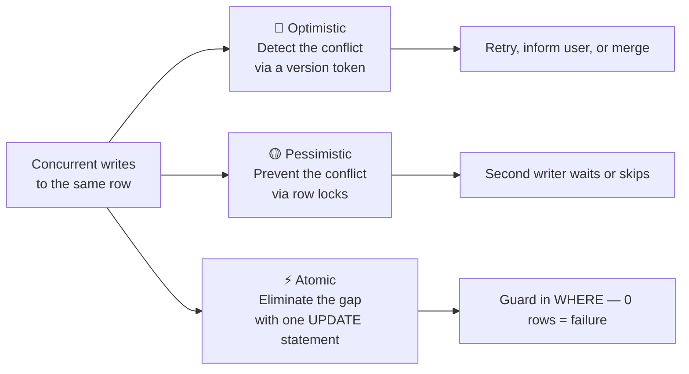

| Strategy | Assumption | Mechanism | Best for |
|---|---|---|---|
| 🔵 Optimistic | Conflicts are **rare** | Version token in the WHERE clause | Human-edited forms, background jobs |
| 🟡 Pessimistic | Conflicts are **frequent** | `FOR UPDATE` row locks | High-contention counters, job queues |
| ⚡ Atomic | The gap can be **eliminated** | Single UPDATE with a guard | Increments, decrements, state transitions |

---

<a name="2-prerequisites"></a>
## 2. Prerequisites

Before starting, make sure you are comfortable with the following:

- **C# and .NET (8 or later)** — async/await, dependency injection, minimal APIs or controllers
- **Entity Framework Core basics** — `DbContext`, entity configuration via `OnModelCreating`, `SaveChangesAsync`, change tracking
- **Basic SQL** — `SELECT`, `UPDATE`, transactions, and `WHERE` clauses
- **A development database** — PostgreSQL (with Npgsql) or SQL Server; the tutorial shows both dialects
- **Optional but recommended:** familiarity with the [Polly](https://www.pollydocs.org) resilience library and the `IDbContextFactory<T>` pattern

### Tools used in this tutorial

| Tool | Version | Purpose |
|---|---|---|
| .NET SDK | 8+ | Runtime and tooling |
| EF Core | 8-10 | Data access (`Microsoft.EntityFrameworkCore`) |
| Npgsql.EntityFrameworkCore.PostgreSQL | 8+ | PostgreSQL provider (`UseXminAsConcurrencyToken`, `FOR UPDATE`) |
| Polly.Core | 8.x | Retry pipelines for conflict handling |
| Testcontainers | latest | Integration testing against a real database |

---

<a name="3-learning-objectives"></a>
## 3. Learning Objectives

By the end of this tutorial, you will be able to:

| # | Objective | Why it matters |
|---|---|---|
| 1 | Explain the lost update problem and why a plain transaction does not prevent it | The failure mode is silent — you cannot fix what you cannot see |
| 2 | Configure optimistic concurrency tokens in EF Core three ways (`xmin`, `rowversion`, manual GUID) | Pick the right token per database and per transport |
| 3 | Send a version token to clients and verify it on write | Protect the full human-editing window, not just milliseconds |
| 4 | Handle `DbUpdateConcurrencyException` with Store Wins, Client Wins, and Field-Level Merge | Each failure needs a deliberate policy, not a default |
| 5 | Retry optimistic conflicts with Polly, re-reading inside every attempt | Automated processes recover without human intervention |
| 6 | Use `FOR UPDATE`, `NOWAIT`, and `SKIP LOCKED` correctly | Pessimistic locking, including database-backed job queues |
| 7 | Replace read-modify-write with `ExecuteUpdateAsync` where possible | Maximum throughput on hot rows with zero retries |
| 8 | Choose the right strategy using a decision framework | Stop guessing; make concurrency a documented design decision |

---

<a name="4-the-lost-update-problem--deep-dive"></a>
## 4. The Lost Update Problem — Deep Dive

### What Happens Without Concurrency Control

Here is the naive update handler that most developers write first:

```csharp
public async Task<Result> Handle(UpdateShipmentRequest request, CancellationToken ct)
{
    // Step 1: Read the current row from the database
    var shipment = await dbContext.Shipments
        .FirstOrDefaultAsync(s => s.Number == request.Number, ct);

    if (shipment is null)
        return Result.NotFound($"Shipment '{request.Number}' not found");

    // Step 2: Modify in memory
    shipment.Address = request.Address;
    shipment.Carrier = request.Carrier;

    // Step 3: Write back to the database
    await dbContext.SaveChangesAsync(ct);
    return Result.Success();
}
```

This is the classic **Read-Modify-Write** pattern. It looks harmless, but there is a dangerous gap between step 1 and step 3.

> 💡 **Analogy:** imagine editing a shared document by printing it, marking changes on paper, then typing the *whole document* back in from your printout. Whoever types last overwrites everything the other person did — even the fields they never touched. That is a lost update.

### The Race Condition — Visualised

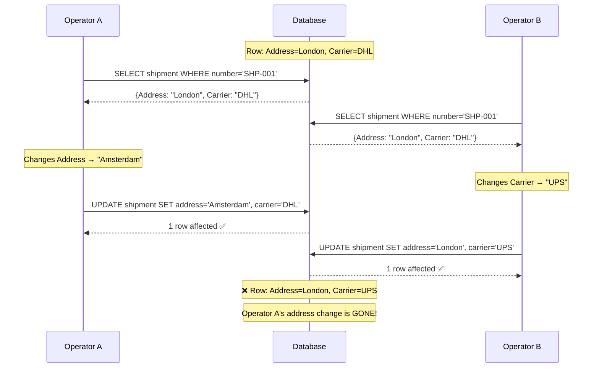

Both operators got a 200 OK. Both updated exactly one row. Neither made a mistake individually. Yet the final state is wrong — Operator A's address change was silently discarded.

### Why a Basic Transaction Doesn't Fix It

Many developers' first instinct is to wrap the handler in a transaction:

```csharp
// ⚠️ This does NOT prevent lost updates
await using var tx = await dbContext.Database.BeginTransactionAsync(ct);
var shipment = await dbContext.Shipments.FirstAsync(...);
shipment.Address = request.Address;
await dbContext.SaveChangesAsync(ct);
await tx.CommitAsync(ct);
```

At the default **Read Committed** isolation level (used by both PostgreSQL and SQL Server), each transaction sees only committed data. Both transactions read the same valid committed row, and both writes succeed. The database did exactly what you asked.

> ⚠️ **Key insight:** the problem is not the transaction. The problem is that **you never told the database the second write depended on the first read being unchanged.** A transaction gives you atomicity (all-or-nothing), not isolation from other writers at Read Committed.

### Isolation Levels — What Actually Changes

| Isolation level | Read Committed | Repeatable Read | Serializable |
|---|---|---|---|
| Two concurrent RMW transactions | ✅ Both succeed — **lost update** | ⚠️ Second write blocks or fails on commit (database-dependent) | ❌ One fails with a serialization error — **must retry anyway** |
| Cost | Lowest | Moderate | Highest, plus retry complexity |
| Verdict | Needs optimistic/pessimistic/atomic control | Rarely worth the coupling | Escalates the same problem to errors |

---

<a name="5-optimistic-concurrency--detect-the-conflict"></a>
## 5. Optimistic Concurrency — Detect the Conflict

### Core Concept

Optimistic concurrency assumes **conflicts are rare**. It lets all requests run at full speed and only checks for a conflict at the moment of writing.

The mechanism is a **concurrency token** — a column whose value changes on every update. The token is read alongside the row data, and the UPDATE carries it in the WHERE clause:

```sql
-- Instead of this (no protection):
UPDATE shipments SET address = @p0, carrier = @p1 WHERE id = @p2;

-- EF Core generates this (with protection):
UPDATE shipments SET address = @p0, carrier = @p1, version = @p2
WHERE id = @p3 AND version = @p4;  -- ← the magic
```

> 💡 **The whole trick in one sentence:** if `version = @p4` does not match what is currently in the database, the UPDATE affects **0 rows**. EF Core sees 0 rows affected and throws `DbUpdateConcurrencyException`.

### Setting Up the Concurrency Token — Three Options

#### Option 1: PostgreSQL `xmin` Column (Zero-Migration Option)

```csharp
// In your DbContext.OnModelCreating
modelBuilder.Entity<Shipment>()
    .UseXminAsConcurrencyToken();
```

**Why use it:** PostgreSQL tracks a transaction ID (`xmin`) on every row automatically. No new column, no migration needed. It is the cheapest option on PostgreSQL.

**Limitation:** `xmin` is PostgreSQL-specific, wraps around over time, and is not practical to send to a client browser. It works beautifully for server-side read-modify-write cycles but not for the stateless HTTP flow shown later in this section.

#### Option 2: SQL Server `rowversion` Column

```csharp
// Entity class
public class Shipment
{
    public Guid Id { get; set; }
    public string Address { get; set; }
    public byte[] RowVersion { get; set; }  // SQL Server manages this
}

// In model configuration
modelBuilder.Entity<Shipment>()
    .Property<byte[]>("RowVersion")
    .IsRowVersion();
```

**Why use it:** SQL Server maintains the `rowversion` automatically on every update. You never assign it in code.

**Limitation:** `byte[]`/`timestamp` is awkward to serialize for browser clients, and it is SQL Server-only. Great for service-to-service writes inside one database.

#### Option 3: Manual GUID Token (Best for Web APIs)

```csharp
// Entity class
public class Shipment
{
    public Guid Id { get; set; }
    public string Number { get; set; }
    public string Address { get; set; }
    public string Carrier { get; set; }
    public Guid Version { get; set; }  // ← our concurrency token
}

// In model configuration
modelBuilder.Entity<Shipment>()
    .Property(s => s.Version)
    .IsConcurrencyToken();
```

Then, automatically rotate the token on every save using a `DbContext` override:

```csharp
public class AppDbContext : DbContext
{
    public override Task<int> SaveChangesAsync(CancellationToken ct = default)
    {
        // Auto-rotate the version token before every save
        var entries = ChangeTracker.Entries<Shipment>()
            .Where(e => e.State is EntityState.Added or EntityState.Modified);

        foreach (var entry in entries)
        {
            entry.Entity.Version = Guid.NewGuid();
        }

        return base.SaveChangesAsync(ct);
    }
}
```

**Why this is best for web APIs:** a GUID is a plain value that can be serialised to JSON, sent to the browser, and returned in the next request — surviving the stateless HTTP boundary. It also works on **any** database, so you can switch providers without redesigning your concurrency strategy.

### Token Options Compared

| | `xmin` (PostgreSQL) | `rowversion` (SQL Server) | Manual GUID |
|---|---|---|---|
| **Migration needed** | ❌ None | ✅ New column | ✅ New column + backfill |
| **Database portability** | PostgreSQL only | SQL Server only | ✅ Any |
| **Survives HTTP round-trip** | ⚠️ Impractical | ⚠️ `byte[]` is awkward | ✅ Plain JSON value |
| **Maintenance** | Automatic | Automatic | You rotate it (one override) |
| **Best for** | Server-side RMW on Postgres | Service-to-service on SQL Server | Stateless web APIs |

### The Complete Web API Flow

For a stateless web API, the version token **must travel to the client and back**. Here is the complete flow:

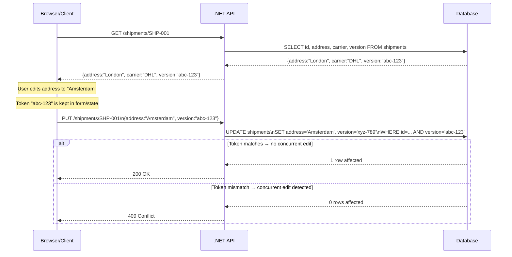

The DTOs that carry the version token:

```csharp
// Response — includes the version token for the client to store
public sealed record ShipmentResponse(
    string Number,
    string Address,
    string Carrier,
    string Version);     // ← sent to client

// Request — client returns the token it received
public sealed record UpdateShipmentRequest(
    string Number,
    string Address,
    string Carrier,
    string Version);     // ← client sends back
```

The update handler with proper version handling:

```csharp
public async Task<Result> Handle(UpdateShipmentRequest request, CancellationToken ct)
{
    var shipment = await dbContext.Shipments
        .FirstOrDefaultAsync(s => s.Number == request.Number, ct);

    if (shipment is null)
        return Result.NotFound($"Shipment '{request.Number}' not found");

    // ⚠️ Critical: use the CLIENT'S version, not the one we just read.
    // This checks the gap between when the user opened the form and now.
    dbContext.Entry(shipment)
        .Property(s => s.Version)
        .OriginalValue = Guid.Parse(request.Version);

    shipment.Address = request.Address;
    shipment.Carrier = request.Carrier;

    await dbContext.SaveChangesAsync(ct);  // throws if version mismatch
    return Result.Success();
}
```

> **Why set `OriginalValue`?** Without this line, EF Core compares the version against what it read milliseconds ago — a tiny window. Setting `OriginalValue` to the client's version means you check the full window from when the user opened the form (potentially minutes ago) to now. That is the window where another user could have made changes.

### How the Conflict Is Now Detected

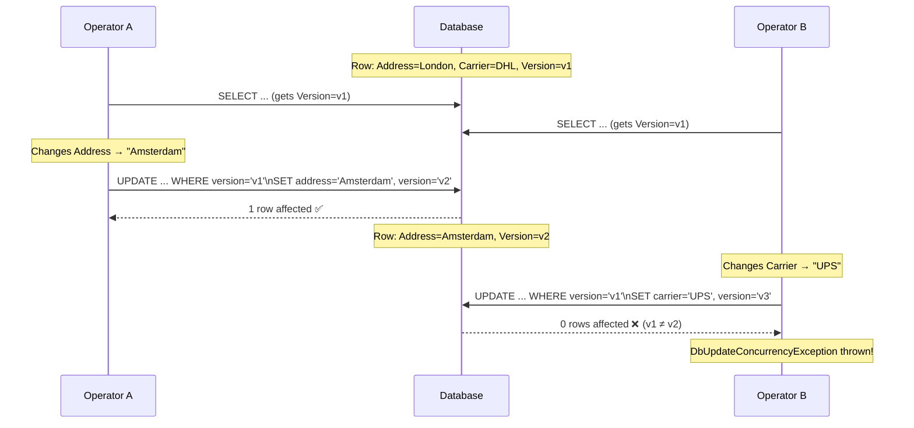

> ✅ **Aha moment:** the token turned a silent data corruption into a loud, catchable exception. Nothing was overwritten — Operator B now *knows* the row moved under them and can decide what to do (Section 6).

---

<a name="6-handling-dbupdateconcurrencyexception"></a>
## 6. Handling DbUpdateConcurrencyException

Catching the exception is only the beginning. You have three distinct strategies for what to do next.

```csharp
try
{
    await dbContext.SaveChangesAsync(ct);
    return Result.Success();
}
catch (DbUpdateConcurrencyException ex)
{
    var entry = ex.Entries.Single();
    var databaseValues = await entry.GetDatabaseValuesAsync(ct);

    if (databaseValues is null)
        return Result.Conflict("The shipment was deleted by another user.");

    // Choose one of the three strategies below...
}
```

### Strategy 1: Store Wins (Safest Default)

Discard the user's edit and return the latest data from the database:

```csharp
// Strategy 1: Store Wins
await entry.ReloadAsync(ct);
return Result.Conflict(
    "This shipment was changed by another user. " +
    "Please review the current values and try again.");
```

**When to use:** any human-edited form. The user gets a clear message and can see the current state before retrying their edit.

**Real example:** a customer changes their billing address. Another admin changed it first. The customer sees the admin's version and can decide whether their change is still needed.

### Strategy 2: Client Wins (Force Through)

Overwrite whatever is in the database with the user's values:

```csharp
// Strategy 2: Client Wins
entry.OriginalValues.SetValues(databaseValues); // refresh the token
await dbContext.SaveChangesAsync(ct);           // now the WHERE matches
```

**When to use:** authoritative imports or system processes that must win — for example, a nightly sync job that pulls the canonical record from an ERP system.

> ⚠️ **Warning:** this silently discards the other user's change. Only use it when the caller is explicitly authoritative.

### Strategy 3: Field-Level Merge (Most Sophisticated)

Keep the fields the current user actually changed; take the rest from the database:

```csharp
// Strategy 3: Merge — only keep fields this user changed
var currentValues = entry.CurrentValues;

foreach (var property in currentValues.Properties)
{
    var proposedValue  = currentValues[property];          // what this user wants
    var originalValue  = entry.OriginalValues[property];   // what they saw when they opened the form
    var databaseValue  = databaseValues[property];         // what is in the DB right now

    // If this user did not change this field, take the DB version
    if (Equals(proposedValue, originalValue))
        currentValues[property] = databaseValue;
    // Otherwise, keep this user's change
}

entry.OriginalValues.SetValues(databaseValues); // refresh the token
await dbContext.SaveChangesAsync(ct);
```

**When to use:** large forms with many independent fields where two users are likely editing different sections simultaneously. For example, in a product catalogue form, one user edits the description while another edits the price — both changes can be preserved.

### Choosing Between the Three Strategies

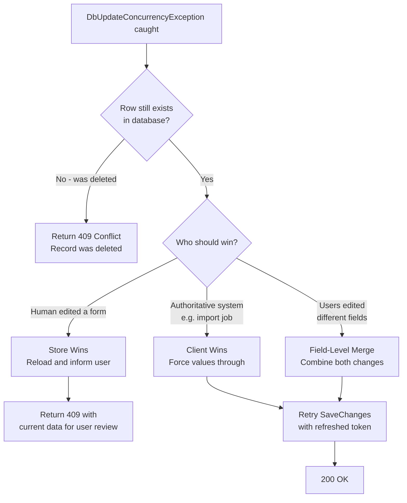

| Strategy | Who wins | Data loss risk | Typical caller |
|---|---|---|---|
| Store Wins | Database | The current user's edit (recoverable — they can re-apply) | Human forms (default) |
| Client Wins | Caller | The other writer's change (silent!) | Authoritative imports, sync jobs |
| Field-Level Merge | Both | Only if both changed the *same* field | Large multi-field forms |

> 💡 **Merge caveat:** if both users changed the *same* field, the merge keeps the current user's value — the other edit to that specific field is lost. Merge preserves changes, not intent. Consider surfacing a warning when a same-field collision is detected during merge.

---

<a name="7-retrying-conflicts-with-polly"></a>
## 7. Retrying Conflicts with Polly

### When Retries Make Sense

For **background jobs** and automated processes — where no human is waiting — a concurrency conflict is just a transient failure. The correct response is to re-read the row and repeat the work.

This is a classic use case for [Polly](https://github.com/App-vNext/Polly), the .NET resilience library.

### Setting Up the Retry Pipeline

```powershell
# Install: dotnet add package Polly.Core
# Install: dotnet add package Microsoft.Extensions.Http.Resilience
```

```csharp
var pipeline = new ResiliencePipelineBuilder()
    .AddRetry(new RetryStrategyOptions
    {
        ShouldHandle = new PredicateBuilder()
            .Handle<DbUpdateConcurrencyException>(),
        MaxRetryAttempts = 3,
        Delay = TimeSpan.FromMilliseconds(20),
        BackoffType = DelayBackoffType.Exponential, // 20ms, 40ms, 80ms
        UseJitter = true  // adds random ±25% to prevent synchronized retries
    })
    .Build();
```

> **Why `UseJitter`?** Without jitter, multiple workers that all collide on the same row at the same time will all back off for the same delay and collide again on the next attempt. Jitter spreads them out randomly, dramatically reducing the chance of repeated collisions.

### Wrapping the Full Read-Modify-Write

```csharp
await pipeline.ExecuteAsync(async token =>
{
    // ⚠️ Must create a FRESH DbContext on each attempt!
    await using var dbContext = await dbContextFactory.CreateDbContextAsync(token);

    var shipment = await dbContext.Shipments
        .FirstAsync(s => s.Number == number, token);

    // Apply the business logic
    shipment.Status = ShipmentStatus.Dispatched;
    shipment.DispatchedAtUtc = DateTime.UtcNow;

    await dbContext.SaveChangesAsync(token);
}, ct);
```

> **Critical:** the entire read-modify-write must be inside the retry callback. If you only retry `SaveChangesAsync`, you send the same stale token every time and fail every attempt for the same reason. **Each retry must re-read the row.**

> **Why a new DbContext per attempt?** A DbContext that has thrown an exception still holds the failed entity in its change tracker with its stale, original values. Reusing it is a subtle bug that makes every retry fail identically. The `IDbContextFactory<T>` pattern is the standard solution for background services.

### Retry Flow Diagram

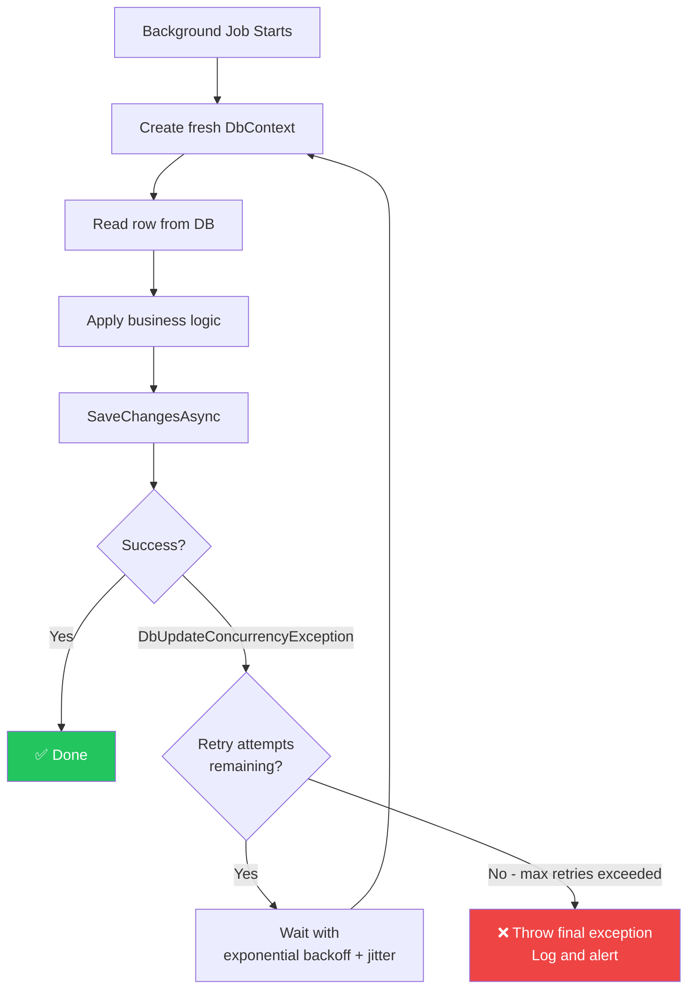

### Retry Tuning Guide

| Parameter | Recommended | Reasoning |
|---|---|---|
| `MaxRetryAttempts` | 2-3 | More retries on a genuinely hot row just amplify contention — escalate to pessimistic or atomic instead |
| `Delay` + `BackoffType` | 20ms exponential | Conflicts resolve in milliseconds once the other transaction commits |
| `UseJitter` | `true` (always) | Prevents synchronized retry storms from parallel workers |
| `ShouldHandle` | Only `DbUpdateConcurrencyException` | Retrying transient network errors is a *different* pipeline with different policy |
| Scope | Whole read-modify-write | Never wrap only `SaveChangesAsync` |

---

<a name="8-pessimistic-concurrency--lock-the-row-first"></a>
## 8. Pessimistic Concurrency — Lock the Row First

### Core Concept

Pessimistic concurrency starts from the opposite assumption: **conflicts are expected**.

Instead of detecting a conflict after the write, pessimistic concurrency prevents the second writer from even reading stale data. The first transaction **locks the row**, and every other writer waits their turn.

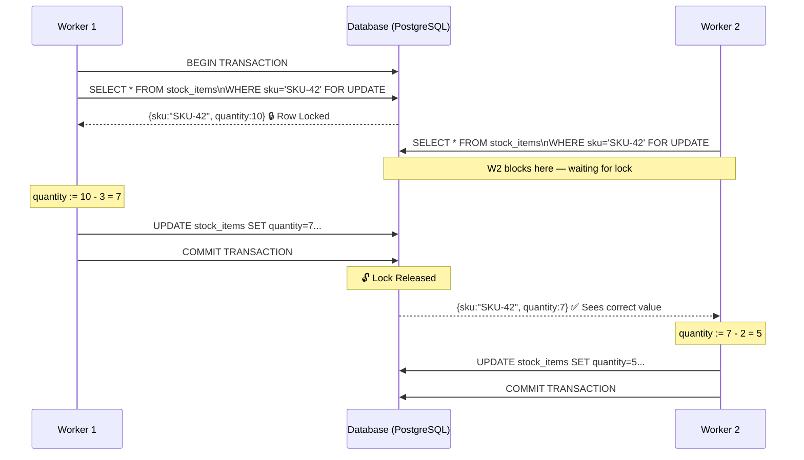

### When to Use Pessimistic Locking

The classic use case: a **counter under high contention**. Consider stock inventory during a flash sale:

- Hundreds of requests per second try to decrement the same SKU's quantity
- With optimistic concurrency, most would lose the race and retry — and those retries themselves would mostly lose and retry again
- This creates an avalanche of wasted work
- Pessimistic locking turns it into an orderly queue

### PostgreSQL Implementation with `FOR UPDATE`

```csharp
public async Task<Result> Handle(ReserveStockRequest request, CancellationToken ct)
{
    // Start a transaction — the lock is held until commit or rollback
    await using var transaction = await dbContext.Database.BeginTransactionAsync(ct);

    // Set a lock timeout (optional but recommended)
    await dbContext.Database.ExecuteSqlRawAsync("SET LOCAL lock_timeout = '3s'", ct);

    // FOR UPDATE acquires a row-level exclusive lock
    var stockItem = await dbContext.StockItems
        .FromSql($"SELECT * FROM stock_items WHERE sku = {request.Sku} FOR UPDATE")
        .SingleAsync(ct);

    if (stockItem.Quantity < request.Quantity)
    {
        await transaction.RollbackAsync(ct);
        return Result.Conflict($"Not enough stock for SKU '{request.Sku}'");
    }

    stockItem.Quantity -= request.Quantity;
    await dbContext.SaveChangesAsync(ct);
    await transaction.CommitAsync(ct);

    return Result.Success();
}
```

> **Injection Safety:** the interpolated `{request.Sku}` in `FromSql` is converted to a real SQL parameter — it is NOT string concatenation. EF Core's interpolated `FromSql` uses parameterisation safely (see [Security Considerations](#16-security-considerations)).

### SQL Server Equivalent

```csharp
// SQL Server uses locking hints instead of FOR UPDATE
var stockItem = await dbContext.StockItems
    .FromSqlRaw(
        "SELECT * FROM StockItems WITH (UPDLOCK, ROWLOCK) WHERE Sku = @sku",
        new SqlParameter("@sku", request.Sku))
    .SingleAsync(ct);
```

> 💡 **Note on SQL Server:** you will usually also want `HOLDLOCK`/`SERIALIZABLE` semantics for true reservation checks (`UPDLOCK, HOLDLOCK, ROWLOCK`) — otherwise a read-then-insert race can still slip through. PostgreSQL's `FOR UPDATE` blocks on existing rows only; `SERIALIZABLE` or `INSERT ... ON CONFLICT` patterns are the answer when the row may not exist yet.

### Advanced: `FOR UPDATE SKIP LOCKED` — Building a Job Queue

One of the most powerful applications of pessimistic locking is implementing a work queue directly on a database table. Multiple workers can poll the same table without stepping on each other:

```csharp
public async Task<List<ShipmentJob>> ClaimNextBatch(int batchSize, CancellationToken ct)
{
    await using var transaction = await dbContext.Database.BeginTransactionAsync(ct);

    // Each worker gets a DIFFERENT batch — no waiting, no duplicate processing
    var jobs = await dbContext.ShipmentJobs
        .FromSql($"""
            SELECT * FROM shipment_jobs
            WHERE status = 'Pending'
            ORDER BY created_at
            LIMIT {batchSize}
            FOR UPDATE SKIP LOCKED
            """)
        .ToListAsync(ct);

    // Mark as claimed so no other worker picks them up
    foreach (var job in jobs)
        job.Status = "Processing";

    await dbContext.SaveChangesAsync(ct);
    await transaction.CommitAsync(ct);

    return jobs;
}
```

**How `SKIP LOCKED` works:**

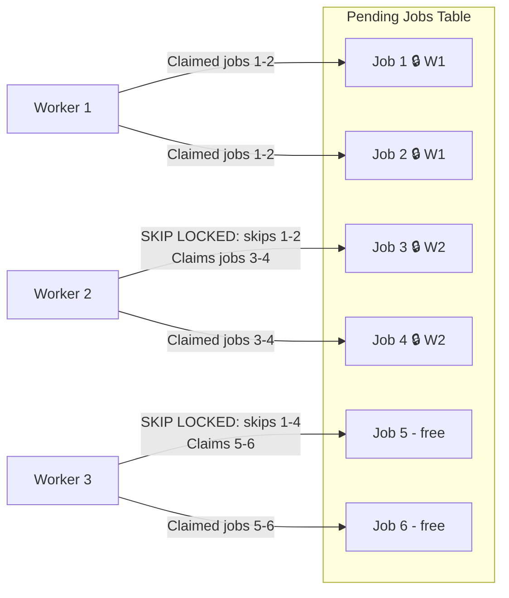

Workers never block each other. This is the foundation of the **Transactional Outbox pattern** (see [Use Case 4](#12-real-world-use-cases)).

### Lock Variants — Choosing the Right One

| Variant | Behaviour | Use Case |
|---|---|---|
| `FOR UPDATE` | Waits until lock is available | Default — orderly queue |
| `FOR UPDATE NOWAIT` | Immediately fails with error `55P03` | Fast rejection preferred over slow success |
| `FOR UPDATE SKIP LOCKED` | Skips locked rows, gets next available | Worker queues, outbox pattern |

### The Real Costs of Pessimistic Locking

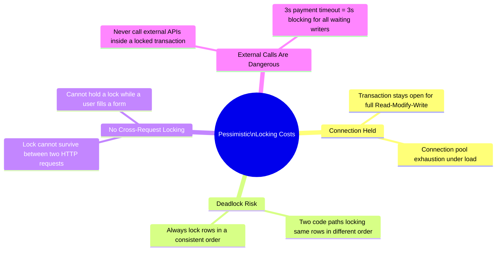

> ⚠️ **The most common production incident from this section:** a developer adds `FOR UPDATE`, everything works in testing, then under load the connection pool fills with blocked transactions and the whole API stalls. The lock is only as short as the work you do while holding it — keep transactions tight and external calls outside.

---

<a name="9-the-third-option-atomic-statements"></a>
## 9. The Third Option: Atomic Statements

### The Insight

Both optimistic and pessimistic concurrency exist because of the **gap** between reading a value and writing it back. What if you eliminated the gap entirely?

For operations where the new value is a **function of the old value** (increment, decrement, toggle, status transition), you can do it in a single SQL statement:

```sql
-- Instead of: read quantity (10), compute 10-3=7, write 7
-- Do: compute and write in one atomic statement
UPDATE stock_items
SET quantity = quantity - 3
WHERE sku = 'SKU-42' AND quantity >= 3;
```

The database locks the row for the microsecond it takes to compute and write. No explicit transaction needed, no conflict possible.

> 💡 **Analogy:** optimistic and pessimistic concurrency are two ways to manage a shared whiteboard. An atomic statement takes the whiteboard away and installs a calculator instead — nobody reads and rewrites a number; they just tell the calculator *"minus 3"* and it does the work in place.

### EF Core `ExecuteUpdateAsync`

```csharp
public async Task<Result> Handle(ReserveStockRequest request, CancellationToken ct)
{
    var affected = await dbContext.StockItems
        .Where(s => s.Sku == request.Sku
                 && s.Quantity >= request.Quantity)  // ← guard condition
        .ExecuteUpdateAsync(
            s => s.SetProperty(
                x => x.Quantity,
                x => x.Quantity - request.Quantity), // ← computed from old value
            ct);

    if (affected == 0)
        return Result.Conflict($"Not enough stock for SKU '{request.Sku}'");

    return Result.Success();
}
```

This generates:

```sql
UPDATE stock_items
SET quantity = quantity - @p0
WHERE sku = @p1 AND quantity >= @p2;
```

One round trip. No entity loaded. No retry logic. Maximum throughput.

### When Each Approach Applies

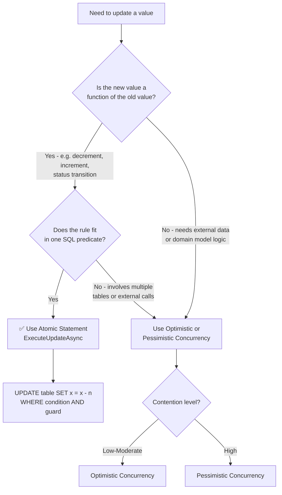

### Important Caveat: What `ExecuteUpdateAsync` Bypasses

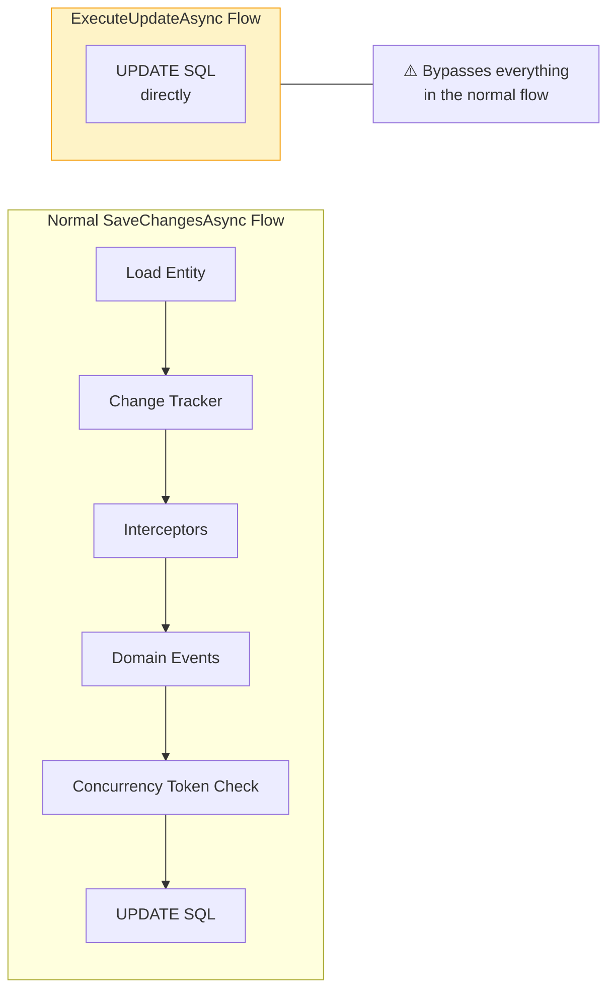

If you rely on domain events, audit interceptors, or automatic concurrency token rotation, `ExecuteUpdateAsync` will bypass all of them. The guard in `WHERE` is your only safety net.

---

<a name="10-deep-comparison--side-by-side"></a>
## 10. Deep Comparison — Side by Side

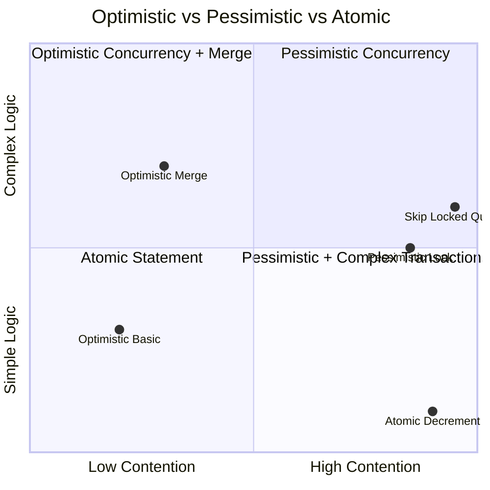

| Criteria | Optimistic | Pessimistic | Atomic |
|---|---|---|---|
| **Conflict handling** | Detects after the write | Prevents via locking | Impossible by design |
| **Best contention level** | Low to moderate | High | Any — best for hot rows |
| **Throughput** | High (no waits), degrades under conflict | Predictable ceiling | Maximum possible |
| **Failure mode** | Exception to handle | Wait, timeout, or deadlock | 0 rows affected |
| **Deadlock risk** | None | Real — lock ordering required | None |
| **Transaction duration** | Short (just the save) | Full read-modify-write | Single statement |
| **Works across HTTP requests** | ✅ Yes — token travels to client | ❌ No — lock cannot span requests | N/A |
| **EF Core native support** | ✅ First-class via tokens | ❌ Requires raw SQL | ✅ `ExecuteUpdateAsync` |
| **Works across microservices** | ✅ Yes — token is just a value | ⚠️ Only with shared DB | ✅ Isolated |
| **Complexity** | Medium — token + conflict handlers | Medium — raw SQL + timeouts | Low |
| **Domain model bypass** | No | No | ⚠️ Yes — bypasses Change Tracker |

---

<a name="11-how-to-choose-a-decision-framework"></a>
## 11. How to Choose: A Decision Framework

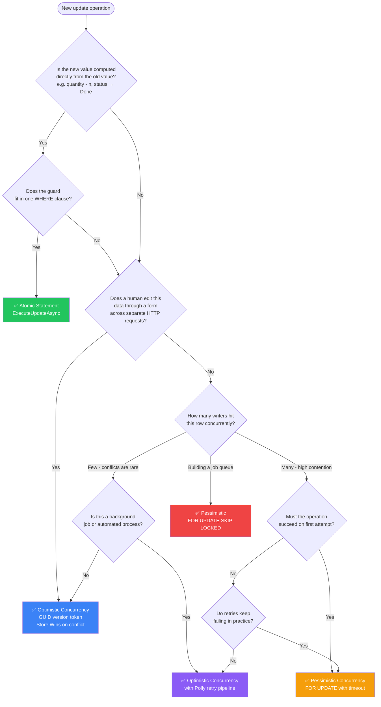

### Red Flags That Tell You the Wrong Strategy Is in Place

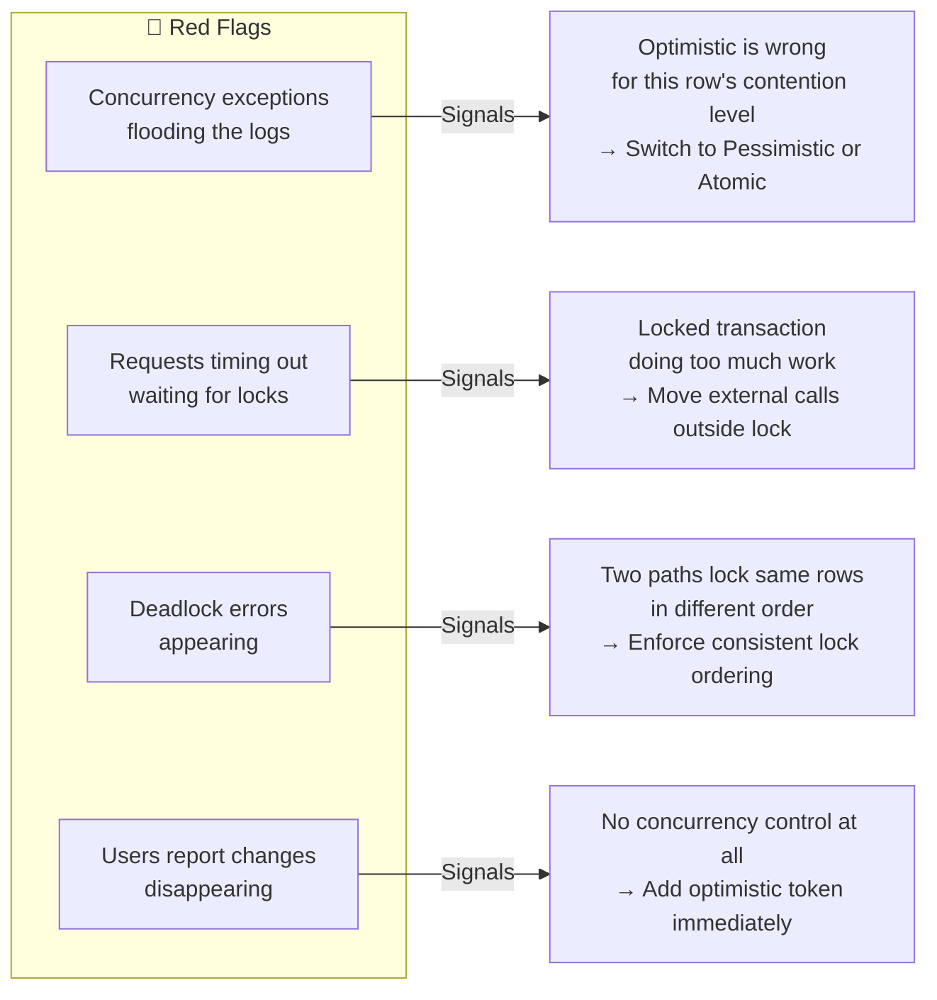

| Symptom in production | Most likely root cause | First fix to try |
|---|---|---|
| `DbUpdateConcurrencyException` spike after a feature release | A hot row moved from a form to automated writers | Atomic statement or `FOR UPDATE` on that specific path |
| Requests pile up with 3s+ latency on one endpoint | `lock_timeout` missing or lock held too long | Shorten the transaction, add `lock_timeout`, alert on waits |
| Deadlocks on two endpoints only | Inconsistent lock ordering between their code paths | Canonical lock order (alphabetical table, ascending PK) |
| Support tickets: "my edit disappeared" | No token in the PUT payload / no 409 handling | Ship the GUID token end-to-end (Pitfall 3) |

---

<a name="12-real-world-use-cases"></a>
## 12. Real-World Use Cases

### Use Case 1: E-Commerce Checkout — Inventory Reservation

**Scenario:** Black Friday. 1,000 users trying to buy the last 10 units of a product simultaneously.

**Problem with Optimistic:** 990 out of 1,000 writes fail. Each triggers a retry. The retries mostly also fail. The database is flooded with failed writes.

**Solution:**

```csharp
// Atomic statement — maximum throughput, no wasted work
var affected = await dbContext.Products
    .Where(p => p.Id == productId && p.StockQuantity >= orderQuantity)
    .ExecuteUpdateAsync(
        s => s.SetProperty(p => p.StockQuantity, p => p.StockQuantity - orderQuantity),
        ct);

if (affected == 0)
    return Result.OutOfStock("This item is no longer available");
```

**Why this wins here:** the check (*enough stock?*) and the write (*decrement*) are the same predicate — the perfect atomic-statement shape. All 1,000 requests each perform one UPDATE; the first 10 succeed, the rest get a clean out-of-stock response with zero retries.

### Use Case 2: Document Editing — Multi-Author Forms

**Scenario:** Two users open the same contract document. Alice edits the title. Bob edits the payment terms. Both should get their changes.

**Solution:** Optimistic with field-level merge.

```csharp
// On GET: return the document with its version token
// On PUT: detect conflict and merge at field level

catch (DbUpdateConcurrencyException ex)
{
    var entry = ex.Entries.Single();
    var dbValues = await entry.GetDatabaseValuesAsync(ct);

    // Keep changes the user actually made; take DB values for fields they did not touch
    foreach (var prop in entry.CurrentValues.Properties)
    {
        if (!Equals(entry.CurrentValues[prop], entry.OriginalValues[prop]))
            continue; // user changed this field — keep their value

        entry.CurrentValues[prop] = dbValues[prop]; // user did not change — use DB value
    }

    entry.OriginalValues.SetValues(dbValues);
    await dbContext.SaveChangesAsync(ct); // succeeds with merged values
}
```

### Use Case 3: Order Status Machine — Status Transitions

**Scenario:** An order can go from `Pending → Confirmed → Dispatched`. A background job confirms orders; another dispatches them. They must not double-process.

**Solution:** Atomic statement with state guard.

```csharp
// Confirm: Pending → Confirmed (only if still Pending)
var confirmed = await dbContext.Orders
    .Where(o => o.Id == orderId && o.Status == OrderStatus.Pending)
    .ExecuteUpdateAsync(s => s
        .SetProperty(o => o.Status, OrderStatus.Confirmed)
        .SetProperty(o => o.ConfirmedAt, DateTime.UtcNow),
        ct);

if (confirmed == 0)
    return Result.Conflict("Order is no longer in Pending state");
```

### Use Case 4: Outbox Pattern — Reliable Message Publishing

**Scenario:** After saving domain events to an outbox table, multiple service instances each try to pick up and publish pending messages. Messages must be published exactly once.

**Solution:** `FOR UPDATE SKIP LOCKED`

```csharp
public async Task<List<OutboxMessage>> ClaimMessages(int batchSize, CancellationToken ct)
{
    await using var tx = await dbContext.Database.BeginTransactionAsync(ct);

    var messages = await dbContext.OutboxMessages
        .FromSql($"""
            SELECT * FROM outbox_messages
            WHERE processed_at IS NULL
            ORDER BY created_at
            LIMIT {batchSize}
            FOR UPDATE SKIP LOCKED
            """)
        .ToListAsync(ct);

    foreach (var msg in messages)
        msg.ClaimedAt = DateTime.UtcNow;

    await dbContext.SaveChangesAsync(ct);
    await tx.CommitAsync(ct);

    return messages; // publish these, then mark processed_at
}
```

### Use Case 5: Seat Booking — Airlines and Cinemas

**Scenario:** Seat 14A is available. Two users simultaneously try to book it. Only one should succeed.

**Solution:** Optimistic concurrency with a unique constraint as backup.

```csharp
// The seat has a version token
// First user to write wins; second gets DbUpdateConcurrencyException

catch (DbUpdateConcurrencyException)
{
    await entry.ReloadAsync(ct);
    return Result.Conflict("This seat was just taken. Please choose another seat.");
}
```

> 💡 **Defense in depth:** a unique constraint on `(flight_id, seat_number)` makes double-booking *impossible* at the database level, even if a code path forgets the token. The token gives a friendly 409; the constraint is the last line of defence.

---

<a name="13-best-practices"></a>
## 13. Best Practices

### Design

1. **Give every writable aggregate a concurrency token.** Decide per entity, not per query. If two writers can touch it, it needs a token, a lock, or an atomic update path.
2. **Choose the token per transport, not per database.** Server-side cycles can use `xmin`/`rowversion`; anything crossing an HTTP boundary needs a plain GUID or integer token.
3. **Prefer the atomic statement first.** When the new value is a function of the old value, `ExecuteUpdateAsync` with a guard beats both other strategies on throughput *and* simplicity.
4. **Make conflict policy explicit per caller.** Forms get Store Wins; authoritative jobs get Client Wins; multi-field forms get merge. Document the choice next to the handler.
5. **Fail fast on lock waits.** Set `lock_timeout` (PostgreSQL) or appropriate query timeouts (SQL Server) so a stuck lock becomes an error, not a cascading pool exhaustion.

### Implementation

6. **Rotate the token centrally** — a `SaveChangesAsync` override or `SaveChangesInterceptor`, never scattered through handlers.
7. **Always set `OriginalValue` from the client's token** in API PUT handlers; otherwise you only protect the milliseconds inside the handler.
8. **Wrap the whole read-modify-write in the Polly pipeline** and create a fresh `DbContext` per attempt via `IDbContextFactory<T>`.
9. **Keep pessimistic transactions tight.** No external calls, no long computations, no `await` on unrelated work between `FOR UPDATE` and commit.
10. **Lock in a canonical order.** Alphabetical by table name or ascending primary key — everywhere, without exception.
11. **Return 409, not 500.** `DbUpdateConcurrencyException` is a client-resolvable condition; map it deliberately in your error middleware.

### Operations

12. **Alert on conflict rates and lock waits** (e.g., `pg_stat_database.deadlocks`, `pg_locks`, EF exception metrics). Rising conflict rates are the signal to switch strategies.
13. **Load-test the hot paths** with realistic concurrency (see [Testing Strategies](#17-testing-strategies)) before Black Friday, not during it.
14. **Log the conflict context** — entity key, both tokens, and the strategy taken. Silent merges are untraceable without this.

### Anti-Patterns and Common Pitfalls

<a name="14-anti-patterns-and-common-pitfalls"></a>
## 14. Anti-Patterns and Common Pitfalls

### ❌ Anti-Pattern 1: Retrying Only `SaveChangesAsync`

```csharp
// ❌ WRONG — retries with the same stale token every time
for (int i = 0; i < 3; i++)
{
    try
    {
        await dbContext.SaveChangesAsync(ct); // always fails with same stale token
        break;
    }
    catch (DbUpdateConcurrencyException) { }
}

// ✅ CORRECT — retry the entire read-modify-write
await pipeline.ExecuteAsync(async token =>
{
    await using var ctx = await dbContextFactory.CreateDbContextAsync(token);
    var entity = await ctx.Set<Shipment>().FirstAsync(...);
    // modify
    await ctx.SaveChangesAsync(token);
}, ct);
```

**Why it fails:** the token was read *before* the loop. Retrying the save re-sends the identical WHERE clause; the row has not changed since the last attempt, so every attempt fails identically — with the change tracker now holding stale state.

### ❌ Anti-Pattern 2: Calling External APIs Inside a Lock

```csharp
// ❌ WRONG — payment call can take 3-10 seconds, blocking all other writers
await using var tx = await dbContext.Database.BeginTransactionAsync(ct);
var order = await dbContext.Orders
    .FromSql($"SELECT * FROM orders WHERE id = {orderId} FOR UPDATE")
    .SingleAsync(ct);

var payment = await paymentProvider.ChargeAsync(order);  // ⚠️ 3-10 second wait!

order.Status = OrderStatus.Paid;
await dbContext.SaveChangesAsync(ct);
await tx.CommitAsync(ct);

// ✅ CORRECT — do the external call outside the lock
var lockResult = await ReserveOrder(orderId);              // short lock
var payment = await paymentProvider.ChargeAsync(lockResult); // external call outside
await FinalizeOrder(orderId, payment);                      // short lock to update
```

**Why it fails:** every other writer of that row queues behind your payment gateway. A 5-second provider outage becomes 5 seconds of blocked database connections, then pool exhaustion, then a site-wide outage.

### ❌ Anti-Pattern 3: Not Sending the Version Token to the Client

```csharp
// ❌ WRONG — version not in response; client cannot return it
public record ShipmentResponse(string Number, string Address, string Carrier);

// This check only covers milliseconds between the GET and PUT handlers.
// It does NOT protect the minutes the user spent editing the form.

// ✅ CORRECT — always include the version in the response
public record ShipmentResponse(string Number, string Address, string Carrier, string Version);
```

**Why it fails:** the token you compare against is the one *your handler just read*. Two clients that GET before either PUTs still both send matching tokens — the race survives. The token must originate from when the user *saw the data*.

### ❌ Anti-Pattern 4: Taking Locks in Inconsistent Order

```csharp
// ❌ WRONG — potential deadlock if both execute concurrently
// Handler A: locks Order first, then Payment
var order = await LockRow<Order>(orderId);
var payment = await LockRow<Payment>(paymentId);

// Handler B: locks Payment first, then Order
var payment = await LockRow<Payment>(paymentId); // ← deadlock!
var order = await LockRow<Order>(orderId);

// ✅ CORRECT — always lock in the same canonical order
// e.g., always lock by table name alphabetically, or by primary key ascending
var order   = await LockRow<Order>(orderId);    // always first
var payment = await LockRow<Payment>(paymentId); // always second
```

### ❌ Anti-Pattern 5: Swallowing the Exception

```csharp
// ❌ WRONG — the write was silently dropped; nobody ever knows
catch (DbUpdateConcurrencyException)
{
    return Result.Success(); // "it probably worked"
}
```

**Why it fails:** the exception means 0 rows were affected — the user's change is gone. Swallowing it converts a detectable conflict back into silent data corruption, now *with* a false success response.

### ❌ Anti-Pattern 6: Holding a Lock Across an HTTP Request

```csharp
// ❌ WRONG — the transaction/lock cannot survive until the next request arrives
public IActionResult StartEdit()   // request 1: BEGIN + FOR UPDATE, never commits
{
    _tx = await dbContext.Database.BeginTransactionAsync(ct);
    /* FOR UPDATE ... */
    return Ok();
}

public IActionResult SaveEdit()    // request 2 (minutes later): deadlocks everything
```

**Why it fails:** locks live on a *connection*; HTTP requests do not. Use the optimistic token to carry the reservation across requests — that is precisely what it exists for.

---

<a name="15-performance-considerations"></a>
## 15. Performance Considerations

### Relative Throughput Characteristics

| Strategy | Round trips per update | Waits under conflict | Notes |
|---|---|---|---|
| Optimistic | 2 (SELECT + UPDATE) | None — conflicts fail fast | Best average latency when conflicts < ~10% |
| Pessimistic | 3+ (BEGIN, SELECT...FOR UPDATE, UPDATE, COMMIT) | Second writer blocks for the whole first transaction | Throughput ceiling = transaction duration |
| Atomic | 1 | Microsecond row lock | The benchmark winner wherever applicable |

### Where the Costs Actually Are

1. **Optimistic retries amplify load.** Under contention *c* and *r* retries, total write volume multiplies roughly by (1+c)^r. At 40% conflicts with 3 retries you are doing ~2.7x the write work — retries are not free, they are load.
2. **Pessimistic locking holds a pooled connection** for the whole read-modify-write. With pool size 100 and 150 concurrent users on the same hot path, you starve unrelated endpoints. Keep the locked section as small as possible.
3. **Index the lock/guard predicate.** `SELECT ... WHERE sku = @sku FOR UPDATE` must hit an index; a sequential scan under `FOR UPDATE` can lock far more rows (and pages) than you intended.
4. **`ExecuteUpdateAsync` avoids materialising entities** — no change-tracker allocations, no entity hydration. On bulk operations (thousands of rows) it is an order of magnitude faster than load-modify-save.
5. **Conflict-rate telemetry beats theory.** Instrument `DbUpdateConcurrencyException` counts per endpoint. Under 1%: optimistic is fine. Sustained 10%+: move that specific operation to atomic or pessimistic.
6. **Batch queue claims.** `SKIP LOCKED` with `LIMIT 50` amortises transaction overhead across 50 jobs instead of one; do not claim a single job per transaction.
7. **Keep tokens small on the wire.** A GUID (36 chars) is fine; returning a full `rowversion` byte[] as base64 also works, but avoid serialising `xmin` (wraps around; misleads clients after wraparound).

### 🚫 Performance anti-combos

- Pessimistic lock + chatty ORM lazy loading → dozens of queries while holding the lock
- Optimistic token + `foreach` loop saving one row at a time → N conflict checks where one atomic batch would do
- `lock_timeout` unset + retry storms → timeouts that look like outages

---

<a name="16-security-considerations"></a>
## 16. Security Considerations

1. **SQL injection in `FromSql`/`FromSqlRaw`.** Interpolated `FromSql($"... {x} ...")` is parameterised — safe. `FromSqlRaw` with string concatenation is **not**. In this tutorial's pessimistic examples, `Sku` and `batchSize` travel as parameters. Never build `rawSql = $"... {userInput} ..."` for `FromSqlRaw`; the `FOR UPDATE` clause is attacker-invisible surface if you do.
2. **Validate the version token from the client.** `Guid.Parse(request.Version)` throws on malformed input — return 400, not 500. Treat the token as untrusted input: it must never be used in string-built SQL (see point 1).
3. **Authorization still applies to conflicts.** A 409 that echoes full database values can leak data the caller may not be allowed to see. Only return fields the caller is authorized to read; for Store Wins, prefer reloading through the normal authorized query path.
4. **`lock_timeout` is a DoS mitigation, not just hygiene.** Without it, one attacker spamming requests against a hot row pins connections and starves the pool. A bounded lock timeout converts abuse into fast 4xx/5xx responses.
5. **Least-privilege DB roles.** Locking commands (`FOR UPDATE`, `SET LOCAL lock_timeout`) require only normal DML privileges — do not grant superuser to the app to "make locking work".
6. **Audit merged writes.** Field-level merge silently combines two users' changes. Log original, proposed, and final values for merged saves so an auditor (or a forensic review) can reconstruct what happened.
7. **Information in concurrency errors.** Do not include SQL, table names, or provider error details in the 409 response body. Keep diagnostics server-side.

---

<a name="17-testing-strategies"></a>
## 17. Testing Strategies

Concurrency bugs are timing bugs — the only way to test them reliably is to **force the collision deterministically**.

### Level 1: Unit tests with the EF Core in-memory / SQLite provider

Fast, but **incomplete**: the in-memory provider does not evaluate concurrency tokens the same way a real database does. Use these for merge-policy logic only (feed it a crafted `DbUpdateConcurrencyException` via a mock/fake), not for token behaviour.

### Level 2: Integration tests with Testcontainers (recommended)

```csharp
[Fact]
public async Task Second_writer_receives_conflict_when_token_is_stale()
{
    await using var ctx1 = await _fixture.CreateContextAsync();
    await using var ctx2 = await _fixture.CreateContextAsync();

    // Writer A and Writer B both read version v1
    var a = await ctx1.Shipments.SingleAsync(s => s.Number == "SHP-001");
    var b = await ctx2.Shipments.SingleAsync(s => s.Number == "SHP-001");

    // Writer A saves — token rotates to v2
    a.Address = "Amsterdam";
    await ctx1.SaveChangesAsync();

    // Writer B still carries v1 → must throw
    b.Carrier = "UPS";
    await Assert.ThrowsAsync<DbUpdateConcurrencyException>(
        () => ctx2.SaveChangesAsync());
}
```

### What to test, per strategy

| Test scenario | Expected result |
|---|---|
| Two writers, same token, sequential saves | First succeeds, second throws `DbUpdateConcurrencyException` |
| PUT with client token older than DB token | 409 Conflict — **not** a silent overwrite |
| PUT with *malformed* token | 400 Bad Request, never 500 |
| Conflict on deleted row (`GetDatabaseValuesAsync` returns null) | 409 with "record was deleted" message |
| Store Wins handler | User's change discarded, response includes current values |
| Field-level merge, different fields changed | Both changes present after save |
| Field-level merge, same field changed | Current user's value wins, merge logged |
| Atomic decrement with sufficient stock | `affected == 1`, quantity correct |
| Atomic decrement with insufficient stock | `affected == 0`, quantity **unchanged** |
| Polly pipeline around RMW | Conflict retried with a fresh read; succeeds on attempt 2 |
| Two workers claiming with `SKIP LOCKED` | No job processed twice; both workers make progress |
| Deadlock probe: two handlers locking in wrong order | Deadlock detected and retried (or prevented by canonical order) |

### Load-testing the collision

- Use `Parallel.For` over N real `DbContext` instances (not one shared context — see `Dotnet Core DbContext is Not Thread-Safe` in this knowledge base)
- Assert invariants, not just absence of exceptions: `quantity == initial - sum(requested)` with `affected` accounting for every request
- Run the suite in CI against the *same engine version* as production (Postgres 17 vs 18 behaviour of `SKIP LOCKED` under vacuum, for instance, is not identical)

---

<a name="18-migration-guide-adding-concurrency-control-to-an-existing-system"></a>
## 18. Migration Guide: Adding Concurrency Control to an Existing System

### Step 1 — Inventory your write paths

For each aggregate, classify: who writes it (humans / jobs / both), expected contention, and current protection. You will usually find three buckets:

- **Form-edited, low contention** → optimistic token (Section 5)
- **Counters / hot rows** → atomic statement (Section 9)
- **Queues / multi-worker tables** → `SKIP LOCKED` (Section 8)

### Step 2 — Add the token column (PostgreSQL + SQL Server examples)

```sql
-- PostgreSQL: nullable first, backfill, then constrain
ALTER TABLE shipments ADD COLUMN version uuid;
UPDATE shipments SET version = gen_random_uuid() WHERE version IS NULL;
ALTER TABLE shipments ALTER COLUMN version SET NOT NULL;

-- SQL Server
ALTER TABLE Shipments ADD RowVersion rowversion; -- auto-maintained, no backfill needed
```

```csharp
// EF Core configuration (applies to both providers with the appropriate token type)
modelBuilder.Entity<Shipment>()
    .Property(s => s.Version)
    .IsConcurrencyToken();
```

### Step 3 — Roll out in three safe phases

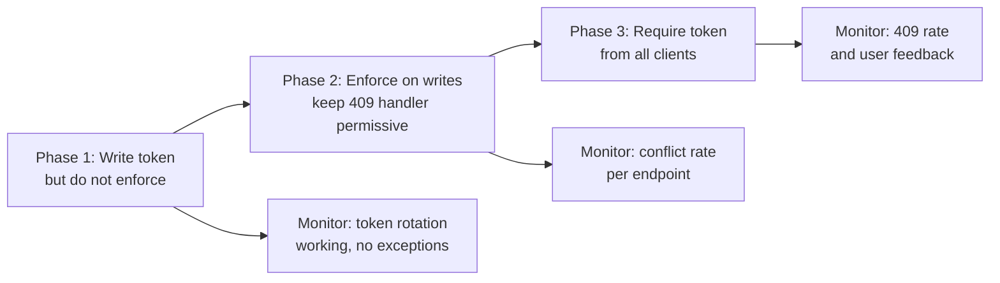

1. **Phase 1 — emit:** add the column, rotate the token on save, include it in responses. Old clients that do not send it back are unaffected (no token in payload = legacy behaviour). Ship and monitor.
2. **Phase 2 — enforce server-side only:** for requests that *do* carry a token, set `OriginalValue` and let the conflict fire. Add the Store Wins/merge handler and the 409 mapping. Track conflict rates per endpoint.
3. **Phase 3 — require the token:** reject PUTs without a token (or with `token-mismatch` semantics) once telemetry shows all clients send one.

### Step 4 — Retrofits for existing pain points

| Existing symptom | Retrofit |
|---|---|
| "My change disappeared" tickets | Optimistic token + Store Wins (fastest win — days, not weeks) |
| Retry storms on a counter | Replace RMW loop with one `ExecuteUpdateAsync` guard |
| Duplicate job processing | Add status guard + `FOR UPDATE SKIP LOCKED` claim query |
| Random deadlocks after a new feature | Audit lock ordering; enforce canonical order; add `lock_timeout` |

> ⚠️ **Watch the backfill on large tables.** The `UPDATE ... SET version = gen_random_uuid()` on millions of rows takes locks and WAL space — batch it (e.g., 10k rows per transaction) or perform it during a maintenance window.

---

<a name="19-troubleshooting-guide"></a>
## 19. Troubleshooting Guide

| Symptom | Likely cause | Fix |
|---|---|---|
| `DbUpdateConcurrencyException` on the **first** save of a new row | Token was generated twice (e.g., default Guid in constructor *and* in `SaveChangesAsync` override) so EF treats the entity as changed | Rotate the token only for `Modified` entries, or ensure it is set before insert and not overwritten after |
| Exception only in production, never in tests | Tests use in-memory/SQLite provider which does not evaluate the token like the real DB | Integration tests against Testcontainers with the real provider |
| Exception says "expected 1 row, affected 0" but row exists | The WHERE clause contains the stale token, or a **store-generated** column (`rowversion`) is being compared with the wrong value | Verify generated SQL with `ToQueryString()` / logging; mark the token `IsConcurrencyToken()` correctly |
| 409 returned for every request | Client sends token but handler compares against freshly-read value *and* the override rotates before save — ordering bug | Set `OriginalValue` from the client token *after* the read, before `SaveChangesAsync` |
| Retries always fail in background job | Retrying only `SaveChangesAsync`, or reusing a context that already failed | Wrap the full read-modify-write; fresh `DbContext` per attempt (Section 7) |
| `55P03` errors in PostgreSQL | `NOWAIT` hit a locked row | Expected fast-rejection behaviour — handle the error, or switch to default `FOR UPDATE` |
| Deadlocks appearing after adding `FOR UPDATE` | Inconsistent lock ordering across code paths | Canonical lock order; shorter transactions; `deadlock_timeout` monitoring |
| API-wide stalls under load with locking enabled | Locks held during slow work (external calls), pool exhaustion | Move external calls outside the transaction; `lock_timeout`; shorten locked section |
| Duplicate job processing despite `SKIP LOCKED` | Status updated but transaction not committed before the work starts, or claim and process in separate transactions with no claim timestamp | Commit the claim transaction first; add `claimed_at` + re-claim timeout for crashed workers |
| `xmin` token confuses clients after some weeks | `xmin` wraparound — the 32-bit transaction ID repeats | Use a persistent GUID token for anything crossing process boundaries |
| Merge strategy saved but domain events did not fire | Merge path calls `SaveChangesAsync` before event dispatch logic, or events raised only in constructor | Re-raise/dispatch events explicitly in the conflict handler |
| Token column grows in every response cache/ETag | Token stored per row in a shared cache with no invalidation | Derive an ETag from the token per resource; invalidate on save |

### Diagnostic toolkit

```csharp
// 1. See the exact SQL EF generates (confirms the token is in the WHERE clause)
Console.WriteLine(dbContext.Shipments.Where(s => s.Id == id).ToQueryString());

// 2. Log every SaveChanges conflict with full context
catch (DbUpdateConcurrencyException ex)
{
    _logger.LogWarning(ex,
        "Concurrency conflict on {Entity} with {Keys}. Strategy: {Strategy}",
        ex.Entries.First().Entity.GetType().Name,
        string.Join(",", ex.Entries.First().Metadata.FindPrimaryKey()?.Properties
            .Select(p => ex.Entries.First().CurrentValues[p.Name]) ?? Array.Empty<object?>()),
        nameof(ConflictStrategy.StoreWins));
}

-- 3. PostgreSQL: who is waiting on whom right now?
SELECT blocked.pid, blocked.query, blocking.pid AS blocking_pid, blocking.query
FROM pg_locks bl
JOIN pg_stat_activity blocked ON blocked.pid = bl.pid
JOIN pg_locks kl ON kl.locktype = bl.locktype AND kl.relation IS NOT DISTINCT FROM bl.relation
    AND kl.pid != bl.pid AND kl.granted
JOIN pg_stat_activity blocking ON blocking.pid = kl.pid
WHERE NOT bl.granted;
```

---

<a name="20-practice-exercises-with-solutions"></a>
## 20. Practice Exercises (with Solutions)

### Exercise 1 — Reproduce and Fix a Lost Update (Beginner)

**Task:** Given the naive `UpdateShipmentRequest` handler from Section 4, write an xUnit test with two real `DbContext` instances that proves the lost update occurs, then fix the handler using a GUID token and prove the fix.

**Solution:**

```csharp
[Fact]
public async Task Naive_handler_silently_loses_first_write()
{
    await using var ctxA = await factory.CreateDbContextAsync();
    await using var ctxB = await factory.CreateDbContextAsync();

    var a = await ctxA.Shipments.SingleAsync(s => s.Number == "SHP-001");
    var b = await ctxB.Shipments.SingleAsync(s => s.Number == "SHP-001");

    a.Address = "Amsterdam";              // Operator A
    b.Carrier = "UPS";                    // Operator B
    await ctxA.SaveChangesAsync();
    await ctxB.SaveChangesAsync();        // B overwrites A's address?!

    var after = await factory.CreateDbContextAsync();
    var row = await after.Shipments.SingleAsync(s => s.Number == "SHP-001");
    Assert.Equal("London", row.Address);  // ❌ proves A's write was lost
}
```

The fix: add `public Guid Version { get; set; }` with `.IsConcurrencyToken()`, rotate it in the `SaveChangesAsync` override, and the second `SaveChangesAsync` in the test now throws `DbUpdateConcurrencyException` — the test changes from asserting corruption to asserting the exception is raised.

### Exercise 2 — Choose and Implement a Conflict Policy (Intermediate)

**Task:** A product-catalogue API has 8 fields per product. Support reports that when two admins edit the same product, the second save fails with a 409 even though they edited *different* fields. Implement the right strategy.

**Solution:** field-level merge (Strategy 3 from Section 6), because the editors touch different fields:

```csharp
catch (DbUpdateConcurrencyException ex)
{
    var entry = ex.Entries.Single();
    var dbValues = await entry.GetDatabaseValuesAsync(ct)
        ?? throw new InvalidOperationException("Product deleted during edit");

    foreach (var prop in entry.CurrentValues.Properties)
        if (Equals(entry.CurrentValues[prop], entry.OriginalValues[prop]))
            entry.CurrentValues[prop] = dbValues[prop]; // untouched field → keep DB value

    entry.OriginalValues.SetValues(dbValues);       // refresh token
    await dbContext.SaveChangesAsync(ct);           // now succeeds with merged values
    return Result.Success();
}
```

Key points: only untouched fields take database values; the token is refreshed from `databaseValues` before retrying; if the *same* field was edited by both, this keeps the current user's value — log that case explicitly.

### Exercise 3 — Replace a Retry Storm with an Atomic Statement (Intermediate)

**Task:** A `LikeService` reads `post.LikeCount`, increments in memory, and saves — under a viral post this produces hundreds of conflicts per second. Replace it.

**Solution:**

```csharp
public Task<int> AddLikeAsync(Guid postId, CancellationToken ct) =>
    dbContext.Posts
        .Where(p => p.Id == postId)                  // target row
        .ExecuteUpdateAsync(s =>
            s.SetProperty(p => p.LikeCount, p => p.LikeCount + 1), ct);
```

Why: the new value is a pure function of the old (`+1`), so no token, no read, no retry. Zero conflicts are possible — concurrent increments all apply. Return the affected count if you need to detect a missing post (`0` → 404).

### Exercise 4 — Build a Deadlock-Free Multi-Row Reservation (Advanced)

**Task:** Transferring stock between two SKUs must lock both rows. Two opposite transfers (`A→B` and `B→A`) currently deadlock. Fix it with canonical ordering.

**Solution:**

```csharp
public async Task<Result> TransferAsync(string fromSku, string toSku, int qty, CancellationToken ct)
{
    // Canonical order: always lock by sku ascending — both A→B and B→A lock A first
    var ordered = new[] { fromSku, toSku }.OrderBy(s => s, StringComparer.Ordinal).ToArray();

    await using var tx = await dbContext.Database.BeginTransactionAsync(ct);
    await dbContext.Database.ExecuteSqlRawAsync("SET LOCAL lock_timeout = '3s'", ct);

    var rows = new List<StockItem>();
    foreach (var sku in ordered)
        rows.Add(await dbContext.StockItems
            .FromSql($"SELECT * FROM stock_items WHERE sku = {sku} FOR UPDATE")
            .SingleAsync(ct));

    var from = rows.Single(r => r.Sku == fromSku);
    var to   = rows.Single(r => r.Sku == toSku);
    if (from.Quantity < qty) { await tx.RollbackAsync(ct); return Result.Conflict("Insufficient stock"); }

    from.Quantity -= qty;
    to.Quantity   += qty;
    await dbContext.SaveChangesAsync(ct);
    await tx.CommitAsync(ct);
    return Result.Success();
}
```

Key points: sorting by primary key gives both directions the same acquisition order → no circular wait → no deadlock; `lock_timeout` bounds the wait if a third path misbehaves.

---

<a name="21-hands-on-lab-break-it-then-fix-it"></a>
## 21. Hands-On Lab: Break It, Then Fix It

Build the tiny warehouse API used throughout this tutorial, deliberately break it, then fix it three ways. Total time: 2-4 hours.

### Setup (20 min)

```bash
dotnet new webapi -n WarehouseDemo
cd WarehouseDemo
dotnet add package Npgsql.EntityFrameworkCore.PostgreSQL
dotnet add package Microsoft.EntityFrameworkCore.Design
dotnet add package Polly.Core
dotnet user-secrets init
# start Postgres however you like, e.g.:
docker run -d --name lab-pg -e POSTGRES_PASSWORD=lab -p 5432:5432 postgres:18
```

Create the `Shipment` entity from Section 1, register `AppDbContext` with Npgsql, and apply an initial migration.

### Lab 1 — Prove the lost update (30 min)

1. Seed one shipment (`SHP-001`, London / DHL).
2. Implement the naive handler from Section 4.
3. In a test (or two curl windows), GET the shipment twice, then PUT twice with different fields.
4. **Expected:** the second PUT silently wipes the first field.
5. **Deliverable:** a failing-correctly test that documents the bug.

### Lab 2 — Add the optimistic token (45 min)

1. Add `Guid Version` with `.IsConcurrencyToken()` and the rotation override from Section 5.
2. Return `Version` in GET, accept it in PUT, set `OriginalValue` from the client token.
3. Repeat Lab 1's scenario: the second PUT now returns 409.
4. Implement Store Wins so the 409 body includes current values.
5. **Stretch:** switch the client's stored token to a stale one from 5 minutes ago and confirm the conflict still fires — that is the whole point of `OriginalValue`.

### Lab 3 — Race the counter (45 min)

1. Add a `StockItem` (SKU, quantity = 100) and a naive `Reserve` endpoint (read, subtract, save).
2. Hammer it with `Parallel.For(0, 50, ...)` requesting 1 unit each, then check `quantity == 50` — watch it fail.
3. Fix it with `ExecuteUpdateAsync` + guard; re-run until the invariant holds.
4. Now implement the same operation with `FOR UPDATE` inside a transaction and compare: which approach is simpler? Which is faster under load?

### Lab 4 — Database-backed job queue (60 min)

1. Create a `shipment_jobs` table with `status` and `created_at`.
2. Implement `ClaimNextBatch` with `FOR UPDATE SKIP LOCKED` (Section 8).
3. Start three console workers polling it.
4. Insert 100 jobs; verify each was processed exactly once by checking `processed_at IS UNIQUE per job`.
5. Kill one worker mid-processing; observe un-claimed jobs still get processed. (Bonus: add a `claimed_at` timeout so another worker can reclaim jobs from dead workers.)

### Success criteria

- [ ] Lab 1 test fails *before* the fix and passes *after*
- [ ] Lab 2 returns 409 on genuine conflict, 200 on clean save
- [ ] Lab 3 invariant holds across 10 consecutive runs
- [ ] Lab 4 processes 100/100 jobs exactly once across 3 workers

---

<a name="22-pro-tips"></a>
## 22. Pro Tips

1. **`ToQueryString()` is your token debugger.** Before blaming the database, check whether EF actually put the token in the WHERE clause: `dbQuery.ToQueryString()` shows the exact UPDATE with `WHERE ... AND version = @p4`.
2. **Interceptors beat overrides.** A `SaveChangesInterceptor` rotating tokens can be registered per-feature and unit-tested independently; the `DbContext` override works but couples all entities to one class.
3. **Tokens double as optimistic ETags.** Map `Version` to an HTTP `ETag` header and honor `If-Match` on PUT — free RFC-compliant caching plus concurrency in one move. Return `412 Precondition Failed` (or 409) when it mismatches.
4. **Escalate deliberately, never randomly.** If optimistic retries fail repeatedly on one operation, that is a contention *measurement*, not bad luck. Move that single operation to atomic/pessimistic — do not lock the whole table.
5. **Idempotent consumers + outbox = at-least-once without duplicates.** `SKIP LOCKED` prevents two workers claiming the same job, but a crashed worker mid-publish still needs an idempotent publish or a reclaim deadline.
6. **Watch `SERIALIZABLE` honestly.** If you enable it globally, you inherit serialization-failure retries everywhere. Using Read Committed + deliberate strategy (as in this tutorial) is usually cheaper and more predictable.
7. **Track conflict metrics per *operation*, not globally.** A 0.1% global conflict rate can hide a 90% conflict rate on one endpoint — the one you need to fix.
8. **Test wraparound logic if you use `xmin`.** Anything long-lived (a client holding a form open for a day, a cache entry keyed on xmin) will eventually misbehave. Persistent tokens for persistence; `xmin` only for server-side cycles.

---

<a name="23-test-your-understanding"></a>
## 23. Test Your Understanding

Answer before reading the solutions — each question maps to a section.

**Q1.** Why does wrapping a read-modify-write in a transaction at Read Committed isolation not prevent a lost update?

> **A:** Read Committed only guarantees you read committed data; both transactions read the same committed row and both writes succeed. Nothing tells the database that the write depended on the earlier read remaining unchanged — that dependency is exactly what a concurrency token adds.

**Q2.** What does EF Core do when an UPDATE with a concurrency token affects 0 rows?

> **A:** It throws `DbUpdateConcurrencyException` instead of silently succeeding. 0-rows-affected means the row changed (or vanished) since you read it.

**Q3.** Which token option survives a stateless HTTP round trip to a browser, and why?

> **A:** A manual GUID token — it is a plain serialisable value in JSON. `xmin` wraps around and is Postgres-specific; `rowversion` is SQL Server-specific and awkward as `byte[]`.

**Q4.** Why must you set `OriginalValue` to the client's version in a PUT handler?

> **A:** Otherwise EF compares against the value the handler just read milliseconds ago. Setting `OriginalValue` from the client's token checks the full window from when the user opened the form — the window where conflicts actually happen.

**Q5.** Name the three conflict-resolution strategies and their typical callers.

> **A:** Store Wins (human forms — reload and inform the user), Client Wins (authoritative imports/sync jobs — force through), Field-Level Merge (large forms where users edit different fields — combine both).

**Q6.** What two mistakes make a Polly retry around `SaveChangesAsync` fail on every attempt?

> **A:** Retrying only the save (the stale token is re-sent every time) and reusing the same DbContext (the failed entity stays in the change tracker). Fix: wrap the entire read-modify-write and create a fresh context per attempt.

**Q7.** What does `FOR UPDATE SKIP LOCKED` change about worker behaviour, and what pattern is it the foundation of?

> **A:** A worker skips rows locked by others and claims the next available ones — no blocking, no duplicates. It is the foundation of the Transactional Outbox and database-backed job queues.

**Q8.** When is `ExecuteUpdateAsync` the best strategy, and what does it bypass?

> **A:** When the new value is a function of the old value (increment/decrement/status transition) and the rule fits in one WHERE predicate. It bypasses the Change Tracker, interceptors, domain events, and token rotation — the WHERE guard is the only safety net.

**Q9.** Which HTTP status should a genuine optimistic-concurrency conflict return, and why not 500?

> **A:** 409 Conflict. It is a client-resolvable condition — the client can re-read, merge, or retry — so it is part of the normal contract, not a server fault.

**Q10.** Your logs show `DbUpdateConcurrencyException` flooding from one endpoint. What does that tell you, and what do you change?

> **A:** Optimistic concurrency is the wrong strategy for that row's contention level (or retries amplify it). Move that specific operation to an atomic statement (if the value is a function of the old) or pessimistic locking (if not).

---

<a name="24-question-bank-52-questions"></a>
## 24. Question Bank (52 Questions)

### Beginner (Q1-Q18)

**Q1.** What is a lost update?
> **A:** Two writers read the same row, both write back, and one overwrites the other's change without either party or the database signalling an error.

**Q2.** Define concurrency in the context of databases.
> **A:** Multiple operations executing at the same time against the same data — from different users, jobs, or services.

**Q3.** What are the three concurrency strategies covered in this tutorial?
> **A:** Optimistic (detect conflicts via tokens), pessimistic (prevent conflicts via row locks), and atomic statements (eliminate the gap with one guarded UPDATE).

**Q4.** What is a concurrency token?
> **A:** A column whose value changes on every update; EF includes it in the UPDATE's WHERE clause so stale writers affect 0 rows.

**Q5.** Which exception does EF Core throw on a token mismatch?
> **A:** `DbUpdateConcurrencyException`.

**Q6.** What does `UseXminAsConcurrencyToken()` do and on which database?
> **A:** Uses PostgreSQL's automatic per-row transaction ID (`xmin`) as the token — no migration required, PostgreSQL only.

**Q7.** What is SQL Server's `rowversion` type used for here?
> **A:** A database-maintained binary version column; every update changes it automatically. Configured with `.IsRowVersion()`.

**Q8.** Why is a GUID token recommended for web APIs?
> **A:** It is a portable, JSON-serialisable value that travels to the client and back, and it works on any database provider.

**Q9.** Which property of an entity entry must you set to compare against the *client's* token?
> **A:** `dbContext.Entry(entity).Property(e => e.Version).OriginalValue`.

**Q10.** What does Store Wins mean?
> **A:** The database's current values win; the user's edit is discarded and they are shown the latest data to retry from.

**Q11.** What does Client Wins mean and what is its risk?
> **A:** The caller's values overwrite the database after refreshing the token; the risk is silently discarding the other writer's change.

**Q12.** When does field-level merge make sense?
> **A:** Large forms with independent fields where different users likely edit different fields — both sets of changes can be preserved.

**Q13.** What is jitter in a retry policy and why use it?
> **A:** Random ±25% added to the retry delay so that many colliding workers do not retry in lockstep and collide again.

**Q14.** What does `FOR UPDATE` do in PostgreSQL?
> **A:** Acquires a row-level exclusive lock on the selected rows inside the transaction; other `FOR UPDATE` readers block until commit/rollback.

**Q15.** What is the SQL Server equivalent of `FOR UPDATE`?
> **A:** Locking hints: `WITH (UPDLOCK, ROWLOCK)` — often with `HOLDLOCK` for reservation semantics.

**Q16.** What does `FOR UPDATE NOWAIT` do?
> **A:** Fails immediately with PostgreSQL error 55P03 instead of waiting — fast rejection over slow success.

**Q17.** What does `SKIP LOCKED` do?
> **A:** Skips rows currently locked by other transactions and returns the next available ones — enabling parallel, non-blocking job queues.

**Q18.** What does `ExecuteUpdateAsync` return and what does a return value of 0 mean?
> **A:** The number of affected rows; 0 means the guard predicate matched nothing (e.g., out of stock, or wrong state).

### Intermediate (Q19-Q37)

**Q19.** Why does the database accept both writes in the lost-update race without error?
> **A:** At Read Committed each transaction independently reads the latest committed row and writes; from the database's perspective each UPDATE is valid — no dependency between read and write was declared.

**Q20.** Compare the failure modes of optimistic, pessimistic, and atomic strategies.
> **A:** Optimistic: an exception you must handle after the fact. Pessimistic: waiting, timeouts, or deadlocks *before* the write. Atomic: impossible by design — 0 affected rows is the only signal.

**Q21.** How would you configure token rotation for all shipment saves without touching every handler?
> **A:** Override `SaveChangesAsync`/`SaveChanges` in the DbContext (or use a `SaveChangesInterceptor`) to set `Version = Guid.NewGuid()` for Added/Modified shipment entries.

**Q22.** A PUT handler sets `OriginalValue` from the client token. What exactly does the generated SQL look like?
> **A:** `UPDATE shipments SET address = @p0, carrier = @p1, version = @p2 WHERE id = @p3 AND version = @p4` — where `@p4` is the client's token, not the freshly read one.

**Q23.** How do you detect a deleted-row conflict differently from a modified-row conflict?
> **A:** `entry.GetDatabaseValuesAsync()` returns null when the row no longer exists — handle that branch with a "record was deleted" 409 before choosing a strategy.

**Q24.** In field-level merge, which value wins when both users changed the same field?
> **A:** The current user's proposed value — the merge keeps user changes and only takes DB values for untouched fields; the other user's edit to that specific field is lost and should be logged.

**Q25.** Why must the whole read-modify-write be inside the Polly `ExecuteAsync` callback?
> **A:** Because each attempt must re-read the row to get a fresh token; retrying only `SaveChangesAsync` re-sends the same stale token and fails identically.

**Q26.** Why create a new DbContext per retry attempt?
> **A:** A context that threw keeps the failed entity tracked with stale original values; reusing it reproduces the failure. `IDbContextFactory<T>` gives a clean context each attempt.

**Q27.** What are the components of a suitable retry pipeline for conflicts?
> **A:** `ShouldHandle` = `DbUpdateConcurrencyException` only, 2-3 attempts, ~20ms exponential backoff, jitter on, wrapping the full RMW with a fresh context.

**Q28.** Why is pessimistic locking a poor fit for human form editing?
> **A:** Locks live on a database connection and cannot span two HTTP requests; you would pin a connection and block everyone while a user thinks. The optimistic token exists precisely for this case.

**Q29.** What is `SET LOCAL lock_timeout` and why `LOCAL`?
> **A:** It bounds how long a statement waits for a lock before erroring; `LOCAL` scopes it to the current transaction so it cannot leak into other operations on the pooled connection.

**Q30.** What are the real costs of pessimistic locking?
> **A:** Connection held for the full RMW (pool exhaustion under load), deadlock risk (requiring consistent lock ordering), no cross-request locking, and severe danger of holding locks across external calls.

**Q31.** Explain why `ExecuteUpdateAsync` has no conflict problem by design.
> **A:** There is no read-modify-write gap: the new value is computed from the old value inside the UPDATE itself, and the row lock lasts only for the statement's duration.

**Q32.** What important EF pipeline features does `ExecuteUpdateAsync` bypass?
> **A:** Entity loading, Change Tracker, interceptors, domain events, and concurrency token checks — the WHERE guard is your only protection.

**Q33.** How does the outbox pattern use `SKIP LOCKED` to guarantee at-least-once publishing without duplicates?
> **A:** Each instance claims a batch (claim rows + mark status in one committed transaction); locked rows are skipped by others, so no two workers publish the same message. Crashed workers need a reclaim deadline and idempotent publishing.

**Q34.** In the e-commerce checkout use case, why does optimistic concurrency fail at 1,000 concurrent buyers?
> **A:** Nearly all writes lose the race and trigger retries that mostly fail too — wasted work scales with contention. The atomic guarded UPDATE resolves each request in one statement with zero retries.

**Q35.** What status-transition guard prevents double-processing of orders?
> **A:** An atomic UPDATE whose WHERE includes the required current state (`WHERE status = 'Pending'`), setting the new state and timestamp; 0 affected rows means another worker got there first.

**Q36.** Why pair optimistic seat booking with a unique constraint?
> **A:** Defense in depth: the token gives a friendly 409 for the common race, while the unique constraint on `(flight_id, seat_number)` makes double-booking impossible even if a code path bypasses the token.

**Q37.** Name four red flags that indicate the wrong concurrency strategy is in place.
> **A:** Conflict exceptions flooding logs (optimistic under-armed), lock-wait timeouts (pessimistic doing too much), deadlocks (inconsistent lock ordering), and users reporting disappearing changes (no control at all).

### Advanced (Q38-Q52)

**Q38.** How do you design lock ordering to eliminate deadlocks between two transfer endpoints that touch the same two rows in opposite directions?
> **A:** Canonical order: sort the target keys (e.g., SKU or PK ascending) before acquiring locks so every path acquires in the same sequence — no circular wait is possible. Combine with `lock_timeout` and deadlock telemetry.

**Q39.** Why can `FOR UPDATE` lock more rows than intended, and how do you prevent it?
> **A:** If the WHERE predicate is not indexed, the planner scans and locks more rows/pages than necessary. Index the predicate; optionally use precise predicates or `FOR UPDATE OF table` to limit scope.

**Q40.** How do conflict retries amplify system load mathematically?
> **A:** With conflict probability c and r retry attempts, write volume multiplies by roughly (1+c)^r — e.g., 40% conflicts with 3 attempts ≈ 2.7x the write traffic, which raises contention further.

**Q41.** What is the interaction between `xmin` wraparound and long-lived client-held tokens?
> **A:** `xmin` is a 32-bit transaction ID that wraps; a token captured weeks ago may match a different transaction's value, so stale-writer detection degrades. Use persistent GUID tokens for anything crossing process boundaries.

**Q42.** How would you implement optimistic concurrency as HTTP ETags?
> **A:** Return the version token as an `ETag` header on GET; require `If-Match` on PUT; on mismatch return 412/409. The token mechanism is identical — only the transport differs.

**Q43.** Design a reclaim mechanism for a `SKIP LOCKED` queue when workers crash mid-job.
> **A:** Record `claimed_at` at claim time; a sweeper re-offers jobs whose `claimed_at` exceeds a lease timeout (status back to Pending), and consumers must be idempotent because reclaim means possible duplicate execution.

**Q44.** When would you combine optimistic tokens *and* pessimistic locking in one operation?
> **A:** E.g., a queue claim (pessimistic, per-worker row locks) whose later state update also carries a token, or a locked read-modify-write where another service writes the same rows with tokens — layers protect different writers.

**Q45.** How do you test token behaviour deterministically in CI?
> **A:** Testcontainers with the real engine; two contexts read the same row, first saves, assert the second throws. Deterministic because the conflict is forced by token state, not by timing.

**Q46.** What goes wrong if you reuse one DbContext across parallel test iterations?
> **A:** DbContext is not thread-safe: concurrent use corrupts the change tracker, and even sequential reuse carries stale tracked entities that fake or mask conflicts.

**Q47.** How do you migrate a large production table to add a token column with minimal disruption?
> **A:** Nullable column first; batched backfill (10k rows per transaction) or maintenance-window update; then NOT NULL; then Phase 1 emit → Phase 2 enforce → Phase 3 require rollout, monitoring conflict rates at each step.

**Q48.** Why is returning full database values in a 409 response a potential security issue?
> **A:** The conflicted row may contain data the caller is not authorized to read; conflict responses must respect the same authorization filters as reads — reload via the authorized query path or return minimal fields.

**Q49.** Compare `SET LOCAL lock_timeout = '3s'` with connection-level `statement_timeout` for lock safety.
> **A:** `lock_timeout` bounds only lock acquisition within that transaction and is transaction-scoped; `statement_timeout` caps total statement time and is session-scoped — use `lock_timeout` for lock hygiene, `statement_timeout` as a broader backstop.

**Q50.** Your store-wins handler calls `ReloadAsync`. What does it do exactly, and what must you return to the client?
> **A:** It re-reads the row from the database into the entity (current + original values), discarding the user's edit. Return 409 with the current (reloaded) values — ideally via your authorized response mapping — so the user can re-apply their change.

**Q51.** How would you choose between `NOWAIT` and `SKIP LOCKED` for a payment-deduction worker that must not double-spend?
> **A:** Neither is ideal for double-spend: use atomic guarded `ExecuteUpdateAsync` (`WHERE balance >= amount`). Between the two, `NOWAIT` suits must-be-fast single-row claims; `SKIP LOCKED` suits batch claims across many rows. Both prevent waiting, but only a guard prevents the second deduction.

**Q52.** Propose a telemetry plan that tells you when to escalate a strategy.
> **A:** Per-operation counters: conflict exceptions, retry counts and outcomes, lock wait times (`pg_locks`/`pg_stat_activity`), deadlock counts, and user-reported 409 rates. Define thresholds (e.g., sustained >5-10% conflicts or p99 lock wait >1s) that trigger moving that operation to atomic or pessimistic.

---

<a name="25-common-interview-questions"></a>
## 25. Common Interview Questions

**Q1. What is the lost update problem, and how would you detect it in an existing system?**
> Strong answers describe the read-modify-write gap, note that Read Committed transactions do not prevent it, and propose detection: replay two concurrent edits in a test, or add a token and watch conflicts appear.

**Q2. Optimistic vs pessimistic concurrency — when do you pick each?**
> Optimistic for low/moderate contention and anything a human edits across HTTP requests; pessimistic for high-contention rows where must-succeed-first-try matters, and for SKIP LOCKED queues. Atomic beats both when the value is a function of the old one.

**Q3. How does EF Core implement optimistic concurrency under the hood?**
> A concurrency token column is included in the UPDATE's WHERE clause (`AND version = @p4`); 0 affected rows → `DbUpdateConcurrencyException`. Tokens: `xmin` (Postgres), `rowversion` (SQL Server), manual GUID.

**Q4. Your API returns 200 OK but users report their changes disappear. Diagnose.**
> Classic silent lost update: no token end-to-end, or the token is compared against the freshly read value instead of the client's (`OriginalValue` bug), or an anti-pattern swallows the exception.

**Q5. How would you retry concurrency conflicts in a background service correctly?**
> Polly pipeline handling only `DbUpdateConcurrencyException`, 2-3 attempts, exponential backoff with jitter, wrapping the entire read-modify-write with a fresh DbContext per attempt via `IDbContextFactory`.

**Q6. What are the dangers of pessimistic locking in a web application?**
> Connection held for the whole transaction (pool exhaustion), blocking cascades, deadlocks without lock ordering, and the impossibility of holding locks across HTTP requests. Mitigations: tight transactions, lock_timeout, canonical ordering, external calls outside locks.

**Q7. Explain `SKIP LOCKED` and the pattern it enables.**
> Claim queries skip rows locked by other workers and lock the next batch, committing the claim before processing — the transactional outbox / DB job queue. Mention reclaim leases for crashed workers.

**Q8. When would you deliberately choose Client Wins despite its data-loss risk?**
> When the caller is authoritative by design (ERP sync, import jobs) and any stored change should be overwritten. Answers should name the risk and add audit logging.

**Q9. What does `ExecuteUpdateAsync` do, and what are its trade-offs?**
> Emits one guarded UPDATE computing the new value from the old — no entity load, no conflicts, best throughput. Trade-offs: bypasses Change Tracker, interceptors, domain events, and token rotation.

**Q10. How do you handle a conflict where the row was deleted between read and save?**
> `GetDatabaseValuesAsync()` returns null → return a specific "record was deleted" 409; do not call merge strategies against null values.

**Q11. Two endpoints deadlock intermittently. Walk me through your investigation.**
> Capture deadlock details (Postgres logs / SQL Server deadlock graph), identify the two lock sets and their acquisition orders, then enforce one canonical order and add lock_timeout + telemetry.

**Q12. How do you add concurrency control to a live system with clients you cannot update simultaneously?**
> Phased rollout: emit token without enforcing → enforce server-side with permissive 409 handling → require token from all clients, monitoring conflict rates at each phase; batched backfill for the new column.

---

<a name="26-self-assessment-checklist"></a>
## 26. Self-Assessment Checklist

Tick every item you can do from memory. Any gap points to the section to re-read.

**Concepts**
- [ ] I can explain the read-modify-write gap and why Read Committed does not close it (§4)
- [ ] I can describe the three strategies' assumptions and failure modes (§1, §10)
- [ ] I know what 0 rows affected means in each strategy (§5, §9)

**Optimistic**
- [ ] I can configure `xmin`, `rowversion`, and GUID tokens from memory (§5)
- [ ] I can wire the token through GET/PUT DTOs and `OriginalValue` (§5)
- [ ] I can implement Store Wins, Client Wins, and Field-Level Merge (§6)
- [ ] I can build a correct Polly retry with fresh context per attempt (§7)

**Pessimistic**
- [ ] I can write a `FOR UPDATE` handler with `lock_timeout` on PostgreSQL (§8)
- [ ] I know the SQL Server hints equivalent (`UPDLOCK`, `ROWLOCK`, `HOLDLOCK`) (§8)
- [ ] I can implement a `SKIP LOCKED` job queue with reclaim-on-crash thinking (§8, §12)
- [ ] I can explain the costs: pool exhaustion, deadlocks, cross-request impossibility (§8)

**Atomic**
- [ ] I can spot operations where the new value is a function of the old (§9)
- [ ] I can write an `ExecuteUpdateAsync` guard and handle `affected == 0` (§9)
- [ ] I know what it bypasses and compensate for it (§9)

**Production**
- [ ] I can run the decision framework on a new update operation (§11)
- [ ] I can name the six anti-patterns and their fixes (§14)
- [ ] I can plan the phased migration for an existing table (§18)
- [ ] I know what to monitor: conflicts, lock waits, deadlocks, per operation (§13, §15)

**Score:** 16-18: you can own concurrency design. 12-15: solid, revisit the missed sections. <12: re-run the Hands-On Lab — the concepts stick fastest by breaking and fixing real code.

---

<a name="27-summary-and-key-takeaways"></a>
## 27. Summary and Key Takeaways

### Quick Decision Table

| Situation | Strategy |
|---|---|
| Human edits a form, conflicts are rare | **Optimistic** — GUID version token |
| Two users editing different fields of same record | **Optimistic** — field-level merge |
| Background job, automated process | **Optimistic** — with Polly retry pipeline |
| High-traffic counter (inventory, likes, seats) | **Atomic** — `ExecuteUpdateAsync` |
| Many writers, must succeed on first attempt | **Pessimistic** — `FOR UPDATE` |
| Multiple workers processing a queue table | **Pessimistic** — `FOR UPDATE SKIP LOCKED` |
| Simple state transition (Pending → Active) | **Atomic** — with state guard in WHERE |

### At-a-Glance Decision Flowchart

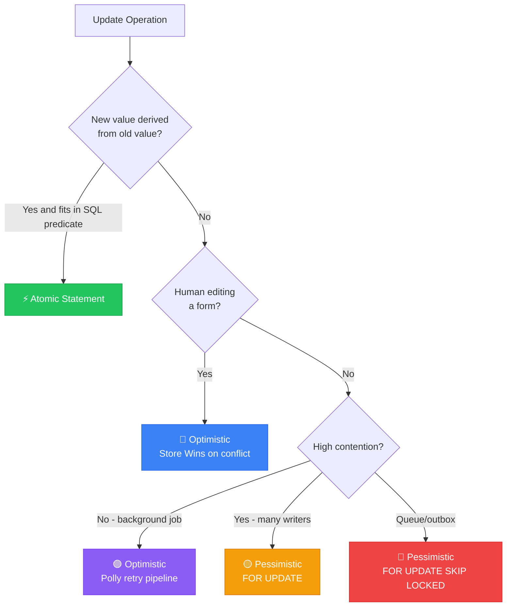

### The Three Golden Rules

1. **Never ignore `DbUpdateConcurrencyException`** — it means a write was silently dropped and data could be wrong.
2. **Never call external APIs inside a locked transaction** — you block every other writer for the full duration of that external call.
3. **Always retry the entire read-modify-write** — retrying only `SaveChangesAsync` will always fail with the same stale token.

### Key takeaways in one paragraph

Concurrency control is not one technique but a *decision*: for each writable row, choose optimistic (token, detect and resolve), pessimistic (lock, prevent and queue), or atomic (single guarded statement, no gap). Tokens must cross the stateless HTTP boundary — that is why GUID beats `xmin` and `rowversion` for APIs. Conflicts are not exceptions to fear but signals to act on: Store Wins for humans, Client Wins for authoritative systems, merges for multi-field forms. And when telemetry shows retries losing more than they win, escalate that one operation — never the whole table.

---

<a name="28-further-reading-and-resources"></a>
## 28. Further Reading and Resources

### Official documentation

- **EF Core — Handling concurrency conflicts** — learn.microsoft.com/ef/core/saving/concurrency
- **EF Core — Concurrency tokens** — learn.microsoft.com/ef/core/modeling/concurrency
- **EF Core — `ExecuteUpdateAsync` / bulk updates** — learn.microsoft.com/ef/core/saving/execute-update
- **EF Core — DbContext pooling & `IDbContextFactory`** — learn.microsoft.com/ef/core/dbcontext-configuration
- **PostgreSQL — Locking (`FOR UPDATE`, `SKIP LOCKED`, `lock_timeout`)** — postgresql.org/docs/current/sql-select.html and postgresql.org/docs/current/runtime-config-locks.html
- **PostgreSQL — Error codes (`55P03` lock_not_available)** — postgresql.org/docs/current/errcodes-appendix.html
- **SQL Server — rowversion & locking hints** — learn.microsoft.com/sql/t-sql/data-types/rowversion-transact-sql
- **Polly v8 — Resilience pipelines & retry** — www.pollydocs.org/strategies/retry
- **Microsoft.Extensions.Http.Resilience** — learn.microsoft.com/dotnet/core/resilience

### Related topics in this knowledge base

- `Dotnet Core DbContext is Not Thread-Safe.md` — why each retry attempt needs its own context
- `Building async producer-consumer queues from scratch in C sharp.md` — in-process alternative to DB queues
- `TickerQ - The Modern .NET Job Scheduler That Beats Quartz and Hangfire.md` — scheduling layer above your worker queue
- `Using EF Core Like a Pro - Performance, Patterns, and Modern Features in .NET 8–10.md` — broader EF Core mastery
- `The Result Pattern.md` — the `Result.Conflict(...)` style used throughout this tutorial
- `PostgreSQL Row-Level Security with EF Core - Complete Tutorial.md` — complementary database-level guarantees
- `Real patterns that scale instead of silently breaking under load.md` — load-driven design decisions

---

<a name="29-learning-path-and-next-steps"></a>
## 29. Learning Path and Next Steps

### Where this fits in your learning journey

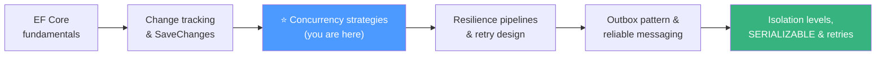

### Suggested next steps

1. **Run the Hands-On Lab** ([Section 21](#21-hands-on-lab-break-it-then-fix-it)) this week — Labs 1-3 alone take about two hours and make every concept physical.
2. **Audit one real service:** list its writable aggregates and classify each as optimistic / pessimistic / atomic candidate using the Section 11 framework.
3. **Add one token end-to-end** (entity → DTO → GET → PUT → 409 handler) in a service you own, and watch the conflict dashboard for a week.
4. **Instrument before you optimize:** per-operation conflict counters and lock-wait metrics turn strategy debates into data.
5. **Go deeper on queues:** combine `SKIP LOCKED` with reclaim leases and idempotent consumers, then read up on the full Transactional Outbox pattern.

> 🎯 **Final thought:** the database cannot guess that your second write depended on your first read — you have to tell it. Optimistic tokens, pessimistic locks, and atomic guarded updates are the three ways to say it. Choose deliberately, measure conflict rates, and silent data corruption becomes an artifact of the past.

---

*Last Updated: 2026-09-18* · *Difficulty: Intermediate* · *Part of the knowledge-base tutorial series, created per `tutorial-preferences.md` requirements.*
