<!--
  Tutorial: PostgreSQL Row-Level Security with EF Core
  Difficulty: Intermediate to Advanced
  Estimated Reading Time: 90-120 minutes
  Last Updated: 2026-09-13
  Source: Content provided by the user, augmented to meet tutorial-preferences.md requirements
  Based on: PostgreSQL 18 Row-Level Security, EF Core 10, Npgsql, and multi-tenant data isolation patterns
-->

# PostgreSQL Row-Level Security with EF Core: The Complete Guide to Bulletproof Multi-Tenant Isolation

> **_"EF Core's global query filter makes tenant isolation visible and intentional in your code. PostgreSQL's Row-Level Security makes it unavoidable at the data layer. Use both — the filter documents intent; the policy enforces it unconditionally."_**

---

## ⏱️ Estimated Reading Time: 90–120 minutes

**Difficulty Level:** Intermediate to Advanced
**Applies to:** .NET 10, EF Core 10, Npgsql, PostgreSQL 18
**Prerequisites:** Basic knowledge of PostgreSQL, C#, and Entity Framework Core

---

## 📋 Table of Contents

1. [Introduction: Why Multi-Tenant Security Matters](#1-introduction-why-multi-tenant-security-matters)
2. [Prerequisites](#2-prerequisites)
3. [Learning Objectives](#3-learning-objectives)
4. [The Problem with Application-Level Filters](#4-the-problem-with-application-level-filters)
5. [What Is Row-Level Security?](#5-what-is-row-level-security)
6. [Architecture Overview](#6-architecture-overview)
7. [Database Setup: Roles, Tables & Policies](#7-database-setup-roles-tables--policies)
8. [Configuring EF Core with Npgsql](#8-configuring-ef-core-with-npgsql)
9. [The Connection Interceptor: Setting the Tenant](#9-the-connection-interceptor-setting-the-tenant)
10. [Multiple Implementation Approaches Compared](#10-multiple-implementation-approaches-compared)
11. [Testing Bypass Scenarios](#11-testing-bypass-scenarios)
12. [Real-World Use Cases](#12-real-world-use-cases)
13. [Best Practices](#13-best-practices)
14. [Anti-Patterns](#14-anti-patterns)
15. [Performance Considerations](#15-performance-considerations)
16. [Security Considerations](#16-security-considerations)
17. [Testing and Verifying Isolation](#17-testing-and-verifying-isolation)
18. [Migration Guide: Adopting RLS on an Existing Database](#18-migration-guide-adopting-rls-on-an-existing-database)
19. [Common Pitfalls and Troubleshooting](#19-common-pitfalls-and-troubleshooting)
20. [Practice Exercises (with Solutions)](#20-practice-exercises-with-solutions)
21. [Hands-On Lab: Build a Tenant-Isolated API End to End](#21-hands-on-lab-build-a-tenant-isolated-api-end-to-end)
22. [Pro Tips](#22-pro-tips)
23. [Test Your Understanding](#23-test-your-understanding)
24. [Question Bank (52 Questions)](#24-question-bank-52-questions)
25. [Common Interview Questions](#25-common-interview-questions)
26. [Self-Assessment Checklist](#26-self-assessment-checklist)
27. [Summary and Key Takeaways](#27-summary-and-key-takeaways)
28. [Further Reading and Resources](#28-further-reading-and-resources)
29. [Learning Path and Next Steps](#29-learning-path-and-next-steps)

---

<a name="1-introduction-why-multi-tenant-security-matters"></a>
## 1. Introduction: Why Multi-Tenant Security Matters

Imagine an office building where three companies share the same filing room. Every employee is trusted to "only open their own company's cabinet" — no locks, just an honor system enforced by a laminated sign. One forgetful intern later, three companies' contracts are in the wrong hands.

That is exactly what a multi-tenant application looks like when tenant isolation is enforced only in application code. In a **multi-tenant application**, multiple customers (tenants) share the same database, and the system must guarantee that **Tenant A can never see or modify Tenant B's data** — even in the event of a bug, a misconfigured query, or a developer mistake.

In this tutorial you will build a **dual-layer defence**: EF Core's global query filter (Layer 1 — fast, visible, readable) on top of **PostgreSQL Row-Level Security** (Layer 2 — absolute, engine-enforced). By the end, even a query that bypasses every EF Core abstraction will still be stopped by the database itself.

### Real-World Breach Scenarios

| Scenario | Cause | Impact |
|----------|-------|--------|
| Developer adds `IgnoreQueryFilters()` for debugging | Forgot to remove it | All tenants' data exposed |
| Raw SQL via `ExecuteSql` | Global filter doesn't apply | Data leak across tenants |
| Admin endpoint forgets tenant check | Code path bypasses EF | Unauthorized cross-tenant access |
| Attached entity save | EF builds update from PK only | Wrong tenant's row overwritten |

> **💡 Key Insight:** If security is enforced only in application code, every developer must remember the rule every time. One mistake causes a breach. Databases do not have bad days — application code does.

### What You Will Get From This Guide

| You will learn... | Why it matters |
|---|---|
| Why global query filters alone leave four dangerous gaps | Know exactly what you are defending against |
| How RLS policies work (`ENABLE`, `FORCE`, `USING`, `WITH CHECK`) | The SQL foundation everything else builds on |
| How to set a per-connection tenant safely with an EF Core interceptor | The single most error-prone part of the whole design |
| Which bypass attempts RLS stops — and what each looks like from EF | `IgnoreQueryFilters`, raw SQL, attached entities, cross-tenant inserts |
| How to test, monitor, and roll out RLS without breaking production | So the guarantee survives real deployments |

---

<a name="4-the-problem-with-application-level-filters"></a>
## 4. The Problem with Application-Level Filters

EF Core's **global query filters** are the first line of defence. Configured once on the `DbContext`, they automatically append `WHERE tenant_id = @tenant` to every LINQ query:

```csharp
// In your DbContext OnModelCreating
modelBuilder.Entity<Invoice>()
    .HasQueryFilter(i => i.TenantId == _tenantContext.TenantId);
```

This is a great start: it is visible in the code, it composes with LINQ, and it cannot be "forgotten" per query. But it lives entirely inside EF Core's LINQ translation pipeline — and there are four well-trodden paths around it.

### Where Global Query Filters Fall Short

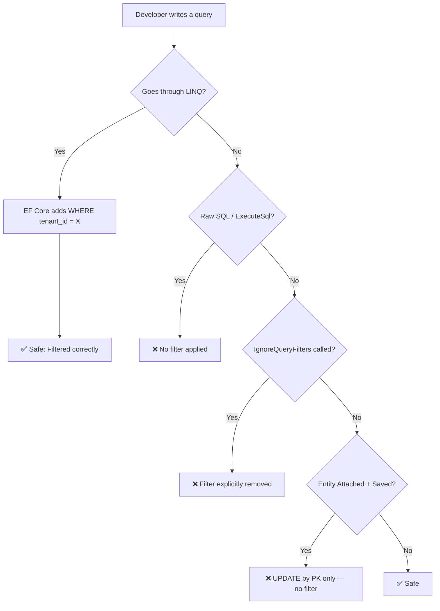

**The gaps:**

1. **`ExecuteSql` / `ExecuteUpdate`** — raw SQL statements bypass the filter entirely
2. **`IgnoreQueryFilters()`** — a single call in admin or reporting code removes the protection
3. **Attached entity saves** — EF generates `UPDATE ... WHERE id = @pk`, with no tenant predicate
4. **Third-party libraries** — tools accessing the DB directly don't know your filters

> **⚠️ The uncomfortable truth:** each of these gaps requires a developer *remembering* the rule. Global filters are a convention, not a constraint — and conventions degrade under deadline pressure.

---

<a name="5-what-is-row-level-security"></a>
## 5. What Is Row-Level Security?

**Row-Level Security (RLS)** is a PostgreSQL feature that enforces data access at the *database engine* level. Instead of your application deciding which rows to return, **Postgres itself** silently filters every query — SELECT, INSERT, UPDATE, DELETE — before any data reaches the application.

> 💡 **Analogy:** a global query filter is a security guard at the entrance to the filing room who *usually* checks badges. RLS is the lock built into each cabinet — it doesn't matter how a visitor got into the room; the cabinet simply won't open without the right key.

### How It Works

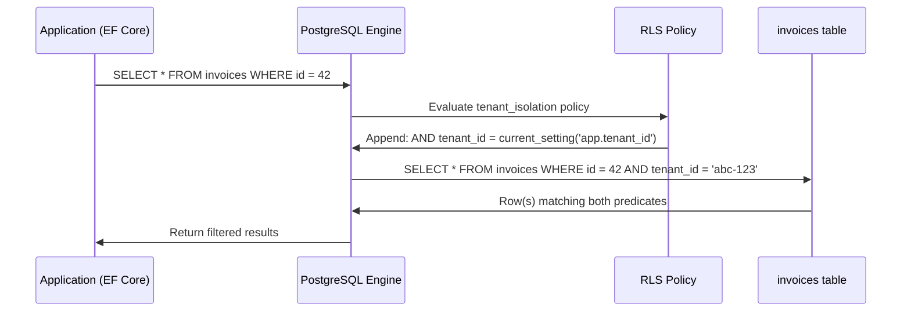

The application sends a plain query. PostgreSQL transparently adds the tenant predicate. The application never sees rows it shouldn't.

### Key Concepts

| Term | Meaning |
|------|---------|
| `ENABLE ROW LEVEL SECURITY` | Turns RLS on for a table |
| `FORCE ROW LEVEL SECURITY` | Applies the policy even to the table owner |
| `USING` | Predicate for SELECT, UPDATE, DELETE (which rows are visible) |
| `WITH CHECK` | Predicate for INSERT, UPDATE (validates new row values) |
| `current_setting()` | Reads a session-level configuration variable |
| `set_config()` | Sets a session-level configuration variable |

### `USING` vs `WITH CHECK` — Two Different Jobs

| Operation | `USING` evaluated? | `WITH CHECK` evaluated? |
|---|---|---|
| SELECT | ✅ Decides which rows are visible | — |
| UPDATE | ✅ Which existing rows may be targeted | ✅ Validates the new row version |
| DELETE | ✅ Which rows may be deleted | — |
| INSERT | — | ✅ Validates the new row |

> **💡 Aha moment:** if you write a `FOR ALL` policy and omit `WITH CHECK`, PostgreSQL uses the `USING` expression to validate new rows too. Explicit is still better — future readers should never have to infer which predicate guards writes.

### When to Use RLS (and When Not To)

| Use RLS when... | Consider alternatives when... |
|---|---|
| Tenants share tables and isolation must be absolute | Data is physically partitioned per tenant (separate DB/schema) |
| Raw SQL, reporting tools, and libraries hit the same tables | Isolation is a *business rule* ("managers see their team"), not an absolute wall |
| Compliance demands engine-level enforcement (HIPAA, SOC 2) | You need column masking — use column privileges or views instead |
| You must fail closed even when application code is wrong | Policies would need joins so complex they distort every query plan |

---

<a name="6-architecture-overview"></a>
## 6. Architecture Overview

Here's how all the components fit together in a multi-tenant SaaS application:

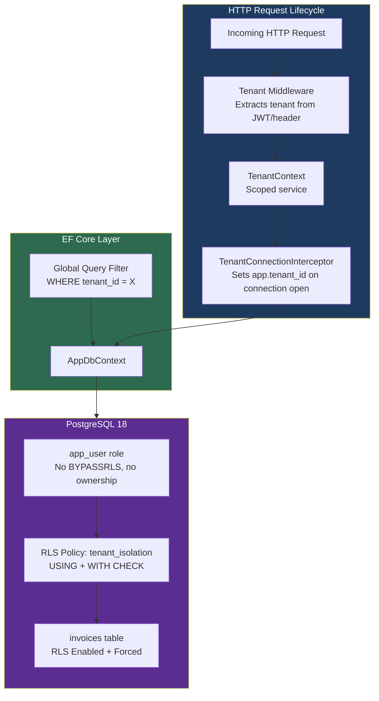

### Defence-in-Depth: Two Layers

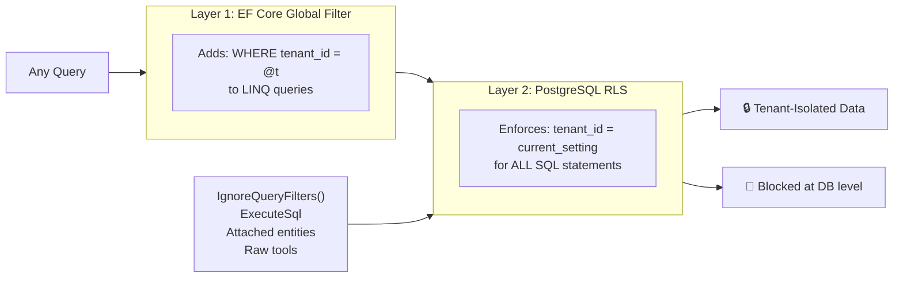

The two layers serve different purposes:

| Layer | Protects | Does not protect |
|---|---|---|
| EF Core global filter | LINQ queries (reads and tracked updates) | Raw SQL, `IgnoreQueryFilters`, attached entities, external tools |
| PostgreSQL RLS | **Every SQL statement on the table, from any client** | Nothing — it is the final arbiter |

---

<a name="7-database-setup-roles-tables--policies"></a>
## 7. Database Setup: Roles, Tables & Policies

### Step 1: Create Separate Database Roles

The most important security principle: **the application user must not own the tables**.

```sql
-- Owner role: runs migrations, DDL changes
CREATE ROLE db_owner WITH LOGIN PASSWORD 'owner_secret';

-- App role: runs queries, has only DML permissions
CREATE ROLE app_user WITH LOGIN PASSWORD 'app_secret';

-- Grant DML to app_user
GRANT SELECT, INSERT, UPDATE, DELETE ON invoices TO app_user;
GRANT USAGE ON SCHEMA public TO app_user;
```

### Why Role Separation Matters

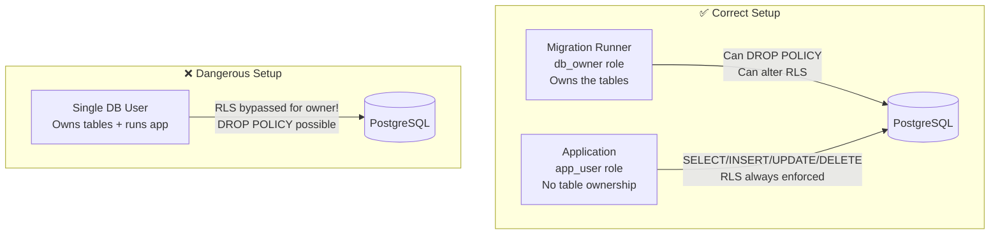

> **⚠️ Critical:** In PostgreSQL, a table's owner bypasses its RLS policies by default. If your application connects as the table owner, your policies are decorative. `FORCE ROW LEVEL SECURITY` (Step 3) closes that hole — but role separation is the stronger, simpler guarantee: `app_user` can never run `ALTER TABLE` or `DROP POLICY` at all.

### Step 2: Create the Table

```sql
CREATE TABLE invoices (
    id          UUID        PRIMARY KEY DEFAULT gen_random_uuid(),
    tenant_id   UUID        NOT NULL,
    number      TEXT        NOT NULL,
    amount      NUMERIC(12,2) NOT NULL,
    status      TEXT        NOT NULL DEFAULT 'Draft',
    created_at  TIMESTAMPTZ NOT NULL DEFAULT now(),
    updated_at  TIMESTAMPTZ NOT NULL DEFAULT now()
);

-- Performance: always filter by tenant first
CREATE INDEX idx_invoices_tenant ON invoices (tenant_id);
```

### Step 3: Create the RLS Policy

```sql
-- Enable RLS on the table
ALTER TABLE invoices ENABLE ROW LEVEL SECURITY;

-- Even the table owner must obey the policy
ALTER TABLE invoices FORCE ROW LEVEL SECURITY;

-- The policy itself
CREATE POLICY tenant_isolation ON invoices
    USING (
        tenant_id = NULLIF(current_setting('app.tenant_id', true), '')::uuid
    )
    WITH CHECK (
        tenant_id = NULLIF(current_setting('app.tenant_id', true), '')::uuid
    );
```

### Dissecting the Policy Expression

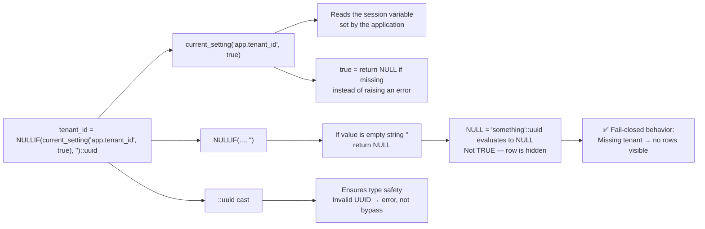

> **🔑 Critical Design Choice:** `NULLIF` ensures a request without a tenant set sees **zero rows**, not all rows. This is the "fail closed" principle — the safe failure mode. Compare the alternatives:

| Behavior when `app.tenant_id` is missing | Result | Failure mode |
|---|---|---|
| `current_setting('app.tenant_id', true)` → NULL → cast → NULL comparison | No rows | ✅ Fail closed |
| `current_setting('app.tenant_id')` without `missing_ok` | Error on every query | Fail closed, but noisy |
| Predicate omitted / `tenant_id = tenant_id` | **All rows visible** | ❌ Fail open — catastrophic |

### Step 4: Populate Test Data

```sql
-- Seed 50 tenants with 20,000 invoices each
INSERT INTO invoices (tenant_id, number, amount, status)
SELECT
    ('tenant-' || (i % 50)::text || '-0000-0000-000000000000')::uuid,
    'INV-' || i::text,
    (random() * 10000)::numeric(12,2),
    CASE (i % 3) WHEN 0 THEN 'Paid' WHEN 1 THEN 'Pending' ELSE 'Draft' END
FROM generate_series(1, 1000000) AS i;
```

---

<a name="8-configuring-ef-core-with-npgsql"></a>
## 8. Configuring EF Core with Npgsql

### The Entity Model

```csharp
public class Invoice
{
    public Guid Id { get; set; }
    public Guid TenantId { get; set; }
    public string Number { get; set; } = string.Empty;
    public decimal Amount { get; set; }
    public string Status { get; set; } = "Draft";
    public DateTimeOffset CreatedAt { get; set; }
    public DateTimeOffset UpdatedAt { get; set; }
}
```

### TenantContext Service

This scoped service holds the authenticated tenant for the current HTTP request:

```csharp
public sealed class TenantContext
{
    public Guid? TenantId { get; private set; }

    /// <summary>
    /// Called by middleware after the tenant is resolved from the JWT or header.
    /// </summary>
    public void SetTenant(Guid tenantId)
    {
        TenantId = tenantId;
    }

    /// <summary>
    /// True when a valid tenant has been established for this request.
    /// </summary>
    public bool IsAuthenticated => TenantId.HasValue;
}
```

### AppDbContext with Global Query Filter

```csharp
public class AppDbContext : DbContext
{
    private readonly TenantContext _tenant;

    public AppDbContext(DbContextOptions<AppDbContext> options, TenantContext tenant)
        : base(options)
    {
        _tenant = tenant;
    }

    public DbSet<Invoice> Invoices => Set<Invoice>();

    protected override void OnModelCreating(ModelBuilder modelBuilder)
    {
        modelBuilder.Entity<Invoice>(entity =>
        {
            entity.ToTable("invoices");
            entity.HasKey(e => e.Id);

            // Layer 1: EF Core global filter (for LINQ queries)
            entity.HasQueryFilter(i => i.TenantId == _tenant.TenantId);

            entity.Property(e => e.Id).HasColumnName("id");
            entity.Property(e => e.TenantId).HasColumnName("tenant_id");
            entity.Property(e => e.Number).HasColumnName("number");
            entity.Property(e => e.Amount).HasColumnName("amount");
            entity.Property(e => e.Status).HasColumnName("status");
            entity.Property(e => e.CreatedAt).HasColumnName("created_at");
            entity.Property(e => e.UpdatedAt).HasColumnName("updated_at");
        });
    }
}
```

> **💡 Design note:** the global query filter intentionally reads the same scoped `TenantContext` the interceptor uses — one source of truth, two enforcement layers. Because the filter is captured per context instance, the context must **not** be pooled (see [Section 9](#9-the-connection-interceptor-setting-the-tenant) and [Section 10](#10-multiple-implementation-approaches-compared)).

---

<a name="9-the-connection-interceptor-setting-the-tenant"></a>
## 9. The Connection Interceptor: Setting the Tenant

### Why a Simple `SET` at Request Start Doesn't Work

The obvious idea — run `SET app.tenant_id = '...'` once per request — fails silently in production. Npgsql **pools physical connections**, and it **resets session state when a connection is returned to the pool**. Your carefully set variable evaporates before the next query.

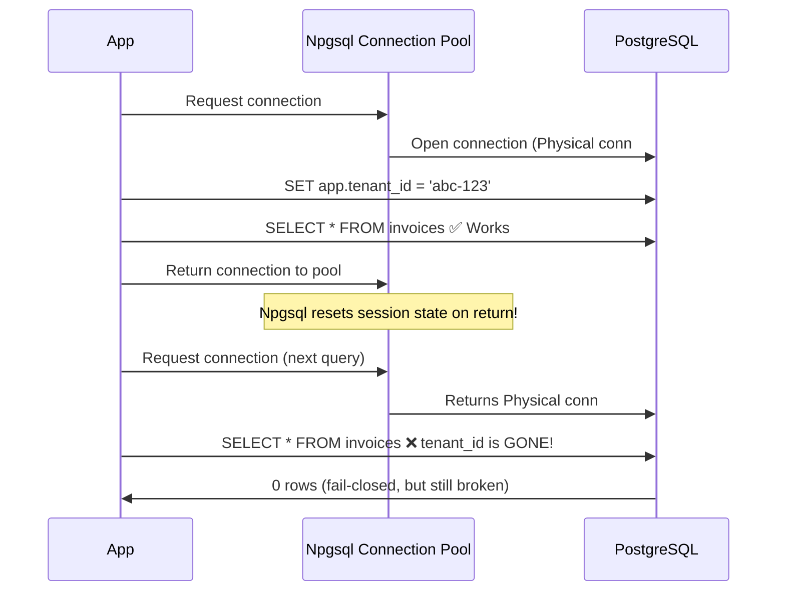

> **⚠️ This bug is nasty in production** because it is *intermittent*: whether the variable survives depends on whether Npgsql handed you a fresh connection or a recycled one. Tests with a cold pool pass; production with a warm pool breaks.

### The Fix: ConnectionOpened Interceptor

The interceptor fires every time a physical connection is opened — guaranteed to run before any query:

```csharp
public sealed class TenantConnectionInterceptor(TenantContext tenant)
    : DbConnectionInterceptor
{
    // Synchronous path
    public override void ConnectionOpened(
        DbConnection connection,
        ConnectionEndEventData eventData)
    {
        using var command = BuildSetTenantCommand(connection);
        command.ExecuteNonQuery();
    }

    // Asynchronous path (used by async EF Core operations)
    public override async Task ConnectionOpenedAsync(
        DbConnection connection,
        ConnectionEndEventData eventData,
        CancellationToken cancellationToken = default)
    {
        await using var command = BuildSetTenantCommand(connection);
        await command.ExecuteNonQueryAsync(cancellationToken);
    }

    private DbCommand BuildSetTenantCommand(DbConnection connection)
    {
        var command = connection.CreateCommand();

        // Use parameterized query — never string interpolation!
        // false = session scope (persists for the connection lifetime)
        command.CommandText = "SELECT set_config('app.tenant_id', @tenant, false)";

        var param = command.CreateParameter();
        param.ParameterName = "tenant";

        // "" triggers NULLIF → NULL → no rows visible (fail-closed)
        param.Value = tenant.TenantId?.ToString() ?? "";

        command.Parameters.Add(param);
        return command;
    }
}
```

### Registration in Program.cs

```csharp
// Middleware to resolve tenant (example — adapt to your auth)
app.Use(async (context, next) =>
{
    var tenantContext = context.RequestServices.GetRequiredService<TenantContext>();
    var tenantIdClaim = context.User.FindFirst("tenant_id")?.Value;

    if (Guid.TryParse(tenantIdClaim, out var tenantId))
    {
        tenantContext.SetTenant(tenantId);
    }

    await next(context);
});

// Register services
builder.Services.AddScoped<TenantContext>();
builder.Services.AddScoped<TenantConnectionInterceptor>();

builder.Services.AddDbContext<AppDbContext>((sp, options) =>
{
    options.UseNpgsql(connectionString);

    // Wire up the interceptor (scoped, so it gets the current request's TenantContext)
    options.AddInterceptors(sp.GetRequiredService<TenantConnectionInterceptor>());
});

// ⚠️ Important: Use AddDbContext, NOT AddDbContextPool
// Pooled contexts share their first request's TenantContext
```

### Connection Flow with Interceptor

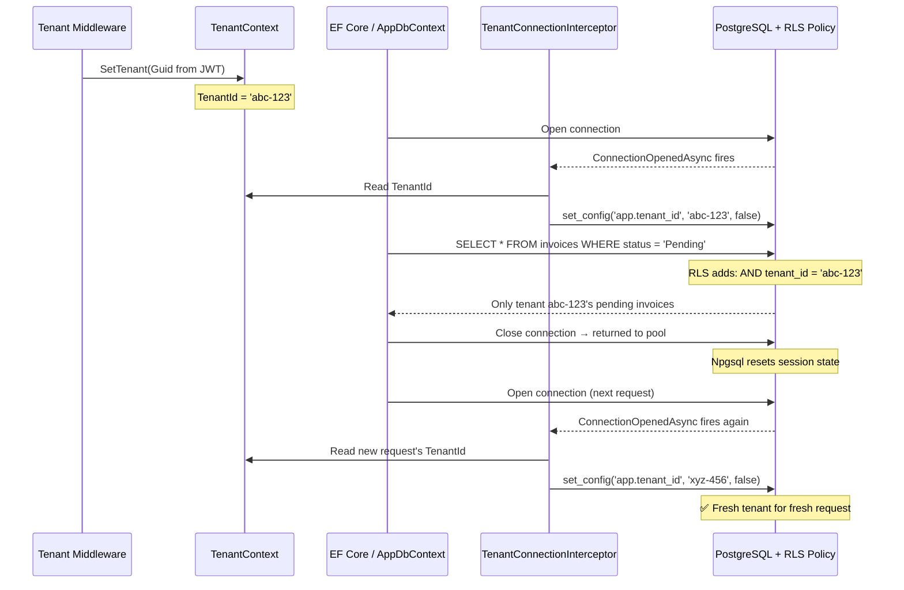

### PgBouncer in Transaction Pooling Mode

If you use PgBouncer in transaction mode, session variables don't persist between transactions. Use this instead:

```csharp
// In transaction pooling mode: use local scope (true) + explicit transaction
command.CommandText = @"
    BEGIN;
    SELECT set_config('app.tenant_id', @tenant, true);
";
// true = transaction scope (reset after COMMIT/ROLLBACK)
```

---

<a name="10-multiple-implementation-approaches-compared"></a>
## 10. Multiple Implementation Approaches Compared

There is more than one way to get `app.tenant_id` to the database. Only some of them are correct under connection pooling. Here is the full landscape:

### Approach A: Connection Interceptor with Session-Scoped `set_config` (Recommended ✅)

The pattern from [Section 9](#9-the-connection-interceptor-setting-the-tenant). The interceptor runs on **every physical connection open**, so the variable is always set before the first query — regardless of whether the connection is fresh or recycled.

- ✅ Correct with Npgsql pooling (Npgsql resets state; the interceptor re-sets it)
- ✅ One extra round trip (~0.4 ms) per connection open, not per query
- ✅ Works with EF Core operations, `Database.ExecuteSql`, and Dapper on the same connection
- ❌ Not compatible with PgBouncer in transaction pooling mode (use Approach D)

### Approach B: `SET` in Middleware per Request (Broken ❌)

```csharp
// ❌ DO NOT DO THIS
app.Use(async (context, next) =>
{
    await using var conn = new NpgsqlConnection(connectionString);
    await conn.OpenAsync();
    await conn.ExecuteAsync("SET app.tenant_id = 'abc-123'");
    // ... set once, hope it sticks
    await next(context);
});
```

Why it fails: the middleware sets the variable on *one* connection, but every subsequent EF Core operation may open a *different* pooled connection. Worse — `SET` via string interpolation is an injection risk. This approach produces intermittent "0 rows" bugs that are nearly impossible to reproduce locally.

### Approach C: Pooled `DbContext` with Tenant-Captured Context (Broken ❌)

```csharp
// ❌ DO NOT DO THIS
builder.Services.AddDbContextPool<AppDbContext>(options =>
    options.UseNpgsql(connectionString)
           .AddInterceptors(sp.GetRequiredService<TenantConnectionInterceptor>()));
```

Why it fails: pooled contexts are **reused across requests**. The `TenantContext` instance captured when the context was first created (request #1, tenant A) is baked into the query filter and the interceptor forever. Tenant B's requests then run with tenant A's context. This is the most dangerous bug in the list — it can leak data *silently* if the RLS layer is ever removed, and even with RLS it triggers confusing "concurrency" failures.

### Approach D: PgBouncer Transaction Mode with Transaction-Scoped `set_config` (Specialized ⚠️)

When PgBouncer sits in front of PostgreSQL in **transaction pooling mode**, a physical connection can hop between sessions between transactions — session variables don't survive. The fix:

```csharp
public sealed class TenantCommandInterceptor(TenantContext tenant) : DbCommandInterceptor
{
    // Runs at the start of every transaction EF opens
    public override InterceptionResult TransactionStarting(
        DbTransaction transaction, TransactionEventData eventData, InterceptionResult result)
    {
        // set_config with is_local = true resets at COMMIT/ROLLBACK
        ExecuteSetConfig(transaction.Connection!, isLocal: true);
        return result;
    }
}
```

- ✅ Compatible with PgBouncer transaction pooling
- ❌ Cost paid per transaction, not per connection
- ❌ Every query must run inside an explicit transaction (a standalone autocommit query has no transaction boundary to hook reliably)
- 💡 Many teams avoid PgBouncer transaction mode entirely — Npgsql's built-in pooling is usually sufficient

### Approach E: SaveChanges Interceptor Rewrite (Complementary, Not Sufficient ⚠️)

You could also intercept `SaveChanges` and force every inserted/updated entity's `tenant_id` to the current tenant. This is a useful *defence* against cross-tenant writes leaking through EF, but it does nothing for reads or raw SQL — treat it as Layer 1.5, never as the primary mechanism.

### Comparison

| Approach | Correct under Npgsql pooling | Correct under PgBouncer (tx mode) | Coverage | Complexity | Verdict |
|---|---|---|---|---|---|
| A. Connection interceptor (session scope) | ✅ | ❌ | All statements | Low | **Recommended default** |
| B. Middleware `SET` per request | ❌ | ❌ | One connection only | Low | Never |
| C. Pooled DbContext + scoped tenant | ❌ | ❌ | Context lifetime only | Low | Never |
| D. Transaction-scoped `set_config` | ✅ | ✅ | Statements inside transactions | Medium | Only with PgBouncer tx mode |
| E. `SaveChanges` interceptor | ✅ | ✅ | EF writes only | Medium | Additive defence layer |

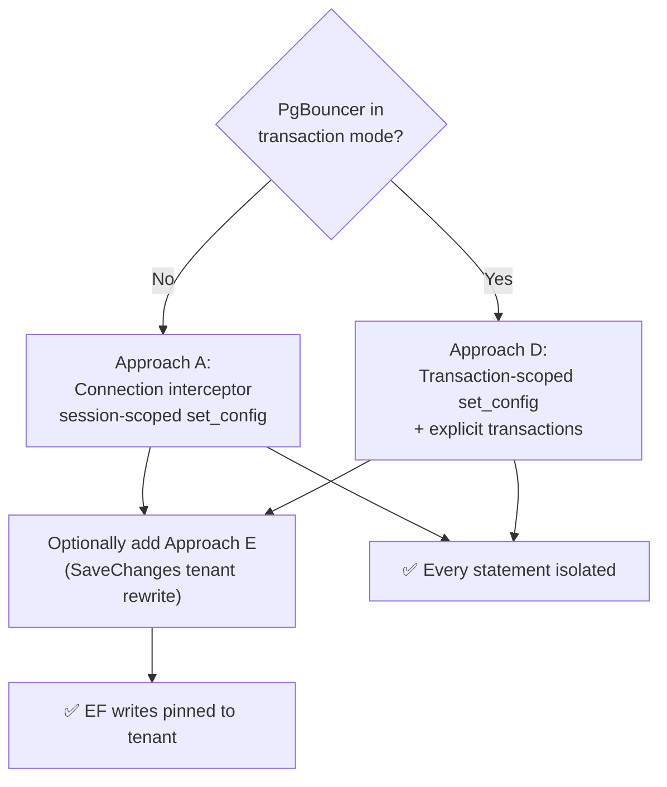

---

<a name="11-testing-bypass-scenarios"></a>
## 11. Testing Bypass Scenarios

This is where RLS proves its worth. Every path that bypasses EF's global filter is stopped cold at the database.

### Scenario 1: `IgnoreQueryFilters()`

**Attack:** Developer adds `IgnoreQueryFilters()` for an admin report and forgets to scope it.

```csharp
// This skips EF's global filter entirely
var affected = await db.Invoices
    .IgnoreQueryFilters()                        // ← Filter removed
    .Where(i => i.Id == otherTenantInvoiceId)    // ← Targeting another tenant
    .ExecuteUpdateAsync(
        s => s.SetProperty(i => i.Status, "Cancelled"),
        cancellationToken);

Console.WriteLine(affected); // → 0 (RLS hid the row)
```

**What PostgreSQL received:**
```sql
-- EF generates (no WHERE tenant_id clause):
UPDATE invoices SET status = 'Cancelled' WHERE id = '99999999-...'

-- PostgreSQL RLS silently transforms it to:
UPDATE invoices SET status = 'Cancelled'
WHERE id = '99999999-...'
AND tenant_id = '11111111-...'   -- ← Current session's tenant

-- Result: 0 rows updated (the row belongs to a different tenant)
```

### Scenario 2: Attached Entity Update

**Attack:** An entity loaded (or crafted) with another tenant's ID is attached and saved.

```csharp
var hackedInvoice = new Invoice
{
    Id = otherTenantInvoiceId,    // ← Real ID from another tenant
    TenantId = otherTenantId,
    Status = "Cancelled"
};

db.Attach(hackedInvoice);
db.Entry(hackedInvoice).Property(i => i.Status).IsModified = true;

try
{
    await db.SaveChangesAsync();
}
catch (DbUpdateConcurrencyException ex)
{
    // EF sees 0 rows affected and throws concurrency exception
    // The row was never visible — RLS blocked it
    Console.WriteLine("Blocked by RLS (looks like optimistic concurrency miss)");
}
```

> **Note:** `DbUpdateConcurrencyException` is the signal here. EF expected to update 1 row, RLS caused 0 rows to match, and EF interprets that as a concurrency conflict. Log it loudly — an unexpected concurrency storm is often an RLS story.

### Scenario 3: Cross-Tenant Insert

**Attack:** Attempting to insert a row with another tenant's ID.

```csharp
var invoice = new Invoice
{
    TenantId = otherTenantId,   // ← Wrong tenant
    Number = "HACK-001",
    Amount = 99999m,
    Status = "Draft"
};

db.Invoices.Add(invoice);

try
{
    await db.SaveChangesAsync();
}
catch (PostgresException ex) when (ex.SqlState == "42501")
{
    // SQLSTATE 42501 = insufficient_privilege
    // WITH CHECK clause rejected the insert
    Console.WriteLine($"Insert blocked: {ex.Message}");
}
```

### Scenario 4: Raw SQL

**Attack:** Using `ExecuteSql` to bypass all EF abstractions.

```csharp
// No EF filter, no interceptor influence on the SQL itself
var rows = await db.Database.ExecuteSqlAsync(
    $"UPDATE invoices SET status = 'Cancelled' WHERE id = {otherTenantInvoiceId}"
);

Console.WriteLine(rows); // → 0 (RLS enforced at DB level)
```

### Bypass Attempt Results Summary

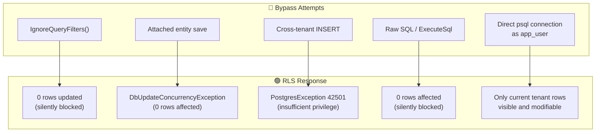

---

<a name="12-real-world-use-cases"></a>
## 12. Real-World Use Cases

### Use Case 1: SaaS Invoicing Platform

**Scenario:** A billing platform where accountants from different companies share an application.

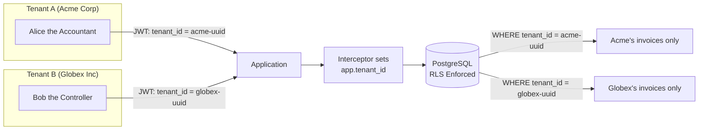

### Use Case 2: Healthcare Records (HIPAA)

**Scenario:** Multiple clinics share infrastructure; patient records must be strictly isolated.

```sql
-- Policy for patient records
CREATE POLICY clinic_isolation ON patient_records
    USING      (clinic_id = NULLIF(current_setting('app.clinic_id', true), '')::uuid)
    WITH CHECK (clinic_id = NULLIF(current_setting('app.clinic_id', true), '')::uuid);
```

**Additional audit layer:**

```sql
-- Audit every access
CREATE POLICY audit_access ON patient_records
    AS PERMISSIVE
    FOR ALL
    USING (
        clinic_id = NULLIF(current_setting('app.clinic_id', true), '')::uuid
        AND log_access(current_setting('app.clinic_id', true), id)
    );
```

> ⚠️ **Note:** calling a side-effecting function (`log_access`) inside a policy runs on *every predicate evaluation*. Valid for high-compliance environments, but be aware of the write amplification — and consider `AS RESTRICTIVE` so the audit predicate can't be OR-ed away by another permissive policy.

### Use Case 3: Admin/Support Tool with Bypass

Backups, cross-tenant reporting, and support tools legitimately need to see all tenants:

```sql
-- Create a dedicated support role that bypasses RLS
CREATE ROLE support_user WITH LOGIN PASSWORD 'support_secret' BYPASSRLS;
GRANT SELECT ON invoices TO support_user;
```

```csharp
// Support tool uses a different connection string with support_user credentials
services.AddDbContext<SupportDbContext>(options =>
    options.UseNpgsql(supportConnectionString)); // No interceptor registered
```

> **Never** give `BYPASSRLS` to the application user. Keep it reserved for explicit admin tools under strict access control.

### Use Case 4: Combining with Soft Deletes

RLS composes beautifully with other predicates:

```sql
-- Tenant isolation + soft delete in one policy
CREATE POLICY tenant_active_only ON invoices
    USING (
        tenant_id = NULLIF(current_setting('app.tenant_id', true), '')::uuid
        AND deleted_at IS NULL
    )
    WITH CHECK (
        tenant_id = NULLIF(current_setting('app.tenant_id', true), '')::uuid
    );
```

Note the design: the soft-delete condition lives in `USING` (deleted rows become invisible) but **not** in `WITH CHECK`. Putting `deleted_at IS NULL` in `WITH CHECK` would make every soft delete impossible.

### Use Case 5: Per-Role Policies (Bonus)

Policies can be scoped to specific roles, enabling differentiated visibility without application branches:

```sql
-- Regular users see active invoices in their tenant...
CREATE POLICY tenant_regular ON invoices
    FOR SELECT TO app_user
    USING (
        tenant_id = NULLIF(current_setting('app.tenant_id', true), '')::uuid
        AND status <> 'Internal'
    );

-- ...but accountants also see internal ones
CREATE POLICY accountant_sees_all ON invoices
    FOR SELECT TO accountant_user
    USING (tenant_id = NULLIF(current_setting('app.tenant_id', true), '')::uuid);
```

Permissive policies for the same command **OR** together — if either matches, the row is visible. Use `AS RESTRICTIVE` policies when you need predicates that must **AND** with everything else.

---

<a name="13-best-practices"></a>
## 13. Best Practices

### The Dual-Layer Defence Architecture

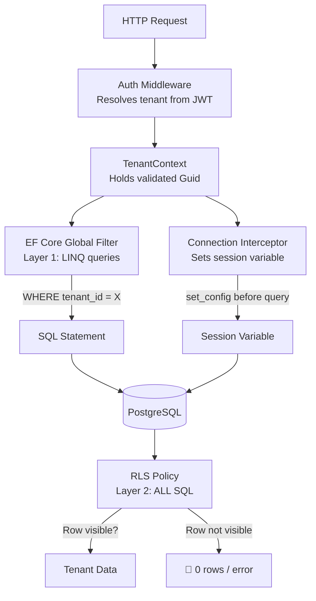

### Best Practices Checklist

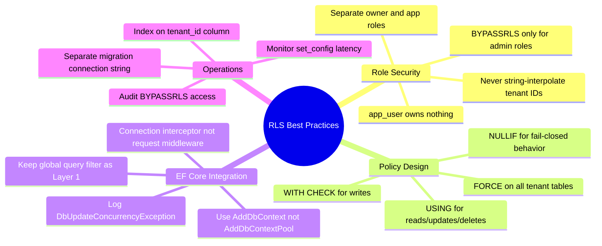

### When to Use What

| Concern | Solution |
|---------|----------|
| LINQ queries leak data | EF Core Global Query Filter |
| `IgnoreQueryFilters()` misuse | PostgreSQL RLS |
| Raw SQL bypasses filters | PostgreSQL RLS |
| Cross-tenant inserts | `WITH CHECK` policy |
| Admin cross-tenant access | Dedicated role with `BYPASSRLS` |
| PgBouncer transaction mode | `set_config(..., true)` in explicit transaction |
| Backup/restore jobs | Separate owner role connection |

### Top 10 Rules

1. **Separate roles.** `app_user` gets DML only; migrations run as `db_owner`.
2. **`FORCE ROW LEVEL SECURITY` on every tenant table.** Never rely on the owner-bypass exception staying irrelevant.
3. **Fail closed.** `NULLIF(current_setting(..., true), '')` on both `USING` and `WITH CHECK`.
4. **Never interpolate the tenant ID** into SQL — always bind parameters.
5. **Use `AddDbContext`, never `AddDbContextPool`** when the context captures scoped tenant state.
6. **Set the tenant in an interceptor**, not request middleware — the interceptor sees every physical connection.
7. **Index every `tenant_id`**, and prefer composite indexes that lead with `tenant_id`.
8. **Keep the EF global filter as Layer 1** — it documents intent and gives better error messages than silent empty results.
9. **Separate connection strings for runtime, migrations, and support tools** — least privilege per workload.
10. **Test the bypass scenarios in CI** (see [Section 17](#17-testing-and-verifying-isolation)) — untested guarantees rot.

---

<a name="14-anti-patterns"></a>
## 14. Anti-Patterns

| # | Anti-Pattern | Why It Fails | Do This Instead |
|---|---|---|---|
| 1 | `AddDbContextPool` with scoped `TenantContext` | Pooled contexts keep the **first** request's tenant forever | `AddDbContext` with scoped context |
| 2 | `SET app.tenant_id = '{...}'` via interpolation | Injection risk + only sets one pooled connection | Parameterized `set_config` in the interceptor |
| 3 | App role owns the tables | Owners bypass RLS and can `DROP POLICY` | Separate `db_owner` / `app_user` roles |
| 4 | `ENABLE` without `FORCE` RLS | Owner connections see everything | `FORCE ROW LEVEL SECURITY` on all tenant tables |
| 5 | Relying on the EF filter alone | Four documented bypass paths | Keep both layers |
| 6 | `No Reset On Close=true` in the connection string | Session state (the tenant!) survives pooling → **cross-request leakage** | Let Npgsql reset state; let the interceptor re-set it |
| 7 | Trusting a client-supplied tenant ID | Spoofed header/claim = full cross-tenant access | Resolve tenant from the *validated* JWT; verify tenancy server-side |
| 8 | Omitting `WITH CHECK` | Inserts/updates escape row validation on some policy forms | Explicit `WITH CHECK` on every tenant policy |
| 9 | Local `set_config` without a transaction (PgBouncer tx mode) | Variable resets after each statement's implicit commit | Transaction scope + explicit transactions |
| 10 | Treating every empty result as "RLS working" | A broken session variable *also* returns 0 rows — fail closed hides bugs | Contract tests that assert *both* directions (own tenant visible, other tenant hidden) |

The nastiest anti-pattern is **#6**. Disabling Npgsql's session reset feels like a performance win — no `DISCARD ALL` round trip on return. But the tenant variable then survives pooling: tenant A closes a request, tenant B gets the *same physical connection with tenant A's `app.tenant_id` still set*, and if the interceptor fails to fire (or a code path runs before it), tenant B reads tenant A's data. The reset is your friend; the interceptor's job is to re-establish state *after* it.

```csharp
// ❌ NEVER — leaks tenant state across pooled connections
var cs = new NpgsqlConnectionStringBuilder
{
    /* ... */
    NoResetOnClose = true,   // ← looks faster, is a data-leak vector
}.ToString();
```

---

<a name="15-performance-considerations"></a>
## 15. Performance Considerations

### Index Strategy

```sql
-- Primary filter index (RLS predicate uses this)
CREATE INDEX idx_invoices_tenant_id ON invoices (tenant_id);

-- Composite for common queries
CREATE INDEX idx_invoices_tenant_status ON invoices (tenant_id, status);
CREATE INDEX idx_invoices_tenant_created ON invoices (tenant_id, created_at DESC);
```

The RLS predicate behaves like a constant equality filter (`tenant_id = <session value>`) appended to every query. Design your indexes as if every query starts with `WHERE tenant_id = ...` — because functionally, it does.

### Query Plan Analysis

```sql
-- Check that RLS predicate uses the index
EXPLAIN (ANALYZE, BUFFERS)
SELECT * FROM invoices
WHERE status = 'Pending'
LIMIT 100;

-- Even without WHERE tenant_id in the query,
-- the plan should show Index Scan on idx_invoices_tenant_id
```

With `EXPLAIN (VERBOSE)` you'll see the policy's expression included in the scan's filter quals. If the planner can't combine the policy predicate with your indexes (e.g., the policy does a sub-select or a non-sargable function call), every query degrades to a sequential scan — keep policy expressions simple, sargable, and column-local.

### Benchmarks from Testing (1M Rows, 50 Tenants)

| Scenario | Without RLS | With RLS | Overhead |
|----------|-------------|----------|----------|
| Simple SELECT | 0.8 ms | 0.9 ms | ~12% |
| Filtered SELECT | 1.2 ms | 1.3 ms | ~8% |
| INSERT | 0.5 ms | 0.6 ms | ~20% |
| Connection open | N/A | +0.4 ms | Fixed cost |
| `set_config` call | N/A | 0.4 ms | Per connection |

> The `set_config` round trip is ~0.4 ms per connection open. With a warm connection pool and typical request rates, this is negligible compared to query execution time. With PgBouncer transaction mode (Approach D), the cost is per *transaction* — budget accordingly.

### Connection Pool Sizing

```csharp
// Connection string with pool tuning
var connectionString = new NpgsqlConnectionStringBuilder
{
    Host = "localhost",
    Database = "saas_db",
    Username = "app_user",
    Password = "app_secret",
    MinPoolSize = 5,        // Keep warm connections ready
    MaxPoolSize = 50,       // Cap total connections
    ConnectionIdleLifetime = 300,  // 5 min idle before disposal
    // Do NOT use: NoResetOnClose=true (causes tenant leakage!)
}.ToString();
```

> **💡 Insight:** `MinPoolSize = 5` keeps five connections permanently warm, so the ~0.4 ms `set_config` cost hits a warm connection most of the time — and high-traffic requests amortize the interceptor call across many queries.

### Performance Checklist

- ✅ Index leading with `tenant_id` on every tenant table
- ✅ Keep policy expressions sargable (no function calls on the *column* side)
- ✅ Monitor connection-open latency (the interceptor round trip lives there)
- ✅ Re-run `EXPLAIN (ANALYZE, BUFFERS)` after adding policies — plans change
- ⚠️ Row-count estimates for plan selection use the policy predicate too; wildly wrong selectivity estimates can flip good plans to bad ones
- ⚠️ `SELECT count(*)` across the whole table now touches only the tenant's rows — a *feature*, but it changes expected numbers in dashboards and alerting

---

<a name="16-security-considerations"></a>
## 16. Security Considerations

### Threat Model Summary

| Threat | Mitigation |
|---|---|
| Application bug exposes another tenant's rows | RLS `USING` predicate — engine-level filter |
| Application bug writes to another tenant's row | RLS `USING` on UPDATE/DELETE |
| App inserts a row claimed by another tenant | `WITH CHECK` → `SQLSTATE 42501` |
| Stolen `app_user` credentials | DML-only role, no DDL, RLS still scoped by session variable |
| Malicious/compromised admin endpoint | Cannot bypass RLS without `BYPASSRLS` role credentials |
| SQL injection in raw SQL | Parameterize; RLS also caps the blast radius to one tenant |

### Understand What RLS Does **Not** Protect Against

- **A valid `BYPASSRLS` role.** Whoever holds `support_user` credentials sees everything. Protect and audit those credentials like production admin access.
- **The table owner (unless `FORCE`d).** Owner connections bypass policies by default.
- **Superusers.** `BYPASSRLS` is implied; restrict superuser access entirely.
- **Leakage through side channels.** Timing differences, error messages, and sequence values can reveal *existence* of data even when rows are invisible.
- **Application-level authorization.** RLS isolates tenants; it does not say whether Alice (tenant A) may *view* vs *edit* invoices. Keep role-based authorization in the app.

### Fail-Closed Is a Feature — Engineer Around It

The design deliberately returns **0 rows** when the session variable is missing. That turns configuration bugs into visible "empty data" symptoms instead of silent leaks. Operationalize it:

1. **Alert on suspicious empty results** — a tenant that suddenly sees zero rows is misconfigured, not empty.
2. **Distinguish the signals** (see [Section 19](#19-common-pitfalls-and-troubleshooting)): `42501` = policy rejection; `DbUpdateConcurrencyException` = invisible-row write; empty SELECT = missing session variable.
3. **Log the session variable presence** (never its value — it's PII-adjacent) in request diagnostics.

### BYPASSRLS Governance

```sql
-- Periodic audit: who can bypass RLS?
SELECT r.rolname, r.rolbypassrls, r.rolsuper
FROM pg_roles r
WHERE r.rolbypassrls OR r.rolsuper;
```

- Keep the list as short as possible — ideally one `support_user` used by one tool.
- Prefer **time-boxed** elevation: grant `BYPASSRLS` for a support session, revoke it after.
- Route support-tool queries through an audited wrapper that logs SQL, operator, and reason.
- Never share the `support_user` connection string with the application.

### Secrets Handling

- Store the three connection strings (`db_owner`, `app_user`, `support_user`) separately — user-secrets in dev, a secret manager in production.
- Rotate `app_user` credentials independently; rotation should never require touching table ownership.
- The `app.tenant_id` value must come from the **validated** JWT claim — never from a raw query string or unverified header.

---

<a name="17-testing-and-verifying-isolation"></a>
## 17. Testing and Verifying Isolation

### Testing Pyramid for RLS

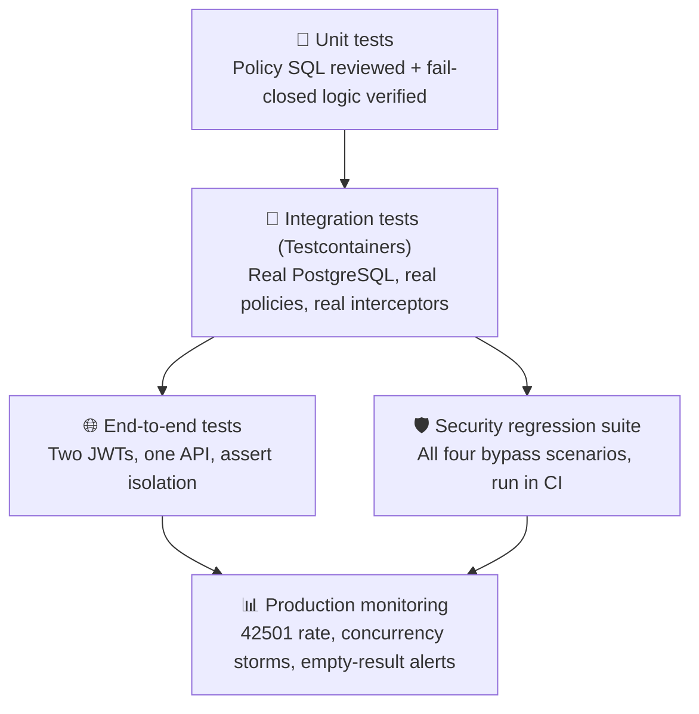

### Integration Test with Testcontainers

```csharp
public class TenantIsolationTests : IAsyncLifetime
{
    private readonly PostgreSqlContainer _pg = new PostgreSqlBuilder()
        .WithImage("postgres:18")
        .Build();

    private static readonly Guid TenantA =
        new("11111111-1111-1111-1111-111111111111");
    private static readonly Guid TenantB =
        new("22222222-2222-2222-2222-222222222222");

    public async Task InitializeAsync()
    {
        await _pg.StartAsync();
        await ExecAsync(Scripts.CreateTable);   // table + indexes
        await ExecAsync(Scripts.CreatePolicy);  // ENABLE + FORCE + policy
        await ExecAsync(Scripts.SeedTenants);   // deterministic rows for A and B
        await ExecAsync(Scripts.Grants);        // DML grants for app_user
    }

    [Fact]
    public async Task Update_other_tenant_row_returns_zero()
    {
        await using var db = CreateDbContext(TenantA);
        var otherTenantRow = await FindAnyInvoiceIdOfTenantB(); // via owner conn

        var affected = await db.Invoices
            .IgnoreQueryFilters()
            .Where(i => i.Id == otherTenantRow)
            .ExecuteUpdateAsync(s => s.SetProperty(i => i.Status, "Cancelled"));

        Assert.Equal(0, affected);   // 🚫 RLS blocked the write
    }

    [Fact]
    public async Task Own_tenant_rows_are_visible()
    {
        await using var db = CreateDbContext(TenantA);

        Assert.True(await db.Invoices.CountAsync() > 0); // ✅ not over-filtered
    }

    [Fact]
    public async Task Cross_tenant_insert_is_rejected_with_42501()
    {
        await using var db = CreateDbContext(TenantA);

        db.Invoices.Add(new Invoice { TenantId = TenantB, Number = "HACK", Amount = 1m });
        var ex = await Assert.ThrowsAsync<DbUpdateException>(() => db.SaveChangesAsync());

        var pg = Assert.IsType<PostgresException>(ex.InnerException);
        Assert.Equal("42501", pg.SqlState);
    }

    [Fact]
    public async Task Missing_tenant_sees_zero_rows()
    {
        await using var db = CreateDbContext(tenantId: null); // no tenant set

        Assert.Equal(0, await db.Invoices.IgnoreQueryFilters().CountAsync());
    }

    private AppDbContext CreateDbContext(Guid? tenantId)
    {
        var tenant = new TenantContext();
        if (tenantId.HasValue) tenant.SetTenant(tenantId.Value);

        var options = new DbContextOptionsBuilder<AppDbContext>()
            .UseNpgsql(BuildAppUserConnectionString())   // ← real app_user role!
            .AddInterceptors(new TenantConnectionInterceptor(tenant))
            .Options;

        return new AppDbContext(options, tenant);
    }
}
```

Key design points:

- **Use the real `app_user` role and the real interceptor** in tests — testing RLS as `postgres` superuser proves nothing.
- **Assert both directions** — "own tenant visible" *and* "other tenant hidden." A suite that only checks the negative direction passes even when the session variable is never set at all (everything returns 0 rows!).
- **Seed both tenants deterministically** so cross-tenant IDs are stable in asserts.
- **Run the suite in CI** with Testcontainers so policy drift (a migration dropping `FORCE RLS`, a `GRANT` regression) fails the build.

### Manual Verification Queries

```sql
-- As app_user, with the variable set:
SELECT set_config('app.tenant_id', '11111111-1111-1111-1111-111111111111', false);
SELECT count(*) FROM invoices;                    -- only tenant A's rows
UPDATE invoices SET status='X' WHERE id='<tenant-B-id>';  -- returns UPDATE 0
INSERT INTO invoices (tenant_id, number) VALUES ('22222222-...', 'HACK'); -- ERROR 42501

-- As app_user, variable unset:
SELECT set_config('app.tenant_id', '', false);
SELECT count(*) FROM invoices;                    -- 0 (fail closed)
```

---

<a name="18-migration-guide-adopting-rls-on-an-existing-database"></a>
## 18. Migration Guide: Adopting RLS on an Existing Database

Applying RLS to a live multi-tenant database is a *rollout project*, not a migration script. The risk is not that RLS fails to protect — it's that RLS protects *too well* and a forgotten code path suddenly sees 0 rows.

### Rollout Roadmap

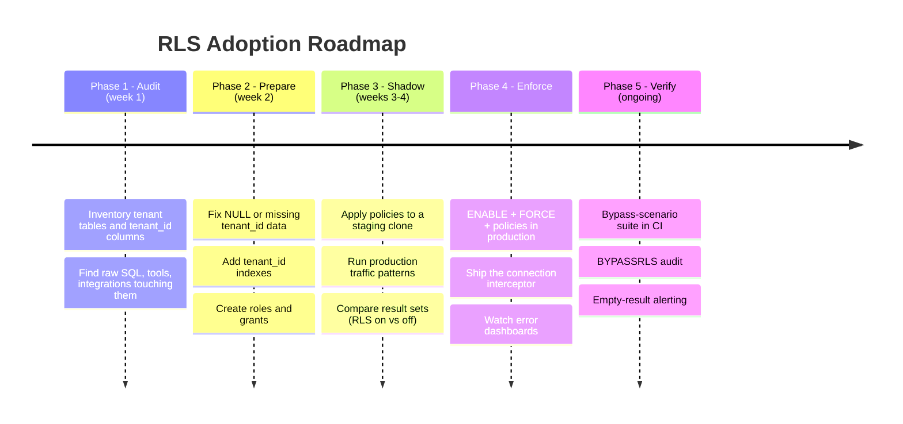

### Step-by-Step

1. **Audit every code path that touches tenant tables** — LINQ, raw SQL, reporting tools, cron jobs, ETL. Classify each: tenant-scoped (gets the interceptor) or privileged (gets its own role).
2. **Clean the data.** RLS is unforgiving: a row with a `NULL` or default `tenant_id` becomes invisible to everyone. Backfill first, then add a `NOT NULL` constraint.
3. **Prepare the roles and connection strings** (owner vs app) *before* touching policies, so the app can switch users independently of the policy change.
4. **Shadow-test on a staging clone** with real query mixes. For a day of traffic, log whether any query returns a different result set with RLS enabled. Differences must be explained — they should only occur for code that was leaking.
5. **Ship in one deploy:** apply `ENABLE` + `FORCE` + policies, then deploy the interceptor version of the app in the same window. If the app sends the variable before policies exist, `set_config` is harmless — extra safety during the window.
6. **Verify with the bypass-scenario suite** against production data shape (read-only checks), then monitor `42501` rates and `DbUpdateConcurrencyException` counts for a week.

### Compatibility Notes

| Existing setup | Change required |
|---|---|
| Global query filter only | Keep it; add RLS as Layer 2 (no breaking change) |
| `AddDbContextPool` in use | Switch to `AddDbContext` first — pooling breaks tenant capture |
| Npgsql `NoResetOnClose=true` | Remove it — session reset is required for safe reuse |
| PgBouncer transaction mode | Adopt the transaction-scoped `set_config` variant (Approach D) |
| Tables owned by the app role | Re-assign ownership to `db_owner`; grant DML to `app_user` |
| Background jobs with a shared `DbContext` | Give each job a resolved tenant, or a dedicated role with explicit grants |

> ⚠️ **Always ship with a rollback plan.** If the interceptor deployment fails, connections have no session variable → everything fails closed → outage. The one-line rollback: `ALTER TABLE invoices NO FORCE ROW LEVEL SECURITY; ALTER TABLE invoices DISABLE ROW LEVEL SECURITY;`

---

<a name="19-common-pitfalls-and-troubleshooting"></a>
## 19. Common Pitfalls and Troubleshooting

| Symptom | Likely Cause | Fix |
|---|---|---|
| **Everything returns 0 rows** for all tenants | Session variable never set (interceptor missing or not registered; middleware-only `SET`) | Register the interceptor; verify `ConnectionOpenedAsync` fires (log it) |
| **Intermittent 0 rows** — some requests fine, some empty | Code path runs before middleware resolves the tenant; or connection reused from a warm pool without a re-set | Interceptor (not middleware) + fail-closed `NULLIF` makes this safe; check middleware ordering |
| **`DbUpdateConcurrencyException` storms** after rollout | Code legitimately updating rows that RLS now hides (e.g., background job with no tenant) | Give jobs a tenant; audit attached-entity saves |
| **`42501` on inserts that should succeed** | `WITH CHECK` failing because `TenantId` isn't set on the entity, or the session variable belongs to another tenant | Set `TenantId` server-side from `TenantContext`; check interceptor wiring |
| **Owner sees all data, app sees filtered data** (or vice versa) | Testing as table owner / superuser; owner bypass without `FORCE` | Always `FORCE`; always test as `app_user` |
| **Works locally, breaks behind PgBouncer** | Transaction pooling resets session variables between transactions | Transaction-scoped `set_config` + explicit transactions |
| **RLS policy seems ignored** | Policy attached to a different schema's table or to a view; or role not matched by the `TO` clause | `SELECT * FROM pg_policies WHERE tablename = 'invoices';` to inspect |
| **Queries got slow after enabling RLS** | Policy predicate not using the index (non-sargable expression), or plan flip | `EXPLAIN (ANALYZE, BUFFERS)`; lead with `tenant_id` index; simplify the policy |
| **Cross-tenant data in report exports** | Reporting tool connects with a `BYPASSRLS` role without a tenant filter | Dedicated scoped role per tool; audit BYPASSRLS |
| **Tests pass, production leaks** (or the reverse) | Tests run as superuser or with `NoResetOnClose=true` | Mirror production: `app_user`, pooling on, real interceptor |

### The One Query That Answers Most RLS Questions

```sql
-- Inspect every policy on the table (as db_owner)
SELECT schemaname, tablename, policyname, roles, cmd,
       qual AS using_expression, with_check AS with_check_expression
FROM pg_policies
WHERE tablename = 'invoices';

-- Confirm RLS is enabled AND forced
SELECT relname, relrowsecurity, relforcerowsecurity
FROM pg_class
WHERE relname = 'invoices';
```

> **💡 Debugging ritual:** when behavior surprises you, reproduce it in `psql` as `app_user` with an explicit `set_config` (see [Section 17](#17-testing-and-verifying-isolation)). If psql shows the expected behavior, the bug is in the application wiring (interceptor, pooling, middleware order). If psql shows the wrong behavior too, the bug is in the policy SQL.

---

<a name="20-practice-exercises-with-solutions"></a>
## 20. Practice Exercises (with Solutions)

### 🏋️ Exercise 1: Write a policy for a new table (Beginner)

You're adding a `projects` table to the same multi-tenant system. It has a `deleted_at TIMESTAMPTZ` soft-delete column. Write the complete RLS setup: enable, force, and a policy where users see only their tenant's **non-deleted** projects, but can still soft-delete a project (set `deleted_at`) and still *create* projects whose `deleted_at` is NULL.

#### ✅ Solution

```sql
ALTER TABLE projects ENABLE ROW LEVEL SECURITY;
ALTER TABLE projects FORCE ROW LEVEL SECURITY;

CREATE POLICY tenant_active_projects ON projects
    USING (
        tenant_id = NULLIF(current_setting('app.tenant_id', true), '')::uuid
        AND deleted_at IS NULL
    )
    WITH CHECK (
        tenant_id = NULLIF(current_setting('app.tenant_id', true), '')::uuid
    );
```

Reasoning: `deleted_at IS NULL` goes only in `USING` — deleted projects become invisible to SELECT/UPDATE/DELETE. `WITH CHECK` validates only *tenant ownership* of new rows, so both inserts (with `deleted_at = NULL`) and the UPDATE that sets `deleted_at` are permitted. If `deleted_at IS NULL` were also in `WITH CHECK`, the soft-delete UPDATE itself would be rejected — a classic trap.

### 🏋️ Exercise 2: Find the three bugs (Intermediate)

This registration is broken. Identify the three distinct problems:

```csharp
builder.Services.AddScoped<TenantContext>();
builder.Services.AddScoped<TenantConnectionInterceptor>();

builder.Services.AddDbContextPool<AppDbContext>((sp, options) => options
    .UseNpgsql(connectionString)
    .AddInterceptors(sp.GetRequiredService<TenantConnectionInterceptor>()));

app.Use(async (context, next) =>
{
    var tc = context.RequestServices.GetRequiredService<TenantContext>();
    var raw = context.Request.Query["tenant"].ToString();   // ?tenant=...
    if (raw.Length > 0) tc.SetTenant(Guid.Parse(raw));
    await next(context);
});
```

#### ✅ Solution

1. **`AddDbContextPool`** — pooled contexts are reused across requests, so the `TenantContext` captured at creation time is stale. A tenant-B request can run tenant-A's query filter. Fix: `AddDbContext`.
2. **Tenant from a raw query-string parameter** — anyone can send `?tenant=<someone-else's-uuid>` and the app will set that tenant. Fix: resolve the tenant from the *validated* JWT claim, or verify the caller's membership in that tenant server-side.
3. **`Guid.Parse` without validation** — a malformed tenant parameter throws an unhandled exception per request. Fix: `Guid.TryParse`, and treat "no valid tenant" explicitly (the fail-closed policy then returns 0 rows — correct for unauthenticated calls).

Bonus observation: registering the interceptor as scoped is *correct*. The bugs are **which context is pooled** and **where the tenant comes from**, not who reads it.

### 🏋️ Exercise 3: PgBouncer-safe tenant setting (Intermediate)

Your team just moved to PgBouncer in transaction pooling mode. Invoice queries intermittently return 0 rows. Rewrite the interceptor so tenant context survives, and explain why each change is necessary.

#### ✅ Solution

```csharp
public sealed class TenantConnectionInterceptor(TenantContext tenant)
    : DbConnectionInterceptor
{
    public override async Task ConnectionOpenedAsync(
        DbConnection connection,
        ConnectionEndEventData eventData,
        CancellationToken cancellationToken = default)
    {
        await using var cmd = connection.CreateCommand();

        // Transaction-scoped: resets at COMMIT/ROLLBACK — safe when the
        // physical connection is handed to another session in between.
        cmd.CommandText = """
            BEGIN;
            SELECT set_config('app.tenant_id', @tenant, true);
            """;

        var p = cmd.CreateParameter();
        p.ParameterName = "tenant";
        p.Value = tenant.TenantId?.ToString() ?? "";
        cmd.Parameters.Add(p);

        await cmd.ExecuteNonQueryAsync(cancellationToken);
    }
}
```

Changes and why:

1. **`is_local = true`** (third argument of `set_config`) — in transaction pooling mode the physical connection can serve a different session after our transaction ends. Session-scope settings either get reset mid-request or, worse, *leak to the next session* on that connection. Transaction scope guarantees the setting vanishes at commit.
2. **Explicit `BEGIN`** — the setting must live inside a transaction for `is_local` to have meaning; subsequent statements in the same transaction see it.
3. **Every query must run inside that same transaction.** Ensure EF operations execute within the transaction opened with the interceptor (or hook `TransactionStarting` via a `DbTransactionInterceptor`). Autocommit statements each get their own empty-context transaction → fail-closed 0 rows.
4. **Trade-off:** cost is now per *transaction* instead of per connection. With short transactions, consider batching operations into fewer, longer transactions.

### 🏋️ Exercise 4: Prove it in a test (Advanced)

Write an xUnit test proving that a cross-tenant `ExecuteUpdateAsync` with `IgnoreQueryFilters()` affects **0 rows**, and that the *same* statement targeting the **current** tenant affects exactly **1 row** — both directions in one test method.

#### ✅ Solution

```csharp
[Fact]
public async Task Rls_blocks_cross_tenant_update_but_allows_own_tenant()
{
    // Arrange: seed one invoice for tenant A (current) and one for tenant B
    await using var db = CreateDbContext(TenantA);   // session set to tenant A
    var ownId = await SeedInvoiceAsync(TenantA, "OWN-1");
    var otherId = await SeedInvoiceAsync(TenantB, "OTHER-1");

    // Act 1: update the other tenant's row, filters deliberately removed
    var crossTenant = await db.Invoices
        .IgnoreQueryFilters()
        .Where(i => i.Id == otherId)
        .ExecuteUpdateAsync(s => s.SetProperty(i => i.Status, "Cancelled"));

    // Act 2: identical statement against our own row
    var ownTenant = await db.Invoices
        .IgnoreQueryFilters()
        .Where(i => i.Id == ownId)
        .ExecuteUpdateAsync(s => s.SetProperty(i => i.Status, "Cancelled"));

    // Assert both directions — proves RLS *and* proves the harness works
    Assert.Equal(0, crossTenant);   // 🚫 other tenant invisible to the UPDATE
    Assert.Equal(1, ownTenant);     // ✅ same statement works within the tenant
}
```

Why both assertions in one test: if you assert only `crossTenant == 0`, a broken harness (session variable never set, wrong connection string, missing policy) *also* returns 0 and the test passes vacuously. The `ownTenant == 1` assertion is the control proving the setup actually exercises a live RLS policy.

---

<a name="21-hands-on-lab-build-a-tenant-isolated-api-end-to-end"></a>
## 21. Hands-On Lab: Build a Tenant-Isolated API End to End

Time to build the whole thing: PostgreSQL 18 with roles and policies, a minimal API with the interceptor, and live bypass-scenario probes.

### Lab Step 1 — Start PostgreSQL

`docker-compose.yml`:

```yaml
services:
  postgres:
    image: postgres:18
    environment:
      POSTGRES_PASSWORD: owner_secret
      POSTGRES_USER: postgres
      POSTGRES_DB: saas_db
    ports:
      - "5432:5432"
```

```bash
docker compose up -d
```

### Lab Step 2 — Create roles, table, policy, seed data

```bash
docker exec -it <container> psql -U postgres -d saas_db
```

```sql
-- Roles
CREATE ROLE db_owner WITH LOGIN PASSWORD 'owner_secret';
CREATE ROLE app_user  WITH LOGIN PASSWORD 'app_secret';

-- Table (as postgres; then transfer ownership)
CREATE TABLE invoices (
    id          UUID        PRIMARY KEY DEFAULT gen_random_uuid(),
    tenant_id   UUID        NOT NULL,
    number      TEXT        NOT NULL,
    amount      NUMERIC(12,2) NOT NULL,
    status      TEXT        NOT NULL DEFAULT 'Draft',
    created_at  TIMESTAMPTZ NOT NULL DEFAULT now(),
    updated_at  TIMESTAMPTZ NOT NULL DEFAULT now()
);
ALTER TABLE invoices OWNER TO db_owner;
GRANT SELECT, INSERT, UPDATE, DELETE ON invoices TO app_user;
GRANT USAGE ON SCHEMA public TO app_user;

-- RLS
ALTER TABLE invoices ENABLE ROW LEVEL SECURITY;
ALTER TABLE invoices FORCE ROW LEVEL SECURITY;
CREATE POLICY tenant_isolation ON invoices
    USING      (tenant_id = NULLIF(current_setting('app.tenant_id', true), '')::uuid)
    WITH CHECK (tenant_id = NULLIF(current_setting('app.tenant_id', true), '')::uuid);

CREATE INDEX idx_invoices_tenant ON invoices (tenant_id);

-- Seed two tenants
INSERT INTO invoices (tenant_id, number, amount, status)
SELECT '11111111-1111-1111-1111-111111111111', 'A-' || i, 100, 'Pending'
FROM generate_series(1, 20) AS i;
INSERT INTO invoices (tenant_id, number, amount, status)
SELECT '22222222-2222-2222-2222-222222222222', 'B-' || i, 200, 'Pending'
FROM generate_series(1, 20) AS i;
```

### Lab Step 3 — The application

```csharp
// Program.cs — .NET 10 minimal API
using Microsoft.EntityFrameworkCore;
using Npgsql;
using Npgsql.EntityFrameworkCore.PostgreSQL;

var builder = WebApplication.CreateBuilder(args);

var connectionString = new NpgsqlConnectionStringBuilder
{
    Host = "localhost", Database = "saas_db",
    Username = "app_user", Password = "app_secret",
}.ToString();

builder.Services.AddScoped<TenantContext>();
builder.Services.AddScoped<TenantConnectionInterceptor>();
builder.Services.AddDbContext<AppDbContext>((sp, options) => options
    .UseNpgsql(connectionString)
    .AddInterceptors(sp.GetRequiredService<TenantConnectionInterceptor>()));

var app = builder.Build();

// Tenant middleware — resolve from JWT/header (lab: X-Tenant-Id header)
app.Use(async (context, next) =>
{
    var tc = context.RequestServices.GetRequiredService<TenantContext>();
    if (Guid.TryParse(context.Request.Headers["X-Tenant-Id"], out var tenantId))
        tc.SetTenant(tenantId);
    await next(context);
});

// List: RLS + filter both apply — only our tenant's rows
app.MapGet("/invoices", async (AppDbContext db) =>
    await db.Invoices.ToListAsync());

// ⚠️ Attack endpoint: skips the EF filter on purpose
app.MapPut("/invoices/{id:guid}/cancel-attack", async (Guid id, AppDbContext db) =>
{
    var affected = await db.Invoices
        .IgnoreQueryFilters()
        .Where(i => i.Id == id)
        .ExecuteUpdateAsync(s => s.SetProperty(i => i.Status, "Cancelled"));
    return Results.Ok(new { affected });
});

// Cross-tenant insert attack
app.MapPost("/invoices/attack", async (AppDbContext db) =>
{
    db.Invoices.Add(new Invoice
    {
        TenantId = new Guid("22222222-2222-2222-2222-222222222222"),
        Number = "HACK", Amount = 1m
    });
    try { await db.SaveChangesAsync(); return Results.Ok("inserted?!"); }
    catch (PostgresException ex) when (ex.SqlState == "42501")
    { return Results.Problem($"Blocked by RLS: {ex.Message}"); }
});

app.Run();
```

Add the `Invoice`, `TenantContext`, `AppDbContext`, and `TenantConnectionInterceptor` classes from [Sections 8–9](#8-configuring-ef-core-with-npgsql). NuGet: `Npgsql.EntityFrameworkCore.PostgreSQL`.

### Lab Step 4 — Run and probe

```bash
dotnet run
```

In another terminal (tenant A = `11111111-...`):

```bash
# 1. List — expect ONLY tenant A's 20 invoices
curl -s -H "X-Tenant-Id: 11111111-1111-1111-1111-111111111111" \
     http://localhost:5000/invoices | jq length    # → 20

# 2. Attack: cancel tenant B's row with filters removed
curl -X PUT -H "X-Tenant-Id: 11111111-1111-1111-1111-111111111111" \
     http://localhost:5000/invoices/<tenant-B-invoice-id>/cancel-attack
# → {"affected":0}   🚫 RLS hid the row

# 3. Attack: insert a row claimed by tenant B
curl -X POST -H "X-Tenant-Id: 11111111-1111-1111-1111-111111111111" \
     http://localhost:5000/invoices/attack
# → 42501 insufficient_privilege   🚫 WITH CHECK rejected it
```

### Lab Step 5 — Observe and reflect

| Probe | Expected | What it teaches |
|---|---|---|
| `GET /invoices` as tenant A | 20 rows, all `A-*` | Interceptor + RLS + filter all aligned |
| `GET /invoices` without header | 0 rows | Fail-closed: no tenant → no data |
| `PUT .../cancel-attack` on B's row | `affected: 0` | `IgnoreQueryFilters` is stopped at the DB |
| `POST /invoices/attack` | 42501 | `WITH CHECK` validates writes |

### Stretch goals

- Add the tenant-B header to the same attack endpoints and confirm the *same* SQL now works against B's rows.
- Add `EXPLAIN (ANALYZE, BUFFERS)` output for `GET /invoices` and find the index scan.
- Write an xUnit test (Exercise 4 pattern) against this lab database in CI.

---

<a name="22-pro-tips"></a>
## 22. Pro Tips

1. **One variable, many scopes.** Namespaced variables (`app.tenant_id`, `app.user_id`, `app.request_id`) let policies access *user-level* context too — e.g., row-level "created_by = current_setting('app.user_id')" restrictions layered on top of tenant isolation.
2. **Validate the tenant claim against the DB.** A JWT can be valid but stale (tenant deactivated, user removed from tenant). A cheap membership check at middleware time prevents 401-vs-403 confusion later.
3. **Watch `DbUpdateConcurrencyException` as a security signal.** After RLS, that exception usually means "someone tried to write a row they can't see." A spike is worth an alert, not just a log line.
4. **Prefer `current_setting(..., true)` over `SET`-time errors.** Failing closed with 0 rows keeps the app partially functional for non-tenant endpoints; hard errors fail whole transactions.
5. **Beware `current_user`-based policies.** `current_user` reflects the *connection role*, not the application user — using it as the tenant discriminator forces one DB role per tenant. The session-variable pattern scales better.
6. **Restrictive policies for audit-grade rules.** If you ever add a second permissive policy, it OR-s with the first and silently widens access. `AS RESTRICTIVE` policies keep must-hold rules must-hold.
7. **Use `SHOW app.tenant_id` or `current_setting` in health checks** to verify the interceptor end-to-end from staging before every deploy.
8. **Document your policies in migration scripts** with a comment stating which application layer depends on them — future schema refactors otherwise discover RLS by accident.

---

<a name="23-test-your-understanding"></a>
## 23. Test Your Understanding

Answers immediately follow each question — try before peeking.

**1. Which two SQL statements turn RLS on for a table and make it apply to the owner too?**
> `ALTER TABLE ... ENABLE ROW LEVEL SECURITY;` and `ALTER TABLE ... FORCE ROW LEVEL SECURITY;`

**2. What does the policy see when `app.tenant_id` was never set, and why is that safe?**
> `current_setting('app.tenant_id', true)` returns NULL, `NULLIF` keeps NULL, the comparison yields NULL (not TRUE) → zero rows. Fail closed: missing tenant shows nothing.

**3. Why can't the tenant be set once per HTTP request with a plain `SET`?**
> Npgsql pools physical connections and resets session state on return. The next query may use a different, reset connection where the variable is gone.

**4. Where does the tenant get set instead, and why there?**
> In a `DbConnectionInterceptor` (`ConnectionOpened`/`ConnectionOpenedAsync`) — it fires on every physical connection open, before any query.

**5. What does `WITH CHECK` guard that `USING` does not?**
> The *new* row values on INSERT and UPDATE — i.e., that you can't create or move a row into another tenant.

**6. A cross-tenant `ExecuteUpdateAsync` returned 0. What did PostgreSQL do?**
> The RLS `USING` predicate made the row invisible; the UPDATE matched nothing and affected 0 rows.

**7. Why does an attached-entity save throw `DbUpdateConcurrencyException` under RLS?**
> EF generates `UPDATE ... WHERE id = @pk` expecting 1 affected row; RLS hides the row so 0 rows match, and EF interprets that as an optimistic-concurrency conflict.

**8. Which SQLSTATE signals a policy-violating insert, and which exception type surfaces it in .NET?**
> `42501` (insufficient_privilege), surfaced as a `PostgresException` (often wrapped in `DbUpdateException`).

**9. Why must the app role not own the tables?**
> Table owners bypass RLS by default and can alter/drop policies. Role separation makes the bypass impossible, not just unlikely.

**10. Why is `AddDbContextPool` dangerous in this design?**
> Pooled contexts are reused across requests, so the scoped `TenantContext` captured at first creation is stale — later requests run with another tenant's filter.

---

<a name="24-question-bank-52-questions"></a>
## 24. Question Bank (52 Questions)

### 🟢 Beginner (Q1–Q20)

**Q1.** What is Row-Level Security?

> **A:** A PostgreSQL feature that filters rows (SELECT/INSERT/UPDATE/DELETE) at the database engine level according to policy predicates, regardless of how the query was issued.

**Q2.** Which SQL statement turns RLS on for a table?

> **A:** `ALTER TABLE invoices ENABLE ROW LEVEL SECURITY;`

**Q3.** What does `FORCE ROW LEVEL SECURITY` add?

> **A:** The policy applies even to the table's owner, who otherwise bypasses RLS.

**Q4.** Which policy clause decides which existing rows are visible?

> **A:** `USING`.

**Q5.** Which clause validates the values of new rows on INSERT/UPDATE?

> **A:** `WITH CHECK`.

**Q6.** Which function reads a session-level configuration variable in PostgreSQL?

> **A:** `current_setting('app.tenant_id', true)`.

**Q7.** What does the second `true` argument to `current_setting` mean?

> **A:** `missing_ok` — return NULL instead of raising an error when the variable is not set.

**Q8.** Why wrap the value in `NULLIF(..., '')`?

> **A:** So an empty string becomes NULL, making the comparison NULL (not TRUE) — a missing tenant sees zero rows (fail closed).

**Q9.** What does an unauthenticated (tenant-less) request see from an RLS table in this design?

> **A:** Zero rows — by design, fail closed.

**Q10.** Which EF Core feature acts as Layer 1 for tenant filtering?

> **A:** Global query filters configured via `HasQueryFilter` in `OnModelCreating`.

**Q11.** Does `IgnoreQueryFilters()` bypass PostgreSQL RLS?

> **A:** No — it only removes EF's filter. RLS still applies to the SQL sent to the server.

**Q12.** Which SQLSTATE signals a policy violation on write?

> **A:** `42501` — `insufficient_privilege`.

**Q13.** Which EF exception appears when an UPDATE affects 0 rows because RLS hid them?

> **A:** `DbUpdateConcurrencyException` (for tracked entity saves).

**Q14.** Why must the application role not own the tables?

> **A:** Owners bypass RLS by default and can alter policies; ownership must stay with a separate migration role.

**Q15.** What is the scope of `set_config('app.tenant_id', 'x', false)`?

> **A:** Session scope — it persists for the life of the connection until reset.

**Q16.** What does the third argument `true` mean in `set_config`?

> **A:** Transaction (local) scope — the value resets at COMMIT/ROLLBACK.

**Q17.** Which interceptor methods fire when a physical connection opens?

> **A:** `ConnectionOpened` (sync) and `ConnectionOpenedAsync` (async) on `DbConnectionInterceptor`.

**Q18.** Why use a parameterized `set_config` command instead of string interpolation?

> **A:** Prevents SQL injection and format errors; parameters bind typed values safely.

**Q19.** What does `gen_random_uuid()` do in the table definition?

> **A:** Generates a random UUID as the default primary key value.

**Q20.** Which index should every tenant-scoped table have at minimum?

> **A:** An index on `tenant_id` (extended with common predicates in composite indexes).

### 🟡 Intermediate (Q21–Q40)

**Q21.** Why does a `SET app.tenant_id` at request start fail under connection pooling?

> **A:** The middleware sets it on one physical connection, but subsequent queries may use other pooled connections — and Npgsql resets session state on return. The variable doesn't follow the request.

**Q22.** Why `AddDbContext` instead of `AddDbContextPool` here?

> **A:** Pooled contexts are reused across requests, capturing the first request's `TenantContext` permanently — later requests run with a stale tenant in both the filter and the interceptor.

**Q23.** What does Npgsql do to session state when a connection returns to the pool?

> **A:** It resets session state so connections are neutral for reuse — which is exactly why the interceptor must re-set the tenant on every open.

**Q24.** How does RLS interact with `ExecuteUpdateAsync`?

> **A:** The RLS predicate is appended server-side to the UPDATE; rows of other tenants don't match, so the command reports 0 affected rows.

**Q25.** Why does an attached-entity save surface as a concurrency exception rather than a security error?

> **A:** RLS hides rows silently: EF's UPDATE matches 0 rows, and EF treats "expected 1, got 0" as an optimistic-concurrency conflict.

**Q26.** How do you give a support tool cross-tenant access safely?

> **A:** A dedicated `BYPASSRLS` role with its own connection string, restricted to the tool, audited, and never used by the application.

**Q27.** Who can bypass RLS by default?

> **A:** Superusers, roles with the `BYPASSRLS` attribute, and table owners (unless the table is `FORCE`d).

**Q28.** How do RLS and soft deletes compose?

> **A:** Add `deleted_at IS NULL` to the `USING` clause only; keep `WITH CHECK` for tenant validation so soft-delete updates remain possible.

**Q29.** What is the difference between permissive and restrictive policies?

> **A:** Permissive policies OR together (any match grants access); restrictive policies AND with everything (all must pass).

**Q30.** What's the per-connection cost of the interceptor pattern?

> **A:** One extra round trip (~0.4 ms measured) per physical connection open — amortized to nearly zero with a warm pool.

**Q31.** How do you verify RLS uses your index?

> **A:** `EXPLAIN (ANALYZE, BUFFERS)` on a query without an explicit tenant filter; the plan should show an index scan driven by the policy's tenant predicate.

**Q32.** What happens with session-scoped `set_config` behind PgBouncer in transaction mode?

> **A:** The physical connection can serve another session between transactions; the variable is reset or lost → intermittent 0-row results.

**Q33.** How do you fix PgBouncer transaction-mode compatibility?

> **A:** Use `set_config(..., is_local => true)` inside an explicit transaction, and ensure all queries run within that transaction.

**Q34.** Why is the `::uuid` cast in the policy expression valuable?

> **A:** Type safety — an invalid UUID raises an error (fail closed) instead of silently matching or bypassing the predicate.

**Q35.** Why keep a separate connection string for migrations?

> **A:** Migrations need the owner role (DDL, policies); the runtime role must never hold DDL rights, so each workload gets least privilege.

**Q36.** What happens when the RLS predicate evaluates to NULL for a row?

> **A:** NULL is not TRUE — the row is filtered out (invisible), in both reads and writes.

**Q37.** How does the query planner treat the RLS predicate?

> **A:** Like any other qual on the scan — it participates in planning, can use indexes, and appears in `EXPLAIN` output (visible with `VERBOSE`).

**Q38.** Why not interpolate the tenant ID into `SET app.tenant_id = '...'`?

> **A:** Injection and quoting hazards; parameter binding is safe, typed, and plan-cache friendly.

**Q39.** Which exception do you catch for blocked inserts, and what property distinguishes it?

> **A:** `PostgresException`, checking `SqlState == "42501"` (often wrapped inside `DbUpdateException`).

**Q40.** Why does fail-closed design turn config bugs into "empty data" instead of leaks?

> **A:** A missing/unset variable yields NULL → no rows. The error direction is toward *less* visibility, so misconfiguration cannot widen access.

### 🔴 Advanced (Q41–Q52)

**Q41.** Where do RLS predicates appear in `EXPLAIN` output?

> **A:** As security quals on the scan node — visible with `EXPLAIN (VERBOSE)`. They're planned like normal quals: indexable, estimated, and subject to plan changes.

**Q42.** How do you implement different visibility for different application roles (e.g., accountants see internal invoices)?

> **A:** Multiple policies with `TO role` clauses — permissive policies OR together per command, or `AS RESTRICTIVE` policies for must-hold constraints layered across roles.

**Q43.** How would you audit every access to an RLS-protected table?

> **A:** A policy (ideally `AS RESTRICTIVE`) whose predicate calls a logging function (`log_access(...)`) — accepting the write amplification — or log-level hooks (`log_statement`/extensions) for a coarser audit.

**Q44.** What's the interaction between RLS and triggers?

> **A:** RLS filtering happens before user triggers see rows: invisible rows never reach row triggers, and `WITH CHECK` runs before INSERT/UPDATE triggers can observe the new row.

**Q45.** How does RLS interact with prepared-statement generic plans?

> **A:** Policy quals are part of planning; with `current_setting` treated as a stable-per-session constant, generic plans remain tenant-correct. Monitor for plan regressions when selectivity estimates drift.

**Q46.** Design RLS for hierarchical tenants (tenant → sub-organizations)?

> **A:** Maintain an org-path or closure table and reference it in the policy — e.g., an indexed `org_path text` column matched with prefix logic against `app.org_path` — keeping the predicate sargable.

**Q47.** How do you test RLS in CI without a hand-maintained database?

> **A:** Testcontainers (`Testcontainers.PostgreSql`) with `postgres:18`; apply schema + policies + grants at fixture startup; run the bypass-scenario suite against the real `app_user` role.

**Q48.** What's the semantics of omitting `WITH CHECK` on a `FOR ALL` policy?

> **A:** PostgreSQL uses the `USING` expression to validate new rows as well. Explicit `WITH CHECK` is still preferred so read and write predicates can evolve independently.

**Q49.** How does the design fail when the session variable contains a *malformed* UUID?

> **A:** The `::uuid` cast raises an error, aborting the statement — fail closed via error rather than fail open. The interceptor prevents this by always sending a valid GUID or an empty string.

**Q50.** What happens to `pg_dump` run as `app_user` against an RLS table?

> **A:** It exports only rows visible to that session — an incomplete backup. Backups must run as the owner or a `BYPASSRLS` role.

**Q51.** A tenant reports intermittent empty results after PgBouncer adoption — root cause and fix?

> **A:** Transaction pooling resets session variables between transactions; the app-set variable doesn't survive. Fix: transaction-scoped `set_config` inside explicit transactions (Approach D), or drop PgBouncer transaction mode.

**Q52.** How would you demonstrate to an auditor that cross-tenant writes are impossible?

> **A:** Combine evidence: CI bypass-scenario tests (update→0, insert→42501), `pg_policies`/`pg_class` inspection proving ENABLE+FORCE, a `BYPASSRLS` audit query with a minimal list, and a role-grant review showing DML-only app credentials.

---

<a name="25-common-interview-questions"></a>
## 25. Common Interview Questions

**Q1. What problem does RLS solve that application-level filtering can't?**
> Strong answers name the four bypass paths (`IgnoreQueryFilters`, raw SQL, attached-entity saves, external tools) and conclude that only engine-level enforcement is unconditional. Bonus: mention the *fail-closed* property.

**Q2. Explain `USING` vs `WITH CHECK` with a concrete example.**
> `USING` filters which existing rows a statement can touch (SELECT/UPDATE/DELETE); `WITH CHECK` validates new row versions (INSERT, and the write side of UPDATE). Example: you can update your tenant's row's status, but you cannot update it to carry another `tenant_id`.

**Q3. Walk me through the connection interceptor pattern end to end.**
> Middleware resolves tenant → scoped `TenantContext` → interceptor sets `app.tenant_id` via parameterized `set_config` on every physical connection open → RLS uses it server-side. Mention pooling reset as *the* reason the interceptor exists.

**Q4. Why does role separation matter? What breaks without it?**
> Owners bypass RLS by default and can drop policies. A single over-privileged app role makes RLS decorative and inflates the blast radius of credential theft.

**Q5. What happens if a teammate switches to `AddDbContextPool`?**
> Contexts (and their captured scoped `TenantContext`) are reused across requests → a stale tenant for everyone after the first request; silent wrong-tenant reads if RLS is removed, confusing concurrency errors if RLS stays.

**Q6. Trace the fail-closed expression: `tenant_id = NULLIF(current_setting('app.tenant_id', true), '')::uuid`.**
> Missing var → NULL (`missing_ok`) → NULLIF keeps NULL → cast of NULL is NULL → `tenant_id = NULL` is NULL → not TRUE → row hidden. Empty string also → NULL. Invalid UUID → error → also fail closed.

**Q7. How do you support admin cross-tenant access without weakening the app?**
> Dedicated `BYPASSRLS` role + separate connection string + audit trail + (ideally) time-boxed grants. Never add `BYPASSRLS` to the application role.

**Q8. How would you roll out RLS on an existing production database?**
> Phased: audit code paths → fix data (NULL tenant_ids) → roles/grants → shadow-test on staging with real traffic → enforce with a rollback plan → monitor `42501` and concurrency signals.

**Q9. What are the performance implications of RLS?**
> Per-connection `set_config` round trip (~0.4 ms), policy quals in every plan (index-friendly if sargable), measured single-digit-percent query overhead on 1M rows. Watch plan regressions and per-transaction costs under PgBouncer.

**Q10. How do you *prove* the isolation works?**
> Automated bypass-scenario suite with both-direction assertions (own tenant works, other tenant blocked), Testcontainers in CI, `pg_policies` inspection, and production monitoring of policy-violation and concurrency signals.

---

<a name="26-self-assessment-checklist"></a>
## 26. Self-Assessment Checklist

Check yourself — every box should be a confident ✅:

- [ ] I can explain why global query filters alone leave four bypass gaps
- [ ] I can write an RLS policy with `ENABLE` + `FORCE` + `USING` + `WITH CHECK` from memory
- [ ] I can trace the fail-closed expression and explain what happens with a missing, empty, or invalid tenant
- [ ] I know why the tenant must be set in a connection interceptor, not request middleware
- [ ] I can explain what Npgsql does to session state on pool return
- [ ] I know why `AddDbContextPool` is forbidden in this design
- [ ] I can identify the exception and SQLSTATE for each blocked operation (concurrency vs 42501)
- [ ] I can make the design work behind PgBouncer transaction pooling
- [ ] I know which role must own tables, which role runs the app, and who gets `BYPASSRLS`
- [ ] I can design the index strategy for tenant-filtered tables
- [ ] I have run `EXPLAIN (ANALYZE, BUFFERS)` and confirmed the policy uses the index
- [ ] I have written (or could write) a Testcontainers integration test proving isolation in both directions
- [ ] I can sketch a phased rollout plan for an existing multi-tenant database
- [ ] I know the rollback command if an RLS rollout goes wrong
- [ ] I know what RLS does *not* protect against (BYPASSRLS roles, superusers, app-level authorization)

**Scoring:** 13–15 ✅ — production-ready. 9–12 — revisit Sections 9, 11, and 18. Below 9 — work through the Hands-On Lab, then re-take.

---

<a name="27-summary-and-key-takeaways"></a>
## 27. Summary and Key Takeaways

### The Complete Picture


### Key Takeaways

1. **Two layers, different jobs.** The EF global filter documents intent for LINQ code; PostgreSQL RLS enforces isolation for *every* statement, from *every* client, unconditionally.
2. **The interceptor is the linchpin.** Connection pooling resets session state — only a `ConnectionOpened` interceptor reliably re-establishes the tenant before each query.
3. **Fail closed by design.** `NULLIF(current_setting(..., true), '')` means a missing tenant sees zero rows, never all rows.
4. **Role separation is non-negotiable.** `db_owner` owns and migrates; `app_user` has DML only; `BYPASSRLS` belongs exclusively to audited admin tools.
5. **Every bypass attempt has a known signature:** 0 affected rows (raw SQL / `IgnoreQueryFilters`), `DbUpdateConcurrencyException` (attached entities), `42501` (cross-tenant inserts).
6. **Test both directions.** A suite that only proves "other tenant hidden" passes vacuously when the whole setup is broken — always assert your own tenant still works.
7. **Performance cost is small and bounded:** ~0.4 ms per connection open, single-digit-percent query overhead, fully mitigated by warm pools and tenant-led indexes.

---

<a name="28-further-reading-and-resources"></a>
## 28. Further Reading and Resources

### Official documentation

- **PostgreSQL Row-Level Security policies** — postgresql.org/docs/current/ddl-rowsecurity.html
- **`CREATE POLICY` reference** — postgresql.org/docs/current/sql-createpolicy.html
- **`current_setting` / `set_config`** — postgresql.org/docs/current/functions-admin.html
- **Npgsql connection pooling** — www.npgsql.org/doc/connection-pooling.html
- **EF Core interceptors** — learn.microsoft.com/ef/core/logging-events-reporting/interceptors
- **EF Core global query filters** — learn.microsoft.com/ef/core/querying/filters
- **Npgsql EF Core provider** — www.npgsql.org/efcore/index.html

### Related topics in this knowledge base

- `Named Global Query Filters Were Updated in EF Core 10.md` — the Layer 1 mechanism, updated for EF Core 10
- `Dotnet Core DbContext is Not Thread-Safe.md` — lifetime rules that interact with tenant-scoped contexts
- `ASP.NET Core Authorization with Policies Requirements and Custom Handlers.md` — app-level authorization that complements RLS
- `.NET API Security - Complete Master Guide.md` — broader API hardening context
- `Best Practices For Building REST APIs.md` — error-contract design for 403 vs blocked-write responses

---

<a name="29-learning-path-and-next-steps"></a>
## 29. Learning Path and Next Steps

### Where this fits in your learning journey

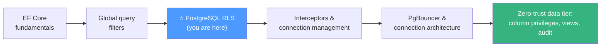

### Suggested next steps

1. **Run the lab** ([Section 21](#21-hands-on-lab-build-a-tenant-isolated-api-end-to-end)) end to end this week — the bypass probes make the concepts stick.
2. **Audit one of your real databases:** list its tenant tables and check which ones lack an RLS policy (`pg_policies`).
3. **Add the bypass-scenario test suite** to one service's CI pipeline — four tests, permanent guarantee.
4. **Wire up alerting** for `42501` rates and `DbUpdateConcurrencyException` spikes.
5. **Explore adjacent hardening:** column-level privileges, views over RLS tables, and audit-trigger patterns.

> 🎯 **Final thought:** EF Core's global query filter makes tenant isolation *visible and intentional* in your code. PostgreSQL's RLS makes it *unavoidable* at the data layer. Use both. The filter documents intent; the policy enforces it unconditionally. Together, they close every gap — including the ones you haven't thought of yet.

---

*Last Updated: 2026-09-13* · *Difficulty: Intermediate to Advanced* · *Part of the knowledge-base tutorial series, created per `tutorial-preferences.md` requirements.*