<!--
  Tutorial: The Complete Guide to Request Timeouts in ASP.NET Core
  Difficulty: Intermediate
  Estimated Reading Time: 60-75 minutes
  Last Updated: 2026-08-29
  Source: Content provided by the user, augmented to meet tutorial-preferences.md requirements
  Based on: ASP.NET Core 8+ Request Timeout Middleware (Microsoft.AspNetCore.Http.Timeouts), cooperative cancellation, and production resilience patterns
-->

# The Complete Guide to Request Timeouts in ASP.NET Core

> **_"A configured timeout is a promise, not an enforcement mechanism. The promise is only kept if every layer of async code between the middleware and the actual I/O operation accepts and forwards the cancellation token."_**

---

## ⏱️ Estimated Reading Time: 60–75 minutes

**Difficulty Level:** Intermediate
**Applies to:** .NET 8 / .NET 9 / .NET 10 (ASP.NET Core)
**Prerequisites:** C# async/await fundamentals, basic ASP.NET Core (Minimal APIs or MVC), dependency injection basics

---

## 📋 Table of Contents

1. [Introduction: Why This Matters](#1-introduction-why-this-matters)
2. [Prerequisites](#2-prerequisites)
3. [Learning Objectives](#3-learning-objectives)
4. [The Core Problem: No Default Timeout](#4-the-core-problem-no-default-timeout)
5. [Setting Up the Request Timeout Middleware](#5-setting-up-the-request-timeout-middleware)
6. [Understanding Cooperative Cancellation](#6-understanding-cooperative-cancellation)
7. [Propagating Cancellation Tokens Through Your Stack](#7-propagating-cancellation-tokens-through-your-stack)
8. [Per-Endpoint Timeout Policies](#8-per-endpoint-timeout-policies)
9. [Special Cases: Streaming, SSE, and Long-Running Work](#9-special-cases-streaming-sse-and-long-running-work)
10. [Multiple Implementation Approaches Compared](#10-multiple-implementation-approaches-compared)
11. [Real-World Use Cases](#11-real-world-use-cases)
12. [Best Practices](#12-best-practices)
13. [Anti-Patterns](#13-anti-patterns)
14. [Performance Considerations](#14-performance-considerations)
15. [Security Considerations](#15-security-considerations)
16. [Testing and Verifying Timeouts](#16-testing-and-verifying-timeouts)
17. [Migration Guide](#17-migration-guide)
18. [Common Pitfalls and Troubleshooting](#18-common-pitfalls-and-troubleshooting)
19. [Practice Exercises (with Solutions)](#19-practice-exercises-with-solutions)
20. [Hands-On Lab: Build a Timeout-Hardened API](#20-hands-on-lab-build-a-timeout-hardened-api)
21. [Pro Tips](#21-pro-tips)
22. [Test Your Understanding](#22-test-your-understanding)
23. [Question Bank (50+ Questions)](#23-question-bank-50-questions)
24. [Common Interview Questions](#24-common-interview-questions)
25. [Self-Assessment Checklist](#25-self-assessment-checklist)
26. [Summary and Checklist](#26-summary-and-checklist)
27. [Further Reading and Resources](#27-further-reading-and-resources)
28. [Learning Path and Next Steps](#28-learning-path-and-next-steps)

---

<a name="1-introduction-why-this-matters"></a>
## 1. Introduction: Why This Matters

Imagine your API is a restaurant kitchen. A customer places an order (a request), and the kitchen starts preparing it. Now imagine one order gets stuck — the chef is waiting on an ingredient delivery that never arrives. Without a policy that says "if this order isn't ready in 10 minutes, cancel it and free up the station," that chef (and that station) stays blocked indefinitely, while more orders pile up behind it.

That's exactly what happens in an ASP.NET Core application without request timeouts. A single slow database query, a hung HTTP call to a third-party API, or a stalled message broker connection can silently consume a thread, a database connection, and memory — for as long as that dependency takes, which might be forever.

> **💡 Key Insight:** This tutorial takes the original concept of ASP.NET Core request timeouts and expands it into a complete, hands-on guide — covering not just "how do I add a timeout" but *why* it works the way it does, where it commonly breaks down, and how to apply it correctly across real production systems.

### What You Will Get From This Guide

| You will learn... | Why it matters |
|---|---|
| How the .NET 8+ request timeout middleware actually works | Configure it correctly instead of guessing |
| Why timeouts are *cooperative*, not forced | The #1 reason timeouts "silently don't work" |
| How to propagate cancellation tokens through every layer | The difference between a 504 and real resource cleanup |
| How to design per-endpoint latency budgets | Fast endpoints fail fast; heavy endpoints get room to breathe |
| How to handle streaming, SSE, and long-running work | The patterns where request timeouts don't apply |
| How to test timeouts end-to-end | So the guarantee survives refactors |

---

<a name="2-prerequisites"></a>
## 2. Prerequisites

### Technical Requirements

| Skill | Minimum Level |
|---|---|
| **C#** | Comfortable with classes, interfaces, and generics |
| **async/await** | Understand `Task`, `await`, and why async I/O matters |
| **ASP.NET Core** | Have built at least one Minimal API or MVC controller endpoint |
| **Dependency Injection** | Know what `builder.Services` registration means |
| **.NET SDK** | .NET 8 SDK or later installed (`dotnet --version`) |

> **📝 This tutorial IS:** a deep dive into the *mechanics* of request timeouts, with runnable code, diagrams, and production patterns.
>
> **❌ This tutorial is NOT:** a general resilience guide (we touch on retries/Polly only where they interact with timeouts), nor a Kestrel tuning manual.

---

<a name="3-learning-objectives"></a>
## 3. Learning Objectives

By the end of this tutorial, you will be able to:

1. Explain why ASP.NET Core has **no default request timeout** and identify the other timeout layers (client, proxy, Kestrel, middleware).
2. Register and configure the request timeout middleware (`AddRequestTimeouts()` / `UseRequestTimeouts()`) in the correct pipeline order.
3. Apply timeouts per endpoint using `.WithRequestTimeout()`, `[RequestTimeout]`, and named policies.
4. Describe **cooperative cancellation** and explain why the middleware cannot forcibly abort your code.
5. Propagate `CancellationToken` through services, repositories, EF Core, `HttpClient`, and messaging SDKs.
6. Choose the right strategy for streaming, SSE, WebSockets, and long-running operations (`DisableRequestTimeout()`, linked CTS, the 202 Accepted pattern).
7. Implement custom timeout policies (e.g., per-tenant SLAs) with `ITimeoutPolicy`.
8. Write automated tests that verify timeout behavior end-to-end.
9. Diagnose the classic failure modes: "timeout never fires," "504 returned but query still running," and debugger-related non-firing.
10. Migrate pre-.NET 8 custom timeout solutions to the built-in middleware.

---
<a name="4-the-core-problem-no-default-timeout"></a>
## 4. The Core Problem: No Default Timeout

Here's a fact that surprises many .NET developers: **ASP.NET Core does not impose any application-level timeout on incoming requests by default.**

That means if you write this endpoint:

```csharp
app.MapGet("/reports", async () =>
{
    var data = await _reportService.GenerateSlowReportAsync();
    return Results.Ok(data);
});
```

...and `GenerateSlowReportAsync()` hangs due to a network partition, a deadlocked database transaction, or a third-party API that never responds — this request will simply **wait forever** (or until Kestrel's very generous transport-level limits eventually intervene, which are not designed for this purpose).

### Why isn't there a default?

ASP.NET Core is a general-purpose framework. It has no way of knowing whether your endpoint is:
- A cheap read that should return in milliseconds, or
- A large file export that legitimately takes 45 seconds

So Microsoft left this decision to you, the developer, via the **request timeout middleware**, introduced in .NET 8.

### The layers of "timeout" you might be confusing

A really important distinction — there are actually **multiple, independent timeout layers** in a typical request path, and they don't automatically talk to each other:

```mermaid
flowchart LR
    A[Client / Browser] -->|1\. Client-side timeout| B[Reverse Proxy<br/>e.g. Nginx, YARP, Azure Front Door]
    B -->|2\. Proxy timeout| C[Kestrel<br/>Web Server]
    C -->|3\. Kestrel transport limits| D[ASP.NET Core<br/>Middleware Pipeline]
    D -->|4\. Request Timeout Middleware<br/>THIS is what we configure| E[Your Endpoint Code]
    E -->|5\. Must manually pass token| F[Database / HttpClient /<br/>Message Queue]

    style D fill:#4C9AFF,color:#fff
    style E fill:#FFAB00,color:#000
```

> **🔑 Key Insight:** If your reverse proxy times out at 30 seconds but your application never sets its own timeout, the *proxy* decides when the client sees an error — not your application. That's a problem because:
> - Your application keeps burning resources on a request the client has already given up on.
> - The error response the client sees comes from the proxy (often a generic, unhelpful error page), not from your API's error format.
> - You lose the ability to log, trace, or gracefully clean up before the timeout occurs.
>
> This is precisely why owning the application-level timeout matters, even when a proxy timeout also exists.

### Quick-Recap

- No default app-level timeout exists in ASP.NET Core.
- Client, proxy, and Kestrel timeouts exist but are **independent layers** that don't coordinate with your code.
- The request timeout middleware (.NET 8+) is the layer you control.

---

<a name="5-setting-up-the-request-timeout-middleware"></a>
## 5. Setting Up the Request Timeout Middleware

Let's build this from the ground up, step by step.

### Step 1 — Register the services

```csharp
var builder = WebApplication.CreateBuilder(args);

builder.Services.AddRequestTimeouts();

var app = builder.Build();
```

> ⚠️ **Important nuance:** `AddRequestTimeouts()` on its own does **nothing** except register the plumbing (the `IRequestTimeoutPolicy` infrastructure) in the DI container. It does not apply any timeout to any endpoint. This is a very common first mistake — developers call this method, see no errors, and assume timeouts are now active. They are not.

### Step 2 — Add the middleware to the pipeline

```csharp
app.UseRequestTimeouts();
```

Order matters here. Like most ASP.NET Core middleware, `UseRequestTimeouts()` should generally be placed **early** in the pipeline — before routing/endpoint execution — so it can wrap the entire remainder of the pipeline in its cancellation logic.

### Step 3 — Apply a timeout to a specific endpoint

```csharp
app.MapGet("/reports", async (CancellationToken cancellationToken) =>
{
    await Task.Delay(TimeSpan.FromSeconds(10), cancellationToken);
    return Results.Ok("Ready");
})
.WithRequestTimeout(TimeSpan.FromSeconds(3));

app.Run();
```

### What happens step by step

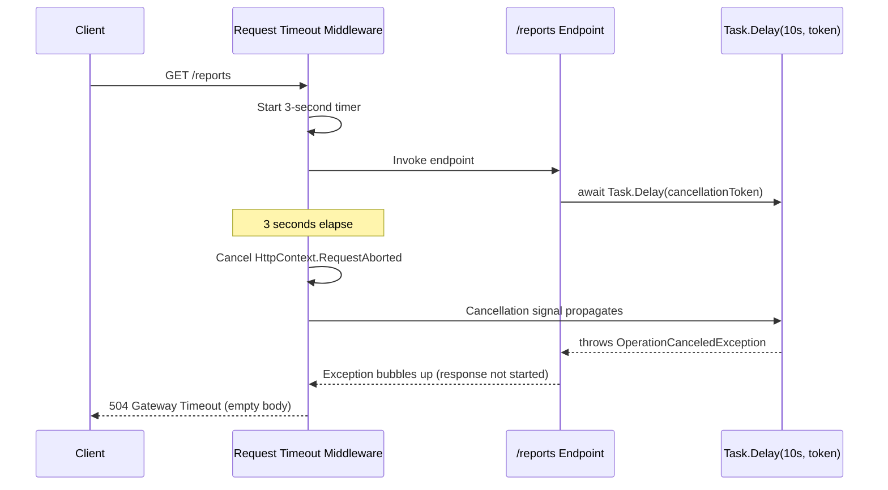

> **🔑 The critical detail:** the minimal API's `CancellationToken` parameter is automatically bound by the framework to `HttpContext.RequestAborted`. You didn't have to do anything special to get that token — but you **do** have to use it.

### 💡 Example 2: Applying this to a controller-based API

If you're using MVC controllers instead of Minimal APIs, the pattern is nearly identical:

```csharp
[ApiController]
[Route("api/[controller]")]
public class ReportsController : ControllerBase
{
    [HttpGet]
    [RequestTimeout(milliseconds: 3000)]
    public async Task<IActionResult> Get(CancellationToken cancellationToken)
    {
        await Task.Delay(TimeSpan.FromSeconds(10), cancellationToken);
        return Ok("Ready");
    }
}
```

Here, the `[RequestTimeout]` attribute plays the same role as `.WithRequestTimeout()` does for Minimal APIs. `CancellationToken` is injected as an action parameter and is likewise bound to `HttpContext.RequestAborted`.

### Quick-Recap

- `AddRequestTimeouts()` registers services; `UseRequestTimeouts()` activates the middleware — **neither applies a timeout by itself**.
- Put `UseRequestTimeouts()` early in the pipeline.
- Minimal APIs: `.WithRequestTimeout(...)`. Controllers: `[RequestTimeout]`.

<a name="6-understanding-cooperative-cancellation"></a>
## 6. Understanding Cooperative Cancellation

This is the single most misunderstood part of .NET timeouts, so let's slow down and build a mental model.

### The middleware does NOT forcibly kill anything

.NET does not have a safe way to forcibly abort a running thread mid-operation (older `Thread.Abort()` mechanisms were deprecated precisely because they left shared state in unpredictable conditions). Instead, .NET's entire asynchronous ecosystem is built on **cooperative cancellation**:

1. A `CancellationTokenSource` is created.
2. A `CancellationToken` (derived from that source) is handed to any operation that might need to stop early.
3. That operation **periodically checks** the token (or passes it further down to something that does).
4. When the source is canceled, the token's state flips to "canceled" — but nothing happens automatically unless the code holding that token chooses to observe it.

> 💡 **Analogy:** Think of it like a fire alarm in an office building: the alarm rings (`token.IsCancellationRequested == true`), but employees still have to notice it and walk out. If someone has headphones on and doesn't hear the alarm, they'll keep working right through the "evacuation."

### Demonstrating what happens when the token is ignored

```csharp
// ❌ BAD: token not passed — endpoint ignores the "fire alarm"
app.MapGet("/reports-broken", async (CancellationToken cancellationToken) =>
{
    await Task.Delay(TimeSpan.FromSeconds(10)); // <-- no token passed!
    return Results.Ok("Ready");
})
.WithRequestTimeout(TimeSpan.FromSeconds(3));
```

Here's what actually happens:

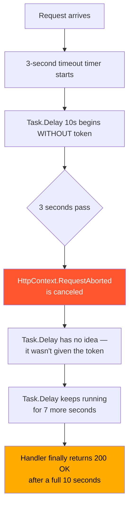

The result: **no 504 is ever returned.** The client (if it hasn't already given up) gets a `200 OK` a full ten seconds later — the "timeout" you configured had zero effect on this code path, even though the middleware technically did its job by canceling the token.

### Side-by-side comparison

| Behavior | Token passed to `Task.Delay` | Token NOT passed |
|---|---|---|
| Timer starts at request start | ✅ | ✅ |
| Token canceled at 3s | ✅ | ✅ |
| `Task.Delay` observes cancellation | ✅ | ❌ |
| Exception thrown | ✅ `OperationCanceledException` | ❌ none |
| Response sent | `504 Gateway Timeout` at ~3s | `200 OK` at ~10s |
| Resources freed early | ✅ | ❌ |

> **🔑 Rule of thumb:** A configured timeout is a *promise*, not an *enforcement mechanism*. The promise is only kept if every layer of async code between the middleware and the actual I/O operation accepts and forwards the cancellation token.

### Quick-Recap

- .NET cancellation is cooperative: tokens must be observed.
- An unobserved token means your timeout silently does nothing.
- The 504 only happens when an `OperationCanceledException` reaches the middleware *before* the response has started.

---

<a name="7-propagating-cancellation-tokens-through-your-stack"></a>
## 7. Propagating Cancellation Tokens Through Your Stack

Real applications aren't a single `Task.Delay` — they're layered: Endpoint → Service → Repository → Database driver (or HttpClient, or message bus). The token has to survive the entire trip.

### The propagation chain, visualized

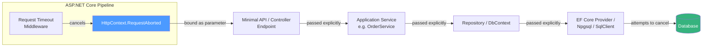

If **any single link** in that chain drops the token (forgets to pass it as a parameter), everything downstream of that point becomes un-cancelable — the middleware's cancellation signal simply never reaches it.

### 💡 Example 1: EF Core repository

```csharp
public class OrderRepository
{
    private readonly AppDbContext _dbContext;

    public OrderRepository(AppDbContext dbContext)
    {
        _dbContext = dbContext;
    }

    public Task<Order?> GetByIdAsync(
        Guid id,
        CancellationToken cancellationToken)
    {
        return _dbContext.Orders
            .AsNoTracking()
            .SingleOrDefaultAsync(
                order => order.Id == id,
                cancellationToken); // <-- token reaches EF Core
    }
}
```

EF Core forwards this token all the way down to `DbCommand.ExecuteReaderAsync(token)`, and from there the underlying ADO.NET provider (Npgsql, Microsoft.Data.SqlClient, etc.) decides whether it can cancel an in-flight query. Most modern providers *can* — they'll send a cancel request to the database server.

### 💡 Example 2: HttpClient calling a third-party API

```csharp
public class PaymentGatewayClient
{
    private readonly HttpClient _httpClient;

    public PaymentGatewayClient(HttpClient httpClient)
    {
        _httpClient = httpClient;
    }

    public async Task<PaymentResult> ChargeAsync(
        ChargeRequest request,
        CancellationToken cancellationToken)
    {
        var response = await _httpClient.PostAsJsonAsync(
            "/v1/charges",
            request,
            cancellationToken); // <-- token flows into HttpClient

        response.EnsureSuccessStatusCode();

        return await response.Content
            .ReadFromJsonAsync<PaymentResult>(cancellationToken)
            ?? throw new InvalidOperationException("Empty response.");
    }
}
```

If the payment gateway hangs, and your endpoint's timeout fires, `HttpClient` will abort the socket-level operation rather than waiting for a response that may never come.

### 💡 Example 3: A message queue publish (e.g., Azure Service Bus / RabbitMQ)

```csharp
public async Task PublishOrderCreatedAsync(
    OrderCreatedEvent @event,
    CancellationToken cancellationToken)
{
    await _serviceBusSender.SendMessageAsync(
        new ServiceBusMessage(JsonSerializer.SerializeToUtf8Bytes(@event)),
        cancellationToken); // <-- token reaches the messaging SDK
}
```

### ⚠️ The most common real-world bug: swallowed tokens in helper methods

```csharp
// ❌ Silent token drop
public async Task<Order?> GetOrderAsync(Guid id)
{
    // No CancellationToken parameter at all!
    return await _dbContext.Orders.FindAsync(id);
}
```

This method compiles fine, works fine in testing, and **completely defeats your timeout policy** the moment it's called from a canceled request. Code reviews should specifically look for async methods that touch I/O but don't accept (and forward) a `CancellationToken`.

### Practical use case: why this matters under load

Picture a service handling 500 requests/second, where 2% of requests hit a slow downstream dependency (a flaky external API). Without cancellation propagation:

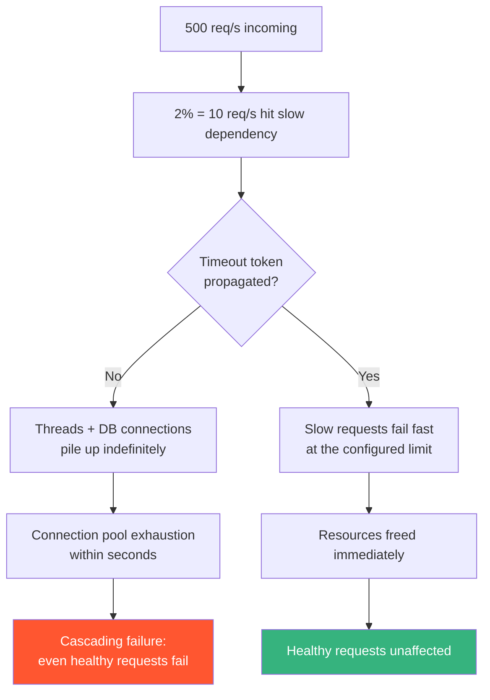

This is the real-world payoff: **timeouts + propagation aren't about individual request UX — they're a defense against cascading failure.**

### Quick-Recap

- The token must survive: endpoint → service → repository → driver.
- One missing parameter anywhere breaks the whole chain.
- `HttpClient`, EF Core, and messaging SDKs all accept tokens — pass them.
- Under load, missing propagation causes cascading failures, not just slow responses.

---
<a name="8-per-endpoint-timeout-policies"></a>
## 8. Per-Endpoint Timeout Policies

Different endpoints have fundamentally different latency budgets. A dashboard's "get unread notification count" endpoint should fail fast; a "generate annual tax report PDF" endpoint legitimately needs more time.

### Defining named policies

```csharp
builder.Services.AddRequestTimeouts(options =>
{
    options.AddPolicy("api-read", TimeSpan.FromSeconds(3));
    options.AddPolicy("api-write", TimeSpan.FromSeconds(5));
    options.AddPolicy("report-export", TimeSpan.FromSeconds(30));
    options.AddPolicy("bulk-import", TimeSpan.FromMinutes(2));
});
```

### Applying them

```csharp
app.MapGet("/orders/{id:guid}", GetOrder)
    .WithRequestTimeout("api-read");

app.MapPost("/orders", CreateOrder)
    .WithRequestTimeout("api-write");

app.MapGet("/reports/{id:guid}", ExportReport)
    .WithRequestTimeout("report-export");

app.MapPost("/imports/bulk", BulkImportOrders)
    .WithRequestTimeout("bulk-import");

app.MapGet("/events", StreamEvents)
    .DisableRequestTimeout();
```

### Visualizing a policy decision tree

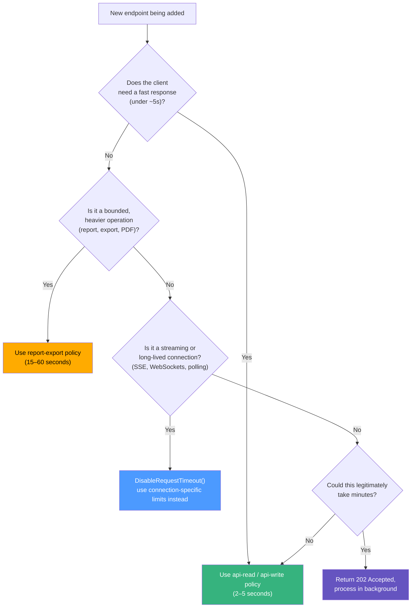

### 💡 Example: a realistic e-commerce API policy table

| Endpoint | Operation type | Suggested timeout | Reasoning |
|---|---|---|---|
| `GET /products/{id}` | Simple cached read | 2s | User-facing, should feel instant |
| `GET /orders/{id}` | DB read with joins | 3–5s | Slightly heavier query |
| `POST /orders` | Write + payment gateway call | 8–10s | External dependency involved |
| `GET /reports/annual` | Aggregation + PDF generation | 30–60s | Genuinely CPU/IO heavy |
| `GET /notifications/stream` | Server-Sent Events | Disabled | Long-lived by design |
| `POST /imports/csv` | Bulk processing | 202 Accepted + background job | Minutes-long; don't block the request thread |

> 💡 **Tip:** You can also apply a policy to a whole endpoint group — `app.MapGroup("/api").WithRequestTimeout("api-read")` — and every endpoint in the group inherits it unless it overrides the policy itself.

### Quick-Recap

- Named policies centralize latency budgets in one place.
- Apply policies per endpoint (or per group) explicitly — every endpoint should opt in or opt out deliberately.

---

<a name="9-special-cases-streaming-sse-and-long-running-work"></a>
## 9. Special Cases: Streaming, SSE, and Long-Running Work

The request timeout middleware assumes a **request/response** lifecycle: a request comes in, work happens, a response goes out. Several common patterns break that assumption.

### Why streaming breaks the model

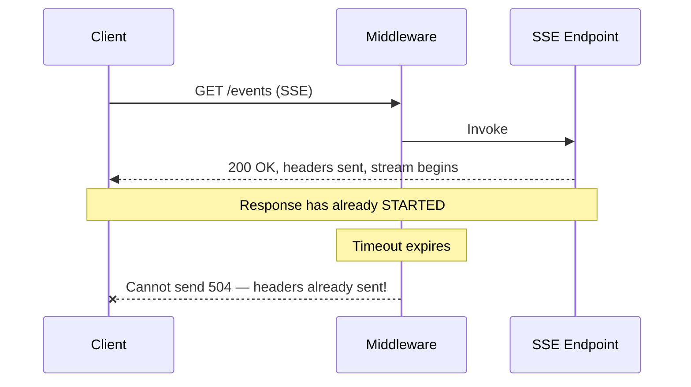

Once the first byte of a response is flushed to the client, the middleware has lost its chance to substitute a clean `504`. This is why the recommendation is `.DisableRequestTimeout()` for these endpoints — you need a *different* strategy for bounding their lifetime (e.g., an idle timeout on the connection itself, or a maximum-duration cancellation token created inside the handler).

### 💡 Example: SSE endpoint with its own internal timeout

```csharp
app.MapGet("/events", async (HttpContext context, CancellationToken requestAborted) =>
{
    context.Response.ContentType = "text/event-stream";

    using var maxDurationCts = CancellationTokenSource
        .CreateLinkedTokenSource(requestAborted);
    maxDurationCts.CancelAfter(TimeSpan.FromMinutes(10)); // self-managed cap

    try
    {
        while (!maxDurationCts.IsCancellationRequested)
        {
            await context.Response.WriteAsync(
                $"data: {DateTime.UtcNow:O}\n\n",
                maxDurationCts.Token);
            await context.Response.Body.FlushAsync(maxDurationCts.Token);
            await Task.Delay(TimeSpan.FromSeconds(5), maxDurationCts.Token);
        }
    }
    catch (OperationCanceledException)
    {
        // Client disconnected or max duration reached — clean exit.
    }
})
.DisableRequestTimeout();
```

### For genuinely long-running work: the 202 Accepted pattern

If an operation legitimately needs minutes (bulk data processing, video transcoding, large report generation), don't fight the request timeout — sidestep it entirely.

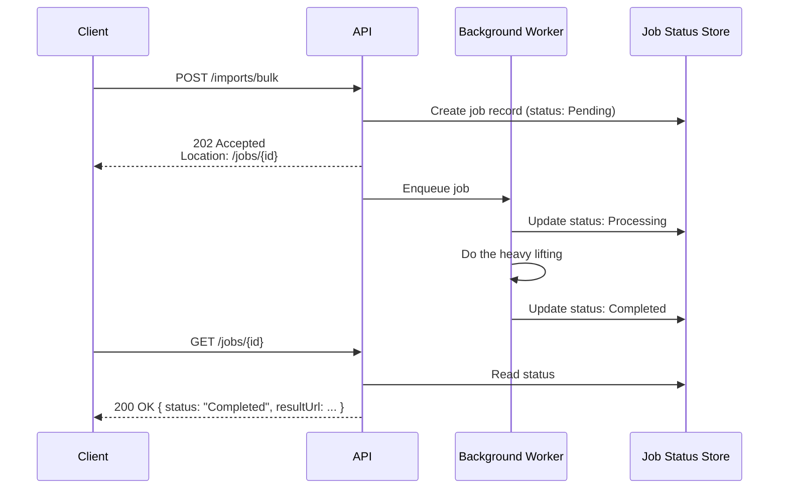

```csharp
app.MapPost("/imports/bulk", async (
    ImportRequest request,
    IJobQueue jobQueue,
    IJobStore jobStore) =>
{
    var jobId = await jobStore.CreateAsync(JobStatus.Pending);
    await jobQueue.EnqueueAsync(new BulkImportJob(jobId, request));

    return Results.Accepted($"/jobs/{jobId}", new { jobId });
});

app.MapGet("/jobs/{id:guid}", async (Guid id, IJobStore jobStore) =>
{
    var job = await jobStore.GetAsync(id);
    return job is null ? Results.NotFound() : Results.Ok(job);
});
```

This pattern completely decouples "how long the work takes" from "how long the HTTP request is open" — the request itself now responds in milliseconds.

### Quick-Recap

- Streaming/SSE: disable the middleware, manage lifetime with a linked CTS + `CancelAfter`.
- Multi-minute work: 202 Accepted + background worker; the HTTP request answers in milliseconds.

<a name="10-multiple-implementation-approaches-compared"></a>
## 10. Multiple Implementation Approaches Compared

There is more than one correct way to wire up request timeouts. Here are the main approaches, when to use each, and how they relate to other timeout mechanisms you may already have.

### Approach A: Inline duration per endpoint

```csharp
app.MapGet("/reports", GetReports)
    .WithRequestTimeout(TimeSpan.FromSeconds(30));
```

✅ Fastest to apply, great for one-off cases. ❌ Scatters latency budgets across the codebase; hard to audit.

### Approach B: Named policies (recommended default)

```csharp
options.AddPolicy("api-read", TimeSpan.FromSeconds(3));
app.MapGet("/orders/{id}", GetOrder).WithRequestTimeout("api-read");
```

✅ Centralized, auditable, tier-friendly. ❌ Slightly more ceremony. **This is the approach most teams should standardize on.**

### Approach C: Attributes on controllers

```csharp
[RequestTimeout("api-read")]
public async Task<IActionResult> Get(CancellationToken ct) { ... }
```

✅ Natural fit for MVC. ❌ Controller-only.

### Approach D: Endpoint groups

```csharp
var api = app.MapGroup("/api").WithRequestTimeout("api-read");
api.MapGet("/orders/{id}", GetOrder);
```

✅ Bulk application with per-endpoint overrides still possible.

### Approach E: Custom `ITimeoutPolicy` (dynamic, e.g., per-tenant SLA)

```csharp
public class TenantTimeoutPolicy : ITimeoutPolicy
{
    private static readonly TimeSpan Free = TimeSpan.FromSeconds(2);
    private static readonly TimeSpan Enterprise = TimeSpan.FromSeconds(20);

    public TimeSpan? GetTimeout(Endpoint endpoint)
    {
        var attr = endpoint.Metadata.GetMetadata<TenantSlaAttribute>();
        return attr?.Tier == TenantTier.Enterprise ? Enterprise : Free;
    }
}

// Registration:
builder.Services.AddRequestTimeouts(options =>
{
    options.DefaultPolicy = new TenantTimeoutPolicy();
});
```

✅ Timeouts computed at runtime from request/endpoint metadata. ❌ More code; only needed for genuinely dynamic rules.

### Approach F: Outbound-call timeouts (complementary, not a substitute)

`HttpClient.Timeout`, EF Core `CommandTimeout`, and `Microsoft.Extensions.Http.Resilience` policies bound *individual downstream calls*. They are valuable layers, but they don't bound the **whole request** — a handler that makes five sequential 4-second calls still takes 20+ seconds. Use both layers together.

### Comparison matrix

| Approach | Scope | Centralized? | Dynamic? | Best for |
|---|---|---|---|---|
| A. Inline duration | Single endpoint | ❌ | ❌ | Quick fixes, experiments |
| B. Named policies | Endpoint/group | ✅ | ❌ | Most production APIs |
| C. `[RequestTimeout]` attribute | Controller action | ⚠️ partial | ❌ | MVC apps |
| D. Endpoint groups | Whole route group | ✅ | ❌ | Uniform API surfaces |
| E. Custom `ITimeoutPolicy` | Global default | ✅ | ✅ | Per-tenant SLAs, config-driven |
| F. Outbound timeouts (`HttpClient.Timeout`, EF `CommandTimeout`) | Single downstream call | ✅ | ❌ | Always — defense in depth |
| Proxy timeouts (Nginx/YARP) | Whole request, external | ⚠️ | ❌ | Safety net; never the only layer |

> 💡 **Trade-off discussion:** Keep `DefaultPolicy` unset if you want timeouts to be explicit-only; set a conservative default (e.g., 30s) if you'd rather have a safety net that endpoints can override or disable. Explicit-only makes audits easier; a default protects endpoints someone forgot about.

---

<a name="11-real-world-use-cases"></a>
## 11. Real-World Use Cases

### Use Case 1 — Protecting a public API from slow third-party dependencies
A SaaS product exposes a `/weather` endpoint that internally calls a third-party weather API. That third-party API occasionally hangs for 60+ seconds during outages. Without a timeout, every hung call ties up a thread and an outbound connection, and under moderate traffic this exhausts the connection pool, taking down unrelated endpoints too. **Fix:** apply a 5-second policy to `/weather`, propagate the token into the outbound `HttpClient` call, and return a graceful cached/fallback response on timeout.

### Use Case 2 — Preventing report-generation endpoints from blocking the thread pool
An internal admin tool has a "generate quarterly report" button that triggers heavy SQL aggregation. During month-end, several admins click it simultaneously, and slow queries pile up, starving the thread pool for the rest of the application. **Fix:** move report generation to the 202 Accepted + background worker pattern described above, freeing the request thread immediately.

### Use Case 3 — Respecting client disconnects to save compute costs
A cost-sensitive API (e.g., billed by compute-second on serverless infrastructure) doesn't want to keep paying for work after a mobile client has gone offline mid-request. Because `HttpContext.RequestAborted` is also canceled on client disconnect (not just on explicit timeout), simply propagating the token through all async work means abandoned requests stop consuming billable compute almost immediately.

### Use Case 4 — Tiered SLAs across a multi-tenant API
A B2B platform offers different response-time guarantees to different subscription tiers. Named policies make this trivial to express in code:

```csharp
options.AddPolicy("tier-free", TimeSpan.FromSeconds(2));
options.AddPolicy("tier-pro", TimeSpan.FromSeconds(8));
options.AddPolicy("tier-enterprise", TimeSpan.FromSeconds(20));
```

Each tenant's requests are routed to the corresponding endpoint group (or the policy is selected dynamically), enforcing the SLA at the framework level rather than relying on downstream code to self-regulate.

### Use Case 5 — Guarding against N+1 query regressions in CI
Teams sometimes add an aggressive timeout (e.g., 1 second) to critical read endpoints specifically in integration test environments. If a code change accidentally introduces an N+1 query problem, the endpoint starts timing out in CI before it ever reaches production — turning a performance regression into a fast, visible test failure instead of a slow production incident.

---
<a name="12-best-practices"></a>
## 12. Best Practices

1. **Always pair registration with application.** `AddRequestTimeouts()` + `UseRequestTimeouts()` do nothing on their own — attach a policy (or explicitly disable) on every endpoint.
2. **Use named policies as your standard.** One place to audit all latency budgets; easy to change under pressure without touching endpoint code.
3. **Make `CancellationToken` a required parameter on every async I/O method** — endpoint, service, repository, gateway client. Enforce via code review or an analyzer.
4. **Pass the token last** (`method(arg, cancellationToken)`) and never default it to `CancellationToken.None` or `default`.
5. **Keep `UseRequestTimeouts()` early in the pipeline**, before response-producing middleware, so a clean 504 remains possible.
6. **Match timeouts to real latency budgets** (measure p95/p99 first), and leave headroom for retries happening *inside* the request.
7. **Treat the timeout budget as a chain:** request timeout ≥ sum of downstream call timeouts + retries, otherwise the outer timeout fires first and masks the inner error.
8. **Disable timeouts explicitly on streaming/SSE/WebSocket endpoints** and manage lifetime with a linked `CancellationTokenSource` + `CancelAfter`.
9. **Use the 202 Accepted pattern** for anything that can legitimately take minutes.
10. **Log cancellation deliberately.** When an `OperationCanceledException` corresponds to `RequestAborted.IsCancellationRequested`, log at information/debug level, not as an error — your dashboards will thank you.
11. **Verify without a debugger attached** — the middleware deliberately does not fire while debugging.
12. **Automate one end-to-end timeout test per critical endpoint** in CI.

### ✅ Recommended setup for a new API

```csharp
var builder = WebApplication.CreateBuilder(args);

builder.Services.AddRequestTimeouts(options =>
{
    options.AddPolicy("api-read", TimeSpan.FromSeconds(3));
    options.AddPolicy("api-write", TimeSpan.FromSeconds(5));
    options.AddPolicy("report-export", TimeSpan.FromSeconds(30));
});

var app = builder.Build();

app.UseRequestTimeouts();   // early — before anything writes a response
// ... routing, auth, other middleware ...

app.MapGet("/orders/{id:guid}", GetOrder).WithRequestTimeout("api-read");
app.MapGet("/events", StreamEvents).DisableRequestTimeout();

app.Run();
```

---

<a name="13-anti-patterns"></a>
## 13. Anti-Patterns

### ❌ Anti-Pattern 1: Register-and-forget

```csharp
// ❌ Looks done. Isn't.
builder.Services.AddRequestTimeouts();
...
app.UseRequestTimeouts();
// ... no endpoint ever gets a policy => no timeouts anywhere
```

**Why it's bad:** zero effect, false sense of security. **Fix:** attach policies or a default policy.

### ❌ Anti-Pattern 2: The disappearing token

```csharp
// ❌ Service swallows the token
public async Task<List<Order>> GetAllAsync()
    => await _db.Orders.ToListAsync(); // no token => un-cancelable query
```

**Fix:** `GetAllAsync(CancellationToken ct) => _db.Orders.ToListAsync(ct);`

### ❌ Anti-Pattern 3: One global timeout for everything

A 30-second global timeout means a misbehaving cached read holds resources 30s; a 2-second global timeout breaks your legitimate 15s export. **Fix:** tiered named policies.

### ❌ Anti-Pattern 4: Timeouts on streaming endpoints

The middleware can't send a 504 after headers are flushed; at best the token cancels mid-stream and the client sees a truncated body. **Fix:** `DisableRequestTimeout()` + internal cap.

### ❌ Anti-Pattern 5: Catching `OperationCanceledException` and returning 200

```csharp
// ❌ Swallows the timeout signal
try { await DoWorkAsync(ct); }
catch (OperationCanceledException) { return Results.Ok("done-ish"); }
```

The client gets a fake success long after the deadline. **Fix:** let it bubble (or check `ct.IsCancellationRequested` and rethrow) unless you genuinely handle a *client disconnect*.

### ❌ Anti-Pattern 6: Treating the 504 as proof the DB stopped

The middleware canceled the HTTP-side token; whether the query actually stopped depends on the provider. **Fix:** verify with tracing/logs (e.g., Npgsql cancellation events, EF command logs).

### ❌ Anti-Pattern 7: Timeout + aggressive retry without a budget

Retrying a 3s-timeout call 3 times inside a 5s request timeout guarantees outer timeouts that hide the real failure. **Fix:** budget the chain (see Best Practices #7).

---
<a name="14-performance-considerations"></a>
## 14. Performance Considerations

### Overhead of the middleware itself is negligible

Per request, the timeout middleware creates a `CancellationTokenSource`, starts a timer entry, and registers cleanup — a few small allocations on a path that typically involves far larger costs (JSON serialization, DB I/O). You will not measure this in a realistic workload. The *value* side of the ledger, however, is enormous:

### The math of unbounded in-flight requests

Little's Law: `concurrency = arrival rate × duration`.

| Scenario | Arrival rate of slow requests | Avg. duration | In-flight slow requests |
|---|---|---|---|
| No timeout (hangs 60s) | 10 req/s | 60s | **600** |
| 5s request timeout | 10 req/s | 5s | **50** |
| 5s timeout + fallback response | 10 req/s | 5s | 50, but threads freed via async cancellation |

Each of those 600 hung requests may hold a DB connection (default pools: 100 for SqlServer/Npgsql) and memory. This is why timeouts are a **capacity-protection** mechanism, not a UX nicety.

### Timeout + retry budgets

If a request makes 3 downstream calls, each with its own 2s timeout and 1 retry, worst case is 12s — a 3s request timeout would fire first and mask the real failure. Budget deliberately:

```
Request timeout >= sum of (per-call timeout x attempts) + margin
```

### Benchmark expectations

- `WithRequestTimeout("name")` is a metadata lookup at endpoint dispatch — sub-microsecond, amortized.
- Cancellation callbacks fire only on cancel; the happy path pays no callback cost.
- Avoid registering many linked CTSs per request in hot paths; create once, link once.

### Why Kestrel limits are not a substitute

Kestrel's `KeepAliveTimeout` (~130s), `MinRequestBodyDataRate`, and `MaxRequestBodySize` protect the *transport* (idle connections, slow uploads), not your handler's logical progress. A request that actively streams nothing but never calls your code back still holds a Kestrel connection. Only an application-level timeout bounds handler work.

### Performance-optimized endpoint pattern

```csharp
// ✅ Timeout-aware, allocation-lean: pass token down, no linked CTS unless needed
app.MapGet("/products/{id:guid}", async (Guid id, IProductStore store,
    CancellationToken ct) =>
{
    var product = await store.FindAsync(id, ct);
    return product is null ? Results.NotFound() : Results.Ok(product);
})
.WithRequestTimeout("api-read");
```

---

<a name="15-security-considerations"></a>
## 15. Security Considerations

Timeouts are a security topic because unbounded work is an attack surface.

### 1. Denial-of-service resistance

Slow/hung endpoints are the cheapest DoS amplifier an attacker can find: a handful of crafted requests against an unbounded endpoint can exhaust threads, connections, and memory for everyone. Request timeouts bound the blast radius. Combine with rate limiting for defense in depth.

### 2. Slow-body / Slowloris attacks are a different layer

The timeout middleware starts its clock when the request is *invoked* — it does not bound how long a client may take to *send* the body. Protect that layer with Kestrel (`MinRequestBodyDataRate`, `MaxRequestBodySize`, `KeepAliveTimeout`) and your reverse proxy's header/body timeouts.

### 3. Don't leak internals through timeout errors

The default 504 has an empty body — good. If you customize the timeout response, avoid including stack traces, upstream URLs, or provider error text; a timeout message should say *that* it timed out, not *where* your dependencies live.

### 4. Authentication and authorization endpoints

Login endpoints that hash passwords (PBKDF2/bcrypt) can take 100–500ms by design — set a sensible policy rather than the strictest one, but don't disable timeouts: credential-stuffing floods against an unbounded login endpoint are a classic exhaustion vector.

### 5. Cancellation does not excuse authorization checks mid-stream

If you stream data, a canceled request stops the *sending*, not necessarily the *work already done* — ensure authorization happens before any sensitive data is produced, since a malicious client could connect/disconnect repeatedly to probe behavior.

### 6. Audit the silent-kill surface

When a request times out, partial work may have been persisted (e.g., a charge succeeded but the response was canceled). Design idempotency keys and reconciliation for operations that outlive their HTTP response.

---
<a name="16-testing-and-verifying-timeouts"></a>
## 16. Testing and Verifying Timeouts

A timeout policy you haven't tested is a guess, not a guarantee. Here's a repeatable verification process:

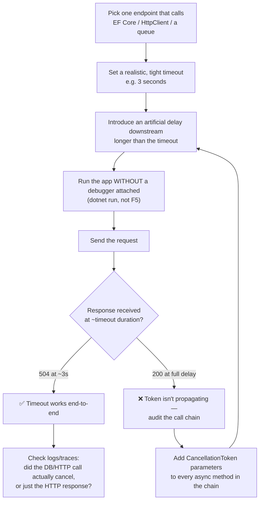

### Example: a quick integration test

```csharp
[Fact]
public async Task SlowEndpoint_Returns504_WhenTimeoutExceeded()
{
    var client = _factory.CreateClient(); // WebApplicationFactory<Program>

    var stopwatch = Stopwatch.StartNew();
    var response = await client.GetAsync("/reports");
    stopwatch.Stop();

    Assert.Equal(HttpStatusCode.GatewayTimeout, response.StatusCode);
    Assert.True(stopwatch.Elapsed < TimeSpan.FromSeconds(4),
        "Timeout should fire close to the configured 3s limit.");
}
```

### 💡 Verifying downstream cancellation (not just the HTTP status)

The test above proves the client saw a 504. To prove the *work* stopped, make the fake dependency observable:

```csharp
app.MapGet("/reports", async (CancellationToken ct) =>
{
    try
    {
        await Task.Delay(TimeSpan.FromSeconds(10), ct);
        probe.MarkCompleted(); // test double records completion
        return Results.Ok("Ready");
    }
    catch (OperationCanceledException)
    {
        probe.MarkCanceled();  // test double records cancellation
        throw;
    }
})
.WithRequestTimeout(TimeSpan.FromSeconds(3));

// In the test: Assert.True(probe.WasCanceled)
```

Wiring these tests into CI turns "does our timeout actually work" from a manual, easy-to-forget check into an automated guarantee that survives refactors.

> ⚠️ **Remember:** timeout behavior must be verified **without a debugger attached** — the middleware intentionally does not fire while debugging.

---

<a name="17-migration-guide"></a>
## 17. Migration Guide

### Before .NET 8: hand-rolled middleware

```csharp
// ❌ Legacy approach (pre-.NET 8) — custom middleware
public class RequestTimeoutMiddleware
{
    private readonly RequestDelegate _next;
    private readonly TimeSpan _timeout;

    public RequestTimeoutMiddleware(RequestDelegate next, TimeSpan timeout)
    {
        _next = next;
        _timeout = timeout;
    }

    public async Task InvokeAsync(HttpContext context)
    {
        using var cts = CancellationTokenSource
            .CreateLinkedTokenSource(context.RequestAborted);
        cts.CancelAfter(_timeout);
        context.RequestAborted = cts.Token; // shadow the token
        await _next(context);
    }
}
```

Problems with the legacy approach: no per-endpoint policies, no automatic 504 semantics (you had to detect cancellation and write the response yourself), and replacing `RequestAborted` is fragile.

### After: the built-in middleware

```csharp
// ✅ .NET 8+
builder.Services.AddRequestTimeouts(options =>
    options.AddPolicy("default", TimeSpan.FromSeconds(10)));

app.UseRequestTimeouts();
app.MapGet("/reports", GetReports).WithRequestTimeout("default");
```

### Migration mapping

| Legacy mechanism | Replace with | Notes |
|---|---|---|
| Custom CTS + `CancelAfter` middleware | `UseRequestTimeouts()` + policies | Removes response-writing boilerplate |
| `CancellationTokenSource(TimeSpan).Token` per call | Request timeout policy + token propagation | Keep per-op CTS only for *shorter* inner deadlines |
| Polly `.Timeout(...)` on outbound calls | Keep it — it's complementary | Polly bounds single calls; middleware bounds the request |
| `HttpClient.Timeout` | Keep, but *also* pass the request token | Default 100s is usually wrong for interactive APIs |
| Reverse-proxy `proxy_read_timeout` | Keep as a safety net | Move the *primary* deadline into the app |
| EF `CommandTimeout` | Keep | Different layer: the DB command, not the request |

### Version-specific notes

- **.NET 8:** middleware introduced (`Microsoft.AspNetCore.Http.Timeouts`).
- **.NET 9/10:** no breaking changes to the API surface shown here; all examples remain valid.

---
<a name="18-common-pitfalls-and-troubleshooting"></a>
## 18. Common Pitfalls and Troubleshooting

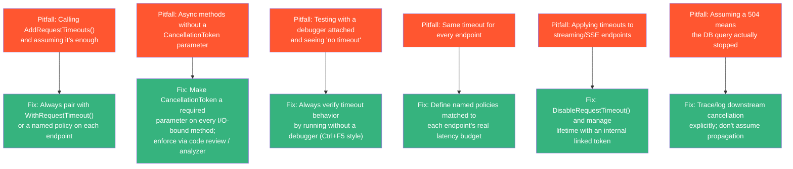

### Troubleshooting guide: symptom → cause → fix

| Symptom | Likely cause | Fix |
|---|---|---|
| Timeout configured but never fires | Token not propagated; or debugger attached | Audit the call chain for missing `CancellationToken` params; run without debugger |
| Client gets `200 OK` long after the deadline | Endpoint ignores cancellation / catches OCE and returns 200 | Pass token to all awaits; rethrow `OperationCanceledException` |
| `504` returned but the DB query keeps running | Provider can't cancel in-flight query, or token dropped before the driver | Verify provider support (e.g., Npgsql sends cancel); ensure token reaches the command |
| Client gets `200` instead of `504` even though timeout fired | Response had already started (headers flushed) | Don't apply timeouts to streaming endpoints; keep middleware early in pipeline |
| `OperationCanceledException` spamming error logs | Global exception handler logs all OCEs as errors | Check `context.RequestAborted.IsCancellationRequested` and log at debug/info |
| Timeout fires *before* downstream retries finish | Retry budget exceeds request timeout | Budget the chain: request timeout ≥ attempts × call timeout + margin |
| `AddRequestTimeouts` throws on unknown policy name | Policy name typo / not registered | Verify exact names in `AddRequestTimeouts(options => ...)` |
| Works in prod but not in integration tests (or vice versa) | Test host has debugger/diagnostics attached, or timing too tight | Use generous margins in assertions; test timeout + small delta |

### Diagnostic checklist when a timeout "isn't working"

1. Is `UseRequestTimeouts()` actually in the pipeline, before response-producing middleware?
2. Is a policy attached to *this* endpoint (check with `.WithRequestTimeout(...)` / attribute / group)?
3. Does the awaited call receive the token?
4. Was the test run without a debugger?
5. Did the response start before cancellation (streaming/flush)?

---

<a name="19-practice-exercises-with-solutions"></a>
## 19. Practice Exercises (with Solutions)

### 🏋️ Exercise 1: Fix the broken timeout (Beginner)

This endpoint never returns 504 no matter what. Find and fix all the problems.

```csharp
var builder = WebApplication.CreateBuilder(args);
builder.Services.AddRequestTimeouts();
var app = builder.Build();

app.UseRouting();

app.MapGet("/slow", async () =>
{
    await Task.Delay(TimeSpan.FromSeconds(15));
    return Results.Ok("done");
})
.WithRequestTimeout(TimeSpan.FromSeconds(2));

app.Run();
```

#### ✅ Solution

Two bugs:

1. **The handler doesn't accept or use a `CancellationToken`** — `Task.Delay` never observes the canceled token.
2. That's the only functional bug here, but note `UseRequestTimeouts()` is also **missing** — without it, the metadata is inert. (Add it right after `builder.Build()`.)

```csharp
var builder = WebApplication.CreateBuilder(args);
builder.Services.AddRequestTimeouts();
var app = builder.Build();

app.UseRequestTimeouts(); // ✅ activate the middleware

app.MapGet("/slow", async (CancellationToken cancellationToken) =>
{
    await Task.Delay(TimeSpan.FromSeconds(15), cancellationToken); // ✅ pass token
    return Results.Ok("done");
})
.WithRequestTimeout(TimeSpan.FromSeconds(2));

app.Run();
```

Now the request returns an empty `504 Gateway Timeout` at ~2 seconds (verified without a debugger attached).

### 🏋️ Exercise 2: Design a policy set (Intermediate)

You're building an e-commerce API with these endpoints. Choose a policy for each and write the full configuration: product list (cached), checkout (calls payment gateway), annual sales report (SQL aggregation + PDF), order status SSE stream, CSV bulk import (~5 minutes).

#### ✅ Solution

```csharp
builder.Services.AddRequestTimeouts(options =>
{
    options.AddPolicy("api-read", TimeSpan.FromSeconds(3));   // cached reads
    options.AddPolicy("api-write", TimeSpan.FromSeconds(10)); // external payment call
    options.AddPolicy("report-export", TimeSpan.FromSeconds(45)); // heavy but bounded
});

app.UseRequestTimeouts();

app.MapGet("/products", ListProducts)        .WithRequestTimeout("api-read");
app.MapPost("/checkout", Checkout)           .WithRequestTimeout("api-write");
app.MapGet("/reports/annual", AnnualReport)  .WithRequestTimeout("report-export");

// SSE: long-lived by design -> disable + internal cap
app.MapGet("/orders/status-stream", StreamOrderStatus).DisableRequestTimeout();

// CSV import takes minutes -> don't fight the request; go async
app.MapPost("/imports/csv", StartCsvImport);          // 202 Accepted + job id
app.MapGet("/imports/status/{jobId:guid}", GetImportStatus);
```

Reasoning: cached reads fail fast (2–3s); checkout budgets the payment gateway's p99 plus one retry; the report is heavy but *bounded*, so 30–60s is fine; streaming and multi-minute work are the two patterns that must escape the request/response model entirely.

### 🏋️ Exercise 3: SSE endpoint that can't outlive 5 minutes (Advanced)

Write an SSE endpoint with the request timeout disabled that (a) stops when the client disconnects, (b) self-terminates after 5 minutes, and (c) exits cleanly without error logs.

#### ✅ Solution

```csharp
app.MapGet("/orders/{id:guid}/status-stream", async (
    Guid id, HttpContext context, CancellationToken requestAborted) =>
{
    context.Response.ContentType = "text/event-stream";

    // (a)+(b): link the client-disconnect token with a 5-minute cap
    using var lifetime = CancellationTokenSource
        .CreateLinkedTokenSource(requestAborted);
    lifetime.CancelAfter(TimeSpan.FromMinutes(5));

    try
    {
        while (!lifetime.IsCancellationRequested)
        {
            var status = await orderService.GetStatusAsync(id, lifetime.Token);
            await context.Response.WriteAsync($"data: {status}\n\n", lifetime.Token);
            await context.Response.Body.FlushAsync(lifetime.Token);
            await Task.Delay(TimeSpan.FromSeconds(2), lifetime.Token); // (c) throws OCE -> caught below
        }
    }
    catch (OperationCanceledException)
    {
        // (c) client left or cap reached — clean exit, no error log
    }
})
.DisableRequestTimeout();
```

Key points: the linked CTS combines *client disconnect* and *max duration* into one token; every await observes it; the `OperationCanceledException` is expected and swallowed at the boundary.

### 🏋️ Exercise 4: Prove the timeout in an automated test (Intermediate)

Write an xUnit integration test asserting that `GET /slow` (Exercise 1) returns 504 within ~2–4 seconds, using `WebApplicationFactory<Program>`.

#### ✅ Solution

```csharp
public class TimeoutTests : IClassFixture<WebApplicationFactory<Program>>
{
    private readonly WebApplicationFactory<Program> _factory;

    public TimeoutTests(WebApplicationFactory<Program> factory) => _factory = factory;

    [Fact]
    public async Task SlowEndpoint_Returns504_AtConfiguredDeadline()
    {
        var client = _factory.CreateClient();
        var sw = Stopwatch.StartNew();

        var response = await client.GetAsync("/slow");

        sw.Stop();
        Assert.Equal(HttpStatusCode.GatewayTimeout, response.StatusCode);
        Assert.InRange(sw.ElapsedMilliseconds, 1500, 4000); // ~2s limit + margin
    }
}
```

Note the range assertion: tight enough to catch a non-firing timeout (which would take 15s and return 200), loose enough to tolerate CI jitter.

---

<a name="20-hands-on-lab-build-a-timeout-hardened-api"></a>
## 20. Hands-On Lab: Build a Timeout-Hardened API

Follow these steps end-to-end (~20 minutes). Everything runs locally with the .NET 8+ SDK.

### Lab Step 1 — Scaffold the API

```bash
dotnet new web -n TimeoutLab
cd TimeoutLab
```

### Lab Step 2 — Replace `Program.cs`

```csharp
var builder = WebApplication.CreateBuilder(args);

builder.Services.AddRequestTimeouts(options =>
{
    options.AddPolicy("api-read", TimeSpan.FromSeconds(3));
    options.AddPolicy("report-export", TimeSpan.FromSeconds(5));
});

var app = builder.Build();
app.UseRequestTimeouts();

// 1. Working timeout: cancels at 3s -> 504
app.MapGet("/reports", async (CancellationToken ct) =>
{
    await Task.Delay(TimeSpan.FromSeconds(30), ct);
    return Results.Ok("Ready");
})
.WithRequestTimeout("api-read");

// 2. Broken timeout: token ignored -> 200 after 30s (watch it fail!)
app.MapGet("/reports-broken", async () =>
{
    await Task.Delay(TimeSpan.FromSeconds(30));
    return Results.Ok("Ready");
})
.WithRequestTimeout("api-read");

// 3. Disabled for streaming: internal 10s cap instead
app.MapGet("/events", async (HttpContext ctx, CancellationToken aborted) =>
{
    ctx.Response.ContentType = "text/event-stream";
    using var cts = CancellationTokenSource.CreateLinkedTokenSource(aborted);
    cts.CancelAfter(TimeSpan.FromSeconds(10));
    try
    {
        while (!cts.IsCancellationRequested)
        {
            await ctx.Response.WriteAsync($"data: {DateTime.UtcNow:O}\n\n", cts.Token);
            await ctx.Response.Body.FlushAsync(cts.Token);
            await Task.Delay(TimeSpan.FromSeconds(1), cts.Token);
        }
    }
    catch (OperationCanceledException) { }
})
.DisableRequestTimeout();

app.Run();
```

### Lab Step 3 — Run WITHOUT the debugger and probe

```bash
dotnet run
```

In another terminal:

```bash
# Expect: HTTP 504 at ~3 seconds
curl -o NUL -s -w "%{http_code} in %{time_total}s\n" http://localhost:5000/reports

# Expect: HTTP 200 at ~30 seconds — the "broken" version
curl -o NUL -s -w "%{http_code} in %{time_total}s\n" http://localhost:5000/reports-broken

# Expect: SSE events for ~10 seconds, then the stream ends cleanly
curl -N http://localhost:5000/events
```

(If Kestrel chose a different port, use the URL printed at startup.)

### Lab Step 4 — Observe and reflect

| Probe | Expected result | What it teaches |
|---|---|---|
| `GET /reports` | 504 at ~3s | Cooperative cancellation works when the token is used |
| `GET /reports-broken` | 200 at ~30s | Ignoring the token defeats the timeout completely |
| `GET /events` | Clean stream, ends at ~10s | Streaming needs `DisableRequestTimeout()` + internal cap |

### Lab Step 5 — Extend (stretch goals)

- Add a named policy and apply it to an endpoint **group**.
- Add an xUnit test asserting the 504 timing of `/reports`.
- Add logging in an exception handler that distinguishes client-disconnect from timeout cancellation.

---

<a name="21-pro-tips"></a>
## 21. Pro Tips

1. **Inner deadlines shorter than the request timeout:** link a CTS to the request token and `CancelAfter` a *tighter* limit for a specific risky call — you get a typed, local failure without giving up the request-level policy.
2. **Distinguish disconnect vs. timeout in logs:** both cancel the same token. Record `RequestAborted.Register(...)` with the endpoint name and whether the response had started — instant clarity during incidents.
3. **Pair with `Microsoft.Extensions.Http.Resilience`:** standard handler pipelines give you per-attempt timeout + retries + circuit breaker; the request middleware stays the outer boundary. Budget them together.
4. **Use `IProblemDetailsService` if you customize the 504:** returning `Results.Problem(...)` shaped bodies keeps your API's error contract consistent.
5. **Watch `TaskCanceledException`:** it derives from `OperationCanceledException`; catch the base class when you mean "any cancellation."
6. **Idempotency for charged-on-timeout:** if a downstream charge may have succeeded when the response timed out, idempotency keys turn a scary reconciliation problem into a lookup.
7. **Diagnostics:** add an activity/log event when a request finishes with `RequestAborted.IsCancellationRequested == true` — cheap, and it makes timeout storms instantly visible in dashboards.
8. **Don't shadow `RequestAborted` yourself** in .NET 8+ apps; let the middleware own it, or you'll fight its semantics.

---
<a name="22-test-your-understanding"></a>
## 22. Test Your Understanding

Answers immediately follow each question — try before peeking.

**1. Does ASP.NET Core apply a default application-level timeout to requests?**
> No. There is no default app-level deadline; Kestrel/proxy limits are separate transport layers.

**2. What does `AddRequestTimeouts()` do by itself?**
> Only registers the timeout services/policy infrastructure. It applies no timeout to any endpoint.

**3. What HTTP status does the middleware return when a timeout fires (before the response starts)?**
> An empty `504 Gateway Timeout`.

**4. Why might a configured timeout never fire even when registered correctly?**
> The cancellation token was never observed — it wasn't passed to the awaited I/O call(s); or the code swallows the `OperationCanceledException`.

**5. Can the middleware forcibly abort a running query or thread?**
> No. Cancellation is cooperative; the token flips to canceled, but only observing code reacts.

**6. Why doesn't the timeout fire while a debugger is attached?**
> By design — to avoid spurious 504s while stepping through code. Verify with `dotnet run`, no debugger.

**7. What does `HttpContext.RequestAborted` signal besides an explicit timeout?**
> Client disconnection. The same token covers both.

**8. Why must streaming/SSE endpoints call `.DisableRequestTimeout()`?**
> Once headers are flushed the middleware can't substitute a 504; the request/response model no longer applies.

**9. How would you enforce different timeouts per subscription tier?**
> Named policies per tier (e.g., `tier-free`, `tier-enterprise`) applied per endpoint group, or a custom `ITimeoutPolicy` computing the timeout from request metadata.

**10. What's the right pattern for work that legitimately takes minutes?**
> Return `202 Accepted` with a job id, process in a background worker, expose `GET /jobs/{id}` for status — decoupling work duration from HTTP request lifetime.

---

<a name="23-question-bank-50-questions"></a>
## 23. Question Bank (50+ Questions)

### 🟢 Beginner (Q1–Q20)

**Q1.** Does ASP.NET Core impose a default request timeout?

> **A:** No — application-level deadlines must be configured explicitly.

**Q2.** Which package/namespace hosts the middleware?

> **A:** `Microsoft.AspNetCore.Http.Timeouts`, built into the framework from .NET 8.

**Q3.** Which two methods register and activate the middleware?

> **A:** `AddRequestTimeouts()` (services) and `UseRequestTimeouts()` (pipeline).

**Q4.** Does calling `AddRequestTimeouts()` alone apply timeouts?

> **A:** No — it only registers services.

**Q5.** Which extension applies a timeout to a Minimal API endpoint?

> **A:** `.WithRequestTimeout(...)`.

**Q6.** Which attribute applies a timeout to a controller action?

> **A:** `[RequestTimeout]`.

**Q7.** What status code is returned on timeout?

> **A:** 504 Gateway Timeout (empty body by default).

**Q8.** What token does the middleware cancel?

> **A:** `HttpContext.RequestAborted`.

**Q9.** How does a Minimal API handler receive the cancellation token?

> **A:** Declare a `CancellationToken` parameter; binding is automatic.

**Q10.** What exception signals cancellation?

> **A:** `OperationCanceledException` (and its subclass `TaskCanceledException`).

**Q11.** Is cancellation in .NET forced or cooperative?

> **A:** Cooperative — code must observe the token.

**Q12.** Which method schedules cancellation after a delay?

> **A:** `CancellationTokenSource.CancelAfter(TimeSpan)`.

**Q13.** What does `DisableRequestTimeout()` do?

> **A:** Opts an endpoint out of timeout handling entirely.

**Q14.** Name two endpoint kinds that should disable timeouts.

> **A:** SSE/streaming endpoints and WebSocket upgrades (also long-polling).

**Q15.** What's the recommended response pattern for multi-minute work?

> **A:** 202 Accepted + background job + status endpoint.

**Q16.** True/False: a named policy must exist before an endpoint references it.

> **A:** True — referencing an unregistered policy name fails at startup/dispatch.

**Q17.** Where in the pipeline should `UseRequestTimeouts()` sit?

> **A:** Early — before routing/endpoint execution and anything that writes a response.

**Q18.** Does `HttpClient.Timeout` substitute for request timeouts?

> **A:** No — it bounds a single outbound call only.

**Q19.** What does a 504 prove, and what doesn't it prove?

> **A:** It proves cancellation reached the middleware/response path; it doesn't prove the DB or third-party call actually stopped.

**Q20.** What's the simplest correct fix for an endpoint that ignores cancellation?

> **A:** Accept a `CancellationToken` and pass it to every awaited call.

### 🟡 Intermediate (Q21–Q40)

**Q21.** How do named policies improve maintainability?

> **A:** Centralize latency budgets, enable audit and bulk changes, support tiers/groups.

**Q22.** How can a policy be applied to many endpoints at once?

> **A:** `MapGroup(...).WithRequestTimeout("policy")` on an endpoint group.

**Q23.** What is `ITimeoutPolicy` used for?

> **A:** Computing timeouts dynamically (e.g., per-tenant SLA) via `GetTimeout(Endpoint)`.

**Q24.** What is `options.DefaultPolicy`?

> **A:** The fallback policy applied to endpoints without an explicit timeout/disabled metadata.

**Q25.** How do you distinguish client disconnects from policy timeouts?

> **A:** Both cancel `RequestAborted`; distinguish via timing, response state, and your own logging/metadata — the token alone doesn't say which.

**Q26.** Why catch `OperationCanceledException` in a streaming loop but rethrow it in normal endpoints?

> **A:** Streaming handlers own the response lifecycle and must exit cleanly; normal endpoints should let it bubble so the middleware can emit 504.

**Q27.** What's the relationship between request timeout and retry policies?

> **A:** The request timeout must budget attempts × per-call timeouts + margin, or it masks inner failures.

**Q28.** How do you verify a DB query actually canceled?

> **A:** Provider-level tracing/logs (e.g., Npgsql cancel requests, EF command diagnostics) — not just the HTTP 504.

**Q29.** What happens if `UseRequestTimeouts()` is placed after a middleware that writes the response?

> **A:** The 504 substitution can't occur; cancellation may still fire but the client sees a started (possibly truncated) response.

**Q30.** Why is `RequestAborted` also canceled on client disconnect useful?

> **A:** It frees compute for abandoned requests immediately (cost, capacity).

**Q31.** How do you test timeout behavior reliably in CI?

> **A:** `WebApplicationFactory` + tight-but-tolerant timing assertions on the 504, run without a debugger.

**Q32.** How would you convert an OCE into a proper API error body instead of an empty 504?

> **A:** Customize handling via exception middleware checking `RequestAborted.IsCancellationRequested` and write a `ProblemDetails` response (before the response has started).

**Q33.** What does `CancellationToken.None` mean and why is it dangerous as a default?

> **A:** "Never cancel" — defaulting parameters to it silently severs propagation.

**Q34.** How do linked token sources help?

> **A:** They combine multiple cancel signals (client disconnect + internal cap) into one token.

**Q35.** What is the impact of ignoring cancellation at 500 req/s with a 60s-hung dependency at 2% incidence?

> **A:** ~600 stuck requests → thread/connection exhaustion → cascading failure.

**Q36.** Why are Kestrel's transport limits not a substitute?

> **A:** They bound transport behavior (idle/slow connections), not handler progress.

**Q37.** What's wrong with `catch (OperationCanceledException) { return Ok(); }`?

> **A:** It fabricates success after the deadline; the client can't distinguish completion from timeout.

**Q38.** How do you give one risky downstream call a *tighter* deadline than the request?

> **A:** Linked CTS + `CancelAfter` for that call (or a per-attempt timeout in the HTTP handler pipeline).

**Q39.** Can an endpoint both have a policy and be disabled?

> **A:** The last/explicit metadata wins — `DisableRequestTimeout()` marks the endpoint as disabled; apply deliberately.

**Q40.** Why should cancellation-related OCEs not be logged as errors?

> **A:** They're expected lifecycle events (client left, deadline hit); error-level logs create alert noise.

### 🔴 Advanced (Q41–Q52)

**Q41.** How does the middleware implement the 504 substitution internally?

> **A:** It wraps the pipeline; if an `OperationCanceledException` surfaces while the response has not started and the abort token is canceled, it writes a 504 instead of letting the exception become a 500.

**Q42.** Why is `Thread.Abort()` not a viable cancellation strategy?

> **A:** It can tear shared state mid-instruction (locks, invariants), which is why it's obsolete; cooperative cancellation keeps state transitions explicit.

**Q43.** Design a timeout strategy for an API gateway calling 3 services with p99s of 200ms/800ms/2s.

> **A:** Per-call timeouts with margin (e.g., 0.5s/1.5s/3s, one retry each on the fastest), request policy ~6–8s, plus fail-fast fallbacks for the read paths.

**Q44.** How would you implement per-tenant SLA timeouts?

> **A:** Custom `ITimeoutPolicy` reading tenant metadata from endpoint/route values, returning tier-specific `TimeSpan`, registered as `DefaultPolicy`.

**Q45.** What's the danger of a very long `DefaultPolicy` (e.g., 10 minutes)?

> **A:** It stops being a protection — resource exhaustion occurs before it fires; slow endpoints masquerade as "working."

**Q46.** How do timeouts interact with idempotency for payments?

> **A:** The HTTP response may time out after the charge succeeded; idempotency keys let clients retry safely and reconciliation detect duplicates.

**Q47.** Why might cancellation not propagate into a stored procedure call?

> **A:** Some drivers can't cancel in-flight RPCs; mitigation: `CommandTimeout`, query hints, or restructuring (cancel between batches).

**Q48.** How does cooperative cancellation interact with synchronous CPU-bound work?

> **A:** It doesn't automatically — long CPU loops should check `token.IsCancellationRequested`/`ThrowIfCancellationRequested()` periodically between chunks.

**Q49.** What observability should surround timeouts in production?

> **A:** Counters for 504s per endpoint/policy, cancellation events, downstream cancel confirmations, p95/p99 latency — alert on rate changes, not single events.

**Q50.** How would you make a timeout value environment-configurable?

> **A:** Bind policy durations from `IConfiguration` (appsettings per env) when building options; CI can then use aggressive values (Use Case 5).

**Q51.** A test asserts 504 within 2s but is flaky on loaded CI agents. How do you fix it?

> **A:** Widen the upper timing bound (limit + generous delta), assert only the status strictly, and pre-warm the test server.

**Q52.** Why does the middleware require the OCE to occur *before the response starts*?

> **A:** HTTP allows headers only once; after that the status can't be changed to 504, so the best it can do is stop the body.

---

<a name="24-common-interview-questions"></a>
## 24. Common Interview Questions

**Q1. Does ASP.NET Core have a default request timeout? How would you add one?**
> Strong answers state there is none, then walk through `AddRequestTimeouts` → `UseRequestTimeouts` → `.WithRequestTimeout`/`[RequestTimeout]`, and emphasize registration alone configures nothing.

**Q2. Explain cooperative cancellation to a junior developer.**
> Fire-alarm analogy: the token rings, code must walk out. Unobserved tokens do nothing. Demonstrates deep understanding of why timeouts "mysteriously" fail.

**Q3. A request returns 200 long after its timeout should have fired — walk me through your diagnosis.**
> Check: debugger attached? token propagated through every layer? OCE swallowed? response started before cancel (streaming)? middleware actually in pipeline?

**Q4. What happens to in-flight DB queries when a request times out?**
> The middleware cancels the token; EF forwards it to the ADO.NET provider, which *may* send a cancel to the server. Not guaranteed — must verify per provider.

**Q5. How would you handle endpoints that stream data or take minutes?**
> Streaming: `DisableRequestTimeout()` + linked CTS with `CancelAfter`. Minutes-long: 202 Accepted + background job + status polling endpoint.

**Q6. How do request timeouts and Polly/resilience pipelines relate?**
> Complementary layers: per-call timeout/retry/circuit-breaker vs. whole-request deadline; budget them together so outer doesn't mask inner.

**Q7. Design timeouts for a multi-tenant API with tiered SLAs.**
> Named policies per tier applied via endpoint groups, or a custom `ITimeoutPolicy` computing from tenant metadata; document budgets; test each tier.

**Q8. Why do 504s sometimes not appear even though cancellation happened?**
> Response already started (headers flushed) or the handler caught the OCE — the middleware can only substitute a 504 before the response starts.

**Q9. What's the performance cost of the timeout middleware?**
> Negligible per request (CTS + timer registration); the benefit — bounding in-flight work — is where the real performance story lives (Little's Law example).

**Q10. How do you test timeouts without flaky tests?**
> Integration test with `WebApplicationFactory`, status asserted strictly, timing asserted with margin (limit + delta), run without debugger; also assert downstream cancellation via test probes.

---

<a name="25-self-assessment-checklist"></a>
## 25. Self-Assessment Checklist

Rate yourself — you're production-ready on this topic when every box is honest ✅:

- [ ] I can explain the four independent timeout layers (client, proxy, Kestrel, middleware) without notes.
- [ ] I know `AddRequestTimeouts()`/`UseRequestTimeouts()` apply no timeouts by themselves.
- [ ] I can implement a working timeout in both Minimal APIs and controllers.
- [ ] I can explain cooperative cancellation and why the middleware can't kill code.
- [ ] I habitually propagate `CancellationToken` through every async I/O method I write.
- [ ] I can define and apply named policies and endpoint-group defaults.
- [ ] I know when to use `DisableRequestTimeout()` and how to build an internal lifetime cap.
- [ ] I can implement the 202 Accepted + background job pattern from scratch.
- [ ] I've written at least one integration test that asserts a 504 and its timing.
- [ ] I can diagnose "timeout never fires" and "504 but query still running" confidently.
- [ ] I understand the retry-budget interaction with request timeouts.
- [ ] I can implement a custom `ITimeoutPolicy` for dynamic (per-tenant) timeouts.

**Scoring:** 10–12 ✅ — expert; 7–9 — solid, review the advanced sections; ≤6 — re-run the Hands-On Lab and exercises.

---
<a name="26-summary-and-checklist"></a>
## 26. Summary and Checklist

The request timeout middleware in .NET 8+ gives you a **deadline mechanism**, not an **enforcement mechanism**. It cancels a token; it's up to every layer of your code to respect that token. A `504` tells you cancellation reached the middleware — it does not, by itself, prove that your database query or third-party call actually stopped.

### Key takeaways

1. **No default exists** — you own the application-level deadline.
2. **Registration ≠ configuration** — policies must be attached per endpoint/group.
3. **Cancellation is cooperative** — propagation through every layer is the whole game.
4. **Different endpoints need different budgets** — named policies make that expressible.
5. **Streaming and multi-minute work escape the model** — internal caps and the 202 pattern, respectively.
6. **Test it end-to-end, without a debugger** — an untested timeout is a guess.

### ✅ Adoption checklist

- [ ] `AddRequestTimeouts()` registered in `Program.cs`
- [ ] `UseRequestTimeouts()` added to the pipeline, early
- [ ] Named policies defined per latency tier (read / write / report / bulk)
- [ ] Every endpoint explicitly opted into a policy or explicitly disabled
- [ ] `CancellationToken` accepted and forwarded through **every** async method: endpoint → service → repository → EF Core / HttpClient / message bus
- [ ] Streaming/SSE/WebSocket endpoints use `.DisableRequestTimeout()` with their own internal lifetime management
- [ ] Truly long-running operations use the `202 Accepted` + background-job pattern instead of fighting the timeout
- [ ] Timeout behavior verified **without** a debugger attached
- [ ] At least one automated test asserts timeout behavior end-to-end
- [ ] Logging/tracing confirms downstream cancellation, not just the HTTP-level `504`

### The adoption workflow

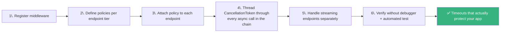

---

<a name="27-further-reading-and-resources"></a>
## 27. Further Reading and Resources

### Official documentation

- **Request timeouts middleware in ASP.NET Core** — learn.microsoft.com/aspnet/core/performance/timeouts
- **`RequestTimeoutOptions` / `ITimeoutPolicy` API reference** — learn.microsoft.com/dotnet/api/microsoft.aspnetcore.http.timeouts
- **Cancellation in managed threads** — learn.microsoft.com/dotnet/standard/threading/cancellation-in-managed-threads
- **`CancellationTokenSource.CreateLinkedTokenSource`** — learn.microsoft.com/dotnet/api/system.threading.cancellationtokensource.createlinkedtokensource
- **Kestrel web server configuration (limits)** — learn.microsoft.com/aspnet/core/fundamentals/servers/kestrel
- **Resilience pipelines (`Microsoft.Extensions.Http.Resilience`)** — learn.microsoft.com/dotnet/core/resilience

### Related topics in this knowledge base

- `ASP.NET Core Output Cache - How to Speed Up Your API with In-Memory Cache and Redis.md` — caching reduces the need for long requests in the first place
- `Async Concepts That Make Sense Once You Understand the Runtime.md` — the async mental model behind cancellation
- `Building High-Performance .NET Apps With C# Channels.md` — background-processing patterns that pair well with 202 Accepted
- `.NET API Security Complete Guide.md` — broader API hardening, including DoS resistance
- `Best Practices For Building REST APIs.md` — API design context for error contracts (504 vs ProblemDetails)

---

<a name="28-learning-path-and-next-steps"></a>
## 28. Learning Path and Next Steps

### Where this fits in your learning journey

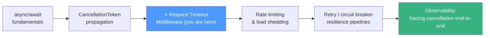

### Suggested next steps

1. **Apply it:** run the Hands-On Lab against one of your real endpoints this week — one endpoint, one policy, one test.
2. **Audit your codebase:** search for `async` methods doing I/O without a `CancellationToken` parameter; fix the top ten.
3. **Add resilience:** explore `Microsoft.Extensions.Http.Resilience` for outbound calls, and budget it against your request policies.
4. **Go deeper on observability:** propagate the cancellation story into your traces so timeout storms are diagnosable at 3 a.m.
5. **Revisit in a month:** re-take the Self-Assessment Checklist — the patterns only stick through repetition.

> 🎯 **Final thought:** Timeouts are one of the rare resilience features that are cheap to add, free at runtime, and pay for themselves the first time a dependency has a bad day. Configure them once, propagate the token everywhere, test them once — and your future self, paging through an incident at 3 a.m., will be grateful the blast radius was five seconds instead of forever.

---

*Last Updated: 2026-08-29*
