<!--
  Tutorial: The Complete Guide to Writing Predictable JavaScript
  Difficulty: Intermediate
  Estimated Reading Time: 90–120 minutes
  Last Updated: 2026-01-09
  Source: Content provided by the user, augmented to meet tutorial-preferences.md requirements
  Based on: JavaScript language fundamentals, React/Redux best practices, TypeScript type safety
-->

# The Complete Guide to Writing Predictable JavaScript: 10 Mistakes That Are Silently Breaking Your Code

> **_"JavaScript is a language of surprises. The goal isn't to memorize every quirk — it's to write code that behaves the way you expect, even when you're not looking at it."_**

---

## ⏱️ Estimated Reading Time: 90–120 minutes

**Difficulty Level:** Intermediate
**Prerequisites:** Basic JavaScript proficiency (variables, functions, objects, arrays), familiarity with browser APIs or Node.js, some exposure to async/await. React/TypeScript experience is helpful but not required.

---

## 📋 Table of Contents

1. [Introduction: Why Predictability Matters](#introduction)
2. [Prerequisites](#prerequisites)
3. [Learning Objectives](#learning-objectives)
4. [How to Use This Tutorial](#how-to-use-this-tutorial)
5. [The Mental Model: Predictability by Default](#mental-model)
6. [Mistake #1: Using `==` Instead of `===`](#mistake-1)
7. [Mistake #2: Mutating State Directly](#mistake-2)
8. [Mistake #3: Not Handling Promise Rejections](#mistake-3)
9. [Mistake #4: Deeply Nested Callbacks ("Callback Hell")](#mistake-4)
10. [Mistake #5: Global Variables Sneaking In](#mistake-5)
11. [Mistake #6: Comparing Objects and Arrays With `===`](#mistake-6)
12. [Mistake #7: Not Cleaning Up Event Listeners and Timers](#mistake-7)
13. [Mistake #8: Overusing `any` in TypeScript](#mistake-8)
14. [Mistake #9: Ignoring the Difference Between `null` and `undefined`](#mistake-9)
15. [Mistake #10: Writing Code for the Computer Instead of People](#mistake-10)
16. [The Pattern Underneath All Ten](#pattern)
17. [Putting It All Together: A Decision Framework](#decision-framework)
18. [Migration Guide: Auditing Your Codebase](#migration-guide)
19. [Best Practices Summary](#best-practices)
20. [Anti-Patterns Summary](#anti-patterns)
21. [Performance Considerations](#performance-considerations)
22. [Security Considerations](#security-considerations)
23. [Testing Strategies](#testing-strategies)
24. [Troubleshooting & Common Pitfalls](#troubleshooting)
25. [Practice Exercises (with Solutions)](#practice-exercises)
26. [Hands-On Lab: Real-World Bug Hunt](#hands-on-lab)
27. [Pro Tips](#pro-tips)
28. [Test Your Understanding](#test-your-understanding)
29. [Question Bank (50+ Questions)](#question-bank)
30. [Common Interview Questions](#interview-questions)
31. [Self-Assessment Checklist](#self-assessment)
32. [Summary & Key Takeaways](#summary)
33. [Further Reading & Resources](#further-reading)
34. [Learning Path Recommendations](#learning-path)
35. [Next Steps](#next-steps)
36. [Final Thoughts](#final-thoughts)

<a name="introduction"></a>
## 1. Introduction: Why Predictability Matters

### The Hidden Cost of "It Works on My Machine"

Most JavaScript bugs that eat entire afternoons don't come from exotic edge cases or obscure language quirks. They come from a small set of everyday habits — habits that look harmless in a 20-line file and turn catastrophic in a 20,000-line codebase.

> **💡 Key Insight:** The most dangerous bugs are not the ones that crash loudly. They are the ones that *appear to work* — silently producing wrong results, skipping re-renders, or swallowing errors — so they propagate far from their source before anyone notices.

This tutorial walks through ten of the most common (and most underestimated) JavaScript mistakes. For each one, you'll get:

- A clear explanation of **why** it happens
- **Multiple examples**, from beginner to real-world
- A **diagram** showing the underlying mechanism
- **Practical use cases** where the fix genuinely matters
- A **quick-reference fix** you can apply today

### The Business Case for Predictable Code

| Cost | Unpredictable Code | Predictable Code |
|---|---|---|
| **Debugging time** | 2–8 hours per "mysterious" bug | Minutes, because the error is caught at its source |
| **Onboarding new devs** | Weeks to learn tribal knowledge | Days, because the code documents itself |
| **Feature velocity** | Slows over time as complexity grows | Stays consistent — complexity is managed |
| **Production incidents** | Silent failures surface in production | Failures surface at compile-time or in tests |
| **Team trust** | "This code works... sometimes" | "This code behaves how it looks" |


---

<a name="prerequisites"></a>
## 2. Prerequisites

### Technical Requirements

| Skill | Minimum Level |
|---|---|
| **JavaScript fundamentals** | Comfortable with variables, functions, objects, arrays, and control flow |
| **Browser APIs or Node.js** | Know how to run JS in a browser console or Node REPL |
| **ES6+ syntax** | Familiar with `let`/`const`, arrow functions, destructuring, spread operator, `async`/`await` |
| **TypeScript (helpful)** | Understanding of basic types; Mistake #8 assumes some TS context |
| **React (helpful)** | The mutation examples in Mistake #2 use React, but the concept applies broadly |

### What This Tutorial IS and IS NOT

> **📝 This tutorial is:**
> - A **deep dive** into the *mechanisms* behind common JavaScript mistakes — not just a checklist
> - A **framework-agnostic** guide — concepts apply to React, Vue, Angular, Node.js, or vanilla JS
> - A **practical** guide — every section includes code you can run and verify

> **❌ This tutorial is NOT:**
> - An exhaustive spec-watching exercise (we focus on *why* these mistakes matter)
> - A framework tutorial (we mention React for context, but the bugs are in the language)
> - A TypeScript textbook (we touch on `any` but don't cover the full type system)

---

<a name="learning-objectives"></a>
## 3. Learning Objectives

By the end of this tutorial, you will be able to:

### 🎯 Core Competencies

1. **Diagnose equality bugs** — distinguish `==` coercion from `===` reference comparison
2. **Write immutable updates** — use spread syntax, `map`/`filter`/`concat` to avoid mutation bugs
3. **Handle async errors reliably** — apply `try/catch` and `.catch()` to every async path
4. **Structure async code for readability** — replace callback pyramids with `async/await`
5. **Avoid global variable leaks** — use strict mode and always declare variables
6. **Compare complex data correctly** — use deep equality utilities instead of `===`
7. **Manage resource lifecycles** — pair every listener/timer/subscription with a teardown
8. **Write safe TypeScript** — avoid `any`, use `unknown` with narrowing, define explicit interfaces
9. **Apply a `null` vs `undefined` convention** — use `??` for fallbacks
10. **Write readable, maintainable code** — name intermediate values, optimize for the reader

### 🚀 Professional Outcomes

By the time you finish, you will be able to:

- **Audit any JavaScript codebase** and identify all 10 mistake categories in minutes
- **Explain to teammates** *why* a mutation caused a re-render to be skipped
- **Set up linter rules and testing strategies** that catch these mistakes automatically
- **Pass senior-level JavaScript/TypeScript interviews** with confidence
- **Lead code review standards** around predictability and error handling


<a name="how-to-use-this-tutorial"></a>
## 4. How to Use This Tutorial

This is a **comprehensive deep-dive**, not a quick reference. Here's the recommended approach:

1. **Read linearly** — Each mistake builds on concepts used in later sections. Resist the temptation to skip to the ones you already "know."
2. **Try the exercises** — The practice problems at the end reinforce key concepts. Write the code yourself; don't just read the solutions.
3. **Bookmark the checklists** — The quick recap, self-assessment, and summary checklist make excellent code-review checklists.
4. **Use the question bank** — 50+ questions for interview prep or team training. Mix closed-answer and open-ended questions.
5. **Apply the migration guide** — Audit your own codebase using the provided framework in Section 18.

### What Each Mistake Section Contains

> **🔔 Callout:** Every mistake section is structured identically so you always know where to look:
> - **The Core Problem** — What goes wrong and why
> - **Why It Happens** — The root cause, not just the symptom
> - **The Diagram** — A Mermaid visualization of the underlying mechanism
> - **Multiple Examples** — From beginner traps to real-world production bugs
> - **Real-World Use Case** — A concrete scenario from production
> - **Multiple Implementation Approaches** — Different valid ways to apply the fix
> - **Testing Strategy / Best Practices** — How to verify and enforce the fix
> - **Quick Fix** — A one-line takeaway you can apply immediately

### How to Run the Examples

```bash
# Vanilla JS examples: open your browser console (F12) or run:
node example.js

# React examples: assumes a create-react-app / Vite project with React hooks
# TypeScript examples: assumes a tsc --strict project
```

> **💡 Pro Tip:** Don't just read the code — run the *incorrect* examples first to *see* the bug happen, then apply the fix and re-run. The contrast cements the concept far more effectively than reading about it.


<a name="mental-model"></a>
## 5. The Mental Model: Predictability by Default

Every mistake on this list traces back to the same root cause: **a loss of predictability.**

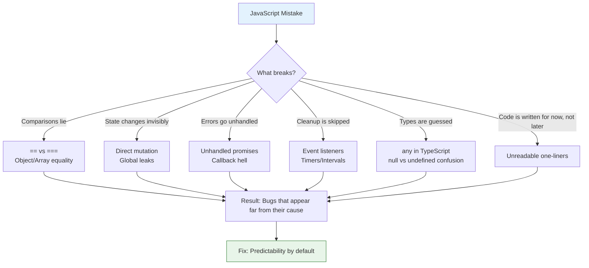

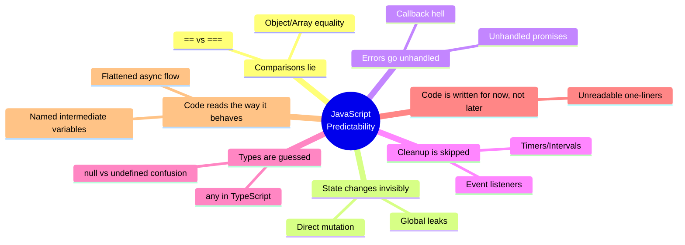

> **🧭 How to read this map:** Every mistake collapses one of these six dimensions of predictability. Notice that most bugs pile up here, they aren't exotic — they are everyday violations of a *simple contract*: **"The code's behavior should match its apparent meaning."**


<a name="mistake-1"></a>
## 6. Mistake #1: Using `==` Instead of `===`

### The Core Problem

JavaScript's loose equality operator (`==`) performs **type coercion** before comparing values. That means it tries to convert both sides into a common type first, and the rules for how it does that are famously counterintuitive.

```js
0 == "0"           // true
0 == ""            // true
"" == "0"          // false
null == undefined  // true
false == "false"   // false
false == 0         // true
[] == false        // true
```

> **🤔 Why these surprise people?** Each one is "explainable" via the spec's abstract-equality algorithm — but none of them match how a human reads the code. That gap between *apparent* and *actual* behavior is exactly the predictability loss this tutorial is about.

### The Diagram: How `==` Decides to Coerce

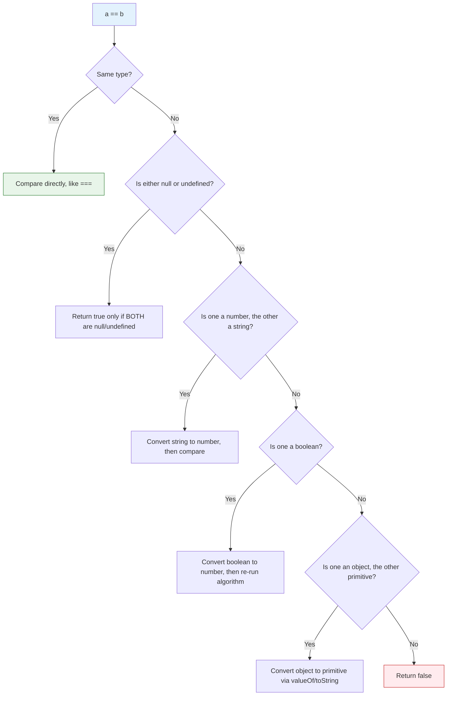
### Multiple Examples

**Example 1 — Form validation bug**

#### ❌ Incorrect Implementation

```js
function isEmpty(value) {
  return value == "";  // Uses loose equality — coerces!
}

isEmpty(0);      // true! but 0 is not "empty", it's a valid number
isEmpty(false);  // true! but false is a valid boolean value
isEmpty(null);   // false (because null != "" via coercion)
```

The function returns `true` for `0` and `false` — meaning a numeric input of `0` or a boolean `false` would be rejected as "empty." This is almost never the intent.

#### ✅ Correct Implementation

```js
function isEmpty(value) {
  return value === "";   // Strict equality — no coercion
}

isEmpty(0);      // false ✅ — 0 is a valid number
isEmpty(false);  // false ✅ — false is a valid boolean
isEmpty("");     // true  ✅ — only the empty string is "empty"
```

**Example 2 — API response check**

```js
// ❌ Bad: assumes status is always a string
if (response.status == 200) { ... }

// If status is sometimes a number (200) and sometimes a string ("200"),
// == will silently paper over the inconsistency instead of surfacing it.
// You'll never know that your API has a type inconsistency bug.
```

```js
// ✅ Good: forces you to know the actual type
if (response.status === 200) { ... }
// If this throws or returns false unexpectedly, you immediately know
// the type is wrong — and you can fix the API contract.
```

**Example 3 — Explicit coercion when needed**

```js
// ✅ When you genuinely need to compare across types, normalize first
function isStatusOk(status) {
  const normalized = Number(status);
  return normalized === 200;
}

isStatusOk(200);      // true
isStatusOk("200");    // true
isStatusOk("200abc"); // false (Number("200abc") is NaN)
isStatusOk("OK");     // false (Number("OK") is NaN)
```

### Real-World Use Case

Imagine a checkout form where a discount code field defaults to `null` before the user types anything, but becomes `""` (empty string) after they type and delete text. If your validation uses `== ""`, both states look identical — but you may need to treat "never touched" differently from "touched and cleared" (e.g., for analytics or auto-save behavior). `===` forces you to be explicit about which state you actually mean.

```js
// Real-world: analytics distinguish between "untouched" and "cleared"
function trackFieldInteraction(fieldName, value) {
  if (value === null) {
    return; // Field was never touched — don't track
  }
  if (value === "") {
    analytics.track("field_cleared", { field: fieldName });
  }
  if (value !== "") {
    analytics.track("field_entered", { field: fieldName, value });
  }
}
```

### Multiple Implementation Approaches

#### Approach 1: Always `===` (Recommended)

```js
const isEqual = (a, b) => a === b;
```

#### Approach 2: Explicit coercion when you need it

```js
// When you genuinely want to compare a string and number
const statusIsOk = Number(response.status) === 200;

// When you want to check if a value is "present" (not null or undefined)
const isPresent = value => value != null; // The one acceptable use of !=
```

<a name="mistake-2"></a>
## 7. Mistake #2: Mutating State Directly

### The Core Problem

Many frameworks and state-management libraries (React, Redux, Vue's reactivity system, etc.) determine "did something change?" by comparing **references**, not by deeply inspecting content. If you mutate an object or array in place, the reference never changes — so the framework never notices.

```js
function addItem(cart, item) {
  cart.items.push(item); // mutates the original array in place
  return cart;
}
```

### Why This Is Dangerous

The bug doesn't appear where the mutation happens. It appears somewhere *else* — a component that "just won't re-render," a memoized selector that returns stale data, a comparison that silently says "nothing changed" when clearly something did. The root cause and the symptom are separated by the framework's change-detection mechanism.

### The Diagram: Mutation vs. Immutable Update

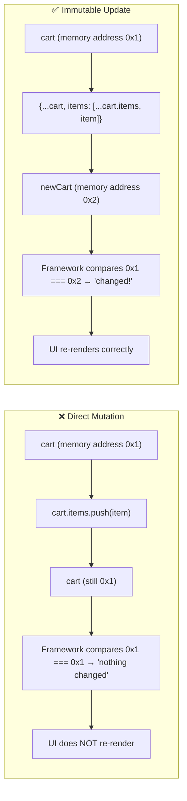

### Multiple Examples

**Example 1 — React state bug**

#### ❌ Incorrect Implementation

```js
const [user, setUser] = useState({ name: "Alex", age: 30 });

function birthday() {
  user.age += 1;        // mutates the original object in place
  setUser(user);        // same reference — React skips the re-render
}
```

#### ✅ Correct Implementation

```js
function birthday() {
  setUser({ ...user, age: user.age + 1 });  // new object reference
}
```

**Example 2 — Redux reducer**

#### ❌ Incorrect Implementation

```js
function reducer(state, action) {
  state.todos.push(action.payload); // mutates the state tree directly
  return state;                     // same reference — Redux ignores it
}
```

#### ✅ Correct Implementation

```js
function reducer(state, action) {
  return {
    ...state,
    todos: [...state.todos, action.payload],  // new array, new object
  };
}
```

**Example 3 — Passing objects between functions**

#### ❌ Incorrect Implementation

```js
function applyDiscount(order, percent) {
  order.total = order.total * (1 - percent / 100); // mutates caller's object
  return order;
}

const original = { total: 100 };
const discounted = applyDiscount(original, 10);
console.log(original.total); // 90 — surprise! the caller's object changed too
```

Because `order` is passed by reference, mutating `order.total` changes the *caller's* object — a behavior the caller never asked for and may not expect.

#### ✅ Correct Implementation

```js
function applyDiscount(order, percent) {
  return {
    ...order,
    total: order.total * (1 - percent / 100),
  };
}

const original = { total: 100 };
const discounted = applyDiscount(original, 10);
console.log(original.total);   // 100 — untouched
console.log(discounted.total); // 90 — the new object carries the discount
```

### Real-World Use Case

**Undo/redo functionality.** If you keep a history stack of previous states (e.g., in a design tool or text editor), mutation destroys your history — every "past" snapshot secretly points to the same mutated object as the present, so undo does nothing. Immutable updates let each history entry stay frozen in time.

```js
// Real-world: undo/redo with immutable updates
class HistoryManager {
  constructor(initialState) {
    this.states = [initialState];
    this.pointer = 0;
  }

  // ✅ Immutable update — each state is a frozen snapshot
  update(newState) {
    // Discard any "redo" states (we're making a new branch)
    this.states = this.states.slice(0, this.pointer + 1);
    // Freeze to catch accidental mutations during development
    const frozen = Object.freeze(newState);
    this.states.push(frozen);
    this.pointer++;
  }

  undo() {
    if (this.pointer > 0) this.pointer--;
    return this.states[this.pointer];
  }

  redo() {
    if (this.pointer < this.states.length - 1) this.pointer++;
    return this.states[this.pointer];
  }
}
```

### Multiple Implementation Approaches

#### Approach 1: Spread syntax (Recommended for simple cases)

```js
// Objects
const updated = { ...original, key: newValue };

// Arrays
const appended = [...original, newItem];
const filtered = original.filter(item => item.id !== removedId);
const mapped = original.map(item =>
  item.id === targetId ? { ...item, ...updates } : item
);
```

#### Approach 2: Immer for complex nested state

```bash
npm install immer
```

```js
import { produce } from "immer";

const nextState = produce(state, draft => {
  // You can write "mutating" code — Immer handles immutability
  draft.cart.items.push(newItem);
  draft.user.profile.name = "New Name";
});
// nextState is a new immutable object; original state is untouched
```

#### Approach 3: Array methods that return new arrays

```js
// These all return new arrays — they never mutate the original
arr.concat(newItem);              // append
arr.filter(fn);                   // subset
arr.map(fn);                      // transform
arr.slice(start, end);            // copy
arr.flatMap(fn);                  // map + flatten
```

### Performance Implications

| Operation | Direct Mutation | Immutable Update |
|---|---|---|
| Time complexity | O(k) for k changes | O(n) for n items in the structure |
| Memory | No new allocation | New object/array allocated |
| **Framework benefit** | None — re-renders are skipped | Change detection works correctly |
| **For small state** (≤100 items) | Negligible difference | Negligible difference |
| **For large state** (>10K items) | Much faster | Can be optimized with structural sharing |

> **💡 Pro Tip:** For performance-critical code with large data structures, use **structural sharing** (libraries like Immer, Immutable.js) — these reuse unchanged parts of the data structure, so the overhead is proportional to what *changed*, not the total size.

### Testing Strategy

<a name="mistake-3"></a>
## 8. Mistake #3: Not Handling Promise Rejections

### The Core Problem

An `async` function that throws without a `try/catch`, or a `.then()` chain missing a `.catch()`, fails **silently** or crashes the process with a barely-visible warning.

```js
async function getUser(id) {
  const res = await fetch(`/api/users/${id}`);
  return res.json();
}

getUser(42); // if this fails... where does the error go?
```


### The Diagram: Promise Rejection Paths

```mermaid
flowchart TD
    A["fetch() call"] --> B{Success?}
    B -->|Yes| C[".then() runs / await resolves"]
    B -->|No: network error, 4xx/5xx, etc.| D{Is there a .catch() or try/catch?}
    D -->|Yes| E["Error is caught, logged, handled gracefully"]
    D -->|No| F["UnhandledPromiseRejection"]
    F --> G["Browser: silent console warning\nNode: process may crash"]
    G --> H["User sees a frozen UI or blank screen\nwith zero explanation"]

    style F fill:#ffebee,stroke:#c62828
    style H fill:#ffcdd2,stroke:#b71c1c
```

### Multiple Examples

**Example 1 — Missing `.catch()`**

#### ❌ Incorrect Implementation

```js
fetch("/api/data")
  .then((res) => res.json())
  .then((data) => renderData(data));
// No .catch() — if the network fails, the user sees nothing
// In Node.js, this may print "UnhandledPromiseRejectionWarning" or crash the process
```

#### ✅ Correct Implementation

```js
fetch("/api/data")
  .then((res) => {
    if (!res.ok) throw new Error(`HTTP ${res.status}`);
    return res.json();
  })
  .then((data) => renderData(data))
  .catch((err) => {
    console.error("Failed to load data:", err);
    showErrorBanner();
  });
```

**Example 2 — `async/await` without `try/catch`**

#### ❌ Incorrect Implementation

```js
// ❌ Throws are invisible to the caller unless they also handle it
async function loadDashboard() {
  const stats = await fetchStats();  // if this rejects, function throws unhandled
  renderStats(stats);
}
```

#### ✅ Correct Implementation

```js
// ✅ Explicit handling at the source
async function loadDashboard() {
  try {
    const stats = await fetchStats();
    renderStats(stats);
  } catch (err) {
    logger.error("Dashboard load failed", err);
    showFallbackUI();  // UIs degrade gracefully instead of silently freezing
  }
}
```

### Real-World Use Case

**Payment processing.** If a "charge card" API call fails and the rejection isn't handled, a customer might see a spinning "processing..." button forever — while your backend never actually knows the charge failed. Explicit `try/catch` with user-facing error messages ("Your card was declined") turns a silent failure into an actionable one.

```js
// Real-world: payment processing with proper error handling
async function processPayment(cardToken, amount) {
  setLoading(true);
  setError(null);

  try {
    const response = await fetch("/api/charge", {
      method: "POST",
      headers: { "Content-Type": "application/json" },
      body: JSON.stringify({ token: cardToken, amount }),
    });

    if (!response.ok) {
      const error = await response.json();
      throw new PaymentError(error.message, error.code);
    }

    const result = await response.json();
    onSuccess(result);  // show confirmation page
  } catch (err) {
    if (err instanceof PaymentError) {
      setError(`Payment failed: ${err.message}`);
    } else if (err.name === "TypeError") {
      setError("Network error — please check your connection and try again.");
    } else {
      setError("An unexpected error occurred. Please try again.");
    }
    // Always track the failure for debugging
    logger.error("Payment processing failed", {
      amount,
      error: err.message,
      stack: err.stack,
    });
  } finally {
    setLoading(false);
  }
}
```

### Multiple Implementation Approaches

#### Approach 1: try/catch with specific error types (Recommended)

```js
class ApiError extends Error {
  constructor(message, status, body) {
    super(message);
    this.name = "ApiError";
    this.status = status;
    this.body = body;
  }
}

async function fetchWithHandling(url, options = {}) {
  try {
    const response = await fetch(url, options);
    if (!response.ok) {
      throw new ApiError(
        `HTTP ${response.status}: ${response.statusText}`,
        response.status,
        await response.text()
      );
    }
    return await response.json();
  } catch (err) {
    if (err instanceof ApiError) throw err;
    // Network error, timeout, etc.
    throw new ApiError(`Network error: ${err.message}`);
  }
}
```

#### Approach 2: Global unhandled rejection safety net (defense-in-depth)

```js
// ✅ Add as a LAST LINE OF DEFENSE, not a primary strategy
window.addEventListener("unhandledrejection", (event) => {
  logger.error("Unhandled promise rejection:", event.reason);
  event.preventDefault();  // prevent default browser behavior
});

// In Node.js:
process.on("unhandledRejection", (reason, promise) => {
  logger.error("Unhandled rejection at:", promise, "reason:", reason);
  // Consider graceful shutdown in production
});
```

#### Approach 3: Centralized error wrapper utility

```js
// Wrap async route handlers in Express-style apps
function asyncHandler(fn) {
  return function (req, res, next) {
    Promise.resolve(fn(req, res, next)).catch(next);
  };
}

// Usage:
app.get("/api/users/:id", asyncHandler(async (req, res) => {
  const user = await User.findById(req.params.id);
  if (!user) throw new AppError("User not found", 404);
  res.json(user);
}));
// Any rejection is automatically passed to Express's error handler
```

<a name="mistake-4"></a>
## 9. Mistake #4: Deeply Nested Callbacks ("Callback Hell")

### The Core Problem

Each new asynchronous step gets nested one level deeper, until the code resembles a staircase and becomes nearly impossible to read, debug, or modify safely.

```js
getUser(id, (user) => {
  getOrders(user.id, (orders) => {
    getShipping(orders[0].id, (shipping) => {
      updateUI(shipping);
    });
  });
});
```

### The Diagram: Callback Pyramid vs. Flattened Async

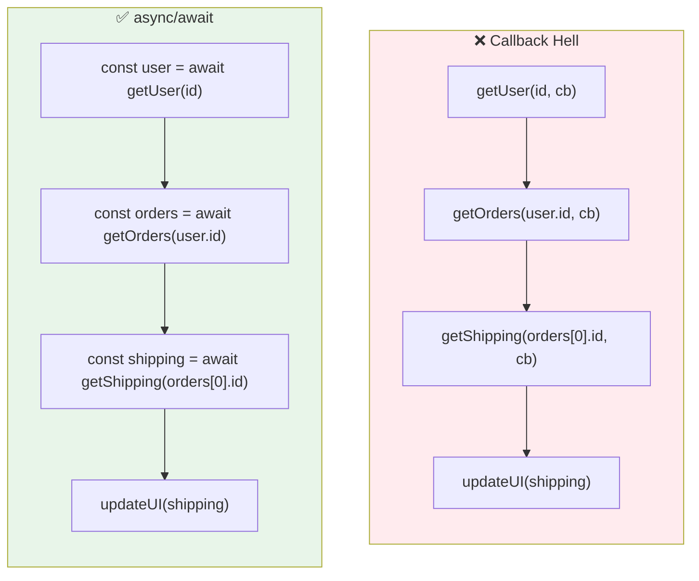

### Multiple Examples

**Example 1 — The nested version**

#### ❌ Incorrect Implementation

```js
function loadShippingInfo(id, callback) {
  getUser(id, (err, user) => {
    if (err) return callback(err);
    getOrders(user.id, (err, orders) => {
      if (err) return callback(err);
      getShipping(orders[0].id, (err, shipping) => {
        if (err) return callback(err);
        callback(null, shipping);
      });
    });
  });
}
```

#### ✅ Correct Implementation: Flattened with `async/await`

```js
async function loadShippingInfo(id) {
  const user = await getUser(id);
  const orders = await getOrders(user.id);
  const shipping = await getShipping(orders[0].id);
  return shipping;
}
```

Notice how the code now reads linearly — top to bottom, left to right — matching how you'd describe the business logic to a colleague.

**Example 2 — Sequential steps that should be parallel**

#### ❌ Incorrect Implementation: Nested but sequential, even when independent

```js
getUser(id, (user) => {
  getPreferences(id, (prefs) => {
    getNotifications(id, (notifs) => {
      render(user, prefs, notifs);
    });
  });
});
```

These three calls have no dependency on each other — they all need `id`, not the result of a prior step. But the nesting forces them to run one-after-another.

#### ✅ Correct Implementation: Concurrent with `Promise.all`

```js
async function loadProfile(id) {
  const [user, prefs, notifs] = await Promise.all([
    getUser(id),
    getPreferences(id),
    getNotifications(id),
  ]);
  render(user, prefs, notifs);
}
```

> **📈 What this teaches us:** Flattening with `async/await` isn't just cosmetic — it makes *parallelization* obvious. Once the callbacks are gone, you can see at a glance which steps depend on each other (sequential `await`s) and which don't (a perfect `Promise.all` candidate). This is the fix that does two things at once.

### Real-World Use Case

**E-commerce checkout flow**: validate cart → apply discount → calculate shipping → charge payment → send confirmation email. Five sequential async steps, each depending on the last. Written as nested callbacks, a single typo in step 3 can be nearly impossible to trace. Written as `async/await`, the code reads like the business logic it represents — and stack traces on error point to the exact failing step.

### Multiple Implementation Approaches

#### Approach 1: `async/await` with `try/finally` (Recommended)

```js
async function checkout(cartId, paymentToken) {
  try {
    const cart = await validateCart(cartId);
    const discount = await applyDiscount(cart, couponCode);
    const shipping = await calculateShipping(discount, address);
    const charge = await chargePayment(paymentToken, shipping.total);
    await sendConfirmation(charge.id);
    return { success: true, orderId: charge.id };
  } catch (err) {
    // Single error handler for all steps
    await logError("Checkout failed", { cartId, error: err.message });
    return { success: false, error: err.message };
  }
}
```

#### Approach 2: Sequential with `reduce` (for dynamic chains)

```js
// When the number of async steps is not known at write time
async function runPipeline(input, steps) {
  return steps.reduce(async (chain, step) => {
    const result = await chain;
    return step(result);
  }, Promise.resolve(input));
}
```

#### Approach 3: Converting callback APIs to Promises

```js
// Node.js: util.promisify for callback-based functions
const { promisify } = require("util");
const fs = require("fs");

const readFile = promisify(fs.readFile);
const writeFile = promisify(fs.writeFile);

async function copyFile(src, dest) {
  const data = await readFile(src);
  await writeFile(dest, data);
  return dest;
}
```

> **💡 Pro Tip:** If you're stuck with a callback-based library, wrap it in a Promise once, then use `async/await` everywhere else. Don't let one callback-based API infect your entire codebase.

### Quick Fix

> Convert callback-based APIs to Promises, then use `async/await`. Use `Promise.all` for independent operations instead of chaining them needlessly.

---

<a name="mistake-5"></a>
## 10. Mistake #5: Global Variables Sneaking In

### The Core Problem

Forgetting `const`, `let`, or `var` in non-strict mode causes JavaScript to silently attach the variable to the global object — without so much as a warning.

```js
function calculateTotal() {
  total = 0; // no declaration — this leaks to the global scope
  for (const item of items) total += item.price;
  return total;
}
```

### The Diagram: Where an Undeclared Variable Ends Up

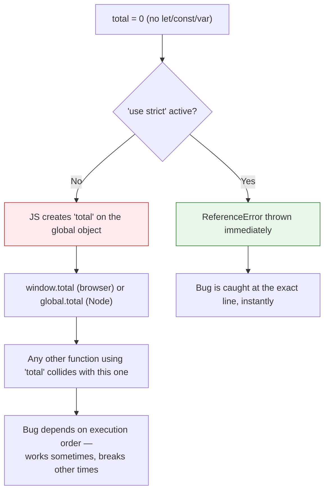

### Multiple Examples

**Example 1 — Two functions colliding**

```js
// file1.js
function processOrders() {
  total = 0; // leaked global
  orders.forEach((o) => (total += o.amount));
  return total;
}

// file2.js, loaded on the same page
function processInvoices() {
  total = 0; // same global variable!
  invoices.forEach((i) => (total += i.amount));
  return total;
}
```

If these run interleaved (e.g., one inside an async callback while the other is mid-loop), their totals corrupt each other. `processOrders` might return `500` when it should return `300`, because `processInvoices` added its numbers to the same `total` variable mid-iteration.

**Example 2 — Strict mode catching it immediately**

```js
"use strict";

function calculateTotal() {
  total = 0; // ❌ ReferenceError: total is not defined
  return total;
}
```

With strict mode, the bug **fails fast** — at the exact line where the accident happened, not hours later when some unrelated code reads a corrupted global.

**Example 3 — The fix**

```js
"use strict";

function calculateTotal(items) {
  let total = 0;  // properly scoped to this function
  for (const item of items) total += item.price;
  return total;
}
```

**Example 4 — Async collision (the sneaky one)**

```js
// ❌ Without strict mode, this is a nightmare under concurrent requests
async function handleRequest(req, res) {
  result = await processStep1(req.body);  // leaked global!
  result = await processStep2(result);    // overwrites the global
  // If two requests interleave here, result is corrupted
  res.json(result);
}
```

```js
// ✅ Proper scoping prevents the race condition entirely
async function handleRequest(req, res) {
  const result1 = await processStep1(req.body);   // local to this function call
  const result2 = await processStep2(result1);   // local to this function call
  res.json(result2);
}
```

### Real-World Use Case

**Third-party script conflicts.** If your site loads an analytics widget and a chat widget, and both accidentally leak a variable named `config` or `data` to the global scope, one script can silently overwrite the other's state. This is one of the most common causes of "it works alone but breaks when both scripts are on the page" bugs.

### Multiple Implementation Approaches

#### Approach 1: `"use strict"` + always declare (Recommended)

```js
"use strict";

function calculateTotal(items) {
  let total = 0;
  for (const item of items) total += item.price;
  return total;
}
```

#### Approach 2: ES Modules (strict mode is automatic)

```js
// In an .mjs file or any <script type="module"> — strict mode is implied
export function calculateTotal(items) {
  let total = 0;  // no "use strict" needed
  for (const item of items) total += item.price;
  return total;
}
```

#### Approach 3: Linter enforcement

```jsonc
// .eslintrc.json
{
  "rules": {
    "no-implicit-globals": "error",   // no undeclared globals in modules
    "no-undef": "error",              // no reading undeclared variables
    "strict": ["error", "global"]     // require "use strict" globally
  }
}
```

### Testing Strategy

```js
// Integration test that catches global leaks
test("no global variables are leaked", () => {
  const globalKeysBefore = Object.keys(global);

  // Run the module/function under test
  require("./module-under-test");

  const globalKeysAfter = Object.keys(global);
  const leakedKeys = globalKeysAfter.filter(
    (key) => !globalKeysBefore.includes(key) && key !== "__coverage__"
  );

  expect(leakedKeys).toHaveLength(0);
});
```

### Quick Fix

> Always use `"use strict"` (or rely on ES modules, which enable it automatically), and always declare variables with `let` or `const`. Configure your linter (ESLint's `no-undef` and `no-implicit-globals`) to catch this automatically.

---

<a name="mistake-6"></a>
## 11. Mistake #6: Comparing Objects and Arrays With `===`

### The Core Problem

`===` compares objects and arrays **by reference**, not by content. Two objects with identical properties are still different objects in memory.

```js
{ a: 1 } === { a: 1 }     // false
[1, 2, 3] === [1, 2, 3]   // false
```

### The Diagram: Reference Equality vs. Deep Equality

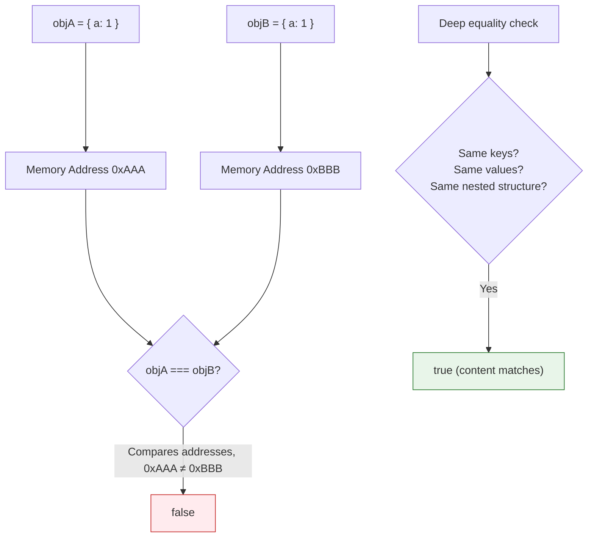

### Multiple Examples

**Example 1 — The trap**

```js
const cartA = { items: ["apple"] };
const cartB = { items: ["apple"] };

console.log(cartA === cartB); // false, even though they look identical
```

**Example 2 — Array comparison in a React dependency check**

```js
// ❌ This condition is ALWAYS true (they're never === unless same reference)
if (prevFilters === newFilters) {
  skipRefetch();
}
```

**Example 3 — The fixes**

```js
// Option 1: JSON.stringify (simple, but order-sensitive and slow on large objects)
JSON.stringify(cartA) === JSON.stringify(cartB); // true

// Option 2: A dedicated deep-equal utility (recommended for real code)
import isEqual from "lodash/isEqual";
isEqual(cartA, cartB); // true

// Option 3: Manual shallow comparison (fast, for simple flat objects)
function shallowEqual(a, b) {
  if (a === b) return true;              // same reference — definitely equal
  if (typeof a !== "object" || a === null) return false;
  if (typeof b !== "object" || b === null) return false;

  const keysA = Object.keys(a);
  const keysB = Object.keys(b);
  if (keysA.length !== keysB.length) return false;
  return keysA.every((key) => b.hasOwnProperty(key) && a[key] === b[key]);
}

shallowEqual(cartA, cartB); // true
```

### Real-World Use Case

**Memoization / avoiding unnecessary re-computation.** A search component that only wants to re-run an expensive filter operation when the filter object *actually changes in content* (not reference) needs deep equality — otherwise it re-filters on every render even when nothing meaningfully changed, or it skips a real change because two different-looking objects happen to share a reference at some point.

```js
// Real-world: React memoization with custom deep equality
function useDeepCompareMemo(callback, deps) {
  const ref = useRef();
  if (!isEqual(deps, ref.current)) {
    ref.current = deps;
  }
  // Only re-runs callback when deps actually changed in content
  return useMemo(callback, [ref.current]);
}

// Usage in a search component:
const filteredResults = useDeepCompareMemo(() => {
  return items.filter(item => 
    item.name.toLowerCase().includes(filters.searchTerm.toLowerCase()) &&
    (filters.category === "all" || item.category === filters.category)
  );
}, [filters]);  // Will NOT re-run if filters is a new object with same content
```

### Performance Considerations

| Method | Time Complexity | Pros | Cons |
|---|---|---|---|
| `===` on objects | O(1) | Instant, no allocation | Only checks reference, not content |
| `JSON.stringify` | O(n) + string allocation | No dependencies, works on plain data | Slow on large objects, order-sensitive, loses `undefined`/functions |
| `lodash/isEqual` | O(n) | Handles all edge cases (cycles, NaN, dates, etc.) | Large bundle if imported fully — use `lodash-es/isEqual` for tree-shaking |
| Manual shallow compare | O(k) where k = keys | Zero dependencies, very fast | Only shallow — nested objects still compared by reference |

### Testing Strategy

```js
// Test that your deep-equal utility handles edge cases
describe("shallowEqual", () => {
  test("returns true for same reference", () => {
    const obj = { a: 1 };
    expect(shallowEqual(obj, obj)).toBe(true);
  });

  test("returns true for different references with same content", () => {
    expect(shallowEqual({ a: 1 }, { a: 1 })).toBe(true);
  });

  test("returns false for different keys", () => {
    expect(shallowEqual({ a: 1 }, { b: 1 })).toBe(false);
  });

  test("returns false for different values", () => {
    expect(shallowEqual({ a: 1 }, { a: 2 })).toBe(false);
  });

  test("returns false for null/undefined inputs", () => {
    expect(shallowEqual(null, { a: 1 })).toBe(false);
    expect(shallowEqual({ a: 1 }, undefined)).toBe(false);
  });
});
```

<a name="mistake-7"></a>
## 12. Mistake #7: Not Cleaning Up Event Listeners and Timers

### The Core Problem

Every `addEventListener`, `setInterval`, or subscription is a commitment to eventually tear it down. Skipping cleanup causes memory leaks that grow slowly in development and bite hard in production.

```js
useEffect(() => {
  window.addEventListener("resize", handleResize);
  // ❌ no cleanup — this listener persists even after the component unmounts
}, []);
```

### The Diagram: Component Lifecycle With and Without Cleanup

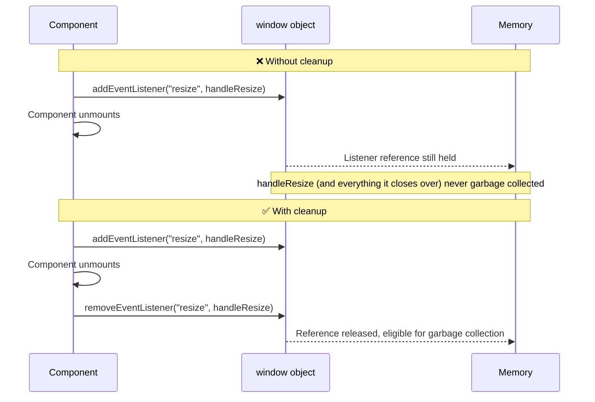

### Multiple Examples

**Example 1 — React `useEffect` cleanup**

#### ❌ Incorrect Implementation

```js
function ResizableComponent() {
  useEffect(() => {
    const handleResize = () => {
      setWidth(window.innerWidth);
    };
    window.addEventListener("resize", handleResize);
    // ❌ No cleanup returned — listener persists after unmount
  }, []);
  // Each time this component mounts, a new listener is added.
  // Each unmount leaves the old one dangling. After 100 mounts/unmounts,
  // you have 100 listeners all calling setState on an unmounted component.
  return <div style={{ width: width }}>{width}px</div>;
}
```

#### ✅ Correct Implementation

```js
function ResizableComponent() {
  useEffect(() => {
    const handleResize = () => {
      setWidth(window.innerWidth);
    };
    window.addEventListener("resize", handleResize);
    // ✅ Return cleanup function — React calls this on unmount
    return () => window.removeEventListener("resize", handleResize);
  }, []);
  return <div style={{ width: width }}>{width}px</div>;
}
```

**Example 2 — `setInterval` without `clearInterval`**

```js
// ❌ Leaks: interval keeps running even after the widget is removed
function startPolling() {
  setInterval(() => fetchLatestData(), 5000);
}
```

```js
// ✅ Store the interval ID and clear it when done
function startPolling() {
  const intervalId = setInterval(() => fetchLatestData(), 5000);
  return () => clearInterval(intervalId);  // Return cleanup function
}

const stopPolling = startPolling();
// Later, when the feature is no longer needed:
stopPolling();
```

**Example 3 — Subscription-based APIs (WebSockets, RxJS, Firebase)**

```js
// ❌ Subscription never unsubscribed
useEffect(() => {
  const unsubscribe = firestore.collection("messages").onSnapshot(handleNewMessages);
}, []);   // Missing return — subscription stays active forever
```

```js
// ✅ Return the unsubscribe function so it fires on unmount
useEffect(() => {
  const unsubscribe = firestore.collection("messages").onSnapshot(handleNewMessages);
  return () => unsubscribe();  // ✅ Cleanup runs on unmount
}, []);
```

### Real-World Use Case

**Single-page applications with client-side routing.** A dashboard page that sets up a `setInterval` to poll for live data will keep polling — and keep making network requests — even after the user navigates away to a completely different page, if that interval is never cleared. Over a long session with many page visits, this compounds into dozens of "ghost" intervals silently draining battery, bandwidth, and memory.

```js
// Real-world: polling with proper cleanup
function usePolling(url, intervalMs = 5000) {
  const [data, setData] = useState(null);

  useEffect(() => {
    let isCancelled = false;  // Guard against race conditions

    const fetchData = async () => {
      try {
        const response = await fetch(url);
        const json = await response.json();
        if (!isCancelled) setData(json);
      } catch (err) {
        if (!isCancelled) console.error("Polling error:", err);
      }
    };

    fetchData();  // Initial fetch

    const interval = setInterval(fetchData, intervalMs);

    // ✅ Cleanup: stop polling AND prevent the last fetch from updating state
    return () => {
      clearInterval(interval);
      isCancelled = true;
    };
  }, [url, intervalMs]);

  return data;
}
```

### Multiple Implementation Approaches

#### Approach 1: React `useEffect` cleanup (Recommended for React)

```js
useEffect(() => {
  const controller = new AbortController();  // For fetch cancellation
  const interval = setInterval(() => fetchData(controller.signal), 5000);

  return () => {
    clearInterval(interval);
    controller.abort();  // Cancel any in-flight fetch
  };
}, []);
```

#### Approach 2: Class component `componentWillUnmount`

```js
class MyComponent extends React.Component {
  componentDidMount() {
    this.interval = setInterval(this.poll, 5000);
  }

  componentWillUnmount() {
    clearInterval(this.interval);
    if (this.subscription) this.subscription.unsubscribe();
  }

  render() { /* ... */ }
}
```

#### Approach 3: Manual lifecycle management (vanilla JS / non-React)

```js
class DataManager {
  constructor(url) {
    this.url = url;
    this.listeners = new Set();
    this.intervalId = null;
  }

  addListener(fn) {
    this.listeners.add(fn);
    return () => this.listeners.delete(fn);  // Return unsubscribe
  }

  startPolling(intervalMs = 5000) {
    this.intervalId = setInterval(() => this.fetch(), intervalMs);
  }

  stopPolling() {
    if (this.intervalId) {
      clearInterval(this.intervalId);
      this.intervalId = null;
    }
  }

  destroy() {
    this.stopPolling();
    this.listeners.clear();
  }
}
```

> **💡 Pro Tip:** Treat every "setup" as needing a matching "teardown." If you open a resource, register a handler, or start a timer, you are *responsible* for closing, unregistering, or clearing it. A good way to remember this: every `addEventListener` needs a `removeEventListener`, every `setInterval` needs a `clearInterval`, every subscription needs an `unsubscribe`.


<a name="mistake-8"></a>
## 13. Mistake #8: Overusing `any` in TypeScript

### The Core Problem

`any` isn't really a type — it's an escape hatch that tells the compiler "stop checking this." Overusing it quietly turns a typed codebase back into an untyped one, without anyone deciding that on purpose.

```ts
function processPayment(data: any) {
  return data.amont * data.rate; // typo: "amont" — no error, returns NaN silently
}
```


### The Diagram: `any` vs `unknown` vs a Defined Type

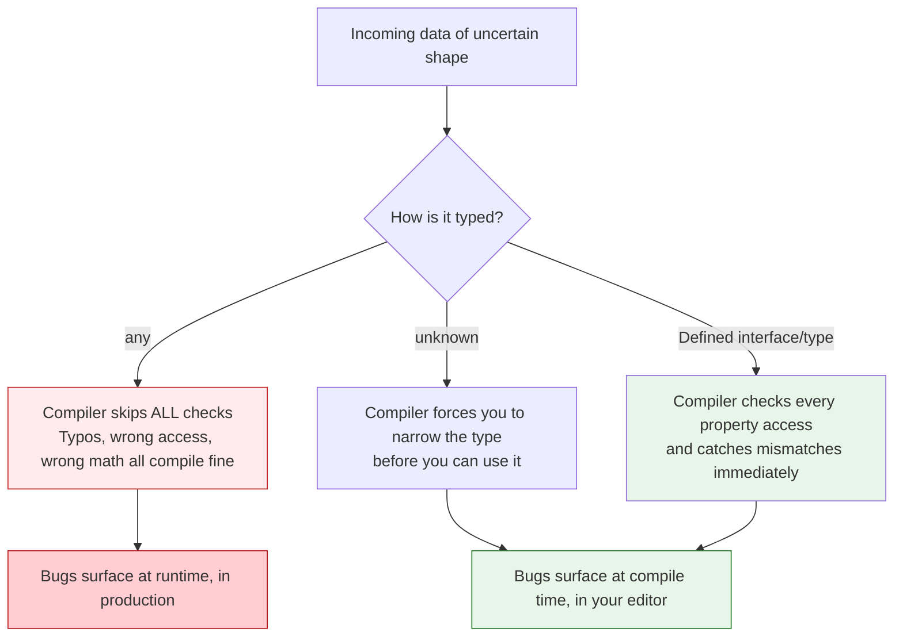

### Multiple Examples

**Example 1 — The silent failure**

```ts
function processPayment(data: any) {
  return data.amont * data.rate; // typo: "amont" — no error, returns NaN silently
  // At runtime: NaN * number = NaN — the payment amount is wrong, but nothing screams
}
```

**Example 2 — Defining the shape properly**

```ts
type PaymentData = { amount: number; rate: number };

function processPayment(data: PaymentData) {
  // ✅ Typo now caught immediately: "Property 'amont' does not exist"
  return data.amount * data.rate;
}
```

**Example 3 — `unknown` for genuinely uncertain input (e.g., API responses)**

```ts
async function fetchPayment(): Promise<unknown> {
  const res = await fetch("/api/payment");
  return res.json();
}

const data = await fetchPayment();
// ❌ Can't use data.amount directly — TypeScript forces you to check first
// data.amount; // Error: Object is of type 'unknown'

// ✅ Narrow the type before using it
if (isPaymentData(data)) {
  console.log(data.amount * data.rate); // now safe
}

function isPaymentData(value: unknown): value is PaymentData {
  return (
    typeof value === "object" &&
    value !== null &&
    "amount" in value &&
    "rate" in value &&
    typeof (value as any).amount === "number" &&
    typeof (value as any).rate === "number"
  );
}
```

**Example 4 — Gradual typing with `as` (use sparingly)**

When migrating JavaScript to TypeScript, you may be tempted to assert types with `as`. It compiles, but it skips runtime validation:

```ts
const res = await fetch("/api/user");
const data = await res.json() as User;  // ✅ Asserts the type (compile-time only)

// Better — validate at runtime so the shape is actually proven:
function assertIsUser(data: unknown): asserts data is User {
  if (typeof data !== "object" || data === null || !("id" in data)) {
    throw new Error("Invalid user data");
  }
}
assertIsUser(data); // data is now 'User' for the rest of the scope
```

> **⚠️ The `as` warning:** Prefer a runtime guard (like `assertIsUser`) over a bare assertion. `as` only convinces the *compiler*; it does nothing to protect against malformed data at runtime. For data crossing a trust boundary (API responses, parsed JSON), a runtime guard is the safe default.

### Real-World Use Case

**Onboarding new developers to a large codebase.** A function typed as `any` gives a new team member zero guidance about what shape of data to pass in — they either dig through the implementation or guess. A properly typed function acts as living documentation: autocomplete shows the exact fields available, and the compiler stops them before they ship a mismatched call.

### Multiple Implementation Approaches

#### Approach 1: Define explicit types (Recommended)

```ts
interface ApiResponse<T> {
  data: T;
  status: number;
  message?: string;
}

interface User {
  id: number;
  name: string;
  email: string;
}

function processUser(response: ApiResponse<User>) {
  // ✅ Full type safety — autocomplete, refactoring, and error checking work
  return response.data.name.toUpperCase();
}
```

#### Approach 2: `unknown` + type guards for external data

```ts
// For data coming from fetch(), JSON.parse(), or third-party libs
interface PaymentData {
  amount: number;
  rate: number;
}

function isPaymentData(value: unknown): value is PaymentData {
  return (
    typeof value === "object" &&
    value !== null &&
    "amount" in value &&
    "rate" in value &&
    typeof (value as PaymentData).amount === "number" &&
    typeof (value as PaymentData).rate === "number"
  );
}

async function handlePaymentResponse(): Promise<void> {
  const data: unknown = await fetch("/api/payment").then(r => r.json());

  if (isPaymentData(data)) {
    const result = data.amount * data.rate;  // ✅ Safe — typed as PaymentData
    console.log("Payment:", result);
  } else {
    console.error("Invalid payment data received");
  }
}
```

#### Approach 3: `satisfies` operator for validation without assertion (TypeScript 4.9+)

```ts
const config = {
  apiUrl: "https://api.example.com",
  timeout: 5000,
  retries: 3,
} satisfies Record<string, string | number>;  // validates structure, keeps literal types
```

### Testing Strategy

```ts
// Type-level tests that ensure your types are correct
import { expectTypeOf, it } from "vitest";

interface User {
  id: number;
  name: string;
  email: string;
}

it("User has correct shape", () => {
  expectTypeOf<User>().toEqualTypeOf<{
    id: number;
    name: string;
    email: string;
  }>();
});
```

### Quick Fix

> Reserve `any` for truly exceptional cases (and comment why). Default to defining the actual shape with an `interface` or `type`. When the shape is genuinely unknown until runtime (e.g., parsing external JSON), use `unknown` and narrow it with a type guard.

---

<a name="mistake-9"></a>
## 14. Mistake #9: Ignoring the Difference Between `null` and `undefined`

### The Core Problem

JavaScript has two ways to represent "nothing," and codebases that mix them inconsistently end up littered with double-checks like `value === null || value === undefined`. The deeper problem: without a convention, you can't tell whether a `null` means "I haven't set this yet" or "the user explicitly cleared this field."

### Why This Happens

JavaScript's `undefined` is assigned automatically to variables that are declared but never assigned, to function parameters that aren't passed, and to object properties that don't exist. Meanwhile, `null` must be assigned explicitly. This asymmetry creates a natural tension: developers use both to mean "nothing," and the distinction is lost.


### The Diagram: A Convention for `null` vs `undefined`

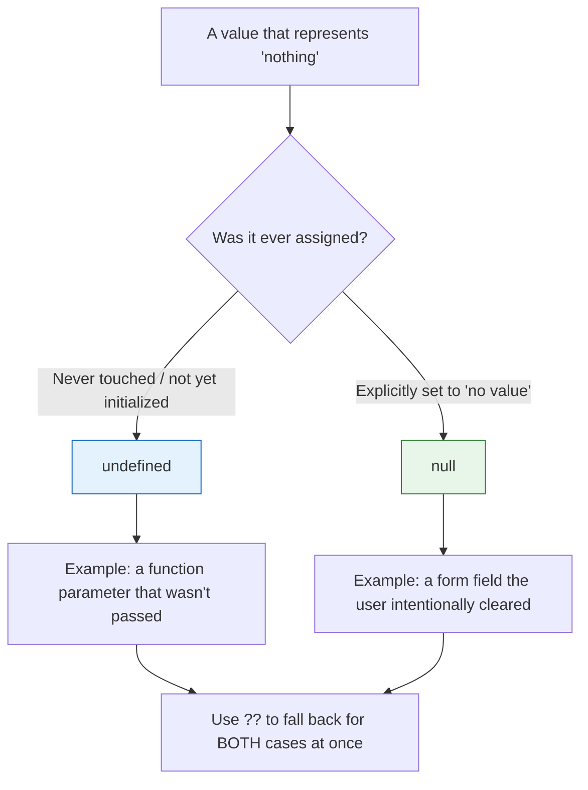

### Multiple Examples

**Example 1 — The inconsistent check**

```js
// ❌ Scattered everywhere across a codebase without a clear convention:
if (value === null || value === undefined) { ... }
if (typeof value === "undefined" || value === null) { ... }
if (!value) { ... } // ❌ also catches 0, "", false — often wrong
```

**Example 2 — A clean convention**

```js
// undefined = "this was never set"
let nickname;  // undefined by default

// null = "this was explicitly set to nothing"
function clearNickname(user) {
  user.nickname = null;  // deliberate: "user chose to remove this"
}
```

**Example 3 — Nullish coalescing (`??`) handles both at once**

```js
const displayName = user.nickname ?? "Anonymous";

// Compare with || which ALSO falls back on other falsy values:
const count = user.itemCount ?? 0;   // 0 stays 0 ✅ (correct: 0 items is valid)
const countBroken = user.itemCount || 0;  // if itemCount is 0, becomes 0 too — but if "0" or false it also incorrectly falls back
```

**Example 4 — Optional chaining paired with nullish coalescing**

```js
// Safely access a deeply nested value that might not exist at any level,
// and fall back only when it's genuinely null/undefined
const city = user?.address?.city ?? "Unknown";
```

### Real-World Use Case

**Form auto-save with drafts.** Imagine a text editor that auto-saves drafts. Using `undefined` for "field was never touched" (so no draft exists yet) and `null` for "user cleared this field on purpose" lets your backend distinguish between "nothing to save" and "save an empty value" — which matters if, say, an empty title should trigger a "please add a title" prompt, while an untouched title shouldn't prompt anything yet.

```js
// Real-world: distinguishing untouched vs. cleared in a form
const initialFormState = {
  title: undefined,     // Untouched — no validation message needed
  description: "",      // User typed then cleared — show "This field is required"
  tags: null,           // User explicitly removed all tags — valid state
};

function getValidationErrors(form) {
  const errors = {};

  if (form.title === null || form.title === "") {
    errors.title = "Title is required";  // User cleared it — show error
  }
  // If title is undefined (never touched), don't show error yet

  if (form.description === "") {
    errors.description = "Description is required";  // User cleared it
  }
  // If description is undefined, don't show error yet

  return errors;
}
```

### Multiple Implementation Approaches

#### Approach 1: Adopt the `undefined` = "absent", `null` = "explicit" convention (Recommended)

```js
// undefined = "I haven't set this yet"
// null = "I explicitly set this to nothing"

function processUserPreferences(prefs) {
  // ✅ undefined → apply default
  const theme = prefs.theme ?? "system";      // undefined → "system"
  const notifications = prefs.notifications ?? true;  // undefined → true

  // ✅ null → explicit opt-out
  if (prefs.email === null) {
    console.log("User explicitly disabled email notifications");
  }
}
```

#### Approach 2: Always use `null` for "intentional nothing" (TypeScript-first)

```ts
// In TypeScript, use `null` for intentional absence, and make all optional
// fields `undefined` by not including them
interface UserProfile {
  name: string;
  nickname: string | null;  // null = user cleared this field
  bio?: string;             // undefined = not set yet
}
```

#### Approach 3: Linter rules to enforce consistency

```jsonc
// .eslintrc.json — catch inconsistent null/undefined usage
{
  "rules": {
    "no-eq-null": "warn",    // Warn when using == null (encourages === checks)
    "eqeqeq": ["error", "always", { "null": "ignore" }]  // But allow != null
  }
}
```

### Testing Strategy

```js
describe("null vs undefined distinction", () => {
  test("untouched form field is undefined, not null", () => {
    const form = createForm();
    expect(form.title).toBeUndefined();  // never set
  });

  test("cleared form field is empty string, not undefined", () => {
    const form = createForm();
    form.title = "";  // user typed then cleared
    expect(form.title).toBe("");
    expect(form.title).not.toBeUndefined();
  });

  test("explicitly cleared field is null", () => {
    const form = createForm();
    form.nickname = null;  // user clicked "clear"
    expect(form.nickname).toBeNull();
  });
});
```

### Quick Fix

> Pick a convention (e.g., `undefined` = "not set," `null` = "explicitly empty") and apply it consistently. Use `??` for fallback logic instead of `||` when zero, empty strings, or `false` are valid values you don't want to accidentally override.

---

<a name="mistake-10"></a>
## 15. Mistake #10: Writing Code for the Computer Instead of People

### The Core Problem

Dense, clever one-liners feel satisfying to write and expensive to read. The computer doesn't care about variable names or spacing — but the next developer (including future-you) absolutely does.

```js
const r = a.filter(x=>x.a).map(x=>x.b).reduce((a,b)=>a+b,0);
```

### Why This Happens

The temptation is understandable: dense code is *fast to write* and feels elegant when it works. But code is written once and read dozens of times. The writer's mental model — "this filter selects active items, this map extracts balances, this reduce sums them" — is never written down, so the reader has to reverse-engineer it from the syntax. The more "clever" the code, the longer that reverse-engineering takes. And in a production codebase where onboarding and review costs matter, that time is genuinely expensive.

### The Diagram: Cost Over Time

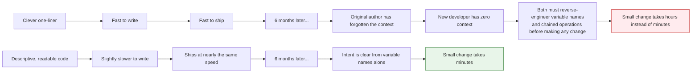

### Multiple Examples

**Example 1 — The cryptic version**

```js
const r = a.filter(x=>x.a).map(x=>x.b).reduce((a,b)=>a+b,0);
```

**Example 2 — The readable version**

```js
const activeUserBalances = users
  .filter((user) => user.isActive)
  .map((user) => user.balance);

const totalActiveBalance = activeUserBalances.reduce(
  (sum, balance) => sum + balance,
  0
);
```

**Example 3 — Cryptic conditionals**

```js
// ❌ What does this actually check?
const ok = u && u.a && u.a.length && !u.d;
```

```js
// ✅ Self-documenting
const hasActiveAddresses =
  user && user.addresses && user.addresses.length > 0 && !user.isDeleted;
```

**Example 4 — Splitting a dense chain into named steps for debuggability**

```js
// ❌ If this throws, the stack trace just says "line 42" with no clue which step failed
const summary = orders
  .filter((o) => o.status === "paid")
  .map((o) => o.total)
  .reduce((a, b) => a + b, 0);
```

```js
// ✅ Each step has a name — easier to log, easier to set a breakpoint on, easier to test individually
const paidOrders = orders.filter((order) => order.status === "paid");
const orderTotals = paidOrders.map((order) => order.total);
const revenueSummary = orderTotals.reduce(
  (sum, total) => sum + total,
  0
);
```

### Real-World Use Case

**Code review velocity on a growing team.** A pull request full of dense one-liners takes reviewers longer to approve (or worse, gets rubber-stamped without real understanding, because reviewers can't easily verify the logic). Named, step-by-step code turns review from "trust the author" into "verify each step," which catches more bugs before they ship.

```js
// Real-world: refactored for readability in a financial calculations module

// ❌ Before: one function, 50 lines of deeply nested ternary chains
const calc = (d, t, u) => d.r ? d.r.filter(x => x.a && x.b).map(x => x.c * (x.d || 1)).reduce((a, b) => a + b, 0) : d.f ? d.f(t) : u.map(x => x.p * x.q);

// ✅ After: decomposed into named, testable steps
function calculateTotalRevenue(orders, transactions, adjustments) {
  const paidOrderItems = orders
    .filter((order) => order.status === "paid")
    .filter((order) => order.items.length > 0);

  const orderRevenue = paidOrderItems.reduce((sum, order) => {
    return sum + order.items.reduce((orderSum, item) => {
      return orderSum + (item.price * item.quantity * (item.taxRate || 1));
    }, 0);
  }, 0);

  const transactionFees = transactions
    .filter((tx) => tx.type !== "refund")
    .reduce((sum, tx) => sum + tx.fee, 0);

  const adjustmentTotal = adjustments.reduce((sum, adj) => sum + adj.amount, 0);

  return orderRevenue - transactionFees + adjustmentTotal;
}

// Each step can now be independently tested:
// test("calculateTotalRevenue handles empty orders", ...);
// test("calculateTotalRevenue applies tax rates correctly", ...);
```

### Best Practices for Readable Code

| Principle | Apply It By |
|---|---|
| **Meaningful names** | `activeUsers` not `a`, `calculateTax` not `calc` |
| **One level of abstraction per function** | If you're mixing "get data" and "format data" in the same function, split it |
| **Guard clauses early** | Return early on invalid input instead of nesting the valid path deeper |
| **Comments explain "why", not "what"** | `why` this algorithm was chosen, `what` the code does should be obvious from the name |
| **Consistent formatting** | Use a formatter (Prettier) and linter (ESLint) so style is automatic |

<a name="pattern"></a>
## 16. The Pattern Underneath All Ten

Every mistake on this list traces back to the same root cause: **a loss of predictability.**

```mermaid
mindmap
  root((Predictability))
    Comparisons mean what they say
      Use === not ==
      Deep-equal for objects/arrays
    State doesn't change behind your back
      Immutable updates
      No accidental globals
    Errors get handled, not swallowed
      try/catch on every async function
      .catch() on every promise chain
    Resources get cleaned up
      removeEventListener
      clearInterval
      unsubscribe
    Types tell the truth
      Avoid any
      Use unknown + narrowing
      Distinguish null vs undefined
    Code reads the way it behaves
      Named intermediate variables
      Flattened async flow
```

### The Summary Checklist

| # | Mistake | Fix |
|---|---|---|
| 1 | `==` instead of `===` | Always use `===` / `!==` |
| 2 | Mutating state directly | Build new objects/arrays with spread syntax |
| 3 | Unhandled promise rejections | `try/catch` + `.catch()` on every async path |
| 4 | Deeply nested callbacks | Convert to `async/await`; use `Promise.all` for parallel steps |
| 5 | Accidental global variables | `"use strict"` + always declare with `let`/`const` |
| 6 | `===` on objects/arrays | Use a deep-equal utility (e.g., lodash `isEqual`) |
| 7 | No cleanup for listeners/timers | Match every setup with a teardown |
| 8 | Overusing `any` in TypeScript | Define real types; use `unknown` + narrowing |
| 9 | Confusing `null` and `undefined` | Pick a convention; use `??` for fallbacks |
| 10 | Writing for the computer, not people | Name intermediate values; avoid dense one-liners |

> **💡 Key Insight:** Fix these ten habits, and most of what remains is *ordinary* debugging — the kind every codebase naturally has — instead of the self-inflicted kind that quietly eats an entire afternoon.

---

<a name="decision-framework"></a>
## 17. Putting It All Together: A Decision Framework

Not every project needs to adopt all ten fixes at once. Here's a prioritized decision framework for choosing which mistakes to tackle first.

### Where These Mistakes Are Most Dangerous

| Mistake | Most Dangerous In | Why |
|---|---|---|
| `==` vs `===` | API boundary code, form validation | Silent type coercion leads to invalid data entering your system |
| Direct mutation | React/Redux/Vue state, shared data | Framework's change detection silently fails |
| Unhandled rejections | Payment flows, data persistence | Silent failures can cause data loss or double-charging |
| Callback hell | Legacy Node.js, complex async flows | Errors get swallowed, stack traces are useless |
| Global variables | Multi-script pages, large teams | Cross-script contamination, impossible-to-reproduce bugs |
| `===` on objects | Memoization, caching, diffing | Unnecessary re-renders or skipped updates |
| No cleanup | SPAs, long-lived sessions | Memory leaks accumulate over time |
| `any` in TypeScript | API layers, shared types | Type safety erodes across the codebase |
| `null` vs `undefined` | Form handling, API contracts | Inconsistent semantics cause logic errors |
| Unreadable code | Any codebase with >3 contributors | Maintenance cost grows exponentially with density |

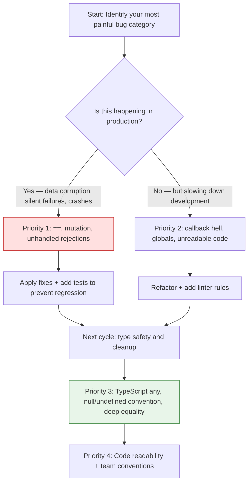

---

<a name="migration-guide"></a>
## 18. Migration Guide: Auditing Your Codebase

### Phase 1: Static Analysis (0–2 hours)

Start with automated tools that can scan your entire codebase without running it.

#### ESLint Rules to Enable

```jsonc
// .eslintrc.json — enforce all 10 fixes
{
  "extends": ["eslint:recommended"],
  "rules": {
    // Mistake #1: ==
    "eqeqeq": ["error", "always", { "null": "ignore" }],

    // Mistake #5: globals
    "no-undef": "error",
    "no-implicit-globals": "error",
    "strict": ["error", "global"],

    // Mistake #8: any
    "@typescript-eslint/no-explicit-any": "warn",
    "@typescript-eslint/no-unsafe-assignment": "error",

    // Mistake #10: readability
    "no-unused-vars": "warn",
    "complexity": ["warn", 10],
    "max-params": ["warn", 4]
  }
}
```

#### TypeScript Compiler Options

```jsonc
// tsconfig.json — make type safety strict
{
  "compilerOptions": {
    "strict": true,                    // Enables all strict type checks
    "noImplicitAny": true,             // No implicit any
    "strictNullChecks": true,           // Distinguish null from undefined
    "noUncheckedIndexedAccess": true,   // Array access returns T | undefined
    "noImplicitReturns": true,        // All code paths must return a value
    "noFallthroughCasesInSwitch": true  // No fallthrough in switch statements
  }
}
```

### Phase 2: Automated Search Patterns

Search your codebase for these patterns to find violations:

```bash
# Mistake #1: loose equality (excluding == null checks)
grep -rn '==[^=]' src/ --include="*.js" --include="*.ts" | grep -v '!= null' | grep -v '== null'

# Mistake #3: unhandled promises (fetch without .catch, async without try/catch)
grep -rn 'fetch(' src/ --include="*.js" --include="*.ts" | grep -v '.catch'

# Mistake #5: potential global leaks (assignment without declaration)
grep -rn '^\s*[a-zA-Z_$][a-zA-Z0-9_$]*\s*=' src/ --include="*.js" | grep -v 'let\|const\|var\|=\s'

# Mistake #8: any usage in TypeScript
grep -rn ': any' src/ --include="*.ts" --include="*.tsx"

# Mistake #7: addEventListener without removeEventListener
grep -rn 'addEventListener' src/ --include="*.js" --include="*.jsx" --include="*.tsx" | grep -v 'removeEventListener'
```

> **⚠️ Warning:** Automated searches have false positives and false negatives. Always manually verify each finding before making changes.

### Phase 3: Manual Code Review Checklist

For each file, ask:

1. **Equality:** Are all comparisons using `===`/`!==`? (Exception: `!= null` is acceptable)
2. **Mutation:** Are state objects/arrays modified in place, or replaced with new references?
3. **Error handling:** Does every `async` function have a `try/catch`? Does every promise chain have a `.catch()`?
4. **Structure:** Are there any deeply nested callbacks (3+ levels)?
5. **Globals:** Are all variables declared with `let`/`const`? Is `"use strict"` present?
6. **Object comparison:** Are objects/arrays compared with a deep-equal utility, or just `===`?
7. **Cleanup:** Does every `addEventListener`, `setInterval`, or subscription have a matching cleanup?
8. **TypeScript:** Is `any` used only with a documented justification? Could `unknown` + narrowing work instead?
9. **null/undefined:** Is there a consistent convention? Are fallbacks using `??` instead of `||` where appropriate?
10. **Readability:** Can a new developer understand this code in under 30 seconds?

### Phase 4: Testing the Fixes

After making changes, verify each fix with tests. A good migration adds tests that would have *caught* the original bug:

```js
import { addItem, fetchDashboard, shallowEqual } from "./fixes";

// Mistake #2 — mutation safety
test("addItem returns a NEW object and leaves the original untouched", () => {
  const originalCart = { id: 1, items: ["apple"] };
  const newCart = addItem(originalCart, "banana");

  expect(newCart).not.toBe(originalCart);              // new reference ✅
  expect(originalCart.items).toEqual(["apple"]);     // original untouched ✅
  expect(newCart.items).toEqual(["apple", "banana"]); // new state correct ✅
});

// Mistake #3 — error handling
test("fetchDashboard returns a fallback instead of throwing on failure", async () => {
  global.fetch = jest.fn().mockRejectedValue(new Error("Network error"));
  const result = await fetchDashboard();
  expect(result.ok).toBe(false);
  expect(result.error).toBe("Network error");
});

// Mistake #6 — deep equality
test("shallowEqual compares content, not reference", () => {
  expect(shallowEqual({ a: 1 }, { a: 1 })).toBe(true);
  expect(shallowEqual({ a: 1 }, { a: 2 })).toBe(false);
});
```

> **💡 Pro Tip:** The most valuable test you can add during a migration is one that **would have failed before your change**. That single test proves the fix actually addresses the bug — not just the code you happened to touch.

---

<a name="best-practices"></a>
## 19. Best Practices Summary

### The 10 Commandments of Predictable JavaScript

| # | Commandment | Apply By |
|---|---|---|
| 1 | **Thou shalt use `===` and `!==`** | Replace all `==`/`!=` except `!= null` for null/undefined checks |
| 2 | **Thou shalt never mutate state in place** | Use `{...obj}`, `[...arr]`, `arr.map()`, `arr.filter()`, `arr.concat()` |
| 3 | **Thou shalt handle every async error** | Add `try/catch` to every `async` function; add `.catch()` to every promise chain |
| 4 | **Thou shalt flatten thy async code** | Use `async/await` instead of nested callbacks; use `Promise.all` for parallel work |
| 5 | **Thou shalt declare all variables** | Use `"use strict"` and always prefix with `let` or `const` |
| 6 | **Thou shalt deep-equal thy objects** | Use `lodash/isEqual` or a custom deep-equal utility, never `===` for content |
| 7 | **Thou shalt clean up thy resources** | Return cleanup functions from `useEffect`; store and clear timer IDs |
| 8 | **Thou shalt avoid `any`** | Define explicit types; use `unknown` + type guards for untyped input |
| 9 | **Thou shalt distinguish `null` from `undefined`** | `undefined` = "not set"; `null` = "explicitly emptied"; use `??` for fallbacks |
| 10 | **Thou shalt write for readers, not compilers** | Name all intermediate values; break dense chains into named steps |

### The Golden Rule for Reviews

> **🔑 Golden Rule:** The goal is not to eliminate all bugs — it's to make bugs **localize**. When a bug occurs, you should be able to point to the line where it was introduced, not hunt through an entire call stack.

### Tooling Recommendations

| Category | Tool | Why |
|---|---|---|
| **Linter** | ESLint + `@typescript-eslint` | Catches `==` (`eqeqeq`), globals (`no-undef`), `any` (`no-explicit-any`) |
| **Formatter** | Prettier | Eliminates style debates; consistent formatting reduces cognitive load |
| **Type checker** | TypeScript `tsc --strict` | Catches null/undefined confusion, missing properties, type mismatches |
| **Testing** | Jest / Vitest | Verifies that your fixes actually work and stay working |
| **Bundle analysis** | `webpack-bundle-analyzer` | Ensures deep-equal utilities don't bloat your bundle |

### Best Practices for Readable Code

| Principle | Apply It By |
|---|---|
| **Meaningful names** | `activeUsers` not `a`; `calculateTax` not `calc` |
| **One level of abstraction per function** | If you're mixing "get data" and "format data" in one function, split it |
| **Guard clauses early** | Return early on invalid input instead of nesting the valid path deeper |
| **Comments explain "why", not "what"** | Save `why` for decisions; the `what` should be obvious from names |
| **Consistent formatting** | Use Prettier + ESLint so style is automatic |
| **Fail loudly** | Let errors surface with messages instead of swallowing them |

### Practice Workflow Diagram

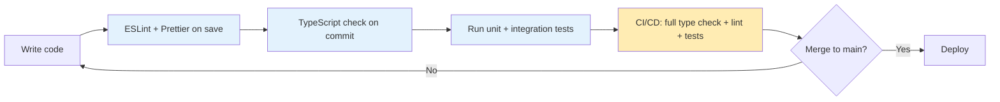

> **💡 Pro Tip:** The cheapest time to fix a bug is when the linter flags it — before the code is even committed. Invest in editor tooling so these mistakes are caught at write-time, not debug-time.

---
<a name="anti-patterns"></a>
## 20. Anti-Patterns Summary

These are the *habits* — not the code bugs — that keep re-introducing the ten mistakes. Watch for them in yourself and your team.

### Anti-Pattern 1: "It Works, So Don't Touch It"

**What it looks like:**
```js
// ❌ "If it ain't broke, don't fix it" — but it IS broke, you just haven't noticed
if (user.id == userId) { return grantAccess(); }
```

**Why it's dangerous:** The `==` silently coerces `"5"` to `5`, so `user.id == "5"` is `true`. This "works" until a URL parameter (always a string) meets a numeric `id` that happens to be `0` or `null`, and the coercion yields a different result than expected.

**The fix:** `if (user.id === userId)` — if it throws or returns `false`, you now know something about the types, instantly.

### Anti-Pattern 2: "I'll Add the Cleanup Later"

**What it looks like:**
```js
// ❌ TODO: add cleanup
useEffect(() => {
  const ws = new WebSocket("wss://api.example.com");
  ws.onmessage = (e) => handleMessage(e.data);
}, []);
```

**Why it's dangerous:** "Later" never comes. The WebSocket stays open after the component unmounts. In a SPA with 20 route changes, you now have 20 orphaned WebSocket connections draining resources.

**The fix:** Add the cleanup *in the same edit*:
```js
useEffect(() => {
  const ws = new WebSocket("wss://api.example.com");
  ws.onmessage = (e) => handleMessage(e.data);
  return () => ws.close();  // ✅ immediate cleanup, no TODO
}, []);
```

### Anti-Pattern 3: The "Just Cast It" Reflex (TypeScript)

**What it looks like:**
```ts
// ❌ Asserting a shape you haven't validated
const data = await res.json() as User;
return data.billing;  // crashes at runtime if billing was never sent
```

**Why it's dangerous:** `as` tells TypeScript "trust me," bypassing every check. If the API shape drifts, the bug appears at runtime in production — exactly where you *don't* want it.

**The fix:** Validate, then narrow:
```ts
function assertIsUser(d: unknown): asserts d is User {
  if (typeof d !== "object" || d === null || !("id" in d)) {
    throw new Error("Invalid user data");
  }
}
const data: unknown = await res.json();
assertIsUser(data); // now data is User
```

### Anti-Pattern 4: "It's Fine, Jest Doesn't Check Anymore"

**What it looks like:**
```js
// ❌ Using loose / truthy checks in tests that hide the real value
expect(cart.items.length).toBeTruthy();  // passes for 1, 2, "1", true...
```

**Why it's dangerous:** A `toBeTruthy()` assertion passes for a surprising range of values, so it can mask the exact regression you're testing for.

**The fix:** Be exact:
```js
expect(cart.items).toEqual(["apple"]);       // exact content
expect(cart).not.toBe(originalCart);        // exact reference
expect(error).toBe("Network error");        // exact message
```

### Anti-Pattern 5: The "Rewrite Everything" Reflex

**What it looks like:** Finding one `==` and deciding to rewrite an entire module from scratch "while we're in there."

**Why it's dangerous:** Large rewrites silently drop behavior, edge-case handling, and tests. Risk scales with scope.

**The fix:** Fix the *behind-the-change-is-minimal*. A small, targeted fix with a regression test is reliably reviewable; a 1,000-line rewrite is not. Refactor in stages, keeping tests green at each step.

---

### Quick-Reference: When Each Fix Matters Most

| Fix | When to apply FIRST |
|---|---|
| `===` instead of `==` | Anywhere user input or API data is compared |
| Immutable updates | In React/Redux/Vue state management, or any observer system |
| `try/catch` + `.catch()` | On every `async` function and promise chain |
| `async/await` | When you have 3+ levels of callback nesting |
| `"use strict"` | On every file, especially shared utility modules |
| Deep equality | In memoization, caching, or dependency arrays |
| Resource cleanup | In `useEffect`, `componentDidMount`, or any lifecycle hook |
| Avoid `any` | In API response handlers and shared type definitions |
| `null` vs `undefined` convention | In form handling, API request/response contracts |
| Readability refactoring | In any code maintained by 3+ people |

---
<a name="performance-considerations"></a>
## 21. Performance Considerations

> **Core truth:** Performance and predictability are not enemies. Most of these fixes actually *improve* performance by preventing redundant re-renders, leaked background timers, and accumulating memory — but you should understand the trade-offs to avoid over-fixing.

### Where These Fixes *Improve* Performance

| Mistake | Consequence when fixed |
|---|---|
| #2 Direct mutation | Correct change detection avoids wasted re-renders |
| #5 Weak globals | No shared mutable state silently invalidating caches |
| #7 No cleanup | No leaked listeners / timers slowly draining memory |
| #6 Deep equality | Re-computation only when content actually changes |
| #4 Callback hell | `Promise.all` runs independent work concurrently |

### Where They *Cost* a Little (and How to Minimize)

| Operation | Cost | Mitigation |
|---|---|---|
| Spread copy `{...obj}` / `[...arr]` | O(n) shallow copy | Structural sharing (Immer) for hot-path, large state |
| `JSON.stringify` equality | O(n) + string alloc | Only for small, order-stable objects |
| `lodash/isEqual` | O(n) | Import `isEqual` from `lodash-es` so it tree-shakes |
| `structuredClone` | O(n) full copy | Prefer `produce`/Immer to share unchanged branches |

### Practical Guidance

```js
// ❌ Deep-copying an entire large tree on every keystroke
setCart(structuredClone(cart));

// ✅ Structural sharing via Immer — only the changed branch is new
setCart(produce(cart, (draft) => {
  draft.items.push(item);
}));
```

> **💡 Rule of thumb:** Profile before optimizing. For state of a few hundred items, immutable updates are effectively free. Re-introducing mutation to "gain speed" is the very trade that creates the bugs this tutorial exists to prevent. Structural sharing gets you both speed *and* predictability.

### The Mutation-Performance Trap

```js
// ❌ "Faster" per-mutation loop — but breaks React change detection!
const rows = state.rows;
for (let i = 0; i < rows.length; i++) {
  rows[i].total = rows[i].qty * rows[i].price; // mutation → no re-render
}

// ✅ Correct and fast enough — new array + new row objects
const updatedRows = state.rows.map((row) => ({
  ...row,
  total: row.qty * row.price,
}));
```

---
<a name="security-considerations"></a>
## 22. Security Considerations

Several of these "mistakes" are not just bugs — they are welcomed vulnerabilities. Predictable code is inherently **harder to exploit**.

### Vulnerability 1: Implicit Globals as an Injection Surface

```js
// ❌ Undeclared global + eval = classic injection vector
function applySettings(input) {
  config = JSON.parse(input);   // leaked global
  eval(`config = ${input}`);    // executes attacker-controlled string!
}
```

**Why it matters:** The leaked global `config` is shared, writable state any third-party script can reach. `eval` on untrusted strings is arbitrary code execution. Both disappear when you `use strict` and never `eval`.

```js
"use strict";
function applySettings(input) {
  const raw = JSON.parse(input);          // parsed DATA, not code
  return { theme: raw.theme, accent: raw.accent }; // whitelist keys
}
```

### Danger 2: Mutating Shared State Lets Tampering Spread Silently

```js
// config (a shared object imported elsewhere)
function enableDebug() {
  Config.debug = true;       // ✅ intended locally…
}
// ...but the mutation is VISIBLE everywhere; if Config.debug=remote-controlled,
// an XSS can flip session/flags/policies globally and nothing complains
```

**Why it matters:** Mutation makes tampering invisible. Immutable updates mean the "changed version" is a new reference — drift becomes visible and auditable at the boundary.

### Danger 3: Swallowing Errors in Security-Critical Paths

```js
// ❌ catch that returns success on failure — flips auth semantics
function authorize(username, password) {
  try {
    return verifyUser(username, password); // true/false
  } catch (err) {
    return true; // ❌ an exception is treated as "authorized"!
  }
}
```

**Why it matters:** Error handling *is* security policy. On authentication, always **fail closed** (default to deny, log the error, alert developers). Never return "all clear" from a `catch`.

### Danger 4: `any` at Trust Boundaries

```ts
// ❌ A string like "true" passes as an admin flag with no type guard
function handleWebhook(body: any) {
  if (body.isAdmin) runAdmin();   // "true" → truthy → admin access
}
```

**Why it matters:** Attacker-controlled JSON reaches your logic with zero runtime validation. Validate + narrow with a type guard so the semantics are enforced at runtime, not assumed.

### Security Checklist

| Area | Action |
|---|---|
| Globals | `"use strict"`, ES modules, ESLint `no-implicit-globals` |
| Input | No `eval`; parse JSON as data; validate with a type guard |
| Errors | Never swallow errors in auth/permission paths; fail closed (deny) |
| State | Prefer immutable updates so tampering is visible/auditable |
| TypeScript | `unknown` + runtime validation at boundaries (API/webhook) |
| Cleanup | Release credentials/sockets/intervals so they can't be re-triggered |

---

<a name="testing-strategies"></a>
## 23. Testing Strategies

The best tests **pin the behavioral contract** you want to protect — the one that is easy to break later.

### Test Targeting

| Mistake | Test that catches it |
|---|---|
| #1 `==` | Test equality where types differ intentionally (`"5"` vs `5`) |
| #2 Mutation | Assert new reference is different AND the original is untouched |
| #3 Promises | Mock a rejection; assert graceful fallback, not a crash |
| #4 Callbacks | Assert parallel calls didn't serialize / run out of order |
| #5 Globals | Assert no new global keys appear after importing a module |
| #6 Object equality | `isEqual(a,b) === true` for distinct refs with same content |
| #7 Cleanup | Assert `removeEventListener` / `clearInterval` called on teardown |
| #8 `any` | Type-level tests + ESLint `no-explicit-any` |
| #9 null/undefined | Test each field holds the exact sentinel you intend |
| #10 Readability | Human review checklist, not a unit assertion |

### Reusable Test Snippets

**Mutation safety:**
```js
test("addItem returns a new cart; the original is untouched", () => {
  const original = { id: 1, items: ["apple"] };
  const updated = addItem(original, "banana");
  expect(updated).not.toBe(original);            // new reference ✅
  expect(original.items).toEqual(["apple"]);     // untouched ✅
  expect(updated.items).toEqual(["apple", "banana"]); // correct ✅
});
```

**Error handling:**
```js
test("fetchDashboard returns a fallback (not a throw) on failure", async () => {
  global.fetch = jest.fn().mockRejectedValue(new Error("Network error"));
  const result = await loadDashboard();
  expect(result.ok).toBe(false);
  expect(result.error).toBe("Network error");
});
```

**Cleanup:**
```js
test("removes resize listener on unmount", () => {
  const { unmount } = render(<ResizableComponent />);
  unmount();
  expect(window.removeEventListener).toHaveBeenCalledWith("resize", expect.any(Function));
});
```

**No global leakage:**
```js
test("module does not leak globals", () => {
  const before = new Set(Object.keys(global));
  require("../src/module-under-test");
  const leaked = Object.keys(global).filter((k) => !before.has(k) && k !== "__coverage__");
  expect(leaked).toHaveLength(0);
});
```

**Type shape (Vitest):**
```ts
import { expectTypeOf, test } from "vitest";
interface User { id: number; name: string; email: string; }

test("User has the correct shape", () => {
  expectTypeOf<User>().toEqualTypeOf<{ id: number; name: string; email: string }>();
});
```

> **💡 Pro Tip:** Add the regression test *after you reproduce a bug but before you apply the fix*. When the test then turns green with the fix, you've proven the fix addresses *this exact bug* — and you never regress to it again.

---
<a name="troubleshooting"></a>
## 24. Troubleshooting & Common Pitfalls

Diagnose the fix back to the underlying mistake with this quick table.

| Symptom | Likely Mistake | Fix it |
|---|---|---|
| Component "won't re-render" after a state change | #2 Mutation | Return a *new* object/array reference with the spread |
| "NaN" in a total/calculation | #1 coercion / #6 type mismatch | Use `===`, type the data, verify the actual types |
| Silent promise warning, frozen UI | #3 Unhandled rejection | Add `.catch()` / `try/catch` on every async path |
| "Works alone but breaks with 3 scripts" | #5 Global leak | `"use strict"`, declare with `let`/`const`, ESLint `no-undef` |
| Two "identical" objects aren't equal | #6 Reference equality | Use `isEqual`/content comparison, not `===` |
| Memory climbs during a long session | #7 No cleanup | Clear every listener/timer/subscription on teardown |
| Can't safely touch 3 nested calls | #4 Callback, #10 one-liners | Flatten with `async/await`; name intermediate values |
| A field shows "Unknown" when it holds `0` | #9 `\|\|` overriding valid falsy | Use `??`, not `\|\|`, for nullish fallbacks |

### Common Pitfalls When Applying the Fixes

**Pitfall 1: Fixing the comparison but not the type upstream.**
```js
// ❌ The real bug is the data source is inconsistent
if (status === 200) { /* works — but is status always a number? */ }
```
Normalize the *data* at the source (or boundary) so the type is stable; then `===` is trustworthy.

**Pitfall 2: Immutable-but-shallow.**
```js
// ❌ Spreading does NOT deep-copy nested structures
const newList = { ...list, items: list.items }; // items still SHARED
newList.items.push(item); // mutates the "old" list too!
```
Copy the nested levels you intend to change: `items: [...list.items]`.

**Pitfall 3: `try/catch` around the wrong thing.**
```js
// ❌ A .then() rejection isn't caught by surrounding try/catch
try { getData().then(doWork); } catch (e) { /* never runs */ }
// ✅ Chain the handler onto the promise
getData().then(doWork).catch(handleRejection);
```

**Pitfall 4: `== null` in a `========` rewrite.**
`!= null` (and `== null`) deliberately match BOTH `null` and `undefined` — that is correct and precise. Don't "fix" it to `!== null` unless you truly want to exclude `undefined`.

**Pitfall 5: Copying more than necessary.**
Immutability is not "copy everything." Copy only the levels that change; share the rest (structural sharing). Copying a 10k-node object on every keystroke is slow AND wasteful.

---

### Quick Pitfall Reference

| Pitfall | One-line Rule |
|---|---|
| Shallow spread mutation | Deep-copy only what you plan to change |
| Wrong async scope | `catch` on the promise, not the surrounding `try` |
| Falsy overwritten by `\|\|` | Use `??` for nullish fallback |
| `!= null` over-aggressive "fix" | It's intentionally both-null-and-undefined |
| Over-copying | Share unchanged branches (structural sharing) |

---
<a name="practice-exercises"></a>
## 25. Practice Exercises (with Solutions)

> Time-box each exercise to ~15 minutes. Attempt *before* reading the solution. Running the code makes the contrast stick.

---

### Exercise 1: Equality & Type Normalization

```js
// Debug this — the statuses that SHOULD match don't always.
function isPaid(order) {
  return order.status == 200;   // sometimes "200", sometimes 200
}
```

**Tasks:** (1) Explain why `== 200` is unsafe. (2) Fix it so status is compared strictly and the data source is normalized for type-stability.

**Solution:**
```js
// Normalize at the boundary once, then use strict equality.
function normalizeStatus(value) {
  if (value === null || value === undefined) return value;
  return Number(value);   // status designed to be numeric
}

function isPaid(order) {
  return normalizeStatus(order.status) === 200;  // ✅ strict, type-stable
}
```
*Explanation:* `==` coerces, hiding the type mismatch. Prefer strict `===`, and ideally fix the source so `order.status` is always a number (or normalize once at the API boundary).

---

### Exercise 2: Immutable Update

**Buggy helper:**
```js
function addItem(cart, item) {
  cart.items.push(item);   // ❌ mutates the caller's cart
  return cart;
}
```
**Tasks:** Rewrite it to return a new object while the original stays untouched. Then write a test proving immutability.

**Solution:**
```js
function addItem(cart, item) {
  return { ...cart, items: [...cart.items, item] };
}

// Test
import { expect, test } from "vitest";

test("addItem leaves the original cart untouched", () => {
  const original = { id: 1, items: ["apple"] };
  const updated = addItem(original, "banana");

  expect(updated).not.toBe(original);          // new reference
  expect(original.items).toEqual(["apple"]);   // original unchanged
  expect(updated.items).toEqual(["apple", "banana"]);
});
```
*Explanation:* `[...cart.items, item]` copies the *array*; `{ ...cart }` rebuilds the wrapper. Neither mutates the caller's object.

---

### Exercise 3: Async Error Handling

**Task:** Rewrite `loadOrders` so network errors AND invalid JSON both land in the same `.catch`, and it returns a stable `{ ok: false, error }` fallback instead of throwing.

**Solution:**
```js
async function loadOrders() {
  try {
    const res = await fetch("/api/orders");
    if (!res.ok) throw new Error(`HTTP ${res.status}`);
    return { ok: true, data: await res.json() }; // parse errors caught too
  } catch (err) {
    return { ok: false, error: err.message };    // graceful fallback
  }
}
```
*Explanation:* `await res.json()` runs inside the same `try`, so a faulty payload is handled exactly like a network failure.

---

### Exercise 4: Global Leak

**Bug:**
```js
function serialize(items) {
  total = 0;               // no declaration → leak!
  for (const i of items) total += i;
  return total;
}
```
**Tasks:** Identify the leak, fix with `"use strict"` + a declaration, and make the function pure.

**Solution:**
```js
"use strict";
function serialize(items) {
  let total = 0;           // ✅ declared & scoped
  for (const i of items) total += i;
  return total;
}
```
*Explanation:* Without a declaration, `total` becomes a property of the global object. `"use strict"` converts that silent leak into an immediate, local `ReferenceError`.

---

### Exercise 5: Deep Equality & Its Limits

**Task:** Write `shallowEqual(a, b)` and test: same reference; different refs with equal top-level; different keys; nested objects that "look" equal.

**Solution:**
```js
function shallowEqual(a, b) {
  if (a === b) return true;
  if (typeof a !== "object" || a === null || typeof b !== "object" || b === null) return false;
  const ka = Object.keys(a), kb = Object.keys(b);
  if (ka.length !== kb.length) return false;
  return ka.every((key) => b.hasOwnProperty(key) && a[key] === b[key]);
}

expect(shallowEqual({ a: 1 }, { a: 1 })).toBe(true);           // same content
expect(shallowEqual({ a: 1 }, { a: 2 })).toBe(false);          // values differ
expect(shallowEqual({ a: 1 }, { b: 1 })).toBe(false);          // keys differ
expect(shallowEqual({ a: { x: 1 } }, { a: { x: 1 } })).toBe(false); // SHALLOW!
```
*Explanation:* `shallowEqual` compares top-level values by `===`; nested objects compare by reference, so distinct-but-"equal" nested objects yield `false`. For deep content, use a deep utility or `JSON.stringify`.

---

### Exercise 6 (Bonus): Cleanup

**Task:** A React component registers a `resize` listener. Add a cleanup that removes it on unmount, then write a test asserting `removeEventListener` was called.

**Solution:**
```jsx
import { useEffect } from "react";
function useWindowWidth() {
  const [width, setWidth] = useState(window.innerWidth);
  useEffect(() => {
    const onResize = () => setWidth(window.innerWidth);
    window.addEventListener("resize", onResize);
    return () => window.removeEventListener("resize", onResize); // ✅
  }, []);
  return width;
}

// Test
const { unmount } = renderHook(() => useWindowWidth());
unmount();
expect(window.removeEventListener).toHaveBeenCalledWith("resize", expect.any(Function));
```

---
<a name="hands-on-lab"></a>
## 26. Hands-On Lab: Real-World Bug Hunt

Inspect this codebase sample and find **all** instances of the ten mistakes. Then fix them and add a test that catches each one.

```js
// cart.js
let total = 0;                       // (A) possible global leak
function addToCart(product) {
  cart.items.push(product);          // (B) mutation
  total = computeTotal(cart);        // (A) leaks/writes a global
  return cart;
}

// notifications.js
function notifyUser(settings) {
  if (settings.email == true) {      // (E) == coercion
    sendEmail(user.email);           // (F) uses user, not defined here!
  } else if (settings) { ... }
}

// server.js
app.get("/api/orders", (req, res) => {
  fetchOrders()
    .then((orders) => res.json(orders))   // missing .catch (C)
});

// useData.js
useEffect(() => {
  const t = setInterval(poll, 5000);    // no cleanup (D)
  return;                                // (D) returns nothing to clear
}, []);
```

### Step 1 — Spot the mistakes

Label each lettered line with the mistake number(s): A=#5 (globals + mutation), B=#2, C=#3, D=#7, E=#1, and G = #6 (#6 not present on the extraction).

### Step 2 — Fixed version

```js
// cart.js
function addToCart(cart, product) {
  const nextCart = { ...cart, items: [...cart.items, product] };  // ✅ #2
  return { nextCart, total: computeTotal(nextCart) };            // ✅ #5 (no global)
}

// notifications.js
function notifyUser(user) {
  if (user?.email && emailPreferences(user)?.email === true) {   // ✅ #9 + #7 narrowing
    return sendEmail(user.email);
  }
  return null;
}

// server.js
app.get("/api/orders", (req, res, next) => {
  fetchOrders()
    .then((orders) => res.json(orders))
    .catch(next);                                                  // ✅ #3
});

// useData.js
useEffect(() => {
  const t = setInterval(poll, 5000);
  return () => clearInterval(t);           // ✅ #7
}, []);
```

### Step 3 — Regression tests

Add tests that would have caught each bug:
- **#2:** `addToCart` returns new reference; `cart.items` unchanged.
- **#3:** rejection on `/api/orders` returns a `next`-passed error (or falls back gracefully).
- **#7:** after `unmount`, `clearInterval` was called with the same id.
- **#9:** a `0` value in an email-like setting still sends (falsy traps avoided).

### What You Should Verify

- Every test fails against the *buggy* version and passes against the *fixed* version.
- That is concrete proof the fix is real, not cosmetic.

---

<a name="pro-tips"></a>
## 27. Pro Tips

1. **Normalize at the boundary.** The instant data enters from an API, a URL param, or a form, fix its type and shape once. Everything downstream can then trust `===`.
2. **Treat immutability as reconstruction, not copying.** Copy only the branch that changed; share the rest (`Immer` does this automatically).
3. **Make errors *visible* in development.** Configure a global `unhandledrejection` logger and surface fallbacks, so problems are loud now instead of silent in prod.
4. **Write the regression test first.** Reproduce → test → fix. The test is proof the fix worked and armor against regression.
5. **Automate review checks.** ESLint rules (`eqeqeq`, `no-undef`, `no-explicit-any`, `react-hooks/exhaustive-deps`) catch most of these before they merge.
6. **Keep functions small and named.** If the name can't fit on one line, the function does too much. Naming drives predictability.
7. **Use `??` and optional chaining together.** `user?.address?.street ?? "Unknown"` is dense, but both the fallback and the guard are explicit.
8. **Prefer `Promise.allSettled` over `Promise.all` for independent, optional work.** It never drops the ones that succeed because of an unrelated failure.
9. **Never "fix" `== null`.** It's intentionally precise. Coercion isn't the problem when you *mean* null-or-undefined.
10. **Prioritize the reader.** A junior can follow 6 clear lines faster than a senior the original author can decode a 1-liner they wrote 6 months ago.

> **🔑 Note:** The habit that pays most is *consistency*. Every tool inherited quirks; min the codebase adopts one convention (strict equals, `??`, immutable updates), the whole project becomes predictable even across teams.

---
<a name="test-your-understanding"></a>
## 28. Test Your Understanding

Quick self-quiz. Answers are given at the bottom of the section.

1. `0 == ""` is `true`. Explain why, and what the safer operator is.
2. Does `{ a: 1 } === { a: 1 }` return `true` or `false`? How would you compare them by content?
3. What happens to a promise with no `.catch()`/`try/catch` when it rejects?
4. Name two advantages `async/await` gives over nested callbacks.
5. In non-strict code, what happens when you assign to an undeclared variable? What triggers an immediate error instead?
6. What's the difference between `any` and `unknown` in TypeScript?
7. When should you prefer `??` over `||`? Give an example with `0`.
8. A component stops re-rendering after you "change" its state. Which mistake is likely, and what's the fix?
9. Why does a leaked `setInterval` keep firing after navigating away? How do you stop it?
10. What single root cause does this tutorial claim connects all ten mistakes?

**Answers:**
1. `==` coerces both to numbers: `0` and `0` match. Use `===` for type-strict comparison.
2. `false` — objects compare by reference. Use a deep-equal utility or `JSON.stringify` (for simple, order-stable data).
3. It fires an `unhandledrejection` (a warning, or a process crash in Node). Add `.catch()` or `try/catch`.
4. Flat, linear structure; native error wrapping in stack traces; and `Promise.all` runs independent work concurrently.
5. It silently attaches to the global object. `"use strict"` turns it into an immediate `ReferenceError`.
6. `any` disables all checks; `unknown` forces you to narrow before use.
7. When `0`, `""`, or `false` are valid values — `??` falls back only on `null`/`undefined`.
8. Direct mutation (same reference) → return a *new* object/array.
9. Cleanup never ran — return a `clearInterval` from the `useEffect`.
10. A **loss of predictability**.

---
<a name="question-bank"></a>
## 29. Question Bank (50+ Questions)

> A bank for interview prep, team training, or self-test. Grouped by the ten mistakes. Some answers are inline; open-ended ones are designed for discussion or a hands-on code answer.

### Group A — Equality & Coercion (Mistakes #1 & #6)

1. What does `0 == "0"` evaluate to, and why?
2. What does `"" == "0"` evaluate to? Why is that surprising?
3. Why is `null == undefined` true, but `null === undefined` false?
4. Is `[] == false` true or false? What makes it counterintuitive?
5. Describe one real bug caused by using `==` on an API value.
6. Why does `===` on objects "compare by reference"?
7. Under what conditions is `JSON.stringify` an acceptable equality check?
8. What are the limits of `JSON.stringify` for equality (ordering, `undefined`, functions, circular)?
9. When is reference equality actually the *right* choice (e.g., React `useMemo`/`useCallback`)?
10. React dependency arrays use reference equality — how does that interact with deep content changes?
11. What does the `"null": "ignore"` ESLint option do, and why is `!= null` acceptable?
12. How do `Number("5")` and `"5" * 1` differ from `"5" == 5`?

### Group B — Mutation & State (Mistake #2)

13. What does "same reference" mean for a React state update, and why does it skip re-render?
14. Write immutable replacements for `arr.push(x)` and `obj.key = value`.
15. Why does mutation break memoization and `shouldComponentUpdate`-style logic?
16. What is structural sharing? Name a library that provides it (Immer, Immutable.js).
17. When is `structuredClone` worth its copy cost, and when is it wasteful?
18. How do you change a nested field immutably without copying the entire object?
19. Why is a Redux reducer *supposed to* return a new state tree?

### Group C — Async & Errors (Mistakes #3 & #4)

20. What is an unhandled promise rejection, and what two bad outcomes follow?
21. Write `try/catch` that safely awaits `fetch(...)` and `.json()`.
22. Contrast `Promise.all` vs `Promise.allSettled` — when to use which?
23. You have three independent fetches. Why might `Promise.allSettled` be safer than `all`?
24. Why can't a surrounding `try/catch` catch a rejection on a bare `promise.then(...)`?
25. Walk a nested-callback chain to `async/await` (coin step-by-step).
26. Define "callback hell" in one sentence.
27. When is it *correct* to use `Promise.all` — and when must you not?

**Answers (A/B/C short):** 1–4: `==` coerces via spec algorithm; `===` never; `JSON.stringify` loses ordering & functions (8); `Promise.allSettled` preserves successes when one fails (23); callback hell = nested async closures (26).

---
### Group D — Globals & Scope (Mistake #5)

28. What does `"use strict"` do to assignment to an undeclared variable?
29. Why is strict mode automatic in ES modules?
30. Give a real-world scenario where two scripts collide on a leaked global like `config`.
31. Which ESLint rules catch undeclared global access ("no-undef", "no-implicit-globals")?
32. How does `let`/`const` differ from `var` in terms of scope and hoisting?
33. Why is a leaked global destructive to *other* modules that happen to reuse the name?

### Group D — Cleanup (Mistake #7)

34. Why does an unmounted component's `setInterval` keep running?
35. What does a `useEffect` cleanup function do, and when does React call it?
36. How do you store a timer/interval ID so it can be cleared later?
37. What's the risk of a WebSocket left open after a route change in a SPA?
38. Name one subscription-based API (e.g., Firestore `onSnapshot`, RxJS `subscribe`) that requires explicit unsubscription.
39. How is garbage collection blocked by lingering event-listeners' closures?
40. In a Node server, why should you close connections/timers in `finally` blocks?

### Group E — TypeScript Types (Mistake #8)

41. What does `any` disable at runtime and in the compiler?
42. When is `unknown` the better choice than `any`?
43. Show a type guard (is) that narrows an `unknown` to a known shape.
44. What is `asserts` in a guard, and how does it differ from `is`?
45. Why does `data.amont` (a typo) go undetected when the parameter is `any`?
46. How do you validate an external JSON at runtime before trusting its shape?

**Answers (short):** 28: ReferenceError immediately. 29: modules opt into strict. 34: cleanup never returned. 40: avoid leaked resources/timers across processes. 43: type guard with `value is Shape`; 44: `asserts` throws and narrows for subsequent control flow. 45: `any` bypasses property-typing.

### Group E — null vs undefined (Mistake #9)

47. Which sentinel means "never assigned" and which means "explicitly emptied"?
48. What does `??` do differently from `||`? Give an example with `0`.
49. When should you combine optional chaining `?.` with `??`?
50. In a form, why might you distinguish `""` (typed then cleared) from `undefined` (never touched)?
51. Why is `if (!value)` a poor check? What does it accidentally include?

**Answers:** 47: `undefined` = not set; `null` = cleared. 48: `??` falls back only on nullish; `0 || default` gives default, but `0 ?? default` keeps `0`. 50: analytics/auto-save may need to know "never happened". 51: `!value` also matches `0`, `""`, `false`, etc.

### Group F — Readability (Mistake #10)

52. Why do named intermediate results beat a dense one-liner in a review?
53. Rewrite a chain like `a.filter(x=>x.a).map(x=>x.b).reduce((a,b)=>a+b,0)` for a reader.
54. How does naming intermediate values help debugging (breakpoints, stack traces)?
55. What's the cost, if any, of naming every intermediate `const`?
56. Why is a 6-line readable function often faster to maintain than a 1-liner?

**Answers:** 52: intent self-documents; 53: split into named steps; 54: see exactly which stage failed; 55: negligible — extra locals cost nothing really; 56: the expensive part is humans reading.

### Group G — Integration & Judgment

57. Which mistake commonly hides behind "it works on my machine"?
58. Recommend an order to audit a codebase using these ten.
59. When is a `!= null` still an intentional, correct choice?
60. State the single underlying principle behind all ten mistakes in one sentence.
61. How would you introduce a `===`-only convention to a team that mixes both, repeatedly?
62. Combine the last three: how do you *prove* a fix to Mistake #2 with a test?

> **💡 How to use:** Answer out loud within 60 seconds per question before checking. The objective answers for Groups A–F are inline;  the rest are open-ended and best used for discussion or code-snippet restates.

---
<a name="interview-questions"></a>
## 30. Common Interview Questions

High-signal questions interviewers use to probe exactly these skills — with the shape of a strong answer.

### Q1. "Why would a React component not re-render after I changed its state?"

**Strong answer:** "Because the reference didn't change. If I mutated `state.items.push(x)` and then called `setState(items)`, React sees the *same* object reference and skips reconciliation. The fix is an immutable update that returns a *new* reference with the same content: `setItems((prev) => [...prev, x])`. The same principle causes stale `useMemo`/`memo` results."

### Q2. "`==` vs `===` — when would you ever use `==`?"

**Strong answer:** "Almost never. The one intentional, conventional use is `value == null`, shorthand for `value === null || value === undefined`. I configure ESLint with `eqeqeq` + `"null": "ignore"` so that single case stays allowed and everything else is forced strict."

### Q3. "Your `Promise.all` sometimes produces a blank page. What's likely wrong?"

**Strong answer:** "`Promise.all` rejects as soon as *any* promise rejects. If nothing handles it, we get an unhandled rejection, and one failing call silently drops the other successful results. For independent work, `Promise.allSettled` reports each result separately so partial failure is handled gracefully."

### Q4. "`any` vs `unknown` — same thing?"

**Strong answer:** "No. `any` disables checking entirely — a typo on a property passes silently at compile time and blows up at runtime. `unknown` forces you to prove the shape before using it, usually with a type guard. I default to `unknown` for external/untrusted data, then validate to a real interface."

### Q5. "How would you find every `==` in a 10k-line codebase?"

**Strong answer:** "Start with static tooling: ESLint `eqeqeq` and `grep -n '==[^=]'` filtered to exclude `== null`. Mutation is less automatable — a mix of lint-adjacent checks plus disciplined code review. Each finding gets a targeted fix and a regression test that would have caught it."

### Q6. "State the single principle behind all ten mistakes."

**Strong answer:** "Predictability. Each mistake makes the code behave in a way that doesn't match what it *appears* to mean — changing state behind your back, failing silently, or reading ambiguously. When I maximize predictability, most of the deep, silent bugs can't exist at all."

---

<a name="self-assessment"></a>
## 31. Self-Assessment Checklist

Use before merging any PR. Score each: **0** missed, **1** partial, **2** fully done.

| # | Check | 0/1/2 |
|---|---|---|
| 1 | Every comparison uses `===`/`!==` (except intentional `== null`) | |
| 2 | State updates return new references; no `push`/assignments to props | |
| 3 | Every async function has `try/catch`; every chain has a `.catch()` | |
| 4 | No callback pyramid of 3+ levels; parallel work uses `Promise.all` | |
| 5 | All variables declared; `"use strict"` or ES modules; no leaks | |
| 6 | Objects/arrays compared by content, not bare `===` | |
| 7 | Every listener/timer/subscription has a matching cleanup | |
| 8 | No `any`; types defined; `unknown` + guards at boundaries | |
| 9 | `null`/`undefined` convention set; `??` used for fallbacks | |
| 10 | Intermediate values named; readable over clever | |
| — | Regression test added for each fixed bug | |

**Reading your score:** 18–20 is very strong. 12–17 is good — fix the biggest gap first. Below 12, apply this checklist line-by-line in your reviews until it becomes muscle memory.

---

<a name="summary"></a>
## 32. Summary & Key Takeaways

### The Summary Checklist

| # | Mistake | Fix |
|---|---|---|
| 1 | `==` instead of `===` | Always use `===` / `!==` |
| 2 | Mutating state directly | Build new objects/arrays with spread / structural sharing |
| 3 | Unhandled promise rejections | `try/catch` + `.catch()` on every async path |
| 4 | Deeply nested callbacks | Convert to `async/await`; use `Promise.all` for parallel work |
| 5 | Accidental global variables | `"use strict"` + always declare with `let`/`const` |
| 6 | `===` on objects/arrays | Use a deep-equal utility (e.g., lodash `isEqual`) |
| 7 | No cleanup for listeners/timers | Match every setup with a teardown |
| 8 | Overusing `any` in TypeScript | Define real types; use `unknown` + narrowing |
| 9 | Confusing `null` and `undefined` | Pick a convention; use `??` for fallbacks |
| 10 | Writing for the computer, not people | Name intermediate values; avoid dense one-liners |

### The Core Lesson

> All ten mistakes collapse to one sentence: **the code's apparent meaning and its actual behavior stopped matching.** Enforce predictability — be strict about equality, immutable with state, explicit about async errors, disciplined about cleanup, honest about types, and considerate of the reader — and most silent bugs become ordinary, local, debuggable ones.

### Your Takeaway Toolkit

- Normalize data at the boundary so types stay stable.
- Reproduce → write the failing test → fix → watch it pass.
- Run the Summary Checklist on your next pre-merge review.

---
<a name="further-reading"></a>
## 33. Further Reading & Resources

- **MDN Web Docs** — "Equality comparisons and sameness", "Promise", "Async functions", "Strict mode", "Spread syntax".
- **You Don't Know JS (YDKJS)**, Kyle Simpson — the most honest deep-dive into coercion and scope.
- **TypeScript Handbook** — `unknown`, narrowing, type guards, and the `satisfies` operator.
- **React Docs** — "Preserving and Resetting State", `useEffect` lifecycle, and immutability in state.
- **Redux Style Guide** — immutability requirements for reducers and why they exist.
- **ESLint rules** — `eqeqeq`, `no-undef`, `no-implicit-globals`, `@typescript-eslint/no-explicit-any`.
- **Node.js docs** — `process.on("unhandledRejection", ...)`; browsers: the `unhandledrejection` event.

---

<a name="learning-path"></a>
## 34. Learning Path Recommendations

Match your goal to the fastest route:

- **Hunting bugs today:** Section 24 (troubleshooting) → Section 31 (self-assessment) → Section 18 (migration guide).
- **Preparing for interviews:** Section 29 (question bank) → Section 30 (interview Qs) → re-read the ten mistakes.
- **Setting team standards:** Sections 19–23 (best practices, anti-patterns, testing, security) + the Section 31 checklist.
- **Deepening fundamentals:** Read YDKJS on coercion/scope, then re-do Exercises 1–5 from Section 25.

> **Suggested pacing:** 1–2 hours → skim Sections 1, 32, and the checklist tables. Half a day → add Sections 6–15 (the ten mistakes). A week → apply the migration guide, exercises, and question bank to a real codebase.

---

<a name="next-steps"></a>
## 35. Next Steps

1. **Audit one folder** of your codebase with Section 18's migration guide — not the whole monolith.
2. **Add the linter config** from Section 19 so most checks run automatically.
3. **Write a regression test** for the first bug you fix (Section 23) before you fix it.
4. **Adopt a team convention** for `null` vs `undefined` and `??` vs `||` (Mistake #9).
5. **Run the self-assessment** (Section 31) on your next PR — and share it in review.
6. **Refresh the three most-probed interview skills:** equality, immutability, and async error handling.

---

## 36. Final Thoughts

JavaScript isn't a bad language — it's a language holding a handful of sharp edges, and nearly all of them become *visible* once you know where to look. The bugs that "eat afternoons" are rarely clever; they're almost always **silent**.

When you tighten equality, stop mutating state, handle every failure, clean up everything you open, trust your types, and write for the reader, you stop fighting the language and start using it. The code becomes *predictable* — for the reviewer, for the next person who inherits it, and for yourself six months from now.

Fix the ten. Keep the checklist. What remains is ordinary debugging — the kind every codebase naturally has, instead of the self-inflicted kind that quietly consumes an entire afternoon.

---

**_End of Tutorial_**

---
